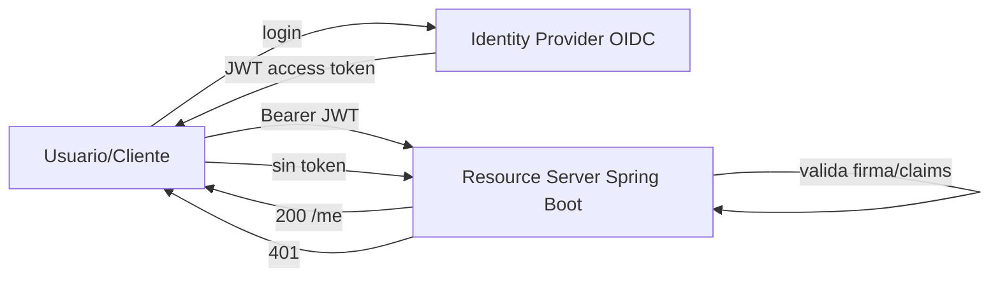

## CAPÍTULO M09-L04: OAuth2/OIDC con Resource Server

### 1. Ubicación
- **Curso:** C2 — Spring Boot Microservicios desde Cero
- **Módulo:** M09 — Seguridad
- **Lección:** L04 — OAuth2/OIDC
- **Tiempo estimado:** 60 min
- **Versiones:** Java 21, Spring Boot 3.4.5, Spring Security OAuth2 Resource Server

### 2. Prerrequisitos
- M09-L03: JWT, firma, claims, expiración.
- Conceptos HTTP: Authorization header Bearer.
- Spring Boot testing con MockMvc.

### 3. Objetivo de aprendizaje
Al terminar podrás **configurar un Resource Server OAuth2/OIDC en Spring Boot** que rechace requests anónimas y acepte JWT válidos, validándolo con tests MockMvc.

### 4. Problema real / por qué importa
En microservicios, no quieres que cada servicio maneje usuarios y contraseñas. OAuth2/OIDC separa responsabilidades: un Identity Provider (IdP) autentica y emite tokens; tus APIs los validan. Si no entiendes este rol, implementas autenticación casera en cada servicio, duplicas lógica y multiplicas vulnerabilidades.

### 5. Analogía y modelo mental
Piensa en un aeropuerto: el **IdP** es migración, que verifica pasaporte y emite pase; el **Resource Server** es la puerta de embarque, que no emite pasaportes pero sí valida que el pase sea legítimo y corresponda al vuelo.

**Dónde se rompe la analogía:** los tokens tienen expiración, scopes, audience, issuer y rotación de claves; la puerta de embarque debe validar todo eso, no solo “tiene pase”.

### 6. Diagrama técnico

**Texto alternativo:** El cliente obtiene un JWT del IdP. Luego llama al Resource Server con Bearer token. El Resource Server valida el token y responde 200, o 401 si falta/invalid.

### 7. Conceptos fundamentales

#### Qué es
- **OAuth2:** framework de autorización (delegación de acceso).
- **OIDC:** capa de identidad sobre OAuth2 (quién es el usuario).
- **Resource Server:** API que protege recursos y valida access tokens.

#### Cómo funciona por dentro
`spring-boot-starter-oauth2-resource-server` configura filtros que extraen el Bearer token, lo decodifican/verifican vía `JwtDecoder`, construyen un `Authentication` y lo ponen en el `SecurityContext`.

#### Cuándo usar
- APIs consumidas por SPA, móviles, otros servicios, o sistemas con IdP central.
- Cuando necesitas SSO, tokens estandarizados, scopes/audiences.

#### Cuándo NO usar
- No uses OAuth2 completo para un script interno simple donde Basic/Auth simple baste.
- No aceptes JWT sin validar issuer, audience y expiración.
- No uses access token como prueba de identidad sin OIDC/id_token cuando el caso lo requiere.

### 8. Construcción desde cero

Lab: `docs/cursos/springboot-microservicios-desde-cero/labs/m09-l04-oauth2-oidc`

#### Paso 1: Dependencias
`pom.xml`: `spring-boot-starter-web`, `spring-boot-starter-oauth2-resource-server`, `spring-boot-starter-test`, `spring-security-test`.

#### Paso 2: Configurar Resource Server
`src/main/java/com/academia/oidc/OidcApp.java`:

```java
@Bean SecurityFilterChain chain(HttpSecurity http) throws Exception {
  http.authorizeHttpRequests(a -> a.anyRequest().authenticated()).oauth2ResourceServer(o -> o.jwt(withDefaults()));
  return http.build();
}
@GetMapping("/me") String me(org.springframework.security.core.Authentication a){ return a.getName(); }
```

#### Paso 3: Probar con JWT mock
`src/test/java/com/academia/oidc/OidcAppTest.java` usa `@MockBean JwtDecoder` para no depender de un IdP externo en unit test. En tests reales/integración, apuntarías a issuer/JWK set.

```java
@Test void rejectsAnonymous() throws Exception { mvc.perform(get("/me")).andExpect(status().isUnauthorized()); }
@Test void acceptsJwt() throws Exception { mvc.perform(get("/me").with(jwt().jwt(j -> j.subject("alice")))).andExpect(status().isOk()).andExpect(content().string("alice")); }
```

#### Paso 4: Ejecutar
```bash
cd docs/cursos/springboot-microservicios-desde-cero/labs/m09-l04-oauth2-oidc
./verify.sh
```
Salida real observada:
```text
RESULTADO: OK
```

### 9. Código de referencia completo
- `pom.xml`
- `src/main/java/com/academia/oidc/OidcApp.java`
- `src/test/java/com/academia/oidc/OidcAppTest.java`
- `verify.sh`

### 10. Explicación línea por línea / por bloque

| Código/bloque | Intención | Efecto | Si se omite/cambia |
|---|---|---|---|
| `oauth2ResourceServer(o -> o.jwt(withDefaults()))` | Activa validación JWT Bearer | Requests usan `Authorization: Bearer <token>` | Sin esto, no se procesa JWT estándar |
| `anyRequest().authenticated()` | Toda API protegida | Anónimo recibe 401 | Abrirías endpoints accidentalmente |
| `Authentication a` en `/me` | Acceder a identidad validada | Devuelve subject `alice` | Sin Authentication, no sabes quién llamó |
| `@MockBean JwtDecoder` | Aislar test de IdP | Test rápido y determinista | Sin mock, Boot buscaría configuración JWT real |
| `jwt().jwt(j -> j.subject("alice"))` | Crea JWT de prueba | Simula token válido | Permite probar autorización sin IdP levantado |

### 11. Laboratorio reproducible
```bash
./verify.sh
```

### 12. Verificación automática
Valida 401 anónimo y 200 con JWT cuyo `sub` es `alice`. Pass/fail por JUnit.

### 13. Modificación guiada
- **Cambio:** quita la configuración `.oauth2ResourceServer(o -> o.jwt(withDefaults()))`.
- **Hipótesis:** el test con JWT puede fallar (401/403) porque el Bearer JWT ya no se interpreta.
- **Comando:** `mvn -q -Dtest=OidcAppTest#acceptsJwt test`.
- **Resultado esperado:** fallo. Revierte.

### 14. Error común y diagnóstico
- **Síntoma:** `401` aunque envías token.
- **Causa:** Resource Server no configurado, issuer/JWK inválido, audience/exp inválidos, o header mal formado.
- **Diagnóstico:** habilita logs de seguridad, verifica `Authorization: Bearer <token>`, valida claims.
- **Fix:** configurar `spring.security.oauth2.resourceserver.jwt.*` o mock adecuado en tests.

### 15. Cierre

#### Anti-patrón
Validar JWT solo por “tiene 3 partes y no explotó el parser”. Debes validar firma, `iss`, `aud`, `exp`, `nbf` y scopes/roles según el caso.

#### Pregunta de entrevista
- **Pregunta:** ¿Qué diferencia hay entre OAuth2 y OIDC?
- **Respuesta modelo:** OAuth2 es un framework de autorización/delegación de acceso; OIDC agrega una capa de identidad sobre OAuth2 para que el cliente pueda saber quién es el usuario autenticado.

#### Resumen
- IdP emite; Resource Server valida.
- JWT Bearer se valida con `oauth2ResourceServer().jwt()`.
- Tests pueden mockear `JwtDecoder`, pero integración real debe validar contra issuer/JWKS.

#### Puente
M09-L05 levanta Keycloak como IdP real para emitir tokens y configurar realms/clients.
