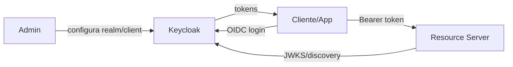

## CAPÍTULO M09-L05: Keycloak como Identity Provider

### 1. Ubicación
- **Curso:** C2 — Spring Boot Microservicios desde Cero
- **Módulo:** M09 — Seguridad
- **Lección:** L05 — Keycloak
- **Tiempo estimado:** 60 min
- **Versiones:** Keycloak 26.0 (imagen `quay.io/keycloak/keycloak:26.0`), Docker Compose

### 2. Prerrequisitos
- M09-L04: OAuth2/OIDC, roles de IdP y Resource Server.
- Docker y Docker Compose funcionando.
- Conocer puertos, variables de entorno y endpoints HTTP.

### 3. Objetivo de aprendizaje
Al terminar podrás **levantar Keycloak con Docker Compose**, verificar su endpoint OIDC de descubrimiento y **explicar qué responsabilidades delegas en un IdP**.

### 4. Problema real / por qué importa
Implementar login, emisión de tokens, MFA, recuperación de contraseña, federation y gestión de usuarios desde cero es costoso y riesgoso. Keycloak es un IdP que implementa OAuth2/OIDC/SAML y centraliza identidad. El problema real no es “levantar un contenedor”, sino entender qué contrato ofrece: realms, clients, usuarios, roles y endpoints de descubrimiento.

### 5. Analogía y modelo mental
Keycloak es como la oficina de pasaportes de tu plataforma: no es la tienda, ni el avión, ni el hotel; emite identidades confiables que otros sistemas validan.

**Dónde se rompe la analogía:** un IdP también maneja flujos, consentimientos, scopes, rotación de claves, sesiones y eventos de auditoría.

### 6. Diagrama técnico

**Texto alternativo:** El administrador configura Keycloak. Las apps obtienen tokens por OIDC. Las APIs validan tokens consultando metadata/JWKS del IdP.

### 7. Conceptos fundamentales

#### Qué es
**Keycloak** es un Identity and Access Management (IAM) open source. Soporta OAuth2, OIDC, SAML, usuarios, roles, grupos, federation y social login.

#### Cómo funciona
- **Realm:** dominio aislado de usuarios/clients/config.
- **Client:** aplicación que pide tokens.
- **User/Role:** identidad y permisos.
- **Discovery endpoint:** `/.well-known/openid-configuration` expone metadata OIDC.

#### Cuándo usar
- Necesitas SSO, múltiples apps, administración de usuarios, estándares OIDC.
- Quieres delegar identidad a un producto maduro.

#### Cuándo NO usar
- No lo uses como “caja negra” sin entender tokens/claims/expiración.
- No expongas Keycloak dev mode en producción.
- No uses credenciales admin por defecto fuera de lab.

### 8. Construcción desde cero

Lab: `docs/cursos/springboot-microservicios-desde-cero/labs/m09-l05-keycloak`

#### Paso 1: Docker Compose
`docker-compose.yml`:

```yaml
services:
  keycloak:
    image: quay.io/keycloak/keycloak:26.0
    command: start-dev --http-port=8080
    environment:
      KEYCLOAK_ADMIN: admin
      KEYCLOAK_ADMIN_PASSWORD: admin
    ports: ["8089:8080"]
```

#### Paso 2: Levantar y esperar discovery
`verify.sh` levanta el servicio, espera el endpoint OIDC y hace cleanup:

```bash
docker compose up -d
for i in $(seq 1 90); do
  if curl -sf http://localhost:8089/realms/master/.well-known/openid-configuration >/dev/null; then
    echo "RESULTADO: OK"; exit 0
  fi
  sleep 3
done
```

#### Paso 3: Ejecutar
```bash
cd docs/cursos/springboot-microservicios-desde-cero/labs/m09-l05-keycloak
./verify.sh
```

Salida real observada:
```text
 Container m09-l05-keycloak-keycloak-1 Started 
RESULTADO: OK
```

### 9. Código de referencia completo
- `docker-compose.yml`
- `verify.sh`
- `README.md`

### 10. Explicación línea por bloque

| Bloque | Intención | Efecto | Si se omite/cambia |
|---|---|---|---|
| `start-dev --http-port=8080` | Modo desarrollo | Arranque simple para lab | En prod se usa configuración hardened |
| `KEYCLOAK_ADMIN/PASSWORD` | Bootstrap admin | Puedes entrar a consola | Credenciales débiles en prod = incidente |
| `8089:8080` | Evitar conflicto local | Keycloak accesible en host 8089 | Puerto ocupado rompe lab |
| `/.well-known/openid-configuration` | Discovery OIDC | Confirma que OIDC está vivo | Sin esto solo sabes que “el contenedor arrancó” |
| `trap cleanup EXIT` | Limpieza | Evita contenedores huérfanos | Deja recursos corriendo |

### 11. Laboratorio reproducible
```bash
./verify.sh
```
Requiere Docker. El script hace `docker compose down -v` al salir.

### 12. Verificación automática
**Valida:** el contenedor arranca y responde discovery OIDC del realm `master`.  
**Pass/fail:** obtiene 200 en discovery antes de 90 intentos; si no, imprime logs y sale 1.

### 13. Modificación guiada
- **Cambio:** cambia el puerto host a `8090:8080` pero deja el curl a `8089`.
- **Hipótesis:** verify fallará por timeout/curl.
- **Comando:** `./verify.sh`.
- **Resultado esperado:** falla al no alcanzar discovery. Revierte puerto/curl.

### 14. Error común y diagnóstico
- **Síntoma:** verify falla tras 90 intentos.
- **Causa:** Docker sin recursos, imagen no descargada, puerto ocupado, Keycloak aún arrancando.
- **Diagnóstico:** `docker compose logs --tail=40`.
- **Fix:** liberar puerto, esperar más, revisar Docker.

### 15. Cierre

#### Anti-patrón
Usar `start-dev` y credenciales admin/admin como si fuera configuración de producción.

#### Pregunta de entrevista
- **Pregunta:** ¿Qué es el endpoint OIDC discovery y para qué sirve?
- **Respuesta modelo:** Es `/.well-known/openid-configuration`; publica metadata del proveedor OIDC (issuer, authorization endpoint, token endpoint, JWKS URI, etc.), permitiendo que clientes y resource servers se configuren dinámicamente.

#### Resumen
- Keycloak centraliza identidad.
- Discovery OIDC es la prueba mínima de vida del IdP.
- Dev mode es para lab, no prod.

#### Puente
M09-L06 usa tokens/claims para autorización fina: RBAC y scopes.
