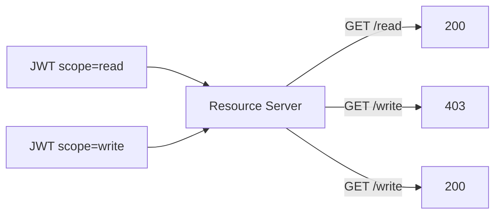

## CAPÍTULO M09-L06: RBAC y Scopes

### 1. Ubicación
- **Curso:** C2 — Spring Boot Microservicios desde Cero
- **Módulo:** M09 — Seguridad
- **Lección:** L06 — RBAC y Scopes
- **Tiempo estimado:** 55 min
- **Versiones:** Java 21, Spring Boot 3.4.5, OAuth2 Resource Server

### 2. Prerrequisitos
- M09-L02: autenticación vs autorización.
- M09-L04: Resource Server JWT.
- Entender claims de token.

### 3. Objetivo de aprendizaje
Al terminar podrás **proteger endpoints por scopes OAuth2** (`SCOPE_read`, `SCOPE_write`) y verificar con MockMvc que un token con scope `read` no puede escribir.

### 4. Problema real / por qué importa
No todo acceso autenticado es igual. Un cliente puede tener permiso para leer pero no para modificar. Si autorizas solo por “está autenticado”, cualquier token válido puede ejecutar operaciones destructivas. Los scopes permiten delegación de permisos acotados.

### 5. Analogía y modelo mental
Un pase de visita puede permitir “entrar al lobby” (read) pero no “abrir sala de servidores” (write). Es el mismo visitante autenticado, distinto permiso.

**Dónde se rompe la analogía:** en OAuth2 los scopes los otorga el flujo de autorización y pueden combinarse, expirar o ser delegados entre servicios.

### 6. Diagrama técnico

**Texto alternativo:** Un token con scope read accede a /read pero recibe 403 en /write. Un token con scope write accede a /write.

### 7. Conceptos fundamentales

#### Qué es
- **RBAC:** control de acceso basado en roles.
- **Scopes:** permisos delegados en OAuth2, típicamente por cliente/aplicación/consentimiento.

#### Cómo funciona
Spring Security convierte scopes JWT en authorities `SCOPE_<name>`. La regla `hasAuthority("SCOPE_read")` evalúa esa authority.

#### Cuándo usar
- Scopes para permisos de API delegados por OAuth2.
- Roles para funciones organizacionales internas.

#### Cuándo NO usar
- No mezcles scopes y roles sin convención clara.
- No des por defecto scopes amplios (`admin`, `*`).

### 8. Construcción desde cero

Lab: `docs/cursos/springboot-microservicios-desde-cero/labs/m09-l06-rbac-y-scopes`

#### Código clave
```java
@Bean SecurityFilterChain chain(HttpSecurity http) throws Exception {
  http.authorizeHttpRequests(a -> a.requestMatchers("/read").hasAuthority("SCOPE_read")
      .requestMatchers("/write").hasAuthority("SCOPE_write")
      .anyRequest().authenticated())
      .oauth2ResourceServer(o -> o.jwt(withDefaults()));
  return http.build();
}
```

#### Tests
```java
@Test void readScopeAllowsRead() throws Exception { mvc.perform(get("/read").with(jwt().jwt(j->j.claim("scope","read")))).andExpect(status().isOk()); }
@Test void readScopeDeniesWrite() throws Exception { mvc.perform(get("/write").with(jwt().jwt(j->j.claim("scope","read")))).andExpect(status().isForbidden()); }
```

#### Ejecución real
```bash
./verify.sh
```
```text
RESULTADO: OK
```

### 9. Código de referencia completo
- `pom.xml`
- `src/main/java/com/academia/rbac/RbacApp.java`
- `src/test/java/com/academia/rbac/RbacAppTest.java`
- `verify.sh`

### 10. Explicación línea por bloque

| Bloque | Intención | Efecto | Si se omite/cambia |
|---|---|---|---|
| `hasAuthority("SCOPE_read")` | Requiere scope read | Protege lectura por permiso | Si usas `authenticated()`, cualquiera entra |
| `hasAuthority("SCOPE_write")` | Requiere scope write | Separa escritura | Token read podría escribir |
| `claim("scope","read")` | Simula token con scope | Prueba caso real | Sin claim, falla autorización |
| `isForbidden()` | Espera 403 | Confirma falta de permiso | 401 indicaría problema distinto |

### 11. Laboratorio reproducible
`./verify.sh` ejecuta Maven tests con MockMvc y JwtDecoder mockeado.

### 12. Verificación automática
Valida permiso positivo (read) y negativo (read no puede write). Pass/fail por JUnit.

### 13. Modificación guiada
- **Cambio:** da a `/write` `hasAuthority("SCOPE_read")`.
- **Hipótesis:** `readScopeDeniesWrite` fallará porque ahora read podrá escribir.
- **Comando:** `mvn -q -Dtest=RbacAppTest#readScopeDeniesWrite test`.
- **Resultado esperado:** status 200 en vez de 403. Revierte.

### 14. Error común y diagnóstico
- **Síntoma:** 403 con token aparentemente válido.
- **Causa:** claim `scope` vs `scp`, prefijo `SCOPE_`, o authority mapping.
- **Diagnóstico:** inspeccionar authorities en `Authentication`.
- **Fix:** alinear claim y convención de mapping.

### 15. Cierre

#### Anti-patrón
Dar scope `write` o `admin` a todos los clientes por comodidad. Viola mínimo privilegio.

#### Pregunta de entrevista
- **Pregunta:** ¿Diferencia entre role y scope?
- **Respuesta modelo:** Un rol suele representar función del usuario dentro del sistema; un scope representa permiso delegado en OAuth2 para una aplicación/cliente sobre un recurso. En Spring Security, scopes suelen mapearse a authorities `SCOPE_*`.

#### Resumen
- Scopes permiten mínimo privilegio.
- Spring mapea scopes a `SCOPE_*`.
- Prueba casos permitidos y denegados.

#### Puente
M09-L07 aborda Token Exchange (RFC 8693) para delegación entre servicios.
