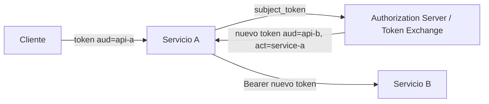

## CAPÍTULO M09-L07: Token Exchange (RFC 8693)

### 1. Ubicación
- **Curso:** C2 — Spring Boot Microservicios desde Cero
- **Módulo:** M09 — Seguridad
- **Lección:** L07 — Token Exchange RFC 8693
- **Tiempo estimado:** 55 min
- **Versiones:** Java 21, Nimbus JOSE+JWT 9.47

### 2. Prerrequisitos
- M09-L03 JWT, M09-L04 OAuth2/OIDC.
- Entender audience, subject y delegación.

### 3. Objetivo de aprendizaje
Al terminar podrás **explicar y simular un token exchange RFC 8693**, validando un subject token y emitiendo un token downstream con nueva audience y claim `act`.

### 4. Problema real / por qué importa
En microservicios, el servicio A recibe un token válido para A, pero necesita llamar a B. Reenviar el mismo token puede ser demasiado amplio o incorrecto en audience. Token Exchange permite obtener un token adecuado para el servicio downstream, preservando identidad y contexto de delegación.

### 5. Analogía y modelo mental
Es como un pase de backstage que se canjea por un pase de sala técnica: la identidad base es la misma, pero el permiso y el destino cambian.

**Dónde se rompe la analogía:** en RFC 8693 intervienen claims formales (`act`, `sub`, `aud`, `iss`), políticas del authorization server y validaciones estrictas.

### 6. Diagrama técnico

**Texto alternativo:** Servicio A recibe token para api-a, lo intercambia en el AS por un token para api-b con claim actor, y llama a B.

### 7. Conceptos fundamentales

#### Qué es
**RFC 8693 Token Exchange** define cómo solicitar y emitir tokens basados en un subject token/actor token para delegación o impersonación controlada.

#### Cómo funciona
1. Validar subject token (firma, exp, aud, iss).
2. Aplicar política de intercambio.
3. Emitir nuevo token con audience/claims adecuados.
4. Incluir `act` cuando hay actuación en nombre de otro sujeto.

#### Cuándo usar
- Llamadas service-to-service con delegación.
- Reducir alcance de tokens downstream.

#### Cuándo NO usar
- No intercambies tokens si el simple forward con audience correcta basta y está permitido.
- No uses impersonación sin auditoría y políticas estrictas.

### 8. Construcción desde cero

Lab: `docs/cursos/springboot-microservicios-desde-cero/labs/m09-l07-token-exchange-rfc-8693`

#### Código clave
```java
SignedJWT subject = new SignedJWT(new JWSHeader(JWSAlgorithm.HS256),
  new JWTClaimsSet.Builder().subject("user1").audience("api-a").expirationTime(new Date(System.currentTimeMillis()+60000)).build());
subject.sign(signer);
// validate subject token, mint new token with new audience and actor
SignedJWT parsed = SignedJWT.parse(subject.serialize());
assertTrue(parsed.verify(new MACVerifier(secret)));
SignedJWT exchanged = new SignedJWT(new JWSHeader(JWSAlgorithm.HS256),
  new JWTClaimsSet.Builder().subject(parsed.getJWTClaimsSet().getSubject())
    .audience("api-b").claim("act", java.util.Map.of("sub","service-a"))
    .issueTime(new Date()).expirationTime(new Date(System.currentTimeMillis()+30000)).build());
```

#### Ejecución real
```bash
./verify.sh
```
```text
RESULTADO: OK
```

### 9. Código de referencia completo
- `pom.xml`
- `src/test/java/com/academia/token/TokenExchangeTest.java`
- `verify.sh`

### 10. Explicación línea por bloque

| Bloque | Intención | Efecto | Si se omite/cambia |
|---|---|---|---|
| `audience("api-a")` | Token original limitado | Representa token para servicio A | Sin audience, se pierde control de destino |
| `verify(new MACVerifier(secret))` | Validar antes de canjear | Evita canjear token falso | Aceptarías tokens inválidos |
| `audience("api-b")` | Nuevo destino | Token útil solo para B | Token sobreamplio/rechazado |
| `claim("act", {sub:service-a})` | Actor de delegación | Trazabilidad de quién actuó | Pierdes auditoría de delegación |
| nueva `expirationTime` corta | Limitar ventana | Menor riesgo si se filtra | Token largo aumenta riesgo |

### 11. Laboratorio reproducible
`./verify.sh` ejecuta el test JUnit que simula validación y emisión.

### 12. Verificación automática
Valida firma del subject token, subject preservado, nueva audience `api-b` y presencia de `act`.

### 13. Modificación guiada
- **Cambio:** elimina el claim `act` del token intercambiado.
- **Hipótesis:** `assertNotNull(out.getJWTClaimsSet().getClaim("act"))` fallará.
- **Comando:** `mvn -q -Dtest=TokenExchangeTest test`.
- **Resultado esperado:** fallo por claim `act` ausente. Revierte.

### 14. Error común y diagnóstico
- **Síntoma:** servicio B rechaza token intercambiado.
- **Causa:** audience incorrecta, firma inválida, exp vencido, issuer no confiable.
- **Diagnóstico:** inspeccionar claims y logs del resource server.
- **Fix:** emitir token con `aud` correcto y claims requeridos.

### 15. Cierre

#### Anti-patrón
Reenviar el token original a todos los downstream sin evaluar audience y privilegios. Facilita movimiento lateral.

#### Pregunta de entrevista
- **Pregunta:** ¿Para qué sirve el claim `act` en token exchange?
- **Respuesta modelo:** Indica el actor que está actuando en nombre del subject, permitiendo trazabilidad y decisiones de autorización en escenarios de delegación.

#### Resumen
- Token exchange adapta tokens a otro destino/contexto.
- Valida antes de emitir.
- `act` aporta auditoría de delegación.

#### Puente
M09-L08 baja al transporte: mTLS con service mesh para identidad servicio-a-servicio.
