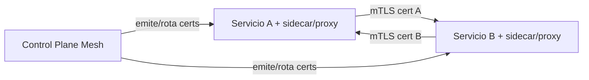

## CAPÍTULO M09-L08: mTLS con Service Mesh

### 1. Ubicación
- **Curso:** C2 — Spring Boot Microservicios desde Cero
- **Módulo:** M09 — Seguridad
- **Lección:** L08 — mTLS con Service Mesh
- **Tiempo estimado:** 50 min
- **Versiones:** Istio PeerAuthentication v1beta1 (manifiesto), concepto aplicable a Istio/Linkerd

### 2. Prerrequisitos
- M09-L03: criptografía asimétrica/certificados a nivel conceptual.
- Conceptos Kubernetes básicos: namespace, manifiesto YAML.
- Entender HTTP y comunicación service-to-service.

### 3. Objetivo de aprendizaje
Al terminar podrás **explicar mTLS entre servicios**, **leer un manifiesto `PeerAuthentication` STRICT de Istio** y **decidir cuándo NO usar un service mesh**.

### 4. Problema real / por qué importa
Dentro de un cluster, el tráfico entre servicios suele viajar por red interna. Si asumes “la red interna es confiable”, un atacante con acceso a la red puede espiar o suplantar servicios. mTLS (mutual TLS) cifra el transporte y autentica ambas partes: cliente y servidor presentan certificados.

El problema es que gestionar certificados manualmente para decenas de servicios es operativo y propenso a errores. Un service mesh automatiza identidad de workloads y rotación.

### 5. Analogía y modelo mental
TLS normal es como mostrar tu DNI al banco: tú verificas al banco. mTLS es cuando ambos se piden DNI: el banco verifica al cliente y el cliente verifica al banco.

**Dónde se rompe la analogía:** en service mesh, los “DNI” son certificados X.509 de corta vida emitidos para identidades de workload (SPIFFE/SVID), rotados automáticamente por el control plane.

### 6. Diagrama técnico

**Texto alternativo:** Dos servicios con sidecar proxy establecen mTLS. Cada uno presenta su certificado. El control plane del mesh emite y rota certificados.

### 7. Conceptos fundamentales

#### Qué es
- **mTLS:** TLS mutuo; autenticación bidireccional en capa de transporte.
- **Service mesh:** capa de infraestructura (Istio, Linkerd) que gestiona tráfico, observabilidad y seguridad entre servicios, usualmente con sidecars.

#### Cómo funciona
El control plane emite identidades/certificados a los proxies. El proxy intercepta tráfico saliente/entrante y negocia mTLS transparente a la aplicación.

#### Cuándo usar
- Muchos servicios, requisitos de zero-trust interno, cumplimiento, rotación automática.
- Cuando necesitas políticas consistentes de tráfico/seguridad.

#### Cuándo NO usar service mesh
- Pocos servicios: la complejidad operativa no se justifica.
- Equipo sin capacidad de operar mesh, depurar sidecars y actualizaciones.
- Latencia/recursos muy ajustados sin medir overhead.

### 8. Construcción desde cero

Lab: `docs/cursos/springboot-microservicios-desde-cero/labs/m09-l08-mtls-con-service-mesh`

#### Paso 1: Manifiesto PeerAuthentication
`peer-authentication.yaml`:

```yaml
apiVersion: security.istio.io/v1beta1
kind: PeerAuthentication
metadata:
  name: default
  namespace: demo
spec:
  mtls:
    mode: STRICT
```

**Qué significa:** en el namespace `demo`, el modo STRICT exige mTLS para tráfico entrante a workloads. Conexiones plaintext serán rechazadas.

#### Paso 2: Verificación
`verify.sh` valida que el manifiesto y documentación contengan los conceptos clave:

```bash
grep -q "mTLS" README.md
grep -q "Cuándo NO usar service mesh" README.md
grep -q "STRICT" peer-authentication.yaml
echo "RESULTADO: OK"
```

#### Ejecución real
```bash
./verify.sh
```
```text
RESULTADO: OK
```

### 9. Código de referencia completo
- `peer-authentication.yaml`
- `README.md`
- `verify.sh`

### 10. Explicación línea por bloque

| Bloque | Intención | Efecto | Si se omite/cambia |
|---|---|---|---|
| `kind: PeerAuthentication` | Política de mTLS Istio | Define cómo aceptar tráfico peer | Otro recurso no aplica esta política |
| `namespace: demo` | Alcance | Afecta namespace demo | Namespace equivocado = política no aplica |
| `mode: STRICT` | Exigir mTLS | Rechaza plaintext | `PERMISSIVE` permite ambos; útil en migración, no como estado final deseado |

### 11. Laboratorio reproducible
Este lab es conceptual-operativo: no requiere cluster Istio para la verificación mínima. En entorno real aplicarías `kubectl apply -f peer-authentication.yaml` sobre un cluster con Istio.

### 12. Verificación automática
Valida presencia de conceptos y modo STRICT. Pass/fail por grep + `set -e`.

### 13. Modificación guiada
- **Cambio:** cambia `STRICT` a `PERMISSIVE`.
- **Hipótesis:** `verify.sh` fallará porque busca `STRICT`.
- **Comando:** `./verify.sh`.
- **Resultado esperado:** salida no OK / exit 1. Revierte.

### 14. Error común y diagnóstico
- **Síntoma:** servicios dejan de comunicarse tras activar STRICT.
- **Causa:** algún workload no tiene sidecar/certificado o hay tráfico legacy plaintext.
- **Diagnóstico:** revisar sidecar injection, logs del proxy, métricas mTLS.
- **Fix:** migrar con PERMISSIVE, asegurar sidecars, luego pasar a STRICT.

### 15. Cierre

#### Anti-patrón
Activar service mesh “porque es moderno” sin capacidad operativa. El mesh agrega control pero también complejidad.

#### Pregunta de entrevista
- **Pregunta:** ¿Qué diferencia hay entre TLS y mTLS?
- **Respuesta modelo:** TLS autentica normalmente al servidor ante el cliente; mTLS autentica a ambos lados. En microservicios, mTLS da identidad de workload en ambos extremos del canal.

#### Resumen
- mTLS = cifrado + autenticación mutua.
- Service mesh automatiza certificados/políticas.
- STRICT exige mTLS; usar con plan de migración.

#### Puente
M09-L09 mueve el foco a secretos: HashiCorp Vault para evitar credenciales hardcodeadas.
