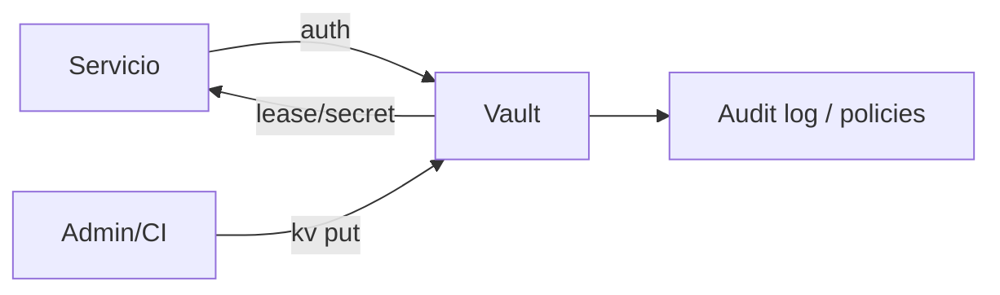

## CAPÍTULO M09-L09: HashiCorp Vault - secretos desde cero

### 1. Ubicación
- **Curso:** C2 — Spring Boot Microservicios desde Cero
- **Módulo:** M09 — Seguridad
- **Lección:** L09 — HashiCorp Vault
- **Tiempo estimado:** 55 min
- **Versiones:** HashiCorp Vault 1.17 (dev mode), Docker Compose

### 2. Prerrequisitos
- Docker Compose.
- Conceptos de secretos, variables de entorno, riesgo de hardcodear credenciales.
- M09-L01/L02 para contexto de seguridad.

### 3. Objetivo de aprendizaje
Al terminar podrás **levantar Vault en modo dev, escribir y leer un secreto KV**, y explicar por qué un vault central reduce exposición de credenciales frente a secretos en código o env files sin control.

### 4. Problema real / por qué importa
Las credenciales en código, repositorios o archivos `.env` copiados sin control se filtran. Un vault centraliza almacenamiento, acceso, auditoría y rotación de secretos. El problema real no es “guardar un string”, sino controlar quién accede, cuándo, y poder rotarlo.

### 5. Analogía y modelo mental
Vault es una caja fuerte con bitácora: no solo guarda, también registra quién abrió, qué sacó y permite cambiar combinaciones.

**Dónde se rompe la analogía:** Vault además puede emitir credenciales dinámicas, cifrar como servicio, y manejar leases/TTL.

### 6. Diagrama técnico

**Texto alternativo:** Aplicaciones se autentican ante Vault y obtienen secretos según políticas. Administradores escriben secretos; Vault audita accesos.

### 7. Conceptos fundamentales

#### Qué es
**HashiCorp Vault** es un sistema de gestión de secretos y cifrado: KV, credenciales dinámicas, PKI, transit encryption, políticas, auditoría.

#### Cómo funciona
El cliente se autentica, Vault evalúa policies, y entrega el secreto o token/lease. En KV v2, los secretos se versionan.

#### Cuándo usar
- Secretos compartidos por múltiples servicios/entornos.
- Necesidad de auditoría, rotación, acceso programático.

#### Cuándo NO usar
- No uses dev mode en producción (`VAULT_DEV_ROOT_TOKEN_ID`, in-memory).
- No metas Vault sin plan de unseal/HA/backup.
- No hardcodees el root token en apps.

### 8. Construcción desde cero

Lab: `docs/cursos/springboot-microservicios-desde-cero/labs/m09-l09-hashicorp-vault`

#### Paso 1: Docker Compose
```yaml
services:
  vault:
    image: hashicorp/vault:1.17
    cap_add: ["IPC_LOCK"]
    environment:
      VAULT_DEV_ROOT_TOKEN_ID: root
      VAULT_DEV_LISTEN_ADDRESS: 0.0.0.0:8200
    ports: ["8200:8200"]
```

#### Paso 2: Escribir y leer secreto
`verify.sh` ejecuta:

```bash
docker compose up -d --wait
export VAULT_ADDR=http://localhost:8200 VAULT_TOKEN=root
docker compose exec -T -e VAULT_ADDR=http://127.0.0.1:8200 -e VAULT_TOKEN=root vault vault kv put secret/demo password=s3cret >/dev/null
val=$(docker compose exec -T -e VAULT_ADDR=http://127.0.0.1:8200 -e VAULT_TOKEN=root vault vault kv get -field=password secret/demo)
test "$val" = "s3cret"
echo "RESULTADO: OK"
```

#### Ejecución real
```bash
./verify.sh
```
```text
 Container m09-l09-hashicorp-vault-vault-1 Healthy 
RESULTADO: OK
```

### 9. Código de referencia completo
- `docker-compose.yml`
- `verify.sh`
- `README.md`

### 10. Explicación línea por bloque

| Bloque | Intención | Efecto | Si se omite/cambia |
|---|---|---|---|
| `IPC_LOCK` | Evitar swap de memoria sensible | Mejora higiene de secretos | En algunos entornos puede fallar sin cap |
| `VAULT_DEV_ROOT_TOKEN_ID: root` | Token predecible en lab | Facilita verificación | En prod es inseguro |
| `vault kv put secret/demo password=s3cret` | Escribir secreto KV v2 | Guarda versión | Path/engine incorrecto falla |
| `kv get -field=password secret/demo` | Leer campo específico | Permite aserción exacta | Sin `-field` sale formato completo |
| `test "$val" = "s3cret"` | Verificación real | Confirma round-trip | Sin aserción, falso verde |

### 11. Laboratorio reproducible
```bash
./verify.sh
```
Requiere Docker. Cleanup automático con `trap`.

### 12. Verificación automática
Valida round-trip KV: escribe `password=s3cret` y lee el mismo valor. Pass/fail por `test`.

### 13. Modificación guiada
- **Cambio:** cambia el valor esperado a `otro`.
- **Hipótesis:** `test "$val" = "otro"` fallará.
- **Comando:** `./verify.sh`.
- **Resultado esperado:** exit 1. Revierte.

### 14. Error común y diagnóstico
- **Síntoma:** `permission denied` o `* permission denied`.
- **Causa:** token incorrecto, policy insuficiente, VAULT_ADDR mal.
- **Diagnóstico:** revisar `VAULT_TOKEN`, `VAULT_ADDR`, logs.
- **Fix:** usar token/policy correcta; en dev, root token del lab.

### 15. Cierre

#### Anti-patrón
Guardar secretos en git “pero en repo privado”. El repo, CI, backups y laptops se convierten en superficie de fuga.

#### Pregunta de entrevista
- **Pregunta:** ¿Por qué Vault es mejor que un `.env` en producción?
- **Respuesta modelo:** Vault centraliza secretos con autenticación, policies, auditoría, rotación y, en algunos motores, credenciales dinámicas. Un `.env` es un archivo estático difícil de auditar, rotar y controlar su distribución.

#### Resumen
- Vault almacena y controla secretos.
- Dev mode es solo para aprendizaje.
- Verifica con round-trip real, no solo “contenedor levantó”.

#### Puente
M09-L10 cierra seguridad con escaneo de vulnerabilidades: Trivy/Snyk.
