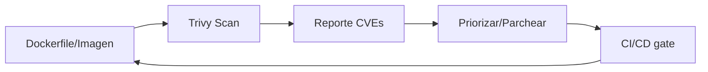

## CAPÍTULO M09-L10: Escaneo de vulnerabilidades con Trivy (y Snyk)

### 1. Ubicación
- **Curso:** C2 — Spring Boot Microservicios desde Cero
- **Módulo:** M09 — Seguridad
- **Lección:** L10 — Trivy/Snyk
- **Tiempo estimado:** 50 min
- **Versiones:** Trivy 0.57.1 (contenedor), Docker

### 2. Prerrequisitos
- Docker instalado.
- Saber qué es una imagen de contenedor y un CVE.
- M09 completo: seguridad no es solo auth, también supply chain.

### 3. Objetivo de aprendizaje
Al terminar podrás **ejecutar un escaneo Trivy sobre una imagen local**, interpretar la salida a alto nivel, y **explicar el rol de Snyk/escáneres** sin confundir “escaneo limpio” con “sistema seguro”.

### 4. Problema real / por qué importa
Tus dependencias e imágenes base traen vulnerabilidades conocidas (CVEs). Si no escaneas, despliegas riesgo conocido. Si solo escaneas y no remedia, solo tienes reportes. La seguridad de supply chain requiere detectar, priorizar, parchear y verificar.

### 5. Analogía y modelo mental
Un escáner de vulnerabilidades es como la revisión técnica del auto: detecta fallas conocidas, pero no maneja por ti ni reemplaza mantenimiento.

**Dónde se rompe la analogía:** el software cambia a diario; nuevas CVEs aparecen sobre imágenes que ayer “pasaban”.

### 6. Diagrama técnico

**Texto alternativo:** La imagen se escanea con Trivy, genera reporte de vulnerabilidades, se prioriza y parchea, y el gate se integra en CI/CD.

### 7. Conceptos fundamentales

#### Qué es
- **Trivy:** escáner open source de vulnerabilidades/misconfig/secrets/SBOM.
- **Snyk:** plataforma comercial con escaneo de dependencias, contenedores, IaC y fix guidance; requiere cuenta/token para uso completo.

#### Cómo funciona
Trivy analiza capas de imagen, paquetes OS y artefactos; compara con bases de vulnerabilidades. Reporta severidad, CVE, paquete afectado y versión fija cuando existe.

#### Cuándo usar
- En CI para cada build de imagen.
- Periódicamente sobre imágenes en ejecución/registro.

#### Cuándo NO usar solo escáner
- No reemplaza patching, SBOM, políticas de admisión, runtime security ni revisión.
- No ignores contexto: una CVE “CRITICAL” puede no ser explotable en tu uso; igual requiere triage.

### 8. Construcción desde cero

Lab: `docs/cursos/springboot-microservicios-desde-cero/labs/m09-l10-trivy-snyk`

#### Paso 1: Imagen de prueba
`Dockerfile`:

```dockerfile
FROM alpine:3.20
RUN echo "demo" > /app.txt
```

#### Paso 2: Ejecutar Trivy
`verify.sh`:

```bash
docker build -t academia-m09l10:local . >/dev/null
docker run --rm -v /var/run/docker.sock:/var/run/docker.sock aquasec/trivy:0.57.1 image --severity HIGH,CRITICAL --no-progress --format table academia-m09l10:local | tee /tmp/m09l10-trivy.txt >/dev/null
grep -q "Total" /tmp/m09l10-trivy.txt || grep -q "Vulnerability" /tmp/m09l10-trivy.txt || grep -q "academia-m09l10" /tmp/m09l10-trivy.txt
echo "RESULTADO: OK"
```

#### Ejecución real
```bash
./verify.sh
```
Salida real observada (resumen):
```text
2026-11-22T06:27:28Z	WARN	This OS version is no longer supported by the distribution	family="alpine" version="3.20.10"
2026-11-22T06:27:28Z	WARN	The vulnerability detection may be insufficient because security updates are not provided
RESULTADO: OK
```

Esta salida es valiosa: el escáner no solo “pasa”; advierte que la detección puede ser insuficiente por OS no soportado. Ese es el tipo de señal que hay que leer.

### 9. Código de referencia completo
- `Dockerfile`
- `verify.sh`
- `README.md`

### 10. Explicación línea por bloque

| Bloque | Intención | Efecto | Si se omite/cambia |
|---|---|---|---|
| `FROM alpine:3.20` | Imagen base | Define superficie de paquetes | Base vieja/EOL cambia CVEs y soporte |
| `docker build -t ...` | Imagen local reproducible | Trivy escanea algo concreto | Sin imagen, no hay target |
| `aquasec/trivy:0.57.1 image ...` | Escaneo de imagen | Genera reporte HIGH/CRITICAL | Sin severidad/filtro, salida puede ser ruidosa |
| `-v /var/run/docker.sock...` | Acceso al daemon Docker | Trivy lee imagen local | Sin socket, no ve la imagen local |
| `grep ...` | Smoke check | Confirma que hubo salida útil | Sin aserción, script podría dar falso verde |

### 11. Laboratorio reproducible
```bash
./verify.sh
```
Requiere Docker y acceso a internet para la imagen de Trivy si no está cacheada.

### 12. Verificación automática
Valida que Trivy se ejecuta y produce salida reconocible. No exige “0 vulnerabilidades” porque eso depende de la base de datos/tiempo; exige evidencia de escaneo.

### 13. Modificación guiada
- **Cambio:** cambia severidad a `--severity CRITICAL` y usa una imagen base vieja intencionalmente en otra rama de prueba.
- **Hipótesis:** el reporte puede cambiar en cantidad/detalle.
- **Comando:** `./verify.sh` tras ajustar.
- **Resultado observado esperado:** cambia el reporte; el criterio de pass del lab puede requerir ajuste. Revierte.

### 14. Error común y diagnóstico
- **Síntoma:** Trivy no encuentra la imagen o falla por Docker socket.
- **Causa:** no se montó `/var/run/docker.sock` o imagen no construida.
- **Diagnóstico:** revisar comando docker run y `docker images`.
- **Fix:** construir imagen local y montar socket.

Otro caso: tratar “RESULTADO: OK” como “sin CVEs”. Falso. El lab verifica ejecución del escaneo, no ausencia total de riesgo.

### 15. Cierre

#### Anti-patrón
Poner un escáner en CI, ignorar sus warnings y nunca parchear. Security theater.

#### Pregunta de entrevista
- **Pregunta:** ¿Qué hace Trivy y qué no hace?
- **Respuesta modelo:** Trivy detecta vulnerabilidades conocidas, misconfiguraciones o secretos según el target. No remedia automáticamente el riesgo en producción, no reemplaza patch management, ni entiende completamente el contexto de explotabilidad de tu aplicación.

#### Resumen
- Escanear es necesario, no suficiente.
- Leer warnings importa (EOL, DB insuficiente).
- Integrar a CI + remediación.

#### Puente
Cierra el módulo de seguridad. Siguiente módulo: resiliencia (Resilience4j, circuit breakers, retries).
