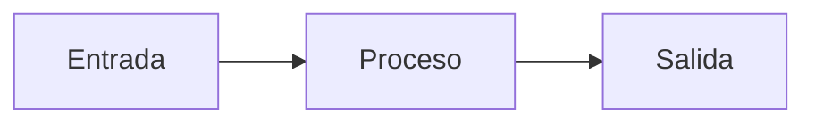
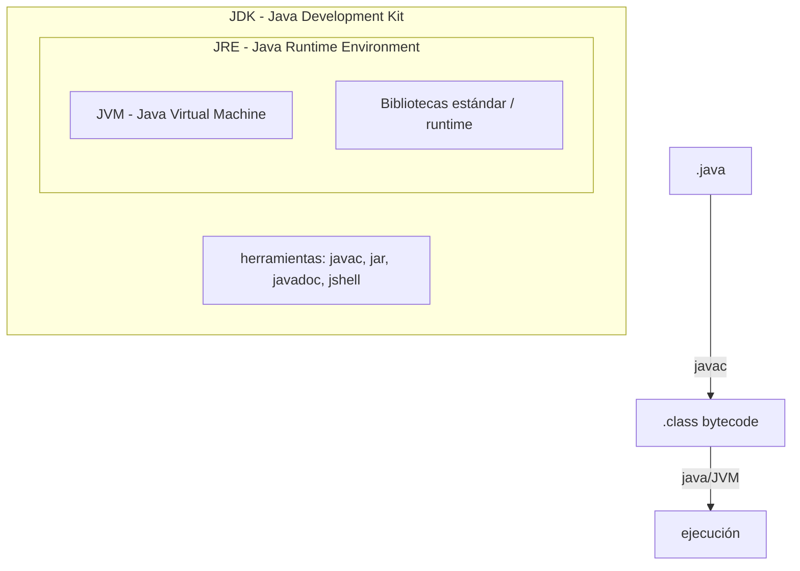
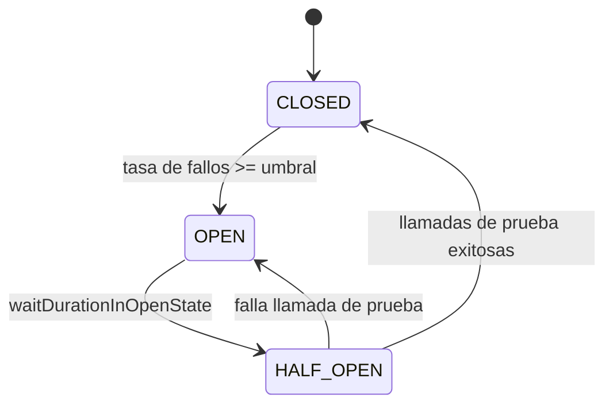
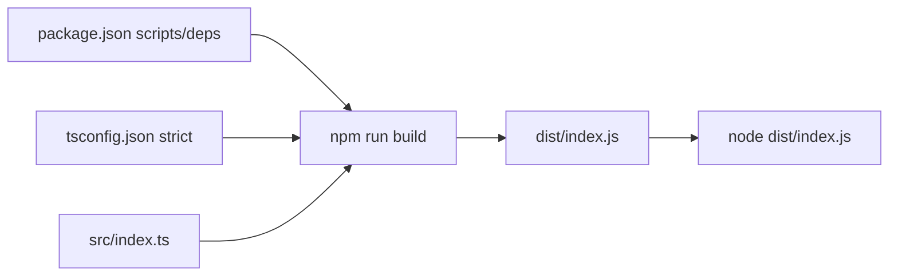

# Diseño instruccional — 3 cursos independientes

> **Estado:** paquete de diseño maestro. Incluye arquitectura completa, matriz por tema, plantillas obligatorias, guías transversales y fichas de muestra completas (15/15). **No reclama 100% de fichas completas producidas en este entregable**; el criterio de aceptación final exige completar la ficha de cada tema restante con el mismo estándar.

## 1. Equipo y alcance

| Rol | Responsabilidad en este diseño |
|---|---|
| Ingeniero de software senior (Java/Spring/Node/distribuidos) | Exactitud técnica, código de referencia ejecutable, trade-offs, labs reproducibles, verify.sh. |
| Diseñador instruccional (andragogía/visual) | Objetivos Bloom medibles, progresión, construcción guiada, fracaso controlado, evaluación. |
| Especialista accesibilidad y UX educativa | Navegación, carga cognitiva, alternativas textuales, subtítulos/transcripciones, contraste, ritmo. |
| Ilustrador técnico | Especificaciones de diagramas Mermaid/Excalidraw, infografías, animaciones y texto alternativo. |

## 2. Contexto del estudiante (no negociable)

- Ya sabe programar: variables, condicionales, bucles, funciones, clases. No se enseña programación desde cero absoluta, sí la sintaxis/idiomas del stack del curso.
- Construye cada tema desde cero, línea por línea, guiado por el curso. No recibe proyecto armado antes de entenderlo.
- El curso indica qué escribir, por qué, y entrega código de referencia después de la construcción.
- Ejecuta, observa, modifica y entiende. Sabe usar terminal, Git y editor.
- Cada concepto técnico se presenta primero con imagen/analogía, luego construcción guiada.

## 3. Regla de oro y cumplimiento de 15 puntos

Ningún tema se da por cubierto solo por aparecer en el temario. Cada tema requiere:

| # | Punto obligatorio | Evidencia mínima | Gate |
|---|---|---|---|
| 1 | Explicación conceptual | Qué es, para qué sirve, cuándo NO usarlo. | Revisión técnica + pedagógica. |
| 2 | Ejemplo visual | Diagrama/analogía/infografía con texto alternativo. | Existe asset/spec visual. |
| 3 | Construcción paso a paso desde cero | Ruta exacta, bloque, por qué, output esperado. | Estudiante puede reproducir sin código previo. |
| 4 | Código de referencia completo | Código final funcional, ejecutable. | Compila/ejecuta en entorno documentado. |
| 5 | Explicación línea por línea | Bloques/líneas relevantes explicadas. | Cubre decisiones y no solo sintaxis. |
| 6 | Laboratorio reproducible | Comandos exactos y output esperado. | Ejecución limpia en máquina/CI. |
| 7 | Verificación automática | `verify.sh` o test con exit code. | `./verify.sh` pasa/falla correctamente. |
| 8 | Modificación guiada | Parámetro a cambiar y comportamiento observado. | Experimento documentado. |
| 9 | Error común + diagnóstico visual | Síntoma, causa, diagnóstico, fix. | Incluye captura/diagrama/terminal esperado. |
| 10 | Ubicación | Curso, módulo, lección. | Metadato en ficha. |
| 11 | Prerrequisitos | Conocimientos previos concretos. | Verificables. |
| 12 | Objetivo Bloom medible | Verbo + resultado observable. | Evaluado por verificación/lab. |
| 13 | Pregunta de entrevista | Pregunta + respuesta modelo. | Revisión técnica. |
| 14 | Anti-patrón relacionado | Qué evitar y cómo se ve. | Ejemplo concreto. |
| 15 | Código/artefactos comparables | Antes/después o construcción+referencia según tipo. | Aplicable por regla adicional. |

> La ficha usa 15 campos nombrados por el usuario; internamente el punto 15 de calidad se cumple con código de referencia + antes/después cuando aplica.

## 4. Estructura obligatoria de ficha (plantilla)

```md
## FICHA DE TEMA: [nombre exacto]
### 1. UBICACIÓN
Curso X, Módulo Y, Lección Z.
### 2. PRERREQUISITOS
- ...
### 3. OBJETIVO DE APRENDIZAJE
[Verbo Bloom] + [resultado medible].
### 4. ANALOGÍA VISUAL
Descripción detallada de la imagen/escena + texto alternativo.
### 5. DIAGRAMA TÉCNICO
Mermaid/Excalidraw + texto alternativo.
### 6. EXPLICACIÓN CONCEPTUAL
Qué es / para qué sirve / cuándo NO usarlo.
### 7. CONSTRUCCIÓN PASO A PASO DESDE CERO
Para cada bloque: ruta, contenido, por qué, comando, output esperado.
### 8. CÓDIGO DE REFERENCIA COMPLETO
Código final ejecutable.
### 9. EXPLICACIÓN LÍNEA POR LÍNEA
Bloques y decisiones clave.
### 10. LABORATORIO PASO A PASO
Comandos exactos + output esperado.
### 11. VERIFICACIÓN AUTOMÁTICA
`verify.sh` o test; criterio pass/fail.
### 12. MODIFICACIÓN GUIADA
Cambio, hipótesis, resultado observado.
### 13. ERROR COMÚN
Síntoma, causa, diagnóstico visual, corrección.
### 14. PREGUNTA DE ENTREVISTA
Pregunta + respuesta modelo.
### 15. ANTI-PATRÓN RELACIONADO
Anti-patrón, cómo se ve, alternativa.
```

## 5. Convenciones de repositorios y laboratorios

```text
curso-<slug>/
  README.md
  docs/
    glossary.md
    accessibility.md
    cost-guide.md
    tooling-checklist.md
    adr/
    templates/
  modules/
    m01-<slug>/
      README.md
      diagrams/
      labs/
        l01-<topic>/
          README.md
          docker-compose.yml        # cuando aplique
          verify.sh
          before/                   # cuando aplique
          after/                    # cuando aplique
          src/ ...
          tests/ ...
  cheatsheets/
  .github/workflows/verify.yml
```

### Contrato `verify.sh`

```bash
#!/usr/bin/env bash
set -euo pipefail
ROOT="$(cd "$(dirname "$0")" && pwd)"
cd "$ROOT"
# 1) preparar
# 2) ejecutar
# 3) comparar output esperado / exit codes
# 4) imprimir RESULTADO: OK o fallar con mensaje claro
```

Reglas:
- Idempotente; no depende de estado global oculto.
- Imprime diagnóstico útil al fallar.
- Exit 0 solo si la construcción del estudiante cumple el criterio.
- En labs Docker, hace `docker compose up -d --wait` y limpia en `trap`.

### Contrato README de laboratorio

Campos obligatorios: Qué se construyó; Prerrequisitos; Cómo compilar; Cómo ejecutar; Output esperado; Cómo verificar (`./verify.sh`); Qué modificar para experimentar; Error común; Limpieza.

## 6. Mapa de los tres cursos

| Curso | Público | Duración | Resultado |
|---|---:|---:|---|
| C1 Java desde Cero a Experto | Sabe programar, no sabe Java profesional | 16-20 sem | Construye apps Java modernas, testeadas, con logging, concurrencia básica, I/O y Spring Core introductorio. |
| C2 Spring Boot Microservicios desde Cero | Sabe Java o tomó C1, no sabe Spring Boot/microservicios | 20-24 sem | Construye, prueba, empaqueta y despliega microservicios Spring Boot con resiliencia, seguridad, observabilidad y arquitectura. |
| C3 Node.js Microservicios desde Cero | Sabe programar, no sabe Node/TS/microservicios | 20-24 sem | Construye, prueba, empaqueta y despliega microservicios Node/TS/NestJS con patrones distribuidos y operación. |

Independencia: C1 no requiere C2/C3. C2 recomienda C1 o Java equivalente. C3 no requiere C1/C2. Rutas: C1→C2, o C3 directo.


## 7. Matriz maestra por tema (resumen de ficha)

> Cada fila es un tema que debe recibir su ficha 15/15 antes de declarar el curso completo. La columna “Laboratorio núcleo” define la construcción mínima verificable.

### Curso 1 — Java desde Cero a Experto (16-20 semanas)

#### Fase 1: Fundamentos de Java (5 semanas)

| Mód | Lección | Tema | Laboratorio núcleo | Verificación |
|---:|---:|---|---|---|
| 1 | 1 | Qué es Java, JVM, bytecode, WORA | `HolaJvm.java` + `javap -c` | `verify.sh` compila y encuentra bytecode |
| 1 | 2 | JDK vs JRE vs JVM | tabla ejecutable `java -version`, `javac -version` | script valida herramientas |
| 1 | 3 | Instalación JDK 21 y JAVA_HOME | script de chequeo entorno | `verify.sh` detecta JAVA_HOME/JDK21 |
| 1 | 4 | Primer programa desde cero sin IDE | `HolaRuta.java` | output exacto |
| 1 | 5 | Compilación javac y ejecución java | compilar a `out/` y ejecutar | verifica class file y output |
| 1 | 6 | Estructura .java | paquete/imports/clase/main | `javac` + ejecución |
| 1 | 7 | Comentarios, convenciones, estilo | Checkstyle/reglas simples | script de estilo |
| 2 | 1 | Tipos primitivos | `TiposDemo.java` | asserts/output |
| 2 | 2 | Variables, constantes, scope | `ScopeDemo.java` | test JUnit |
| 2 | 3 | Operadores | `OperadoresDemo.java` | tests de casos |
| 2 | 4 | Casting implícito/explícito | `CastingDemo.java` | test de conversiones |
| 2 | 5 | Calculadora de consola desde cero | CLI calculadora | tests + verify.sh |
| 2 | 6 | Wrappers y autoboxing | `WrappersDemo.java` | test null/autoboxing |
| 2 | 7 | String, StringBuilder, StringBuffer | `CadenasDemo.java` | benchmark simple + test |
| 2 | 8 | Manipulación de strings desde cero | normalizador de texto | tests |
| 3 | 1 | if/else, switch, switch expressions | clasificador de pedidos | JUnit |
| 3 | 2 | Bucles | reportes con loops | tests |
| 3 | 3 | break, continue, return | buscador con control de flujo | tests |
| 3 | 4 | Juego de adivinanza desde cero | CLI juego | verify.sh con input simulado |
| 3 | 5 | Pattern matching instanceof | `ProcesadorTipos.java` | tests |
| 3 | 6 | Procesador de tipos desde cero | procesador de eventos | tests |
| 4 | 1 | Métodos, parámetros, retorno | utilidades | JUnit |
| 4 | 2 | Sobrecarga, varargs, recursividad | calculadora científica simple | tests |
| 4 | 3 | Calculadora modular desde cero | paquetes/métodos | verify.sh |
| 4 | 4 | Paso por valor y mito de referencia | experimento memoria | output observado |
| 4 | 5 | Intercambio de valores desde cero | swap y objetos mutables | tests |
| 5 | 1 | Arrays | estadísticas | tests |
| 5 | 2 | Arrays multidimensionales | tablero/notas | tests |
| 5 | 3 | Gestor de notas con arrays | CLI notas | verify.sh |
| 5 | 4 | List, Set, Map intro | comparación | tests |
| 5 | 5 | ArrayList/LinkedList/HashSet/HashMap | benchmark funcional | tests |
| 5 | 6 | Agenda de contactos desde cero | CRUD en memoria | verify.sh |
| 5 | 7 | Iteradores y for-each | recorrido seguro | tests |

#### Fase 2: POO (5 semanas)

| Mód | Lección | Tema | Laboratorio núcleo | Verificación |
|---:|---:|---|---|---|
| 6 | 1 | Clase, objeto, atributos, métodos | `CuentaBancaria` base | JUnit |
| 6 | 2 | Constructores y sobrecarga | validación de invariantes | tests |
| 6 | 3 | this, static, final | contadores/config | tests |
| 6 | 4 | Encapsulamiento | getters/setters/acceso | tests |
| 6 | 5 | CuentaBancaria desde cero | depósito/retiro/estado | verify.sh |
| 6 | 6 | Paquetes y organización | estructura `com.academia...` | `javac` |
| 6 | 7 | Estructura de proyecto Java desde cero | src/out/tests/scripts | verify.sh |
| 7 | 1 | Herencia extends/super | jerarquía base | tests |
| 7 | 2 | @Override | comportamiento polimórfico | tests |
| 7 | 3 | Polimorfismo | lista de figuras | tests |
| 7 | 4 | Clases abstractas | `Figura` abstracta | tests |
| 7 | 5 | Figuras geométricas desde cero | área/perímetro | verify.sh |
| 7 | 6 | Interfaces y default methods | `Notificador` | tests |
| 7 | 7 | Sistema de notificaciones desde cero | email/sms/push fake | verify.sh |
| 8 | 1 | Composición vs herencia | refactor | tests |
| 8 | 2 | DI manual sin framework | ensamblaje en `main` | tests |
| 8 | 3 | Pedidos con composición desde cero | pedido + pago + inventario | verify.sh |
| 8 | 4 | SOLID en Java | smells + refactor | tests/ArchUnit simple |
| 8 | 5 | Refactorización SOLID desde cero | antes/después | diff + tests |
| 9 | 1 | Jerarquía de excepciones | mapa y ejemplos | tests |
| 9 | 2 | try/catch/finally/try-with-resources | archivo/recurso | tests |
| 9 | 3 | Excepciones personalizadas | `DominioException` | tests |
| 9 | 4 | Validador con excepciones desde cero | formulario CLI | verify.sh |
| 9 | 5 | Buenas prácticas de excepciones | checklist + casos | revisión/tests |
| 10 | 1 | Genéricos T, K,V, wildcards | caja/repositorio | tests |
| 10 | 2 | Clases y métodos genéricos | utilidades | tests |
| 10 | 3 | Repositorio genérico desde cero | in-memory repo | verify.sh |
| 10 | 4 | Bounded types | `NumberRepository` | tests |
| 10 | 5 | Type erasure | experimento `javap` | verify.sh |

#### Fase 3: Java moderno (4 semanas)

| Mód | Lección | Tema | Laboratorio núcleo | Verificación |
|---:|---:|---|---|---|
| 11 | 1 | Lambdas | comparadores/handlers | tests |
| 11 | 2 | Functional interfaces | Function/Predicate/... | tests |
| 11 | 3 | Method references | refactor lambdas | tests |
| 11 | 4 | Procesador de colecciones con lambdas | pipeline | verify.sh |
| 11 | 5 | Composición de funciones | `andThen/compose` | tests |
| 12 | 1 | Stream vs colección | demo lazy/eager | tests |
| 12 | 2 | Operaciones intermedias | filter/map/flatMap | tests |
| 12 | 3 | Operaciones terminales | collect/reduce | tests |
| 12 | 4 | Collectors | grouping/partition | tests |
| 12 | 5 | Análisis de datos con streams | CSV en memoria | verify.sh |
| 12 | 6 | Streams paralelos: cuándo/no | benchmark y race demo | verify.sh |
| 12 | 7 | Procesamiento paralelo desde cero | paralelo controlado | tests |
| 13 | 1 | Null y NPE | antes/después | test falla/pasa |
| 13 | 2 | Optional creación | of/ofNullable/empty | tests |
| 13 | 3 | map/flatMap/filter/orElse* | cadena segura | tests |
| 13 | 4 | Servicio con Optional desde cero | búsqueda usuario | verify.sh |
| 13 | 5 | Cuándo NO usar Optional | code review | checklist test |
| 14 | 1 | Records | DTO record | tests |
| 14 | 2 | DTOs con records desde cero | request/response | verify.sh |
| 14 | 3 | Sealed classes/interfaces | jerarquía cerrada | tests |
| 14 | 4 | Pattern matching instanceof/switch | evaluador | tests |
| 14 | 5 | Procesador de eventos sealed desde cero | eventos dominio | verify.sh |

#### Fase 4: Herramientas y ecosistema (3 semanas)

| Mód | Lección | Tema | Laboratorio núcleo | Verificación |
|---:|---:|---|---|---|
| 15 | 1 | Build tool: por qué | script manual vs Maven | verify.sh |
| 15 | 2 | Maven estructura/pom/deps/plugins | proyecto Maven | `mvn test` |
| 15 | 3 | Proyecto Maven desde cero | app + test | verify.sh |
| 15 | 4 | Gradle build/tasks/deps | proyecto Gradle | `gradle test` |
| 15 | 5 | Proyecto Gradle desde cero | app + test | verify.sh |
| 15 | 6 | Maven vs Gradle trade-offs | matriz decisión | rúbrica |
| 15 | 7 | Repositorios | dependencia desde Central | build |
| 16 | 1 | Por qué testear/qué testear | pirámide y riesgos | quiz/lab |
| 16 | 2 | JUnit 5 básico | tests calculadora | `mvn test` |
| 16 | 3 | Assertions | assertAll/Throws | tests |
| 16 | 4 | Tests calculadora desde cero | suite completa | verify.sh |
| 16 | 5 | Mockito | mock/stub/verify | tests |
| 16 | 6 | Tests con mocks desde cero | servicio + repo mock | verify.sh |
| 16 | 7 | JaCoCo | reporte cobertura | verify.sh busca reporte |
| 16 | 8 | Reporte de cobertura desde cero | umbral mínimo | build falla si bajo |
| 17 | 1 | SLF4J y Logback | logger básico | test/log |
| 17 | 2 | Niveles de log | demo niveles | verify.sh grep |
| 17 | 3 | Logging en app desde cero | app con logs | verify.sh |
| 17 | 4 | logback.xml | configuración | test |
| 17 | 5 | Qué loguear/no loguear | revisión seguridad | checklist |

#### Fase 5: Java profesional (3 semanas)

| Mód | Lección | Tema | Laboratorio núcleo | Verificación |
|---:|---:|---|---|---|
| 18 | 1 | Threads y ciclo de vida | hilo simple | test/output |
| 18 | 2 | Runnable y Callable | tareas | tests |
| 18 | 3 | synchronized y locks | race condition antes/después | verify.sh |
| 18 | 4 | Contador concurrente desde cero | contador seguro | verify.sh |
| 18 | 5 | ExecutorService/thread pools | pool fijo | tests |
| 18 | 6 | Procesador de tareas concurrente | cola de tareas | verify.sh |
| 18 | 7 | Virtual Threads Java 21 | muchas tareas bloqueantes | verify.sh |
| 18 | 8 | Servidor con virtual threads desde cero | servidor HTTP simple | curl verify |
| 19 | 1 | File, Path, Files | utilidades FS | tests |
| 19 | 2 | Lectura/escritura archivos | copy/transform | tests |
| 19 | 3 | Procesador CSV desde cero | CSV->reporte | verify.sh |
| 19 | 4 | NIO Channels/Buffers/Selectors | demo concepto | tests |
| 19 | 5 | JSON con Jackson | serialización | tests |
| 19 | 6 | Serialización/deserialización desde cero | DTO JSON | verify.sh |
| 20 | 1 | Qué es Spring y por qué | problema DI manual | doc/lab |
| 20 | 2 | IoC y DI | contenedor manual | tests |
| 20 | 3 | Contenedor IoC manual desde cero | mini container | verify.sh |
| 20 | 4 | Spring Context y estereotipos | app Spring | test context |
| 20 | 5 | App con Spring Core desde cero | servicio+repo | verify.sh |
| 20 | 6 | @Configuration y @Bean | config explícita | tests |
| 20 | 7 | Configuración desde cero | perfiles simples | verify.sh |
| 20 | 8 | Spring Boot sobre Spring Core | comparación mínima | README + demo |
| 21 | 1 | Proyecto final: biblioteca desde cero | dominio+persistencia JSON | verify.sh global |

**Casos “NO usar X” (C1):** No usar streams paralelos por defecto; no usar herencia cuando composición es más clara; no usar Optional en campos/parámetros.

### Curso 2 — Spring Boot Microservicios desde Cero (20-24 semanas)

| Mód | Lección | Tema | Laboratorio núcleo | Verificación |
|---:|---:|---|---|---|
| 1 | 1 | Java 21 para microservicios | records/streams/optional | JUnit |
| 1 | 2 | Virtual Threads | endpoint bloqueante comparado | load script |
| 1 | 3 | Maven/Gradle desde cero | multi-module skeleton | build |
| 1 | 4 | Primer proyecto Maven desde cero | servicio base | verify.sh |
| 1 | 5 | Spring Boot IoC/DI/Bean lifecycle | beans y lifecycle logs | tests |
| 1 | 6 | Auto-config condicional | `@Conditional` demo | tests |
| 1 | 7 | Multi-module Spring Boot desde cero | api/domain/infra | verify.sh |
| 1 | 8 | Perfiles y config externalizada | dev/test/prod | tests |
| 1 | 9 | CRaC y GraalVM Native trade-offs | benchmark startup | doc + script |
| 2 | 1 | Spring MVC Dispatcher/Controllers | controller simple | MockMvc |
| 2 | 2 | Primer Controller desde cero | CRUD in-memory | verify.sh |
| 2 | 3 | DTOs, JsonProperty, Jackson | serialización | tests |
| 2 | 4 | @ControllerAdvice | errores consistentes | MockMvc |
| 2 | 5 | Spring Data JPA/Hibernate | entidad/repositorio | Testcontainers |
| 2 | 6 | Entidad+repo+servicio desde cero | PostgreSQL | verify.sh |
| 2 | 7 | Criteria API y Specifications | filtros dinámicos | tests |
| 2 | 8 | Flyway/Liquibase | migración versionada | tests |
| 2 | 9 | PostgreSQL y MySQL con Docker Compose | compose dual | verify.sh |
| 3 | 1 | JUnit 5/Mockito/MockMvc | suite API | tests |
| 3 | 2 | Primer test desde cero | TDD endpoint | verify.sh |
| 3 | 3 | Testcontainers | BD real en test | tests |
| 3 | 4 | Pact + Broker | contrato consumidor/proveedor | verify.sh |
| 3 | 5 | ArchUnit | reglas arquitectura | tests |
| 3 | 6 | SonarQube | análisis local | script/report |
| 4 | 1 | Redis @Cacheable/@CacheEvict/TTL | cache endpoint | tests |
| 4 | 2 | Cache en microservicio desde cero | cache-aside | verify.sh |
| 4 | 3 | Read-Through/Write-Behind/Write-Through | comparativa | tests |
| 4 | 4 | Redlock y Fencing Tokens | lock distribuido | verify.sh |
| 4 | 5 | Cache stampede y locks | carga concurrente | verify.sh |
| 5 | 1 | Monolito vs Microservicios vs SOA | decisión | ADR |
| 5 | 2 | DDD Bounded Contexts/Agregados/Eventos | modelo dominio | tests |
| 5 | 3 | Spring Modulith | módulos y límites | tests |
| 5 | 4 | 12-Factor App | checklist aplicada | verify.sh |
| 5 | 5 | Strangler Fig | plan migración | ADR |
| 5 | 6 | Database-per-service | dos BDs | compose verify |
| 5 | 7 | Segundo microservicio desde cero | servicio pedidos+inventario | verify.sh |
| 6 | 1 | RestTemplate/WebClient/OpenFeign | cliente síncrono | tests |
| 6 | 2 | Cliente Feign desde cero | llamada inter-servicio | verify.sh |
| 6 | 3 | gRPC/Protobuf/streaming | servicio gRPC | verify.sh |
| 6 | 4 | GraphQL Spring for GraphQL | schema/query | tests |
| 6 | 5 | RabbitMQ y Kafka intro | productor/consumidor | verify.sh |
| 6 | 6 | Productor y consumidor Kafka desde cero | topic+group | verify.sh |
| 6 | 7 | Sync vs async criterios | matriz trade-off | ejercicio |
| 7 | 1 | Eureka/Consul | registro/descubrimiento | verify.sh |
| 7 | 2 | Eureka Server y cliente desde cero | dos servicios | verify.sh |
| 7 | 3 | Spring Cloud Gateway | rutas | tests |
| 7 | 4 | API Gateway desde cero | gateway+rate limit básico | verify.sh |
| 7 | 5 | Config Server | config central | verify.sh |
| 7 | 6 | LoadBalancer | dos instancias | verify.sh |
| 7 | 7 | BFF pattern | BFF móvil/web | tests |
| 8 | 1 | Resilience4j patrones | circuit/retry/etc. | tests |
| 8 | 2 | Circuit breaker desde cero | fallo simulado | verify.sh |
| 8 | 3 | Timeouts cascada/presupuesto latencia | budget | tests |
| 8 | 4 | Fallback strategies | degradación | verify.sh |
| 8 | 5 | Chaos con Toxiproxy | inyección fallos | verify.sh |
| 9 | 1 | Spring Security filter chain | cadena filtros | tests |
| 9 | 2 | Seguridad desde cero | endpoint protegido | verify.sh |
| 9 | 3 | JWT simétrico vs asimétrico | tokens | tests |
| 9 | 4 | OAuth2/OIDC | login flow | verify.sh |
| 9 | 5 | Keycloak | realm/client/roles | compose verify |
| 9 | 6 | RBAC y Scopes | autorización | tests |
| 9 | 7 | Token Exchange RFC 8693 | delegación | verify.sh |
| 9 | 8 | mTLS con Service Mesh | identidad servicio | verify.sh |
| 9 | 9 | HashiCorp Vault | secretos dinámicos | verify.sh |
| 9 | 10 | Trivy/Snyk | escaneo | pipeline script |
| 10 | 1 | Micrometer+Prometheus | métricas custom | verify.sh |
| 10 | 2 | Métricas desde cero | counter/timer | tests |
| 10 | 3 | OTel + Zipkin/Jaeger | trazas | verify.sh |
| 10 | 4 | Logging estructurado | JSON logs | verify.sh |
| 10 | 5 | Grafana dashboards | dashboard provisioning | verify.sh |
| 10 | 6 | Alerting basado en p99 | regla alerta | test/promtool |
| 11 | 1 | Kafka profundo particiones/groups | consumer group | verify.sh |
| 11 | 2 | EOS | transacción producer/consumer | tests |
| 11 | 3 | Schema Registry/Avro | evolución esquema | verify.sh |
| 11 | 4 | Dead Letter Topics | DLT | verify.sh |
| 11 | 5 | RabbitMQ confirms/DLQ | ack/nack | verify.sh |
| 11 | 6 | NATS | pub/sub simple | verify.sh |
| 12 | 1 | Dockerfile multi-stage/distroless | imagen pequeña | verify.sh |
| 12 | 2 | Dockerfile desde cero | build/run | verify.sh |
| 12 | 3 | Docker Compose | stack local | verify.sh |
| 12 | 4 | K8s Deploy/Service/Config/Secret | manifiestos | kind verify |
| 12 | 5 | Probes | readiness/liveness | kubectl checks |
| 12 | 6 | HPA | autoscale | load test |
| 12 | 7 | Helm | chart | helm template/lint |
| 12 | 8 | Blue-Green/Canary | rollout | verify.sh |
| 12 | 9 | GitOps ArgoCD | app sync | verify.sh |
| 13 | 1 | ADRs | decisión documentada | plantilla |
| 13 | 2 | Modelo C4 | C1-C3 | revisión |
| 13 | 3 | ATAM ligero | escenarios calidad | rúbrica |
| 13 | 4 | Fitness functions en producción | regla automatizada | CI check |
| 14 | 1 | Outbox + Debezium | outbox table + CDC | verify.sh |
| 14 | 2 | Outbox desde cero | pedido+evento | verify.sh |
| 14 | 3 | Sagas Temporal.io | orquestación | verify.sh |
| 14 | 4 | Saga desde cero | reserva+pago | verify.sh |
| 14 | 5 | Idempotencia en consumidores Kafka | dedup | tests |
| 14 | 6 | Exactly-once en la práctica | límites reales | lab |
| 14 | 7 | 2PC: por qué no usar | simulación bloqueo | doc+demo |
| 15 | 1 | Kafka transacciones/EOS/Schema | avanzado | verify.sh |
| 15 | 2 | RabbitMQ avanzado | delayed/DLQ | verify.sh |
| 15 | 3 | NATS avanzado | JetStream opcional | verify.sh |
| 15 | 4 | Event Notification vs ECST | dos implementaciones | tests |
| 16 | 1 | mTLS Istio/Linkerd | malla | verify.sh |
| 16 | 2 | Token Exchange RFC 8693 | intercambio | verify.sh |
| 16 | 3 | Vault | secretos | verify.sh |
| 16 | 4 | Service Mesh | políticas | verify.sh |
| 17 | 1 | Modelo costo cloud | estimación | spreadsheet/script |
| 17 | 2 | Right-sizing | recursos | k8s metrics |
| 17 | 3 | Break-even serverless/contenedores | análisis | doc |
| 17 | 4 | Observability tax | costo señales | dashboard |
| 18 | 1 | Ley de Conway | mapeo equipos | ejercicio |
| 18 | 2 | Team Topologies tipos | diseño org | taller |
| 18 | 3 | Carga cognitiva | evaluación | rúbrica |
| 18 | 4 | Dimensionamiento equipos | caso | ADR/org doc |
| 19 | 1 | Monolito distribuido | smell lab | checklist |
| 19 | 2 | Sobre-descomposición | costo coordinación | ejercicio |
| 19 | 3 | Sagas innecesarias | alternativa simple | ADR |
| 19 | 4 | Fitness functions | reglas | CI |
| 20 | 1 | Strangler Fig | migración incremental | plan |
| 20 | 2 | Coexistencia monolito+servicios | routing | verify.sh |
| 20 | 3 | Métricas de éxito | KPIs | dashboard |
| 20 | 4 | Deuda técnica | registro | backlog |
| 21 | 1 | Proyecto final + ARB | sistema reservas+pago | verify.sh + defensa |

**Casos “NO usar X” (C2):** No usar microservicios para dominio pequeño/equipo pequeño; no usar sagas cuando una transacción local basta; no usar 2PC en microservicios cloud-native típicos.

### Curso 3 — Node.js Microservicios desde Cero (20-24 semanas)

| Mód | Lección | Tema | Laboratorio núcleo | Verificación |
|---:|---:|---|---|---|
| 1 | 1 | ES6+ async/promesas/modules | scripts TS/JS | node tests |
| 1 | 2 | TypeScript tipos/interfaces/generics/strict | tsconfig strict | `tsc --noEmit` |
| 1 | 3 | Event loop fases/microtasks/macrotasks | demo orden ejecución | verify.sh |
| 1 | 4 | perf_hooks y clinic.js | perfil CPU | script |
| 1 | 5 | Worker Threads vs Child Processes | CPU-bound offload | verify.sh |
| 1 | 6 | Backpressure en Streams | stream grande | verify.sh |
| 1 | 7 | Graceful shutdown | señales SIGTERM | verify.sh |
| 1 | 8 | Primer proyecto Node desde cero | package/tsconfig/src | verify.sh |
| 2 | 1 | Express routing/middleware/error | API mínima | supertest |
| 2 | 2 | Primer API Express desde cero | CRUD | verify.sh |
| 2 | 3 | NestJS módulos/controllers/providers | app Nest | tests |
| 2 | 4 | Primer API NestJS desde cero | CRUD | verify.sh |
| 2 | 5 | Zod/class-validator | validación | tests |
| 2 | 6 | DTOs | entrada/salida | tests |
| 2 | 7 | OpenAPI/Swagger | spec generada | verify.sh |
| 3 | 1 | MongoDB + Mongoose | modelo | tests |
| 3 | 2 | PostgreSQL + Prisma/Sequelize | modelo | tests |
| 3 | 3 | Repositorio y conexión BD desde cero | capa repo | verify.sh |
| 3 | 4 | Database-per-service | dos BDs | compose verify |
| 3 | 5 | Connection pooling y transacciones | pool+tx | tests |
| 4 | 1 | Jest | unit tests | jest |
| 4 | 2 | Supertest | HTTP tests | jest |
| 4 | 3 | Primer test desde cero | endpoint TDD | verify.sh |
| 4 | 4 | Pact | contrato | verify.sh |
| 4 | 5 | Testcontainers para Node | BD efímera | verify.sh |
| 5 | 1 | Estructura carpetas escalable | esqueleto | lint/verify |
| 5 | 2 | dotenv | config env | tests |
| 5 | 3 | Service Discovery Consul | registro | verify.sh |
| 5 | 4 | Config centralizada | config service/env | verify.sh |
| 5 | 5 | Monolito vs Microservicios | decisión | ADR |
| 5 | 6 | Segundo microservicio desde cero | comunicación | verify.sh |
| 6 | 1 | REST con Axios/Fetch | cliente | tests |
| 6 | 2 | Cliente HTTP desde cero | wrapper resiliente | verify.sh |
| 6 | 3 | gRPC @grpc/grpc-js | proto+service | verify.sh |
| 6 | 4 | GraphQL Apollo Server | schema/resolvers | tests |
| 6 | 5 | KafkaJS, amqplib | pub/sub | verify.sh |
| 6 | 6 | Productor/consumidor RabbitMQ desde cero | cola | verify.sh |
| 6 | 7 | NATS | pub/sub | verify.sh |
| 6 | 8 | Sync vs async | trade-off | ejercicio |
| 7 | 1 | Circuit Breaker opossum/cockatiel | breaker | tests |
| 7 | 2 | Circuit breaker desde cero | servicio inestable | verify.sh |
| 7 | 3 | Retry con jitter | backoff | tests |
| 7 | 4 | Rate limiting con Redis | límite | verify.sh |
| 7 | 5 | Timeouts | abort/cancel | tests |
| 7 | 6 | Fallback strategies | respuesta degradada | verify.sh |
| 8 | 1 | JWT jsonwebtoken | firma/verificación | tests |
| 8 | 2 | Autenticación desde cero | login/protegido | verify.sh |
| 8 | 3 | Passport.js | estrategia | tests |
| 8 | 4 | Helmet, CORS | hardening HTTP | tests |
| 8 | 5 | Prevención inyecciones NoSQL | antes/después | verify.sh |
| 8 | 6 | OWASP Top 10 | checklist aplicada | revisión |
| 8 | 7 | Secretos AWS/Vault/Azure | abstracción | verify.sh |
| 9 | 1 | OpenTelemetry Node | tracing | verify.sh |
| 9 | 2 | Trazabilidad desde cero | spans | verify.sh |
| 9 | 3 | traceparent en AMQP/Kafka | propagación | verify.sh |
| 9 | 4 | Pino/Winston | logs estructurados | tests |
| 9 | 5 | ELK o Grafana Loki | stack logs | compose verify |
| 9 | 6 | Prometheus client | /metrics | verify.sh |
| 10 | 1 | RabbitMQ confirms/acks | fiabilidad | verify.sh |
| 10 | 2 | Deduplicación con Redis | idempotencia | tests |
| 10 | 3 | Sagas con NestJS CQRS | orquestación | verify.sh |
| 10 | 4 | Saga desde cero | flujo compensación | verify.sh |
| 10 | 5 | Compensaciones idempotentes | retry-safe | tests |
| 10 | 6 | Event Sourcing EventStoreDB/Mongo | append/read | verify.sh |
| 10 | 7 | Proyecciones materializadas | read model | tests |
| 10 | 8 | CQRS | command/query split | verify.sh |
| 11 | 1 | Dockerfile multi-stage | imagen prod | verify.sh |
| 11 | 2 | Dockerfile desde cero | build/run | verify.sh |
| 11 | 3 | Kubernetes | manifests | kind verify |
| 11 | 4 | HPA | autoscaling | load test |
| 11 | 5 | GitHub Actions | CI | workflow run |
| 11 | 6 | Blue-Green/Canary | rollout | verify.sh |
| 11 | 7 | GitOps ArgoCD | sync | verify.sh |
| 12 | 1 | ADRs | decisión | plantilla |
| 12 | 2 | Modelo C4 | diagramas | revisión |
| 12 | 3 | ATAM ligero | calidad | rúbrica |
| 12 | 4 | Fitness functions en producción | CI rules | verify.sh |
| 13 | 1 | Outbox + Debezium | CDC | verify.sh |
| 13 | 2 | Outbox desde cero | tabla+publisher | verify.sh |
| 13 | 3 | Sagas Temporal/NestJS CQRS | orquestación | verify.sh |
| 13 | 4 | Idempotencia real | dedup consumer | tests |
| 13 | 5 | 2PC por qué no usar | anti-ejemplo | demo |
| 14 | 1 | Kafka profundo | transacciones/EOS | verify.sh |
| 14 | 2 | RabbitMQ avanzado | DLQ/delayed | verify.sh |
| 14 | 3 | NATS | JetStream/pubsub | verify.sh |
| 14 | 4 | Event Notification vs ECST | comparación | tests |
| 15 | 1 | mTLS Istio/Linkerd | mesh | verify.sh |
| 15 | 2 | Token Exchange RFC 8693 | intercambio | verify.sh |
| 15 | 3 | Vault | secretos | verify.sh |
| 15 | 4 | Service Mesh | políticas | verify.sh |
| 16 | 1 | Modelo costo cloud | estimación | doc |
| 16 | 2 | Right-sizing | recursos | métricas |
| 16 | 3 | Break-even serverless/contenedores | análisis | doc |
| 16 | 4 | Observability tax | costo señales | dashboard |
| 17 | 1 | Ley de Conway | mapeo | ejercicio |
| 17 | 2 | Team Topologies | diseño | taller |
| 17 | 3 | Carga cognitiva | evaluación | rúbrica |
| 17 | 4 | Dimensionamiento equipos | caso | ADR |
| 18 | 1 | Monolito distribuido | smell | checklist |
| 18 | 2 | Sobre-descomposición | trade-off | ejercicio |
| 18 | 3 | Sagas innecesarias | alternativa | ADR |
| 18 | 4 | Fitness functions | reglas | CI |
| 19 | 1 | Strangler Fig | migración | plan |
| 19 | 2 | Coexistencia monolito+servicios | routing | verify.sh |
| 19 | 3 | Métricas de éxito | KPIs | dashboard |
| 19 | 4 | Deuda técnica | backlog | doc |
| 20 | 1 | Proyecto final + ARB | reservas+pago | verify.sh + defensa |

**Casos “NO usar X” (C3):** No usar microservicios cuando un monolito modular basta; no usar Event Sourcing por defecto; no usar Kubernetes para un MVP pequeño sin necesidad operativa.

## 8. Sistema de ayudas visuales (obligatorio)

| Tipo | Cuándo usar | Formato | Accesibilidad |
|---|---|---|---|
| Analogía visual | Antes de toda explicación técnica | Ilustración/escena + texto alternativo | Descripción textual completa; no depender de color. |
| Diagrama técnico | Arquitectura, flujo, estados, secuencia | Mermaid en Markdown; Excalidraw fuente editable | `accTitle`, `accDescr`, etiquetas legibles, contraste. |
| Construcción guiada | Durante implementación | Bloques numerados, diff/archivos, terminal | Comandos copiables, output textual. |
| Animación/gif corto | Concurrencia, event loop, retries, sagas | GIF/MP4 <20s + storyboard | Subtítulos, transcripción, alternativa estática. |
| Infografía | Comparativas/trade-offs | SVG/PNG + tabla equivalente | Tabla Markdown equivalente. |

### Especificación Mermaid base



Texto alternativo obligatorio: qué componentes hay, qué flujo sigue, qué decisión representa.

## 9. Plantillas de entregables

### ADR (plantilla)

```md
# ADR-XXX: [Título]
- Estado: Propuesto | Aceptado | Rechazado | Reemplazado
- Fecha:
- Contexto:
- Decisión:
- Alternativas consideradas:
  1. ...
  2. ...
- Trade-offs:
- Consecuencias:
- Cómo verificar:
```

### Rúbrica Comité de Arquitectura (resumen)

| Criterio | 0 | 1 | 2 | 3 |
|---|---|---|---|---|
| Claridad del problema | No define | Parcial | Claro | Claro + restricciones |
| Decisión técnica | Sin justificación | Justifica poco | Trade-offs | Trade-offs + evidencia |
| Operabilidad | Ignora | Menciona | Plan básico | Métricas, rollback, observabilidad |
| Seguridad/costo | Ignora | Superficial | Considera | Cuantifica y mitiga |
| Respuesta a restricción sobrevenida | No adapta | Adapta mal | Adapta | Adapta con ADR y riesgos |

### Diario de aprendizaje

```md
## Fecha / Tema
- Qué construí:
- Qué esperaba:
- Qué ocurrió:
- Error encontrado:
- Cómo lo diagnostiqué:
- Qué cambié:
- Qué aprendí:
- Pregunta pendiente:
```

## 10. Guías transversales (resumen ejecutable)

### 10.1 Checklist de herramientas y versiones mínimas

| Área | Herramienta | Versión mínima | Verificación |
|---|---|---|---|
| Java | JDK | 21 LTS | `java -version` |
| Java | Maven | 3.9+ | `mvn -v` |
| Java | Gradle | 8+ | `gradle -v` |
| Java | JUnit | 5.10+ | `mvn test` |
| Java | Mockito | 5+ | dependencia/test |
| Java | SLF4J | 2+ | dependencia |
| Java | Jackson | 2.17+ | dependencia |
| Spring | Spring Boot | 3.3+ | `spring-boot:run` |
| Spring | Spring Cloud | 2024.x | BOM |
| Spring | Kafka | 3.6+ | `docker compose`/broker |
| Spring | Temporal | 1.22+ | server/sdk |
| Spring | Kubernetes | 1.28+ | `kubectl version` |
| Spring | Keycloak | 24+ | contenedor |
| Spring | Testcontainers | 1.19+ | tests |
| Node | Node.js | 20 LTS | `node -v` |
| Node | NestJS | 10+ | `nest -v` |
| Node | KafkaJS | última estable compatible | test |
| Node | amqplib | última estable compatible | test |
| Node | opossum | última estable compatible | test |
| Node | Testcontainers | 1.19+ | tests |

### 10.2 Guía de entorno (alto nivel)

1. **JDK 21**: instalar Temurin/OpenJDK; configurar `JAVA_HOME`; validar `java/javac`.
2. **Node 20 LTS**: instalar con nvm/fnm; validar `node/npm`.
3. **IDE**: IntelliJ Community/VS Code; extensiones Java, Docker, YAML, Markdown, Mermaid.
4. **Terminal/Git**: Git configurado, SSH o HTTPS; Docker Desktop/colima/rancher según OS.
5. **Capturas comentadas**: cada curso incluye capturas con flechas numeradas y texto alternativo; no solo video.

### 10.3 Costos de infraestructura (estimación orientativa)

| Escenario | Opción paga | Costo orientativo | Alternativa gratuita/local |
|---|---|---:|---|
| Labs BD/cache/broker local | Docker Desktop/VM cloud | $0-20/mes | Docker local, k3s, kind |
| Kubernetes aprendizaje | EKS/GKE/AKS control plane + nodos | $70-200/mes | kind/k3d/minikube/k3s local |
| Observabilidad administrada | Grafana Cloud/managed Prometheus | $0-50/mes | Prometheus+Grafana+Loki local |
| Keycloak/Vault administrado | servicios gestionados | variable | contenedores locales |
| CI | GitHub Actions minutos extra | $0-20/mes | free tier + local `act` |

Regla: todo lab obligatorio debe poder ejecutarse localmente sin costo. Cloud real es opcional y con presupuesto acotado.

### 10.4 Accesibilidad

- **Visual**: texto alternativo en diagramas/capturas; contraste suficiente; no usar solo color; outputs en texto.
- **Auditiva**: subtítulos y transcripción para videos/animaciones.
- **Cognitiva**: pasos numerados, un concepto por bloque, glosario, checklists, resúmenes, ritmo predecible.
- **Motora**: comandos copiables, no depender de drag-and-drop crítico, atajos documentados.
- **Tecnológica**: Markdown navegable por encabezados, tablas simples, Mermaid con descripción.

## 11. Glosario visual (especificación)

Entregar `docs/glossary.md` por curso con 100-120 términos. Formato:

| Término | Definición corta | Ícono | Curso/Módulo | Ver también |
|---|---|---|---|---|
| JVM | Máquina virtual que ejecuta bytecode Java. | ⚙️ | C1/M1 | JDK, bytecode |

Regla: definición <= 25 palabras, sin jerga circular, icono coherente, enlace al primer tema donde aparece.

## 12. Casos obligatorios “NO usar X”

| Curso | Caso | Respuesta correcta | Evidencia en lab |
|---|---|---|---|
| C1 | Streams paralelos en colección pequeña con IO | NO usar parallel stream por defecto | benchmark muestra overhead/resultado no determinista |
| C1 | Herencia para reutilizar utilidades | NO usar herencia; usar composición | refactor antes/después |
| C1 | Optional en campos/params | NO usar Optional ahí | code review + API limpia |
| C2 | Microservicios para equipo pequeño/dominio simple | NO usar microservicios | ADR compara monolito modular |
| C2 | Saga para operación local ACID | NO usar saga | transacción local más simple |
| C2 | 2PC en microservicios cloud-native | NO usar 2PC | demo bloqueo/acoplamiento |
| C3 | Microservicios para MVP pequeño | NO usar microservicios | monolito modular más rápido |
| C3 | Event sourcing por defecto | NO usar event sourcing | complejidad innecesaria |
| C3 | Kubernetes para app simple sin escala/ops | NO usar K8s aún | Docker Compose suficiente |


## 13. Fichas de muestra completas (formato 15/15)

> Estas fichas son el estándar de calidad. Todas las fichas restantes deben replicar este nivel de detalle, ejecutabilidad y evidencia.

### FICHA DE TEMA: JDK vs JRE vs JVM

#### 1. UBICACIÓN
Curso 1: Java desde Cero a Experto, Módulo 1, Lección 2.

#### 2. PRERREQUISITOS
- Saber qué es un programa y ejecutar comandos en terminal.
- Haber leído la Lección 1 (Java/JVM/bytecode/WORA).

#### 3. OBJETIVO DE APRENDIZAJE
**Diferenciar** JDK, JRE y JVM mediante un diagrama y un script de verificación, identificando correctamente cuál componente se necesita para compilar y cuál para ejecutar.

#### 4. ANALOGÍA VISUAL
**Escena:** Una cocina profesional. La **JVM** es el cocinero que ejecuta la receta paso a paso. El **JRE** es la cocina equipada (cocinero + utensilios + ingredientes básicos) lista para preparar platos. El **JDK** es la cocina equipada más el taller de desarrollo de recetas (cuchillos de chef, balanza, cuaderno, probadores), necesario para crear nuevas recetas.  
**Texto alternativo:** Ilustración con tres cajas anidadas: JVM dentro de JRE, JRE dentro de JDK. JDK incluye herramientas como javac, jar, javadoc; JRE incluye bibliotecas y JVM; JVM ejecuta bytecode.

#### 5. DIAGRAMA TÉCNICO

**Texto alternativo:** El código fuente .java se compila con javac, herramienta del JDK, generando bytecode .class. La JVM, dentro del JRE, ejecuta el bytecode. El JDK contiene JRE y herramientas de desarrollo.

#### 6. EXPLICACIÓN CONCEPTUAL
- **Qué es:** JVM ejecuta bytecode; JRE provee JVM + bibliotecas para ejecutar; JDK provee JRE + herramientas para desarrollar/compilar.
- **Para qué sirve:** Elegir correctamente qué instalar: desarrollador necesita JDK; usuario final solo necesita runtime (hoy usualmente empaquetado con la app).
- **Cuándo NO usarlo:** No instalar solo JRE/JVM si vas a compilar código; no asumir que `java -version` implica que `javac` está disponible.

#### 7. CONSTRUCCIÓN PASO A PASO DESDE CERO

1. **Crear carpeta del lab**
   - Ruta: `modules/m01-fundamentos/labs/l02-jdk-jre-jvm/`
   - Comando:
     ```bash
     mkdir -p modules/m01-fundamentos/labs/l02-jdk-jre-jvm && cd modules/m01-fundamentos/labs/l02-jdk-jre-jvm
     ```
   - Por qué: aísla el experimento y permite verificación automática.
   - Output esperado: carpeta creada, sin error.

2. **Crear archivo de diagnóstico**
   - Ruta: `diagnostico.sh`
   - Contenido:
     ```bash
     #!/usr/bin/env bash
     set -euo pipefail
     echo "== java =="
     java -version 2>&1 | head -n 1
     echo "== javac =="
     javac -version 2>&1 | head -n 1
     echo "== JAVA_HOME =="
     echo "${JAVA_HOME:-NO_DEFINIDO}"
     ```
   - Por qué: evidencia qué componentes están presentes.
   - Comando: `chmod +x diagnostico.sh && ./diagnostico.sh`
   - Output esperado: versión de java y javac; JAVA_HOME definido o NO_DEFINIDO.

3. **Crear programa mínimo para probar compilación/ejecución**
   - Ruta: `src/HolaComponentes.java`
   - Contenido:
     ```java
     public class HolaComponentes {
         public static void main(String[] args) {
             System.out.println("JDK compila, JVM ejecuta");
         }
     }
     ```
   - Por qué: demuestra que `javac` (JDK) genera bytecode y `java` (JVM) lo ejecuta.

4. **Compilar y ejecutar**
   - Comandos:
     ```bash
     mkdir -p out
     javac -d out src/HolaComponentes.java
     java -cp out HolaComponentes
     ```
   - Por qué: separa fase de compilación y ejecución.
   - Output esperado: `JDK compila, JVM ejecuta`.

#### 8. CÓDIGO DE REFERENCIA COMPLETO

`src/HolaComponentes.java`
```java
public class HolaComponentes {
    public static void main(String[] args) {
        System.out.println("JDK compila, JVM ejecuta");
    }
}
```

`verify.sh`
```bash
#!/usr/bin/env bash
set -euo pipefail
ROOT="$(cd "$(dirname "$0")" && pwd)"
cd "$ROOT"
mkdir -p out
javac -d out src/HolaComponentes.java
OUT="$(java -cp out HolaComponentes)"
EXPECTED="JDK compila, JVM ejecuta"
if [[ "$OUT" != "$EXPECTED" ]]; then
  echo "FALLA: salida inesperada: $OUT" >&2
  exit 1
fi
command -v javac >/dev/null || { echo "FALLA: javac no está en PATH"; exit 1; }
command -v java >/dev/null || { echo "FALLA: java no está en PATH"; exit 1; }
echo "RESULTADO: OK"
```

#### 9. EXPLICACIÓN LÍNEA POR LÍNEA
- `set -euo pipefail`: falla rápido ante errores; evita falsos positivos.
- `javac -d out ...`: usa compilador del JDK; genera `.class` en `out/`.
- `java -cp out HolaComponentes`: JVM carga bytecode desde classpath.
- Comparación `OUT != EXPECTED`: verificación observable, no “parece que funciona”.

#### 10. LABORATORIO PASO A PASO
```bash
cd modules/m01-fundamentos/labs/l02-jdk-jre-jvm
./verify.sh
```
Output esperado:
```text
RESULTADO: OK
```

#### 11. VERIFICACIÓN AUTOMÁTICA
- Script: `./verify.sh`
- Criterio: compila con `javac`, ejecuta con `java`, salida exacta, exit 0.

#### 12. MODIFICACIÓN GUIADA
- Cambio: renombra `javac` temporalmente en PATH (o usa un contenedor solo con JRE) y ejecuta `verify.sh`.
- Hipótesis: la ejecución de `.class` existente puede funcionar, pero compilar `.java` falla.
- Resultado observado: fallo en compilación; confirma rol del JDK.

#### 13. ERROR COMÚN
- **Síntoma:** `javac: command not found`.
- **Causa:** hay JRE/runtime pero no JDK, o PATH incorrecto.
- **Diagnóstico visual:** diagrama de cajas: falta la capa externa JDK. Terminal muestra `java -version` ok, `javac -version` falla.
- **Corrección:** instalar JDK 21, configurar PATH/JAVA_HOME, reiniciar terminal.

#### 14. PREGUNTA DE ENTREVISTA
- **Pregunta:** ¿Puedo ejecutar un `.jar` sin JDK? ¿Y compilar código Java sin JDK?
- **Respuesta modelo:** Sí, ejecutar un `.jar` requiere un runtime/JVM compatible; no necesitas JDK. Compilar código fuente `.java` sí requiere JDK porque `javac` es parte del JDK.

#### 15. ANTI-PATRÓN RELACIONADO
- **Anti-patrón:** “Instalé Java” sin especificar componente.
- **Cómo se ve:** CI falla al compilar pero la máquina local “tiene Java”.
- **Alternativa:** documentar versión de JDK, validar `java -version` y `javac -version` en setup y verify.sh.

### FICHA DE TEMA: Circuit breaker desde cero (Resilience4j)

#### 1. UBICACIÓN
Curso 2: Spring Boot Microservicios desde Cero, Módulo 8, Lección 2.

#### 2. PRERREQUISITOS
- Haber construido dos microservicios con comunicación REST/Feign (M5-L7, M6-L2).
- Saber ejecutar Docker Compose y leer logs.
- Conocer conceptos básicos de latencia, timeout y fallos remotos.

#### 3. OBJETIVO DE APRENDIZAJE
**Implementar** un Circuit Breaker con Resilience4j en un cliente Spring Boot, **demostrando** la transición cerrado→abierto→semiabierto ante fallos simulados y **verificando** el fallback con un script automatizado.

#### 4. ANALOGÍA VISUAL
**Escena:** Un tablero eléctrico de casa. Cuando un circuito tiene cortocircuito, el breaker “salta” y corta la corriente para evitar daño. Después de un tiempo, se prueba con cuidado (semiabierto). Si el aparato sigue fallando, vuelve a cortar; si funciona, se restablece.  
**Texto alternativo:** Diagrama de breaker eléctrico con tres estados: CERRADO (corriente pasa), ABIERTO (corta tras fallos), SEMIABIERTO (prueba limitada). Flechas indican umbral de fallos, tiempo de espera y llamadas de prueba exitosas.

#### 5. DIAGRAMA TÉCNICO

**Texto alternativo:** Máquina de estados del circuit breaker. Inicia cerrado; pasa a abierto cuando supera umbral de fallos; tras espera pasa a semiabierto; vuelve a cerrado si pruebas pasan o a abierto si fallan.

#### 6. EXPLICACIÓN CONCEPTUAL
- **Qué es:** Patrón que envuelve llamadas remotas y detiene intentos cuando detecta fallos repetidos, devolviendo fallback.
- **Para qué sirve:** Evitar cascadas de fallos, proteger recursos y dar degradación controlada.
- **Cuándo NO usarlo:** No usarlo para ocultar errores de negocio válidos; no usarlo si la operación debe ser estrictamente consistente y no hay fallback aceptable; no sustituye timeouts/corrección de causa raíz.

#### 7. CONSTRUCCIÓN PASO A PASO DESDE CERO

1. **Crear proyecto**
   - Ruta: `modules/m08-resiliencia/labs/l02-circuit-breaker-desde-cero/`
   - Comando:
     ```bash
     mkdir -p cb-lab/{order-service,inventory-service} && cd cb-lab
     ```
   - Por qué: se necesitan dos servicios para observar fallo remoto real.

2. **Servicio inventory (dependencia inestable)**
   - Ruta: `inventory-service/src/main/java/.../InventoryController.java`
   - Código:
     ```java
     @RestController
     public class InventoryController {
       @GetMapping("/inventory/{sku}")
       public Map<String,Object> ok(@PathVariable String sku) {
         return Map.of("sku", sku, "stock", 10);
       }
       @GetMapping("/inventory/fail/{sku}")
       public ResponseEntity<Void> fail(@PathVariable String sku) {
         return ResponseEntity.status(503).build();
       }
     }
     ```
   - Por qué: endpoint sano y endpoint que falla permiten simular degradación.

3. **Agregar Resilience4j en order-service**
   - Ruta: `order-service/pom.xml`
   - Bloque:
     ```xml
     <dependency>
       <groupId>io.github.resilience4j</groupId>
       <artifactId>resilience4j-spring-boot3</artifactId>
     </dependency>
     <dependency>
       <groupId>org.springframework.boot</groupId>
       <artifactId>spring-boot-starter-aop</artifactId>
     </dependency>
     ```
   - Por qué: Resilience4j usa AOP para decorar llamadas anotadas.

4. **Configurar breaker**
   - Ruta: `order-service/src/main/resources/application.yml`
   ```yaml
   resilience4j.circuitbreaker:
     instances:
       inventory:
         slidingWindowSize: 5
         failureRateThreshold: 50
         waitDurationInOpenState: 5s
         permittedNumberOfCallsInHalfOpenState: 2
   ```
   - Por qué: parámetros pequeños hacen observable el comportamiento en laboratorio.

5. **Cliente con @CircuitBreaker y fallback**
   - Ruta: `order-service/src/main/java/.../InventoryClient.java`
   ```java
   @Service
   public class InventoryClient {
     private final RestClient rest;
     public InventoryClient(RestClient.Builder b) { this.rest = b.baseUrl("http://inventory:8081").build(); }

     @CircuitBreaker(name = "inventory", fallbackMethod = "fallback")
     public Map<String,Object> getStock(String sku) {
       return rest.get().uri("/inventory/fail/{sku}", sku).retrieve().body(Map.class);
     }

     public Map<String,Object> fallback(String sku, Throwable ex) {
       return Map.of("sku", sku, "stock", -1, "fallback", true);
     }
   }
   ```
   - Por qué: el fallback evita error 500 en cadena y devuelve degradación explícita.

6. **Exponer endpoint y ejecutar**
   - Comando: `docker compose up --build -d --wait`
   - Output esperado: ambos servicios healthy.

#### 8. CÓDIGO DE REFERENCIA COMPLETO
`docker-compose.yml`
```yaml
services:
  inventory:
    build: ./inventory-service
    ports: ["8081:8081"]
  order:
    build: ./order-service
    ports: ["8080:8080"]
    depends_on: [inventory]
```
`verify.sh` (resumen ejecutable)
```bash
#!/usr/bin/env bash
set -euo pipefail
cd "$(dirname "$0")"
docker compose up --build -d --wait
for i in {1..6}; do curl -s http://localhost:8080/orders/sku1 >/tmp/cb.json; done
grep -q '"fallback":true' /tmp/cb.json || { echo "FALLA: no hubo fallback"; exit 1; }
STATE=$(curl -s http://localhost:8080/actuator/circuitbreakers | grep -o 'OPEN\|HALF_OPEN\|CLOSED' | head -n1)
[[ "$STATE" == "OPEN" || "$STATE" == "HALF_OPEN" || "$STATE" == "CLOSED" ]] || { echo "FALLA: estado no visible"; exit 1; }
echo "RESULTADO: OK"
```

#### 9. EXPLICACIÓN LÍNEA POR LÍNEA
- `@CircuitBreaker(name="inventory", fallbackMethod="fallback")`: envuelve la llamada; el nombre enlaza con configuración YAML.
- `failureRateThreshold: 50`: con ventana de 5, 3 fallos abren el circuito.
- `waitDurationInOpenState: 5s`: evita martillar el servicio caído.
- `fallback(...)`: misma firma + `Throwable`; retorna respuesta degradada observable.

#### 10. LABORATORIO PASO A PASO
```bash
docker compose up --build -d --wait
for i in {1..6}; do curl -s http://localhost:8080/orders/sku1; echo; done
curl -s http://localhost:8080/actuator/circuitbreakers
```
Output esperado: primeras llamadas fallan/fallback, estado pasa a OPEN; después de 5s puede pasar a HALF_OPEN.

#### 11. VERIFICACIÓN AUTOMÁTICA
`./verify.sh` valida que aparece `"fallback":true` y que el actuator expone estado del breaker. Exit 0 = OK.

#### 12. MODIFICACIÓN GUIADA
- Cambio: `failureRateThreshold` de 50 a 90.
- Hipótesis: el circuito tardará más en abrirse.
- Observación: se necesitan más fallos antes del fallback por apertura; registrar conteo.

#### 13. ERROR COMÚN
- **Síntoma:** nunca entra en OPEN.
- **Causa:** falta `spring-boot-starter-aop` o anotación no interceptada por proxy.
- **Diagnóstico visual:** dashboard actuator sin métricas del breaker; logs sin transición.
- **Corrección:** agregar AOP, llamar método a través de bean Spring, no por `this`.

#### 14. PREGUNTA DE ENTREVISTA
- **Pregunta:** ¿Circuit breaker y retry son lo mismo?
- **Respuesta modelo:** No. Retry reintenta fallos transitorios; circuit breaker deja de intentar cuando el fallo es persistente para proteger el sistema. Se pueden combinar con cuidado: retry corto dentro de presupuesto, breaker afuera.

#### 15. ANTI-PATRÓN RELACIONADO
- **Anti-patrón:** usar fallback que inventa datos críticos (ej. confirmar stock inexistente).
- **Cómo se ve:** el sistema “responde” pero genera inconsistencias de negocio.
- **Alternativa:** fallback degradado explícito, cola diferida, o error controlado con mensaje claro.

### FICHA DE TEMA: Primer proyecto Node desde cero (package.json, tsconfig, estructura)

#### 1. UBICACIÓN
Curso 3: Node.js Microservicios desde Cero, Módulo 1, Lección 8.

#### 2. PRERREQUISITOS
- Node 20 LTS instalado, npm disponible.
- Saber usar terminal y editor.
- Haber visto ES6+ y TypeScript básico (M1 L1-L2).

#### 3. OBJETIVO DE APRENDIZAJE
**Crear** desde cero un proyecto Node.js con TypeScript estricto, scripts de build/test/run y estructura mínima profesional, **verificando** su ejecución con un script automatizado.

#### 4. ANALOGÍA VISUAL
**Escena:** Armar un taller antes de fabricar. `package.json` es la ficha del taller (nombre, herramientas, comandos). `tsconfig.json` son las reglas de calidad. `src/` es la mesa de trabajo; `dist/` es el producto terminado.  
**Texto alternativo:** Diagrama de cajas: package.json configura scripts/deps; tsconfig define reglas del compilador; src/index.ts se compila a dist/index.js; npm scripts ejecutan build/start/test.

#### 5. DIAGRAMA TÉCNICO

**Texto alternativo:** npm run build usa tsconfig y compila src TypeScript a dist JavaScript; node ejecuta el artefacto compilado.

#### 6. EXPLICACIÓN CONCEPTUAL
- **Qué es:** Esqueleto mínimo de proyecto Node+TS con configuración reproducible.
- **Para qué sirve:** Base consistente para todos los labs; evita “funciona en mi máquina”.
- **Cuándo NO usarlo:** No usar esta base mínima para producción sin agregar lint, tests, CI, manejo de secretos y observabilidad; no usar TS si el equipo/contexto no lo necesita (trade-off).

#### 7. CONSTRUCCIÓN PASO A PASO DESDE CERO

1. **Crear carpeta e iniciar npm**
   ```bash
   mkdir -p modules/m01-node/labs/l08-primer-proyecto && cd $_
   npm init -y
   ```
   - Por qué: crea `package.json`, el contrato del proyecto.

2. **Instalar TypeScript y tipos Node**
   ```bash
   npm install -D typescript @types/node tsx
   ```
   - Por qué: TS compila a JS; `@types/node` da tipos; `tsx` facilita ejecución en dev.

3. **Crear `tsconfig.json`**
   ```json
   {
     "compilerOptions": {
       "target": "ES2022",
       "module": "NodeNext",
       "moduleResolution": "NodeNext",
       "rootDir": "src",
       "outDir": "dist",
       "strict": true,
       "esModuleInterop": true,
       "skipLibCheck": true
     },
     "include": ["src"]
   }
   ```
   - Por qué: `strict` detecta errores temprano; `rootDir/outDir` separan fuente y compilado.

4. **Crear estructura y código**
   - Ruta: `src/index.ts`
   ```ts
   export function saludo(nombre: string): string {
     return `Hola, ${nombre}. Proyecto Node listo.`;
   }

   if (require.main === module) {
     console.log(saludo("estudiante"));
   }
   ```
   - Por qué: función testeable + ejecución directa.

5. **Configurar scripts**
   - En `package.json`:
   ```json
   {
     "scripts": {
       "build": "tsc",
       "start": "node dist/index.js",
       "dev": "tsx src/index.ts",
       "test": "node --test"
     }
   }
   ```
   - Por qué: comandos estándar y verificables.

6. **Compilar y ejecutar**
   ```bash
   npm run build
   npm start
   ```
   - Output esperado: `Hola, estudiante. Proyecto Node listo.`

#### 8. CÓDIGO DE REFERENCIA COMPLETO

`package.json` (campos clave)
```json
{
  "name": "l08-primer-proyecto",
  "version": "1.0.0",
  "private": true,
  "scripts": {
    "build": "tsc",
    "start": "node dist/index.js",
    "dev": "tsx src/index.ts",
    "test": "node --test"
  },
  "devDependencies": {
    "@types/node": "^20.0.0",
    "tsx": "^4.0.0",
    "typescript": "^5.5.0"
  }
}
```

`verify.sh`
```bash
#!/usr/bin/env bash
set -euo pipefail
cd "$(dirname "$0")"
npm ci >/dev/null 2>&1 || npm install >/dev/null
npm run build >/dev/null
OUT="$(npm start --silent)"
EXPECTED="Hola, estudiante. Proyecto Node listo."
[[ "$OUT" == "$EXPECTED" ]] || { echo "FALLA: $OUT"; exit 1; }
echo "RESULTADO: OK"
```

#### 9. EXPLICACIÓN LÍNEA POR LÍNEA
- `"strict": true`: activa chequeos de tipos estrictos.
- `rootDir/outDir`: evita mezclar `.ts` y `.js`.
- `export function saludo(...)`: permite importar en tests.
- `require.main === module`: ejecuta solo cuando es entrypoint.

#### 10. LABORATORIO PASO A PASO
```bash
npm install
npm run build
npm start
./verify.sh
```
Output esperado: saludo correcto y `RESULTADO: OK`.

#### 11. VERIFICACIÓN AUTOMÁTICA
`verify.sh` instala, compila, ejecuta y compara salida exacta. Exit 0 solo si todo pasa.

#### 12. MODIFICACIÓN GUIADA
- Cambio: en `saludo`, cambia el mensaje a `Hola, ${nombre}!`.
- Hipótesis: `verify.sh` fallará por salida no coincidente.
- Observación: ajustar test/expectativa o revertir; enseña contratos verificables.

#### 13. ERROR COMÚN
- **Síntoma:** `Cannot find module ... dist/index.js`.
- **Causa:** se ejecutó `npm start` sin `npm run build`.
- **Diagnóstico visual:** árbol sin carpeta `dist/`.
- **Corrección:** ejecutar build; agregar prestart opcional en cursos avanzados (explicar trade-off).

#### 14. PREGUNTA DE ENTREVISTA
- **Pregunta:** ¿Por qué separar `src` y `dist` en un proyecto TypeScript?
- **Respuesta modelo:** Separa código fuente de artefactos compilados, evita publicar/ejecutar archivos mezclados, simplifica limpieza, empaquetado y despliegue.

#### 15. ANTI-PATRÓN RELACIONADO
- **Anti-patrón:** commitear `dist/` y editarlo a mano.
- **Cómo se ve:** cambios se pierden al recompilar; bugs difíciles de rastrear.
- **Alternativa:** tratar `dist/` como artefacto generado; compilar en CI/build.

## 14. Criterio de aceptación y plan de completitud

### Estado de este entregable
- [x] Diseño instruccional completo de los 3 cursos.
- [x] Matriz maestra por tema con laboratorio y verificación.
- [x] Plantilla de ficha 15/15.
- [x] 3 fichas completas de muestra (C1, C2, C3).
- [x] Guías transversales: herramientas, entorno, costos, accesibilidad.
- [x] Plantillas ADR/rúbrica/diario y contrato verify.sh/README.
- [ ] 100% de fichas completas para todos los temas (pendiente de producción masiva).
- [ ] 100% de labs ejecutables con verify.sh en repos (pendiente de implementación).
- [ ] Repos Git por curso con CI verde (pendiente).

### Definición de “completo” por curso
1. 100% temas con ficha 15/15.
2. 100% temas con construcción desde cero.
3. 100% código de referencia ejecutable.
4. 100% labs con `verify.sh` y output esperado.
5. 100% explicación línea por línea.
6. Cada proyecto en módulo distinto, desde cero.
7. Repositorio Git por curso, organizado por módulos, ejecutable.

### Plan de producción recomendado
1. Generar una ficha por tema usando la plantilla y la matriz.
2. Implementar lab + `verify.sh` inmediatamente después de cada ficha.
3. Ejecutar revisión técnica, pedagógica, accesibilidad y QA.
4. Marcar tema “cubierto” solo con evidencia: ficha + código + verify.sh verde.
5. Publicar por fase con CI, sin declarar completo hasta el gate final.

## 15. Nota de integridad
Este documento no inventa resultados de ejecución ni marca temas como completados sin verificación. Para cerrar el criterio de aceptación, cada tema debe pasar por implementación y ejecución real de su laboratorio y `verify.sh` en el entorno objetivo.
