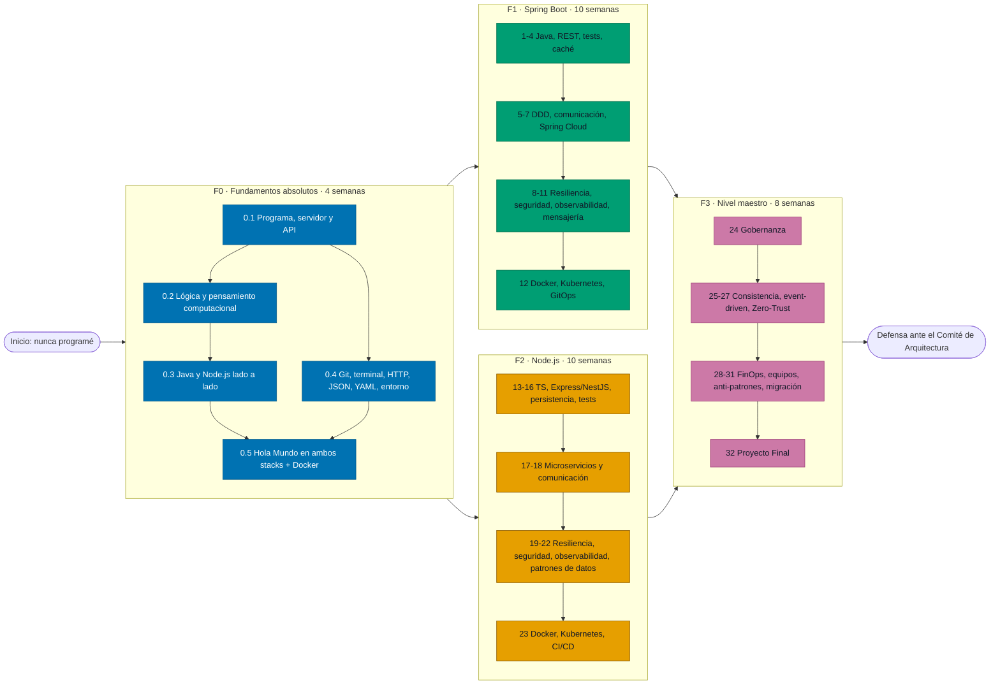
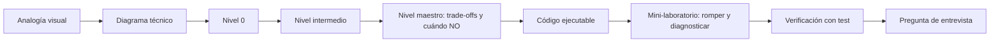

# 2 · Mapa visual del curso

> Entregable 2 del prompt del dueño: las **3 fases + la Fase 0**, su progresión y sus conexiones. Duraciones y
> dependencias exactas en [03-tabla-de-contenidos.md](03-tabla-de-contenidos.md); colores en
> [01-portada.md](01-portada.md).

## Analogía: un mapa de metro

Imagina el plano del metro de una ciudad. Todos entran por la misma estación, **«Hola Mundo»**, y recorren la
línea azul (Fase 0), corta y sin desvíos. Al final de la línea azul hay un **transbordo**: puedes tomar la línea
verde (Spring Boot) o la naranja (Node.js). Las dos recorren barrios parecidos (APIs, tests, mensajería,
Kubernetes) pero cada una con sus propias estaciones; no se cruzan, así que puedes hacer una, la otra o ambas.
Las dos líneas llegan a la estación **«Gobernanza»**, donde empieza la línea violeta (Fase 3), que acaba en la
terminal: **«Comité de Arquitectura»**.

## Mapa general (fases)

> Nota de contraste: el texto blanco sobre `#0072B2` da 5.19:1 (AA para texto normal); el resto de nodos usa
> tinta `#111827` (ver [01-portada.md](01-portada.md)).

**Texto alternativo:** diagrama de flujo de izquierda a derecha. Desde «Inicio: nunca programé» se entra en la
Fase 0 (4 semanas), con cinco módulos: 0.1 lleva a 0.2 y a 0.4; 0.2 lleva a 0.3; 0.3 y 0.4 llevan a 0.5. De la
Fase 0 salen dos ramas independientes: la Fase 1, Spring Boot (10 semanas: módulos 1–4, 5–7, 8–11 y 12 en
secuencia) y la Fase 2, Node.js (10 semanas: módulos 13–16, 17–18, 19–22 y 23 en secuencia). Ambas ramas
desembocan en la Fase 3, nivel maestro (8 semanas: módulo 24, luego 25–27, luego 28–31, luego 32), que termina
en «Defensa ante el Comité de Arquitectura».

## Conexiones entre fases (temas espejo)

Las fases 1 y 2 tratan los mismos problemas con herramientas distintas. Esta tabla te dice dónde está el «mismo
tema» en el otro stack, útil si haces ambas o si cambias de stack.

| Problema | Fase 1 · Spring Boot | Fase 2 · Node.js | Se profundiza en Fase 3 |
|---|---|---|---|
| Lenguaje y runtime | Módulo 1 (Java 25, Virtual Threads) | Módulo 13 (TypeScript, Event Loop) | — |
| API REST | Módulo 2 (Spring MVC) | Módulo 14 (Express, NestJS) | Módulo 24 (C4) |
| Persistencia | Módulo 2 (JPA, Flyway) | Módulo 15 (Mongoose, Prisma) | Módulo 25 (Outbox) |
| Tests y contratos | Módulo 3 (JUnit, Pact, Testcontainers) | Módulo 16 (Jest, Pact, Testcontainers) | Módulo 24 (fitness functions) |
| Database-per-service | Módulo 5 | Módulo 15 | Módulo 30 |
| Discovery y configuración | Módulo 7 (Eureka, Consul, Config Server) | Módulo 17 (Consul, configuración centralizada) | — |
| Comunicación síncrona/asíncrona | Módulo 6 | Módulo 18 | Módulo 26 |
| Resiliencia | Módulo 8 (Resilience4j, Toxiproxy) | Módulo 19 (opossum/cockatiel) | Módulo 32 |
| Seguridad | Módulo 9 (Spring Security, Keycloak, Vault) | Módulo 20 (jsonwebtoken, Passport, Helmet) | Módulo 27 (Zero-Trust) |
| Observabilidad | Módulo 10 (Micrometer, OpenTelemetry) | Módulo 21 (OpenTelemetry, Pino) | Módulo 28 (observability tax) |
| Mensajería | Módulo 11 (Kafka EOS, Schema Registry) | Módulo 22 (RabbitMQ, sagas, CQRS) | Módulos 25 y 26 |
| Despliegue | Módulo 12 (Kubernetes, Helm, Argo CD) | Módulo 23 (Kubernetes, GitHub Actions, Argo CD) | Módulo 28 (right-sizing) |

## Progresión dentro de cada módulo

**Texto alternativo:** cadena de nueve pasos de izquierda a derecha que sigue cada ficha: analogía visual,
diagrama técnico, nivel 0, nivel intermedio, nivel maestro con trade-offs, código ejecutable, mini-laboratorio
donde se rompe el sistema y se diagnostica, verificación con un test y pregunta de entrevista.

## Hitos

| Al terminar | Eres capaz de |
|---|---|
| Fase 0 | explicar qué es una API, usar Git y la terminal, y arrancar un «Hola Mundo» en Java y en Node.js dentro de Docker. |
| Fase 1 | construir, probar, asegurar, observar y desplegar en Kubernetes un sistema de microservicios con Spring Boot. |
| Fase 2 | hacer lo mismo con Node.js, TypeScript y NestJS. |
| Fase 3 | decidir cuándo **no** usar microservicios, documentar decisiones en ADR y defender un diseño ante un comité. |
