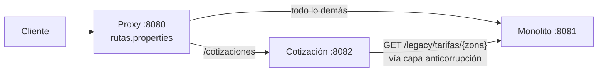

# Curso Microservicios · Migrar sin reescribir: Strangler Fig y capa anticorrupción

## Aprende construyendo

En M1 dejaste RutaFlow como un monolito modular y escribiste un ADR que decide, con métricas, si conviene extraer algo. Este módulo hace la primera extracción real sin apagar el monolito. Primero delimitas contextos y eliges la costura. Después pones una fachada delante del monolito, construyes Cotización detrás de una capa anticorrupción, comparas las dos implementaciones con tráfico real y demuestras que puedes volver atrás.

**Hito RutaFlow:** Cotización sirve tráfico real detrás del proxy y una reversión queda demostrada.

Este módulo reescribe en Java los temas de DevOps M19 T2 (lenguaje ubicuo y contextos), M19 T3 (agregados, invariantes y eventos de dominio) y M21 T1 (descomponer por capacidad: dos servicios, un contrato).

## Entorno del módulo

- **JDK 25** con `javac` y `java`, y `curl`. No hace falta Maven, Spring ni Docker: todo usa `com.sun.net.httpserver` y `java.net.http.HttpClient` del JDK.
- Laboratorio completo: `examples/microservices-rutaflow/m2/`. Cópialo a tu espacio de trabajo y compila una vez:

```bash
mkdir -p academia-labs/microservices
cp -R examples/microservices-rutaflow/m2 academia-labs/microservices/m2
cd academia-labs/microservices/m2
javac --release 25 -d out *.java
```

- Puertos: monolito `8081`, Cotización `8082` y proxy `8080`. Si alguno está ocupado, `lsof -nP -iTCP:8080 -sTCP:LISTEN` te dice qué proceso lo usa (M0 T1).
- Las salidas de este módulo se obtuvieron ejecutando el laboratorio. Los milisegundos que imprime el proxy cambian en cada máquina; los demás valores no.

### Tema 1: Contextos delimitados y mapa de contextos antes de cortar · Intermedio · 40 min

**Prerrequisito:** «Separar mitos y verdades de Domain-Driven Design» (referencia interna M1 T14).

**Objetivo observable:** escribir el mapa de contextos de RutaFlow con el tipo de cada relación, detectar una tabla compartida como fuga y proteger una invariante de Cotización dentro de su agregado.

**¿Por qué es importante?** Si cortas un servicio sin saber qué significa cada palabra a cada lado, el servicio nuevo hereda el modelo viejo y la extracción solo agrega red. El mapa dice qué cruza cada frontera, quién manda en cada relación y dónde hará falta traducir.

#### Subtema 2.1.1: El mismo «envío» con dos modelos · 8 min

**Contexto:** para Operaciones, un envío tiene estado y conductor. Para Cotización, solo importan zona y peso. Si las dos áreas comparten una clase `Envio`, cada cambio de una obliga a revisar la otra.

**Hazlo tú:** abre `MapaDeContextos.java` y ubica los dos records del mismo sustantivo:

```java
record EnvioOperaciones(String envioId, String estado, String conductorId) { }
record SolicitudCotizacion(String zona, BigDecimal pesoKg) { }
```

Ejecuta:

```bash
java MapaDeContextos.java
```

**Resultado esperado (primeras líneas):**

```text
Operaciones ve: EnvioOperaciones[envioId=E-100, estado=EN_TRANSITO, conductorId=C-7]
Cotizacion ve:  SolicitudCotizacion[zona=Z03, pesoKg=2.5]
```

**Fallo deliberado:** agrega `String estado` a `SolicitudCotizacion` «por si acaso» y pregúntate quién lo actualiza. **Diagnóstico:** nadie en Cotización cambia el estado de un envío. El campo solo existe para copiar el modelo de Operaciones, y en cuanto Operaciones agregue un estado nuevo, Cotización tendrá que actualizarse. Quítalo.

**Entiende:** un **contexto delimitado** es la frontera dentro de la cual un término tiene un solo significado y un solo modelo. El **lenguaje ubicuo** es local a esa frontera, no un glosario global. Un contexto no es todavía un microservicio: puede vivir en el mismo proceso, como en M1.

**Cierra:** anota en `evidencia/contextos.md` tres términos de RutaFlow que significan cosas distintas en dos contextos.

#### Subtema 2.1.2: Dibuja el mapa con el tipo de cada relación · 10 min

**Contexto:** un mapa de contextos no es un diagrama de cajas. Cada flecha dice quién está aguas arriba (publica el modelo), quién está aguas abajo (lo consume) y cómo se protege el consumidor.

**Hazlo tú:** en el mismo archivo, revisa la lista `mapa`. La salida de la ejecución anterior continúa así:

```text
MAPA Cotizacion -> Monolito [ACL] GET /legacy/tarifas/{zona}
MAPA Facturacion -> Cotizacion [LENGUAJE_PUBLICADO] CotizacionEmitida v1
MAPA Operaciones -> Monolito [CLIENTE_PROVEEDOR] GET /envios/{id}
MAPA_OK
```

**Fallo deliberado:** dibuja una flecha sin contrato, por ejemplo `new Relacion("Cotizacion", "Monolito", Tipo.ACL, "")`. **Diagnóstico:** la relación existe, pero nadie puede probarla ni versionarla. Toda flecha necesita un contrato concreto: una ruta HTTP, un evento con versión o una tabla de traducción.

**Entiende:** tres relaciones bastan para empezar:

| Relación | Qué significa en RutaFlow | Protección |
|---|---|---|
| Capa anticorrupción (ACL) | Cotización consume tarifas del monolito y traduce su formato | La traducción vive en una sola clase de Cotización (T4) |
| Lenguaje publicado | Facturación consume `CotizacionEmitida v1` | El evento tiene versión y reglas de compatibilidad (M4 T6) |
| Cliente-proveedor | Operaciones pide datos al monolito y negocia cambios | Contrato acordado entre equipos |

**Cierra:** guarda la salida `MAPA ...` en `evidencia/contextos.md`.

#### Subtema 2.1.3: Detecta una fuga por tabla compartida · 10 min

**Contexto:** la forma más común de romper una frontera es leer la tabla del otro «solo para consultar». Desde ese momento, el esquema del monolito es parte del contrato de Cotización.

**Hazlo tú:**

```bash
java MapaDeContextos.java --fuga
```

**Resultado esperado:**

```text
MAPA Cotizacion -> Monolito [TABLA_COMPARTIDA] tabla TARIFAS_ZONA
VIOLACION Cotizacion lee tabla TARIFAS_ZONA de Monolito: cambia junto con su esquema
MAPA_CON_FUGAS=1
```

**Fallo deliberado:** cambia en `violaciones` la condición por `r.tipo() == Tipo.ACL`. **Diagnóstico:** ahora se marcan como fuga las relaciones protegidas y la tabla compartida pasa sin aviso. La regla debe señalar el acoplamiento por esquema, no la traducción. Restaura la condición.

**Entiende:** con una tabla compartida, un `ALTER TABLE` en el monolito rompe a Cotización en producción y ningún contrato lo anuncia. microservices.io resume la regla de propiedad: las tablas de un servicio solo las usa ese servicio (M5 T1 vuelve sobre esto).

**Límite:** esta comprobación lee un mapa escrito a mano. En un sistema real también hay que revisar los permisos de la base de datos. En M5 T1 lo haces con roles de PostgreSQL.

**Cierra:** añade a tu evidencia la línea `VIOLACION` y quién debería cambiar para eliminarla.

#### Subtema 2.1.4: Protege una invariante dentro del agregado · 10 min

**Contexto:** un **agregado** es el grupo de objetos que cambia como una unidad y protege sus reglas. En Cotización, la regla que nunca se puede romper es que el total sea positivo y la vigencia dure entre 1 y 15 días. Cuando la cotización se emite, el agregado registra el **evento de dominio** `CotizacionEmitida`.

**Hazlo tú:** revisa `Cotizacion.emitir` y ejecuta los dos casos:

```bash
java MapaDeContextos.java | tail -1
java MapaDeContextos.java --invariante 2>&1 | grep Exception
```

**Resultado esperado:**

```text
EVENTO CotizacionEmitida(Q-1, 8126 COP, hasta 2026-11-25)
Exception in thread "main" java.lang.IllegalArgumentException: total debe ser positivo: 0
```

**Fallo deliberado:** convierte el constructor privado en público y crea `new Cotizacion("Q-2", 0, ...)` desde `main`. **Diagnóstico:** compila y crea una cotización inválida sin evento. La invariante solo existe si la única puerta de entrada es `emitir`. Devuelve el constructor a `private`.

**Entiende:** el evento se registra dentro del agregado, en el mismo cambio de estado. Por eso, en M4, el outbox lo puede guardar en la misma transacción. Un evento que el código «recuerda publicar después» se pierde con el primer error.

**Cierra:** escribe la invariante de Cotización con tus palabras y el nombre del evento que produce.

#### Hito del tema

- [ ] Ejecuté `MapaDeContextos` en sus tres modos y guardé las salidas.
- [ ] Expliqué por qué `EnvioOperaciones` y `SolicitudCotizacion` no deben fusionarse.
- [ ] Provoqué la fuga por tabla compartida y dije quién debe cambiar.
- [ ] Demostré que la invariante solo se cumple si `emitir` es la única entrada.

#### Ejercicio

Agrega el contexto **Tracking** al mapa. Consume `EnvioDespachado` de Operaciones y no debe leer la tabla `ENVIOS` del monolito. Elige el tipo de relación y su contrato, y comprueba que `MAPA_OK` se mantiene.

<details>
<summary>Solución — ábrela después de intentarlo</summary>

Tracking queda aguas abajo de Operaciones y consume un evento versionado. La relación es de lenguaje publicado:

```java
new Relacion("Tracking", "Operaciones", Tipo.LENGUAJE_PUBLICADO, "EnvioDespachado v1")
```

La salida añade `MAPA Tracking -> Operaciones [LENGUAJE_PUBLICADO] EnvioDespachado v1` y conserva `MAPA_OK`. Si escribiste `TABLA_COMPARTIDA` con `tabla ENVIOS`, el detector lo marca como fuga: así descubre la presión real de leer la tabla del monolito. La vista de tracking se construye con eventos en M5 T4.

</details>

**Fuentes primarias:** [Fowler, *BoundedContext*](https://martinfowler.com/bliki/BoundedContext.html), [microservices.io: Decompose by subdomain](https://microservices.io/patterns/decomposition/decompose-by-subdomain.html), [Azure: análisis de dominio para microservicios](https://learn.microsoft.com/en-us/azure/architecture/microservices/model/domain-analysis) y [microservices.io: Database per service](https://microservices.io/patterns/data/database-per-service.html).

**Siguiente tema:** «Elegir la primera costura» (referencia interna M2 T2).

### Tema 2: Elegir la primera costura: Cotización, con las señales de M1 T12 · Intermedio · 35 min

**Prerrequisito:** «Medir señales que justifican una extracción» (referencia interna M1 T12) y el tema anterior.

**Objetivo observable:** puntuar cuatro candidatos con las señales medidas en M1, descartar los que el proxy no puede interceptar o que tienen tablas escritas por otros módulos, y fijar el contrato del primer servicio.

**¿Por qué es importante?** La primera extracción enseña al equipo a migrar. Si eliges el módulo más grande o el más acoplado, el aprendizaje llega tarde y caro. Una buena primera costura es pequeña, cambia a menudo, se puede interceptar en el borde y no comparte escrituras.

#### Subtema 2.2.1: Inventaria las señales · 8 min

**Contexto:** en M1 T12 mediste cadencia de cambios y dependencias. Aquí sumas dos señales más que exige el patrón Strangler Fig: que exista una ruta propia que la fachada pueda interceptar y que nadie más escriba las tablas del candidato.

**Hazlo tú:** abre `ElegirCostura.java` y lee el record:

```java
record Candidato(String nombre, int lineasDeCodigo, int cambiosPorMes, int llamadasEntrantes,
                 int tablasEscritasPorOtros, boolean rutaHttpPropia, boolean soloLectura) { }
```

Reemplaza los números de ejemplo por los que mediste en M1 si los tienes. Si no, usa los del archivo.

**Resultado esperado:** un inventario de cuatro filas en `evidencia/costura.csv`, con una columna por señal y la fuente de cada número (git log, grafo de dependencias, consultas a la base).

**Fallo deliberado:** deja `llamadasEntrantes` en 0 para todos sin medirlo. **Diagnóstico:** el puntaje ignora que cada consumidor interno se convierte en una llamada remota. Un número sin fuente invalida la comparación.

**Entiende:** cada señal responde una pregunta concreta. `cambiosPorMes` mide si desplegar aparte ahorra coordinación. `llamadasEntrantes` cuenta cuántas llamadas remotas nuevas aparecerán. `tablasEscritasPorOtros` revela si los datos tienen dueño. `soloLectura` indica si una ejecución en paralelo es segura (T5).

**Cierra:** guarda el CSV con fuentes.

#### Subtema 2.2.2: Puntúa y descarta · 10 min

**Contexto:** hay dos condiciones que descartan sin puntuar: sin ruta propia no hay intercepción, y con tablas escritas por otros no hay propiedad de datos.

**Hazlo tú:**

```bash
java ElegirCostura.java
```

**Resultado esperado:**

```text
Cotizacion   puntos= 20 
Tracking     puntos=  4 
Facturacion  puntos=  0 BLOQUEADA: 1 tabla(s) escrita(s) por otros modulos
Asignacion   puntos=  0 BLOQUEADA: sin ruta propia: el proxy no puede interceptarla
```

**Fallo deliberado:**

```bash
java ElegirCostura.java --por-tamano
```

```text
ELEGIDA_POR_TAMANO Asignacion (6100 lineas)
BLOQUEO_IGNORADO sin ruta propia: el proxy no puede interceptarla
```

**Diagnóstico:** el criterio por tamaño eligió justo el módulo que no se puede interceptar. Azure lista ese caso entre los que no admiten Strangler Fig: si las solicitudes al backend no se pueden interceptar, el patrón no aplica.

**Entiende:** Cotización gana porque cambia a menudo (9 veces al mes), solo la llama un módulo, ninguna tabla suya la escriben otros y calcula sin escribir, así que se puede ejecutar en paralelo. Las ponderaciones del archivo (×2, ×3, +5) son una decisión del equipo y deben quedar en el ADR. No son una ley.

**Cierra:** copia la salida al ADR de M1 T13 como evidencia de la decisión.

#### Subtema 2.2.3: Fija el contrato del servicio nuevo · 10 min

**Contexto:** DevOps M21 T1 lo resume en «dos servicios, un contrato». Strangler Fig añade una condición: los clientes no deben notar la migración. Por eso el contrato público de `/cotizaciones` es el mismo del monolito.

**Hazlo tú:** crea `evidencia/contrato-cotizaciones.md` con este contenido:

```text
POST /cotizaciones
Content-Type: application/x-www-form-urlencoded
Cuerpo: zona=<Z01|Z03>&pesoKg=<decimal con punto>

200 application/json  {"cotizacionId":"<texto>","totalCop":<entero>}
422 application/json  {"error":"<motivo>"}      zona desconocida o inactiva
Redondeo de totalCop: HALF_UP a pesos enteros (igual que el monolito)
Campos que pueden diferir entre implementaciones: cotizacionId
```

**Resultado esperado:** un contrato que puedes comprobar con `curl` en T3 y con la comparación de T5.

**Fallo deliberado:** omite la línea de redondeo. **Diagnóstico:** en T5 aparecerán diferencias de un peso que nadie sabrá si son errores o decisiones. Lo que no está escrito en el contrato no se puede comparar.

**Entiende:** el contrato incluye las reglas de cálculo que el cliente percibe, como el redondeo, y declara qué campos pueden variar. M7 convierte este texto en una prueba de contrato.

**Cierra:** el contrato queda listo para la fachada de T3.

#### Hito del tema

- [ ] Medí o justifiqué cada señal con su fuente.
- [ ] Ejecuté los dos modos de `ElegirCostura` y expliqué por qué fallaba el criterio por tamaño.
- [ ] Escribí el contrato de `/cotizaciones` con su regla de redondeo.
- [ ] Anoté en el ADR qué ponderaciones usé y por qué.

#### Ejercicio

El equipo propone extraer primero Facturación «porque es la que más factura». Escribe la respuesta usando las señales y propón qué tendría que cambiar en Facturación para que deje de estar bloqueada.

<details>
<summary>Solución — ábrela después de intentarlo</summary>

Facturación está bloqueada porque otro módulo escribe una de sus tablas (`tablasEscritasPorOtros=1`). Si se extrae así, la escritura externa se convierte en un acceso directo a la base del servicio nuevo o en una transacción distribuida. Antes de extraerla hay que darle un único dueño a esa tabla: el otro módulo deja de escribirla y pide el cambio por la API pública del módulo (M1 T4) o publica un evento que Facturación consume. Cuando el inventario muestre `tablasEscritasPorOtros=0`, se puede volver a puntuar. La facturación total no es una señal de autonomía.

</details>

**Fuentes primarias:** [Azure: Strangler Fig, «When not to use»](https://learn.microsoft.com/en-us/azure/architecture/patterns/strangler-fig), [microservices.io: Decompose by business capability](https://microservices.io/patterns/decomposition/decompose-by-business-capability.html) y [Fowler, *StranglerFigApplication*](https://martinfowler.com/bliki/StranglerFigApplication.html) (revisión del 22 de agosto de 2024).

**Siguiente tema:** «Strangler Fig: proxy de enrutamiento» (referencia interna M2 T3).

### Tema 3: Strangler Fig: proxy de enrutamiento con `/cotizaciones` al servicio nuevo y el resto al monolito · Avanzado · 45 min

**Prerrequisito:** temas 1 y 2 de este módulo, y «Ejecutar dos procesos Java y comprobar su socket HTTP» (referencia interna M0 T1).

**Objetivo observable:** poner una fachada delante del monolito que primero lo envía todo al monolito y después manda `/cotizaciones` al servicio nuevo, sin que el cliente cambie de URL.

**¿Por qué es importante?** Fowler describe Strangler Fig como un reemplazo gradual: se construye lo nuevo alrededor de lo viejo y se mueve el comportamiento por partes. La fachada es la pieza que permite moverlo: intercepta cada solicitud y decide adónde va. Azure lo divide en cuatro fases: introducir la fachada, desviar tráfico poco a poco, retirar lo heredado y, al final, quitar la fachada.



#### Subtema 2.3.1: Introduce la fachada sin cambiar nada · 10 min

**Contexto:** la fase 1 consiste en poner la fachada delante y enviarlo todo al monolito. Si algo se rompe en este paso, la culpa es del proxy, no de la migración.

**Hazlo tú:** abre tres terminales en `academia-labs/microservices/m2` y arranca un proceso en cada una:

```bash
java -cp out Monolito
java -cp out CotizacionService
java -cp out ProxyStrangler
```

`rutas.properties` empieza así:

```text
/cotizaciones=monolito
```

Desde una cuarta terminal:

```bash
curl -i http://127.0.0.1:8080/envios/E-100
curl -i -X POST -d 'zona=Z03&pesoKg=2.5' http://127.0.0.1:8080/cotizaciones
```

**Resultado esperado (cabeceras relevantes y cuerpo):**

```text
HTTP/1.1 200 OK
X-servido-por: monolito
X-proxy: strangler
{"envioId":"E-100","estado":"EN_TRANSITO"}

HTTP/1.1 200 OK
X-servido-por: monolito
{"cotizacionId":"M-1","totalCop":8126}
```

`HttpServer` del JDK escribe los nombres de cabecera con mayúscula solo en la primera letra. HTTP no distingue mayúsculas en los nombres de cabecera.

**Fallo deliberado:** detén el monolito (Ctrl+C) y repite el primer `curl`. **Diagnóstico:** el proxy responde `502` con `DESTINO_NO_DISPONIBLE monolito`. La fachada no oculta la caída del destino: la hace visible con un código propio. Vuelve a arrancar el monolito.

**Entiende:** el cliente solo conoce `:8080`. Desde ahora puedes mover rutas sin pedirle que cambie nada, que es la condición que Azure exige: los clientes no se enteran de la migración.

**Cierra:** guarda las dos respuestas como línea base en `evidencia/strangler.md`.

#### Subtema 2.3.2: Desvía `/cotizaciones` al servicio nuevo · 10 min

**Contexto:** la fase 2 mueve una ruta. El proxy relee `rutas.properties` cuando cambia la fecha de modificación del archivo, así que no hace falta reiniciarlo.

**Hazlo tú:** cambia la línea a:

```text
/cotizaciones=cotizacion
```

y repite:

```bash
curl -i -X POST -d 'zona=Z03&pesoKg=2.5' http://127.0.0.1:8080/cotizaciones
curl -i http://127.0.0.1:8080/cotizaciones-pdf/M-1
```

**Resultado esperado:**

```text
HTTP/1.1 200 OK
X-servido-por: cotizacion
{"cotizacionId":"C-1","totalCop":8126}

HTTP/1.1 200 OK
X-servido-por: monolito
PDF heredado de M-1
```

En la terminal del proxy aparece `RUTAS_CARGADAS {/cotizaciones=cotizacion}`. En la del monolito aparece `MONOLITO GET /legacy/tarifas/Z03`: el servicio nuevo sigue leyendo la tarifa del monolito a través de su capa anticorrupción (T4).

**Fallo deliberado:** escribe `/cotizaciones=cotizacoin` y repite el primer `curl`. **Diagnóstico:** el proxy carga la tabla sin quejarse (`RUTAS_CARGADAS {/cotizaciones=cotizacoin}`), pero no encuentra ese destino. La excepción escapa del manejador, `curl` termina con `curl: (52) Empty reply from server` y el proxy ni siquiera escribe su línea `PROXY`. Una tabla de rutas editada a mano necesita validación antes de cargarse. Ese es el ejercicio del tema.

**Entiende:** el total coincide (`8126`) porque los dos lados aplican la misma regla. Coincidir en un caso no prueba la equivalencia. Para eso está la ejecución en paralelo de T5.

**Cierra:** registra qué proceso sirvió cada ruta.

#### Subtema 2.3.3: Evita que un prefijo capture rutas ajenas · 12 min

**Contexto:** `/cotizaciones-pdf/{id}` es otra funcionalidad heredada que no se migró. Una comparación de texto ingenua la confundiría con `/cotizaciones`.

**Hazlo tú:** detén el proxy y arráncalo con la coincidencia ingenua:

```bash
java -cp out ProxyStrangler --prefijo-ingenuo
curl -i http://127.0.0.1:8080/cotizaciones-pdf/M-1
```

**Resultado esperado del fallo:**

```text
HTTP/1.1 404 Not Found
X-servido-por: cotizacion
```

**Diagnóstico:** `"/cotizaciones-pdf/M-1".startsWith("/cotizaciones")` es verdadero, así que la ruta del PDF se envió al servicio nuevo, que no la conoce. El método `destinoPara` corrige esto comparando segmentos completos:

```java
boolean coincide = prefijoIngenuo ? ruta.startsWith(prefijo)
    : ruta.equals(prefijo) || ruta.startsWith(prefijo + "/");
```

Arranca el proxy sin la opción y comprueba que el PDF vuelve a `X-servido-por: monolito`.

**Entiende:** la fachada debe elegir el prefijo más largo que coincide por segmentos. Cada ruta migrada se añade como una regla explícita, y en un gateway real se escribe una prueba por ruta (M3 T1).

**Cierra:** añade a tu evidencia el caso del PDF con los dos resultados.

#### Subtema 2.3.4: Mide lo que cuesta la fachada · 8 min

**Contexto:** Azure advierte que la fachada no debe convertirse en punto único de fallo ni en cuello de botella.

**Hazlo tú:** mira las líneas del proxy, por ejemplo:

```text
PROXY POST /cotizaciones -> cotizacion (49 ms)
PROXY GET /cotizaciones-pdf/M-1 -> monolito (3 ms)
```

Compara el tiempo de `curl -w '%{time_total}\n' -o /dev/null -s` contra `:8080` y contra `:8081/envios/E-100` diez veces cada uno.

**Resultado esperado:** la ruta por el proxy tarda más que la directa. La diferencia exacta depende de tu máquina. Las primeras solicitudes de cada JVM son más lentas porque el código todavía no está compilado por el JIT.

**Fallo deliberado:** con el proxy detenido, intenta cotizar. **Diagnóstico:** sin fachada no hay ruta, aunque los dos destinos estén sanos. En producción la fachada corre en varias instancias, y quitarla es la última fase de la migración.

**Entiende:** la fachada es **arquitectura de transición**. Fowler defiende pagar ese código temporal porque reduce el riesgo y adelanta valor. Para pagarlo con conciencia, mide su latencia y su disponibilidad.

**Cierra:** anota el sobrecosto medido y cuántas instancias tendría la fachada en producción.

#### Hito del tema

- [ ] Arranqué los tres procesos y la fachada envió todo al monolito.
- [ ] Moví `/cotizaciones` al servicio nuevo sin reiniciar el proxy ni cambiar el cliente.
- [ ] Reproduje y corregí la captura de `/cotizaciones-pdf` por prefijo ingenuo.
- [ ] Medí el sobrecosto de la fachada y expliqué por qué es temporal.

#### Ejercicio

Haz que `ProxyStrangler` rechace al cargar una tabla con un destino desconocido: debe imprimir `RUTAS_RECHAZADAS` con el motivo y seguir usando la última tabla válida.

<details>
<summary>Solución — ábrela después de intentarlo</summary>

Valida en `recargarSiCambio` antes de asignar `tabla`:

```java
for (var regla : nueva.entrySet()) {
  String destino = regla.getValue();
  if (!destino.equals("sombra") && !DESTINOS.containsKey(destino)) {
    System.out.println("RUTAS_RECHAZADAS destino desconocido '" + destino + "' en " + regla.getKey());
    versionLeida = modificado; // no reintentar el mismo archivo inválido en cada solicitud
    return;
  }
}
```

Con `/cotizaciones=cotizacoin`, la consola muestra `RUTAS_RECHAZADAS destino desconocido 'cotizacoin' en /cotizaciones` y las solicitudes siguen yendo al destino anterior. La decisión importante es conservar la última tabla válida: una fachada que se queda sin rutas por un error tipográfico tumba todo el sistema.

</details>

**Fuentes primarias:** [Fowler, *StranglerFigApplication*](https://martinfowler.com/bliki/StranglerFigApplication.html), [Azure: Strangler Fig pattern](https://learn.microsoft.com/en-us/azure/architecture/patterns/strangler-fig) y [microservices.io: Strangler application](https://microservices.io/patterns/refactoring/strangler-application.html).

**Siguiente tema:** «Capa anticorrupción» (referencia interna M2 T4).

### Tema 4: Capa anticorrupción: traducir el modelo heredado sin contaminar el nuevo · Avanzado · 45 min

**Prerrequisito:** tema anterior.

**Objetivo observable:** traducir el registro de tarifas del monolito al modelo de Cotización en una sola clase, rechazar registros desconocidos con un error que explique el motivo y demostrar que el dominio nuevo no conoce ningún nombre heredado.

**¿Por qué es importante?** El servicio nuevo todavía necesita las tarifas que guarda el monolito. Si las lee tal como vienen (`COD_ZONA`, decimales con coma, `IND_ACTIVO=S`), el modelo nuevo adopta las convenciones viejas y la migración solo cambia de proceso. Azure describe la capa anticorrupción como una fachada o adaptador que traduce entre dos subsistemas para que ninguno comprometa el diseño del otro.

#### Subtema 2.4.1: Observa el modelo heredado · 8 min

**Contexto:** el monolito expone sus tarifas en un formato de texto antiguo.

**Hazlo tú:** con el monolito en marcha:

```bash
curl -s http://127.0.0.1:8081/legacy/tarifas/Z03; echo
curl -s -o /dev/null -w '%{http_code}\n' http://127.0.0.1:8081/legacy/tarifas/Z99
```

**Resultado esperado:**

```text
COD_ZONA=Z03|TARIFA_X_KG=1250,50|BASE=5000|IND_ACTIVO=S
404
```

**Fallo deliberado:** intenta leer `TARIFA_X_KG` como número en Java con `Double.parseDouble("1250,50")` (lo harás en el subtema 2.4.3). **Diagnóstico:** el formato usa coma decimal y no es el formato que espera Java.

**Entiende:** cada convención heredada (códigos de zona, coma decimal, indicador `S/N`) es una decisión del monolito que no debe filtrarse al modelo nuevo.

**Cierra:** lista en tu evidencia las cuatro convenciones heredadas del registro.

#### Subtema 2.4.2: Traduce en la frontera, una sola vez · 12 min

**Contexto:** la traducción vive en `CapaAnticorrupcion.java`. El dominio de Cotización solo conoce `Zona` y `Tarifa`:

```java
enum Zona { URBANA, METROPOLITANA, REGIONAL }
record Tarifa(Zona zona, BigDecimal precioPorKgCop, long baseCop) { }
```

**Hazlo tú:**

```bash
java CapaAnticorrupcion.java
```

**Resultado esperado:**

```text
OK      Tarifa[zona=METROPOLITANA, precioPorKgCop=1250.50, baseCop=5000]
OK      Tarifa[zona=URBANA, precioPorKgCop=980.00, baseCop=4000]
RECHAZO zona heredada desconocida: Z09
RECHAZO tarifa inactiva para Z07
```

Comprueba que el dominio no conoce los nombres heredados:

```bash
grep -c "COD_ZONA\|IND_ACTIVO" CotizacionService.java CapaAnticorrupcion.java
```

```text
CotizacionService.java:0
CapaAnticorrupcion.java:9
```

**Fallo deliberado:** en `CotizacionService.calcular`, recibe el texto heredado y haz `registro.split("\\|")` ahí mismo. **Diagnóstico:** el `grep` deja de dar 0 para `CotizacionService.java`: el modelo viejo ya contaminó el servicio. Vuelve a llamar a `CapaAnticorrupcion.traducir`.

**Entiende:** la ACL tiene tres responsabilidades: **seleccionar** los campos necesarios, **transformar** nombres, unidades y formatos, y **validar** el registro. La tabla `ZONAS` es la única equivalencia entre códigos y zonas. Si el monolito agrega `Z09`, el error aparece en la frontera y no dentro del cálculo.

**Cierra:** guarda las dos salidas en `evidencia/acl.md`.

#### Subtema 2.4.3: Convierte formatos sin perder precisión · 10 min

**Contexto:** el dinero no se representa con `double`. Además, el formato heredado usa coma decimal.

**Hazlo tú:**

```bash
java CapaAnticorrupcion.java --double 2>&1 | head -1
```

**Resultado esperado del fallo:**

```text
Exception in thread "main" java.lang.NumberFormatException: For input string: "1250,50"
```

**Diagnóstico:** `Double.parseDouble` no acepta coma decimal y, aunque la aceptara, `double` no representa con exactitud todos los decimales. La versión correcta convierte una sola vez, en la frontera:

```java
return new BigDecimal(textoHeredado.replace(',', '.'));
```

**Entiende:** quitar la coma con `replace` funciona porque el formato del monolito no usa separador de miles. Si lo usara (`1.250,50`), la traducción tendría que eliminar primero los puntos. Esa regla también pertenece a la ACL.

**Cierra:** escribe qué cambiaría en `precio` si el monolito empezara a enviar `1.250,50`.

#### Subtema 2.4.4: Rechaza lo desconocido y decide la vida de la ACL · 10 min

**Contexto:** ante un registro inesperado hay dos opciones: rechazarlo con un motivo o completarlo con un valor por defecto. La segunda produce cotizaciones equivocadas sin avisar a nadie.

**Hazlo tú:** con los tres procesos en marcha y `/cotizaciones=cotizacion`:

```bash
curl -i -X POST -d 'zona=Z09&pesoKg=1' http://127.0.0.1:8080/cotizaciones
```

**Resultado esperado:**

```text
HTTP/1.1 422 
{"error":"zona heredada desconocida: Z09"}
```

**Fallo deliberado:** en `zona`, cambia la excepción por `return Zona.URBANA;`. **Diagnóstico:** la solicitud responde `200` con la tarifa urbana para una zona que no existe. Un valor por defecto silencioso es la forma más cara de corrupción porque nadie la detecta. Restaura la excepción.

**Entiende:** Azure enumera los costos de una ACL: agrega latencia, es otro componente que operar, puede convertirse en punto único de fallo y hay que decidir si es permanente o se retira cuando termina la migración. También advierte que no debe contener reglas de negocio. Aquí la ACL vive dentro del proceso de Cotización y se retirará cuando las tarifas tengan dueño en el servicio nuevo.

**Cierra:** anota en el ADR si tu ACL es temporal o permanente y qué condición la retira.

#### Hito del tema

- [ ] Ejecuté la ACL y obtuve dos traducciones y dos rechazos con motivo.
- [ ] Demostré con `grep` que el servicio no conoce nombres heredados.
- [ ] Provoqué el fallo de `Double.parseDouble` y expliqué la corrección.
- [ ] Decidí la vida de la ACL y la condición que la retira.

#### Ejercicio

El monolito empieza a enviar un campo nuevo `MONEDA=COP|USD`. Cotización solo admite COP. Cambia la ACL para que un registro en USD se rechace y uno sin `MONEDA` siga funcionando, porque los registros antiguos no lo traen.

<details>
<summary>Solución — ábrela después de intentarlo</summary>

En `traducir`, después de comprobar los obligatorios:

```java
String moneda = campos.getOrDefault("MONEDA", "COP");
if (!moneda.equals("COP"))
  throw new RegistroHeredadoInvalido("moneda no soportada " + moneda + " para " + campos.get("COD_ZONA"));
```

`MONEDA` no entra en la lista de obligatorios porque los registros antiguos no lo tienen: el valor por defecto `COP` está justificado por el contrato histórico, no es un silencio arbitrario. Ninguna clase del dominio cambia, y esa es la evidencia de que la frontera funciona.

</details>

**Fuentes primarias:** [Azure: Anti-Corruption Layer pattern](https://learn.microsoft.com/en-us/azure/architecture/patterns/anti-corruption-layer), [microservices.io: Anti-corruption layer](https://microservices.io/patterns/refactoring/anti-corruption-layer.html) y [`BigDecimal` en Java 25](https://docs.oracle.com/en/java/javase/25/docs/api/java.base/java/math/BigDecimal.html).

**Siguiente tema:** «Ejecución en paralelo y comparación de respuestas» (referencia interna M2 T5).

### Tema 5: Ejecución en paralelo y comparación de respuestas antes del corte · Avanzado · 40 min

**Prerrequisito:** temas 3 y 4 de este módulo.

**Objetivo observable:** enviar el tráfico de `/cotizaciones` al monolito y, al mismo tiempo, al servicio nuevo en modo sombra, comparar los totales, encontrar una diferencia de redondeo y fijar el criterio para hacer el corte.

**¿Por qué es importante?** Que una cotización coincida no demuestra que todas coincidan. La ejecución en paralelo (*parallel run*, que Newman describe en *Monolith to Microservices*) llama a las dos implementaciones con las mismas entradas. El cliente sigue recibiendo la respuesta del sistema actual y las diferencias quedan registradas. La librería Scientist de GitHub aplica esa idea: siempre devuelve el resultado del control y solo es segura con código que no modifica datos.

#### Subtema 2.5.1: Activa el modo sombra · 10 min

**Contexto:** en modo `sombra`, el proxy responde con el monolito y, en un hilo virtual, envía la misma solicitud a Cotización con la cabecera `X-Modo-Sombra: true`. Después compara `totalCop`.

**Hazlo tú:** cambia la regla a:

```text
/cotizaciones=sombra
```

y ejecuta el cliente con cinco pesos:

```bash
rm -f evidencia/comparaciones.log
java -cp out ClienteCotizaciones Z03 1 2 3 4 5
sort evidencia/comparaciones.log
```

**Resultado esperado:**

```text
pesoKg=1 status=200 servidoPor=monolito {"cotizacionId":"M-2","totalCop":6251}
...
IGUAL zona=Z03&pesoKg=1 control=6251 candidato=6251
IGUAL zona=Z03&pesoKg=2 control=7501 candidato=7501
IGUAL zona=Z03&pesoKg=3 control=8752 candidato=8752
IGUAL zona=Z03&pesoKg=4 control=10002 candidato=10002
IGUAL zona=Z03&pesoKg=5 control=11253 candidato=11253
```

El número de `cotizacionId` depende de cuántas cotizaciones hiciste antes. El orden de las líneas del log puede variar porque cada comparación termina en su propio hilo. Por eso se ordenan con `sort`.

**Fallo deliberado:** detén `CotizacionService` y repite el cliente. **Diagnóstico:** el cliente sigue recibiendo `200` del monolito y el log muestra `ERROR_CANDIDATO ... ConnectException`. Un fallo del candidato no puede afectar al cliente, y esa es la propiedad que estás comprobando. Vuelve a arrancarlo.

**Entiende:** la comparación ocurre después de responder, así que el cliente no espera al candidato. El costo es el doble de carga en la parte migrada y en sus dependencias, incluida la consulta de tarifas al monolito.

**Cierra:** guarda el log ordenado.

#### Subtema 2.5.2: Compara normalizando lo que puede diferir · 8 min

**Contexto:** las respuestas nunca son idénticas byte a byte: `cotizacionId` empieza por `M-` o por `S-`. El contrato de T2 declaró qué campos pueden diferir.

**Hazlo tú:** revisa `HttpUtil.totalCop`, que extrae solo el campo comparable:

```java
private static final Pattern TOTAL = Pattern.compile("\"totalCop\":(-?\\d+)");
```

**Resultado esperado:** puedes explicar por qué el proxy compara `totalCop` y no el cuerpo completo.

**Fallo deliberado:** compara `respuestaControl.equals(candidato.body())`. **Diagnóstico:** todas las líneas salen `DISTINTO` por culpa de `cotizacionId`. Un comparador con ruido hace que el equipo ignore el log. Normaliza según el contrato.

**Entiende:** normalizar es una decisión de contrato. Si ignoras un campo que el cliente sí usa, la comparación da un falso verde.

**Cierra:** lista en la evidencia qué campos se comparan y cuáles se ignoran.

#### Subtema 2.5.3: Encuentra una diferencia de redondeo · 12 min

**Contexto:** el error típico de una reimplementación no está en el caso feliz, sino en los bordes: redondeos, zonas horarias, mayúsculas o nulos.

**Hazlo tú:** reinicia Cotización con otro modo de redondeo y repite el cliente:

```bash
java -cp out CotizacionService --redondeo=HALF_EVEN
```

```bash
rm -f evidencia/comparaciones.log
java -cp out ClienteCotizaciones Z03 1 2 3 4 5
sort evidencia/comparaciones.log
grep -c DISTINTO evidencia/comparaciones.log
```

**Resultado esperado:**

```text
DISTINTO zona=Z03&pesoKg=1 control=6251 candidato=6250
DISTINTO zona=Z03&pesoKg=5 control=11253 candidato=11252
IGUAL zona=Z03&pesoKg=2 control=7501 candidato=7501
IGUAL zona=Z03&pesoKg=3 control=8752 candidato=8752
IGUAL zona=Z03&pesoKg=4 control=10002 candidato=10002
2
```

**Diagnóstico:** con 1 kg, `1250.50 × 1 + 5000 = 6250.5`. `HALF_UP` redondea a 6251 y `HALF_EVEN` redondea al par, 6250. Con 3 kg el total es `8751.5`, y los dos modos dan 8752 porque 8752 ya es par. Por eso solo fallan algunos pesos. Ningún cliente vio el error, porque recibió la respuesta del monolito.

**Entiende:** la diferencia solo aparece con valores que terminan exactamente en ,5. Con pocas solicitudes podrías no verla nunca. El volumen y la variedad del tráfico real son los que dan valor a la ejecución en paralelo.

**Cierra:** reinicia Cotización sin la opción, repite y confirma `0` discrepancias.

#### Subtema 2.5.4: Define el criterio de corte y sus límites · 10 min

**Contexto:** «ya no veo diferencias» no es un criterio. El corte necesita un número de comparaciones, una ventana y un umbral.

**Hazlo tú:** escribe en el ADR un criterio como este y comprueba que tu log lo cumple:

```text
Corte de /cotizaciones cuando:
- >= 10000 comparaciones IGUAL en 7 días, con todas las zonas activas representadas
- 0 DISTINTO sin explicar (cada DISTINTO tiene causa y corrección)
- 0 ERROR_CANDIDATO en las últimas 24 h
```

**Resultado esperado:** un criterio que otra persona puede verificar con `grep -c` sobre el log.

**Fallo deliberado:** pon en sombra una ruta que escribe, por ejemplo una que confirma un envío. **Diagnóstico:** el candidato ejecutaría el efecto por segunda vez. Scientist advierte que su técnica solo es segura con métodos que no modifican datos. Para escrituras, su guía propone actualizar los dos sistemas y comparar al leer. Cotización es un cálculo, y por eso se eligió en T2 (`soloLectura=true`).

**Entiende:** la ejecución en paralelo reduce el riesgo de la lógica, no el de la operación: el candidato también debe soportar la carga y tener alertas antes del corte.

**Cierra:** con 0 discrepancias, cambia la regla a `/cotizaciones=cotizacion`. Ese es el corte.

#### Hito del tema

- [ ] Ejecuté el modo sombra y obtuve comparaciones `IGUAL`.
- [ ] Demostré que la caída del candidato no afecta al cliente.
- [ ] Encontré y expliqué la diferencia `HALF_UP`/`HALF_EVEN`.
- [ ] Escribí un criterio de corte verificable con el log.

#### Ejercicio

Agrega al log el tiempo de respuesta del candidato y escribe un comando que calcule cuántas comparaciones superaron 200 ms.

<details>
<summary>Solución — ábrela después de intentarlo</summary>

En `compararEnSegundoPlano`, mide alrededor de `reenviar`:

```java
long inicio = System.nanoTime();
var candidato = reenviar(ex, DESTINOS.get("cotizacion"), cuerpo, true);
long ms = (System.nanoTime() - inicio) / 1_000_000;
// ... y añade a la línea: + " candidatoMs=" + ms
```

Y para contar:

```bash
grep -o 'candidatoMs=[0-9]*' evidencia/comparaciones.log | cut -d= -f2 | awk '$1 > 200' | wc -l
```

Así el criterio de corte cubre corrección y latencia. Un candidato correcto pero lento rompería el presupuesto de M0 T2 después del corte.

</details>

**Fuentes primarias:** [GitHub Scientist](https://github.com/github/scientist), [Sam Newman, *Monolith to Microservices*](https://samnewman.io/books/monolith-to-microservices/) (patrón *parallel run*), [Azure: Strangler Fig, validación antes de cambiar el sistema de registro](https://learn.microsoft.com/en-us/azure/architecture/patterns/strangler-fig) y [`RoundingMode` en Java 25](https://docs.oracle.com/en/java/javase/25/docs/api/java.base/java/math/RoundingMode.html).

**Siguiente tema:** «Revertir el enrutamiento y retirar el código heredado» (referencia interna M2 T6).

### Tema 6: Revertir el enrutamiento y retirar el código heredado · Avanzado · 35 min

**Prerrequisito:** tema anterior.

**Objetivo observable:** revertir `/cotizaciones` al monolito sin reiniciar nada, demostrar qué pasa si la fachada no recarga su tabla y decidir con evidencia cuándo se puede borrar el código heredado.

**¿Por qué es importante?** Azure señala que la reversión es posible mientras existan los componentes heredados. Después de retirarlos, volver atrás cuesta mucho más y es más riesgoso. Por eso el retiro es un paso deliberado y final para cada dominio, que solo se da después de validar.

#### Subtema 2.6.1: Revierte sin reiniciar · 8 min

**Contexto:** el corte está hecho (`/cotizaciones=cotizacion`). En producción aparece un problema y necesitas volver al monolito en segundos.

**Hazlo tú:** con los tres procesos en marcha:

```bash
java -cp out ClienteCotizaciones Z03 2
```

cambia la regla a `/cotizaciones=monolito` y repite:

```bash
java -cp out ClienteCotizaciones Z03 2
```

**Resultado esperado:**

```text
pesoKg=2 status=200 servidoPor=cotizacion {"cotizacionId":"C-1","totalCop":7501}
pesoKg=2 status=200 servidoPor=monolito {"cotizacionId":"M-12","totalCop":7501}
```

Los números de `cotizacionId` dependen de tu historial. En el proxy aparece `RUTAS_CARGADAS {/cotizaciones=monolito}`.

**Fallo deliberado:** antes de revertir, borra `Monolito.cotizar`. **Diagnóstico:** la reversión ya no tiene adónde ir. Esto es lo que Azure quiere decir con que el retiro dificulta la reversión: el código heredado es tu plan B mientras la ventana sigue abierta.

**Entiende:** revertir es editar una línea porque la decisión de enrutamiento está fuera del código. Un despliegue no debería ser la única forma de volver atrás.

**Cierra:** cronometra la reversión y anota el tiempo en la evidencia.

#### Subtema 2.6.2: Diagnostica una fachada que no recarga · 10 min

**Contexto:** muchas fachadas leen su configuración solo al arrancar. Entonces revertir exige reiniciarlas, y el reinicio puede no estar disponible justo en el incidente.

**Hazlo tú:** deja la regla en `/cotizaciones=cotizacion`, reinicia el proxy con `--sin-recarga` y revierte:

```bash
java -cp out ProxyStrangler --sin-recarga
```

```bash
java -cp out ClienteCotizaciones Z03 2
# cambia la regla a /cotizaciones=monolito
java -cp out ClienteCotizaciones Z03 2
```

**Resultado esperado del fallo:**

```text
pesoKg=2 status=200 servidoPor=cotizacion {"cotizacionId":"C-2","totalCop":7501}
pesoKg=2 status=200 servidoPor=cotizacion {"cotizacionId":"C-3","totalCop":7501}
```

**Diagnóstico:** el archivo dice `monolito`, pero el proxy sigue enviando a `cotizacion` y no imprime una segunda línea `RUTAS_CARGADAS`. Para revertir hay que comprobar el efecto en la respuesta (`X-Servido-Por`), no solo el cambio en la configuración.

**Entiende:** la fachada carga la tabla una vez y descarta los cambios. En un gateway real, la recarga dinámica también necesita validación (ejercicio de T3) para que una configuración rota no sustituya a la buena.

**Cierra:** reinicia el proxy sin la opción y confirma que la reversión vuelve a funcionar.

#### Subtema 2.6.3: Decide el retiro con evidencia · 10 min

**Contexto:** el retiro exige pruebas de que nadie usa el código heredado. El log del proxy no las da completas, porque hay módulos del monolito que llaman al código por dentro sin pasar por la fachada.

**Hazlo tú:**

```bash
java VerificarRetiro.java evidencia-retiro.properties
```

```text
PUEDE_RETIRAR
```

Cambia `llamadasInternasAlCodigoHeredado30d=0` por `37` y repite:

```text
BLOQUEO otro modulo del monolito llama al codigo heredado sin pasar por el proxy
NO_RETIRAR (1)
```

**Fallo deliberado:** calcula `solicitudesAlLegadoPorProxy30d` solo con el log del proxy y deja las llamadas internas sin medir. **Diagnóstico:** la verificación da `PUEDE_RETIRAR`, pero borrar el código rompe al módulo que lo llama por dentro. Cada valor del archivo necesita su fuente: logs del proxy, una métrica dentro del código heredado y la búsqueda de llamadas en el grafo de M1 T7.

**Entiende:** el retiro tiene cinco condiciones: cero tráfico por la fachada, cero llamadas internas, cero discrepancias pendientes, ventana de reversión cerrada y un ADR aprobado. Azure recomienda ese mismo orden: validar, cambiar el sistema de registro y retirar lo heredado al final.

**Cierra:** guarda la salida y la fuente de cada número.

#### Subtema 2.6.4: Planea cuándo quitar la fachada · 7 min

**Contexto:** la cuarta fase de Azure quita la fachada y deja que el cliente hable directamente con el sistema nuevo. También admite conservarla como adaptador para clientes heredados.

**Hazlo tú:** escribe en el ADR qué rutas siguen en el monolito y cuál es el siguiente candidato según T2 (Tracking). Mientras quede una ruta heredada, la fachada se queda.

**Resultado esperado:** una tabla con ruta, destino actual, estado de la migración y fecha de revisión.

**Fallo deliberado:** quita la fachada en cuanto Cotización está migrada. **Diagnóstico:** `/envios` y `/cotizaciones-pdf` dejan de tener entrada pública. La fachada se retira cuando ya no tiene trabajo, no cuando termina la primera migración.

**Entiende:** en M3 la fachada evoluciona hacia un gateway con autenticación y límite de tasa. Esas responsabilidades no desaparecen al terminar la migración.

**Cierra:** el hito del módulo queda completo: Cotización sirve tráfico real y la reversión está demostrada.

#### Hito del tema

- [ ] Revertí `/cotizaciones` al monolito sin reiniciar y cronometré la reversión.
- [ ] Reproduje la fachada que no recarga y la diagnostiqué por la respuesta.
- [ ] Ejecuté `VerificarRetiro` en los dos casos y documenté la fuente de cada valor.
- [ ] Escribí cuándo se quitará la fachada.

#### Ejercicio

Agrega a `VerificarRetiro` una condición: la última prueba de reversión en un entorno de preproducción debe tener menos de 30 días (`diasDesdeUltimaPruebaDeReversion`). Explica por qué importa aunque no pienses revertir.

<details>
<summary>Solución — ábrela después de intentarlo</summary>

```java
if (entero(e, "diasDesdeUltimaPruebaDeReversion") > 30)
  bloqueos.add("la reversion no se ha probado en los ultimos 30 dias");
```

Añade la clave al archivo de evidencia. Mientras la ventana de reversión esté abierta, la reversión es tu control de riesgo. Si nunca se ensaya, puede fallar justo cuando la necesitas, como ocurrió con `--sin-recarga`. Una vez retirado el código heredado, esta condición deja de aplicar y se elimina con el ADR de cierre.

</details>

**Fuentes primarias:** [Azure: Strangler Fig, reversión y retiro](https://learn.microsoft.com/en-us/azure/architecture/patterns/strangler-fig) y [Fowler, *StranglerFigApplication*](https://martinfowler.com/bliki/StranglerFigApplication.html).

**Variante Spring:** el enrutamiento con Spring Cloud Gateway está en Spring Boot M16 T2 y T5. Este módulo te da los criterios para configurarlo.

**Siguiente módulo:** «APIs hacia clientes: gateway, BFF y composición» (referencia interna M3 T1).
