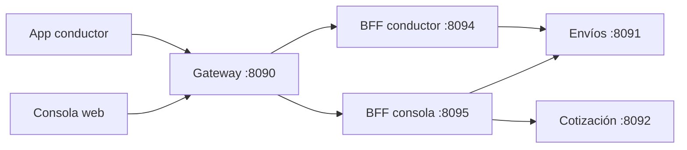

# Curso Microservicios · APIs hacia clientes: gateway, BFF y composición

## Aprende construyendo

Con Cotización fuera del monolito, RutaFlow tiene dos clientes con necesidades opuestas. La app del conductor corre en un móvil con mala señal y solo necesita las entregas del día. La consola web de operaciones muestra todos los envíos con su total cotizado. En este módulo pones un gateway en el borde para lo transversal, construyes un BFF por experiencia, compones llamadas dentro de un deadline, degradas la respuesta cuando falla una dependencia opcional y anuncias el retiro de una versión con cabeceras estándar.

**Hito RutaFlow:** dos BFF con contratos distintos. Al caer Cotización, la app sigue mostrando envíos.

## Entorno del módulo

- **JDK 25** y `curl`. Laboratorio: `examples/microservices-rutaflow/m3/`.

```bash
cp -R examples/microservices-rutaflow/m3 academia-labs/microservices/m3
cd academia-labs/microservices/m3
javac --release 25 -d out *.java
```

| Proceso | Puerto | Arranque |
|---|---|---|
| Envíos y Cotización simulados | 8091 y 8092 | `java -cp out Servicios` |
| Gateway | 8090 | `java -cp out Gateway` |
| BFF del conductor | 8094 | `java -cp out BffConductor` |
| BFF de la consola | 8095 | `java -cp out BffConsola` |

- `Servicios` simula latencias fijas: Envíos tarda 150 ms y Cotización 250 ms. Puedes cambiar el comportamiento sin reiniciar: `curl -X POST 'http://127.0.0.1:8092/admin/modo?valor=caida'` (valores `ok`, `lenta` de 3 s o `caida`). Para Envíos usa el puerto 8091 con `ok` o `caida`.
- `JsonPlano.java` es un lector mínimo de JSON plano para no depender de librerías. En un servicio real usarías Jackson (Spring Boot M2 T7).
- Los tiempos que aparecen en las salidas se midieron al ejecutar el laboratorio y cambian en cada máquina. La primera solicitud a cada JVM siempre es más lenta.

### Tema 1: Gateway: enrutamiento y descarga de responsabilidades sin lógica de negocio · Intermedio · 40 min

**Prerrequisito:** «Strangler Fig: proxy de enrutamiento» (referencia interna M2 T3).

**Objetivo observable:** enrutar `/api/envios` y `/api/cotizaciones` desde un único punto de entrada, rechazar claves inválidas con 401, limitar la tasa por cliente con 429 y `Retry-After`, y explicar por qué el gateway no contiene reglas de negocio.

**¿Por qué es importante?** microservices.io define el API gateway como el punto de entrada único de todos los clientes. Enruta, compone, traduce protocolos y puede autenticar. Azure separa dos usos: *Gateway Routing*, que da una sola dirección para varios servicios, y *Gateway Offloading*, que lleva al gateway las responsabilidades transversales, como TLS, autenticación y límite de tasa. Y da una regla sin excepciones: nunca lleves lógica de negocio al gateway.

#### Subtema 3.1.1: Enruta desde un solo punto de entrada · 8 min

**Contexto:** la fachada de M2 ya enrutaba. El gateway hace lo mismo con una tabla fija y añade un `X-Request-Id` para correlacionar la solicitud en todos los saltos (M8 T3).

**Hazlo tú:** arranca `Servicios` y `Gateway`, y ejecuta:

```bash
curl -i -H 'X-Api-Key: k-app-conductor' 'http://127.0.0.1:8090/api/envios?conductor=C-7'
curl -i -H 'X-Api-Key: k-consola' 'http://127.0.0.1:8090/api/cotizaciones/E-1'
```

**Resultado esperado (resumido):**

```text
HTTP/1.1 200 OK
X-request-id: 049b7c39-c28c-4c90-ba9f-fc52ab4f3dfd
[{"cliente":"Ferreteria Norte","conductorId":"C-7","direccion":"Cra 7 # 72-10","envioId":"E-1",...}]

HTTP/1.1 200 OK
{"envioId":"E-1","totalCop":8126}
```

El identificador cambia en cada solicitud, salvo que el cliente envíe el suyo en `X-Request-Id`.

**Fallo deliberado:** pide `http://127.0.0.1:8090/api/facturas` con una clave válida. **Diagnóstico:** `404 {"error":"RUTA_DESCONOCIDA"}`. El gateway no adivina destinos, y una ruta nueva exige una entrada nueva en `RUTAS`.

**Entiende:** el cliente conoce una sola dirección y el gateway traduce `/api/envios` a `http://127.0.0.1:8091/envios`. Si un servicio cambia de puerto o de nombre interno, solo cambia la tabla.

**Cierra:** guarda las dos respuestas y el `X-Request-Id` de cada una.

#### Subtema 3.1.2: Autentica en el borde · 10 min

**Contexto:** si cada servicio valida la clave por su cuenta, hay tantas implementaciones como servicios. El gateway valida una vez y reenvía una identidad ya verificada.

**Hazlo tú:**

```bash
curl -i 'http://127.0.0.1:8090/api/envios'
```

**Resultado esperado:**

```text
HTTP/1.1 401 Unauthorized
{"error":"API_KEY_INVALIDA"}
```

Lee en `Gateway.java` qué cabeceras viajan hacia dentro:

```java
.header("X-Request-Id", requestId)
.header("X-Cliente", cliente) // identidad ya verificada; X-Api-Key no viaja hacia dentro
```

**Fallo deliberado:** pide `http://127.0.0.1:8091/envios` directamente, sin pasar por el gateway. **Diagnóstico:** responde `200` sin ninguna clave. Azure lo advierte: configura los servicios para aceptar solicitudes solo por la ruta del gateway y no tomes una cabecera reenviada sin verificar como prueba de identidad. En el laboratorio todo escucha en `127.0.0.1`. En producción hace falta red privada o mTLS (M10 T3).

**Entiende:** el gateway descarga la autenticación, pero cada servicio sigue decidiendo qué puede hacer cada cliente (M10 T2).

**Cierra:** anota qué protege el gateway y qué sigue protegiendo cada servicio.

#### Subtema 3.1.3: Limita la tasa por cliente · 12 min

**Contexto:** una app con un bug que reintenta sin parar no debe dejar sin servicio a la consola. El gateway da a cada cliente una **cubeta de fichas**: 5 fichas de capacidad que se recargan a razón de 1 por segundo. Cada solicitud gasta una ficha.

**Hazlo tú:** `Rafaga` envía todas las solicitudes de una clave al mismo tiempo y después pasa a la siguiente clave:

```bash
java -cp out Rafaga k-app-conductor:10 k-consola:3
curl -i -H 'X-Api-Key: k-app-conductor' 'http://127.0.0.1:8090/api/envios'
```

**Resultado esperado:**

```text
clave=k-app-conductor estados={200=5, 429=5}
clave=k-consola estados={200=3}

HTTP/1.1 429 
Retry-after: 1
{"error":"LIMITE_DE_TASA","cliente":"app-conductor"}
```

Si el `curl` llega más de un segundo después de la ráfaga, ya habrá una ficha nueva y verás `200`.

**Fallo deliberado:** reinicia el gateway con una sola cubeta para todos:

```bash
java -cp out Gateway --bucket-global
java -cp out Rafaga k-app-conductor:10 k-consola:3
```

```text
clave=k-app-conductor estados={200=5, 429=5}
clave=k-consola estados={429=3}
```

**Diagnóstico:** la ráfaga de la app agotó la cubeta compartida y la consola, que no hizo nada mal, recibió 429. La clave de la cubeta debe ser la identidad verificada del cliente.

**Entiende:** 429 (*Too Many Requests*) con `Retry-After` le dice al cliente cuándo volver. Así el reintento queda en manos del cliente y no se convierte en una tormenta (M6 T1). Con varias instancias del gateway, cada una tendría su propia cubeta. Para un límite global hace falta un almacén compartido o el límite que ya trae la plataforma, como recomienda Azure.

**Cierra:** guarda las dos salidas de `Rafaga` y explica la diferencia.

#### Subtema 3.1.4: Deja la lógica de negocio fuera del gateway · 10 min

**Contexto:** el gateway es el único lugar por donde pasa todo el tráfico. Por eso es tentador poner ahí «solo una regla»: un descuento, una validación de zona, un estado calculado.

**Hazlo tú:** clasifica estas propuestas en `evidencia/gateway.md` como **borde** o **negocio**:

```text
1. Rechazar solicitudes sin X-Api-Key
2. Aplicar 10 % de descuento a clientes con más de 100 envíos
3. Terminar TLS
4. Rechazar zonas inactivas antes de llegar a Cotización
5. Limitar a 5 solicitudes por segundo por cliente
6. Redirigir /v0/* a /v1/* (mapeo fijo)
```

**Resultado esperado:** 1, 3, 5 y 6 son de borde. 2 y 4 son de negocio y pertenecen a Cotización.

**Fallo deliberado:** implementa la regla 4 en `Gateway.atender`. **Diagnóstico:** cuando Cotización active `Z07`, habrá que desplegar el gateway, que es compartido por todos los equipos, para cambiar una regla de un solo equipo. Azure describe ese acoplamiento como un motivo para no usar el patrón: reglas propias de un servicio en el gateway atan sus cambios a cambios de configuración del gateway.

**Entiende:** el gateway concentra responsabilidad. Azure pide varias instancias, capacidad para los picos y un equipo que pueda operarlo para todos los servicios que dependen de él. Con cada regla de negocio que entra, más equipos dependen de un solo despliegue.

**Cierra:** guarda la clasificación con una línea de motivo por regla.

#### Hito del tema

- [ ] Enruté dos servicios desde el gateway y obtuve un `X-Request-Id`.
- [ ] Obtuve 401 sin clave y anoté por qué el acceso directo al servicio es un riesgo.
- [ ] Reproduje la cubeta global y la corregí por cliente.
- [ ] Clasifiqué seis reglas entre borde y negocio con su motivo.

#### Ejercicio

Agrega al gateway una ruta `/app/` hacia el BFF del conductor (`:8094`) y `/consola/` hacia el BFF de la consola (`:8095`), como en el ejemplo de Azure, donde la plataforma de API está delante de los BFF. Comprueba que la app no puede llamar a `/consola/` con su clave.

<details>
<summary>Solución — ábrela después de intentarlo</summary>

Añade las rutas a `RUTAS` y un mapa de rutas permitidas por cliente antes de reenviar:

```java
private static final Map<String, String> RUTAS = Map.of(
    "/api/envios", "http://127.0.0.1:8091/envios",
    "/api/cotizaciones", "http://127.0.0.1:8092/cotizaciones",
    "/app", "http://127.0.0.1:8094",
    "/consola", "http://127.0.0.1:8095/consola");
private static final Map<String, String> PREFIJO_PERMITIDO = Map.of(
    "app-conductor", "/app/", "consola-web", "/consola/");
// en atender(), después del límite de tasa:
String permitido = PREFIJO_PERMITIDO.get(cliente);
if (!ruta.startsWith(permitido) && !ruta.startsWith("/api/")) {
  HttpUtil.json(ex, 403, "{\"error\":\"RUTA_NO_PERMITIDA\"}");
  return;
}
```

Con `/app` hacia `http://127.0.0.1:8094`, `/app/conductor/v1/entregas-de-hoy` llega al BFF como `/conductor/v1/entregas-de-hoy`. La app con su clave recibe 403 en `/consola/v1/envios`. Esto es autorización de borde, por ruta. La autorización fina (qué envíos puede ver cada conductor) sigue en el servicio.

</details>

**Fuentes primarias:** [microservices.io: API gateway](https://microservices.io/patterns/apigateway.html), [Azure: Gateway Routing](https://learn.microsoft.com/en-us/azure/architecture/patterns/gateway-routing), [Azure: Gateway Offloading](https://learn.microsoft.com/en-us/azure/architecture/patterns/gateway-offloading) y [RFC 6585, §4: 429 Too Many Requests](https://www.rfc-editor.org/rfc/rfc6585.html#section-4).

**Variante Spring:** Spring Cloud Gateway con filtros de límite de tasa está en Spring Boot M16 T2 y T5.

**Siguiente tema:** «BFF: un backend por experiencia» (referencia interna M3 T2).

### Tema 2: BFF: un backend para la app del conductor y otro para la consola web · Avanzado · 45 min

**Prerrequisito:** tema anterior.

**Objetivo observable:** obtener de dos BFF dos contratos distintos sobre los mismos servicios, medir el tamaño y el número de llamadas de cada uno, y demostrar qué se rompe cuando un BFF se «reutiliza» para otra experiencia.

**¿Por qué es importante?** Sam Newman resume la regla en «one experience, one BFF»: un backend por experiencia de usuario, mantenido normalmente por el mismo equipo que hace esa interfaz. Un backend genérico que sirve a todos acaba siendo un cuello de botella, porque muchos equipos cambian un mismo despliegue. Azure coincide: crea un BFF por interfaz, con solo la lógica propia de esa interfaz.



#### Subtema 3.2.1: Dos experiencias, dos contratos · 10 min

**Contexto:** el conductor necesita dirección y ventana de sus entregas pendientes. La consola necesita todos los envíos, su cliente, su estado y su total cotizado.

**Hazlo tú:** arranca `Servicios`, `BffConductor` y `BffConsola`, y ejecuta:

```bash
curl -s 'http://127.0.0.1:8094/conductor/v1/entregas-de-hoy?conductor=C-7'; echo
curl -s 'http://127.0.0.1:8095/consola/v2/envios'; echo
```

**Resultado esperado:**

```text
{"conductorId":"C-7","entregas":[{"envioId":"E-1","direccion":"Cra 7 # 72-10","ventana":"08:00-10:00"},{"envioId":"E-2","direccion":"Cl 45 # 13-20","ventana":"10:00-12:00"}]}
{"envios":[{"envioId":"E-1","cliente":"Ferreteria Norte","conductorId":"C-7","estado":"PENDIENTE","cotizacion":{"totalCop":8126,"moneda":"COP"}},...,{"envioId":"E-3",...,"estado":"ENTREGADO","cotizacion":{"totalCop":8900,"moneda":"COP"}}],"degradado":[]}
```

En la terminal del BFF del conductor aparece `BFF_CONDUCTOR llamadas=1 bytes=174`.

**Fallo deliberado:** pide `entregas-de-hoy` sin `conductor`. **Diagnóstico:** `400 CONDUCTOR_REQUERIDO`. El contrato del BFF es de la experiencia: la app siempre conoce a su conductor, así que el parámetro es obligatorio.

**Entiende:** los dos BFF leen el mismo servicio de Envíos, pero cada uno filtra y da forma para su cliente. El del conductor descarta `notasInternas`, `pesoKg` y los envíos ya entregados. Ese trabajo no se hace en el móvil.

**Cierra:** guarda las dos respuestas y el tamaño en bytes de la del conductor.

#### Subtema 3.2.2: Fallo deliberado: un BFF «reutilizado» para la consola · 12 min

**Contexto:** la consola pide el total cotizado y alguien propone agregarlo al BFF del conductor «para no tener dos backends».

**Hazlo tú:** reinicia el BFF del conductor con el fallo activado:

```bash
java -cp out BffConductor --reutilizar-consola
curl -s 'http://127.0.0.1:8094/conductor/v1/entregas-de-hoy?conductor=C-7'; echo
```

**Resultado esperado del fallo:**

```text
{"conductorId":"C-7","entregas":[{"envioId":"E-1","direccion":"Cra 7 # 72-10","ventana":"08:00-10:00","cliente":"Ferreteria Norte","notasInternas":"cliente pide factura electronica","totalCop":8126},...]}
BFF_CONDUCTOR llamadas=3 bytes=355
```

**Diagnóstico:** la respuesta de la app pasó de 174 a 355 bytes y de 1 a 3 llamadas internas. Además, el móvil ahora recibe `notasInternas`, que no debería ver. Con Cotización caída (`curl -X POST 'http://127.0.0.1:8092/admin/modo?valor=caida'`), la app recibe `"totalCop":null`, un campo que ni siquiera usa. Restaura el BFF sin la opción.

**Entiende:** mezclar experiencias en un BFF suma latencia, datos y dependencias a un cliente que no los necesita. También obliga a coordinar a dos equipos en un mismo despliegue, que es justo lo que el patrón intenta evitar.

**Cierra:** registra la tabla «bytes y llamadas, antes y después».

#### Subtema 3.2.3: Propiedad y duplicación · 10 min

**Contexto:** los dos BFF repiten el código que llama a Envíos. ¿Hay que extraer una librería compartida?

**Hazlo tú:** compara `BffConductor.obtener` con las llamadas de `BffConsola` y anota qué partes se parecen y cuáles cambian por experiencia (timeouts, filtros, campos).

**Resultado esperado:** la llamada HTTP se parece. Los filtros, los campos, el tratamiento del error y el presupuesto de tiempo son distintos.

**Fallo deliberado:** crea una clase `ClienteEnviosCompartido` con un parámetro `boolean paraConsola` que cambia el filtro. **Diagnóstico:** un booleano de experiencia dentro de código compartido vuelve a acoplar a los dos equipos: cualquier cambio de la consola obliga a probar la app.

**Entiende:** Newman tolera la duplicación entre servicios porque le preocupa más el acoplamiento, y ve en las librerías compartidas una fuente principal de acoplamiento. Propone abstraer a la tercera repetición. Azure también acepta la duplicación como consecuencia probable del patrón, a cambio de una experiencia ajustada a cada cliente. Lo que sí se comparte es transversal y no depende de la experiencia: trazas, autenticación y métricas.

**Cierra:** escribe quién es dueño de cada BFF en tu ADR (equipo móvil y equipo de consola).

#### Subtema 3.2.4: Decide cuándo no hace falta un BFF · 8 min

**Contexto:** cada BFF es un servicio más que desplegar, monitorear y asegurar.

**Hazlo tú:** evalúa estos casos con los criterios de Azure:

```text
A. App Android y app iOS del conductor, mismas pantallas, mismo equipo
B. Consola web y API pública para clientes empresariales
C. Un solo cliente web
```

**Resultado esperado:** en A basta un BFF para las dos apps: misma experiencia y mismo equipo, el caso que Newman acepta. En B hacen falta dos, porque las experiencias y los contratos son distintos. En C no hace falta BFF: Azure no lo recomienda cuando solo una interfaz usa el backend.

**Fallo deliberado:** crea un BFF por plataforma en A. **Diagnóstico:** el mismo equipo mantiene dos servicios idénticos. La regla es una experiencia, un BFF, no una tecnología, un BFF.

**Entiende:** Azure también señala que GraphQL con *resolvers* por cliente puede volver innecesario el BFF. Es otra forma de dar a cada cliente lo que necesita, con sus propios costos.

**Cierra:** guarda tu decisión para A, B y C con su motivo.

#### Hito del tema

- [ ] Obtuve dos contratos distintos de dos BFF sobre los mismos servicios.
- [ ] Medí bytes y llamadas al «reutilizar» el BFF del conductor y vi la fuga de `notasInternas`.
- [ ] Decidí qué se duplica y qué se comparte, con su motivo.
- [ ] Resolví los casos A, B y C con los criterios de Newman y Azure.

#### Ejercicio

La app del conductor necesita mostrar si cada entrega «requiere cobro contraentrega». Ese dato está en Facturación. Diseña el cambio sin romper la regla de experiencia y sin agregar latencia a las entregas que no lo requieren.

<details>
<summary>Solución — ábrela después de intentarlo</summary>

El campo pertenece a la experiencia del conductor, así que va en su BFF y lo implementa el equipo móvil. Hay dos opciones razonables:

1. **Componer en el BFF del conductor**: una llamada a Facturación con todos los `envioId` del día en un solo lote, en paralelo con la de Envíos si se puede, y con degradación si falla (T4): la entrega se muestra con `cobroContraentrega: null` y un aviso en la app.
2. **Publicar el dato con el envío**: si Facturación emite un evento (`CobroContraentregaRequerido`), Envíos o una vista de lectura pueden guardarlo (M5 T4), y el BFF lo lee sin llamar a Facturación en cada carga.

Lo que no se hace es agregar el campo al contrato de la consola ni crear un BFF compartido. La opción 2 quita latencia del camino de la app, a costa de consistencia eventual.

</details>

**Fuentes primarias:** [Sam Newman, *Backends For Frontends*](https://samnewman.io/patterns/architectural/bff/), [Azure: Backends for Frontends pattern](https://learn.microsoft.com/en-us/azure/architecture/patterns/backends-for-frontends) y [microservices.io: API gateway, variante *Backends for frontends*](https://microservices.io/patterns/apigateway.html).

**Siguiente tema:** «Composición de API con presupuesto de deadline» (referencia interna M3 T3).

### Tema 3: Composición de API con presupuesto de deadline · Avanzado · 40 min

**Prerrequisito:** «Propagar un deadline absoluto entre servicios HTTP» (referencia interna M0 T3) y tema anterior.

**Objetivo observable:** componer Envíos y Cotización en el BFF de la consola, medir la diferencia entre llamadas en paralelo y en secuencia, y repartir un deadline absoluto entre todas las llamadas.

**¿Por qué es importante?** Cuando cada servicio tiene sus datos, una pantalla que necesita datos de varios servicios exige una **composición de API**: la aplicación hace la unión que antes hacía la base de datos (microservices.io). Newman recomienda hacer en paralelo las llamadas independientes. Sin un presupuesto común, la suma de esperas supera lo que el cliente está dispuesto a esperar.

#### Subtema 3.3.1: Compara llamadas en paralelo y en secuencia · 12 min

**Contexto:** `BffConsola` primero pide la lista a Envíos (150 ms) y luego cotiza cada envío (250 ms cada uno). Las cotizaciones son independientes entre sí.

**Hazlo tú:** con `Servicios` y `BffConsola` en marcha, repite tres veces:

```bash
curl -s -o /dev/null -w '%{http_code} %{time_total}\n' 'http://127.0.0.1:8095/consola/v2/envios'
```

Después reinicia el BFF en modo secuencial y repite:

```bash
java -cp out BffConsola --secuencial
```

**Resultado esperado:** en paralelo, unos 0,43 s y `degradado=[]` en la consola del BFF. En secuencia, unos 0,76 s y `degradado=[cotizacion]`:

```text
BFF_CONSOLA v2 428 ms degradado=[]
BFF_CONSOLA v2 756 ms degradado=[cotizacion]
```

**Diagnóstico del modo secuencial:** 150 + 250 + 250 = 650 ms. Para la tercera cotización solo quedan 800 − 650 − 50 = 100 ms de presupuesto, así que esa llamada vence y su total sale `null`. En paralelo, el tiempo es 150 + 250 ≈ 400 ms más el costo de componer.

**Entiende:** en secuencia, la latencia es la suma. En paralelo, es la de la llamada más lenta. Por eso Newman pide paralelizar lo que no depende de otra respuesta. Envíos debe ir primero porque sin la lista no hay a quién cotizar: esa dependencia de datos sí fuerza la secuencia.

**Cierra:** registra los tiempos de los dos modos y vuelve al modo normal.

#### Subtema 3.3.2: Reparte el deadline entre las llamadas · 12 min

**Contexto:** el BFF acepta la cabecera de M0 T3, `X-Deadline-Epoch-Millis`. Si no llega, fija ahora + 800 ms. Cada llamada recibe lo que queda menos una reserva de 50 ms para componer la respuesta:

```java
long restante = deadline - System.currentTimeMillis() - RESERVA_MS;
if (!timeoutFijo && restante <= 0) throw new IllegalArgumentException("sin presupuesto para " + url);
```

**Hazlo tú:** pon Cotización en modo lento (3 s) y mide:

```bash
curl -X POST 'http://127.0.0.1:8092/admin/modo?valor=lenta'
curl -s -o /dev/null -w '%{http_code} %{time_total}\n' 'http://127.0.0.1:8095/consola/v2/envios'
```

**Resultado esperado:**

```text
200 0.763480
```

La respuesta llega dentro de los 800 ms, con `"cotizacion":null` en cada envío y `"degradado":["cotizacion"]`.

**Fallo deliberado:** envía un deadline ya vencido:

```bash
curl -s -i -H "X-Deadline-Epoch-Millis: $(( $(date +%s) * 1000 - 1000 ))" 'http://127.0.0.1:8095/consola/v2/envios'
```

**Diagnóstico:** `503 ENVIOS_NO_DISPONIBLE` inmediato. Sin presupuesto, el BFF ni siquiera llama a Envíos. El mensaje mezcla «no disponible» con «sin presupuesto». En el ejercicio lo separas con un código propio.

**Entiende:** el deadline es absoluto y se propaga tal cual a Envíos y Cotización, como en M0 T3. Cada salto recalcula lo que le queda. Así el total queda acotado aunque cambie el número de llamadas.

**Cierra:** devuelve Cotización a `ok`.

#### Subtema 3.3.3: Fallo deliberado: un timeout fijo por llamada · 10 min

**Contexto:** el error habitual es poner un timeout «razonable» de 1 s en cada cliente HTTP y olvidarse del total.

**Hazlo tú:**

```bash
curl -X POST 'http://127.0.0.1:8092/admin/modo?valor=lenta'
java -cp out BffConsola --timeout-fijo
curl -s -o /dev/null -w '%{http_code} %{time_total}\n' 'http://127.0.0.1:8095/consola/v2/envios'
```

**Resultado esperado del fallo:**

```text
200 1.164953
```

**Diagnóstico:** la consola esperaba como máximo 800 ms y recibió la respuesta en 1,16 s. Cada llamada cumplió su timeout de 1 s, pero el total no estaba limitado. Con más saltos o llamadas en secuencia, el exceso crece.

**Entiende:** un timeout por llamada protege los recursos de quien llama. Un deadline protege la promesa que le hiciste al cliente. Hacen falta los dos, y el timeout debe salir del deadline.

**Cierra:** guarda las dos mediciones y vuelve al BFF normal con Cotización en `ok`.

#### Hito del tema

- [ ] Medí paralelo frente a secuencia y expliqué la tercera cotización degradada.
- [ ] Con Cotización lenta, la consola respondió dentro de 800 ms.
- [ ] Reproduje el timeout fijo que rompe el deadline.
- [ ] Expliqué por qué Envíos va primero y las cotizaciones en paralelo.

#### Ejercicio

Cuando el deadline ya venció al llegar, el BFF responde `503 ENVIOS_NO_DISPONIBLE`, que confunde al operador. Haz que responda `504` con `{"error":"SIN_PRESUPUESTO"}` antes de llamar a nadie.

<details>
<summary>Solución — ábrela después de intentarlo</summary>

Al inicio de `envios`, después de calcular `deadline`:

```java
if (deadline - System.currentTimeMillis() <= RESERVA_MS) {
  HttpUtil.json(ex, 504, "{\"error\":\"SIN_PRESUPUESTO\"}");
  return;
}
```

504 dice que el plazo venció. 503 dice que una dependencia no está disponible. Separarlos cambia el diagnóstico: un pico de 504 apunta a clientes que envían deadlines demasiado cortos o a saltos previos lentos, y un pico de 503 apunta a Envíos. Es la misma clasificación de resultados de M0 T4.

</details>

**Fuentes primarias:** [microservices.io: API Composition](https://microservices.io/patterns/data/api-composition.html), [Azure: Gateway Aggregation](https://learn.microsoft.com/en-us/azure/architecture/patterns/gateway-aggregation), [Sam Newman, *Backends For Frontends*](https://samnewman.io/patterns/architectural/bff/) y [`HttpClient.sendAsync` en Java 25](https://docs.oracle.com/en/java/javase/25/docs/api/java.net.http/java/net/http/HttpClient.html).

**Siguiente tema:** «Respuesta degradada ante un fallo parcial» (referencia interna M3 T4).

### Tema 4: Respuesta degradada ante un fallo parcial · Avanzado · 40 min

**Prerrequisito:** tema anterior.

**Objetivo observable:** clasificar cada dependencia como crítica u opcional, devolver una respuesta parcial y explícita cuando falla una opcional, devolver un error cuando falla una crítica y demostrar que ocultar el fallo crítico produce una respuesta falsa.

**¿Por qué es importante?** Newman advierte que fallar toda la respuesta no siempre es sensato. Si cae un servicio no crítico, el BFF puede degradar la funcionalidad, y el cliente tiene que saber interpretar una respuesta parcial. Degradar sin decirlo es igual de grave que caerse: el usuario toma decisiones con datos incompletos.

#### Subtema 3.4.1: Clasifica las dependencias · 8 min

**Contexto:** para la consola, sin la lista de envíos no hay pantalla. Sin el total cotizado, la pantalla sigue siendo útil.

**Hazlo tú:** escribe la tabla en `evidencia/degradacion.md`:

| BFF | Dependencia | Tipo | Si falla |
|---|---|---|---|
| Consola | Envíos | Crítica | 503 |
| Consola | Cotización | Opcional | 200 con `cotizacion: null` y `degradado: ["cotizacion"]` |
| Conductor | Envíos | Crítica | 503 |

**Resultado esperado:** una tabla que el código de los BFF cumple.

**Fallo deliberado:** marca Cotización como crítica en la consola. **Diagnóstico:** cada caída de Cotización deja a operaciones sin ver los envíos, aunque el dato que falta sea secundario. La clasificación es una decisión de producto, no técnica.

**Entiende:** que una dependencia sea opcional depende de la experiencia: el total es opcional para la consola y ni siquiera existe para el conductor.

**Cierra:** valida la tabla con quien es dueño de cada pantalla.

#### Subtema 3.4.2: Degrada de forma explícita · 12 min

**Contexto:** es el hito del módulo: al caer Cotización, la app sigue mostrando envíos.

**Hazlo tú:**

```bash
curl -X POST 'http://127.0.0.1:8092/admin/modo?valor=caida'
curl -s 'http://127.0.0.1:8095/consola/v1/envios'; echo
curl -s 'http://127.0.0.1:8094/conductor/v1/entregas-de-hoy?conductor=C-7'; echo
```

**Resultado esperado:**

```text
{"envios":[{"envioId":"E-1","cliente":"Ferreteria Norte","conductorId":"C-7","estado":"PENDIENTE","totalCop":null},...],"degradado":["cotizacion"]}
{"conductorId":"C-7","entregas":[{"envioId":"E-1","direccion":"Cra 7 # 72-10","ventana":"08:00-10:00"},{"envioId":"E-2","direccion":"Cl 45 # 13-20","ventana":"10:00-12:00"}]}
```

En el BFF de la consola aparece `degradado=[cotizacion]` en unos 170 ms: Cotización caída responde 503 de inmediato, sin consumir el deadline.

**Fallo deliberado:** cambia `totalONull` para que devuelva `"0"` en lugar de `"null"`. **Diagnóstico:** la consola mostraría envíos con costo cero y `degradado` vacío, porque la lista ya no contiene `null`. Un valor falso es peor que un hueco declarado. Restaura `"null"`.

**Entiende:** `degradado` es parte del contrato: le dice al cliente qué sección mostrar como «no disponible». La app del conductor no cambió nada porque su experiencia no depende de Cotización. Ese aislamiento es el beneficio concreto del BFF por experiencia.

**Cierra:** guarda las dos respuestas como evidencia del hito.

#### Subtema 3.4.3: Fallo deliberado: ocultar el fallo de una dependencia crítica · 10 min

**Contexto:** «para que la consola nunca muestre error», alguien captura toda excepción y devuelve una lista vacía.

**Hazlo tú:** tira Envíos y compara los dos BFF de consola:

```bash
curl -X POST 'http://127.0.0.1:8091/admin/modo?valor=caida'
curl -s -i 'http://127.0.0.1:8095/consola/v2/envios' | grep -E '^HTTP|error'
```

```text
HTTP/1.1 503 Service Unavailable
{"error":"ENVIOS_NO_DISPONIBLE"}
```

Ahora reinicia el BFF con la opción que oculta el fallo:

```bash
java -cp out BffConsola --ocultar-fallo-envios
curl -s -i 'http://127.0.0.1:8095/consola/v2/envios' | grep -E '^HTTP|envios'
```

**Resultado esperado del fallo:**

```text
HTTP/1.1 200 OK
{"envios":[],"degradado":[]}
```

**Diagnóstico:** la consola dice «no hay envíos hoy» con un 200 y sin degradación declarada. Operaciones podría liberar conductores pensando que no hay trabajo, y ninguna alerta salta porque las métricas solo ven respuestas 200. Vuelve al BFF normal y pon Envíos en `ok`.

**Entiende:** degradar solo vale para dependencias opcionales y siempre se declara. El fallo de una crítica debe verse como error, para que el cliente reintente o avise y para que las métricas de error (M8 T2) lo registren.

**Cierra:** escribe la regla «crítica → error; opcional → `degradado`» en el ADR.

#### Subtema 3.4.4: Acuerda cómo el cliente interpreta lo parcial · 10 min

**Contexto:** Newman pide que el cliente sepa interpretar una respuesta parcial. Si la consola ignora `degradado`, muestra «$ null».

**Hazlo tú:** escribe en el contrato del BFF de la consola qué hace la interfaz con cada valor:

```text
degradado = []              -> tabla completa
degradado = ["cotizacion"]  -> columna Total con "No disponible" y aviso en la cabecera
HTTP 503                    -> pantalla de error con botón "Reintentar" (respeta Retry-After si llega)
```

**Resultado esperado:** el contrato documenta los tres casos y el equipo de la consola los cubre con pruebas de interfaz.

**Fallo deliberado:** agrega una nueva dependencia opcional (por ejemplo, Tracking) sin añadir su nombre a `degradado`. **Diagnóstico:** el cliente no sabe por qué faltan datos. Cada dependencia opcional necesita su propio nombre en la lista.

**Entiende:** la degradación cuenta con dos partes: el servidor que la declara y el cliente que sabe mostrarla. Una sin la otra no protege al usuario.

**Cierra:** con Cotización caída, la app sigue mostrando entregas. El hito del módulo queda demostrado.

#### Hito del tema

- [ ] Clasifiqué dependencias críticas y opcionales por experiencia.
- [ ] Con Cotización caída, la consola respondió con `degradado` y la app no cambió.
- [ ] Reproduje la lista vacía falsa y expliqué por qué no salta ninguna alerta.
- [ ] Documenté cómo el cliente interpreta cada caso.

#### Ejercicio

Haz que el BFF de la consola marque `degradado: ["cotizacion"]` solo para los envíos sin total, añadiendo un campo `cotizacionDisponible` por fila, y que la lista global siga presente. Explica cuándo conviene degradar por fila y cuándo por sección.

<details>
<summary>Solución — ábrela después de intentarlo</summary>

En el bucle que arma `filas`:

```java
fila.put("cotizacionDisponible", "#" + !total.equals("null"));
```

La lista global se mantiene porque resume el estado para la cabecera de la pantalla. Degradar por fila conviene cuando el fallo es parcial dentro de la misma dependencia, por ejemplo cuando una de tres cotizaciones vence por deadline, como en el modo secuencial de T3. Degradar por sección basta cuando la dependencia falla entera. Con el campo por fila, la consola muestra el total de los envíos que sí lo tienen en lugar de ocultar toda la columna.

</details>

**Fuentes primarias:** [Sam Newman, *Backends For Frontends*, sección sobre fallo parcial](https://samnewman.io/patterns/architectural/bff/) y [Azure: Backends for Frontends](https://learn.microsoft.com/en-us/azure/architecture/patterns/backends-for-frontends).

**Siguiente tema:** «Versionado y deprecación de la API pública» (referencia interna M3 T5).

### Tema 5: Versionado y deprecación de la API pública (cabeceras `Deprecation` y `Sunset`) · Intermedio · 35 min

**Prerrequisito:** «Evolucionar un contrato JSON sin romper consumidores» (referencia interna M0 T8).

**Objetivo observable:** publicar `v2` de la consola con un cambio incompatible, anunciar la deprecación de `v1` con `Deprecation`, `Sunset` y `Link`, detectar dos errores de formato y medir el uso de `v1` antes de apagarla.

**¿Por qué es importante?** Algunos cambios no se pueden hacer compatibles. Cuando eso pasa, conviven dos versiones y la vieja necesita una fecha de retiro que los clientes puedan leer. El RFC 9745 (marzo de 2025) define la cabecera `Deprecation` y la relación de enlace `deprecation`. El RFC 8594 define `Sunset`, que indica cuándo se espera que el recurso deje de responder.

#### Subtema 3.5.1: Haz un cambio incompatible en una versión nueva · 8 min

**Contexto:** la consola necesita la moneda junto al total. En `v1`, `totalCop` es un número. En `v2`, pasa a ser un objeto `cotizacion`.

**Hazlo tú:** con Cotización en `ok`:

```bash
curl -s 'http://127.0.0.1:8095/consola/v1/envios' | head -c 120; echo
curl -s 'http://127.0.0.1:8095/consola/v2/envios' | head -c 160; echo
```

**Resultado esperado:**

```text
{"envios":[{"envioId":"E-1","cliente":"Ferreteria Norte","conductorId":"C-7","estado":"PENDIENTE","totalCop":8126},{"env
{"envios":[{"envioId":"E-1","cliente":"Ferreteria Norte","conductorId":"C-7","estado":"PENDIENTE","cotizacion":{"totalCop":8126,"moneda":"COP"}},{"envioId":"E-2
```

**Fallo deliberado:** cambia la forma de `totalCop` dentro de `v1`. **Diagnóstico:** un cliente que lee `fila.totalCop` como número recibe un objeto y falla. Un cambio incompatible exige una ruta nueva. M0 T8 explica qué cambios sí son compatibles.

**Entiende:** las dos versiones comparten la composición y solo difieren en cómo arman la respuesta. Así el costo de mantener `v1` es pequeño mientras dura la transición.

**Cierra:** guarda las dos formas en el contrato.

#### Subtema 3.5.2: Anuncia la deprecación con cabeceras estándar · 12 min

**Contexto:** `Deprecacion.java` construye las tres cabeceras y `BffConsola` las añade a cada respuesta de `v1`.

**Hazlo tú:**

```bash
java Deprecacion.java
curl -s -i 'http://127.0.0.1:8095/consola/v1/envios' | grep -E '^(Deprecation|Sunset|Link)'
```

**Resultado esperado:**

```text
Deprecation: @1796083200
Sunset: Mon, 01 Mar 2027 00:00:00 GMT
Link: <https://rutaflow.example/docs/consola/v2>; rel="deprecation"; type="text/html"
```

`@1796083200` son los segundos desde 1970 de `2026-12-01T00:00:00Z`. Es el tipo *Date* de los campos estructurados (RFC 9651), que es lo que exige RFC 9745. `Sunset` usa el formato de fecha HTTP. `v2` no lleva estas cabeceras.

**Fallo deliberado:** pide `v2` y busca las cabeceras. **Diagnóstico:** no aparecen, y es lo correcto: solo la versión que se va a retirar las anuncia. Si las pones en todas, los clientes aprenden a ignorarlas.

**Entiende:** `Deprecation` dice desde cuándo la versión deja de recomendarse. `Sunset` dice cuándo se espera que deje de responder. RFC 8594 aclara que ese momento es una pista, no una garantía. `Link` con `rel="deprecation"` apunta a la guía de migración para las personas que la lean.

**Cierra:** guarda la salida con las tres cabeceras.

#### Subtema 3.5.3: Detecta fechas mal formadas o incoherentes · 8 min

**Contexto:** hay dos errores fáciles de cometer: un formato de fecha que no cumple la norma y un retiro anterior a la deprecación.

**Hazlo tú:**

```bash
java Deprecacion.java --rfc1123 | grep Sunset
java Deprecacion.java --sunset-antes 2>&1 | head -1
```

**Resultado esperado:**

```text
Sunset: Mon, 1 Mar 2027 00:00:00 GMT
Exception in thread "main" java.lang.IllegalArgumentException: Sunset 2026-11-01T00:00:00Z es anterior a Deprecation 2026-12-01T00:00:00Z
```

**Diagnóstico:** `DateTimeFormatter.RFC_1123_DATE_TIME` de Java escribe el día con un dígito (`1 Mar`). RFC 9110 obliga a quien genera una fecha HTTP a usar *IMF-fixdate*, con el día en dos dígitos (`01 Mar`). Por eso el laboratorio usa un patrón propio:

```java
DateTimeFormatter.ofPattern("EEE, dd MMM yyyy HH:mm:ss 'GMT'", Locale.ENGLISH)
```

El segundo caso lo rechaza el constructor del record, porque RFC 9745 indica que `Sunset` no debe ser anterior a `Deprecation`.

**Entiende:** `Locale.ENGLISH` evita que una JVM configurada en español escriba `lun., 01 mar.`. Las fechas HTTP no se traducen.

**Cierra:** anota los dos errores y su corrección.

#### Subtema 3.5.4: Mide el uso antes de apagar · 7 min

**Contexto:** la fecha de `Sunset` se cumple, pero ¿quién sigue llamando a `v1`?

**Hazlo tú:** cuenta las solicitudes por versión en el log del BFF:

```bash
grep -c 'BFF_CONSOLA v1 ' bff-consola.log
grep -c 'BFF_CONSOLA v2 ' bff-consola.log
```

Antes, arranca el BFF guardando su salida: `java -cp out BffConsola | tee bff-consola.log`.

**Resultado esperado:** dos números que deberían bajar (`v1`) y subir (`v2`) con el tiempo. En producción la métrica se separa también por cliente (`X-Cliente` del gateway), para saber a quién llamar.

**Fallo deliberado:** apaga `v1` en la fecha de `Sunset` sin mirar el conteo. **Diagnóstico:** si un cliente sigue en `v1`, se rompe sin aviso efectivo. La fecha es una pista para el cliente, no una autorización para apagar sin medir.

**Entiende:** el retiro sigue la lógica de M2 T6: se mide, se comunica y se retira cuando el uso llega a cero o cuando se acepta por escrito el impacto restante.

**Cierra:** escribe el criterio de apagado de `v1` en el ADR.

#### Hito del tema

- [ ] Publiqué `v2` con un cambio incompatible y mantuve `v1`.
- [ ] Obtuve `Deprecation`, `Sunset` y `Link` solo en `v1`.
- [ ] Reproduje la fecha sin dos dígitos y el `Sunset` anterior a la deprecación.
- [ ] Definí el criterio de apagado con datos de uso por cliente.

#### Ejercicio

Agrega a la respuesta de `v1` el enlace `rel="sunset"` (RFC 8594) que apunte a la política de retiro, sin perder el enlace `deprecation`.

<details>
<summary>Solución — ábrela después de intentarlo</summary>

Una cabecera `Link` puede llevar varios enlaces separados por coma:

```java
ex.getResponseHeaders().set("Link", Deprecacion.CONSOLA_V1.link()
    + ", <https://rutaflow.example/politicas/retiro-apis>; rel=\"sunset\"; type=\"text/html\"");
```

`curl -s -i .../consola/v1/envios | grep ^Link` muestra los dos enlaces en la misma línea. `deprecation` explica cómo migrar y `sunset` explica la política de retiro. Son documentos distintos con relaciones registradas distintas.

</details>

**Fuentes primarias:** [RFC 9745: The Deprecation HTTP Response Header Field](https://www.rfc-editor.org/rfc/rfc9745.html), [RFC 8594: The Sunset HTTP Header Field](https://www.rfc-editor.org/rfc/rfc8594.html), [RFC 9110, §5.6.7: formatos de fecha](https://www.rfc-editor.org/rfc/rfc9110.html#section-5.6.7) y [RFC 9651: Structured Field Values](https://www.rfc-editor.org/rfc/rfc9651.html).

**Siguiente módulo:** «Mensajería fiable entre servicios» (referencia interna M4 T1).
