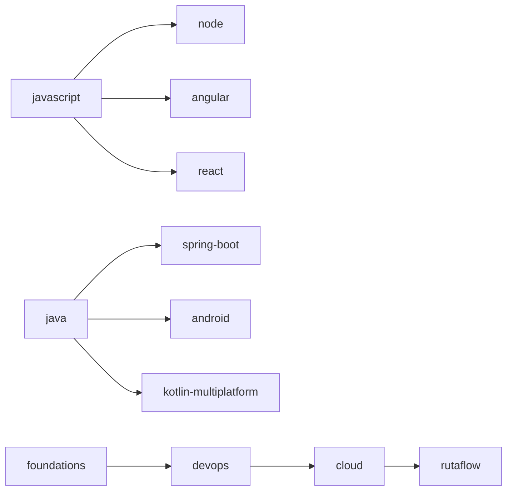

# Grafo de prerrequisitos

Este inventario representa el orden mínimo verificable. La secuencia automática no sustituye la revisión conceptual tema por tema.

## Dependencias entre libros

## Cobertura

| Track | Temas ordenados |
|---|---:|
| foundations | 97 |
| javascript | 88 |
| java | 80 |
| node | 77 |
| spring-boot | 84 |
| angular | 71 |
| react | 58 |
| kotlin-multiplatform | 56 |
| android | 57 |
| ios | 56 |
| flutter | 63 |
| devops | 104 |
| cloud | 156 |
| rutaflow | 26 |

**Total:** 1073 temas.
