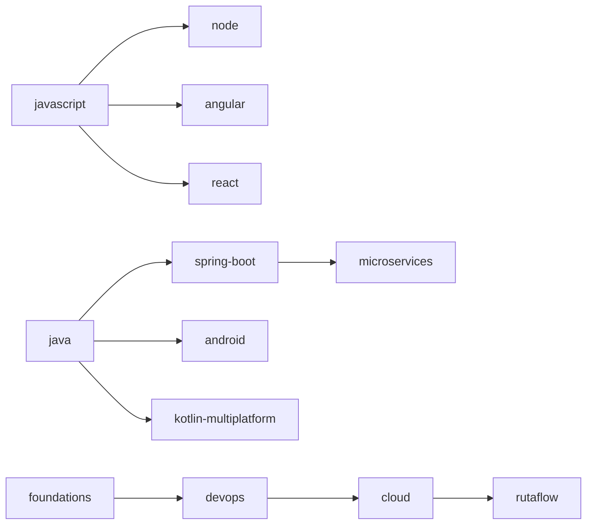

# Grafo de prerrequisitos

Este inventario representa el orden mínimo verificable. La secuencia automática no sustituye la revisión conceptual tema por tema.

## Dependencias entre libros

## Cobertura

| Track | Temas ordenados |
|---|---:|
| foundations | 102 |
| javascript | 92 |
| java | 117 |
| node | 90 |
| spring-boot | 121 |
| microservices | 24 |
| angular | 78 |
| react | 64 |
| kotlin-multiplatform | 66 |
| android | 83 |
| ios | 69 |
| flutter | 119 |
| devops | 138 |
| cloud | 168 |
| rutaflow | 29 |

**Total:** 1360 temas.
