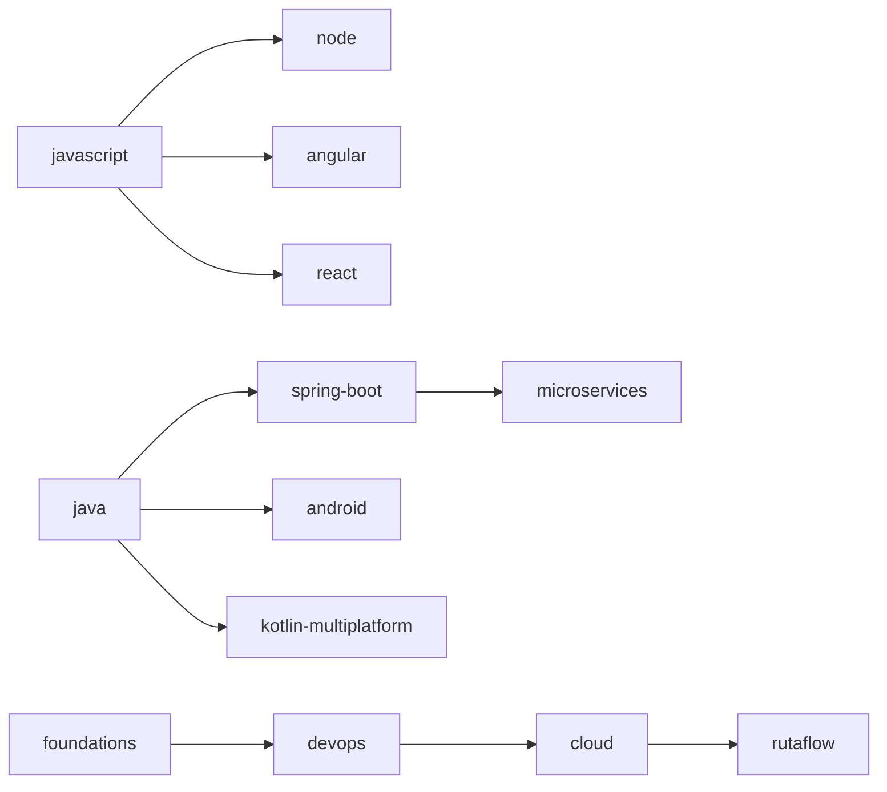

# Grafo de prerrequisitos

Este inventario representa el orden mínimo verificable. La secuencia automática no sustituye la revisión conceptual tema por tema.

## Dependencias entre libros

## Cobertura

| Track | Temas ordenados |
|---|---:|
| foundations | 100 |
| javascript | 88 |
| java | 111 |
| node | 83 |
| spring-boot | 113 |
| microservices | 23 |
| angular | 71 |
| react | 58 |
| kotlin-multiplatform | 56 |
| android | 74 |
| ios | 56 |
| flutter | 106 |
| devops | 129 |
| cloud | 156 |
| rutaflow | 29 |

**Total:** 1253 temas.
