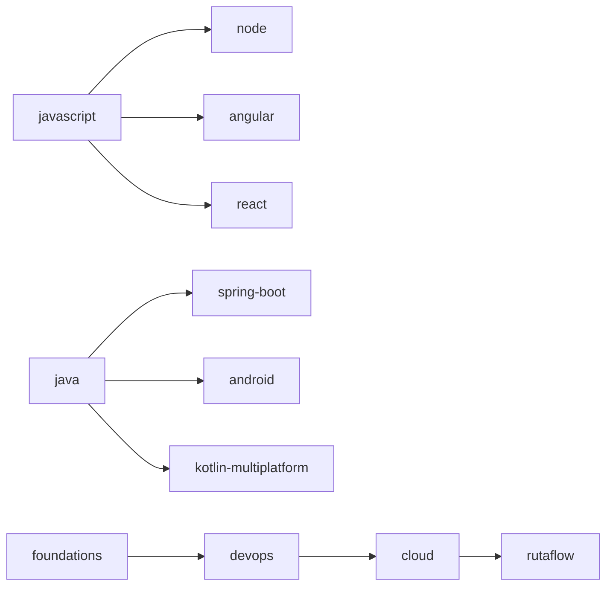

# Grafo de prerrequisitos

Este inventario representa el orden mínimo verificable. La secuencia automática no sustituye la revisión conceptual tema por tema.

## Dependencias entre libros

## Cobertura

| Track | Temas ordenados |
|---|---:|
| foundations | 73 |
| javascript | 83 |
| java | 72 |
| node | 75 |
| spring-boot | 80 |
| angular | 68 |
| react | 57 |
| kotlin-multiplatform | 55 |
| android | 52 |
| ios | 55 |
| flutter | 58 |
| devops | 99 |
| cloud | 155 |
| rutaflow | 25 |

**Total:** 1007 temas.
