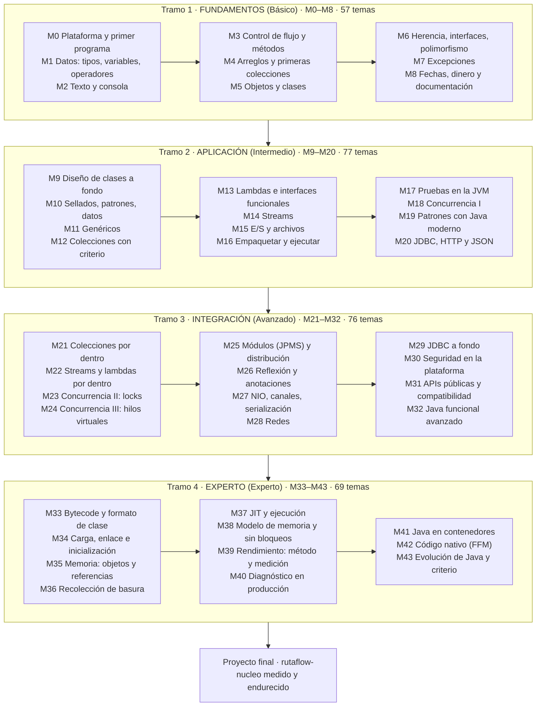

# Java (JDK 25): de cero a experto

> Portada del curso según el [formato único](../../FORMATO-UNICO.md) (specs/021). Temario aprobado por el
> dueño el 2026-11-20: [`docs/temarios/java-objetivo.md`](../../../temarios/java-objetivo.md) (279 temas, 44
> módulos). **Estado de esta zona de preparación:** escritos el [módulo 0](modulo-0.md), el
> [módulo 1](modulo-1.md), el [módulo 2](modulo-2.md), el [módulo 3](modulo-3.md) y los cuatro primeros temas
> del [módulo 4](modulo-4.md) —todos con su laboratorio ejecutado y en verde, ver el `README.md` de cada carpeta
> `laboratorios/modulo-N/`; el resto se escribe igual, por tramos completos—.

## 1. Para quién es

Para quien quiere programar en Java de forma profesional y entender lo que ocurre debajo: desde quien nunca
ha programado hasta quien ya escribe Java y quiere dominar la JVM, la concurrencia y el diagnóstico en
producción.

**Qué necesitas saber antes:**

- Usar una terminal, Git y un editor: curso [Fundamentos](/curso/foundations/0).
- Para los módulos 20 y 29 (JDBC), SQL básico: [Fundamentos · SQL](/curso/foundations/4).
- Ningún conocimiento previo de programación para empezar el tramo Fundamentos.

Lo que este curso **no** enseña y dónde está: el modelo de build de Gradle (curso de Gradle), Spring y
JPA/Hibernate (curso de Spring), contenedores y despliegue (cursos de Docker y Kubernetes). Aquí se usan y
se enlazan.

## 2. Qué sabrás hacer

Al terminar podrás demostrar, con el proyecto guía, que sabes:

1. **Escribir Java moderno** (records, tipos sellados, patrones, genéricos, lambdas y streams) y explicar
   qué bytecode produce cada construcción leyendo `javap -c`.
2. **Dibujar la memoria** de cualquier fragmento (pila, heap, referencias) y predecir alias, copias y
   `null`.
3. **Elegir y justificar** estructuras de datos y tipos numéricos por su coste real, con mediciones.
4. **Escribir código concurrente correcto**: reproducir una carrera y un bloqueo, corregirlos, y atender
   10 000 conexiones con hilos virtuales.
5. **Construir, probar y empaquetar** una aplicación con Gradle (Kotlin DSL), módulos JPMS, pruebas con
   cobertura y una imagen de runtime con `jlink`.
6. **Persistir y comunicar** sin framework: JDBC con transacciones, `HttpClient`, sockets con TLS y E/S con
   NIO.
7. **Medir y diagnosticar** una JVM en producción: benchmarks con JMH, grabaciones JFR, `jcmd`, volcados
   de memoria, elección de recolector con datos.
8. **Decidir con criterio de experto**: qué función en preview adoptar, cuándo migrar de entrega y qué
   compatibilidad promete una API pública.

## 3. Mapa del curso

**Texto alternativo:** cuatro tramos en orden. Fundamentos (módulos 0 a 8, 57 temas): plataforma, datos,
texto, control de flujo, arreglos, objetos, herencia, excepciones y fechas. Aplicación (módulos 9 a 20, 77
temas): diseño de clases, tipos sellados y patrones, genéricos, colecciones, lambdas, streams, archivos,
empaquetado, pruebas, concurrencia I, patrones de diseño y JDBC, HTTP y JSON. Integración (módulos 21 a 32,
76 temas): colecciones y streams por dentro, concurrencia II y III, módulos, reflexión, NIO, redes, JDBC a
fondo, seguridad, APIs públicas y Java funcional avanzado. Experto (módulos 33 a 43, 69 temas): bytecode,
carga de clases, memoria, recolección de basura, JIT, modelo de memoria, rendimiento, diagnóstico,
contenedores, código nativo y evolución de Java. Al final, el proyecto final.

Integración y Experto suman 145 de 279 temas (52 %): se cumple «al menos la mitad».

| Tramo | Módulos | Temas | Escritos en formato único |
|---|---|---:|---|
| Fundamentos | M0–M8 | 57 | **30**: M0 (7) · M1 (7) · M2 (6) · M3 (6) y 4 de los 6 de M4 |
| Aplicación | M9–M20 | 77 | — |
| Integración | M21–M32 | 76 | — |
| Experto | M33–M43 | 69 | — |

## 4. Proyecto guía: `rutaflow-nucleo`

El motor de envíos de RutaFlow en **Java puro, sin framework**: un solo proyecto que crece módulo a módulo.
Es el mismo dominio del resto de la academia (envíos, rutas, tarifas, rastreo), y el curso de Spring parte
de este núcleo.

| Tramo | Qué es el proyecto al terminar |
|---|---|
| Fundamentos | Programa de consola que registra envíos, calcula tarifa y fecha prometida, lee un archivo y falla con mensajes útiles |
| Aplicación | Aplicación por capas con dominio sellado, reglas de tarifa componibles, informes con streams, CLI empaquetada, pruebas con cobertura, ingesta concurrente, JDBC en PostgreSQL y un puerto HTTP mínimo |
| Integración | Varios subproyectos Gradle y módulos JPMS, plugins de transportistas por `ServiceLoader`, protocolo TCP con TLS, cotizador con hilos virtuales, manifiestos firmados, librería `rutaflow-tarifas` e imagen `jlink` |
| Experto | El mismo sistema medido y endurecido: JMH, JFR, recolector elegido con datos, caché AOT, estructuras sin bloqueos, FFM, imagen de contenedor mínima y tres incidentes diagnosticados |

Lo que ya existe tras el piloto:

| Módulo | Qué aporta al proyecto | Laboratorio |
|---|---|---|
| M0 | El proyecto Gradle (wrapper, toolchain 25, catálogo), la regla `Tarifa`, el `Cotizador` de consola y 3 pruebas | [`laboratorios/modulo-0/`](laboratorios/modulo-0/README.md) |
| M1 | `CalculadoraDeTarifas` sin desbordamientos, truncados ni errores de céntimos; `CalculadoraIngenua` con los cuatro fallos demostrados; 11 pruebas | [`laboratorios/modulo-1/`](laboratorios/modulo-1/README.md) |
| M2 | `GuiaDeEnvio` (record que parsea `código;destino;peso` y devuelve el **motivo** de rechazo, no una excepción) y `LectorDeGuias` con `IO.readln()`; 12 pruebas | [`laboratorios/modulo-2/`](laboratorios/modulo-2/README.md) |
| M3 | `Zona` (enum de cinco zonas) y `Despachador`: expresión `switch` con `yield`, ternarios anidados, `break` con etiqueta, `sumaGramos` recursiva con sobrecarga `varargs`; 12 pruebas | [`laboratorios/modulo-3/`](laboratorios/modulo-3/README.md) |
| M4 | `Manifiesto`: el mismo manifiesto de guías resuelto **dos veces** —con arreglos (`Arrays.sort` + `binarySearch`) y con colecciones (`merge` para los totales por zona y `totalesOrdenados` para imprimirlos siempre igual, ordenando las claves a mano)— y las dos versiones cuadrando; 9 pruebas | [`laboratorios/modulo-4/`](laboratorios/modulo-4/README.md) |

Cada laboratorio parte del estado final del anterior y su `README.md` dice qué cambia y por qué.

## 5. Duración, versiones y entorno

**Duración** (estimación del temario: 40 min de media por tema; los minutos reales se fijan en cada tema).

| Tramo | Temas | Horas de estudio |
|---|---:|---:|
| Fundamentos | 57 | ≈ 38 h |
| Aplicación | 77 | ≈ 51 h |
| Integración | 76 | ≈ 51 h |
| Experto | 69 | ≈ 46 h |
| Proyecto final | — | ≈ 20 h |
| **Total** | **279** | **≈ 206 h** |

Medido en lo ya escrito, sumando los minutos declarados por tema (cuadrilla `### Tema` de cada módulo): M0,
4 h 20 min; M1, 4 h 40 min; M2, 4 h 10 min; M3, 4 h 05 min y M4, **2 h 45 min de los 4 h 10 min planeados**
(quedan el tema 5 y el 6). Total de temas escritos: **20 h 00 min**, más una hora de laboratorio por módulo
(5 h, de M0 a M4) → **25 h 00 min** de Tramo 1 disponible hoy (el tramo son 8 módulos).

**Versiones fijadas** (fuente: `docs/VERSIONES.md`).

| Herramienta | Versión | Dónde se fija |
|---|---|---|
| Java | JDK 25 (LTS, disponible desde el 2025-09-16) | toolchain en cada `build.gradle.kts` |
| Gradle | 9.8.2, por wrapper | `gradle/wrapper/gradle-wrapper.properties` |
| JUnit | 6.0.3 | `gradle/libs.versions.toml` |
| Resto de bibliotecas | se fijan en el catálogo antes de escribir su módulo | `gradle/libs.versions.toml` |

Funciones de JDK 25 según su estado: las **definitivas** se usan sin más (JEP 512 archivos fuente
compactos, 511 `import module`, 513 constructores flexibles, 506 valores con ámbito). Las que están en
**preview** (JEP 505 concurrencia estructurada, 507 patrones con primitivos, 502 valores estables, 470 PEM),
en **incubación** (JEP 508 Vector API) o **experimentales** (JEP 509) se marcan en el título del tema y su
laboratorio activa `--enable-preview` o `--add-modules` en el build. Los módulos 0 y 1 no usan ninguna.

**Cómo preparar el entorno.**

1. Instala JDK 25 y comprueba `java -version` y `javac -version`
   ([M0 · Tema 2](modulo-0.md)). En macOS: `brew install --cask temurin@25`; en Ubuntu 24.04 o posterior:
   `sudo apt install openjdk-25-jdk`; con SDKMAN: `sdk install java <identificador de la 25>`.
2. Define `JAVA_HOME` y pon `$JAVA_HOME/bin` delante en `PATH`.
3. Comprueba el entorno: `java laboratorios/modulo-0/tema-2/ComprobarEntorno.java` debe terminar en
   `RESULTADO: entorno coherente`.
4. Instala un IDE (IntelliJ IDEA Community o VS Code con «Extension Pack for Java»). No hace falta instalar
   Gradle: cada laboratorio trae su wrapper.
5. Ejecuta `./verificar.sh` en `laboratorios/modulo-0/`: debe terminar en `RESULTADO: OK`.

Si tu terminal muestra `?` en lugar de tildes, ejecuta con `-Dstdout.encoding=UTF-8` (los comandos del
curso ya lo llevan).

## 6. Proyecto final y rúbrica

Entregar `rutaflow-nucleo` completo con seis piezas. Cada una se califica de 0 a 3 (0 no está; 1 está pero
no se puede reproducir; 2 reproducible; 3 reproducible, explicada y con la decisión justificada). Se
aprueba con 12 de 18 y ninguna pieza en 0.

| # | Entregable | Evidencia que se pide | Cómo se comprueba |
|---|---|---|---|
| 1 | Build verde en JDK 25 | repositorio con wrapper, toolchain y catálogo | `./gradlew check` termina en `BUILD SUCCESSFUL` |
| 2 | 10 000 conexiones de rastreo con hilos virtuales | programa de carga y grabación JFR | la grabación muestra las conexiones atendidas y el número de hilos de plataforma usados |
| 3 | Informe de rendimiento | objetivo en percentiles, benchmark JMH antes y después, mejora demostrada | las tablas de JMH se regeneran con una orden |
| 4 | Diagnóstico de los tres incidentes de M40 | por incidente: síntoma, evidencia (volcado, JFR, registro), causa y arreglo | cada incidente se reproduce con su script |
| 5 | Imagen de runtime con `jlink` y caché AOT | tamaño de la imagen y arranque medido antes y después | script que construye la imagen y mide el arranque |
| 6 | Registro de decisiones | qué recolector, qué estructuras de datos, qué funciones en preview se usan y por qué | un documento por decisión con alternativas y datos |

## Cómo está escrito cada tema

Todos los temas siguen las 12 secciones del formato único, con el énfasis propio de Java (specs/021 §3):

- **Memoria dibujada** (pila, heap, referencias) en cada tema de lenguaje.
- **Bytecode con `javap -c`** para comprobar lo que hace el compilador, y `jcmd`/JFR para lo que hace la
  JVM.
- **El mismo ejemplo de Java 8 a 25** cuando la forma de escribirlo cambió.
- **Especificación citada por sección** (JLS y JVMS) y cada JEP con su número y la entrega en que quedó
  definitivo.
- **Código ejecutado**: cada bloque lleva archivo, comando y salida real. Los archivos están en
  `laboratorios/modulo-N/` y `verificar.sh` los vuelve a ejecutar y comprueba la salida.
- **Errores reales**: el mensaje que imprime el compilador o la JVM, copiado, con síntoma, causa,
  diagnóstico y arreglo.
