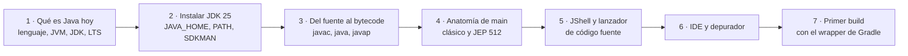
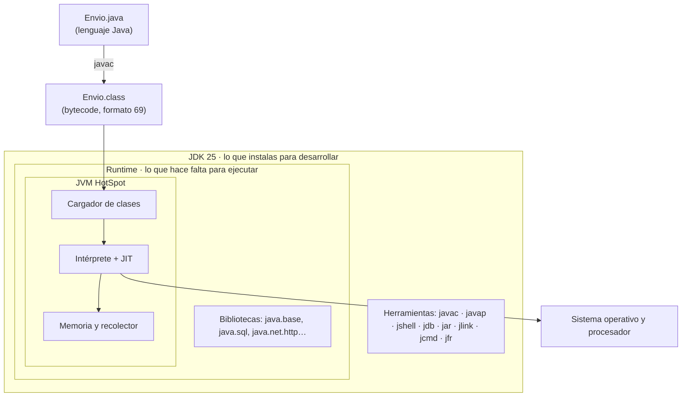
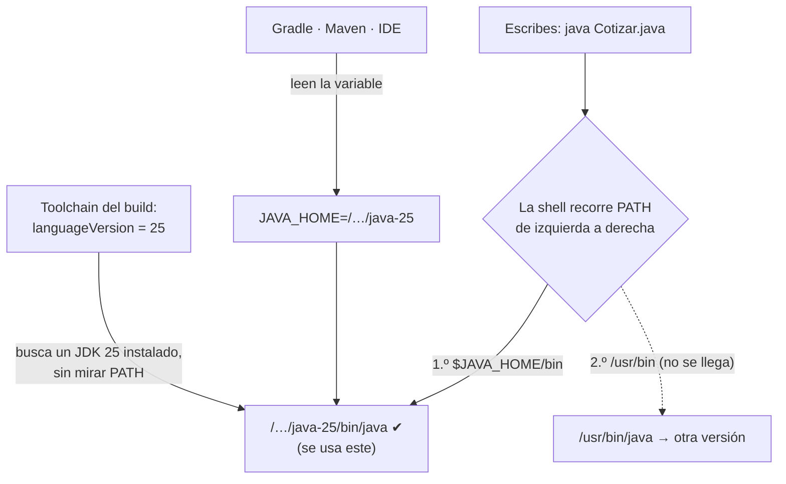
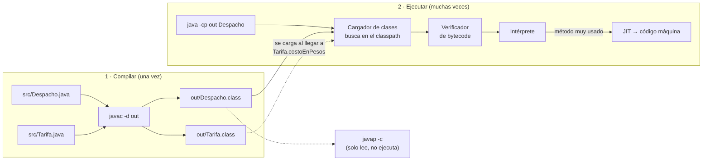
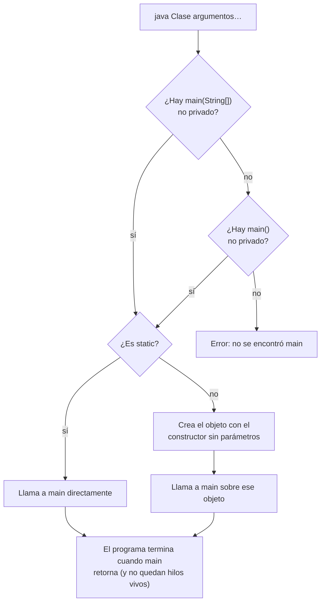
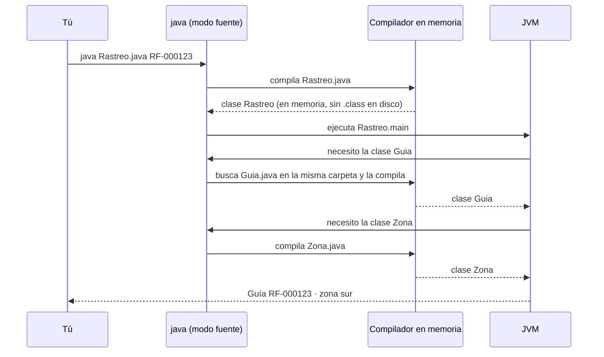
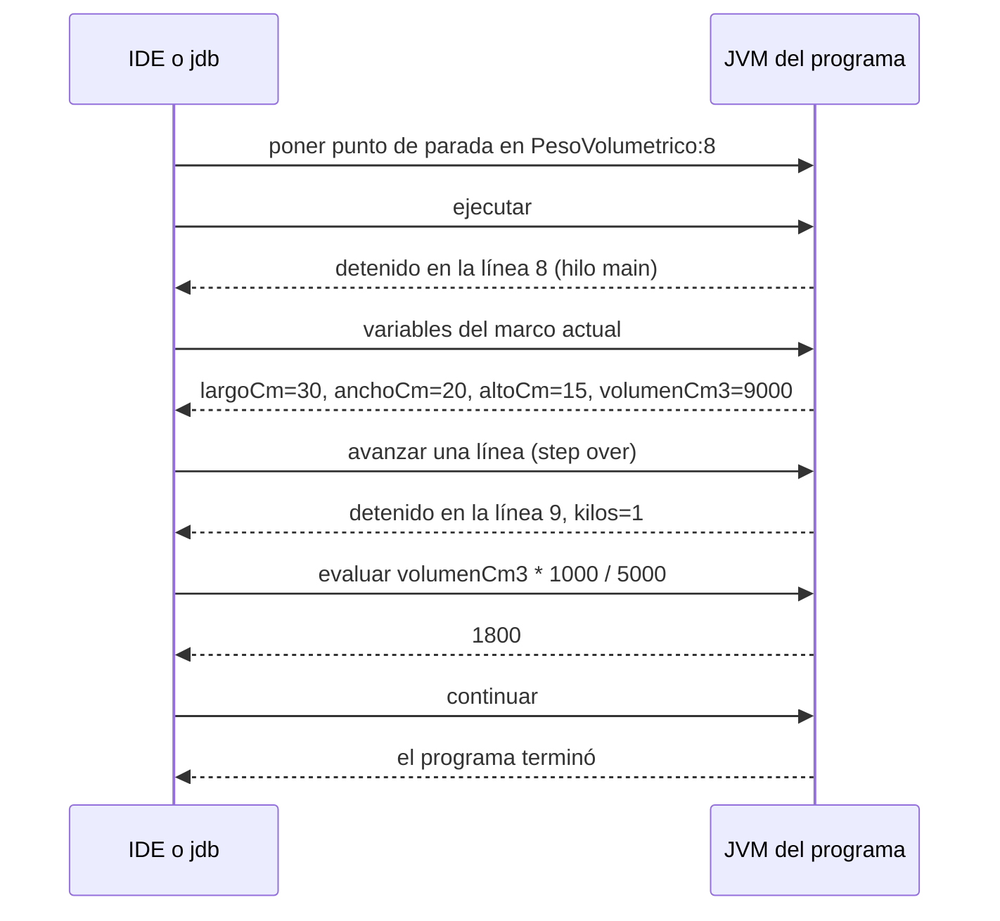
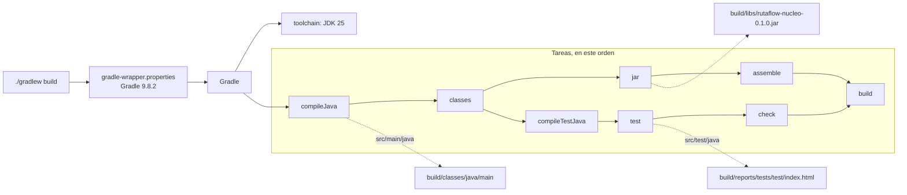

# Módulo 0 · Plataforma, herramientas y primer programa

> Curso Java (JDK 25) · tramo **Fundamentos** · 7 temas · formato único (specs/021). Portada del curso:
> [CURSO.md](CURSO.md). Todo el código de este módulo se ejecutó con OpenJDK 25.0.5 (Ubuntu, x86-64) el
> 2026-11-20 y las salidas están pegadas tal cual. Lo que no se pudo ejecutar se dice en el propio tema.

## Cabecera del módulo

| | |
|---|---|
| **Objetivo** | Dejar una máquina lista para trabajar con Java 25 y entender qué ocurre desde que escribes un `.java` hasta que la JVM lo ejecuta: instalar y elegir el JDK, compilar, leer bytecode, escribir `main` en sus dos formas, probar con JShell, depurar y construir `rutaflow-nucleo` con el wrapper de Gradle. |
| **Prerrequisitos** | Saber usar una terminal (carpetas, `cd`, `ls`, variables de entorno): curso [Fundamentos](/curso/foundations/0). Ninguno de programación. |
| **Duración** | 4 h 20 min (7 temas de 30 a 45 min) más 1 h de laboratorio. |
| **Versiones** | JDK 25 (LTS, disponible desde el 2025-09-16) · Gradle 9.8.2 por wrapper · JUnit 6.0.3. JDK 21 solo para demostrar errores de versión. |
| **Laboratorio** | [`laboratorios/modulo-0/`](laboratorios/modulo-0/README.md) (al publicar: `examples/java/modulo-0/`), con `verificar.sh`. |
| **Proyecto guía** | `rutaflow-nucleo`: el motor de envíos de RutaFlow en Java puro. Aquí nace: un cotizador de consola y su build. |

### Mapa del módulo



**Texto alternativo:** los siete temas van en línea: primero qué es la plataforma, luego instalarla, compilar
y leer bytecode, escribir `main`, experimentar con JShell y el lanzador, depurar y, al final, construir el
proyecto con Gradle.

---

### Tema 1: Qué es Java hoy: lenguaje, JVM, JDK, distribuciones de OpenJDK y calendario de versiones (LTS y entregas semestrales) · Básico · 35 min

#### 1. Ubicación y prerrequisitos

Curso Java · tramo Fundamentos · módulo 0 · primer tema del curso. No necesita ningún tema anterior; solo
una terminal. Para ejecutar los ejemplos hace falta un JDK: si aún no lo tienes, lee este tema y vuelve a
ejecutarlos después del tema siguiente, que lo instala. Versión: JDK 25.

#### 2. Objetivo

Al terminar podrás leer la salida de `java -version` y decir qué entrega de Java es, quién la construyó,
si tiene soporte largo y qué formato de clase produce, y explicar la diferencia entre lenguaje, JVM y JDK.

#### 3. Por qué importa

En un equipo real conviven máquinas con Java 17, 21 y 25, de proveedores distintos. Un programa que compila
en tu portátil y revienta en el servidor con `UnsupportedClassVersionError` casi nunca tiene un fallo de
código: se compiló para una entrega y se está ejecutando en otra. Si no sabes leer qué Java tienes delante,
buscarás el error en el lugar equivocado. Y si eliges una entrega sin soporte largo para producción, en seis
meses dejarás de recibir parches de seguridad.

#### 4. Analogía

Java es como la música escrita. El **lenguaje** es la notación (las reglas para escribir la partitura). El
**bytecode** es la partitura impresa: no suena sola, pero cualquier orquesta puede leerla. La **JVM** es la
orquesta que la interpreta en cada sala (Linux, macOS, Windows). El **JDK** es el estudio completo: trae la
orquesta y además las herramientas para escribir, revisar y empaquetar partituras. Las **distribuciones**
son estudios de distintas empresas montados con los mismos planos (OpenJDK).

**Dónde se rompe la analogía:** una orquesta toca igual la primera vez que la milésima; la JVM no. Observa
qué partes del programa se ejecutan más y las recompila a código máquina mientras corre (compilador JIT), de
modo que el mismo programa va más rápido al cabo de unos segundos.

#### 5. Diagrama



**Texto alternativo:** el JDK contiene las herramientas de desarrollo y, dentro, el runtime; el runtime
contiene las bibliotecas y la JVM. El compilador `javac` convierte el fuente en bytecode de formato 69; la
JVM lo carga, lo interpreta y lo compila a código máquina para el sistema operativo.

#### 6. Explicación

**Nivel 0.** «Java» son tres cosas distintas con el mismo nombre. El **lenguaje** es lo que escribes. La
**JVM** (máquina virtual de Java) es el programa que ejecuta lo que escribiste, una vez traducido a
**bytecode**. El **JDK** (kit de desarrollo) es el paquete que instalas: trae el compilador `javac`, la JVM
y más herramientas. Para desarrollar necesitas un JDK; con uno solo basta.

**Nivel intermedio.** Lo que hay que saber para trabajar:

- **OpenJDK** es el proyecto de código abierto donde se desarrolla Java. De ese mismo código, varias
  organizaciones publican su **distribución**: Eclipse Temurin (Adoptium), Oracle JDK, Amazon Corretto, Azul
  Zulu, Microsoft Build of OpenJDK, BellSoft Liberica, Red Hat, SAP Machine, y las de las distribuciones de
  Linux (la de este curso se verificó con la de Ubuntu). Para tu código son equivalentes: cambian el
  instalador, la licencia, el tiempo de soporte y algún parche.
- **Calendario.** Desde Java 10 hay una entrega nueva cada seis meses, en marzo y septiembre
  ([JEP 322](https://openjdk.org/jeps/322)). JDK 25 salió el 2025-09-16
  ([proyecto JDK 25](https://openjdk.org/projects/jdk/25/)).
- **LTS** (soporte a largo plazo) no es una propiedad técnica de la entrega: es el compromiso de un
  proveedor de publicar parches durante años. Las entregas que los proveedores tratan como LTS son 8, 11,
  17, 21 y 25. Una entrega que no es LTS (22, 23, 24) deja de recibir actualizaciones cuando sale la
  siguiente. Para producción se elige una LTS; las intermedias sirven para probar lo que viene.
- **JRE.** Hasta Java 8 existía un paquete aparte solo para ejecutar. Hoy casi ninguna distribución lo
  publica como producto principal: se instala el JDK, o se construye un runtime a medida con `jlink` (módulo
  25 del curso).
- **Leer `java -version`.** En la salida de abajo, `25.0.5.0.3` es `FEATURE.INTERIM.UPDATE.PATCH`: entrega
  25, quinta actualización trimestral. La fecha es la de publicación de esa actualización. `mixed mode`
  significa intérprete más JIT; `sharing`, que usa un archivo de clases precargadas para arrancar antes.

**Nivel maestro.** Tres detalles que explican errores reales:

1. **El número de formato de clase.** Cada `.class` empieza con su versión de formato: JDK 25 escribe la
   **69** y JDK 21 la **65** (JVMS §4.1; la tabla es `entrega + 44`). Una JVM se niega a cargar un formato
   más nuevo que el suyo: eso es `UnsupportedClassVersionError`. Al revés sí funciona: una JVM 25 ejecuta
   clases compiladas para 8. Para producir clases antiguas desde un JDK nuevo se usa `javac --release N`,
   que además impide usar por accidente bibliotecas que no existían en N.
2. **Tres versiones distintas en una misma máquina.** `java.specification.version` (la especificación del
   lenguaje y las bibliotecas: 25), `java.vm.specification.version` (la de la JVM: 25) y `java.version` (la
   construcción concreta: 25.0.5.0.3). El archivo `release` de la carpeta del JDK dice quién lo construyó
   (`IMPLEMENTOR`) y qué módulos trae.
3. **La marca LTS es opcional y la pone el proveedor.** JEP 322 dice que un proveedor puede añadir `LTS` a
   la primera línea de `java -version`. La construcción de Ubuntu usada aquí no la pone, y Temurin sí: que
   no aparezca no significa que la entrega 25 no tenga soporte largo. Lo que cuenta es la política del
   proveedor de tu distribución.

Las especificaciones oficiales son dos documentos: la JLS (el lenguaje) y la JVMS (la máquina virtual), en
[docs.oracle.com/javase/specs](https://docs.oracle.com/javase/specs/). En este curso se citan por sección.

#### 7. Código ejecutable

**Lo primero: preguntar a la plataforma** · comando `java -version`

Salida:

```text
openjdk version "25.0.5.0.3" 2026-10-24
OpenJDK Runtime Environment (build 25.0.5.0.3+1-3-24.04.1-Ubuntu)
OpenJDK 64-Bit Server VM (build 25.0.5.0.3+1-3-24.04.1-Ubuntu, mixed mode, sharing)
```

**Ejemplo mínimo** · archivo `tema-1/VersionDeJava.java` · ejecuta `java VersionDeJava.java`

```java
// M0 · Tema 1 · ejemplo mínimo: qué Java está ejecutando este programa.
// Java 25. Ejecuta: java VersionDeJava.java
public class VersionDeJava {
    public static void main(String[] args) {
        Runtime.Version version = Runtime.version();
        System.out.println("Versión completa: " + version);
        System.out.println("Número de entrega (feature): " + version.feature());
        System.out.println("Máquina virtual: " + System.getProperty("java.vm.name"));
    }
}
```

Salida:

```text
Versión completa: 25.0.5.0.3+1-3-24.04.1-Ubuntu
Número de entrega (feature): 25
Máquina virtual: OpenJDK 64-Bit Server VM
```

**Ejemplo realista** · archivo `tema-1/InformeDeEntorno.java` · ejecuta
`java -Dstdout.encoding=UTF-8 InformeDeEntorno.java`

`rutaflow-nucleo` comprueba la plataforma antes de arrancar, para fallar con un mensaje claro y no con un
error raro diez minutos después.

```java
// M0 · Tema 1 · ejemplo realista: rutaflow-nucleo comprueba su plataforma antes de arrancar.
// Java 25. Ejecuta: java -Dstdout.encoding=UTF-8 InformeDeEntorno.java
public class InformeDeEntorno {
    // rutaflow-nucleo usa funciones definitivas de JDK 25: con menos no arranca.
    static final int ENTREGA_MINIMA = 25;

    public static void main(String[] args) {
        Runtime.Version version = Runtime.version();
        int entrega = version.feature();

        System.out.println("rutaflow-nucleo · informe de entorno");
        System.out.println("  entrega de Java:        " + entrega);
        System.out.println("  actualización:          " + version.update());
        System.out.println("  formato de clase:       " + System.getProperty("java.class.version"));
        System.out.println("  especificación de JVM:  " + System.getProperty("java.vm.specification.version"));
        System.out.println("  ¿trae compilador?       " + (javax.tools.ToolProvider.getSystemJavaCompiler() != null));

        if (entrega < ENTREGA_MINIMA) {
            System.out.println("RESULTADO: este equipo tiene Java " + entrega
                    + " y rutaflow-nucleo necesita Java " + ENTREGA_MINIMA + " o posterior");
            System.exit(1);
        }
        System.out.println("RESULTADO: plataforma válida para rutaflow-nucleo");
    }
}
```

Salida con JDK 25:

```text
rutaflow-nucleo · informe de entorno
  entrega de Java:        25
  actualización:          5
  formato de clase:       69.0
  especificación de JVM:  25
  ¿trae compilador?       true
RESULTADO: plataforma válida para rutaflow-nucleo
```

El mismo programa, compilado para Java 21 y ejecutado con una JVM 21
(`javac --release 21 -d out21 InformeDeEntorno.java` y después `java -cp out21 InformeDeEntorno` con el
`java` de JDK 21):

```text
rutaflow-nucleo · informe de entorno
  entrega de Java:        21
  actualización:          13
  formato de clase:       65.0
  especificación de JVM:  21
  ¿trae compilador?       true
RESULTADO: este equipo tiene Java 21 y rutaflow-nucleo necesita Java 25 o posterior
código de salida: 1
```

**Por dentro** · qué trae el JDK y cómo se identifica

`ls "$JAVA_HOME/bin"` (30 herramientas; en este curso usarás al menos `javac`, `java`, `javap`, `jshell`,
`jdb`, `jar`, `jlink`, `jcmd` y `jfr`):

```text
jar jarsigner java javac javadoc javap jcmd jconsole jdb jdeprscan jdeps jfr jhsdb jimage jinfo jlink jmap jmod jnativescan jpackage jps jrunscript jshell jstack jstat jstatd jwebserver keytool rmiregistry serialver 
```

`java -XshowSettings:properties -version 2>&1 | grep -E "java\.(version|vendor|vm\.name|...)"`:

```text
    java.class.version = 69.0
    java.home = /usr/lib/jvm/java-25-openjdk-amd64
    java.runtime.name = OpenJDK Runtime Environment
    java.specification.version = 25
    java.vendor = Ubuntu
    java.version = 25.0.5.0.3
    java.version.date = 2026-10-24
    java.vm.name = OpenJDK 64-Bit Server VM
    java.vm.vendor = Ubuntu
```

`javac -d out VersionDeJava.java && javap -v -cp out VersionDeJava | grep "major version"`:

```text
  major version: 69
```

#### 8. Mini-laboratorio

1. Ejecuta `java -version` y `javac -version`. Anota entrega, actualización, proveedor y fecha.
2. Ejecuta `InformeDeEntorno.java` y confirma la línea `RESULTADO`.
3. Abre el archivo `release` de tu JDK (`cat "$JAVA_HOME/release"`) y localiza `IMPLEMENTOR` y
   `JAVA_VERSION_DATE`. Calcula cuántos meses tiene tu actualización.
4. Cambia `ENTREGA_MINIMA` a 26, ejecuta de nuevo y comprueba el código de salida con `echo $?`.
5. Devuelve el valor a 25.

**Listo cuando** puedes decir, sin mirar apuntes, la entrega, el proveedor y el formato de clase de tu JDK,
y el paso 4 imprime un mensaje que nombra las dos entregas y termina con código 1.

#### 9. Verificación

```bash
java -Dstdout.encoding=UTF-8 InformeDeEntorno.java | tail -1
```

Debe imprimir `RESULTADO: plataforma válida para rutaflow-nucleo`. El laboratorio completo se comprueba con
`./verificar.sh` (sección «Tema 1»).

#### 10. Error común y diagnóstico

**Síntoma:** el programa compila en tu máquina y al ejecutarlo en otra aparece esto (salida real: clase
compilada con JDK 25 y ejecutada con el `java` de JDK 21):

```text
Error: LinkageError occurred while loading main class VersionDeJava
	java.lang.UnsupportedClassVersionError: VersionDeJava has been compiled by a more recent version of the Java Runtime (class file version 69.0), this version of the Java Runtime only recognizes class file versions up to 65.0
```

**Causa:** la clase tiene formato 69 (JDK 25) y esa JVM solo entiende hasta el 65 (JDK 21). No es un fallo
del código.

**Diagnóstico:** `java -version` en la máquina que falla, y `javap -v Clase.class | grep "major version"`
sobre el archivo. Si el número del archivo es mayor que `entrega + 44` de la JVM, es este caso.

**Arreglo:** ejecutar con un JDK de la entrega correcta (lo normal), o compilar para la entrega más antigua
que deba soportarse con `javac --release 21`. Nunca «bajar» el número a mano.

**Otro error real:** escribir `java -v` o `java --v`. La opción es `java -version` (escribe en la salida de
error) o `java --version` (escribe en la salida estándar).

#### 11. Pregunta con respuesta modelo

**Comprensión.** ¿Por qué un `.class` compilado con JDK 21 funciona en una JVM 25, pero no al revés?

**Respuesta modelo:** porque cada JVM conoce todos los formatos de clase hasta el suyo. La JVM 25 entiende
el formato 65; la JVM 21 no puede entender el 69, que puede usar instrucciones y estructuras que no
existían cuando se escribió.

**Entrevista.** ¿Qué diferencia hay entre JDK, JRE y JVM, y qué instalarías hoy en un servidor?

**Respuesta modelo:** la JVM ejecuta bytecode; el runtime (lo que se llamaba JRE) es la JVM más las
bibliotecas estándar; el JDK añade las herramientas de desarrollo y diagnóstico. Hoy la mayoría de
distribuciones solo publican el JDK. En un servidor pondría un JDK de una entrega LTS de un proveedor con
soporte, o una imagen mínima creada con `jlink` que contenga solo los módulos que usa la aplicación. Tener
`jcmd` y `jfr` en producción es útil para diagnosticar, y eso inclina la balanza hacia el JDK completo
salvo que el tamaño de la imagen sea crítico.

#### 12. Cuándo usarlo y cuándo no

| Úsalo | No lo uses |
|---|---|
| Una entrega LTS (hoy, 25) para producción y para aprender | Una entrega intermedia (22–24, 26) en producción: se queda sin parches en seis meses |
| Una distribución con soporte declarado (Temurin, Corretto, Zulu, Oracle, la de tu sistema) | Un JDK descargado de un sitio que no es el del proveedor |
| `javac --release N` cuando el destino ejecuta una entrega anterior | `-source`/`-target` sueltos: no impiden usar bibliotecas que no existen en el destino |
| El mismo proveedor y entrega en desarrollo, CI y producción | «Funciona en mi máquina» con tres entregas distintas |

**Costo:** cambiar de entrega LTS cada dos años exige probar la aplicación entera; no hacerlo acumula
vulnerabilidades sin parche. Elegir proveedor es sobre todo una decisión de soporte y licencia, no técnica.

---

### Tema 2: Instalar JDK 25 y convivir con varias versiones: `JAVA_HOME`, `PATH`, SDKMAN y toolchains · Básico · 35 min

#### 1. Ubicación y prerrequisitos

Curso Java · tramo Fundamentos · módulo 0. Antes: [M0 · Tema 1](modulo-0.md#tema-1-que-es-java-hoy-lenguaje-jvm-jdk-distribuciones-de-openjdk-y-calendario-de-versiones-lts-y-entregas-semestrales--basico--35-min) (qué es un JDK y qué es una entrega).
Necesitas saber qué es una variable de entorno. Versión: JDK 25; JDK 21 como segunda versión para practicar
la convivencia.

#### 2. Objetivo

Al terminar podrás instalar JDK 25, tener otra versión al lado, decidir cuál se usa en cada terminal y en
cada proyecto, y diagnosticar en un minuto por qué «se está usando el Java que no es».

#### 3. Por qué importa

Vas a mantener a la vez un servicio en Java 21 y `rutaflow-nucleo` en Java 25. Si cada cambio de proyecto
te obliga a reinstalar, o si no sabes cuál de los dos está respondiendo cuando escribes `java`, perderás
horas con errores como `release version 25 not supported`. El fallo típico es silencioso: `JAVA_HOME`
apunta a un JDK y `PATH` a otro, y cada herramienta usa uno distinto.

#### 4. Analogía

`PATH` es la lista de cajones donde la terminal busca una herramienta, **en orden**: abre el primer cajón,
y si ahí hay un `java`, usa ese y no mira más. `JAVA_HOME` es una nota pegada en la pared que dice «el taller
de Java está en tal sitio»: la terminal no la lee, pero muchas herramientas (Gradle, Maven, el IDE) sí. Si
la nota dice un sitio y el primer cajón tiene otro `java`, cada uno trabajará con un taller diferente.

**Dónde se rompe la analogía:** la nota y los cajones no se guardan en ningún lugar común. Cada terminal
tiene su propia copia, y lo que cambias con `export` desaparece al cerrarla; para que dure hay que
escribirlo en el archivo de arranque de la shell (`~/.zshrc`, `~/.bashrc`) o dejar que lo gestione SDKMAN.

#### 5. Diagrama



**Texto alternativo:** al escribir `java`, la shell recorre `PATH` y usa el primer ejecutable que
encuentra. Las herramientas de build leen `JAVA_HOME`. La toolchain del build pide una versión concreta y
localiza un JDK instalado de esa versión con independencia de `PATH`. Lo sano es que los tres caminos
lleguen al mismo JDK.

#### 6. Explicación

**Nivel 0.** Instalar Java es copiar una carpeta (el JDK) y decirle a la terminal dónde está. Dos variables
lo deciden: `PATH`, que usa la terminal para encontrar `java` y `javac`, y `JAVA_HOME`, que usan las demás
herramientas. Las dos deben apuntar al mismo JDK.

**Nivel intermedio.** Tres formas de instalar, de menos a más cómoda cuando hay varias versiones:

| Forma | Instalar | Cambiar de versión |
|---|---|---|
| Gestor del sistema | macOS: `brew install --cask temurin@25` · Ubuntu 24.04 o posterior: `sudo apt install openjdk-25-jdk` · Windows: `winget install EclipseAdoptium.Temurin.25.JDK` | a mano, con `JAVA_HOME` y `PATH` |
| [SDKMAN](https://sdkman.io) (macOS, Linux, WSL) | `sdk list java` muestra los identificadores; `sdk install java <identificador>` | `sdk use java <id>` (esta terminal), `sdk default java <id>` (todas), `sdk env` (lo que diga el archivo `.sdkmanrc` del proyecto) |
| Toolchain del build | el build declara «Java 25» y la herramienta localiza o descarga ese JDK | no se cambia: cada proyecto dice lo suyo |

Fijar el JDK a mano en una terminal (macOS y Linux):

```bash
export JAVA_HOME=/usr/lib/jvm/java-25-openjdk-amd64     # macOS: export JAVA_HOME=$(/usr/libexec/java_home -v 25)
export PATH="$JAVA_HOME/bin:$PATH"                      # delante, para que gane
```

En Windows se hace en «Variables de entorno»: `JAVA_HOME` con la carpeta del JDK y `%JAVA_HOME%\bin` al
principio de `Path`; después hay que abrir una terminal nueva.

La regla que evita casi todos los problemas: **`PATH` se construye a partir de `JAVA_HOME`**, nunca por
separado. Y en los proyectos, la versión la fija la **toolchain** del build ([M0 · Tema 7](modulo-0.md#tema-7-primer-build-con-el-wrapper-de-gradle-ejecutar-probar-y-empaquetar-solo-uso-el-porque-vive-en-el-curso-de-gradle--basico--30-min)), de modo que da
igual qué `java` tenga cada persona delante.

**Nivel maestro.**

- **Cómo sabe `java` dónde están sus bibliotecas.** No mira `JAVA_HOME`. El ejecutable localiza su propia
  carpeta y sube un nivel: de `…/java-25/bin/java` deduce `java.home = …/java-25`, y de ahí carga
  `lib/modules` (la imagen con todas las clases de la plataforma, que sustituyó a `rt.jar` en JDK 9 con
  JEP 220) y `lib/server/libjvm.so` (la JVM). Por eso
  un JDK es **reubicable**: se copia la carpeta entera a otro sitio y funciona. Y por eso `JAVA_HOME` puede
  estar mal y `java` seguir funcionando: es justo el caso difícil de ver.
- **Enlaces intermedios.** En Linux, `/usr/bin/java` suele ser un enlace a `/etc/alternatives/java`, que a
  su vez enlaza al JDK elegido con `update-alternatives`. `which java` muestra el primer eslabón;
  `readlink -f "$(which java)"` muestra el final. En macOS, `/usr/bin/java` es un lanzador del sistema que
  consulta `/usr/libexec/java_home`.
- **Qué hace una toolchain.** El build declara la entrega del lenguaje. La herramienta busca un JDK de esa
  entrega en las ubicaciones habituales (las del sistema, SDKMAN, Homebrew, las que le indiques) y lo usa
  para compilar, probar y ejecutar, aunque ella misma esté corriendo con otro JDK. En la verificación de
  este módulo, Gradle corría con JDK 21 y compiló con el 25 que encontró instalado.
- **Coste.** En la máquina de verificación el JDK 25 ocupa 332 MB y el 21, 288 MB (`du -sh`). Tener cuatro no cuesta más que disco.

#### 7. Código ejecutable

**Ejemplo mínimo** · archivo `tema-2/DondeEstaJava.java` · ejecuta `java DondeEstaJava.java`

```java
// M0 · Tema 2 · ejemplo mínimo: de qué carpeta sale el Java que está ejecutando este programa.
// Java 25. Ejecuta: java DondeEstaJava.java
public class DondeEstaJava {
    public static void main(String[] args) {
        System.out.println("java.home = " + System.getProperty("java.home"));
        System.out.println("JAVA_HOME = " + System.getenv("JAVA_HOME"));
        System.out.println("ejecutable = " + ProcessHandle.current().info().command().orElse("desconocido"));
    }
}
```

Salida:

```text
java.home = /usr/lib/jvm/java-25-openjdk-amd64
JAVA_HOME = /usr/lib/jvm/java-25-openjdk-amd64
ejecutable = /usr/lib/jvm/java-25-openjdk-amd64/bin/java
```

**Ejemplo realista** · archivo `tema-2/ComprobarEntorno.java` · ejecuta
`java -Dstdout.encoding=UTF-8 ComprobarEntorno.java`

La comprobación que `rutaflow-nucleo` pide pasar antes de empezar a trabajar. Usa `if`/`else`, que se
estudia en el módulo 3; aquí basta con leerlo como «si… si no…».

```java
// M0 · Tema 2 · ejemplo realista: la comprobación que rutaflow-nucleo pide pasar antes de trabajar.
// Detecta el fallo más frecuente con varias versiones instaladas: JAVA_HOME dice una cosa y PATH otra.
// Java 25. Ejecuta: java -Dstdout.encoding=UTF-8 ComprobarEntorno.java
import java.io.File;
import java.io.IOException;

public class ComprobarEntorno {
    public static void main(String[] args) throws IOException {
        String enUso = new File(System.getProperty("java.home")).getCanonicalPath();
        String javaHome = System.getenv("JAVA_HOME");
        int entrega = Runtime.version().feature();
        int fallos = 0;

        System.out.println("JDK en uso (lo decide PATH): " + enUso);

        if (entrega == 25) {
            System.out.println("[ok]    entrega 25");
        } else {
            System.out.println("[FALLO] entrega " + entrega + "; se esperaba 25");
            fallos++;
        }

        if (javaHome == null) {
            System.out.println("[FALLO] JAVA_HOME no está definida");
            fallos++;
        } else if (new File(javaHome).getCanonicalPath().equals(enUso)) {
            System.out.println("[ok]    JAVA_HOME apunta al mismo JDK");
        } else {
            System.out.println("[FALLO] JAVA_HOME apunta a otro JDK: " + javaHome);
            fallos++;
        }

        if (new File(enUso, "bin/javac").exists() || new File(enUso, "bin/javac.exe").exists()) {
            System.out.println("[ok]    es un JDK completo (trae javac)");
        } else {
            System.out.println("[FALLO] no hay javac en " + enUso + "/bin: es solo un runtime");
            fallos++;
        }

        System.out.println(fallos == 0 ? "RESULTADO: entorno coherente" : "RESULTADO: " + fallos + " problema(s)");
        System.exit(fallos == 0 ? 0 : 1);
    }
}
```

Salida con el entorno bien configurado:

```text
JDK en uso (lo decide PATH): /usr/lib/jvm/java-25-openjdk-amd64
[ok]    entrega 25
[ok]    JAVA_HOME apunta al mismo JDK
[ok]    es un JDK completo (trae javac)
RESULTADO: entorno coherente
código de salida: 0
```

Salida con `JAVA_HOME` apuntando a otro JDK (`JAVA_HOME=/usr/lib/jvm/java-21-openjdk-amd64 java … ComprobarEntorno.java`):

```text
JDK en uso (lo decide PATH): /usr/lib/jvm/java-25-openjdk-amd64
[ok]    entrega 25
[FALLO] JAVA_HOME apunta a otro JDK: /usr/lib/jvm/java-21-openjdk-amd64
[ok]    es un JDK completo (trae javac)
RESULTADO: 1 problema(s)
código de salida: 1
```

**Por dentro** · quién responde cuando escribes `java`

`which -a java; readlink -f "$(which java)"` (todos los `java` que hay en `PATH`, en orden, y a dónde lleva
el primero):

```text
/usr/lib/jvm/java-25-openjdk-amd64/bin/java
/usr/bin/java
/bin/java
/usr/lib/jvm/java-25-openjdk-amd64/bin/java
```

Cambiar de versión en una terminal, a mano:
`export JAVA_HOME=/usr/lib/jvm/java-21-openjdk-amd64; export PATH="$JAVA_HOME/bin:$PATH"; java -version 2>&1 | head -1; javac -version`

```text
openjdk version "21.0.13.0.3" 2026-10-24
javac 21.0.13.0.3
```

#### 8. Mini-laboratorio

1. Instala JDK 25 con el método de tu sistema (tabla de la sección 6) y abre una terminal nueva.
2. Ejecuta `ComprobarEntorno.java`. Si sale algún `[FALLO]`, corrige `JAVA_HOME` y `PATH` hasta que no
   salga ninguno.
3. Instala una segunda versión (JDK 21) con el mismo método.
4. En una terminal, cambia a 21 con `export` (o `sdk use java …`) y ejecuta `java -version`. Abre otra
   terminal y comprueba que allí sigue la 25.
5. Con el 21 activo, ejecuta `ComprobarEntorno.java`: debe decir `[FALLO] entrega 21; se esperaba 25`.
6. Escribe en tu archivo de arranque de la shell las dos líneas `export` para que la 25 sea la de por
   defecto.

**Listo cuando** una terminal recién abierta pasa `ComprobarEntorno.java` con `RESULTADO: entorno
coherente` y sabes cambiar a la 21 y volver sin cerrar la terminal.

#### 9. Verificación

```bash
java -Dstdout.encoding=UTF-8 ComprobarEntorno.java; echo "código de salida: $?"
```

Debe terminar en `RESULTADO: entorno coherente` y `código de salida: 0`.

#### 10. Error común y diagnóstico

**Síntoma:** al compilar aparece (salida real, usando el `javac` de JDK 21 para compilar para 25):

```text
error: release version 25 not supported
Usage: javac <options> <source files>
use --help for a list of possible options
```

O bien: Gradle o el IDE dicen que usan Java 21 aunque `java -version` muestra 25.

**Causa:** el `javac` que respondió no es de la entrega que creías. `PATH` y `JAVA_HOME` apuntan a JDK
distintos, o el orden de `PATH` pone antes el JDK viejo.

**Diagnóstico:** tres comandos, en este orden: `which -a java` (qué ejecutables hay y cuál gana),
`echo "$JAVA_HOME"` y `java -XshowSettings:properties -version 2>&1 | grep java.home`. Si las rutas no
coinciden, ya está localizado. `ComprobarEntorno.java` hace esa misma comparación.

**Arreglo:** definir `JAVA_HOME` y construir `PATH` desde ella (`export PATH="$JAVA_HOME/bin:$PATH"`), en el
archivo de arranque de la shell. Cerrar y abrir la terminal.

**Otro error real:** en Windows, `'javac' is not recognized as an internal or external command`. O se
instaló solo un runtime, o `%JAVA_HOME%\bin` no está en `Path`, o no se abrió una terminal nueva después de
cambiar las variables.

#### 11. Pregunta con respuesta modelo

**Comprensión.** `JAVA_HOME` apunta a JDK 21 y `java -version` dice 25. ¿Cómo puede ser y qué pasará al
ejecutar el build?

**Respuesta modelo:** la terminal no usa `JAVA_HOME` para encontrar `java`: usa `PATH`, y el primer `java`
de `PATH` es el de 25. El build sí lee `JAVA_HOME` y arrancará con 21. Si el proyecto no declara toolchain,
compilará con 21 y fallará al encontrar sintaxis o bibliotecas de 25.

**Entrevista.** ¿Cómo garantizas que todo el equipo y el servidor de integración compilan con la misma
versión de Java?

**Respuesta modelo:** no dependo de lo que cada uno tenga instalado: declaro la versión en el build con una
toolchain (en Gradle, `java { toolchain { languageVersion = JavaLanguageVersion.of(25) } }`) y uso el
wrapper para fijar también la versión de la herramienta de build. Añado un `.sdkmanrc` para que quien use
SDKMAN tenga el mismo JDK en la terminal, y en integración continua instalo ese mismo JDK de forma explícita.
Así la versión está en el repositorio y no en la memoria de las personas.

#### 12. Cuándo usarlo y cuándo no

| Úsalo | No lo uses |
|---|---|
| Gestor del sistema si solo necesitas una versión | Instaladores sueltos repetidos: acabas con cinco JDK y no sabes cuál manda |
| SDKMAN si cambias de versión a menudo (macOS, Linux, WSL) | SDKMAN en Windows nativo: no existe; usa `winget` y variables, o WSL |
| Toolchain en el build para todo proyecto compartido | `JAVA_HOME` global como única fuente de verdad de un proyecto |
| `export` en la terminal para una prueba puntual | `export` suelto como configuración permanente: se pierde al cerrar |

**Costo:** la toolchain añade unas líneas al build y, la primera vez, puede descargar un JDK; a cambio
elimina toda una clase de errores «en mi máquina funciona».

**No verificado en este entorno:** los comandos de instalación de Homebrew, `winget`, `apt` y SDKMAN de la
tabla no se ejecutaron aquí (la máquina de verificación ya traía los JDK 21 y 25 de Ubuntu y no tiene
acceso a esos repositorios). Los identificadores exactos de SDKMAN cambian con cada actualización: tómalos
de `sdk list java`. Se comprobarán en el Mac del dueño al cerrar el módulo.

---

### Tema 3: Del fuente al bytecode: `javac`, `java`, classpath y primera lectura con `javap` · Básico · 45 min

#### 1. Ubicación y prerrequisitos

Curso Java · tramo Fundamentos · módulo 0. Antes: [M0 · Tema 1](modulo-0.md#tema-1-que-es-java-hoy-lenguaje-jvm-jdk-distribuciones-de-openjdk-y-calendario-de-versiones-lts-y-entregas-semestrales--basico--35-min) y [M0 · Tema 2](modulo-0.md#tema-2-instalar-jdk-25-y-convivir-con-varias-versiones-javahome-path-sdkman-y-toolchains--basico--35-min) (tener JDK 25 respondiendo en
la terminal). Versión: JDK 25.

#### 2. Objetivo

Al terminar podrás compilar un programa de varios archivos con `javac`, ejecutarlo con `java` indicando el
classpath, leer con `javap -c` qué instrucciones generó el compilador y distinguir por el mensaje si falta
la clase principal o una clase de la que depende.

#### 3. Por qué importa

Un IDE y Gradle esconden estos pasos, y está bien que lo hagan. Pero cuando algo falla —«Could not find or
load main class», `NoClassDefFoundError`, una clase vieja que se sigue ejecutando aunque cambiaste el
fuente— el mensaje habla de `.class` y de classpath, no de botones del IDE. Quien no ha compilado nunca a
mano no puede leer esos mensajes y acaba borrando carpetas al azar.

#### 4. Analogía

`javac` es un traductor que convierte tu texto en un manual de instrucciones muy simples (`.class`), y se
va. `java` es el operario que lee ese manual y hace lo que dice. El **classpath** es la lista de estanterías
donde el operario busca los manuales: si le dices una estantería equivocada, no encuentra el manual aunque
exista.

**Dónde se rompe la analogía:** el operario no lee todos los manuales al empezar. Carga cada clase la
primera vez que la necesita; por eso un manual que falta puede no notarse hasta la mitad del programa.

#### 5. Diagrama



**Texto alternativo:** `javac` lee los dos archivos fuente y escribe dos `.class` en `out`. Al ejecutar,
`java` busca la clase principal en el classpath, la verifica y la interpreta; `Tarifa` solo se carga cuando
el programa llega a usarla. Los métodos muy usados pasan al compilador JIT. `javap` lee un `.class` y
muestra su contenido sin ejecutarlo.

#### 6. Explicación

**Nivel 0.** Son dos pasos con dos programas distintos. `javac Archivo.java` **compila**: lee el texto y
escribe un archivo `.class`. `java Clase` **ejecuta** ese `.class`. A `javac` se le da un nombre de archivo
(con `.java`); a `java`, un nombre de clase (sin extensión). Compilar no ejecuta nada.

**Nivel intermedio.**

- `javac -d out src/Despacho.java src/Tarifa.java` compila los dos fuentes y deja los `.class` en `out`.
  Separar `src` y `out` evita mezclar lo que escribes con lo que se genera (y `out` no se sube a Git).
- `java -cp out Despacho`: `-cp` (o `--class-path`) es el **classpath**, la lista de carpetas y archivos
  `.jar` donde se buscan las clases, separadas por `:` en macOS y Linux y por `;` en Windows. Si no se
  indica, es la carpeta actual.
- Si solo nombras `Despacho.java` y este usa `Tarifa`, `javac` necesita encontrarla. Con
  `-sourcepath src` busca el fuente y lo compila también; si ya existe `Tarifa.class` en el classpath, usa
  ese.
- Una clase `public` debe estar en un archivo con su mismo nombre, mayúsculas incluidas (JLS §7.6).
- `javap -c -cp out Despacho` desensambla: muestra las instrucciones de cada método. `-p` incluye lo
  privado, `-constants` muestra el valor de las constantes y `-v` lo enseña todo, incluida la versión del
  formato.

**Nivel maestro.** Qué hay dentro y qué pasa al arrancar:

- **El archivo `.class`** (JVMS §4.1) empieza con cuatro bytes fijos, `CA FE BA BE`, seguidos de la
  versión del formato (`00 00 00 45`: menor 0, mayor 0x45 = 69). Después viene la **tabla de constantes**
  (nombres de clases, de métodos y textos, cada uno una sola vez), y los métodos con su bytecode.
- **La JVM es una máquina de pila** (JVMS §2.11). Cada instrucción toma operandos de una pila y deja su
  resultado en ella. En `Tarifa.costoEnPesos`: `iload_0` apila el parámetro, `sipush 999` apila 999, `iadd`
  los suma, `sipush 1000`, `idiv`… No hay registros ni direcciones de memoria.
- **`javac` casi no optimiza.** Traduce de forma directa; quien optimiza es el JIT en ejecución. Sí hace
  una cosa visible: las constantes `static final` de tipo primitivo se **copian** en el bytecode que las
  usa (`sipush 6000`, no una lectura del campo). Consecuencia real: si cambias una constante y recompilas
  solo su clase, las clases que la usaban conservan el valor antiguo.
- **Unir textos con `+`** no genera un `StringBuilder` desde JDK 9: genera una instrucción `invokedynamic`
  que llama a `makeConcatWithConstants` (JEP 280). Lo verás en el bytecode de `Despacho`.
- **El arranque** (JLS §12.1): la JVM carga la clase indicada, la **enlaza** (verifica que el bytecode es
  válido, prepara sus campos estáticos), la **inicializa** y llama a `main`. Las demás clases se cargan
  **cuando se usan por primera vez**. Para imprimir una línea, la JVM carga más de seiscientas clases de la
  propia plataforma (medido abajo).
- **Dos mensajes, dos momentos.** `Could not find or load main class` sale **antes** de ejecutar nada: no
  se encontró la clase que pediste. `NoClassDefFoundError` sale **durante** la ejecución, con traza: la
  clase principal arrancó y, al llegar a una línea, la clase que necesitaba no estaba.

#### 7. Código ejecutable

**Ejemplo mínimo** · archivo `tema-3/src/Arranque.java` · ejecuta
`javac -d out src/Arranque.java && ls out && java -cp out Arranque`

```java
// M0 · Tema 3 · ejemplo mínimo: un fuente, un .class.
// Java 25. Compila: javac -d out src/Arranque.java · Ejecuta: java -cp out Arranque
public class Arranque {
    public static void main(String[] args) {
        System.out.println("rutaflow-nucleo en marcha");
    }
}
```

Salida:

```text
Arranque.class
rutaflow-nucleo en marcha
```

Su bytecode · `javap -c -cp out Arranque`:

```text
Compiled from "Arranque.java"
public class Arranque {
  public Arranque();
    Code:
         0: aload_0
         1: invokespecial #1                  // Method java/lang/Object."<init>":()V
         4: return

  public static void main(java.lang.String[]);
    Code:
         0: getstatic     #7                  // Field java/lang/System.out:Ljava/io/PrintStream;
         3: ldc           #13                 // String rutaflow-nucleo en marcha
         5: invokevirtual #15                 // Method java/io/PrintStream.println:(Ljava/lang/String;)V
         8: return
}
```

Cómo se lee `main`: `getstatic` apila el objeto `System.out`; `ldc` apila el texto (constante n.º 13);
`invokevirtual` llama a `println` con lo que hay en la pila; `return` termina. El primer método,
`Arranque()`, no lo escribiste tú: es el constructor que `javac` añade a toda clase que no declara uno.

**Ejemplo realista** · archivos `tema-3/src/Despacho.java` y `tema-3/src/Tarifa.java` · ejecuta
`javac -d out src/Despacho.java src/Tarifa.java && ls out && java -cp out Despacho`

La primera regla de negocio de `rutaflow-nucleo`: la tarifa de un envío es una base fija más un valor por
cada kilogramo empezado.

```java
// M0 · Tema 3 · ejemplo realista: Despacho usa otra clase (Tarifa) que vive en su propio archivo.
// Java 25. Compila: javac -d out src/Despacho.java src/Tarifa.java · Ejecuta: java -cp out Despacho
public class Despacho {
    public static void main(String[] args) {
        int pesoGramos = 2500;
        int costo = Tarifa.costoEnPesos(pesoGramos);
        System.out.println("Envío de " + pesoGramos + " g: $" + costo);
    }
}
```

```java
// M0 · Tema 3 · la regla de tarifa: base fija más un valor por cada kilogramo empezado.
public class Tarifa {
    static final int BASE_EN_PESOS = 6000;
    static final int PESOS_POR_KILO = 1800;

    static int costoEnPesos(int pesoGramos) {
        int kilosEmpezados = (pesoGramos + 999) / 1000;
        return BASE_EN_PESOS + kilosEmpezados * PESOS_POR_KILO;
    }
}
```

Salida:

```text
Arranque.class
Despacho.class
Tarifa.class
Envío de 2500 g: $11400
```

**Por dentro** · la regla de tarifa en bytecode · `javap -c -p -constants -cp out Tarifa`

```text
Compiled from "Tarifa.java"
public class Tarifa {
  static final int BASE_EN_PESOS = 6000;

  static final int PESOS_POR_KILO = 1800;

  public Tarifa();
    Code:
         0: aload_0
         1: invokespecial #1                  // Method java/lang/Object."<init>":()V
         4: return

  static int costoEnPesos(int);
    Code:
         0: iload_0
         1: sipush        999
         4: iadd
         5: sipush        1000
         8: idiv
         9: istore_1
        10: sipush        6000
        13: iload_1
        14: sipush        1800
        17: imul
        18: iadd
        19: ireturn
}
```

Observa `sipush 6000` y `sipush 1800`: las constantes están copiadas dentro del método.

`javap -c -cp out Despacho` (la llamada a otra clase es `invokestatic`; unir textos es `invokedynamic`):

```text
Compiled from "Despacho.java"
public class Despacho {
  public Despacho();
    Code:
         0: aload_0
         1: invokespecial #1                  // Method java/lang/Object."<init>":()V
         4: return

  public static void main(java.lang.String[]);
    Code:
         0: sipush        2500
         3: istore_1
         4: iload_1
         5: invokestatic  #7                  // Method Tarifa.costoEnPesos:(I)I
         8: istore_2
         9: getstatic     #13                 // Field java/lang/System.out:Ljava/io/PrintStream;
        12: iload_1
        13: iload_2
        14: invokedynamic #19,  0             // InvokeDynamic #0:makeConcatWithConstants:(II)Ljava/lang/String;
        19: invokevirtual #23                 // Method java/io/PrintStream.println:(Ljava/lang/String;)V
        22: return
}
```

Los primeros ocho bytes del archivo · `od -A d -t x1 -N 8 out/Arranque.class`:

```text
0000000 ca fe ba be 00 00 00 45
0000008
```

Lo mismo, leído por `javap -v -cp out Arranque` (líneas seleccionadas):

```text
  minor version: 0
  major version: 69
  flags: (0x0021) ACC_PUBLIC, ACC_SUPER
  this_class: #21                         // Arranque
  super_class: #2                         // java/lang/Object
  interfaces: 0, fields: 0, methods: 2, attributes: 1
  #13 = String             #14            // rutaflow-nucleo en marcha
  #14 = Utf8               rutaflow-nucleo en marcha
```

Carga perezosa · `java -verbose:class -cp out Despacho | grep -E "Despacho|Tarifa"` (la ruta es la de la
máquina donde se ejecutó) y, debajo, el número total de clases cargadas para este programa
(`java -verbose:class -cp out Despacho | grep -c "class,load"`):

```text
[info][class,load] Despacho source: file:/tmp/lab/modulo-0/tema-3/out/
[info][class,load] Tarifa source: file:/tmp/lab/modulo-0/tema-3/out/
```

```text
621
```

`javac` encuentra solo lo que necesita · `javac -d out2 -sourcepath src src/Despacho.java && ls out2`:

```text
Despacho.class
Tarifa.class
```

#### 8. Mini-laboratorio

1. En `tema-3/`, compila los dos archivos a `out` y ejecuta `Despacho`. Confirma `$11400`.
2. Con `javap -c -p -constants -cp out Tarifa`, localiza la instrucción que divide y la que multiplica.
3. Cambia `PESOS_POR_KILO` a 2000 en `Tarifa.java` y recompila **solo** `Tarifa.java`
   (`javac -d out src/Tarifa.java`). Ejecuta: ¿cambió el resultado? ¿Por qué sí en este caso? (Pista: la
   constante se usa dentro de la propia `Tarifa`.)
4. Borra `out/Tarifa.class` y ejecuta `Despacho`. Lee el error completo y di en qué línea del fuente
   ocurrió.
5. Recompila todo y ejecuta `java -cp src Despacho`. Compara el mensaje con el del paso 4.
6. Devuelve `PESOS_POR_KILO` a 1800.

**Listo cuando** obtienes `Envío de 2500 g: $11400`, has provocado los dos errores y puedes explicar cuál
ocurre antes de que el programa empiece y cuál después.

#### 9. Verificación

```bash
javac -d out src/Despacho.java src/Tarifa.java && java -cp out Despacho && javap -c -cp out Tarifa | grep -c idiv
```

Debe imprimir la línea del envío y después `1` (hay exactamente una división en la regla).

#### 10. Error común y diagnóstico

**Síntoma A** (salida real de `java -cp src Despacho`):

```text
Error: Could not find or load main class Despacho
Caused by: java.lang.ClassNotFoundException: Despacho
```

**Causa:** el classpath apunta a `src`, donde solo hay `.java`. La clase principal no se encontró y el
programa no llegó a empezar. También ocurre si escribes `java Despacho.class` o `java out/Despacho`: a
`java` se le da un nombre de clase, no una ruta.

**Síntoma B** (salida real tras borrar `out/Tarifa.class`):

```text
Exception in thread "main" java.lang.NoClassDefFoundError: Tarifa
	at Despacho.main(Despacho.java:6)
Caused by: java.lang.ClassNotFoundException: Tarifa
	at java.base/jdk.internal.loader.BuiltinClassLoader.loadClass(BuiltinClassLoader.java:580)
	at java.base/java.lang.ClassLoader.loadClass(ClassLoader.java:490)
	... 1 more
```

**Causa:** `Despacho` se cargó y empezó a ejecutarse; al llegar a la línea 6 necesitó `Tarifa` y su
`.class` no estaba en el classpath.

**Diagnóstico:** mira si hay traza. Sin traza y con «main class»: el problema es el classpath o el nombre
que le diste a `java`. Con `at Despacho.main(Despacho.java:6)`: falta una dependencia en ejecución que sí
estaba al compilar. `ls` de la carpeta del classpath lo confirma.

**Arreglo:** A) `java -cp out Despacho`. B) recompilar todo o añadir al classpath la carpeta o el `.jar` que
contiene la clase.

**Otro error real** (un archivo llamado `arranque.java` con la clase pública `Arranque`):

```text
arranque.java:3: error: class Arranque is public, should be declared in a file named Arranque.java
public class Arranque {
       ^
1 error
```

#### 11. Pregunta con respuesta modelo

**Comprensión.** Cambias una constante `static final int` en `Tarifa`, recompilas solo `Tarifa.java` y
otra clase que la usaba sigue mostrando el valor viejo. ¿Por qué?

**Respuesta modelo:** porque `javac` copió el valor de la constante dentro del bytecode de la otra clase
cuando la compiló. Esa clase no lee el campo en ejecución: tiene el número escrito. Hay que recompilarla
también; las herramientas de build lo hacen solas porque saben qué clases dependen de cuál.

**Entrevista.** ¿Qué diferencia hay entre `ClassNotFoundException` y `NoClassDefFoundError`?

**Respuesta modelo:** `ClassNotFoundException` es una excepción comprobada que lanza quien pide cargar una
clase **por su nombre** en ejecución (`Class.forName`, un cargador) y no la encuentra.
`NoClassDefFoundError` es un error de enlace: el código compilado hace referencia a una clase que existía al
compilar y no se puede cargar al ejecutar; suele llevar una `ClassNotFoundException` como causa. Un caso
menos conocido: si el inicializador estático de una clase falló antes, los usos posteriores de esa clase
dan `NoClassDefFoundError` aunque el `.class` esté presente. El primero suele ser un nombre o una
configuración equivocados; el segundo, un classpath de ejecución distinto del de compilación.

#### 12. Cuándo usarlo y cuándo no

| Úsalo | No lo uses |
|---|---|
| `javac`/`java` a mano para aprender, para reproducir un fallo mínimo y para scripts de uno o dos archivos | Para un proyecto con dependencias y pruebas: ahí va Gradle ([M0 · Tema 7](modulo-0.md#tema-7-primer-build-con-el-wrapper-de-gradle-ejecutar-probar-y-empaquetar-solo-uso-el-porque-vive-en-el-curso-de-gradle--basico--30-min)) |
| `javap -c` para confirmar qué hizo el compilador (conversiones, cortocircuitos, concatenaciones) | Para «optimizar» mirando bytecode: el rendimiento lo decide el JIT, no `javac` |
| `-d out` siempre, con `src` y `out` separados | Compilar dejando los `.class` junto a los fuentes |
| `java -verbose:class` para saber de dónde se cargó una clase | En producción de forma permanente: imprime cientos de líneas |

**Costo:** compilar a mano no escala: no gestiona dependencias, no sabe qué recompilar y no ejecuta
pruebas. Su valor es entender el mensaje de error cuando la herramienta que sí escala falla.

---

### Tema 4: Anatomía de `main`: de `public static void main` al `main` de instancia y los archivos fuente compactos (JEP 512, JDK 25) · Básico · 40 min

#### 1. Ubicación y prerrequisitos

Curso Java · tramo Fundamentos · módulo 0. Antes: [M0 · Tema 3](modulo-0.md#tema-3-del-fuente-al-bytecode-javac-java-classpath-y-primera-lectura-con-javap--basico--45-min) (compilar, ejecutar y leer con `javap`).
Versión: JDK 25. Los archivos fuente compactos y el `main` de instancia son **definitivos en JDK 25**
([JEP 512](https://openjdk.org/jeps/512)); estuvieron en preview de JDK 21 a 24, así que con `--release 21`
no compilan.

#### 2. Objetivo

Al terminar podrás escribir el punto de entrada de un programa en su forma clásica y en la compacta de
Java 25, explicar qué significa cada palabra de `public static void main(String[] args)`, recibir
argumentos y predecir cuál `main` elige el lanzador cuando hay más de uno.

#### 3. Por qué importa

Todo programa Java empieza en un `main`. Durante treinta años, la primera línea que escribía un principiante
tenía cinco conceptos que no podía entender todavía (`public`, `class`, `static`, `void`, `String[]`). Java
25 permite empezar sin ellos, pero el código profesional sigue usando la forma clásica, y vas a leer las
dos. Si no sabes qué busca exactamente el lanzador, un `main` mal escrito produce un mensaje que parece
hablar de JavaFX y no de tu error.

#### 4. Analogía

El `main` es la puerta de entrada de un edificio. El lanzador de Java es un repartidor que solo conoce una
regla: «busco una puerta que se llame `main`». La forma clásica es una puerta a la calle (`static`): se
entra sin que nadie abra desde dentro. El `main` de instancia es una puerta interior: primero alguien tiene
que construir el edificio (crear el objeto) y luego se entra.

**Dónde se rompe la analogía:** el repartidor no acepta cualquier puerta llamada `main`. Tiene que ser
`void`, no puede ser privada, y si hay dos prefiere la que recibe `String[]`.

#### 5. Diagrama



**Texto alternativo:** el lanzador busca primero un `main` que reciba `String[]`; si no lo hay, uno sin
parámetros. Si el elegido es `static`, lo llama directamente; si es de instancia, crea antes un objeto con
el constructor sin parámetros y lo llama sobre él. Si no hay ninguno, da error.

#### 6. Explicación

**Nivel 0.** `main` es el método por el que empieza el programa. En Java 25 puedes escribir un archivo que
solo contenga:

```java
void main() {
    IO.println("RF-000123 · frágil · 2500 g");
}
```

y ejecutarlo con `java Etiqueta.java`. Eso es un **archivo fuente compacto**: sin `class`, sin `public`,
sin `static`.

**Nivel intermedio.** La forma clásica, palabra por palabra:

| Palabra | Qué significa | ¿Qué pasa si falta? |
|---|---|---|
| `public` | se puede llamar desde fuera de la clase | desde JDK 25 no hace falta: basta con que no sea `private` |
| `static` | pertenece a la clase; no hace falta crear un objeto | desde JDK 25 el lanzador crea el objeto por ti |
| `void` | no devuelve nada | obligatorio: el código de salida se da con `System.exit(n)` |
| `main` | el nombre que busca el lanzador | error «Main method not found» |
| `String[] args` | los textos escritos tras el nombre del programa, en orden | desde JDK 25 es opcional |

- **Argumentos.** `java CotizarEnvio.java Bogotá Medellín 2500` deja `args[0]` = `"Bogotá"`, `args[1]` =
  `"Medellín"`, `args[2]` = `"2500"`. Siempre son texto: para usarlos como número hay que convertirlos
  (`Integer.parseInt`). Unas comillas agrupan palabras: `"Santa Marta"` es un solo argumento. El nombre del
  programa **no** está en `args` (a diferencia de C o Python).
- **`IO`.** La clase `java.lang.IO` (nueva en JDK 25) ofrece `IO.println(…)`, `IO.print(…)` y
  `IO.readln(…)` como forma corta de escribir y leer por consola. `System.out.println` sigue funcionando
  igual.
- **Un archivo compacto** puede tener también campos y otros métodos sueltos, como en `CotizarEnvio.java`.
  Importa solo todo el módulo `java.base` (colecciones, fechas, `BigDecimal`…), sin escribir `import`.
- **Código de salida.** Si `main` termina con normalidad, el proceso devuelve 0. `System.exit(64)` lo
  cambia; una excepción no capturada lo deja en 1. Los scripts y la integración continua leen ese número.

**Nivel maestro.**

- **Qué genera el compilador.** Un archivo compacto se compila a una clase `final` normal, con el nombre
  del archivo, un constructor sin parámetros y tus métodos como **métodos de instancia** (`javap` abajo). No
  hay magia en ejecución: la «clase implícita» es azúcar del compilador (JLS §7.3, edición de Java SE 25;
  JEP 512). No se puede nombrar desde otro archivo ni crear con `new`, y no puede declarar paquete.
- **El protocolo de arranque** (JLS §12.1.4): el lanzador elige `main(String[])` si existe; si no,
  `main()`. Si el elegido es de instancia, la clase necesita un constructor sin parámetros que no sea
  privado; el lanzador crea el objeto y después llama a `main`. Comprobado abajo con `DosMain` y
  `SoloInstancia`.
- **En el bytecode**, `IO.println` es una llamada estática corriente (`invokestatic java/lang/IO.println`).
  `IO` vive en `java.lang`, que se importa siempre: se puede usar también en una clase normal.
- **Dos lanzadores, dos mensajes.** Ejecutar una clase compilada sin `main` da un mensaje heredado que
  sugiere la firma clásica y menciona JavaFX. Ejecutar el fuente directamente da otro, más exacto:
  `can't find main(String[]) or main() method`.
- **Límite.** La forma compacta es para programas pequeños y para aprender. En cuanto el programa tiene
  paquetes, pruebas o varias clases que se usan entre sí, se vuelve a clases con nombre. En
  `rutaflow-nucleo`, el `main` definitivo es clásico ([M0 · Tema 7](modulo-0.md#tema-7-primer-build-con-el-wrapper-de-gradle-ejecutar-probar-y-empaquetar-solo-uso-el-porque-vive-en-el-curso-de-gradle--basico--30-min)).

**Evolución del mismo programa:**

| Java | Lo mínimo para imprimir una línea |
|---|---|
| 8 | `public class Etiqueta { public static void main(String[] args) { System.out.println("…"); } }`, compilar con `javac` y ejecutar con `java` |
| 11 | lo mismo, pero se puede ejecutar con `java Etiqueta.java` sin compilar antes (JEP 330) |
| 21–24 | `void main() { System.out.println("…"); }`, solo con `--enable-preview` |
| 25 | `void main() { IO.println("…"); }`, definitivo (JEP 512) |

#### 7. Código ejecutable

**Ejemplo mínimo** · archivo `tema-4/Etiqueta.java` · ejecuta `java -Dstdout.encoding=UTF-8 Etiqueta.java`

```java
// M0 · Tema 4 · ejemplo mínimo: archivo fuente compacto con main de instancia (JEP 512, definitivo en JDK 25).
// Sin clase, sin static, sin String[]. Ejecuta: java Etiqueta.java
void main() {
    IO.println("RF-000123 · frágil · 2500 g");
}
```

Salida:

```text
RF-000123 · frágil · 2500 g
```

**La forma clásica** · archivo `tema-4/MainClasico.java` · ejecuta
`java -Dstdout.encoding=UTF-8 MainClasico.java Bogotá Medellín "Santa Marta"`

```java
// M0 · Tema 4 · la firma clásica: funciona en todas las versiones de Java.
// Ejecuta: java MainClasico.java Bogotá Medellín
public class MainClasico {
    public static void main(String[] args) {
        System.out.println("Argumentos recibidos: " + args.length);
        for (int i = 0; i < args.length; i++) {
            System.out.println("  args[" + i + "] = " + args[i]);
        }
    }
}
```

Salida:

```text
Argumentos recibidos: 3
  args[0] = Bogotá
  args[1] = Medellín
  args[2] = Santa Marta
```

**Ejemplo realista** · archivo `tema-4/CotizarEnvio.java` · ejecuta
`java -Dstdout.encoding=UTF-8 CotizarEnvio.java Bogotá Medellín 2500`

El cotizador de `rutaflow-nucleo` como programa de consola: valida cuántos argumentos llegan, convierte el
peso y aplica la regla de tarifa del tema anterior.

```java
// M0 · Tema 4 · ejemplo realista: cotizador de consola de rutaflow-nucleo en un archivo fuente compacto.
// Java 25. Ejecuta: java -Dstdout.encoding=UTF-8 CotizarEnvio.java Bogotá Medellín 2500
final int BASE_EN_PESOS = 6000;
final int PESOS_POR_KILO = 1800;

int costoEnPesos(int pesoGramos) {
    int kilosEmpezados = (pesoGramos + 999) / 1000;
    return BASE_EN_PESOS + kilosEmpezados * PESOS_POR_KILO;
}

void main(String[] args) {
    if (args.length != 3) {
        IO.println("Uso: java CotizarEnvio.java <origen> <destino> <peso en gramos>");
        System.exit(64);
    }
    String origen = args[0];
    String destino = args[1];
    int pesoGramos = Integer.parseInt(args[2]);

    IO.println("Ruta: " + origen + " → " + destino);
    IO.println("Peso: " + pesoGramos + " g");
    IO.println("Tarifa: $" + costoEnPesos(pesoGramos));
}
```

Salida:

```text
Ruta: Bogotá → Medellín
Peso: 2500 g
Tarifa: $11400
```

Con argumentos de menos (`java … CotizarEnvio.java Bogotá; echo "código de salida: $?"`):

```text
Uso: java CotizarEnvio.java <origen> <destino> <peso en gramos>
código de salida: 64
```

**Por dentro** · qué clase generó el compilador · `javac -d out Etiqueta.java && ls out && javap -c -p -cp out Etiqueta`

```text
Etiqueta.class
Compiled from "Etiqueta.java"
final class Etiqueta {
  Etiqueta();
    Code:
         0: aload_0
         1: invokespecial #1                  // Method java/lang/Object."<init>":()V
         4: return

  void main();
    Code:
         0: ldc           #7                  // String RF-000123 · frágil · 2500 g
         2: invokestatic  #9                  // Method java/lang/IO.println:(Ljava/lang/Object;)V
         5: return
}
```

`javap -p -cp out CotizarEnvio` (los campos y métodos sueltos pasan a ser miembros de instancia):

```text
Compiled from "CotizarEnvio.java"
final class CotizarEnvio {
  final int BASE_EN_PESOS;
  final int PESOS_POR_KILO;
  CotizarEnvio();
  int costoEnPesos(int);
  void main(java.lang.String[]);
}
```

¿Cuál gana si hay dos? · archivo `tema-4/DosMain.java` · `java DosMain.java`

```java
// M0 · Tema 4 · nivel maestro: ¿cuál elige el lanzador si hay dos main?
// Ejecuta: java DosMain.java
public class DosMain {
    public static void main(String[] args) {
        System.out.println("elegido: static main(String[] args)");
    }

    void main() {
        System.out.println("elegido: main() de instancia");
    }
}
```

```text
elegido: static main(String[] args)
```

El lanzador construye el objeto · archivo `tema-4/SoloInstancia.java` · `java SoloInstancia.java`

```java
// M0 · Tema 4 · nivel maestro: con main de instancia, el lanzador crea primero el objeto.
// Ejecuta: java SoloInstancia.java
public class SoloInstancia {
    SoloInstancia() {
        System.out.println("1. el lanzador llama al constructor sin parámetros");
    }

    void main() {
        System.out.println("2. y después llama a main() sobre ese objeto");
    }
}
```

```text
1. el lanzador llama al constructor sin parámetros
2. y después llama a main() sobre ese objeto
```

El import implícito de `java.base` · archivo `tema-4/ImportImplicito.java` · `java ImportImplicito.java`

```java
// M0 · Tema 4 · nivel maestro: un archivo compacto importa el módulo java.base sin que lo escribas.
// BigDecimal está en java.math y aquí no hay ningún import. Ejecuta: java ImportImplicito.java
void main() {
    BigDecimal tarifa = new BigDecimal("11400.00");
    IO.println("tarifa: " + tarifa);
}
```

```text
tarifa: 11400.00
```

#### 8. Mini-laboratorio

1. Ejecuta `CotizarEnvio.java` con tres argumentos y confirma la tarifa de 2500 g.
2. Ejecútalo con un peso de 1000 y de 1001. Explica por qué la tarifa cambia en 1800.
3. Ejecútalo con `pesado` como peso. Lee la traza: ¿qué excepción es y en qué línea de tu archivo?
4. Reescribe `CotizarEnvio.java` en forma clásica (clase `CotizarEnvioClasico` con
   `public static void main(String[] args)`); los campos y el método `costoEnPesos` necesitarán `static`.
5. Compila los dos y compara `javap -p` de cada uno.

**Listo cuando** las dos versiones imprimen lo mismo para los mismos argumentos, la clásica muestra sus
miembros como `static` en `javap -p` y la compacta no, y con argumentos de menos ambas terminan con
código 64.

#### 9. Verificación

```bash
java -Dstdout.encoding=UTF-8 CotizarEnvio.java Bogotá Medellín 2500 | tail -1
java CotizarEnvio.java; echo "código de salida: $?"
```

La primera orden debe imprimir `Tarifa: $11400`; la segunda, el mensaje de uso y `código de salida: 64`.

#### 10. Error común y diagnóstico

**Síntoma** (salida real de una clase compilada cuyo método de entrada se llama `iniciar`):

```text
Error: Main method not found in class SinMain, please define the main method as:
   public static void main(String[] args)
or a JavaFX application class must extend javafx.application.Application
```

El mismo archivo lanzado desde el fuente (`java SinMain.java`):

```text
error: can't find main(String[]) or main() method in class: SinMain
```

**Causa:** el lanzador no encontró ningún método llamado `main` con una firma válida. Pasa por un nombre
distinto (`Main`, `mian`, `iniciar`), por devolver `int` en vez de `void`, por parámetros distintos de
`String[]`, o por declararlo `private`.

**Diagnóstico:** `javap -p -cp out SinMain` lista los métodos reales de la clase. Compara con las dos
firmas admitidas: `void main(String[])` y `void main()`. La mención a JavaFX del primer mensaje es
histórica y no tiene que ver con tu programa.

**Arreglo:** renombrar el método a `main`, con `void` y sin `private`.

**Otros errores reales de este tema.** Un archivo compacto compilado para una entrega anterior
(`javac --release 21 -d out21 Etiqueta.java`):

```text
Etiqueta.java:3: error: implicitly declared classes are not supported in -source 21
void main() {
^
  (use -source 25 or higher to enable implicitly declared classes)
1 error
```

Un argumento que no es un número (`java … CotizarEnvio.java Bogotá Medellín pesado`):

```text
Exception in thread "main" java.lang.NumberFormatException: For input string: "pesado"
	at java.base/java.lang.NumberFormatException.forInputString(NumberFormatException.java:67)
	at java.base/java.lang.Integer.parseInt(Integer.java:565)
	at java.base/java.lang.Integer.parseInt(Integer.java:662)
	at CotizarEnvio.main(CotizarEnvio.java:18)
código de salida: 1
```

La traza se lee de abajo arriba: la última línea que es tuya es `CotizarEnvio.main(CotizarEnvio.java:18)`.
Validar la entrada con un mensaje propio se estudia en el módulo 7.

#### 11. Pregunta con respuesta modelo

**Comprensión.** En la forma clásica, ¿por qué `main` tiene que ser `static`?

**Respuesta modelo:** porque, cuando el programa arranca, todavía no existe ningún objeto. Un método
`static` pertenece a la clase y se puede llamar sin crear nada. Con un `main` de instancia el problema es el
mismo; lo que cambia en JDK 25 es que el lanzador se encarga de crear el objeto con el constructor sin
parámetros antes de llamarlo.

**Entrevista.** Una clase tiene `static void main(String[] args)` y también `void main()`. ¿Cuál se
ejecuta y por qué? ¿Y si la clase no tiene constructor sin parámetros?

**Respuesta modelo:** se ejecuta `main(String[] args)`: el lanzador busca primero un `main` con parámetro
`String[]` y solo si no existe usa el que no tiene parámetros; que sea `static` o de instancia se mira
después. Si el `main` elegido es de instancia y la clase no tiene un constructor sin parámetros accesible,
el lanzador no puede crear el objeto y termina con error. Con un `main` estático el constructor es
irrelevante.

#### 12. Cuándo usarlo y cuándo no

| Úsalo | No lo uses |
|---|---|
| Archivo compacto para aprender, para scripts y para reproducir un fallo en diez líneas | En un proyecto con paquetes, pruebas o varias clases: la clase implícita no se puede usar desde otro archivo |
| `main` clásico en aplicaciones y en todo lo que deba compilar con entregas anteriores a 25 | `main` compacto si el build declara `--release 21` o menor |
| `IO.println` en programas pequeños | `IO` o `System.out` como registro de una aplicación real: ahí va un sistema de logging |
| `System.exit(n)` con un código distinto de 0 para señalar el fallo a quien llama | `System.exit` dentro de una biblioteca: mata el proceso de quien la usa |

**Costo:** la forma compacta ahorra ceremonia pero limita la estructura; pasar a la clásica más tarde es
mecánico (añadir `class`, `static` y, si hace falta, `public`).

---

### Tema 5: JShell y el lanzador de código fuente: un archivo y varios archivos (JEP 458, JDK 22) · Básico · 35 min

#### 1. Ubicación y prerrequisitos

Curso Java · tramo Fundamentos · módulo 0. Antes: [M0 · Tema 3](modulo-0.md#tema-3-del-fuente-al-bytecode-javac-java-classpath-y-primera-lectura-con-javap--basico--45-min) (qué hacen `javac` y `java`) y [M0 · Tema 4](modulo-0.md#tema-4-anatomia-de-main-de-public-static-void-main-al-main-de-instancia-y-los-archivos-fuente-compactos-jep-512-jdk-25--basico--40-min)
(`main` clásico y compacto). Versión: JDK 25. JShell existe desde JDK 9 (JEP 222); el lanzador de un
archivo, desde JDK 11 (JEP 330); el de varios archivos, desde JDK 22
([JEP 458](https://openjdk.org/jeps/458)).

#### 2. Objetivo

Al terminar podrás probar una expresión o un método en JShell sin crear archivos, guardar la sesión, y
ejecutar un programa de varios archivos fuente con una sola orden `java`, sabiendo qué no puede hacer ese
modo.

#### 3. Por qué importa

Para saber cuánto vale `(2500 + 999) / 1000` no deberías tener que crear una clase, un `main`, compilar y
ejecutar. Y para un programa de tres archivos no deberías necesitar un build. Sin estas dos herramientas,
la gente deja de comprobar las cosas pequeñas «porque es mucho lío» y las suposiciones sin comprobar
terminan en producción. La regla 9 de esta academia —nada sin ejecutar— se cumple casi siempre con JShell.

#### 4. Analogía

JShell es la libreta del taller: apuntas una cuenta, ves el resultado, tachas y pruebas otra. El lanzador
de código fuente es montar el prototipo sobre la mesa para ver si arranca, sin embalarlo. El build
([M0 · Tema 7](modulo-0.md#tema-7-primer-build-con-el-wrapper-de-gradle-ejecutar-probar-y-empaquetar-solo-uso-el-porque-vive-en-el-curso-de-gradle--basico--30-min)) es la línea de producción: más lenta de preparar, pero es la que entrega el producto.

**Dónde se rompe la analogía:** lo que escribes en la libreta no se convierte solo en el producto. Una
sesión de JShell no es un programa: se guarda como una lista de fragmentos, y pasarla a un archivo `.java`
es trabajo tuyo.

#### 5. Diagrama



**Texto alternativo:** al lanzar `Rastreo.java`, el lanzador compila ese archivo en memoria y ejecuta su
`main`. Cuando el programa necesita `Guia` y después `Zona`, el lanzador busca los archivos con ese nombre
en la misma carpeta y los compila en ese momento. No se escribe ningún `.class` en disco.

#### 6. Explicación

**Nivel 0.** Escribe `jshell` en la terminal. Aparece `jshell>`. Escribe `2500 / 1000` y pulsa Intro:
responde `2`. Escribe `/exit` para salir. Y si tienes un programa en `Rastreo.java`, `java Rastreo.java` lo
compila y lo ejecuta de una vez.

**Nivel intermedio.**

*JShell.* Aceptas expresiones, variables, métodos y clases sueltas, sin `main` y sin punto y coma al final
de una línea simple. Lo imprescindible:

| Orden | Para qué |
|---|---|
| una expresión | la evalúa y guarda el resultado en `$1`, `$2`… |
| `/vars`, `/methods`, `/list` | lo que has definido hasta ahora |
| `/set feedback verbose` | además del valor, dice el tipo y qué creó o cambió |
| `/edit nombre` | abre un editor para corregir un método |
| `/save sesion.jsh` y `/open sesion.jsh` | guardar y recuperar la sesión |
| `/exit` | salir |
| Tab | completa nombres; dos veces, muestra la documentación |

Puedes redefinir una variable o un método: gana la última definición. Puedes definir un método que llama a
otro que aún no existe; JShell lo acepta y avisa de que no se puede llamar todavía.

*Lanzador de código fuente.* `java Archivo.java argumentos…` compila en memoria y ejecuta. Con varios
archivos (JEP 458), lanzas el que tiene el `main` y el lanzador busca los demás por nombre de clase en la
misma carpeta (o en subcarpetas que correspondan al paquete). Para usar bibliotecas, se añaden con
`-cp 'libs/*'`.

**Nivel maestro.**

- **Cómo funciona JShell.** No es un intérprete de Java. Cada fragmento se envuelve en una clase
  sintética, se compila con el compilador real y se ejecuta en **otra JVM** que JShell controla. Por eso un
  bucle infinito o un `System.exit` no matan la sesión, y por eso los mensajes nombran cosas como
  `REPL.$JShell$4.destino`: es la clase envoltorio del fragmento 4.
- **Importaciones.** JShell arranca con `import java.base` hecho (salida de `/imports` en JDK 25): todo el
  módulo base está disponible sin escribir `import`.
- **El lanzador compila bajo demanda.** Solo compila los archivos de las clases que el programa llega a
  usar, en el momento en que las necesita. Consecuencia: un error de compilación en un archivo que se usa
  tarde puede aparecer cuando el programa ya lleva un rato ejecutándose.
- **Coste medido.** Lanzar desde el fuente paga la compilación en cada ejecución: en la máquina de
  verificación, unos 0,6–0,7 s frente a 0,05 s con las clases ya compiladas (salida abajo). Para algo que
  se ejecuta mil veces al día, se compila.
- **Límites del modo fuente (JEP 458):** no guarda los `.class`; no procesa anotaciones; no admite un
  programa repartido en varios módulos; el arranque con `#!` solo sirve para programas de un archivo; y las
  clases precompiladas del classpath no pueden usar clases que estén solo en fuente.
- **Scripts.** Un archivo sin extensión `.java`, con permiso de ejecución y primera línea
  `#!/usr/bin/env -S java --source 25`, se ejecuta como cualquier script del sistema.

#### 7. Código ejecutable

**Ejemplo mínimo en JShell** · archivo `tema-5/tarifa.jsh` (las líneas que se teclean) · ejecuta `jshell` y
escríbelas una a una, o `jshell tarifa.jsh` para cargarlas

Sesión real (JShell 25.0.5):

```text
|  Welcome to JShell -- Version 25.0.5.0.3
|  For an introduction type: /help intro
jshell> int pesoGramos = 2500
pesoGramos ==> 2500

jshell> (pesoGramos + 999) / 1000
$2 ==> 3

jshell> int costoEnPesos(int gramos) { return 6000 + (gramos + 999) / 1000 * 1800; }
|  created method costoEnPesos(int)

jshell> costoEnPesos(pesoGramos)
$4 ==> 11400

jshell> costoEnPesos(1)
$5 ==> 7800

jshell> pesoGramos = 3001
pesoGramos ==> 3001

jshell> costoEnPesos(pesoGramos)
$7 ==> 13200

jshell> /vars
|    int pesoGramos = 3001
|    int $2 = 3
|    int $4 = 11400
|    int $5 = 7800
|    int $7 = 13200

jshell> /methods
|    int costoEnPesos(int)
```

**Ejemplo mínimo del lanzador** · archivo `tema-5/Saludo.java` · ejecuta
`java -Dstdout.encoding=UTF-8 Saludo.java; ls | grep -c "\.class$"`

```java
// M0 · Tema 5 · ejemplo mínimo: un archivo, sin javac. Ejecuta: java Saludo.java
void main() {
    IO.println("lanzado desde el fuente, sin .class en disco");
}
```

Salida (la última línea es el número de `.class` que quedaron en la carpeta):

```text
lanzado desde el fuente, sin .class en disco
0
```

**Ejemplo realista** · archivos `tema-5/rastreo/Rastreo.java`, `Guia.java` y `Zona.java` · ejecuta, dentro
de `tema-5/rastreo/`, `java -Dstdout.encoding=UTF-8 Rastreo.java RF-000123`

Una utilidad de `rutaflow-nucleo` para consultar a qué zona de reparto va una guía. Son tres clases en tres
archivos y se lanza sin compilar a mano.

```java
// M0 · Tema 5 · ejemplo realista: programa de varios archivos lanzado sin compilar a mano (JEP 458, JDK 22).
// El lanzador compila en memoria este archivo y busca Guia.java y Zona.java en esta misma carpeta.
// Java 25. Ejecuta: java -Dstdout.encoding=UTF-8 Rastreo.java RF-000123
public class Rastreo {
    public static void main(String[] args) {
        if (args.length != 1) {
            System.out.println("Uso: java Rastreo.java <número de guía>");
            System.exit(64);
        }
        String numero = args[0];
        if (!Guia.esValida(numero)) {
            System.out.println("Guía inválida: " + numero + " (formato esperado: RF-000000)");
            System.exit(1);
        }
        System.out.println("Guía " + numero + " · zona " + Zona.deGuia(numero));
    }
}
```

```java
// M0 · Tema 5 · valida el formato de un número de guía: RF- y seis dígitos.
public class Guia {
    static boolean esValida(String numero) {
        return numero.matches("RF-\\d{6}");
    }
}
```

```java
// M0 · Tema 5 · la zona de reparto sale del último dígito de la guía.
public class Zona {
    static String deGuia(String numero) {
        int ultimoDigito = numero.charAt(numero.length() - 1) - '0';
        return ultimoDigito % 2 == 0 ? "norte" : "sur";
    }
}
```

Salida de dos ejecuciones y, después, el contenido de la carpeta:

```text
Guía RF-000123 · zona sur
Guía RF-000124 · zona norte
Guia.java
Rastreo.java
Zona.java
out
```

**Explorar con JShell en modo detallado** · archivo `tema-5/exploracion.jsh`

Aquí se ve cómo se descubre un fallo (la división entera que pierde el medio kilo), cómo se redefine una
variable y cómo JShell deja en espera un método que depende de otro que aún no existe:

```text
|  Welcome to JShell -- Version 25.0.5.0.3
|  For an introduction type: /help intro
jshell> /set feedback verbose
|  Feedback mode: verbose

jshell> int pesoGramos = 2500
pesoGramos ==> 2500
|  created variable pesoGramos : int

jshell> pesoGramos / 1000
$2 ==> 2
|  created scratch variable $2 : int

jshell> double kilos = pesoGramos / 1000
kilos ==> 2.0
|  created variable kilos : double

jshell> double kilos = pesoGramos / 1000.0
kilos ==> 2.5
|  modified variable kilos : double
|    update overwrote variable kilos : double

jshell> int total(int gramos) { return tarifa(gramos) + 500; }
|  created method total(int), however, it cannot be invoked until method tarifa(int) is declared

jshell> total(pesoGramos)
|  attempted to call method total(int) which cannot be invoked until method tarifa(int) is declared

jshell> int tarifa(int gramos) { return 6000 + (gramos + 999) / 1000 * 1800; }
|  created method tarifa(int)
|    update modified method total(int)

jshell> total(pesoGramos)
$8 ==> 11900
|  created scratch variable $8 : int

jshell> Math.max(1200, 1800)
$9 ==> 1800
|  created scratch variable $9 : int

jshell> /list
   1 : int pesoGramos = 2500;
   2 : pesoGramos / 1000
   4 : double kilos = pesoGramos / 1000.0;
   5 : int total(int gramos) { return tarifa(gramos) + 500; }
   6 : total(pesoGramos)
   7 : int tarifa(int gramos) { return 6000 + (gramos + 999) / 1000 * 1800; }
   8 : total(pesoGramos)
   9 : Math.max(1200, 1800)
```

**Por dentro** · cuánto cuesta no compilar · tres ejecuciones de cada forma, medidas con `time` de bash
(los segundos cambian en cada máquina; la proporción no):

```text
desde el fuente: 0.682 s
desde el fuente: 0.728 s
desde el fuente: 0.602 s
ya compilado:    0.043 s
ya compilado:    0.049 s
ya compilado:    0.045 s
```

Un script en Java · archivo `tema-5/etiquetar` · ejecuta `./etiquetar RF-000123`

```java
#!/usr/bin/env -S java --source 25
// M0 · Tema 5 · nivel maestro: un «script» en Java. Sin extensión .java y con permiso de ejecución.
// Ejecuta: ./etiquetar RF-000123
void main(String[] args) {
    IO.println("[" + (args.length > 0 ? args[0] : "sin guía") + "] RutaFlow");
}
```

```text
[RF-000123] RutaFlow
```

#### 8. Mini-laboratorio

1. Abre `jshell` y calcula los kilos empezados de 1, 1000, 1001 y 2500 gramos con `(g + 999) / 1000`.
2. Define `costoEnPesos(int gramos)` como en `tarifa.jsh` y pruébalo con esos cuatro pesos.
3. Guarda la sesión con `/save mi-sesion.jsh`, sal y vuelve a entrar con `jshell mi-sesion.jsh`. Comprueba
   con `/methods` que el método sigue ahí.
4. En `tema-5/rastreo/`, ejecuta `Rastreo.java` con `RF-000123`, con `RF-000124` y con `123`.
5. Añade a `Zona.java` una tercera zona, `centro`, para las guías cuyo último dígito sea 0, y vuelve a
   lanzar. No compiles nada a mano.

**Listo cuando** `java Rastreo.java RF-000120` imprime `zona centro`, `RF-000123` sigue en `sur`, y en la
carpeta no hay ningún `.class`.

#### 9. Verificación

```bash
cd tema-5/rastreo && java -Dstdout.encoding=UTF-8 Rastreo.java RF-000123 && ls | grep -c "\.class$"
```

Debe imprimir `Guía RF-000123 · zona sur` y `0`.

#### 10. Error común y diagnóstico

**Síntoma** (salida real: se copió `Rastreo.java` y `Guia.java` a otra carpeta, sin `Zona.java`):

```text
Rastreo.java:15: error: cannot find symbol
        System.out.println("Guía " + numero + " · zona " + Zona.deGuia(numero));
                                                           ^
  symbol:   variable Zona
  location: class Rastreo
1 error
error: compilation failed
```

**Causa:** el lanzador busca `Zona.java` en la carpeta del archivo que lanzaste y no está. El mismo mensaje
sale si el archivo se llama distinto que la clase (`zona.java`), porque la búsqueda es por nombre de clase.

**Diagnóstico:** el mensaje nombra el símbolo (`variable Zona`) y termina en `error: compilation failed`:
es un error de **compilación** aunque hayas usado `java`. Comprueba con `ls` que existe un archivo con ese
nombre exacto en la carpeta del programa.

**Arreglo:** poner el archivo que falta junto a los demás, con el nombre de su clase.

**Errores reales en JShell** (archivo `tema-5/errores.jsh`). JShell muestra el error y **sigue**: no hay que
reiniciar nada.

```text
|  Welcome to JShell -- Version 25.0.5.0.3
|  For an introduction type: /help intro
jshell> int peso = "2500"
|  Error:
|  incompatible types: java.lang.String cannot be converted to int
|  int peso = "2500";
|             ^----^

jshell> int x = 5 / 0
|  Exception java.lang.ArithmeticException: / by zero
|        at (#1:1)

jshell> String destino = null
destino ==> null

jshell> destino.length()
|  Exception java.lang.NullPointerException: Cannot invoke "String.length()" because "REPL.$JShell$4.destino" is null
|        at (#3:1)
```

Fíjate en la última: `NullPointerException` explica qué era nulo. Las referencias nulas se estudian en
[M1 · Tema 2](modulo-1.md).

#### 11. Pregunta con respuesta modelo

**Comprensión.** Si `java Rastreo.java` no deja ningún `.class`, ¿dónde está el bytecode que se ejecutó?

**Respuesta modelo:** en memoria. El lanzador usa el mismo compilador que `javac`, pero guarda el resultado
en memoria y se lo entrega a un cargador de clases propio. Al terminar el proceso, desaparece; la siguiente
ejecución vuelve a compilar.

**Entrevista.** ¿Cuándo usarías `java Archivo.java` en vez de un build con Gradle, y qué pierdes?

**Respuesta modelo:** para scripts, utilidades de pocos archivos, demostraciones y para reproducir un
fallo con lo mínimo. Gano inmediatez: no hay configuración ni carpeta de salida. Pierdo todo lo que da un
build: gestión de dependencias (solo puedo añadir `.jar` a mano con `-cp`), pruebas, empaquetado,
compilación incremental y procesadores de anotaciones. También pago la compilación en cada arranque. En
cuanto el programa necesita una biblioteca externa o una prueba, lo paso a un proyecto.

#### 12. Cuándo usarlo y cuándo no

| Úsalo | No lo uses |
|---|---|
| JShell para comprobar una expresión, una conversión o un método de la API antes de escribirlo | JShell para escribir un programa: no hay proyecto, ni pruebas, ni control de versiones |
| `java Archivo.java` para scripts y utilidades de uno a pocos archivos | Para algo que arranca muchas veces o debe arrancar rápido: compílalo |
| El modo de varios archivos para un prototipo que aún no merece un build | Si necesitas bibliotecas externas gestionadas, pruebas o anotaciones procesadas |
| Shebang para utilidades internas en macOS y Linux | En Windows nativo: el shebang no existe |

**Costo:** medio segundo largo de compilación en cada ejecución y ningún artefacto que distribuir.

---

### Tema 6: El IDE y el depurador: puntos de parada, inspección de variables y paso a paso · Básico · 40 min

#### 1. Ubicación y prerrequisitos

Curso Java · tramo Fundamentos · módulo 0. Antes: [M0 · Tema 3](modulo-0.md#tema-3-del-fuente-al-bytecode-javac-java-classpath-y-primera-lectura-con-javap--basico--45-min) (compilar y leer bytecode) y [M0 · Tema 4](modulo-0.md#tema-4-anatomia-de-main-de-public-static-void-main-al-main-de-instancia-y-los-archivos-fuente-compactos-jep-512-jdk-25--basico--40-min)
(`main`). Versión: JDK 25. IDE: IntelliJ IDEA Community o Visual Studio Code con «Extension Pack for Java»;
los dos son gratuitos y usan el mismo mecanismo de depuración del JDK.

#### 2. Objetivo

Al terminar podrás detener un programa en una línea, ver el valor de cada variable en ese instante, avanzar
línea a línea y evaluar una expresión sin modificar el código, tanto desde el IDE como desde la terminal
con `jdb`.

#### 3. Por qué importa

`PesoVolumetrico.java` dice que un paquete de 30 × 20 × 15 cm pesa 1000 g volumétricos cuando la cuenta
correcta da 1800. No hay excepción ni mensaje: solo un número equivocado, y con él una factura equivocada.
Sin depurador, lo habitual es llenar el código de `println`, recompilar, mirar, borrar los `println` y
repetir. Con depurador, se para el programa donde se calcula el número y se **ve** el valor que se rompe.

#### 4. Analogía

Depurar es revisar la grabación de una jugada con el mando en la mano. El **punto de parada** es pausar en
el fotograma que te interesa. **Paso a paso** es avanzar fotograma a fotograma. **Inspeccionar** es mirar
dónde está cada jugador en la imagen congelada.

**Dónde se rompe la analogía:** una grabación ya ocurrió; el programa pausado está vivo. Puedes cambiar el
valor de una variable y dejarlo continuar, y lo que pase después será distinto. Y, salvo herramientas
especiales, no puedes ir hacia atrás.

#### 5. Diagrama



**Texto alternativo:** el depurador pide a la JVM un punto de parada en la línea 8 y la deja correr. La JVM
se detiene ahí y entrega los valores de las variables. El depurador pide avanzar una línea, ve que `kilos`
vale 1, pide evaluar una expresión alternativa (que da 1800) y deja continuar el programa hasta el final.

#### 6. Explicación

**Nivel 0.** Un **punto de parada** (breakpoint) es una marca en una línea: el programa se detiene justo
**antes** de ejecutarla. Con el programa detenido puedes leer el valor de todas las variables. Luego decides:
avanzar una línea o seguir hasta el final.

**Nivel intermedio.** Las cinco acciones, con su nombre en cada herramienta:

| Acción | Qué hace | IntelliJ IDEA | VS Code | `jdb` |
|---|---|---|---|---|
| Punto de parada | detenerse antes de una línea | clic en el margen | clic en el margen | `stop at Clase:línea` |
| Paso por encima (*step over*) | ejecutar la línea entera, sin entrar en los métodos que llama | F8 | F10 | `next` |
| Paso hacia dentro (*step into*) | entrar en el método que la línea llama | F7 | F11 | `step` |
| Paso hacia fuera (*step out*) | terminar el método actual y volver a quien lo llamó | Mayús+F8 | Mayús+F11 | `step up` |
| Continuar | seguir hasta el siguiente punto de parada | F9 | F5 | `cont` |

Además: el panel de **variables** muestra las del método actual; el de **pila de llamadas** (*frames* o
*call stack*) muestra quién llamó a quién, y al hacer clic en un marco ves las variables de ese método;
**evaluar expresión** calcula cualquier expresión con los valores del momento; un **punto de parada
condicional** solo detiene si se cumple una condición (`pesoGramos > 30000`), imprescindible dentro de
bucles.

Cómo empezar en el IDE: abre la carpeta `tema-6/`, abre `PesoVolumetrico.java`, pon un punto de parada en
la línea `int kilos = volumenCm3 / 5000;` y elige «Debug» (no «Run») sobre el `main`.

Método de trabajo, siempre el mismo: (1) reproduce el fallo con una entrada concreta; (2) escribe qué valor
esperas en cada paso; (3) para el programa donde empieza el cálculo y compara lo esperado con lo real; (4)
el primer paso donde difieren es el fallo.

**Nivel maestro.**

- **El depurador no es parte del IDE.** La JVM trae un agente de depuración que habla el protocolo
  **JDWP**. El IDE y `jdb` son clientes de ese protocolo: por eso hacen lo mismo. Se puede arrancar un
  programa esperando a un depurador con
  `java -agentlib:jdwp=transport=dt_socket,server=y,suspend=y,address=127.0.0.1:5005 …` y conectarse desde
  otra terminal u otra máquina (salida real abajo).
- **De dónde salen los nombres y las líneas.** El depurador no lee tu fuente para saber qué variable es
  cuál: lo lee del `.class`. La tabla `LineNumberTable` relaciona cada instrucción con su línea (JVMS
  §4.7.12) y `LocalVariableTable` da nombre a cada posición de variable local (JVMS §4.7.13). `javac` por
  defecto escribe la primera y **no** la segunda; con `-g` escribe las dos; con `-g:none`, ninguna. Los IDE
  y Gradle compilan con información de depuración. Medido abajo: el mismo fuente ocupa 1533, 1177 y 1039
  bytes.
- **Coste.** Con un depurador conectado, los métodos con puntos de parada se ejecutan sin optimizar. Un
  punto de parada condicional dentro de un bucle de millones de vueltas puede hacer el programa cientos de
  veces más lento, porque la condición se evalúa en cada vuelta.
- **Seguridad.** Un puerto JDWP abierto permite ejecutar código arbitrario en esa JVM. `address=127.0.0.1:5005`
  lo limita a la propia máquina; nunca se expone en producción a la red.
- **Límites.** El depurador muestra un hilo detenido; en programas concurrentes, pausar cambia el orden de
  los hechos y puede esconder el fallo (módulo 18). Y no sustituye a una prueba: lo que encuentres depurando
  se fija después con un test.

#### 7. Código ejecutable

**Ejemplo mínimo** · archivo `tema-6/Contador.java` · ejecuta `java Contador.java`

Un programa para poner el primer punto de parada: detente en la línea `paquetes = paquetes + vuelta;` y
observa cómo cambian `vuelta` y `paquetes` en cada pasada. (El bucle `for` se estudia en el módulo 3; aquí
solo repite tres veces.)

```java
// M0 · Tema 6 · ejemplo mínimo para el primer punto de parada: una variable que cambia en cada vuelta.
// Java 25. Ejecuta: java Contador.java
public class Contador {
    public static void main(String[] args) {
        int paquetes = 0;
        for (int vuelta = 1; vuelta <= 3; vuelta++) {
            paquetes = paquetes + vuelta;
        }
        System.out.println("paquetes cargados: " + paquetes);
    }
}
```

Salida:

```text
paquetes cargados: 6
```

**Ejemplo realista** · archivo `tema-6/PesoVolumetrico.java` · ejecuta
`java -Dstdout.encoding=UTF-8 PesoVolumetrico.java`

```java
// M0 · Tema 6 · ejemplo realista: el programa tiene un fallo que se encuentra con el depurador.
// Un paquete de 30 × 20 × 15 cm y 1200 g debe facturarse por su peso volumétrico: 1800 g.
// Java 25. Ejecuta: java PesoVolumetrico.java
public class PesoVolumetrico {
    // Peso volumétrico en gramos: volumen en cm³ dividido entre 5000 da kilogramos.
    static int volumetricoEnGramos(int largoCm, int anchoCm, int altoCm) {
        int volumenCm3 = largoCm * anchoCm * altoCm;
        int kilos = volumenCm3 / 5000;
        int gramos = kilos * 1000;
        return gramos;
    }

    static int facturableEnGramos(int pesoRealGramos, int volumetricoGramos) {
        return Math.max(pesoRealGramos, volumetricoGramos);
    }

    public static void main(String[] args) {
        int volumetrico = volumetricoEnGramos(30, 20, 15);
        int facturable = facturableEnGramos(1200, volumetrico);
        System.out.println("volumétrico: " + volumetrico + " g");
        System.out.println("facturable:  " + facturable + " g");
    }
}
```

Salida (equivocada: se esperaban 1800 g):

```text
volumétrico: 1000 g
facturable:  1200 g
```

**La sesión de depuración** · archivo `tema-6/sesion.jdb` (las órdenes) · ejecuta
`javac -g -d out PesoVolumetrico.java` y después `jdb -classpath out PesoVolumetrico`, tecleando las órdenes
una a una

```text
stop at PesoVolumetrico:8
run
locals
next
locals
print volumenCm3 / 5000
print volumenCm3 * 1000 / 5000
where
cont
```

Sesión real:

```text
Initializing jdb ...
> Deferring breakpoint PesoVolumetrico:8.
It will be set after the class is loaded.
> run PesoVolumetrico
> 
VM Started: Set deferred breakpoint PesoVolumetrico:8

Breakpoint hit: "thread=main", PesoVolumetrico.volumetricoEnGramos(), line=8 bci=6

main[1] Method arguments:
largoCm = 30
anchoCm = 20
altoCm = 15
Local variables:
volumenCm3 = 9000
main[1] > 
Step completed: "thread=main", PesoVolumetrico.volumetricoEnGramos(), line=9 bci=13

main[1] Method arguments:
largoCm = 30
anchoCm = 20
altoCm = 15
Local variables:
volumenCm3 = 9000
kilos = 1
main[1]  volumenCm3 / 5000 = 1
main[1]  volumenCm3 * 1000 / 5000 = 1800
main[1]   [1] PesoVolumetrico.volumetricoEnGramos (PesoVolumetrico.java:9)
  [2] PesoVolumetrico.main (PesoVolumetrico.java:18)
main[1] > volumétrico: 1000 g
facturable:  1200 g

The application exited
```

Lectura: en la línea 8, `volumenCm3 = 9000` es correcto (30 × 20 × 15). Tras `next`, `kilos = 1`: se
esperaba 1,8. Ahí está el fallo: `9000 / 5000` entre enteros descarta los decimales. La expresión
alternativa, multiplicar antes de dividir, da 1800. `where` muestra la pila: `volumetricoEnGramos` fue
llamado desde `main`, línea 18.

**El programa corregido** · archivo `tema-6/PesoVolumetricoCorregido.java` · ejecuta
`java -Dstdout.encoding=UTF-8 PesoVolumetricoCorregido.java`

```java
// M0 · Tema 6 · el mismo programa después de depurarlo: se multiplica antes de dividir.
// Java 25. Ejecuta: java PesoVolumetricoCorregido.java
public class PesoVolumetricoCorregido {
    static int volumetricoEnGramos(int largoCm, int anchoCm, int altoCm) {
        int volumenCm3 = largoCm * anchoCm * altoCm;
        return volumenCm3 * 1000 / 5000;
    }

    static int facturableEnGramos(int pesoRealGramos, int volumetricoGramos) {
        return Math.max(pesoRealGramos, volumetricoGramos);
    }

    public static void main(String[] args) {
        int volumetrico = volumetricoEnGramos(30, 20, 15);
        int facturable = facturableEnGramos(1200, volumetrico);
        System.out.println("volumétrico: " + volumetrico + " g");
        System.out.println("facturable:  " + facturable + " g");
    }
}
```

Salida:

```text
volumétrico: 1800 g
facturable:  1800 g
```

**Por dentro** · lo que el depurador lee del `.class` ·
`javap -l -c -cp out PesoVolumetrico` (método `volumetricoEnGramos`, compilado con `-g`)

```text
  static int volumetricoEnGramos(int, int, int);
    Code:
         0: iload_0
         1: iload_1
         2: imul
         3: iload_2
         4: imul
         5: istore_3
         6: iload_3
         7: sipush        5000
        10: idiv
        11: istore        4
        13: iload         4
        15: sipush        1000
        18: imul
        19: istore        5
        21: iload         5
        23: ireturn
      LineNumberTable:
        line 7: 0
        line 8: 6
        line 9: 13
        line 10: 21
      LocalVariableTable:
        Start  Length  Slot  Name   Signature
            0      24     0 largoCm   I
            0      24     1 anchoCm   I
            0      24     2 altoCm   I
            6      18     3 volumenCm3   I
           13      11     4 kilos   I
           21       3     5 gramos   I
```

`LineNumberTable` dice que la línea 8 empieza en la instrucción 6: ahí puso la JVM el punto de parada
(`line=8 bci=6` en la sesión). `LocalVariableTable` dice que la posición 4 se llama `kilos`.

Tamaño del mismo `.class` con `-g`, por defecto y con `-g:none` · `wc -c …`:

```text
1533 out/PesoVolumetrico.class
1177 outdef/PesoVolumetrico.class
1039 outsin/PesoVolumetrico.class
3749 total
```

Depuración remota · archivo `tema-6/remoto.jdb` · el programa arranca esperando
(`java -agentlib:jdwp=transport=dt_socket,server=y,suspend=y,address=127.0.0.1:5005 -cp out PesoVolumetrico`)
y, desde otra terminal, `jdb -attach 127.0.0.1:5005`. Esta sesión **cambia** el valor de `gramos` con el
programa detenido:

```text
stop at PesoVolumetrico:10
cont
locals
set gramos = 1800
cont
```

```text
Initializing jdb ...
> 
VM Started: No frames on the current call stack

Deferring breakpoint PesoVolumetrico:10.
It will be set after the class is loaded.
main[1] main[1] > Set deferred breakpoint PesoVolumetrico:10

Breakpoint hit: "thread=main", PesoVolumetrico.volumetricoEnGramos(), line=10 bci=21

main[1] Method arguments:
largoCm = 30
anchoCm = 20
altoCm = 15
Local variables:
volumenCm3 = 9000
kilos = 1
gramos = 1000
main[1]  gramos = 1800 = 1800
main[1] > 
The application exited
--- salida del programa ---
Listening for transport dt_socket at address: 5005
volumétrico: 1800 g
facturable:  1800 g
```

El programa imprimió 1800 sin haber cambiado una línea de código: sirve para comprobar una hipótesis, no
para arreglar nada.

#### 8. Mini-laboratorio

1. Abre `tema-6/` en tu IDE y ejecuta `PesoVolumetrico` en modo depuración con un punto de parada en la
   línea 8.
2. Anota el valor de `volumenCm3`. Avanza una línea (*step over*) y anota `kilos`.
3. Usa «evaluar expresión» con `volumenCm3 / 5000.0` y con `volumenCm3 * 1000 / 5000`.
4. Reinicia; esta vez pon el punto de parada en la línea 18 de `main` y entra en el método con *step into*.
   Mira la pila de llamadas: deben aparecer dos marcos.
5. Repite los pasos 1 a 3 en la terminal con `jdb` y `sesion.jdb`.
6. Corrige el método en tu copia (o compara con `PesoVolumetricoCorregido.java`) y ejecuta sin depurador.

**Listo cuando** has visto `kilos = 1` con tus propios ojos en el IDE y en `jdb`, y tu versión corregida
imprime `volumétrico: 1800 g` y `facturable:  1800 g`.

#### 9. Verificación

```bash
java -Dstdout.encoding=UTF-8 PesoVolumetricoCorregido.java | grep -c "1800 g"
javac -g -d out PesoVolumetrico.java && javap -l -c -cp out PesoVolumetrico | grep -c "kilos"
```

La primera orden imprime `2`; la segunda, `1` (el nombre `kilos` está en la tabla de variables locales).

#### 10. Error común y diagnóstico

**Síntoma** (salida real: el programa se compiló con `javac -g:none` y se pidió `locals` en `jdb`):

```text
Initializing jdb ...
> Deferring breakpoint PesoVolumetrico.volumetricoEnGramos.
It will be set after the class is loaded.
> run PesoVolumetrico
> 
VM Started: Set deferred breakpoint PesoVolumetrico.volumetricoEnGramos

Breakpoint hit: "thread=main", PesoVolumetrico.volumetricoEnGramos(), line=-1 bci=0

main[1] Local variable information not available.  Compile with -g to generate variable information
main[1] > volumétrico: 1000 g
facturable:  1200 g

The application exited
```

En un IDE el mismo problema se ve como variables llamadas `slot_3`, `slot_4`, o un punto de parada que
aparece tachado o que nunca se alcanza.

**Causa:** el `.class` no lleva `LocalVariableTable` (y con `-g:none`, tampoco números de línea:
`line=-1`). Suele pasar al depurar un `.class` compilado a mano sin `-g`, o un `.jar` de terceros.

**Diagnóstico:** `javap -l -c -cp out Clase | grep -c LocalVariableTable`. Si da 0, falta la información.
Con la compilación por defecto (ni `-g` ni `-g:none`) hay líneas pero no nombres:

```text
Initializing jdb ...
> Deferring breakpoint PesoVolumetrico.volumetricoEnGramos.
It will be set after the class is loaded.
> run PesoVolumetrico
> 
VM Started: Set deferred breakpoint PesoVolumetrico.volumetricoEnGramos

Breakpoint hit: "thread=main", PesoVolumetrico.volumetricoEnGramos(), line=7 bci=0

main[1] Local variable information not available.  Compile with -g to generate variable information
main[1] > volumétrico: 1000 g
facturable:  1200 g

The application exited
```

**Arreglo:** recompilar con `javac -g`, o dejar que compile el IDE o Gradle.

**Otros errores reales:** el punto de parada no se alcanza porque elegiste «Run» en vez de «Debug»; o
porque el `.class` que se ejecuta es más antiguo que el fuente que miras (recompila); o `jdb` responde
`Unable to set deferred breakpoint PesoVolumetrico:11 : No code at line 11 in PesoVolumetrico` porque esa
línea es una llave de cierre y no tiene instrucciones.

#### 11. Pregunta con respuesta modelo

**Comprensión.** ¿Qué diferencia hay entre *step over* y *step into* en la línea
`int volumetrico = volumetricoEnGramos(30, 20, 15);`?

**Respuesta modelo:** *step over* ejecuta la llamada entera y se detiene en la línea siguiente de `main`,
con `volumetrico` ya calculado. *Step into* se detiene en la primera línea de `volumetricoEnGramos`, dentro
de un marco nuevo de la pila, con los parámetros 30, 20 y 15.

**Entrevista.** ¿Cómo depuras un programa que solo falla en otro servidor y qué riesgos tiene?

**Respuesta modelo:** primero intento reproducirlo en local con los mismos datos, y miro registros y trazas.
Si hace falta depurar en remoto, arranco la JVM con el agente JDWP
(`-agentlib:jdwp=transport=dt_socket,server=y,suspend=n,address=127.0.0.1:5005`) y me conecto por un túnel
SSH, sin abrir el puerto a la red. Riesgos: quien llega a ese puerto puede ejecutar código en la JVM; un
punto de parada detiene el hilo y, en un servicio, las peticiones que atiende; y el código con puntos de
parada se ejecuta sin optimizar. En producción prefiero herramientas que no detienen el proceso: registros,
volcados de hilos con `jcmd` y grabaciones de JFR.

#### 12. Cuándo usarlo y cuándo no

| Úsalo | No lo uses |
|---|---|
| Para un resultado equivocado sin excepción: ver el primer valor que no coincide con lo esperado | Para un fallo que ya dice su causa en la traza: léela primero |
| Punto de parada condicional dentro de bucles | Punto de parada sin condición en un bucle de miles de vueltas |
| `jdb` cuando no hay IDE (un servidor, un contenedor) | `println` permanentes como herramienta de diagnóstico |
| Depuración remota por `127.0.0.1` y túnel | JDWP abierto a la red, nunca |
| Para entender código ajeno paso a paso | Para fallos de concurrencia: pausar cambia el comportamiento |

**Costo:** depurar es lento y no deja nada reutilizable. Lo que descubras, conviértelo en una prueba que
falle sin el arreglo y pase con él.

**No verificado en este entorno:** las sesiones de `jdb` y de JDWP de este tema se ejecutaron y su salida
es real. Los atajos de teclado y menús de IntelliJ IDEA y VS Code no se pudieron ejecutar aquí (no hay
entorno gráfico) y este tema no incluye capturas de pantalla del IDE; quedan para la verificación en el Mac
del dueño.

---

### Tema 7: Primer build con el wrapper de Gradle: ejecutar, probar y empaquetar (solo uso; el porqué vive en el curso de Gradle) · Básico · 30 min

#### 1. Ubicación y prerrequisitos

Curso Java · tramo Fundamentos · módulo 0 · último tema. Antes: [M0 · Tema 2](modulo-0.md#tema-2-instalar-jdk-25-y-convivir-con-varias-versiones-javahome-path-sdkman-y-toolchains--basico--35-min) (toolchains y `JAVA_HOME`),
[M0 · Tema 3](modulo-0.md#tema-3-del-fuente-al-bytecode-javac-java-classpath-y-primera-lectura-con-javap--basico--45-min) (qué son `.class` y classpath) y [M0 · Tema 4](modulo-0.md#tema-4-anatomia-de-main-de-public-static-void-main-al-main-de-instancia-y-los-archivos-fuente-compactos-jep-512-jdk-25--basico--40-min) (`main`). Versiones: JDK 25, Gradle 9.8.2 por
wrapper, JUnit 6.0.3. Este tema enseña **a usar** el build; el modelo de Gradle (tareas, ciclo de vida,
caché, plugins) se explica en el curso de Gradle y aquí solo se enlaza.

#### 2. Objetivo

Al terminar podrás ejecutar, probar y empaquetar `rutaflow-nucleo` con tres órdenes del wrapper
(`./gradlew run`, `test` y `build`), decir dónde queda cada resultado y leer el informe cuando una prueba
falla.

#### 3. Por qué importa

Hasta ahora compilabas con `javac` nombrando cada archivo. Eso deja de servir en cuanto hay pruebas, una
biblioteca externa o más de una persona: cada uno compila con una versión distinta, alguien olvida
recompilar una clase, nadie ejecuta las pruebas. Un build escribe esos pasos una vez, en el repositorio. Y
el **wrapper** resuelve el problema anterior a todos: que cada persona tenga instalada una versión distinta
de la herramienta de build.

#### 4. Analogía

El build es la receta escrita del restaurante: ingredientes, cantidades y orden. `./gradlew build` es
pedirle al cocinero que la siga. El **wrapper** es una nota grapada a la receta que dice «usa exactamente
este horno»; si el cocinero no lo tiene, la nota trae la dirección donde recogerlo.

**Dónde se rompe la analogía:** un cocinero repite todos los pasos cada vez. Gradle no: si nada cambió
desde la última vez, marca el paso como `UP-TO-DATE` y no lo repite.

#### 5. Diagrama



**Texto alternativo:** `./gradlew` lee qué versión de Gradle usar y la arranca. Gradle localiza un JDK 25 y
ejecuta las tareas en orden: compilar, empaquetar el JAR, compilar las pruebas, ejecutarlas, y por último
`build`, que depende de `assemble` y de `check`. Las clases quedan en `build/classes`, el informe de pruebas
en `build/reports` y el JAR en `build/libs`.

#### 6. Explicación

**Nivel 0.** En la carpeta del proyecto hay un programa llamado `gradlew` (en Windows, `gradlew.bat`). Tres
órdenes cubren el día a día:

```bash
./gradlew run --args="Bogotá Medellín 2500"   # ejecuta el programa
./gradlew test                                # ejecuta las pruebas
./gradlew build                               # compila, prueba y empaqueta
```

No hace falta instalar Gradle: `gradlew` descarga la versión que el proyecto necesita la primera vez.

**Nivel intermedio.** Qué hay en el proyecto y para qué sirve cada archivo:

| Archivo o carpeta | Qué es |
|---|---|
| `gradlew`, `gradlew.bat`, `gradle/wrapper/` | el **wrapper**: fija la versión de Gradle (9.8.2) y la descarga si falta. Se sube a Git |
| `settings.gradle.kts` | el nombre del proyecto |
| `build.gradle.kts` | el build, en Kotlin DSL: qué plugin se usa, qué JDK, qué dependencias, cuál es la clase principal |
| `gradle/libs.versions.toml` | el **catálogo de versiones**: el único lugar donde se escribe un número de versión |
| `src/main/java/…` | el código de la aplicación |
| `src/test/java/…` | las pruebas |
| `build/` | todo lo generado. No se sube a Git; se puede borrar con `./gradlew clean` |

Las carpetas `src/main/java` y `src/test/java` son una convención: Gradle las busca ahí sin que se lo
digas. Dentro, `rutaflow/nucleo/` corresponde a la línea `package rutaflow.nucleo;` de cada archivo (los
paquetes se estudian en el módulo 5; por ahora, «carpeta = paquete»).

Dónde queda cada cosa: clases en `build/classes/java/main`, informe de pruebas en
`build/reports/tests/test/index.html`, JAR en `build/libs/`, y una distribución con scripts de arranque en
`build/distributions/`.

Una prueba es un método marcado con `@Test` que comprueba un resultado con `assertEquals(esperado, real)`.
Las pruebas se estudian a fondo en el módulo 17; desde aquí todos los laboratorios traen las suyas.

**Nivel maestro.** Lo justo para leer la salida; el resto está en el curso de Gradle.

- **El wrapper no es Gradle.** `gradle-wrapper.jar` pesa unos 48 KB y solo sabe leer
  `gradle-wrapper.properties`, descargar la distribución indicada en `distributionUrl`, comprobar su
  `distributionSha256Sum` y lanzarla. La distribución se guarda en `~/.gradle/wrapper/dists/` y se reutiliza.
- **Un build es un grafo de tareas.** `build` depende de `assemble` y `check`; `check` de `test`; `test` de
  `compileTestJava`, que depende de `classes`. `./gradlew build --dry-run` lo lista sin ejecutar nada
  (salida abajo). Gradle recorre solo lo necesario para la tarea pedida.
- **`UP-TO-DATE`.** Gradle guarda una huella de las entradas y salidas de cada tarea; si no cambiaron, no la
  repite. Por eso el segundo `test` tarda 2 s y el primero 36 (salida abajo).
- **La toolchain** (`languageVersion = 25`) hace que se compile y se pruebe con JDK 25 aunque Gradle esté
  corriendo con otro JDK. Se comprueba con `javap`: el formato de las clases generadas es 69 (JVMS §4.1).
- **El JAR** es un archivo ZIP con los `.class` y un manifiesto. Como el build declara `Main-Class`, se
  ejecuta con `java -jar`. Un JAR así no incluye las bibliotecas de las que dependa la aplicación; cómo
  distribuirlas se ve en el módulo 16.
- **Qué puede fallar la primera vez:** la descarga. El wrapper necesita llegar a `services.gradle.org` y el
  build a Maven Central (`repo.maven.apache.org`). En redes corporativas con proxy hay que configurarlo.

#### 7. Código ejecutable

> **Cómo se obtuvieron estas salidas.** La red de la máquina de verificación bloquea `services.gradle.org`
> y Maven Central, así que el wrapper no pudo descargar Gradle 9.8.2 ni JUnit 6.0.3. Las salidas de abajo
> son reales, pero se obtuvieron con el **mismo `build.gradle.kts`** ejecutado por un Gradle 8.14.3 ya
> instalado, en modo sin conexión, con JUnit 5.10.1 de un repositorio local y JDK 25 como toolchain. Donde
> pone `./gradlew`, la orden ejecutada fue `gradle --offline`. La ejecución con el wrapper y las versiones
> fijadas queda pendiente para el Mac del dueño (`EXIGIR_GRADLE=1 ./verificar.sh`).

**Ejemplo mínimo** · archivos `settings.gradle.kts`, `gradle/libs.versions.toml` y `build.gradle.kts`

```kotlin
// M0 · Tema 7 · nombre del proyecto. Sin esta línea Gradle usaría el nombre de la carpeta.
rootProject.name = "rutaflow-nucleo"
```

```toml
# Catálogo de versiones: el único lugar donde se escribe un número de versión.
[versions]
java = "25"
junit = "6.0.3"

[libraries]
junit-bom = { module = "org.junit:junit-bom", version.ref = "junit" }
junit-jupiter = { module = "org.junit.jupiter:junit-jupiter" }
junit-platform-launcher = { module = "org.junit.platform:junit-platform-launcher" }
```

```kotlin
// M0 · Tema 7 · build de rutaflow-nucleo. Kotlin DSL, toolchain de Java 25 y catálogo de versiones.
// En este curso solo se usa; por qué funciona así se estudia en el curso de Gradle.
plugins {
    application
}

group = "rutaflow"
version = "0.1.0"

repositories {
    mavenCentral()
}

java {
    toolchain {
        languageVersion = JavaLanguageVersion.of(libs.versions.java.get().toInt())
    }
}

dependencies {
    testImplementation(platform(libs.junit.bom))
    testImplementation(libs.junit.jupiter)
    testRuntimeOnly(libs.junit.platform.launcher)
}

application {
    mainClass = "rutaflow.nucleo.Cotizador"
}

tasks.withType<JavaCompile>().configureEach {
    options.encoding = "UTF-8"
}

tasks.named<JavaExec>("run") {
    systemProperty("stdout.encoding", "UTF-8")
}

tasks.test {
    useJUnitPlatform()
    testLogging {
        events("passed", "failed", "skipped")
    }
}

tasks.jar {
    manifest {
        attributes("Main-Class" to application.mainClass.get())
    }
}
```

**Ejemplo realista** · `rutaflow-nucleo` como proyecto · archivos
`src/main/java/rutaflow/nucleo/Tarifa.java`, `Cotizador.java` y `src/test/java/rutaflow/nucleo/TarifaTest.java`

La regla de tarifa del tema 3 y el cotizador del tema 4, ahora con validación del peso y con pruebas.

```java
// M0 · Tema 7 · la regla de tarifa de rutaflow-nucleo, ahora dentro de un proyecto Gradle.
// La línea «package» dice en qué carpeta vive el archivo; los paquetes se estudian en M5.
package rutaflow.nucleo;

public class Tarifa {
    static final int BASE_EN_PESOS = 6000;
    static final int PESOS_POR_KILO = 1800;

    /** Base fija más un valor por cada kilogramo empezado. */
    public static int costoEnPesos(int pesoGramos) {
        if (pesoGramos <= 0) {
            throw new IllegalArgumentException("el peso debe ser mayor que 0 g: " + pesoGramos);
        }
        int kilosEmpezados = (pesoGramos + 999) / 1000;
        return BASE_EN_PESOS + kilosEmpezados * PESOS_POR_KILO;
    }
}
```

```java
// M0 · Tema 7 · punto de entrada de rutaflow-nucleo.
// Ejecuta: ./gradlew run --args="Bogotá Medellín 2500"
package rutaflow.nucleo;

public class Cotizador {
    public static void main(String[] args) {
        if (args.length != 3) {
            System.out.println("Uso: cotizador <origen> <destino> <peso en gramos>");
            System.exit(64);
        }
        int pesoGramos = Integer.parseInt(args[2]);
        System.out.println("Ruta: " + args[0] + " → " + args[1]);
        System.out.println("Peso: " + pesoGramos + " g");
        System.out.println("Tarifa: $" + Tarifa.costoEnPesos(pesoGramos));
    }
}
```

```java
// M0 · Tema 7 · primeras pruebas de rutaflow-nucleo. Ejecuta: ./gradlew test
package rutaflow.nucleo;

import static org.junit.jupiter.api.Assertions.assertEquals;
import static org.junit.jupiter.api.Assertions.assertThrows;

import org.junit.jupiter.api.Test;

class TarifaTest {
    @Test
    void unKiloExactoPagaBaseMasUnKilo() {
        assertEquals(7800, Tarifa.costoEnPesos(1000));
    }

    @Test
    void unKiloEmpezadoSeCobraEntero() {
        assertEquals(9600, Tarifa.costoEnPesos(1001));
    }

    @Test
    void elPesoDebeSerPositivo() {
        assertThrows(IllegalArgumentException.class, () -> Tarifa.costoEnPesos(0));
    }
}
```

**Probar** · ejecuta `./gradlew --console=plain test`

Salida (primera ejecución):

```text
Starting a Gradle Daemon, 4 incompatible and 1 stopped Daemons could not be reused, use --status for details
> Task :compileJava
> Task :processResources NO-SOURCE
> Task :classes
> Task :compileTestJava
> Task :processTestResources NO-SOURCE
> Task :testClasses

> Task :test

TarifaTest > elPesoDebeSerPositivo() PASSED

TarifaTest > unKiloEmpezadoSeCobraEntero() PASSED

TarifaTest > unKiloExactoPagaBaseMasUnKilo() PASSED

BUILD SUCCESSFUL in 36s
3 actionable tasks: 3 executed
```

Salida (segunda ejecución, sin cambiar nada):

```text
> Task :compileJava UP-TO-DATE
> Task :processResources NO-SOURCE
> Task :classes UP-TO-DATE
> Task :compileTestJava UP-TO-DATE
> Task :processTestResources NO-SOURCE
> Task :testClasses UP-TO-DATE
> Task :test UP-TO-DATE

BUILD SUCCESSFUL in 2s
3 actionable tasks: 3 up-to-date
```

**Ejecutar** · ejecuta `./gradlew --console=plain run --args='Bogotá Medellín 2500'`

Salida:

```text
> Task :compileJava UP-TO-DATE
> Task :processResources NO-SOURCE
> Task :classes UP-TO-DATE

> Task :run
Ruta: Bogotá → Medellín
Peso: 2500 g
Tarifa: $11400

BUILD SUCCESSFUL in 1s
2 actionable tasks: 1 executed, 1 up-to-date
```

**Empaquetar** · ejecuta `./gradlew --console=plain build && ls build/libs build/distributions`

Salida:

```text
> Task :compileJava UP-TO-DATE
> Task :processResources NO-SOURCE
> Task :classes UP-TO-DATE
> Task :jar
> Task :startScripts
> Task :distTar
> Task :distZip
> Task :assemble
> Task :compileTestJava UP-TO-DATE
> Task :processTestResources NO-SOURCE
> Task :testClasses UP-TO-DATE
> Task :test UP-TO-DATE
> Task :check UP-TO-DATE
> Task :build

BUILD SUCCESSFUL in 3s
7 actionable tasks: 4 executed, 3 up-to-date
build/distributions:
rutaflow-nucleo-0.1.0.tar
rutaflow-nucleo-0.1.0.zip

build/libs:
rutaflow-nucleo-0.1.0.jar
```

Y el JAR se ejecuta sin Gradle · `java -Dstdout.encoding=UTF-8 -jar build/libs/rutaflow-nucleo-0.1.0.jar Cali Pasto 1001`

```text
Ruta: Cali → Pasto
Peso: 1001 g
Tarifa: $9600
```

**Por dentro** · qué hay en el JAR · `jar tf build/libs/rutaflow-nucleo-0.1.0.jar` y su manifiesto

```text
META-INF/
META-INF/MANIFEST.MF
rutaflow/
rutaflow/nucleo/
rutaflow/nucleo/Tarifa.class
rutaflow/nucleo/Cotizador.class
Manifest-Version: 1.0
Main-Class: rutaflow.nucleo.Cotizador
```

El grafo de tareas sin ejecutar nada · `./gradlew --console=plain build --dry-run`

```text
:compileJava SKIPPED
:processResources SKIPPED
:classes SKIPPED
:jar SKIPPED
:startScripts SKIPPED
:distTar SKIPPED
:distZip SKIPPED
:assemble SKIPPED
:compileTestJava SKIPPED
:processTestResources SKIPPED
:testClasses SKIPPED
:test SKIPPED
:check SKIPPED
:build SKIPPED

BUILD SUCCESSFUL in 1s
```

Los JDK que Gradle encuentra para la toolchain · `./gradlew -q javaToolchains`

```text
 + Options
     | Auto-detection:     Enabled
     | Auto-download:      Enabled
 + Ubuntu JDK 21.0.13.0.3+1-1-24.04.1-Ubuntu
     | Location:           /usr/lib/jvm/java-21-openjdk-amd64
     | Language Version:   21
     | Vendor:             Ubuntu
     | Architecture:       amd64
     | Is JDK:             true
     | Detected by:        Current JVM
 + Ubuntu JDK 25.0.5.0.3+1-3-24.04.1-Ubuntu
     | Location:           /usr/lib/jvm/java-25-openjdk-amd64
     | Language Version:   25
     | Vendor:             Ubuntu
     | Architecture:       amd64
     | Is JDK:             true
     | Detected by:        Common Linux Locations
```

El formato de las clases que produjo el build · `javap -v -cp build/classes/java/main rutaflow.nucleo.Tarifa | grep "major version"`

```text
  major version: 69
```

El wrapper fija la versión · `gradle/wrapper/gradle-wrapper.properties`

```properties
distributionBase=GRADLE_USER_HOME
distributionPath=wrapper/dists
distributionUrl=https\://services.gradle.org/distributions/gradle-9.8.2-bin.zip
networkTimeout=10000
retries=0
retryBackOffMs=500
validateDistributionUrl=true
zipStoreBase=GRADLE_USER_HOME
zipStorePath=wrapper/dists
distributionSha256Sum=21bd5da2de49b642904077f38c0efdc7778e92b3ed0889392dca61b97e389607
```

#### 8. Mini-laboratorio

1. En `laboratorios/modulo-0/`, ejecuta `./gradlew test`. La primera vez descargará Gradle y JUnit.
2. Ejecuta `./gradlew run --args="Cali Pasto 1001"` y confirma `Tarifa: $9600`.
3. Añade a `TarifaTest` una prueba para 2500 g que espere 11400. Ejecuta `./gradlew test`.
4. Cambia `PESOS_POR_KILO` a 2000 en `Tarifa.java` y ejecuta `./gradlew test`. Abre
   `build/reports/tests/test/index.html` y lee qué se esperaba y qué se obtuvo.
5. Devuelve el valor a 1800, ejecuta `./gradlew build` y lanza el JAR con `java -jar`.

**Listo cuando** `./gradlew build` termina en `BUILD SUCCESSFUL` con cuatro pruebas, existe
`build/libs/rutaflow-nucleo-0.1.0.jar` y ese JAR cotiza un envío desde la terminal.

#### 9. Verificación

```bash
./gradlew --console=plain build && java -jar build/libs/rutaflow-nucleo-0.1.0.jar Cali Pasto 1001 | tail -1
```

Debe terminar con `BUILD SUCCESSFUL` y, después, `Tarifa: $9600`. Todo el módulo se comprueba con
`./verificar.sh`, que termina en `RESULTADO: OK`.

#### 10. Error común y diagnóstico

**Síntoma** (salida real tras cambiar en una prueba el valor esperado de 9600 a 7800):

```text
> Task :compileJava UP-TO-DATE
> Task :processResources NO-SOURCE
> Task :classes UP-TO-DATE
> Task :compileTestJava
> Task :processTestResources NO-SOURCE
> Task :testClasses

> Task :test

TarifaTest > elPesoDebeSerPositivo() PASSED

TarifaTest > unKiloEmpezadoSeCobraEntero() FAILED
    org.opentest4j.AssertionFailedError at TarifaTest.java:17

TarifaTest > unKiloExactoPagaBaseMasUnKilo() PASSED

3 tests completed, 1 failed

> Task :test FAILED

FAILURE: Build failed with an exception.

* What went wrong:
Execution failed for task ':test'.
> There were failing tests. See the report at: file:///tmp/lab/modulo-0/build/reports/tests/test/index.html

* Try:
> Run with --scan to get full insights.

BUILD FAILED in 7s
3 actionable tasks: 2 executed, 1 up-to-date
código de salida: 1
```

**Causa:** una prueba no se cumple. O el código cambió de comportamiento, o la prueba espera un valor
equivocado. El build se detiene: no se genera el JAR con una prueba en rojo.

**Diagnóstico:** la consola dice qué prueba y en qué línea (`TarifaTest.java:17`). El informe HTML de la
ruta que imprime Gradle muestra los dos valores: `expected: <7800> but was: <9600>`.

**Arreglo:** decidir cuál de los dos tiene razón según la regla de negocio y corregir ese. Nunca borrar la
prueba ni saltársela con `-x test` para «que pase».

**Otros errores reales de este tema:**

- `./gradlew: Permission denied`: el archivo perdió el permiso de ejecución. `chmod +x gradlew`.
- El wrapper no puede descargar (salida real en la red de verificación, última línea de la traza:
  `at org.gradle.wrapper.GradleWrapperMain.main`). Es un problema de red o de proxy, no del proyecto.
- Lanzar Gradle 8.14.3 **con** JDK 25 como JVM propia falló aquí mostrando solo `25.0.5.0.3` como mensaje:
  esa versión de Gradle no sabe arrancar sobre Java 25. Las líneas de versiones de esta academia fijan
  Gradle 9 con JDK 25 (`docs/VERSIONES.md`); la toolchain permite además que Gradle corra con un JDK y
  compile con otro.

#### 11. Pregunta con respuesta modelo

**Comprensión.** ¿Por qué se sube `gradle-wrapper.jar` al repositorio si es un binario?

**Respuesta modelo:** porque es lo que permite construir el proyecto sin tener Gradle instalado y con la
versión exacta que el proyecto espera. Es pequeño y cambia solo al actualizar Gradle. Sin él, cada persona
usaría la versión que tuviera a mano y el build dejaría de ser reproducible.

**Entrevista.** ¿Qué diferencia hay entre `./gradlew assemble`, `check` y `build`?

**Respuesta modelo:** `assemble` produce los artefactos (compila y empaqueta el JAR) sin ejecutar pruebas.
`check` ejecuta las verificaciones (las pruebas y lo que se le añada: análisis estático, cobertura) sin
empaquetar. `build` depende de los dos. En integración continua uso `build`; mientras programo, `test` o
`check` dan respuesta más rápida porque Gradle ejecuta solo las tareas necesarias para lo que pido.

#### 12. Cuándo usarlo y cuándo no

| Úsalo | No lo uses |
|---|---|
| `./gradlew` siempre, en tu máquina y en integración continua | `gradle` instalado a mano para construir un proyecto que trae wrapper |
| Un build en cuanto hay pruebas, dependencias o más de una persona | Un build para un script de un archivo: `java Archivo.java` ([M0 · Tema 5](modulo-0.md#tema-5-jshell-y-el-lanzador-de-codigo-fuente-un-archivo-y-varios-archivos-jep-458-jdk-22--basico--35-min)) |
| Toolchain y catálogo de versiones desde el primer día | Números de versión repartidos por el `build.gradle.kts` |
| `./gradlew build` antes de subir cambios | `-x test` para ocultar una prueba que falla |

**Alternativa:** Maven hace el mismo trabajo con un `pom.xml` y su propio wrapper (`./mvnw`); esta academia
usa Gradle con Kotlin DSL por defecto y deja Maven como equivalencia (módulo 16).

**Costo:** la primera ejecución descarga la distribución de Gradle y las dependencias, y arranca un proceso en segundo plano que acelera las
siguientes; en proyectos pequeños el build tarda más que `javac`, y a cambio es repetible.

---

## Cierre del módulo

### Resumen

- «Java» es un lenguaje, una máquina virtual y un kit de herramientas. El JDK los trae todos; las
  distribuciones salen del mismo código de OpenJDK y difieren en soporte y licencia.
- Hay entrega cada seis meses; las LTS (8, 11, 17, 21, 25) son las de producción. JDK 25 escribe clases de
  formato 69, y una JVM no carga un formato más nuevo que el suyo.
- `PATH` decide qué `java` responde en la terminal; `JAVA_HOME` lo leen las herramientas; la toolchain del
  build decide con qué JDK se compila el proyecto. Los tres deben coincidir.
- `javac` traduce a bytecode y `java` lo ejecuta buscando las clases en el classpath, una a una y cuando las
  necesita. `javap -c` enseña lo que el compilador generó.
- El lanzador busca `main(String[])` y, si no hay, `main()`. En JDK 25 un archivo puede contener solo
  `void main() { … }` (JEP 512); el compilador lo convierte en una clase `final` corriente.
- JShell comprueba una idea en segundos; `java Archivo.java` ejecuta programas de uno o varios archivos sin
  compilar a mano, pagando la compilación en cada arranque.
- El depurador detiene el programa y muestra el estado real; funciona porque el `.class` lleva tablas de
  líneas y de variables (`javac -g`).
- `./gradlew test`, `run` y `build` son el día a día; el wrapper fija la versión de Gradle y la toolchain,
  la de Java.

### Autoevaluación

1. ¿Qué significa `class file version 69.0` en un `UnsupportedClassVersionError` y cómo se resuelve?
   **Respuesta:** la clase se compiló con JDK 25 y la JVM que la ejecuta es anterior. Se ejecuta con JDK 25
   o se compila con `javac --release N` para la entrega del destino.
2. `java -version` dice 25 y Gradle dice que usa 21. ¿Dónde miras?
   **Respuesta:** `which -a java` y `echo "$JAVA_HOME"`: apuntan a JDK distintos. Se corrige construyendo
   `PATH` desde `JAVA_HOME`, y declarando la toolchain en el build.
3. ¿Qué diferencia hay entre `Could not find or load main class X` y `NoClassDefFoundError: Y`?
   **Respuesta:** el primero ocurre antes de ejecutar nada: no se encontró la clase principal en el
   classpath. El segundo ocurre durante la ejecución, con traza: falta una clase de la que depende el
   código que ya estaba corriendo.
4. Una clase tiene `void main()` y `static void main(String[] args)`. ¿Cuál se ejecuta?
   **Respuesta:** `main(String[] args)`; el lanzador prefiere la firma con parámetro.
5. ¿Qué genera `javac` a partir de un archivo que solo contiene `void main() { IO.println("x"); }`?
   **Respuesta:** una clase `final` con el nombre del archivo, un constructor sin parámetros y un método de
   instancia `main` que llama a `java.lang.IO.println` con `invokestatic`.
6. ¿Por qué `java Rastreo.java` tarda más que `java -cp out Rastreo`?
   **Respuesta:** porque compila en memoria en cada ejecución; con las clases ya compiladas solo hay que
   cargarlas.
7. En `jdb`, `locals` responde `Local variable information not available`. ¿Qué falta?
   **Respuesta:** la tabla de variables locales del `.class`. Se recompila con `javac -g`.
8. ¿Qué hace `./gradlew build` que no haga `./gradlew assemble`?
   **Respuesta:** ejecuta además `check`, que incluye las pruebas.
9. ¿Por qué en el bytecode de `Tarifa.costoEnPesos` aparece `sipush 6000` y no una lectura del campo
   `BASE_EN_PESOS`? **Respuesta:** porque es una constante `static final` de tipo primitivo y `javac` copia
   su valor donde se usa.
10. ¿Qué código de salida devuelve un programa que termina por una excepción no capturada, y cuál el
    cotizador cuando faltan argumentos? **Respuesta:** 1 en el primer caso; 64 en el segundo, porque llama
    a `System.exit(64)`.

### Estado del proyecto guía al terminar

`rutaflow-nucleo` existe como proyecto Gradle (`laboratorios/modulo-0/`): una regla de tarifa (`Tarifa`),
un cotizador de consola (`Cotizador`) y tres pruebas. Todo lo demás del curso crece desde aquí.

### Siguiente módulo

[Módulo 1 · Datos: tipos, variables y operadores](modulo-1.md): los números del cotizador se desbordan, se
truncan y pierden céntimos sin avisar. El módulo 1 explica por qué y deja la calculadora de tarifas
corregida y con pruebas.
