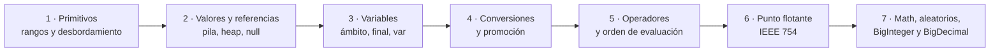
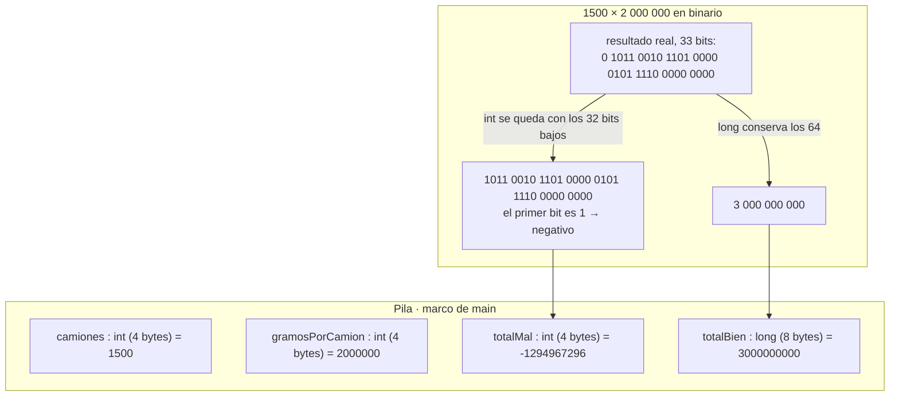
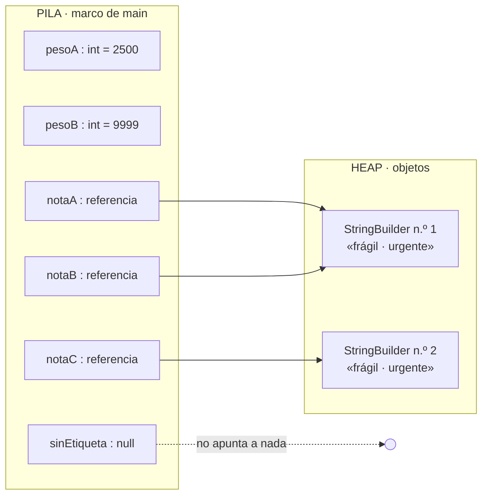
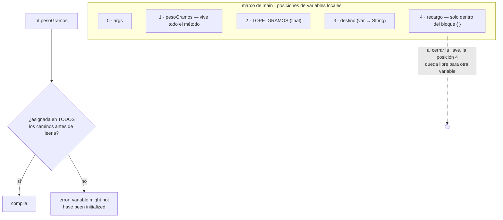
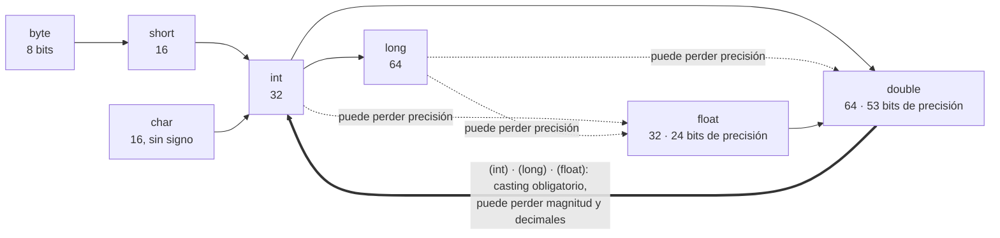
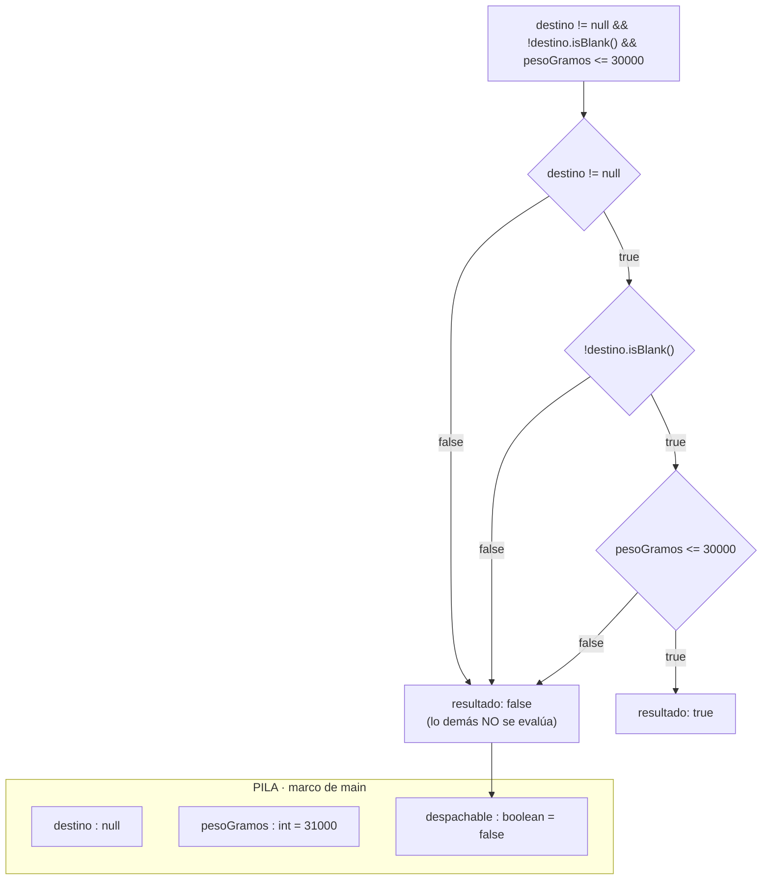
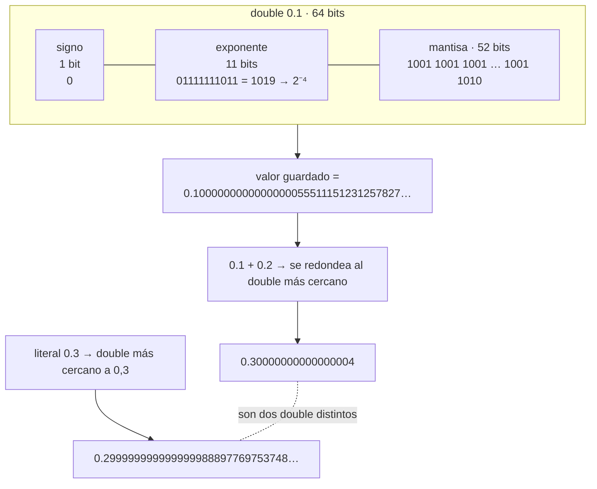
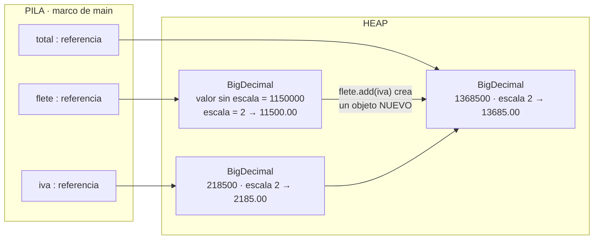

# Módulo 1 · Datos: tipos, variables y operadores

> Curso Java (JDK 25) · tramo **Fundamentos** · 7 temas · formato único (specs/021). Portada del curso:
> [CURSO.md](CURSO.md). Todo el código de este módulo se ejecutó con OpenJDK 25.0.5 (Ubuntu, x86-64) el
> 2026-11-20 y las salidas están pegadas tal cual.

## Cabecera del módulo

| | |
|---|---|
| **Objetivo** | Saber qué guarda exactamente cada variable de un programa Java —un valor o una referencia—, qué rango y precisión tiene, y qué hace el lenguaje cuando un número no cabe, se convierte o se combina con otro. Al terminar, la calculadora de tarifas de `rutaflow-nucleo` no pierde ni un gramo ni un centavo sin avisar. |
| **Prerrequisitos** | [Módulo 0](modulo-0.md) completo: ejecutar con `java Archivo.java`, leer `javap -c`, usar JShell y `./gradlew test`. |
| **Duración** | 4 h 40 min (7 temas de 35 a 45 min) más 1 h de laboratorio. |
| **Versiones** | JDK 25 · Gradle 9.8.2 por wrapper · JUnit 6.0.3. Nada de este módulo está en preview. |
| **Laboratorio** | [`laboratorios/modulo-1/`](laboratorios/modulo-1/README.md) (al publicar: `examples/java/modulo-1/`), con `verificar.sh`. |
| **Proyecto guía** | `rutaflow-nucleo`: la calculadora de tarifas, primero ingenua (cuatro fallos silenciosos demostrados con pruebas) y después corregida. |

### Mapa del módulo



**Texto alternativo:** siete temas en línea: los tipos primitivos y sus límites; la diferencia entre guardar
un valor y guardar una referencia; cómo se declaran y hasta dónde viven las variables; cómo se convierten
los tipos entre sí; cómo se combinan con operadores; por qué los decimales binarios no son exactos; y las
herramientas de la biblioteca para calcular con seguridad.

**Convención del módulo.** En cada tema, la memoria se dibuja con dos zonas: la **pila** (una ficha por
cada método en ejecución, con sus variables) y el **heap** (donde viven los objetos). Y cada afirmación
sobre lo que hace el compilador se comprueba con `javap -c`.

---

### Tema 1: Primitivos: rangos, literales, desbordamiento silencioso, `Math.*Exact` y `char` como unidad UTF-16 · Básico · 40 min

#### 1. Ubicación y prerrequisitos

Curso Java · tramo Fundamentos · módulo 1 · primer tema. Antes: [M0 · Tema 3](modulo-0.md#tema-3-del-fuente-al-bytecode-javac-java-classpath-y-primera-lectura-con-javap--basico--45-min) (leer bytecode con `javap`) y
[M0 · Tema 5](modulo-0.md#tema-5-jshell-y-el-lanzador-de-codigo-fuente-un-archivo-y-varios-archivos-jep-458-jdk-22--basico--35-min) (JShell, para probar cada cuenta). Versión: JDK 25.

#### 2. Objetivo

Al terminar podrás elegir el tipo primitivo adecuado para un dato, escribir sus literales sin trampas,
predecir el resultado de una cuenta que se desborda y sustituirla por una que falle en vez de callar.

#### 3. Por qué importa

`rutaflow-nucleo` suma el peso de la carga del día: 1500 camiones de 2 toneladas, en gramos. El resultado
correcto es 3 000 000 000. El programa dice −1 294 967 296, sin excepción ni aviso, y con ese número
negativo se factura, se planifica y se decide. El desbordamiento de enteros es de los pocos fallos de Java
que **no** deja rastro: hay que saber de antemano dónde puede ocurrir.

#### 4. Analogía

Un `int` es un cuentakilómetros de 32 ruedas binarias. Cuenta bien hasta 2 147 483 647; un paso más y todas
las ruedas dan la vuelta a la vez: marca el número más bajo posible, −2 147 483 648. El coche no se
detiene ni enciende ninguna luz.

**Dónde se rompe la analogía:** un cuentakilómetros vuelve a cero; un `int` vuelve al **mínimo negativo**,
porque la mitad de sus combinaciones representan números negativos (complemento a dos).

#### 5. Diagrama



**Texto alternativo:** las cuatro variables viven en el marco de `main`, en la pila, y cada una guarda
directamente su número. El producto real necesita 33 bits (el que sobra, a la izquierda, vale 0 y le sigue
un 1). Un `int` conserva solo los 32 bits bajos; como el primero de ellos es 1, el número se lee como
negativo. Un `long` conserva el valor completo.

#### 6. Explicación

**Nivel 0.** Java tiene ocho tipos **primitivos**: guardan un valor simple, directamente.

| Tipo | Guarda | Tamaño | Rango | Uso normal |
|---|---|---|---|---|
| `int` | enteros | 32 bits | ±2 147 millones | el entero por defecto |
| `long` | enteros grandes | 64 bits | ±9,2 × 10¹⁸ | milisegundos, bytes, totales, identificadores |
| `double` | decimales | 64 bits | ~15–17 dígitos | medidas, promedios (no dinero) |
| `boolean` | `true` o `false` | — | — | condiciones |
| `char` | una unidad de texto | 16 bits | 0 a 65 535 | una letra |
| `byte`, `short` | enteros pequeños | 8 y 16 bits | −128 a 127; ±32 767 | datos binarios, arreglos grandes |
| `float` | decimales | 32 bits | ~6–7 dígitos | gráficos, sensores |

Para empezar: `int` para contar, `long` si puede pasar de dos mil millones, `double` para medir y `boolean`
para decidir.

**Nivel intermedio.**

*Literales* (JLS §3.10): un número entero escrito en el código es `int`; con sufijo `L` es `long`. Un
decimal es `double`; con `f`, `float`. Se pueden separar los dígitos con `_` (`3_000_000_000L`). Otras
bases: `0xFF` (hexadecimal), `0b1010` (binario) y —trampa— `010` es **octal** y vale 8. Un `char` va entre
comillas simples: `'A'`, `'ñ'`, `'\n'`, `'ñ'`.

*Desbordamiento* (JLS §4.2.2, §15.17–15.18): las operaciones enteras nunca avisan; el resultado se recorta
a los bits del tipo. Tres defensas:

1. **Elegir `long`** cuando el total puede superar los dos mil millones. Ojo con el orden:
   `long total = camiones * gramos;` multiplica dos `int` (y se desborda) y **después** convierte. Hay que
   convertir un operando antes: `(long) camiones * gramos`.
2. **Los métodos exactos:** `Math.addExact`, `subtractExact`, `multiplyExact`, `negateExact`,
   `incrementExact`, `toIntExact`. Hacen la misma cuenta y lanzan `ArithmeticException` si no cabe.
3. **`BigInteger`** si no hay límite conocido ([M1 · Tema 7](modulo-1.md#tema-7-math-numeros-aleatorios-con-randomgenerator-y-primer-contacto-con-bigintegerbigdecimal--basico--45-min)).

*`char` no es «una letra»*: es un número de 16 bits sin signo, una **unidad de código UTF-16**. `'A'` es
65 y se puede operar con él (`'A' + 1` es 66). Los caracteres más allá de U+FFFF, como los emojis, ocupan
**dos** `char` (un par sustituto): `"📦".length()` es 2. Unicode a fondo se estudia en el módulo 2.

**Nivel maestro.**

- **Complemento a dos.** Los enteros con signo usan el bit más alto como signo con peso negativo:
  un `int` vale −2³¹·b₃₁ + Σ 2ⁱ·bᵢ. Por eso `MAX_VALUE + 1 == MIN_VALUE` y hay un negativo más que
  positivos; `-Integer.MIN_VALUE` es él mismo.
- **En el bytecode no existe la comprobación.** `int * int` es la instrucción `imul` y nada más (abajo).
  `Math.multiplyExact` es un método que el JIT sustituye por la multiplicación del procesador más una
  consulta a su indicador de desbordamiento: cuesta casi lo mismo que multiplicar.
- **El tamaño del literal decide la instrucción** (JVMS §2.11, §6.5): `iconst_5` para −1 a 5, `bipush`
  hasta un byte, `sipush` hasta dos, y `ldc`/`ldc2_w` leyendo de la tabla de constantes para el resto.
- **En la pila, todo lo pequeño es `int`.** `boolean`, `byte`, `short` y `char` se guardan en variables
  locales como `int` (fíjate en `istore` para `g` y `h` abajo): la JVM no tiene instrucciones aritméticas
  para ellos (JVMS §2.11.1). Solo ahorran memoria dentro de arreglos y campos de objetos. `long` y `double`
  ocupan **dos** posiciones de variable local (JVMS §2.6.1): por eso, tras el `long` en la posición 4, el
  `double` va a la 6.
- **`boolean` no tiene tamaño definido** por la especificación; no se puede convertir a número ni desde
  número, a diferencia de C.
- **Rendimiento.** En un procesador de 64 bits, `long` cuesta lo mismo que `int` en aritmética. Lo que
  cuesta es la memoria en arreglos de millones de elementos: el doble.

#### 7. Código ejecutable

**Ejemplo mínimo** · archivo `tema-1/Rangos.java` · ejecuta `java -Dstdout.encoding=UTF-8 Rangos.java`

```java
// M1 · Tema 1 · ejemplo mínimo: los ocho primitivos, su tamaño y su rango.
// Java 25. Ejecuta: java Rangos.java
public class Rangos {
    public static void main(String[] args) {
        System.out.println("byte    " + Byte.SIZE + " bits  " + Byte.MIN_VALUE + " a " + Byte.MAX_VALUE);
        System.out.println("short   " + Short.SIZE + " bits  " + Short.MIN_VALUE + " a " + Short.MAX_VALUE);
        System.out.println("int     " + Integer.SIZE + " bits  " + Integer.MIN_VALUE + " a " + Integer.MAX_VALUE);
        System.out.println("long    " + Long.SIZE + " bits  " + Long.MIN_VALUE + " a " + Long.MAX_VALUE);
        System.out.println("float   " + Float.SIZE + " bits  hasta " + Float.MAX_VALUE);
        System.out.println("double  " + Double.SIZE + " bits  hasta " + Double.MAX_VALUE);
        System.out.println("char    " + Character.SIZE + " bits  " + (int) Character.MIN_VALUE + " a " + (int) Character.MAX_VALUE);
        System.out.println("boolean true o false");

        int maximo = Integer.MAX_VALUE;
        System.out.println("MAX_VALUE + 1 = " + (maximo + 1));
    }
}
```

Salida:

```text
byte    8 bits  -128 a 127
short   16 bits  -32768 a 32767
int     32 bits  -2147483648 a 2147483647
long    64 bits  -9223372036854775808 a 9223372036854775807
float   32 bits  hasta 3.4028235E38
double  64 bits  hasta 1.7976931348623157E308
char    16 bits  0 a 65535
boolean true o false
MAX_VALUE + 1 = -2147483648
```

**Ejemplo realista** · archivo `tema-1/CargaDelDia.java` · ejecuta
`java -Dstdout.encoding=UTF-8 CargaDelDia.java`

Usa `try`/`catch` para mostrar el mensaje de la excepción sin detener el programa; se estudia en el
módulo 7.

```java
// M1 · Tema 1 · ejemplo realista: el peso total del día se desborda en int y nadie avisa.
// Java 25. Ejecuta: java -Dstdout.encoding=UTF-8 CargaDelDia.java
public class CargaDelDia {
    public static void main(String[] args) {
        int camiones = 1_500;
        int gramosPorCamion = 2_000_000;   // 2 toneladas

        // ANTES: int * int = int. El resultado real (3 000 000 000) no cabe en 32 bits.
        int totalMal = camiones * gramosPorCamion;
        System.out.println("ANTES   total en int:        " + totalMal + " g");

        // Diagnóstico: la versión exacta de la misma cuenta lanza una excepción en vez de callar.
        try {
            Math.multiplyExact(camiones, gramosPorCamion);
        } catch (ArithmeticException e) {
            System.out.println("        multiplyExact dice:  " + e.getMessage());
        }

        // DESPUÉS: basta con que un operando sea long para que la cuenta se haga en 64 bits.
        long totalBien = (long) camiones * gramosPorCamion;
        System.out.println("DESPUÉS total en long:       " + totalBien + " g");

        // Trampa: convertir después de multiplicar ya es tarde.
        long tarde = camiones * gramosPorCamion;
        System.out.println("TRAMPA  long x = int * int:  " + tarde + " g");
    }
}
```

Salida:

```text
ANTES   total en int:        -1294967296 g
        multiplyExact dice:  integer overflow
DESPUÉS total en long:       3000000000 g
TRAMPA  long x = int * int:  -1294967296 g
```

**Literales y `char`** · archivo `tema-1/Literales.java` · ejecuta
`java -Dstdout.encoding=UTF-8 Literales.java`

```java
// M1 · Tema 1 · literales: bases, separadores, sufijos y char como número.
// Java 25. Ejecuta: java -Dstdout.encoding=UTF-8 Literales.java
public class Literales {
    public static void main(String[] args) {
        int decimal = 1_000_000;
        int hexadecimal = 0xFF;
        int binario = 0b1010;
        int octal = 010;                 // ¡empieza por 0: es octal, vale 8!
        long grande = 3_000_000_000L;    // sin la L no compila
        float precio = 19.99f;           // sin la f es double
        double avogadro = 6.022e23;

        System.out.println(decimal + " " + hexadecimal + " " + binario + " " + octal);
        System.out.println(grande + " " + precio + " " + avogadro);

        char letra = 'A';
        char enie = 'ñ';
        char porCodigo = 'ñ';       // la misma ñ, escrita con su código
        System.out.println(letra + " vale " + (int) letra + " · " + enie + " vale " + (int) enie
                + " · iguales: " + (enie == porCodigo));
        System.out.println("'A' + 1 = " + (letra + 1) + " · (char) ('A' + 1) = " + (char) (letra + 1));

        // char es una unidad UTF-16 de 16 bits: un emoji no cabe en una.
        String caja = "📦";
        System.out.println("\"📦\".length() = " + caja.length()
                + " · code points = " + caja.codePointCount(0, caja.length())
                + " · U+" + Integer.toHexString(caja.codePointAt(0)).toUpperCase());
        System.out.println("unidades: " + Integer.toHexString(caja.charAt(0)) + " " + Integer.toHexString(caja.charAt(1)));
    }
}
```

Salida:

```text
1000000 255 10 8
3000000000 19.99 6.022E23
A vale 65 · ñ vale 241 · iguales: true
'A' + 1 = 66 · (char) ('A' + 1) = B
"📦".length() = 2 · code points = 1 · U+1F4E6
unidades: d83d dce6
```

**Por dentro** · la multiplicación que se desborda ·
`javac -d out CargaDelDia.java && javap -c -cp out CargaDelDia` (primeras instrucciones de `main`)

```text
  public static void main(java.lang.String[]);
    Code:
         0: sipush        1500
         3: istore_1
         4: ldc           #7                  // int 2000000
         6: istore_2
         7: iload_1
         8: iload_2
         9: imul
        10: istore_3
```

`imul` multiplica y guarda: no hay ninguna instrucción que mire si cupo.

Cada literal, su instrucción · archivo `tema-1/por-dentro/Constantes.java` ·
`javac -d out Constantes.java && javap -c -cp out Constantes`

```java
// M1 · Tema 1 · nivel maestro: cada tamaño de literal usa una instrucción distinta de bytecode.
// Mira: javac -d out Constantes.java && javap -c -cp out Constantes
public class Constantes {
    static long medir() {
        int a = 5;
        int b = 100;
        int c = 30_000;
        int d = 100_000;
        long e = 3_000_000_000L;
        double f = 2.5;
        boolean g = true;
        char h = 'A';
        return a + b + c + d + e;
    }
}
```

```text
  static long medir();
    Code:
         0: iconst_5
         1: istore_0
         2: bipush        100
         4: istore_1
         5: sipush        30000
         8: istore_2
         9: ldc           #7                  // int 100000
        11: istore_3
        12: ldc2_w        #8                  // long 3000000000l
        15: lstore        4
        17: ldc2_w        #10                 // double 2.5d
        20: dstore        6
        22: iconst_1
        23: istore        8
        25: bipush        65
        27: istore        9
        29: iload_0
        30: iload_1
        31: iadd
        32: iload_2
        33: iadd
        34: iload_3
        35: iadd
        36: i2l
        37: lload         4
        39: ladd
        40: lreturn
```

En la suma final, `i2l` (instrucción 36) convierte a `long` **después** de sumar los cuatro `int`: la misma
trampa del ejemplo realista, vista en bytecode.

#### 8. Mini-laboratorio

1. En JShell, calcula `Integer.MAX_VALUE + 1`, `Integer.MIN_VALUE - 1` y `-Integer.MIN_VALUE`.
2. Ejecuta `CargaDelDia.java` y confirma las cuatro líneas.
3. Cambia `camiones` a 1000. ¿Sigue habiendo desbordamiento? Calcula a mano el número máximo de camiones de
   2 toneladas que caben en un `int` de gramos y compruébalo.
4. En el proyecto Gradle del módulo, abre `CalculadoraIngenua.cargaTotalGramos` y su prueba
   `laCargaSeDesbordaEnSilencio`. Ejecuta `./gradlew test`.
5. Lee `CalculadoraDeTarifas.cargaTotalGramos`: usa `long` **y** `multiplyExact`. Explica para qué sirve
   cada uno.

**Listo cuando** sabes decir sin ejecutar qué imprime `long x = 100_000 * 100_000;`, y la respuesta del
paso 3 es 1073 camiones (con 1074 se desborda).

#### 9. Verificación

```bash
java -Dstdout.encoding=UTF-8 CargaDelDia.java | grep -c -- "-1294967296"
```

Imprime `2`: el total en `int` y la trampa de convertir tarde. Las pruebas del laboratorio se ejecutan con
`./gradlew test`.

#### 10. Error común y diagnóstico

**Síntoma:** un total, un contador o un identificador aparece **negativo**, o mucho menor de lo esperado,
solo con volúmenes grandes. No hay excepción. En las pruebas con datos pequeños todo funciona.

**Causa:** una operación entre `int` superó 2 147 483 647 y se recortó. Variante frecuente: el resultado se
guarda en un `long`, pero la operación se hizo en `int`.

**Diagnóstico:** sustituye la operación sospechosa por su versión exacta (`Math.multiplyExact(a, b)`) y
ejecuta con los datos que fallan: lanzará `ArithmeticException: integer overflow` en la línea culpable.
Con `javap -c` se confirma si la cuenta fue `imul` (32 bits) o `lmul` (64).

**Arreglo:** convertir un operando a `long` antes de operar y, si el `long` también puede quedarse corto,
mantener el método exacto para fallar pronto.

**Errores de compilación reales de este tema.** Un literal que no cabe en `int`
(`tema-1/errores/LiteralGrande.java`):

```text
LiteralGrande.java:4: error: integer number too large
        long cargaGramos = 3000000000;
                           ^
1 error
```

Se arregla con el sufijo `L`: `3000000000L`. Y un valor fuera del rango de `byte`
(`tema-1/errores/ByteFueraDeRango.java`):

```text
ByteFueraDeRango.java:4: error: incompatible types: possible lossy conversion from int to byte
        byte cajas = 200;
                     ^
1 error
```

#### 11. Pregunta con respuesta modelo

**Comprensión.** ¿Por qué `long total = camiones * gramosPorCamion;` da un número negativo si `total` es
`long`?

**Respuesta modelo:** porque el tipo de la variable de destino no influye en cómo se calcula la expresión.
Los dos operandos son `int`, así que la multiplicación se hace en 32 bits y se desborda; el resultado, ya
equivocado, se convierte a `long` al asignarlo.

**Entrevista.** ¿Qué imprime `System.out.println(Math.abs(Integer.MIN_VALUE));` y cómo lo evitarías?

**Respuesta modelo:** imprime `-2147483648`. En complemento a dos hay un negativo más que positivos, así
que el opuesto de `MIN_VALUE` no cabe en un `int` y la negación se desborda devolviendo el mismo valor. Se
evita con `Math.absExact`, que lanza `ArithmeticException`, o trabajando en `long`. El caso real típico es
`Math.abs(hash) % n` para elegir una partición: una vez de cada cuatro mil millones da un índice negativo;
lo correcto es `Math.floorMod(hash, n)`.

#### 12. Cuándo usarlo y cuándo no

| Úsalo | No lo uses |
|---|---|
| `int` para contadores e índices que no pasan de dos mil millones | `int` para milisegundos, bytes de archivos, totales de dinero en centavos o identificadores de base de datos |
| `long` para todo lo que crece sin techo claro | `long` «por si acaso» en arreglos de millones de elementos sin necesitarlo |
| `Math.*Exact` en cuentas de negocio (pesos, importes, cupos) | `Math.*Exact` en funciones de dispersión (hash), donde el desbordamiento es intencionado |
| `byte`/`short` en arreglos grandes y formatos binarios | `byte`/`short` en variables sueltas: no ahorran nada y obligan a hacer castings |
| `char` para una unidad UTF-16 conocida | `char` para «un carácter» que puede ser un emoji: usa code points (módulo 2) |

**Costo:** los métodos exactos cuestan una comprobación por operación, despreciable frente a un total
equivocado; `long` duplica la memoria solo cuando hay millones de valores.

---

### Tema 2: Valores frente a referencias: pila, heap, alias y `null` dibujados · Básico · 40 min

#### 1. Ubicación y prerrequisitos

Curso Java · tramo Fundamentos · módulo 1. Antes: [M1 · Tema 1](modulo-1.md#tema-1-primitivos-rangos-literales-desbordamiento-silencioso-mathexact-y-char-como-unidad-utf-16--basico--40-min) (primitivos) y [M0 · Tema 3](modulo-0.md#tema-3-del-fuente-al-bytecode-javac-java-classpath-y-primera-lectura-con-javap--basico--45-min) (bytecode).
Versión: JDK 25. Este tema usa `StringBuilder` (un texto que se puede modificar) solo como ejemplo de
objeto; se estudia en el módulo 2.

#### 2. Objetivo

Al terminar podrás dibujar la pila y el heap de un fragmento de código, predecir si un cambio hecho a
través de una variable se ve a través de otra, y leer un `NullPointerException` hasta la variable que era
nula.

#### 3. Por qué importa

En `rutaflow-nucleo`, un método recibe la etiqueta de un envío y la marca como urgente. ¿Cambia la etiqueta
de quien llamó? Sí. Otro método recibe el peso y le suma un recargo. ¿Cambia el peso de quien llamó? No.
Quien no distingue por qué, pasa años copiando objetos «por si acaso» o persiguiendo datos que «cambian
solos». Y el error más frecuente de Java, `NullPointerException`, es exactamente esto: una referencia que
no apunta a nada.

#### 4. Analogía

Una variable primitiva es una casilla con el número escrito dentro. Una variable de referencia es una
casilla con **la dirección de una casa** escrita dentro; la casa (el objeto) está en otro sitio. Copiar la
variable copia lo que hay en la casilla: en un caso, el número; en el otro, la dirección. Dos papeles con
la misma dirección llevan a la misma casa: si entras por uno y pintas la pared, quien entre por el otro la
verá pintada. `null` es un papel en blanco.

**Dónde se rompe la analogía:** una dirección postal se puede leer y calcular («el número siguiente»). Una
referencia de Java no: no puedes imprimirla como número ni sumarle nada, y el recolector de basura puede
mudar la casa de sitio sin que tu papel deje de servir.

#### 5. Diagrama



**Texto alternativo:** en la pila, `pesoA` y `pesoB` guardan cada una su propio número. `notaA` y `notaB`
guardan la misma referencia y apuntan al mismo objeto del heap; `notaC` apunta a otro objeto distinto con el
mismo texto. `sinEtiqueta` vale `null` y no apunta a ningún objeto.

#### 6. Explicación

**Nivel 0.** Hay dos clases de variables. Las de tipo primitivo (`int`, `double`, `boolean`…) guardan el
valor. Todas las demás (`String`, `StringBuilder`, arreglos, tus clases) guardan una **referencia**: un
enlace a un objeto. `=` copia lo que la variable guarda; nunca copia un objeto.

**Nivel intermedio.**

- **Alias.** Tras `StringBuilder notaB = notaA;` hay un objeto y dos nombres. Cambiarlo por uno se ve por el
  otro.
- **`==`** compara lo que guardan las variables. Entre primitivos, los valores. Entre referencias, si
  apuntan **al mismo objeto**, no si los objetos se parecen. Para comparar contenido se usa `equals`
  (módulos 2 y 5).
- **Paso de argumentos: siempre por valor** (JLS §8.4.1, §15.12.4). El método recibe una copia de lo que
  guardaba la variable. Si era un número, copia del número: el original no puede cambiar. Si era una
  referencia, copia de la referencia: el método puede **modificar el objeto** (lo comparte), pero no puede
  hacer que la variable de quien llamó apunte a otro objeto.
- **`null`** es el valor de una referencia que no apunta a nada (JLS §4.1). Usarla (`sinEtiqueta.append`)
  lanza `NullPointerException`. Un primitivo no puede ser `null`.
- **Valores por defecto.** Un campo sin inicializar vale 0, `false` o `null` (JLS §4.12.5). Una variable
  local no tiene valor por defecto: el compilador obliga a dársela ([M1 · Tema 3](modulo-1.md#tema-3-variables-ambito-final-var-y-asignacion-definitiva--basico--35-min)).

**Nivel maestro.**

- **Las áreas de memoria** (JVMS §2.5). Cada hilo tiene su **pila**; cada llamada a un método apila un
  **marco** (JVMS §2.6) con sus variables locales y su pila de operandos, y lo quita al retornar. El
  **heap** es común a todos los hilos y contiene los objetos; lo gestiona el recolector de basura. Un objeto
  deja de existir cuando ya no se puede llegar a él desde ninguna referencia viva, no cuando termina el
  método que lo creó.
- **En el bytecode** se ve la diferencia: `iload`/`istore` mueven enteros; `aload`/`astore` mueven
  referencias. Copiar una referencia es `aload_3; astore 4`: no hay `new`, no se crea nada. `new` reserva
  el objeto en el heap y deja su referencia en la pila; `invokespecial <init>` ejecuta el constructor.
- **Cuánto ocupa una referencia.** En esta JVM de 64 bits, 4 bytes: `UseCompressedOops` arranca en `true` y las
  referencias se guardan comprimidas. Cada objeto lleva además una cabecera: son 96 bits, y el formato compacto
  los deja en 64 (JEP 519, que llega a producto en JDK 25). Si está activado **por defecto** no es una constante
  del lenguaje sino de la build, y aquí se comprueba con las dos JVM instaladas en la misma máquina:
  `UseCompactObjectHeaders` sale `false {default}` en OpenJDK 26.0.2 y `true {default}` en Temurin 27.0.1 —las
  dos salidas, línea por línea, están en el bloque de abajo. Lo que **no** se mide aquí es el tamaño real de un
  objeto: para eso hace falta JOL y no está en la caché local.
- **Tamaño de la pila.** 2 MB por hilo en esta máquina (`ThreadStackSize = 2048`, en KB, igual en las dos
  builds); se cambia con `-Xss`. Es un flag `product_pd`, que en la salida aparece como `{pd product}`: en el
  código de HotSpot se declara sin valor —`product_pd(intx, ThreadStackSize, "Thread Stack Size (in Kbytes)")`—
  porque, como recuerda el comentario de esa familia de flags, su valor por defecto vive en los cabeceros
  dependientes de la plataforma. Así que este número se lee en la máquina de cada uno y no se memoriza. La
  pila se agota con recursión muy profunda (`StackOverflowError`, módulo 3). El heap máximo la fija `-Xmx`, pero
  sin darla sale con origen `{ergonomic}`: lo calcula la JVM con los recursos de la máquina. Aquí, con 16 GB
  (`hw.memsize` = 17 179 869 184), salen 4 294 967 296 bytes: la cuarta parte justa.
- **El mensaje del `NullPointerException`** dice qué era nulo desde JDK 14 (JEP 358, activo por defecto
  desde JDK 15). Para nombrar una variable **local** necesita la tabla de variables del `.class`: sin
  `javac -g` dice `"<local3>"`; con `-g`, `"sinEtiqueta"`. Es lo que ocurre al lanzar desde el fuente con
  `java Archivo.java`. Campos y llamadas a métodos se nombran siempre.
- **Lo que la JVM puede hacer sin que lo notes.** Si el JIT demuestra que un objeto no sale del método
  (análisis de escape), puede no crearlo en el heap. El modelo «objetos en el heap» es el que garantiza la
  especificación; la optimización nunca cambia el resultado.

#### 7. Código ejecutable

**Ejemplo mínimo** · archivo `tema-2/CopiaYAlias.java` · ejecuta
`java -Dstdout.encoding=UTF-8 CopiaYAlias.java`

```java
// M1 · Tema 2 · ejemplo mínimo: copiar un primitivo copia el valor; copiar una referencia crea un alias.
// Java 25. Ejecuta: java -Dstdout.encoding=UTF-8 CopiaYAlias.java
public class CopiaYAlias {
    public static void main(String[] args) {
        int pesoA = 2500;
        int pesoB = pesoA;        // se copia el número
        pesoB = 9999;
        System.out.println("primitivos:  pesoA = " + pesoA + " · pesoB = " + pesoB);

        StringBuilder notaA = new StringBuilder("frágil");
        StringBuilder notaB = notaA;   // se copia la referencia: un solo objeto, dos nombres
        notaB.append(" · urgente");
        System.out.println("referencias: notaA = " + notaA + " · notaB = " + notaB);
        System.out.println("¿mismo objeto? " + (notaA == notaB));

        StringBuilder notaC = new StringBuilder("frágil · urgente");   // otro objeto con el mismo texto
        System.out.println("¿notaA == notaC? " + (notaA == notaC)
                + " · ¿mismo texto? " + notaA.toString().equals(notaC.toString()));
    }
}
```

Salida:

```text
primitivos:  pesoA = 2500 · pesoB = 9999
referencias: notaA = frágil · urgente · notaB = frágil · urgente
¿mismo objeto? true
¿notaA == notaC? false · ¿mismo texto? true
```

**Ejemplo realista** · archivo `tema-2/EtiquetaDeEnvio.java` · ejecuta
`java -Dstdout.encoding=UTF-8 EtiquetaDeEnvio.java`

```java
// M1 · Tema 2 · ejemplo realista: qué puede cambiar un método cuando recibe un primitivo o una referencia.
// Java 25. Ejecuta: java -Dstdout.encoding=UTF-8 EtiquetaDeEnvio.java
public class EtiquetaDeEnvio {
    // Recibe una COPIA del número: cambiarla no afecta a quien llamó.
    static void recargar(int pesoGramos) {
        pesoGramos = pesoGramos + 500;
    }

    // Recibe una COPIA de la referencia: las dos apuntan al mismo objeto, y el objeto sí cambia.
    static void marcarUrgente(StringBuilder etiqueta) {
        etiqueta.append(" [URGENTE]");
    }

    // Reasignar el parámetro solo cambia la copia local de la referencia.
    static void reemplazar(StringBuilder etiqueta) {
        etiqueta = new StringBuilder("RF-999999");
    }

    public static void main(String[] args) {
        int pesoGramos = 2500;
        StringBuilder etiqueta = new StringBuilder("RF-000123");

        recargar(pesoGramos);
        System.out.println("tras recargar:      " + pesoGramos + " g");

        marcarUrgente(etiqueta);
        System.out.println("tras marcarUrgente: " + etiqueta);

        reemplazar(etiqueta);
        System.out.println("tras reemplazar:    " + etiqueta);

        // null: una referencia que no apunta a ningún objeto.
        StringBuilder sinEtiqueta = null;
        System.out.println("sinEtiqueta = " + sinEtiqueta);
        sinEtiqueta.append("x");   // aquí falla
    }
}
```

Salida (termina, a propósito, con el error de la última línea):

```text
tras recargar:      2500 g
tras marcarUrgente: RF-000123 [URGENTE]
tras reemplazar:    RF-000123 [URGENTE]
sinEtiqueta = null
Exception in thread "main" java.lang.NullPointerException: Cannot invoke "java.lang.StringBuilder.append(String)" because "<local3>" is null
	at EtiquetaDeEnvio.main(EtiquetaDeEnvio.java:35)
código de salida: 1
```

`recargar` no cambió el peso; `marcarUrgente` sí cambió la etiqueta; `reemplazar` no consiguió sustituirla.

**Por dentro** · copiar un número y copiar una referencia, en bytecode ·
`javac -d out CopiaYAlias.java && javap -c -cp out CopiaYAlias` (inicio de `main`)

```text
  public static void main(java.lang.String[]);
    Code:
         0: sipush        2500
         3: istore_1
         4: iload_1
         5: istore_2
         6: sipush        9999
         9: istore_2
        10: getstatic     #7                  // Field java/lang/System.out:Ljava/io/PrintStream;
        13: iload_1
        14: iload_2
        15: invokedynamic #13,  0             // InvokeDynamic #0:makeConcatWithConstants:(II)Ljava/lang/String;
        20: invokevirtual #17                 // Method java/io/PrintStream.println:(Ljava/lang/String;)V
        23: new           #23                 // class java/lang/StringBuilder
        26: dup
        27: ldc           #25                 // String frágil
        29: invokespecial #27                 // Method java/lang/StringBuilder."<init>":(Ljava/lang/String;)V
        32: astore_3
        33: aload_3
        34: astore        4
        36: aload         4
        38: ldc           #29                 // String  · urgente
        40: invokevirtual #31                 // Method java/lang/StringBuilder.append:(Ljava/lang/String;)Ljava/lang/StringBuilder;
```

Instrucciones 4–5: `iload_1; istore_2` copia el entero. Instrucciones 33–34: `aload_3; astore 4` copia la
referencia. Solo hay un `new` (instrucción 23): un solo objeto.

La misma excepción, con el nombre de la variable ·
`javac -g -d out EtiquetaDeEnvio.java && java -cp out EtiquetaDeEnvio` (últimas dos líneas)

```text
Exception in thread "main" java.lang.NullPointerException: Cannot invoke "java.lang.StringBuilder.append(String)" because "sinEtiqueta" is null
	at EtiquetaDeEnvio.main(EtiquetaDeEnvio.java:35)
```

Los tamaños de esta JVM ·
`java -XX:+PrintFlagsFinal -version | grep -E " (ThreadStackSize|MaxHeapSize|InitialHeapSize|UseCompressedOops|UseCompactObjectHeaders) "`
— Temurin 27.0.1.0.2+1, macOS aarch64, máquina de 16 GB. Es la JVM con la que se ejecuta este laboratorio.

```text
   size_t InitialHeapSize                          = 8388608                                   {product} {ergonomic}
   size_t MaxHeapSize                              = 4294967296                                {product} {ergonomic}
     intx ThreadStackSize                          = 2048                                   {pd product} {default}
     bool UseCompactObjectHeaders                  = true                           {product lp64_product} {default}
     bool UseCompressedOops                        = true                           {product lp64_product} {ergonomic}
```

El mismo mando, con la otra JVM instalada en la misma máquina ·
`"/$(/usr/libexec/java_home -v 26)/bin/java" -XX:+PrintFlagsFinal -version | grep -E " (ThreadStackSize|MaxHeapSize|InitialHeapSize|UseCompressedOops|UseCompactObjectHeaders) "`
— OpenJDK 26.0.2+10-55. Mismo hardware, misma plataforma, otra build:

```text
   size_t InitialHeapSize                          = 8388608                                   {product} {ergonomic}
   size_t MaxHeapSize                              = 4294967296                                {product} {ergonomic}
     intx ThreadStackSize                          = 2048                                   {pd product} {default}
     bool UseCompactObjectHeaders                  = false                          {product lp64_product} {default}
     bool UseCompressedOops                        = true                           {product lp64_product} {ergonomic}
```

Cuatro de las cinco líneas son idénticas en las dos builds; cambia la cabecera compacta, y eso es lo que hay que
saber leer: el heap viene marcado `{ergonomic}` (depende de la memoria de la máquina), `ThreadStackSize` viene
marcado `{pd product}` (lo define el código de la plataforma) y `UseCompactObjectHeaders` vale `false` en 26 y
`true` en 27 sin que nadie lo pidiera. Ninguno de los tres es una regla del lenguaje Java. El módulo 3 aplica la
misma disciplina al revés: en lugar de cifrar cuántos marcos caben en la pila, lee el flag y comprueba el tope
fijo de la traza.

Identidad frente a contenido · archivo `tema-2/por-dentro/Identidad.java` · `java -Dstdout.encoding=UTF-8 Identidad.java`

```java
// M1 · Tema 2 · nivel maestro: la identidad de un objeto no depende de su contenido.
// Ejecuta: java Identidad.java
void main() {
    var a = new StringBuilder("RF-1");
    var b = a;
    var c = new StringBuilder("RF-1");
    IO.println("a y b, ¿misma identidad? " + (System.identityHashCode(a) == System.identityHashCode(b)));
    IO.println("a y c, ¿misma identidad? " + (System.identityHashCode(a) == System.identityHashCode(c)));
}
```

```text
a y b, ¿misma identidad? true
a y c, ¿misma identidad? false
```

#### 8. Mini-laboratorio

1. Antes de ejecutar `EtiquetaDeEnvio.java`, dibuja en papel la pila y el heap justo antes y justo después
   de cada una de las tres llamadas. Luego ejecuta y compara.
2. Cambia `reemplazar` para que **devuelva** el `StringBuilder` nuevo, y en `main` escribe
   `etiqueta = reemplazar(etiqueta);`. Ejecuta.
3. Corrige el final: antes de `sinEtiqueta.append("x")`, comprueba `if (sinEtiqueta != null)`.
4. Compila con `javac -g` y sin `-g` una versión que aún falle, y compara los dos mensajes.

**Listo cuando** tu dibujo del paso 1 coincide con la salida, tras el paso 2 se imprime `RF-999999`, y el
programa termina con código 0.

#### 9. Verificación

```bash
java -Dstdout.encoding=UTF-8 EtiquetaDeEnvio.java; echo "código de salida: $?"
java -XX:+PrintFlagsFinal -version 2>&1 | grep -cE " (ThreadStackSize|MaxHeapSize|InitialHeapSize|UseCompressedOops|UseCompactObjectHeaders) "
java -XX:+PrintFlagsFinal -version 2>&1 | grep -E " ThreadStackSize " | tr -s " "
java -Xss256k -XX:+PrintFlagsFinal -version 2>&1 | grep -E " ThreadStackSize " | tr -s " "
```

Con el archivo original termina en `código de salida: 1` y la traza del `NullPointerException`; tras el
laboratorio, en `código de salida: 0` y sin traza. Las otras tres órdenes imprimen `5`, luego
` intx ThreadStackSize = 2048 {pd product} {default}` y ` intx ThreadStackSize = 256 {pd product} {command
line}` —medido aquí; ese `2048` lo pone la plataforma, así que léelo en tu máquina antes de darlo por hecho
en un apunte. Las tres comprobaciones de flags están en `verificar.sh`, en el bloque del tema 2.

#### 10. Error común y diagnóstico

**Síntoma** (salida real de `tema-2/errores/DestinoNulo.java`):

```text
Exception in thread "main" java.lang.NullPointerException: Cannot invoke "String.length()" because "<local1>" is null
	at DestinoNulo.main(DestinoNulo.java:5)
```

**Causa:** se llamó a un método sobre una referencia que valía `null`. El objeto nunca se creó, o un método
devolvió `null` y no se comprobó.

**Diagnóstico:** el mensaje dice **qué** se intentaba (`String.length()`) y **quién** era nulo
(`<local1>`: la variable local n.º 1; con `javac -g` diría `destino`). La primera línea `at …` da el
archivo y la línea. Desde ahí se sigue hacia atrás: ¿dónde se asignó esa variable por última vez?

**Arreglo:** dar a la variable un objeto válido en su origen. Comprobar `!= null` solo donde `null` sea un
valor legítimo; si no debería ocurrir nunca, es mejor que falle pronto y cerca del origen
(`Objects.requireNonNull`, módulo 7).

**El otro síntoma de este tema:** «un dato cambia solo». Dos variables apuntan al mismo objeto y una parte
del programa lo modifica. Se diagnostica comparando con `==` las dos referencias; se evita con objetos
inmutables (módulo 5) o copiando el objeto de forma explícita.

**Error de compilación real** (`tema-2/errores/PrimitivoNull.java`):

```text
PrimitivoNull.java:4: error: incompatible types: <null> cannot be converted to int
        int pesoGramos = null;
                         ^
1 error
```

#### 11. Pregunta con respuesta modelo

**Comprensión.** ¿Por qué `reemplazar(etiqueta)` no cambia la etiqueta de `main`?

**Respuesta modelo:** porque el parámetro es una copia de la referencia. La asignación dentro del método
hace que esa copia apunte a un objeto nuevo; la variable de `main` sigue apuntando al original. Al terminar
el método, el objeto nuevo queda sin referencias y el recolector lo eliminará.

**Entrevista.** ¿Java pasa los objetos por valor o por referencia?

**Respuesta modelo:** Java pasa **todo por valor**. Lo que ocurre es que el valor de una variable de tipo
objeto es una referencia, y lo que se copia es esa referencia. Por eso el método puede modificar el estado
del objeto compartido, pero no puede cambiar a qué objeto apunta la variable de quien llamó. La prueba es
que no se puede escribir en Java un método `intercambiar(a, b)` que intercambie las variables del que
llama; en un lenguaje con paso por referencia de verdad, sí.

#### 12. Cuándo usarlo y cuándo no

| Úsalo | No lo uses |
|---|---|
| Primitivos para cantidades y marcas que siempre tienen valor | Un primitivo cuando «no hay dato» es un caso real: 0 no significa «desconocido» |
| Compartir una referencia cuando quieres que el cambio se vea (un acumulador, un registro) | Compartir un objeto modificable entre partes que no deberían afectarse: cópialo o hazlo inmutable |
| `==` entre referencias para preguntar «¿es el mismo objeto?» | `==` para comparar contenido de textos u objetos: `equals` |
| `null` solo donde la ausencia es legítima y está documentada | `null` como valor de retorno habitual: obliga a todos a comprobar |

**Costo:** un objeto cuesta su cabecera, una indirección para llegar a él y trabajo para el recolector; un
primitivo, nada de eso. En colecciones de millones de números, la diferencia es de varias veces en memoria
(módulo 4, wrappers).

---

### Tema 3: Variables, ámbito, `final`, `var` y asignación definitiva · Básico · 35 min

#### 1. Ubicación y prerrequisitos

Curso Java · tramo Fundamentos · módulo 1. Antes: [M1 · Tema 1](modulo-1.md#tema-1-primitivos-rangos-literales-desbordamiento-silencioso-mathexact-y-char-como-unidad-utf-16--basico--40-min) y [M1 · Tema 2](modulo-1.md#tema-2-valores-frente-a-referencias-pila-heap-alias-y-null-dibujados--basico--40-min) (qué guarda una variable).
Versión: JDK 25. `var` existe desde JDK 10 (JEP 286).

#### 2. Objetivo

Al terminar podrás declarar cada variable en el ámbito más pequeño posible, decidir cuándo marcarla `final`
y cuándo usar `var`, y corregir sin dudar el error «variable might not have been initialized».

#### 3. Por qué importa

Una variable declarada al principio de un método de cien líneas, reasignada cuatro veces, obliga a leer las
cien líneas para saber cuánto vale en la 80. La mayoría de los fallos de «tiene un valor que no esperaba»
no existirían si la variable viviera tres líneas y no pudiera cambiar. El compilador de Java ayuda más que
otros: se niega a compilar si puedes leer una variable sin valor. Entender esa regla convierte un error
molesto en una garantía.

#### 4. Analogía

Una variable es una etiqueta adhesiva con un nombre, pegada a una caja. El **ámbito** es la habitación
donde está la caja: fuera de ella, la etiqueta no existe. `final` es pegarla con pegamento permanente: esa
etiqueta ya no se mueve a otra caja. `var` es dejar que el almacenista escriba qué tipo de cosa hay dentro
mirando lo primero que metes.

**Dónde se rompe la analogía:** `final` fija la etiqueta, no el contenido. Si la caja contiene un objeto
modificable, se puede seguir cambiando por dentro.

#### 5. Diagrama



**Texto alternativo:** el marco de `main` tiene una posición numerada por cada variable local: `args`,
`pesoGramos`, `TOPE_GRAMOS`, `destino` y `recargo`. `recargo` solo existe dentro de su bloque; al cerrarse
la llave su posición queda libre. Aparte, el compilador comprueba que toda variable local reciba un valor en
todos los caminos antes de leerse; si no, no compila.

#### 6. Explicación

**Nivel 0.** Una variable se **declara** con su tipo y su nombre (`int pesoGramos;`) y se le **asigna** un
valor con `=`. Lo normal es hacer las dos cosas a la vez: `int pesoGramos = 2500;`. Solo existe entre las
llaves `{ }` donde se declaró.

**Nivel intermedio.**

- **Tres clases de variables** (JLS §4.12.3): **locales** (dentro de un método; sin valor por defecto),
  **parámetros** (reciben su valor en la llamada) y **campos** (pertenecen a la clase o al objeto; valen 0,
  `false` o `null` si no se inicializan).
- **Ámbito** (JLS §6.3): una variable local existe desde su declaración hasta la llave que cierra su
  bloque. Declárala lo más tarde y lo más adentro posible.
- **Sombreado** (JLS §6.4): una variable local **no** puede repetir el nombre de otra local visible (error
  de compilación), pero **sí** puede tener el mismo nombre que un campo, y entonces lo tapa. Es legal y es
  fuente de fallos.
- **`final`**: la variable se asigna una sola vez. Convención: las constantes de clase (`static final`) van
  en `MAYUSCULAS_CON_GUIONES`; las locales `final`, en `camelCase` (en este módulo algunas locales van en
  mayúsculas solo para resaltarlas).
- **`var`** (JLS §14.4.1): el compilador deduce el tipo del valor inicial. La variable **sigue teniendo un
  tipo fijo**; no es tipado dinámico. Solo vale para variables locales con inicializador: no para campos,
  parámetros ni tipos de retorno; no con `null`; no varias en una línea.
- **Asignación definitiva** (JLS capítulo 16): el compilador recorre todos los caminos posibles y exige
  que una variable local tenga valor antes de cada lectura. Una `final` puede declararse sin valor y
  asignarse después, **exactamente una vez por cada camino** (como `categoria` en el ejemplo realista).
- **Nombres:** el tipo dice qué es; el nombre dice qué significa y en qué unidad. `pesoGramos`, no `p` ni
  `peso`.

**Nivel maestro.**

- **`var` y `final` no existen en el bytecode de una variable local.** `ConVar` y `SinVar` producen
  instrucciones idénticas (abajo). El tipo deducido lo usa el compilador y desaparece; las variables
  locales son posiciones numeradas del marco (JVMS §2.6.1).
- **Una `final` con valor constante se evapora.** Si la variable es `final` y su inicializador es una
  expresión constante, es una **variable constante** (JLS §4.12.4): el compilador pone el número
  directamente donde se usa y no reserva posición (compara `ConFinal` con `SinVar` abajo: desaparecen
  `istore_1` e `iload_1`).
- **Las posiciones se reutilizan.** En la tabla de `Ambito`, `recargo` ocupa la posición 4 solo durante 5
  instrucciones (`Start 16, Length 5`). Una variable declarada después del bloque reutilizaría esa posición.
- **La JVM vuelve a comprobarlo.** La asignación definitiva es una regla del compilador, pero el
  verificador de bytecode también rechaza un método que lea una posición local no escrita (JVMS §4.10).
  Ninguna implementación conforme puede leer «basura» de una variable local.
- **`var` puede deducir más de lo que esperas.** `var cargaGramos = 12_000_000_000L` es `long` por el
  sufijo; `var precio = 19.99` es `double`, no `float`; `var lista = new ArrayList<>()` deduce
  `ArrayList<Object>`. El tipo deducido se ve en el IDE o con `/vars` en JShell.
- **Rendimiento:** ninguno de estos modificadores cambia el rendimiento. El JIT determina por sí mismo qué
  variables no cambian. `final` en locales es documentación comprobada por el compilador.

#### 7. Código ejecutable

**Ejemplo mínimo** · archivo `tema-3/Ambito.java` · ejecuta `java -Dstdout.encoding=UTF-8 Ambito.java`

```java
// M1 · Tema 3 · ejemplo mínimo: declarar, inicializar, ámbito de bloque, final y var.
// Java 25. Ejecuta: java -Dstdout.encoding=UTF-8 Ambito.java
public class Ambito {
    public static void main(String[] args) {
        int pesoGramos;              // declarada, todavía sin valor
        pesoGramos = 2500;           // primera asignación
        final int TOPE_GRAMOS = 30_000;
        var destino = "Medellín";    // el compilador deduce String

        {
            int recargo = 500;       // solo existe dentro de estas llaves
            pesoGramos = pesoGramos + recargo;
        }
        // System.out.println(recargo);   // no compila: recargo ya no existe

        System.out.println(destino + ": " + pesoGramos + " g de un tope de " + TOPE_GRAMOS + " g");
    }
}
```

Salida:

```text
Medellín: 3000 g de un tope de 30000 g
```

**Ejemplo realista** · archivo `tema-3/ResumenDeRuta.java` · ejecuta
`java -Dstdout.encoding=UTF-8 ResumenDeRuta.java`

```java
// M1 · Tema 3 · ejemplo realista: variables bien delimitadas en el resumen de una ruta.
// Java 25. Ejecuta: java -Dstdout.encoding=UTF-8 ResumenDeRuta.java
public class ResumenDeRuta {
    static final int TOPE_GRAMOS = 30_000;   // constante de la clase: un solo lugar para la regla
    static int paquetes = 3;                 // campo: tiene valor por defecto si no se inicializa

    public static void main(String[] args) {
        var origen = "Bogotá";                 // String
        var distanciaKm = 415;                 // int
        var horas = 8.5;                       // double
        var cargaGramos = 12_000_000_000L;     // long (por el sufijo L)

        // Asignación definitiva: el compilador comprueba que TODOS los caminos dan valor antes de usarla.
        final String categoria;
        if (distanciaKm > 300) {
            categoria = "larga distancia";
        } else {
            categoria = "regional";
        }

        // Sombreado: una variable local puede tapar a un campo con el mismo nombre.
        int paquetes = 40;
        System.out.println("local: " + paquetes + " · campo: " + ResumenDeRuta.paquetes);

        System.out.println(origen + " · " + distanciaKm + " km · " + horas + " h · " + categoria);
        System.out.println("velocidad media: " + distanciaKm / horas + " km/h");
        System.out.println("carga: " + cargaGramos / 1_000_000 + " t · tope por paquete: " + TOPE_GRAMOS + " g");
    }
}
```

Salida:

```text
local: 40 · campo: 3
Bogotá · 415 km · 8.5 h · larga distancia
velocidad media: 48.8235294117647 km/h
carga: 12000 t · tope por paquete: 30000 g
```

**Por dentro** · las posiciones de las variables de `Ambito` ·
`javac -g -d out Ambito.java && javap -c -l -cp out Ambito` (tabla de variables locales de `main`)

```text
      LocalVariableTable:
        Start  Length  Slot  Name   Signature
           16       5     4 recargo   I
            0      35     0  args   [Ljava/lang/String;
            4      31     1 pesoGramos   I
            8      27     2 TOPE_GRAMOS   I
           11      24     3 destino   Ljava/lang/String;
}
```

`var` no deja rastro · archivos `tema-3/por-dentro/ConVar.java` y `SinVar.java` · se compilan, se extrae el
método `f` de cada uno con `javap -c` y se comparan con `diff`

```java
// M1 · Tema 3 · nivel maestro: var no existe en el bytecode. Compara con SinVar.java.
public class ConVar {
    static int f() {
        var peso = 2500;
        var tope = 30_000;
        return peso + tope;
    }
}
```

```text
  static int f();
    Code:
         0: sipush        2500
         3: istore_0
         4: sipush        30000
         7: istore_1
         8: iload_0
         9: iload_1
        10: iadd
        11: ireturn
→ bytecode idéntico con var y con int
```

Una `final` constante desaparece · archivo `tema-3/por-dentro/ConFinal.java` ·
`javap -c -cp out ConFinal`

```java
// M1 · Tema 3 · nivel maestro: una final con valor constante desaparece: el compilador pone el número.
public class ConFinal {
    static int f() {
        int peso = 2500;
        final int tope = 30_000;
        return peso + tope;
    }
}
```

```text
  static int f();
    Code:
         0: sipush        2500
         3: istore_0
         4: iload_0
         5: sipush        30000
         8: iadd
         9: ireturn
```

Qué tipo dedujo `var` · en JShell, tras declarar las cuatro variables del ejemplo realista, `/vars`:

```text

jshell> /vars
|    String origen = "Bogotá"
|    int distanciaKm = 415
|    double horas = 8.5
|    long cargaGramos = 12000000000
```

#### 8. Mini-laboratorio

1. Ejecuta `ResumenDeRuta.java`. Cambia `distanciaKm` a 120 y confirma que la categoría es `regional`.
2. Borra la rama `else` completa e intenta ejecutar. Lee el error.
3. Restaura el `else`. Cambia `var horas = 8.5;` por `var horas = 8;` y explica por qué cambia la velocidad
   media impresa.
4. Renombra la variable local `paquetes` a `paquetesEnRuta` y elimina así el sombreado.
5. Añade `final` a todas las variables locales que no se reasignan. ¿Cuántas quedan sin `final`?

**Listo cuando** el programa compila con todas las locales marcadas `final`, no hay ninguna variable con el
nombre de un campo y puedes explicar el resultado del paso 3 (división entera: 415 / 8 = 51).

#### 9. Verificación

```bash
java -Dstdout.encoding=UTF-8 ResumenDeRuta.java | grep -c "larga distancia"
javac -d /tmp/out tema-3/errores/SinInicializar.java 2>&1 | grep -c "might not have been initialized"
```

Las dos órdenes imprimen `1` (la segunda, lanzada desde la carpeta del laboratorio).

#### 10. Error común y diagnóstico

**Síntoma** (salida real de `tema-3/errores/SinInicializar.java`: falta la rama `else`):

```text
SinInicializar.java:9: error: variable categoria might not have been initialized
        System.out.println(categoria);
                           ^
1 error
```

**Causa:** existe un camino —que la condición sea falsa— por el que se llega a leer `categoria` sin que
nadie le haya dado valor. El compilador no evalúa la condición: aunque tú sepas que `415 > 300`, para él
`distanciaKm` es una variable cualquiera.

**Diagnóstico:** el error señala la **lectura**, no la declaración. Desde ahí, recorre hacia atrás cada
camino (`if` sin `else`, `switch` sin caso por defecto, un bucle que podría no ejecutarse) y busca el que no
asigna.

**Arreglo:** asignar en todos los caminos (añadir el `else`). No «arreglarlo» con `String categoria = null;`
o `= ""` en la declaración: eso calla al compilador y convierte un error de compilación en un fallo en
ejecución.

**Otros errores de compilación reales de este tema.** Reasignar una `final`
(`errores/FinalReasignada.java`):

```text
FinalReasignada.java:5: error: cannot assign a value to final variable TOPE_GRAMOS
        TOPE_GRAMOS = 35_000;
        ^
1 error
```

Usar una variable fuera de su bloque y repetir un nombre local (`errores/FueraDeAmbito.java`):

```text
FueraDeAmbito.java:7: error: variable peso is already defined in method main(String[])
            int peso = 100;
                ^
FueraDeAmbito.java:9: error: cannot find symbol
        System.out.println(peso + recargo);
                                  ^
  symbol:   variable recargo
  location: class FueraDeAmbito
2 errors
```

Los tres límites de `var` (`errores/VarSinInicializador.java`, `VarNull.java`, `VarCompuesta.java`):

```text
VarSinInicializador.java:4: error: cannot infer type for local variable destino
        var destino;
            ^
  (cannot use 'var' on variable without initializer)
1 error
VarNull.java:4: error: cannot infer type for local variable origen
        var origen = null;
            ^
  (variable initializer is 'null')
1 error
VarCompuesta.java:4: error: 'var' is not allowed in a compound declaration
        var ancho = 30, alto = 20;
        ^
1 error
```

Y `var` no es tipado dinámico (`errores/VarCambiaDeTipo.java`):

```text
VarCambiaDeTipo.java:5: error: incompatible types: String cannot be converted to int
        peso = "2,5 kg";
               ^
VarCambiaDeTipo.java:6: error: incompatible types: possible lossy conversion from double to int
        peso = 2500.5;
               ^
2 errors
```

#### 11. Pregunta con respuesta modelo

**Comprensión.** ¿Por qué `final String categoria;` puede declararse sin valor y asignarse dos líneas
después, dentro de un `if`/`else`?

**Respuesta modelo:** porque `final` exige que la variable se asigne **una vez**, no que se asigne en la
declaración. El compilador comprueba que en cada camino hay exactamente una asignación antes de la primera
lectura: en la rama del `if` hay una y en la del `else` otra, y nunca se ejecutan las dos.

**Entrevista.** ¿Cuándo usarías `var` y cuándo no? ¿Tiene algún coste en ejecución?

**Respuesta modelo:** lo uso cuando el tipo es evidente en la misma línea (`var envios = new
ArrayList<Envio>()`) o cuando el nombre de la variable ya lo dice todo y el tipo es largo y ruidoso. No lo
uso cuando el tipo no se ve en la expresión (`var r = servicio.calcular()`), con literales numéricos donde
el tipo importa (`var total = 0` es `int`, quizá yo quería `long`), ni cuando quiero declarar la variable
por su interfaz y no por su implementación. No tiene ningún coste: el tipo se resuelve al compilar y el
bytecode es idéntico al de la declaración explícita. Es una decisión de legibilidad.

#### 12. Cuándo usarlo y cuándo no

| Úsalo | No lo uses |
|---|---|
| Declarar la variable en el bloque más interno, junto a su primer uso | Declarar todas las variables al principio del método |
| `final` en constantes de clase y en locales que no cambian | Reutilizar una misma variable para dos significados distintos |
| `var` cuando el tipo se lee en la misma línea | `var` cuando hay que abrir otro archivo para saber el tipo |
| `final` sin inicializador + asignación en cada rama, en lugar de un valor ficticio | Inicializar a `null`, `0` o `""` solo para que compile |
| Nombres con unidad: `pesoGramos`, `distanciaKm` | Nombres de un campo repetidos en una variable local (sombreado) |

**Costo:** ninguno en ejecución. El coste de no hacerlo es de lectura y de fallos: cada variable de vida
larga y valor cambiante es estado que quien lee tiene que seguir de memoria.

---

### Tema 4: Conversiones: ensanchamiento, estrechamiento, casting y promoción numérica · Básico · 40 min

#### 1. Ubicación y prerrequisitos

Curso Java · tramo Fundamentos · módulo 1. Antes: [M1 · Tema 1](modulo-1.md#tema-1-primitivos-rangos-literales-desbordamiento-silencioso-mathexact-y-char-como-unidad-utf-16--basico--40-min) (rangos de cada primitivo) y [M1 · Tema 3](modulo-1.md#tema-3-variables-ambito-final-var-y-asignacion-definitiva--basico--35-min)
(declarar variables). Versión: JDK 25.

#### 2. Objetivo

Al terminar podrás predecir el tipo y el valor de cualquier expresión que mezcle tipos numéricos, decidir
cuándo hace falta un casting y demostrar con un ejemplo cuándo una conversión pierde información.

#### 3. Por qué importa

El cotizador divide 2500 gramos entre 1000 para obtener kilos y guarda el resultado en un `double`. Sale
2.0, no 2.5. Nadie escribió un error: el lenguaje aplicó sus reglas de conversión en un orden que el autor
no esperaba. Estas reglas actúan en cada expresión aritmética; quien no las conoce produce números
ligeramente equivocados que pasan las pruebas hechas con datos redondos.

#### 4. Analogía

Convertir es trasvasar líquido entre recipientes. De un vaso a una jarra (**ensanchar**) nunca se derrama:
Java lo hace solo. De una jarra a un vaso (**estrechar**) puede derramarse: Java exige que lo pidas por
escrito con un casting, `(int)`, para que conste que aceptas el riesgo.

**Dónde se rompe la analogía:** hay jarras «más grandes» que pierden detalle. De `int` a `float`, o de
`long` a `double`, Java convierte sin pedir permiso y aun así puede cambiar el número, porque el recipiente
grande mide con marcas más separadas.

#### 5. Diagrama



**Texto alternativo:** las flechas continuas son conversiones automáticas y exactas: `byte` a `short`, a
`int`, a `long`; `char` a `int`; `int` a `double`; `float` a `double`. Las flechas de puntos también son
automáticas pero pueden perder precisión: `int` a `float`, `long` a `float` y `long` a `double`. En sentido
contrario (flecha gruesa) hace falta casting y puede perderse magnitud y decimales.

#### 6. Explicación

**Nivel 0.** Si el valor cabe seguro en el tipo de destino, Java lo convierte solo (`int` → `long`,
`int` → `double`). Si puede no caber, tienes que escribir el tipo entre paréntesis delante:
`int pesos = (int) tarifa;`. Ese casting **corta**, no redondea: `(int) 3.99` es 3.

**Nivel intermedio.**

- **Ensanchamiento** (JLS §5.1.2): automático. Entre enteros es exacto. De entero a punto flotante puede
  perder dígitos: un `float` tiene 24 bits de precisión y un `int` hasta 31, así que `16_777_217` pasa a
  `1.6777216E7`. Un `double` (53 bits) representa exactamente cualquier `int`, pero no cualquier `long`.
- **Estrechamiento** (JLS §5.1.3): requiere casting.
  - Entre enteros se conservan los bits bajos: `(byte) 200` es −56; `(int) 3_000_000_000L` es
    −1 294 967 296.
  - De punto flotante a entero se trunca hacia cero (`(int) -3.99` es −3) y, si no cabe, **satura**:
    `(int) 1e20` es `Integer.MAX_VALUE`; `(int) NaN` es 0.
- **Promoción numérica** (JLS §5.6): antes de operar, los dos operandos se llevan a un tipo común. Reglas,
  en orden: si uno es `double`, el otro pasa a `double`; si no, si uno es `float`, a `float`; si no, si uno
  es `long`, a `long`; si no, **los dos pasan a `int`**. Consecuencias: `byte + byte` da `int`; `'a' + 1`
  da 98; `5 / 2` da 2 pero `5 / 2.0` da 2.5.
- **El tipo se decide operación a operación**, de dentro afuera. En `double kilos = pesoGramos / 1000;` la
  división es entre dos `int` y da 2; la conversión a `double` llega después. Basta un operando decimal:
  `pesoGramos / 1000.0`.
- **Constantes que caben** (JLS §5.2): `byte cajas = 10;` compila sin casting porque 10 es una constante
  que cabe en `byte`. `byte cajas = 200;` no.
- **Herramientas seguras:** `Math.toIntExact(long)` falla si no cabe; `Math.round(double)` redondea al
  entero más cercano y devuelve `long`. Texto a número: `Integer.parseInt("2500")`,
  `Double.parseDouble("2.5")`; número a texto: `String.valueOf(n)`.

**Nivel maestro.**

- **Cada conversión es una instrucción** (JVMS §2.11.4): `i2l`, `i2d`, `d2i`, `l2i`, `i2b`, `i2c`…
  (abajo). En `gramos / 1000` se ve `idiv` y **después** `i2d`; en `gramos / 1000.0`, `i2d` y después
  `ddiv`. El orden de esas dos instrucciones es todo el fallo.
- **Por qué `(byte) 200` es −56.** 200 es `1100 1000` en binario. `i2b` se queda con esos 8 bits y los
  interpreta con signo: −128 + 64 + 8 = −56.
- **Por qué `(int)` satura y `(byte)` no.** `d2i` está definido para saturar (JVMS §6.5, `d2i`). Pero
  `(byte) 1e20` son dos pasos: `d2i` (satura a `MAX_VALUE`) y luego `i2b` (recorta): el resultado es −1.
- **`char` es el raro.** `byte` → `char` y `short` → `char` necesitan casting aunque `char` no sea «más
  pequeño»: uno tiene signo y el otro no, así que ninguno contiene al otro.
- **Coste.** Una conversión entre enteros es gratis o casi. `i2d` y `d2i` son instrucciones del procesador:
  un nanosegundo. El coste real de las conversiones es de corrección, no de tiempo.

#### 7. Código ejecutable

**Ejemplo mínimo** · archivo `tema-4/Conversiones.java` · ejecuta
`java -Dstdout.encoding=UTF-8 Conversiones.java`

```java
// M1 · Tema 4 · ejemplo mínimo: ensanchar es automático, estrechar exige casting y puede perder.
// Java 25. Ejecuta: java -Dstdout.encoding=UTF-8 Conversiones.java
public class Conversiones {
    public static void main(String[] args) {
        // Ensanchamiento: automático.
        int gramos = 2500;
        long gramosLargos = gramos;
        double gramosDecimales = gramos;
        System.out.println("ensanchar: " + gramosLargos + " · " + gramosDecimales);

        // Ensanchar también puede perder precisión: float solo tiene 24 bits para los dígitos.
        int exacto = 16_777_217;
        float aproximado = exacto;
        System.out.println("int " + exacto + " → float " + aproximado + " → int " + (int) aproximado);
        long muyExacto = 9_007_199_254_740_993L;
        double casi = muyExacto;
        System.out.println("long " + muyExacto + " → double → long " + (long) casi);

        // Estrechamiento: hay que pedirlo con (tipo).
        System.out.println("(int) 3.99 = " + (int) 3.99 + " · (int) -3.99 = " + (int) -3.99);
        System.out.println("(byte) 200 = " + (byte) 200 + " · (byte) 128 = " + (byte) 128);
        System.out.println("(int) 3_000_000_000L = " + (int) 3_000_000_000L);
        System.out.println("(int) 1e20 = " + (int) 1e20 + " · (int) NaN = " + (int) Double.NaN);
        System.out.println("(char) 65 = " + (char) 65 + " · (int) 'ñ' = " + (int) 'ñ');

        // Promoción numérica: byte, short y char se convierten en int antes de operar.
        byte a = 10;
        byte b = 20;
        int suma = a + b;            // byte + byte da int
        System.out.println("byte + byte = " + suma + " · 'a' + 1 = " + ('a' + 1) + " · 5 / 2 = " + 5 / 2
                + " · 5 / 2.0 = " + 5 / 2.0);
    }
}
```

Salida:

```text
ensanchar: 2500 · 2500.0
int 16777217 → float 1.6777216E7 → int 16777216
long 9007199254740993 → double → long 9007199254740992
(int) 3.99 = 3 · (int) -3.99 = -3
(byte) 200 = -56 · (byte) 128 = -128
(int) 3_000_000_000L = -1294967296
(int) 1e20 = 2147483647 · (int) NaN = 0
(char) 65 = A · (int) 'ñ' = 241
byte + byte = 30 · 'a' + 1 = 98 · 5 / 2 = 2 · 5 / 2.0 = 2.5
```

**Ejemplo realista** · archivo `tema-4/ConvertirPeso.java` · ejecuta
`java -Dstdout.encoding=UTF-8 ConvertirPeso.java`

```java
// M1 · Tema 4 · ejemplo realista: tres conversiones del cotizador que dan un número equivocado sin avisar.
// Java 25. Ejecuta: java -Dstdout.encoding=UTF-8 ConvertirPeso.java
public class ConvertirPeso {
    public static void main(String[] args) {
        int pesoGramos = 2500;
        int paquetes = 3;
        int pesoTotalGramos = 7600;

        // 1. División entera: el decimal desaparece antes de llegar al double.
        double kilosMal = pesoGramos / 1000;
        double kilosBien = pesoGramos / 1000.0;
        System.out.println("kilos:    mal " + kilosMal + " · bien " + kilosBien);

        // 2. Promedio: el casting debe ir sobre un operando, no sobre el resultado.
        double promedioMal = (double) (pesoTotalGramos / paquetes);
        double promedioBien = (double) pesoTotalGramos / paquetes;
        System.out.println("promedio: mal " + promedioMal + " · bien " + promedioBien);

        // 3. Volver a entero: (int) trunca; Math.round redondea al más cercano.
        double tarifa = 11399.6;
        System.out.println("tarifa:   (int) " + (int) tarifa + " · Math.round " + Math.round(tarifa));

        // 4. De long a int sin sorpresas: toIntExact falla en vez de recortar bits.
        long cargaGramos = 3_000_000_000L;
        System.out.println("recorte:  (int) " + (int) cargaGramos);
        System.out.println("exacto:   " + Math.toIntExact(cargaGramos));
    }
}
```

Salida (la última línea falla a propósito: es `toIntExact` negándose a recortar):

```text
kilos:    mal 2.0 · bien 2.5
promedio: mal 2533.0 · bien 2533.3333333333335
tarifa:   (int) 11399 · Math.round 11400
recorte:  (int) -1294967296
Exception in thread "main" java.lang.ArithmeticException: integer overflow
	at java.base/java.lang.Math.toIntExact(Math.java:1375)
	at ConvertirPeso.main(ConvertirPeso.java:26)
código de salida: 1
```

**Por dentro** · archivo `tema-4/por-dentro/Conv.java` ·
`javac -d out Conv.java && javap -c -cp out Conv`

```java
// M1 · Tema 4 · nivel maestro: cada conversión es una instrucción de bytecode (i2l, i2d, d2i, l2i, i2b, i2c).
// Mira: javac -d out Conv.java && javap -c -cp out Conv
public class Conv {
    static void f(int gramos, double tarifa, long carga) {
        long l = gramos;
        double d = gramos;
        int i = (int) tarifa;
        int j = (int) carga;
        byte b = (byte) gramos;
        char c = (char) gramos;
        double kilos = gramos / 1000;
        double bien = gramos / 1000.0;
    }
}
```

```text
  static void f(int, double, long);
    Code:
         0: iload_0
         1: i2l
         2: lstore        5
         4: iload_0
         5: i2d
         6: dstore        7
         8: dload_1
         9: d2i
        10: istore        9
        12: lload_3
        13: l2i
        14: istore        10
        16: iload_0
        17: i2b
        18: istore        11
        20: iload_0
        21: i2c
        22: istore        12
        24: iload_0
        25: sipush        1000
        28: idiv
        29: i2d
        30: dstore        13
        32: iload_0
        33: i2d
        34: ldc2_w        #7                  // double 1000.0d
        37: ddiv
        38: dstore        15
        40: return
```

Instrucciones 24–29: `idiv` y luego `i2d` (el decimal ya se perdió). Instrucciones 32–37: `i2d` y luego
`ddiv` (correcto).

#### 8. Mini-laboratorio

1. En JShell, predice y comprueba: `7 / 2`, `7 / 2.0`, `(double) 7 / 2`, `(double) (7 / 2)`, `(int) 7.9`,
   `(byte) 130`, `'a' + 1`, `(char) ('a' + 1)`.
2. Ejecuta `ConvertirPeso.java` y explica cada pareja «mal / bien».
3. En el laboratorio de Gradle, lee `CalculadoraIngenua.kilos` y `tarifaEnPesos` y sus pruebas.
4. En `CalculadoraDeTarifas.kilos`, cambia `1000.0` por `1000` y ejecuta `./gradlew test`. Lee el informe.
5. Restaura el cambio.

**Listo cuando** acertaste las ocho predicciones del paso 1 (o sabes explicar las que fallaste) y, en el
paso 4, la prueba `losKilosConservanLosDecimales` falla con `expected: <2.5> but was: <2.0>`.

#### 9. Verificación

```bash
java -Dstdout.encoding=UTF-8 ConvertirPeso.java 2>/dev/null | grep -c "mal"
./gradlew --console=plain test
```

La primera orden imprime `2`; la segunda termina en `BUILD SUCCESSFUL`.

#### 10. Error común y diagnóstico

**Síntoma:** un promedio, un porcentaje o una conversión de unidades siempre sale «redondo» (2.0, 2533.0,
0.0), o un porcentaje es siempre 0. Sin error.

**Causa:** división entre enteros. El resultado se truncó antes de convertirse a `double`. Caso extremo:
`double porcentaje = entregados / total * 100;` es 0 siempre que `entregados < total`.

**Diagnóstico:** mira los **tipos de los operandos** de la división, no el tipo de la variable de destino.
Si ambos son enteros, es este caso. `javap -c` lo confirma: `idiv` en vez de `ddiv`.

**Arreglo:** hacer decimal un operando: un literal con punto (`1000.0`) o un casting sobre un operando
(`(double) total / paquetes`). No sobre el resultado: `(double) (total / paquetes)` llega tarde.

**Errores de compilación reales** (`tema-4/errores/Estrechar.java`, cuatro estrechamientos sin casting):

```text
Estrechar.java:5: error: incompatible types: possible lossy conversion from double to int
        int pesos = tarifa;
                    ^
Estrechar.java:7: error: incompatible types: possible lossy conversion from long to int
        int gramos = carga;
                     ^
Estrechar.java:9: error: incompatible types: possible lossy conversion from int to byte
        byte suma = a + b;
                      ^
Estrechar.java:10: error: incompatible types: possible lossy conversion from double to float
        float precio = 19.99;
                       ^
4 errors
```

El tercero sorprende: `a + b` con dos `byte` es `int`. El cuarto: `19.99` es `double`; hace falta `19.99f`.

#### 11. Pregunta con respuesta modelo

**Comprensión.** ¿Por qué `(double) (7600 / 3)` da 2533.0 y `(double) 7600 / 3` da 2533.33…?

**Respuesta modelo:** el casting es un operador unario con más precedencia que la división. En el segundo
caso se aplica a 7600, que pasa a `double`; la división es entonces entre `double` e `int`, y el `int` se
promociona. En el primero, los paréntesis obligan a dividir antes, entre enteros, y el casting convierte un
2533 ya truncado.

**Entrevista.** ¿Es cierto que una conversión de ensanchamiento nunca pierde información?

**Respuesta modelo:** no. Nunca pierde **magnitud**, pero puede perder **precisión**. `int` → `float`,
`long` → `float` y `long` → `double` son ensanchamientos automáticos y el tipo de destino tiene menos bits
de mantisa que el entero de origen: `16_777_217` pasa a `1.6777216E7` como `float`, y
`9_007_199_254_740_993L` no se puede representar en `double`. Es especialmente peligroso con
identificadores `long` que pasan por `double`, por ejemplo al serializarse a JSON y leerse en JavaScript.

#### 12. Cuándo usarlo y cuándo no

| Úsalo | No lo uses |
|---|---|
| Un operando decimal (`/ 1000.0`) cuando quieres el resultado con decimales | Casting sobre el resultado de una división entera |
| `Math.round` para pasar de decimal a entero en una cuenta de negocio | `(int)` para «redondear»: trunca |
| `Math.toIntExact` al bajar de `long` a `int` | `(int)` sobre un `long` cuyo rango no controlas |
| Casting explícito cuando recortar es la intención (formatos binarios, hash) | `float` para ahorrar memoria en cuentas donde importan los dígitos |

**Costo:** un casting innecesario no cuesta tiempo, pero esconde la pregunta «¿y si no cabe?». Cada
`(int)` del código de negocio debería poder justificarse.

---

### Tema 5: Operadores, precedencia, orden de evaluación y cortocircuito · Básico · 40 min

#### 1. Ubicación y prerrequisitos

Curso Java · tramo Fundamentos · módulo 1. Antes: [M1 · Tema 2](modulo-1.md#tema-2-valores-frente-a-referencias-pila-heap-alias-y-null-dibujados--basico--40-min) (`null`), [M1 · Tema 4](modulo-1.md#tema-4-conversiones-ensanchamiento-estrechamiento-casting-y-promocion-numerica--basico--40-min) (promoción numérica y
casting). Versión: JDK 25. Las condiciones aparecen aquí dentro de expresiones; `if` y los bucles se
estudian en el módulo 3.

#### 2. Objetivo

Al terminar podrás leer una expresión compuesta y decir cómo se agrupa, en qué orden se evalúan sus partes
y cuáles pueden no evaluarse, y usar los operadores de bits y la asignación compuesta sabiendo qué
conversión esconden.

#### 3. Por qué importa

La regla de negocio es «se despacha si está pagado **o** es cliente, **y** tiene crédito, **y** no excede
el tope». Escrita sin paréntesis, `pagado || esCliente && tieneCredito && peso <= 30000` significa otra
cosa, y un envío de 31 kg sale a ruta. En otra línea, cambiar `&&` por `&` convierte una comprobación
segura en un `NullPointerException`. Son fallos de una tecla que compilan sin aviso.

#### 4. Analogía

La **precedencia** es la gramática de una frase: decide qué palabras forman grupo («arroz con pollo o
carne» agrupa «pollo o carne»… o no, según la regla). El **orden de evaluación** es el orden en que lees:
en Java, siempre de izquierda a derecha. El **cortocircuito** es dejar de leer en cuanto la frase ya está
decidida: «si no hay destino, …» y no hace falta mirar más.

**Dónde se rompe la analogía:** en una frase ambigua, la gente pregunta. El compilador no pregunta: aplica
la tabla de precedencia en silencio. Los paréntesis son la única forma de decirle lo que querías.

#### 5. Diagrama



**Texto alternativo:** la condición se evalúa de izquierda a derecha. Si `destino != null` es falso, el
resultado es falso y las otras dos partes no se evalúan, de modo que nunca se llama a `isBlank` sobre una
referencia nula. Solo si las tres son verdaderas el resultado es verdadero. En la pila, `destino` vale
`null`, `pesoGramos` 31000 y `despachable` queda en `false`.

#### 6. Explicación

**Nivel 0.** Los operadores básicos: aritméticos `+ - * / %` (`%` es el resto), de comparación
`== != < <= > >=`, lógicos `&&` (y), `||` (o), `!` (no), y de asignación `=`. `*`, `/` y `%` se agrupan
antes que `+` y `-`, como en matemáticas. Ante la duda, paréntesis.

**Nivel intermedio.** Precedencia, de mayor a menor (JLS capítulo 15):

| Nivel | Operadores | Ejemplo |
|---|---|---|
| 1 | postfijos `x++ x--` | |
| 2 | unarios `++x --x + - ! ~ (tipo)` | `-x`, `!listo`, `(int) y` |
| 3 | `* / %` | |
| 4 | `+ -` (y unión de textos) | |
| 5 | desplazamientos `<< >> >>>` | |
| 6 | `< <= > >= instanceof` | |
| 7 | `== !=` | |
| 8–10 | `&`, luego `^`, luego `\|` | bits o lógicos sin cortocircuito |
| 11 | `&&` | |
| 12 | `\|\|` | |
| 13 | `? :` | ternario |
| 14 | `= += -= *= …` | asignación (se agrupa de derecha a izquierda) |

Lo que más se usa de esta tabla: `&&` agrupa antes que `||`; las comparaciones, antes que `&&`; y la
asignación, lo último.

- **División y resto enteros** (JLS §15.17): truncan hacia cero. `-7 / 2` es −3 y `-7 % 2` es −1: el resto
  toma el signo del dividendo.
- **`i++` y `++i`:** los dos suman 1. `i++` vale lo que tenía antes; `++i`, lo de después. Como sentencia
  suelta (`i++;`) son equivalentes.
- **Cortocircuito** (JLS §15.23–15.24): `a && b` no evalúa `b` si `a` es falso; `a || b` no evalúa `b` si
  `a` es verdadero. `&` y `|` entre booleanos evalúan **siempre** los dos lados.
- **Ternario:** `condición ? valorSiVerdadero : valorSiFalso`. Es una expresión: produce un valor.
- **Asignación compuesta** (JLS §15.26.2): `x += y` no es `x = x + y`, sino `x = (T) (x + y)`, donde `T` es
  el tipo de `x`. Por eso `byte cajas = 10; cajas += 5;` compila y `cajas = cajas + 5;` no. Y por eso
  `int pesos = 100; pesos += 3.7;` compila y deja 103.
- **`+` con textos:** si un operando es `String`, une. Se evalúa de izquierda a derecha: `1 + 2 + "3"` es
  `"33"`; `"1" + 2 + 3` es `"123"`.
- **Operadores de bits:** `&` (y), `|` (o), `^` (o exclusivo), `~` (negación), `<<` (desplazar a la
  izquierda), `>>` (a la derecha conservando el signo), `>>>` (a la derecha rellenando con ceros). Sirven
  para guardar varias marcas en un entero y para formatos binarios.

**Nivel maestro.**

- **Precedencia no es orden de evaluación.** Java garantiza que los operandos se evalúan **de izquierda a
  derecha** y que el izquierdo se evalúa por completo antes que el derecho (JLS §15.7.1–15.7.2). En
  `a() + b() * c()` se llama a `a`, luego a `b`, luego a `c`; la precedencia solo decide que se multiplica
  antes de sumar. A diferencia de C, en Java expresiones como `i = i++` tienen un resultado definido.
- **`i = i++` no cambia `i`.** En el bytecode (abajo): `iload_0` apila el valor viejo, `iinc` incrementa la
  variable, `istore_0` vuelve a escribir en ella el valor viejo.
- **El cortocircuito es un salto.** `destino != null && peso <= 30000` se compila a `ifnull 15`: si es
  nulo, salta al final sin tocar lo demás. No hay ningún operador «y» en el bytecode.
- **La distancia de desplazamiento se recorta** (JLS §15.19): para un `int` solo cuentan los 5 bits bajos
  de la distancia, así que `1 << 33` es `1 << 1` = 2, no 0. Para `long`, los 6 bits bajos.
- **Rendimiento.** `&` evita un salto y a veces se usa a propósito en código muy medido para no depender de
  la predicción de saltos del procesador. Fuera de un benchmark que lo demuestre, se usa `&&`: es más
  seguro y el JIT ya decide. Las marcas en bits ahorran memoria frente a varios `boolean`, pero para un
  conjunto de opciones con nombre, `EnumSet` (módulo 12) da el mismo coste con mucha más claridad.

#### 7. Código ejecutable

**Ejemplo mínimo** · archivo `tema-5/Operadores.java` · ejecuta
`java -Dstdout.encoding=UTF-8 Operadores.java`

```java
// M1 · Tema 5 · ejemplo mínimo: precedencia, orden de evaluación, cortocircuito y asignación compuesta.
// Java 25. Ejecuta: java -Dstdout.encoding=UTF-8 Operadores.java
public class Operadores {
    // Imprime su nombre al evaluarse: así se ve el orden real.
    static int ver(String nombre, int valor) {
        System.out.print(nombre + " ");
        return valor;
    }

    static boolean comprobar(String nombre, boolean valor) {
        System.out.print(nombre + " ");
        return valor;
    }

    public static void main(String[] args) {
        System.out.println("2 + 3 * 4 = " + (2 + 3 * 4) + " · (2 + 3) * 4 = " + (2 + 3) * 4);
        System.out.println("7 / 2 = " + 7 / 2 + " · 7 % 2 = " + 7 % 2 + " · -7 / 2 = " + -7 / 2 + " · -7 % 2 = " + -7 % 2);

        // La precedencia decide cómo se AGRUPA; el orden de evaluación es siempre de izquierda a derecha.
        System.out.print("orden: ");
        int r = ver("a", 1) + ver("b", 2) * ver("c", 3);
        System.out.println("→ " + r);

        int i = 5;
        int despues = i++;     // usa 5 y luego sube a 6
        int antes = ++i;       // sube a 7 y usa 7
        System.out.println("i++ dio " + despues + " · ++i dio " + antes + " · i = " + i);
        i = i++;               // trampa clásica: i se queda igual
        System.out.println("tras i = i++: " + i);

        // Cortocircuito: && y || no evalúan la derecha si la izquierda ya decide.
        System.out.print("&&: ");
        boolean y = comprobar("izq", false) && comprobar("der", true);
        System.out.println("→ " + y);
        System.out.print("&:  ");
        boolean ySinCorto = comprobar("izq", false) & comprobar("der", true);
        System.out.println("→ " + ySinCorto);

        // Asignación compuesta: lleva un casting escondido.
        byte cajas = 10;
        cajas += 5;            // equivale a cajas = (byte) (cajas + 5)
        int pesos = 100;
        pesos += 3.7;          // compila: (int) (100 + 3.7)
        byte desbordado = 120;
        desbordado += 10;      // (byte) 130
        System.out.println("cajas = " + cajas + " · pesos = " + pesos + " · desbordado = " + desbordado);

        System.out.println("1 + 2 + \"3\" = " + (1 + 2 + "3") + " · \"1\" + 2 + 3 = " + ("1" + 2 + 3));
    }
}
```

Salida:

```text
2 + 3 * 4 = 14 · (2 + 3) * 4 = 20
7 / 2 = 3 · 7 % 2 = 1 · -7 / 2 = -3 · -7 % 2 = -1
orden: a b c → 7
i++ dio 5 · ++i dio 7 · i = 7
tras i = i++: 7
&&: izq → false
&:  izq der → false
cajas = 15 · pesos = 103 · desbordado = -126
1 + 2 + "3" = 33 · "1" + 2 + 3 = 123
```

La línea `orden: a b c → 7` prueba que los operandos se evalúan de izquierda a derecha aunque la
multiplicación se agrupe antes. Las líneas `&&` y `&` muestran quién evalúa el lado derecho.

**Ejemplo realista** · archivo `tema-5/ReglasDeDespacho.java` · ejecuta
`java -Dstdout.encoding=UTF-8 ReglasDeDespacho.java`

```java
// M1 · Tema 5 · ejemplo realista: las condiciones de despacho de un paquete y sus marcas guardadas en bits.
// Java 25. Ejecuta: java -Dstdout.encoding=UTF-8 ReglasDeDespacho.java
public class ReglasDeDespacho {
    // Cada marca ocupa un bit distinto: caben 32 en un int.
    static final int FRAGIL = 1 << 0;        // 001
    static final int REFRIGERADO = 1 << 1;   // 010
    static final int URGENTE = 1 << 2;       // 100

    static String binario(int marcas) {
        return String.format("%3s", Integer.toBinaryString(marcas)).replace(' ', '0');
    }

    public static void main(String[] args) {
        int marcas = FRAGIL | URGENTE;                 // encender dos bits
        System.out.println("marcas          = " + binario(marcas));
        System.out.println("¿frágil?        " + ((marcas & FRAGIL) != 0));
        System.out.println("¿refrigerado?   " + ((marcas & REFRIGERADO) != 0));
        marcas |= REFRIGERADO;                         // encender
        marcas &= ~URGENTE;                            // apagar
        marcas ^= FRAGIL;                              // alternar
        System.out.println("tras cambios    = " + binario(marcas));

        // Desplazamientos: >> conserva el signo, >>> rellena con ceros.
        System.out.println("-16 >> 2 = " + (-16 >> 2) + " · -16 >>> 28 = " + (-16 >>> 28) + " · 1 << 33 = " + (1 << 33));

        // Cortocircuito como protección: la derecha solo se evalúa si destino no es null.
        String destino = null;
        int pesoGramos = 31_000;
        boolean despachable = destino != null && !destino.isBlank() && pesoGramos <= 30_000;
        System.out.println("¿despachable?   " + despachable);

        // Precedencia: && agrupa antes que ||. Los paréntesis cambian la regla de negocio.
        boolean pagado = true, esCliente = true, tieneCredito = true;
        System.out.println("sin paréntesis: " + (pagado || esCliente && tieneCredito && pesoGramos <= 30_000));
        System.out.println("con paréntesis: " + ((pagado || esCliente) && tieneCredito && pesoGramos <= 30_000));

        String motivo = destino == null ? "falta destino" : pesoGramos > 30_000 ? "excede el tope" : "ninguno";
        System.out.println("motivo:         " + motivo);

        // Sin cortocircuito, la misma condición revienta.
        boolean roto = destino != null & !destino.isBlank();
        System.out.println(roto);
    }
}
```

Salida (la última línea falla a propósito: es la misma comprobación con `&` en vez de `&&`):

```text
marcas          = 101
¿frágil?        true
¿refrigerado?   false
tras cambios    = 010
-16 >> 2 = -4 · -16 >>> 28 = 15 · 1 << 33 = 2
¿despachable?   false
sin paréntesis: true
con paréntesis: false
motivo:         falta destino
Exception in thread "main" java.lang.NullPointerException: Cannot invoke "String.isBlank()" because "<local2>" is null
	at ReglasDeDespacho.main(ReglasDeDespacho.java:41)
código de salida: 1
```

`sin paréntesis: true` despacha un paquete de 31 kg porque está pagado; `con paréntesis: false` aplica el
tope a todos.

**Por dentro** · archivo `tema-5/por-dentro/Corto.java` ·
`javac -d out Corto.java && javap -c -cp out Corto`

```java
// M1 · Tema 5 · nivel maestro: el cortocircuito es un salto; i = i++ pierde el incremento; += trae su casting.
// Mira: javac -d out Corto.java && javap -c -cp out Corto
public class Corto {
    static boolean despachable(String destino, int peso) {
        return destino != null && peso <= 30000;
    }

    static int trampa(int i) {
        i = i++;
        return i;
    }

    static byte compuesta(byte cajas) {
        cajas += 5;
        return cajas;
    }
}
```

```text
  static boolean despachable(java.lang.String, int);
    Code:
         0: aload_0
         1: ifnull        15
         4: iload_1
         5: sipush        30000
         8: if_icmpgt     15
        11: iconst_1
        12: goto          16
        15: iconst_0
        16: ireturn

  static int trampa(int);
    Code:
         0: iload_0
         1: iinc          0, 1
         4: istore_0
         5: iload_0
         6: ireturn

  static byte compuesta(byte);
    Code:
         0: iload_0
         1: iconst_5
         2: iadd
         3: i2b
         4: istore_0
         5: iload_0
         6: ireturn
}
```

En `compuesta`, la instrucción `i2b` es el casting que `+=` añade sin que lo escribas.

#### 8. Mini-laboratorio

1. Sin ejecutar, escribe qué imprime cada línea de `Operadores.java`. Ejecuta y compara.
2. En `ReglasDeDespacho.java`, añade una cuarta marca `SEGURO = 1 << 3`, enciéndela y comprueba con
   `binario` que el resultado tiene cuatro dígitos (ajusta el formato a `%4s`).
3. Reescribe la regla de despacho con variables intermedias con nombre (`boolean puedePagar = pagado ||
   esCliente && tieneCredito;` …) hasta que no necesite comentarios.
4. Corrige la última línea para que use `&&` y el programa termine sin excepción.
5. En JShell, comprueba `1 << 31`, `1 << 32`, `-1 >>> 28` y `-1 >> 28`.

**Listo cuando** tus predicciones del paso 1 coinciden con la salida, el programa termina con código 0 y la
regla de despacho aplica el tope de peso también a los envíos pagados.

#### 9. Verificación

```bash
java -Dstdout.encoding=UTF-8 Operadores.java | grep -c "izq"
javac -d out tema-5/por-dentro/Corto.java && javap -c -cp out Corto | grep -c ifnull
```

La primera orden imprime `2` (las líneas de `&&` y de `&`); la segunda, `1`.

#### 10. Error común y diagnóstico

**Síntoma** (final de la salida real de `ReglasDeDespacho.java`):

```text
Exception in thread "main" java.lang.NullPointerException: Cannot invoke "String.isBlank()" because "<local2>" is null
	at ReglasDeDespacho.main(ReglasDeDespacho.java:41)
```

**Causa:** la condición comprueba `destino != null` y, sin embargo, falla por `null`: se usó `&`, que evalúa
siempre los dos lados. También ocurre al escribir las comprobaciones en el orden contrario
(`!destino.isBlank() && destino != null`).

**Diagnóstico:** la línea de la traza apunta a la condición. Busca en ella un `&` o `|` sueltos entre
booleanos, y comprueba que la comprobación de `null` está **a la izquierda** de quien usa la referencia.

**Arreglo:** `&&` y `||`, con la comprobación que protege primero.

**El otro fallo de este tema no da error:** una regla con `||` y `&&` mezclados sin paréntesis que hace
algo distinto de lo que dice el requisito. Se diagnostica escribiendo la tabla de casos y una prueba por
cada uno; se evita con paréntesis o variables intermedias con nombre.

**Errores de compilación reales** (`tema-5/errores/AsignarEnCondicion.java`):

```text
AsignarEnCondicion.java:5: error: incompatible types: int cannot be converted to boolean
        if (pesoGramos = 0) {
                       ^
AsignarEnCondicion.java:9: error: incompatible types: possible lossy conversion from int to byte
        cajas = cajas + 5;
                      ^
2 errors
```

El primero es una protección de Java: `=` dentro de una condición no compila (salvo que la variable sea
`boolean`, donde `if (activo = true)` compila y es un fallo). El segundo es la diferencia entre `+` y `+=`.

#### 11. Pregunta con respuesta modelo

**Comprensión.** ¿Qué vale `i` tras `int i = 5; i = i++;` y por qué?

**Respuesta modelo:** 5. La expresión `i++` produce el valor anterior (5) e incrementa la variable a 6;
después la asignación escribe en `i` el valor producido, 5, y pisa el incremento.

**Entrevista.** ¿Qué diferencia hay entre `&` y `&&`? ¿Cuándo usarías `&` a propósito?

**Respuesta modelo:** entre booleanos los dos calculan «y», pero `&&` no evalúa el operando derecho si el
izquierdo es falso, y `&` evalúa siempre los dos. Eso importa cuando el lado derecho puede fallar
(`x != null && x.esValido()`) o tiene efectos. Entre enteros, `&` es la operación bit a bit y `&&` no
existe. Usaría `&` a propósito con máscaras de bits; entre booleanos, solo si necesito que los dos lados se
ejecuten siempre por sus efectos (y entonces prefiero dos sentencias separadas), o en código de
rendimiento crítico donde una medición demuestre que evitar el salto compensa.

#### 12. Cuándo usarlo y cuándo no

| Úsalo | No lo uses |
|---|---|
| `&&` y `\|\|` para toda condición booleana, con la comprobación que protege a la izquierda | `&` y `\|` entre booleanos |
| Paréntesis siempre que se mezclen `&&` y `\|\|` | Confiar en que el lector recuerde la tabla de precedencia |
| `i++` como sentencia suelta | `++` o `--` dentro de una expresión mayor (`a[i++] = i`) |
| Ternario para elegir entre dos valores simples | Ternarios anidados: a partir del segundo, `if` o `switch` |
| Bits para formatos binarios, protocolos y marcas compactas medidas | Bits para opciones de negocio con nombre: `EnumSet` |
| `+=` sabiendo que lleva casting | `+=` con un `double` a la derecha y un entero a la izquierda |

**Costo:** los paréntesis y las variables intermedias no cuestan nada en ejecución: el bytecode es el
mismo. Una expresión «ingeniosa» cuesta en cada lectura.

---

### Tema 6: Punto flotante IEEE 754: por qué 0.1 + 0.2 no es 0.3, `NaN`, infinitos y comparación · Básico · 40 min

#### 1. Ubicación y prerrequisitos

Curso Java · tramo Fundamentos · módulo 1. Antes: [M1 · Tema 1](modulo-1.md#tema-1-primitivos-rangos-literales-desbordamiento-silencioso-mathexact-y-char-como-unidad-utf-16--basico--40-min) (`float` y `double`), [M1 · Tema 4](modulo-1.md#tema-4-conversiones-ensanchamiento-estrechamiento-casting-y-promocion-numerica--basico--40-min)
(conversiones) y [M1 · Tema 5](modulo-1.md#tema-5-operadores-precedencia-orden-de-evaluacion-y-cortocircuito--basico--40-min) (comparaciones). Versión: JDK 25.

#### 2. Objetivo

Al terminar podrás explicar por qué `0.1 + 0.2 == 0.3` es falso, comparar dos `double` correctamente,
reconocer `NaN` e infinito cuando aparecen en un resultado y decidir cuándo un dato no debe guardarse en
punto flotante.

#### 3. Por qué importa

`rutaflow-nucleo` acumula un recargo de 0,10 por envío. Tras un millón de envíos, el total en `double` no
es 100 000: es 100 000,00000133288. La conciliación con contabilidad no cuadra por una fracción de centavo,
y alguien pasa una semana buscando un envío duplicado que no existe. No es un defecto de Java: lo hacen
igual todos los lenguajes, porque todos usan el mismo estándar. Hay que saber dónde está el límite.

#### 4. Analogía

Intenta escribir un tercio en decimal: 0,3333… Nunca terminas; con un número fijo de cifras, guardas una
aproximación. Al ordenador le pasa lo mismo con **un décimo** en binario: 0,0001100110011… se repite sin
fin. Un `double` guarda las primeras 53 cifras binarias y corta. Lo que guardas al escribir `0.1` no es
0,1: es el número representable más cercano.

**Dónde se rompe la analogía:** con decimales, sabes a simple vista qué números son exactos. En binario no
es intuitivo: 0.5, 0.25 y 0.75 son exactos; 0.1, 0.2 y 0.3 no. Y al imprimir, Java muestra el decimal más
corto que identifica al `double`, así que `0.1` se imprime como `0.1` aunque no lo sea.

#### 5. Diagrama



**Texto alternativo:** los 64 bits de un `double` se reparten en 1 de signo, 11 de exponente y 52 de
mantisa. Para 0.1, el exponente indica 2 elevado a −4 y la mantisa es el patrón 1001 repetido, redondeado
al final. El valor guardado es ligeramente mayor que 0,1. Al sumar 0.1 y 0.2 y redondear, sale un `double`
que se imprime como 0.30000000000000004, distinto del `double` más cercano a 0,3.

#### 6. Explicación

**Nivel 0.** `double` y `float` guardan números con decimales de forma **aproximada**. Casi siempre la
diferencia es invisible, pero existe. Tres reglas para empezar: no compares decimales con `==`; no guardes
dinero en `double`; y usa `double`, no `float`, salvo que tengas una razón.

**Nivel intermedio.**

- **Precisión.** `double`: 53 bits, unos 15–17 dígitos decimales. `float`: 24 bits, unos 6–7. Los literales
  decimales son `double`; `0.1f` y `0.1` son números distintos.
- **Valores especiales** (JLS §4.2.3): dividir entre cero en punto flotante **no** lanza excepción. Da
  `Infinity` o `-Infinity`; y `0.0 / 0.0` da `NaN` («no es un número»). Entre enteros, dividir entre cero sí
  lanza `ArithmeticException`.
- **`NaN` contamina y no se compara** (JLS §15.20.1, §15.21.1): cualquier operación con `NaN` da `NaN`.
  `NaN == NaN` es `false`; `NaN < x` y `NaN > x` también. Se detecta con `Double.isNaN(x)`. Para comprobar
  que un resultado es utilizable: `Double.isFinite(x)`.
- **Dos ceros.** `0.0 == -0.0` es `true`, pero `1 / -0.0` es `-Infinity` y `Double.compare(0.0, -0.0)` da 1.
- **Comparar:** con una tolerancia adecuada a la magnitud de los datos,
  `Math.abs(a - b) < tolerancia`. Para ordenar o usar como clave, `Double.compare(a, b)`, que da un orden
  total (`NaN` incluido).
- **Dinero y cantidades exactas:** enteros en la unidad mínima (`long` de centavos, gramos) o `BigDecimal`
  ([M1 · Tema 7](modulo-1.md#tema-7-math-numeros-aleatorios-con-randomgenerator-y-primer-contacto-con-bigintegerbigdecimal--basico--45-min)).
- **Bucles:** nunca controles un bucle con `x != 1.0` sumando `0.1`. Cuenta con un entero.

**Nivel maestro.**

- **El formato** (IEEE 754 binary64): valor = (−1)^signo × 1,mantisa × 2^(exponente − 1023). El exponente
  de 0.1 es 1019 − 1023 = −4 y su mantisa, `1001…1010`: el último grupo se redondeó hacia arriba, por eso
  el valor guardado es algo **mayor** que 0,1 (salida de `Bits.java` abajo). Los exponentes 0 y 2047 están
  reservados: 0 para el cero y los **subnormales** (hasta 4.9E-324, con pérdida gradual de precisión); 2047
  para infinitos y `NaN`.
- **La separación entre vecinos crece.** `Math.ulp(x)` es la distancia al siguiente `double`. Cerca de 1 es
  2,2 × 10⁻¹⁶; cerca de 10¹⁶ es **2**: ahí `x + 1 == x`. Un `double` no sirve como contador más allá de
  2⁵³.
- **La suma no es asociativa.** `(a + b) + c` puede diferir de `a + (b + c)`. Por eso el compilador y el
  JIT no reordenan sumas en punto flotante, y por eso sumar un millón de valores en otro orden (por
  ejemplo, en paralelo) da un resultado ligeramente distinto.
- **Mismo resultado en toda máquina.** Desde JDK 17 toda la aritmética de punto flotante es estricta
  (JEP 306): el modificador `strictfp` ya no hace falta y las operaciones básicas dan bit a bit el mismo
  resultado en cualquier procesador (JLS §15.4, JVMS §2.8).
- **En el bytecode**, `a == b` entre `double` es `dcmpl` seguido de un salto (abajo). `dcmpl` y `dcmpg`
  existen por `NaN`: dan −1 o +1 cuando un operando es `NaN`, de modo que toda comparación con `NaN`
  resulte falsa.
- **`Double.equals` no es `==`.** `Double.valueOf(NaN).equals(NaN)` es `true` y `0.0` no es `equals` a
  `-0.0`: usa los bits, para que los `double` puedan ser claves de un mapa de forma coherente.
- **Rendimiento.** La aritmética en `double` es tan rápida como la entera en un procesador actual; los
  subnormales, en cambio, pueden ser mucho más lentos. `BigDecimal` es mucho más lento que `double` (se mide en el módulo 39): se usa donde la exactitud decimal es un requisito, no en todas partes.

#### 7. Código ejecutable

**Ejemplo mínimo** · archivo `tema-6/PuntoFlotante.java` · ejecuta
`java -Dstdout.encoding=UTF-8 PuntoFlotante.java`

```java
// M1 · Tema 6 · ejemplo mínimo: lo que double puede y no puede representar.
// Java 25. Ejecuta: java -Dstdout.encoding=UTF-8 PuntoFlotante.java
import java.math.BigDecimal;

public class PuntoFlotante {
    public static void main(String[] args) {
        System.out.println("0.1 + 0.2 = " + (0.1 + 0.2) + " · ¿== 0.3? " + (0.1 + 0.2 == 0.3));
        System.out.println("0.5 + 0.25 = " + (0.5 + 0.25) + " · ¿== 0.75? " + (0.5 + 0.25 == 0.75));

        // El valor que de verdad se guarda cuando escribes 0.1:
        System.out.println("0.1 exacto = " + new BigDecimal(0.1));
        System.out.println("bits de 0.1 = 0x" + Long.toHexString(Double.doubleToLongBits(0.1)));
        System.out.println("0.1f == 0.1 ? " + (0.1f == 0.1) + " · (double) 0.1f = " + (double) 0.1f);

        // Valores especiales: no hay excepción al dividir entre cero en punto flotante.
        double infinito = 1 / 0.0;
        double nan = 0 / 0.0;
        System.out.println("1/0.0 = " + infinito + " · -1/0.0 = " + (-1 / 0.0) + " · 0/0.0 = " + nan);
        System.out.println("NaN == NaN ? " + (nan == nan) + " · Double.isNaN: " + Double.isNaN(nan)
                + " · NaN > 1 ? " + (nan > 1) + " · NaN < 1 ? " + (nan < 1));
        System.out.println("0.0 == -0.0 ? " + (0.0 == -0.0) + " · Double.compare: " + Double.compare(0.0, -0.0)
                + " · 1/-0.0 = " + (1 / -0.0));

        // La separación entre números representables crece con la magnitud.
        System.out.println("ulp(1.0) = " + Math.ulp(1.0) + " · ulp(1e16) = " + Math.ulp(1e16));
        System.out.println("1e16 + 1 == 1e16 ? " + (1e16 + 1 == 1e16));
        System.out.println("MAX_VALUE * 2 = " + Double.MAX_VALUE * 2 + " · MIN_VALUE / 2 = " + Double.MIN_VALUE / 2);

        // Comparar con tolerancia en vez de ==.
        double tolerancia = 1e-9;
        System.out.println("|0.1 + 0.2 - 0.3| < 1e-9 ? " + (Math.abs(0.1 + 0.2 - 0.3) < tolerancia));
    }
}
```

Salida:

```text
0.1 + 0.2 = 0.30000000000000004 · ¿== 0.3? false
0.5 + 0.25 = 0.75 · ¿== 0.75? true
0.1 exacto = 0.1000000000000000055511151231257827021181583404541015625
bits de 0.1 = 0x3fb999999999999a
0.1f == 0.1 ? false · (double) 0.1f = 0.10000000149011612
1/0.0 = Infinity · -1/0.0 = -Infinity · 0/0.0 = NaN
NaN == NaN ? false · Double.isNaN: true · NaN > 1 ? false · NaN < 1 ? false
0.0 == -0.0 ? true · Double.compare: 1 · 1/-0.0 = -Infinity
ulp(1.0) = 2.220446049250313E-16 · ulp(1e16) = 2.0
1e16 + 1 == 1e16 ? true
MAX_VALUE * 2 = Infinity · MIN_VALUE / 2 = 0.0
|0.1 + 0.2 - 0.3| < 1e-9 ? true
```

**Ejemplo realista** · archivo `tema-6/SumaDeTarifas.java` · ejecuta
`java -Dstdout.encoding=UTF-8 SumaDeTarifas.java`

```java
// M1 · Tema 6 · ejemplo realista: sumar dinero en double acumula error; en centavos enteros, no.
// Java 25. Ejecuta: java -Dstdout.encoding=UTF-8 SumaDeTarifas.java
public class SumaDeTarifas {
    public static void main(String[] args) {
        int envios = 1_000_000;

        // ANTES: recargo de 0,10 por envío, acumulado en double.
        double totalDouble = 0;
        for (int i = 0; i < envios; i++) {
            totalDouble += 0.10;
        }

        // DESPUÉS: el mismo recargo en centavos, con long.
        long totalCentavos = 0;
        for (int i = 0; i < envios; i++) {
            totalCentavos += 10;
        }

        System.out.println("ANTES   (double):   " + totalDouble);
        System.out.println("DESPUÉS (centavos): " + totalCentavos / 100 + "," + String.format("%02d", totalCentavos % 100));
        System.out.println("¿coinciden? " + (totalDouble == totalCentavos / 100.0)
                + " · diferencia: " + (totalDouble - totalCentavos / 100.0));

        // float es mucho peor: solo 24 bits de precisión.
        float totalFloat = 0;
        for (int i = 0; i < envios; i++) {
            totalFloat += 0.10f;
        }
        System.out.println("con float:          " + totalFloat);

        // Un bucle controlado por un double puede no terminar donde esperas.
        int vueltas = 0;
        for (double x = 0; x != 1.0 && vueltas < 20; x += 0.1) {
            vueltas++;
        }
        System.out.println("vueltas de 0 a 1.0 con paso 0.1 y «!=»: " + vueltas + " (se detuvo por el tope de 20)");
    }
}
```

Salida:

```text
ANTES   (double):   100000.00000133288
DESPUÉS (centavos): 100000,00
¿coinciden? false · diferencia: 1.3328826753422618E-6
con float:          100958.34
vueltas de 0 a 1.0 con paso 0.1 y «!=»: 20 (se detuvo por el tope de 20)
```

Con `float`, el error ya no es de millonésimas: son 958 de más sobre 100 000.

**Por dentro** · los bits de 0.1 · archivo `tema-6/por-dentro/Bits.java` ·
`java -Dstdout.encoding=UTF-8 Bits.java`

```java
// M1 · Tema 6 · nivel maestro: los 64 bits de 0.1 separados en signo, exponente y mantisa.
// Ejecuta: java -Dstdout.encoding=UTF-8 Bits.java
void main() {
    long bits = Double.doubleToLongBits(0.1);
    String b = String.format("%64s", Long.toBinaryString(bits)).replace(' ', '0');
    int exponente = Integer.parseInt(b.substring(1, 12), 2);
    IO.println("signo:     " + b.substring(0, 1));
    IO.println("exponente: " + b.substring(1, 12) + " = " + exponente + " (menos 1023 = " + (exponente - 1023) + ")");
    IO.println("mantisa:   " + b.substring(12));
    IO.println("hexadecimal exacto: " + Double.toHexString(0.1));
    IO.println("double siguiente a 0.1: " + Math.nextUp(0.1));
    IO.println("menor normal: " + Double.MIN_NORMAL + " · menor subnormal: " + Double.MIN_VALUE);
}
```

```text
signo:     0
exponente: 01111111011 = 1019 (menos 1023 = -4)
mantisa:   1001100110011001100110011001100110011001100110011010
hexadecimal exacto: 0x1.999999999999ap-4
double siguiente a 0.1: 0.10000000000000002
menor normal: 2.2250738585072014E-308 · menor subnormal: 4.9E-324
```

La comparación en bytecode · archivo `tema-6/por-dentro/Fp.java` ·
`javac -d out Fp.java && javap -c -cp out Fp`

```text
  static boolean igual(double, double);
    Code:
         0: dload_0
         1: dload_2
         2: dcmpl
         3: ifne          10
         6: iconst_1
         7: goto          11
        10: iconst_0
        11: ireturn

  static double suma(double, double);
    Code:
         0: dload_0
         1: dload_2
         2: dadd
         3: dreturn
}
```

#### 8. Mini-laboratorio

1. En JShell, comprueba cuáles de estas igualdades son verdaderas: `0.1 + 0.2 == 0.3`,
   `0.5 + 0.25 == 0.75`, `0.1 * 3 == 0.3`, `1.0 / 3 * 3 == 1.0`.
2. Calcula `new java.math.BigDecimal(0.3)` y `new java.math.BigDecimal(0.1 + 0.2)` y compara los dígitos.
3. Ejecuta `SumaDeTarifas.java`. Cambia `envios` a 10 y a 100: ¿a partir de cuántos se ve el error?
4. Reescribe el bucle final para que cuente con un `int` de 0 a 10 y calcule `x = i / 10.0` dentro.
5. En el laboratorio de Gradle, lee la prueba `elRecargoEnDoubleNoDaElNumeroExacto` y su versión corregida
   `elRecargoEnCentavosEsExacto`.

**Listo cuando** puedes explicar por qué `0.5 + 0.25 == 0.75` sí es verdadero, tu bucle del paso 4 da
exactamente 11 vueltas y la suma en centavos imprime `100000,00`.

#### 9. Verificación

```bash
java -Dstdout.encoding=UTF-8 SumaDeTarifas.java | grep -c "¿coinciden? false"
java -Dstdout.encoding=UTF-8 PuntoFlotante.java | grep -c "NaN == NaN ? false"
```

Las dos órdenes imprimen `1`.

#### 10. Error común y diagnóstico

**Síntoma:** una comparación `if (total == esperado)` que «debería» cumplirse no se cumple; un total de
dinero difiere en la última cifra; o en un informe aparece `NaN` o `Infinity`.

**Causa:** en los dos primeros casos, los valores no son representables exactamente y el error de redondeo
se acumuló. En el tercero, una división `0.0 / 0.0` (por ejemplo, un promedio de cero elementos) o una
división entre cero se propagó en silencio por todas las cuentas posteriores.

**Diagnóstico:** imprime el valor exacto con `new BigDecimal(x)` o sus bits con `Double.toHexString(x)`;
verás la diferencia que `println` esconde. Para `NaN`, busca hacia atrás la primera operación que lo
produce comprobando `Double.isNaN` en puntos intermedios.

**Arreglo:** comparar con tolerancia o, si el dato debe ser exacto, cambiar su tipo a entero en unidad
mínima o a `BigDecimal`. Validar los divisores antes de dividir.

**Error real en ejecución** (`tema-6/errores/DivisionEntera.java`: la misma división, primero entre
`double` y luego entre `int`):

```text
Infinity
Exception in thread "main" java.lang.ArithmeticException: / by zero
	at DivisionEntera.main(DivisionEntera.java:6)
```

#### 11. Pregunta con respuesta modelo

**Comprensión.** ¿Por qué `0.5 + 0.25 == 0.75` es verdadero y `0.1 + 0.2 == 0.3` es falso?

**Respuesta modelo:** 0.5, 0.25 y 0.75 son sumas de potencias de dos (1/2, 1/4, 1/2 + 1/4) y se
representan exactamente en binario. 0.1, 0.2 y 0.3 no: cada una se guarda redondeada, la suma de dos
redondeos se redondea otra vez, y el resultado cae en un `double` vecino del que corresponde a 0.3.

**Entrevista.** ¿Cómo representarías importes de dinero en Java y por qué no con `double`?

**Respuesta modelo:** con `long` en la unidad mínima de la moneda (centavos) cuando las operaciones son
sumas, restas y multiplicaciones por enteros; o con `BigDecimal`, construido desde `String`, con escala y
modo de redondeo explícitos, cuando hay porcentajes, impuestos o divisiones. No con `double` porque la
mayoría de fracciones decimales no tienen representación binaria exacta: los errores se acumulan, las
comparaciones fallan y el redondeo no es el que exige la norma contable. Además guardaría la moneda junto
al importe, y fijaría en un solo lugar la regla de redondeo.

#### 12. Cuándo usarlo y cuándo no

| Úsalo | No lo uses |
|---|---|
| `double` para medidas físicas, estadísticas, coordenadas, promedios | `double` o `float` para dinero, inventario o cualquier dato que deba cuadrar exactamente |
| Comparación con tolerancia, o `Double.compare` para ordenar | `==` entre resultados de cuentas en punto flotante |
| `Double.isNaN` y `Double.isFinite` para validar resultados | `x == Double.NaN`: siempre es falso |
| `float` en arreglos enormes donde 7 dígitos bastan (gráficos, modelos) | `float` en variables sueltas para «ahorrar» |
| Un contador entero para controlar bucles | Un `double` como variable de control de un bucle |

**Costo:** `double` es rápido y compacto pero aproximado; la exactitud decimal cuesta velocidad
(`BigDecimal`) o disciplina (enteros en unidad mínima).

---

### Tema 7: `Math`, números aleatorios con `RandomGenerator` y primer contacto con `BigInteger`/`BigDecimal` · Básico · 45 min

#### 1. Ubicación y prerrequisitos

Curso Java · tramo Fundamentos · módulo 1 · último tema. Antes: [M1 · Tema 1](modulo-1.md#tema-1-primitivos-rangos-literales-desbordamiento-silencioso-mathexact-y-char-como-unidad-utf-16--basico--40-min) (desbordamiento),
[M1 · Tema 2](modulo-1.md#tema-2-valores-frente-a-referencias-pila-heap-alias-y-null-dibujados--basico--40-min) (objetos y referencias), [M1 · Tema 4](modulo-1.md#tema-4-conversiones-ensanchamiento-estrechamiento-casting-y-promocion-numerica--basico--40-min) (redondeo y truncado) y [M1 · Tema 6](modulo-1.md#tema-6-punto-flotante-ieee-754-por-que-01--02-no-es-03-nan-infinitos-y-comparacion--basico--40-min) (por qué `double`
no es exacto). Versión: JDK 25. La interfaz `RandomGenerator` existe desde JDK 17 (JEP 356).

#### 2. Objetivo

Al terminar podrás elegir la función de `Math` correcta para redondear, dividir y acotar; generar números
aleatorios reproducibles; y calcular con `BigDecimal` y `BigInteger` cuando un primitivo no es suficiente.

#### 3. Por qué importa

Los seis temas anteriores terminaron en una advertencia: «esto se desborda», «esto trunca», «esto no es
exacto». Este tema da las herramientas de la biblioteca estándar que resuelven cada una. Con ellas la
liquidación de un flete —base, IVA, reparto en cuotas— da el mismo resultado que haría un contable a mano,
y una simulación de carga se puede repetir bit a bit para reproducir un fallo.

#### 4. Analogía

`Math` es la calculadora científica del taller: funciones ya hechas y bien probadas. `RandomGenerator` es un
dado con memoria: si lo «cargas» con la misma semilla, repite exactamente la misma serie de tiradas.
`BigDecimal` es la calculadora de contabilidad: trabaja en decimal, con tantas cifras como necesites, y te
obliga a decir cómo redondear. `BigInteger` es papel sin límite de ancho para enteros.

**Dónde se rompe la analogía:** una calculadora cambia su pantalla. `BigDecimal` y `BigInteger` son
**inmutables**: `total.add(iva)` no cambia `total`, devuelve un objeto nuevo. Si no guardas el resultado,
la cuenta se pierde.

#### 5. Diagrama



**Texto alternativo:** en la pila hay tres referencias: `flete`, `iva` y `total`. Cada una apunta a un
objeto `BigDecimal` distinto del heap. Un `BigDecimal` guarda un entero sin escala y una escala: 1150000 con
escala 2 es 11500.00. `flete.add(iva)` no modifica ninguno de los dos: crea un tercer objeto, al que apunta
`total`.

#### 6. Explicación

**Nivel 0.** `Math` trae las operaciones que no son operadores: `Math.max(a, b)`, `Math.round(x)`,
`Math.sqrt(x)`. Para números al azar, `RandomGenerator.getDefault().nextInt(1, 7)` da un entero de 1 a 6.
Para dinero, `BigDecimal`, creado desde un texto: `new BigDecimal("11500.00")`.

**Nivel intermedio.**

*`Math`, por problema que resuelve:*

| Necesito | Uso | Cuidado |
|---|---|---|
| Redondear al entero más cercano | `Math.round(x)` → `long` | los medios van hacia arriba: `round(-2.5)` es −2 |
| Redondear hacia abajo / arriba | `Math.floor`, `Math.ceil` → `double` | con negativos, `floor(-2.1)` es −3 |
| «Unidades empezadas» entre enteros | `Math.ceilDiv(a, b)` (JDK 18) | evita el truco `(a + b - 1) / b` |
| Resto siempre no negativo | `Math.floorMod(a, n)` | `%` da negativo si `a` lo es |
| Acotar a un rango | `Math.clamp(valor, min, max)` (JDK 21) | |
| No desbordar | `addExact`, `multiplyExact`, `toIntExact`, `absExact` | lanzan `ArithmeticException` |
| Mayor, menor, valor absoluto | `max`, `min`, `abs` | `abs(Integer.MIN_VALUE)` es negativo |
| Raíces y potencias | `sqrt`, `pow`, `hypot` | devuelven `double` |

*Aleatorios.* `RandomGenerator` es la interfaz común de todos los generadores. Los métodos con rango
(`nextInt(origen, límite)`, `nextDouble(origen, límite)`) excluyen el límite superior. Con una **semilla**
fija, la secuencia se repite en cada ejecución: imprescindible en pruebas y simulaciones. Sin semilla,
cambia cada vez. Para contraseñas, tokens o cualquier cosa de seguridad se usa `SecureRandom`, no estos
(módulo 30).

*`BigDecimal`.* Tres reglas de uso:

1. **Constrúyelo desde `String`** (o con `BigDecimal.valueOf(long)`). `new BigDecimal(0.1)` hereda el
   error binario del `double`.
2. **Opera con métodos y guarda el resultado:** `add`, `subtract`, `multiply`, `divide`. Los operadores
   `+ - * /` no funcionan con objetos.
3. **Al dividir o reducir decimales, indica escala y redondeo:** `divide(tres, 2, RoundingMode.HALF_EVEN)`.
   Sin eso, una división sin fin decimal lanza `ArithmeticException`.

Para comparar valores, `compareTo` (`a.compareTo(b) == 0`). `equals` compara también la escala: `2.0` y
`2.00` no son `equals`.

*`BigInteger`* es lo mismo para enteros sin límite de tamaño: `BigInteger.valueOf(25)`, `multiply`, `pow`,
`mod`.

**Nivel maestro.**

- **Qué es un `BigDecimal` por dentro:** un entero sin escala (un `long` si cabe, o un `BigInteger`) y una
  **escala** `int`: valor = sinEscala × 10^(−escala). `11500.00` es 1150000 con escala 2. La suma iguala
  escalas; la multiplicación las suma (`2` + `2` = `4` decimales, de ahí el `setScale` tras calcular el
  IVA). Por eso `equals` distingue `2.0` de `2.00`: son representaciones distintas del mismo valor. Usar
  `BigDecimal` como clave de `HashMap` con escalas mezcladas es un fallo clásico; `stripTrailingZeros()` o
  una escala fija lo evitan.
- **Modos de redondeo.** `HALF_UP` es el de la escuela (2.5 → 3). `HALF_EVEN`, el «del banquero» (2.5 → 2,
  3.5 → 4): los medios van al par, y así el error no se acumula siempre hacia arriba en sumas largas; es el
  que usa IEEE 754. La norma contable o fiscal de cada caso dice cuál aplicar: es una decisión de negocio
  que debe estar escrita en un solo lugar.
- **El centavo que sobra.** 13685.00 entre 3 da 4561.67 por cuota, y tres cuotas suman 13685.01. Ningún
  modo de redondeo lo evita: hay que decidir quién absorbe la diferencia (normalmente, la última cuota es
  `total − suma de las anteriores`).
- **Los generadores** (JEP 356). El de por defecto en este JDK es `L32X64MixRandom`; hay 13 algoritmos
  disponibles. `java.util.Random`, el clásico, tiene solo 48 bits de estado y período 2⁴⁸; los de la
  familia LXM tienen períodos mucho mayores y mejor calidad estadística, y permiten crear flujos
  independientes para varios hilos (`SplittableGenerator`, módulo 23). `Math.random()` sigue existiendo,
  pero no permite semilla ni rango.
- **`Math` frente a `StrictMath`.** Las funciones básicas de `Math` (`sqrt`, las exactas, `floorMod`) dan
  el mismo resultado en toda plataforma. Las trascendentes (`sin`, `pow`, `exp`) admiten un error de hasta
  1 ulp y el JIT puede sustituirlas por instrucciones del procesador; `StrictMath` garantiza resultados
  idénticos bit a bit a costa de velocidad.
- **Coste.** Cada operación de `BigDecimal` crea un objeto; es mucho más lenta que la
  misma con `double` (no se midió en este módulo), y `BigInteger` crece en coste con el número de dígitos. En una liquidación no se
  nota; dentro de un bucle de millones de iteraciones, sí. Ahí la alternativa es `long` en unidad mínima.

#### 7. Código ejecutable

**Ejemplo mínimo** · archivo `tema-7/UtilidadesMath.java` · ejecuta
`java -Dstdout.encoding=UTF-8 UtilidadesMath.java`

```java
// M1 · Tema 7 · ejemplo mínimo: Math para redondear, dividir y acotar sin sorpresas.
// Java 25. Ejecuta: java -Dstdout.encoding=UTF-8 UtilidadesMath.java
public class UtilidadesMath {
    public static void main(String[] args) {
        System.out.println("round(2.5) = " + Math.round(2.5) + " · round(-2.5) = " + Math.round(-2.5)
                + " · rint(2.5) = " + Math.rint(2.5) + " · rint(3.5) = " + Math.rint(3.5));
        System.out.println("floor(-2.1) = " + Math.floor(-2.1) + " · ceil(-2.1) = " + Math.ceil(-2.1)
                + " · (int) -2.1 = " + (int) -2.1);

        // Kilos empezados: tres formas de la misma cuenta.
        int gramos = 2500;
        System.out.println("kilos empezados: " + (gramos + 999) / 1000 + " · " + Math.ceilDiv(gramos, 1000)
                + " · " + (int) Math.ceil(gramos / 1000.0));

        // % conserva el signo del dividendo; floorMod siempre cae en el rango del divisor.
        System.out.println("-7 % 5 = " + (-7 % 5) + " · floorMod(-7, 5) = " + Math.floorMod(-7, 5)
                + " · -7 / 5 = " + (-7 / 5) + " · floorDiv(-7, 5) = " + Math.floorDiv(-7, 5));

        System.out.println("clamp(31000, 0, 30000) = " + Math.clamp(31_000, 0, 30_000)
                + " · max(1200, 1800) = " + Math.max(1200, 1800));
        System.out.println("sqrt(2) = " + Math.sqrt(2) + " · pow(2, 10) = " + Math.pow(2, 10)
                + " · hypot(3, 4) = " + Math.hypot(3, 4));

        // Una trampa de borde: el valor absoluto del mínimo no cabe.
        System.out.println("abs(Integer.MIN_VALUE) = " + Math.abs(Integer.MIN_VALUE));
        try {
            Math.absExact(Integer.MIN_VALUE);
        } catch (ArithmeticException e) {
            System.out.println("absExact dice: " + e.getMessage());
        }
    }
}
```

Salida:

```text
round(2.5) = 3 · round(-2.5) = -2 · rint(2.5) = 2.0 · rint(3.5) = 4.0
floor(-2.1) = -3.0 · ceil(-2.1) = -2.0 · (int) -2.1 = -2
kilos empezados: 3 · 3 · 3
-7 % 5 = -2 · floorMod(-7, 5) = 3 · -7 / 5 = -1 · floorDiv(-7, 5) = -2
clamp(31000, 0, 30000) = 30000 · max(1200, 1800) = 1800
sqrt(2) = 1.4142135623730951 · pow(2, 10) = 1024.0 · hypot(3, 4) = 5.0
abs(Integer.MIN_VALUE) = -2147483648
absExact dice: Overflow to represent absolute value of Integer.MIN_VALUE
```

**Aleatorios reproducibles** · archivo `tema-7/Aleatorios.java` · ejecuta
`java -Dstdout.encoding=UTF-8 Aleatorios.java`

```java
// M1 · Tema 7 · números aleatorios con RandomGenerator (JEP 356, JDK 17): con semilla son reproducibles.
// Java 25. Ejecuta: java -Dstdout.encoding=UTF-8 Aleatorios.java
import java.util.random.RandomGenerator;
import java.util.random.RandomGeneratorFactory;

public class Aleatorios {
    public static void main(String[] args) {
        // Con semilla fija: la misma secuencia en cada ejecución. Sirve para pruebas y simulaciones.
        RandomGenerator simulacion = RandomGeneratorFactory.of("L64X128MixRandom").create(42L);
        System.out.print("pesos simulados (g):");
        for (int i = 0; i < 5; i++) {
            System.out.print(" " + simulacion.nextInt(100, 30_001));   // de 100 a 30 000, el tope queda fuera
        }
        System.out.println();
        System.out.println("demora (h): " + simulacion.nextDouble(0.5, 4.0) + " · ¿frágil? " + simulacion.nextBoolean());

        // Dos generadores con la misma semilla producen lo mismo.
        RandomGenerator a = RandomGeneratorFactory.of("L64X128MixRandom").create(7L);
        RandomGenerator b = RandomGeneratorFactory.of("L64X128MixRandom").create(7L);
        System.out.println("misma semilla, mismo número: " + (a.nextLong() == b.nextLong()));

        // Sin semilla: distinto en cada ejecución.
        RandomGenerator alAzar = RandomGenerator.getDefault();
        int dado = alAzar.nextInt(1, 7);
        System.out.println("dado entre 1 y 6: " + (dado >= 1 && dado <= 6 ? "en rango" : "FUERA DE RANGO"));
        System.out.println("algoritmo por defecto: " + RandomGeneratorFactory.getDefault().name()
                + " · algoritmos disponibles: " + RandomGeneratorFactory.all().count());
    }
}
```

Salida:

```text
pesos simulados (g): 9082 1910 7666 21844 21454
demora (h): 0.8876015467904089 · ¿frágil? true
misma semilla, mismo número: true
dado entre 1 y 6: en rango
algoritmo por defecto: L32X64MixRandom · algoritmos disponibles: 13
```

Las dos primeras líneas de una segunda ejecución (idénticas, por la semilla):

```text
pesos simulados (g): 9082 1910 7666 21844 21454
demora (h): 0.8876015467904089 · ¿frágil? true
```

**Ejemplo realista** · archivo `tema-7/LiquidacionDeFlete.java` · ejecuta
`java -Dstdout.encoding=UTF-8 LiquidacionDeFlete.java`

```java
// M1 · Tema 7 · ejemplo realista: liquidar un flete con BigDecimal y contar combinaciones con BigInteger.
// Java 25. Ejecuta: java -Dstdout.encoding=UTF-8 LiquidacionDeFlete.java
import java.math.BigDecimal;
import java.math.BigInteger;
import java.math.RoundingMode;

public class LiquidacionDeFlete {
    public static void main(String[] args) {
        // Se construye desde texto: desde un double se hereda su error.
        System.out.println("new BigDecimal(0.1)   = " + new BigDecimal(0.1));
        System.out.println("new BigDecimal(\"0.1\") = " + new BigDecimal("0.1"));
        System.out.println("0.1 + 0.2             = " + new BigDecimal("0.1").add(new BigDecimal("0.2")));

        BigDecimal flete = new BigDecimal("11500.00");
        BigDecimal tasaIva = new BigDecimal("0.19");
        BigDecimal iva = flete.multiply(tasaIva).setScale(2, RoundingMode.HALF_EVEN);
        BigDecimal total = flete.add(iva);     // BigDecimal es inmutable: add devuelve un objeto nuevo
        System.out.println("flete " + flete + " + IVA " + iva + " = " + total);

        // Repartir entre 3: sin escala y redondeo no hay resultado exacto.
        BigDecimal tres = new BigDecimal("3");
        try {
            total.divide(tres);
        } catch (ArithmeticException e) {
            System.out.println("divide sin redondeo: " + e.getMessage());
        }
        BigDecimal cuota = total.divide(tres, 2, RoundingMode.HALF_EVEN);
        System.out.println("cuota: " + cuota + " · 3 cuotas: " + cuota.multiply(tres)
                + " · falta por repartir: " + total.subtract(cuota.multiply(tres)));

        // equals compara también la escala; compareTo compara el valor.
        BigDecimal a = new BigDecimal("2.0");
        BigDecimal b = new BigDecimal("2.00");
        System.out.println("2.0 equals 2.00 ? " + a.equals(b) + " · compareTo: " + a.compareTo(b));

        // Redondeo del banquero frente al de la escuela.
        System.out.println("2.5 → HALF_EVEN " + new BigDecimal("2.5").setScale(0, RoundingMode.HALF_EVEN)
                + " · HALF_UP " + new BigDecimal("2.5").setScale(0, RoundingMode.HALF_UP)
                + " · 3.5 → HALF_EVEN " + new BigDecimal("3.5").setScale(0, RoundingMode.HALF_EVEN));

        // BigInteger: enteros sin límite. Órdenes posibles de visitar 25 paradas: 25!
        BigInteger ordenes = BigInteger.ONE;
        for (int parada = 2; parada <= 25; parada++) {
            ordenes = ordenes.multiply(BigInteger.valueOf(parada));
        }
        System.out.println("25! = " + ordenes + " (" + ordenes.bitLength() + " bits; long tiene 63 útiles)");
        long enLong = 1;
        for (int parada = 2; parada <= 25; parada++) {
            enLong *= parada;
        }
        System.out.println("25! en long = " + enLong + " (desbordado en silencio)");
    }
}
```

Salida:

```text
new BigDecimal(0.1)   = 0.1000000000000000055511151231257827021181583404541015625
new BigDecimal("0.1") = 0.1
0.1 + 0.2             = 0.3
flete 11500.00 + IVA 2185.00 = 13685.00
divide sin redondeo: Non-terminating decimal expansion; no exact representable decimal result.
cuota: 4561.67 · 3 cuotas: 13685.01 · falta por repartir: -0.01
2.0 equals 2.00 ? false · compareTo: 0
2.5 → HALF_EVEN 2 · HALF_UP 3 · 3.5 → HALF_EVEN 4
25! = 15511210043330985984000000 (84 bits; long tiene 63 útiles)
25! en long = 7034535277573963776 (desbordado en silencio)
```

**La calculadora del módulo** · archivo `src/main/java/rutaflow/nucleo/CalculadoraDeTarifas.java` del
laboratorio: reúne en un solo lugar lo aprendido en los siete temas.

```java
// M1 · laboratorio · la calculadora corregida con lo aprendido en el módulo.
package rutaflow.nucleo;

import java.math.BigDecimal;
import java.math.RoundingMode;

public class CalculadoraDeTarifas {
    static final int BASE_EN_PESOS = 6000;
    static final int PESOS_POR_KILO = 1800;
    static final BigDecimal TASA_IVA = new BigDecimal("0.19");

    /** Tema 1: la cuenta se hace en long y, si aun así no cabe, falla en vez de callar. */
    public static long cargaTotalGramos(int camiones, int gramosPorCamion) {
        return Math.multiplyExact((long) camiones, (long) gramosPorCamion);
    }

    /** Tema 4: basta un operando double para conservar los decimales. */
    public static double kilos(int pesoGramos) {
        return pesoGramos / 1000.0;
    }

    /** Tema 4 y 7: redondeo al entero más cercano, comprobando que cabe en int. */
    public static int tarifaEnPesos(double tarifaCalculada) {
        return Math.toIntExact(Math.round(tarifaCalculada));
    }

    /** Tema 6: el dinero se acumula en centavos enteros. */
    public static long recargoAcumuladoEnCentavos(int envios) {
        return Math.multiplyExact((long) envios, 10L);
    }

    /** Tema 7: base más un valor por kilo empezado. */
    public static int costoEnPesos(int pesoGramos) {
        if (pesoGramos <= 0) {
            throw new IllegalArgumentException("el peso debe ser mayor que 0 g: " + pesoGramos);
        }
        return Math.addExact(BASE_EN_PESOS, Math.multiplyExact(Math.ceilDiv(pesoGramos, 1000), PESOS_POR_KILO));
    }

    /** Tema 7: el IVA se calcula con BigDecimal y redondeo declarado. */
    public static BigDecimal totalConIva(int costoEnPesos) {
        BigDecimal costo = new BigDecimal(costoEnPesos).setScale(2);
        BigDecimal iva = costo.multiply(TASA_IVA).setScale(2, RoundingMode.HALF_EVEN);
        return costo.add(iva);
    }
}
```

**Por dentro** · entero sin escala y escala · archivo `tema-7/por-dentro/Escala.java` ·
`java -Dstdout.encoding=UTF-8 Escala.java`

```java
// M1 · Tema 7 · nivel maestro: un BigDecimal es un entero sin escala más una escala.
// Ejecuta: java -Dstdout.encoding=UTF-8 Escala.java
void main() {
    BigDecimal flete = new BigDecimal("11500.00");
    BigDecimal tasa = new BigDecimal("0.19");
    BigDecimal producto = flete.multiply(tasa);
    IO.println("flete:    sin escala " + flete.unscaledValue() + " · escala " + flete.scale() + " · precisión " + flete.precision());
    IO.println("tasa:     sin escala " + tasa.unscaledValue() + " · escala " + tasa.scale());
    IO.println("producto: " + producto + " · sin escala " + producto.unscaledValue() + " · escala " + producto.scale());

    BigDecimal a = new BigDecimal("2.0");
    BigDecimal b = new BigDecimal("2.00");
    IO.println("2.0  → sin escala " + a.unscaledValue() + " · escala " + a.scale() + " · hashCode " + a.hashCode());
    IO.println("2.00 → sin escala " + b.unscaledValue() + " · escala " + b.scale() + " · hashCode " + b.hashCode());
    IO.println("tras stripTrailingZeros, ¿equals? " + a.stripTrailingZeros().equals(b.stripTrailingZeros()));
    IO.println("flete.add(tasa) sin guardar → flete sigue valiendo " + flete);
}
```

```text
flete:    sin escala 1150000 · escala 2 · precisión 7
tasa:     sin escala 19 · escala 2
producto: 2185.0000 · sin escala 21850000 · escala 4
2.0  → sin escala 20 · escala 1 · hashCode 621
2.00 → sin escala 200 · escala 2 · hashCode 6202
tras stripTrailingZeros, ¿equals? true
flete.add(tasa) sin guardar → flete sigue valiendo 11500.00
```

La multiplicación suma las escalas (2 + 2 = 4 decimales): por eso el IVA se lleva a 2 con `setScale`. Y
`2.0` y `2.00` tienen `hashCode` distinto: en un `HashMap` serían dos claves.

`./gradlew -q run --args=2500` (ejecutado con el Gradle local; ver la nota del laboratorio):

```text
Peso: 2500 g (2.5 kg)
Flete: $11400
Total con IVA: $13566.00
```

#### 8. Mini-laboratorio

1. En JShell, comprueba `Math.round(2.5)`, `Math.round(-2.5)`, `Math.floorMod(-7, 5)` y
   `Math.ceilDiv(2500, 1000)`.
2. Ejecuta `Aleatorios.java` dos veces y confirma que la primera línea no cambia. Cambia la semilla 42 por
   otra y observa.
3. En `LiquidacionDeFlete.java`, haz que la tercera cuota absorba la diferencia:
   `ultima = total.subtract(cuota.multiply(new BigDecimal("2")))`. Imprime las tres cuotas y su suma.
4. En el laboratorio, ejecuta `./gradlew test` (11 pruebas) y `./gradlew run --args="2500"`.
5. Añade a `CalculadoraDeTarifas` un método `cuotas(BigDecimal total, int n)` que devuelva el importe de la
   cuota normal, y una prueba que compruebe que `n − 1` cuotas más la última suman el total exacto.

**Listo cuando** las tres cuotas del paso 3 suman `13685.00`, `./gradlew test` pasa con tu prueba nueva y
no queda ningún `double` en el camino de una cantidad de dinero.

#### 9. Verificación

```bash
java -Dstdout.encoding=UTF-8 LiquidacionDeFlete.java | grep -c "13685.00"
./gradlew --console=plain test && ./verificar.sh | tail -1
```

La primera orden imprime `1` con el archivo original; la segunda termina en `RESULTADO: OK`.

#### 10. Error común y diagnóstico

**Síntoma** (salida real de `tema-7/errores/DecimalSinFin.java`, que divide 10 entre 3):

```text
Exception in thread "main" java.lang.ArithmeticException: Non-terminating decimal expansion; no exact representable decimal result.
	at java.base/java.math.BigDecimal.divide(BigDecimal.java:1810)
	at DecimalSinFin.main(DecimalSinFin.java:7)
```

**Causa:** `divide` sin escala ni modo de redondeo intenta devolver el cociente exacto, y 3,333… no tiene
representación decimal finita. Funciona en las pruebas con divisores «amables» (2, 4, 5, 10) y falla en
producción con el primer 3 o 7.

**Diagnóstico:** el mensaje es inequívoco y la traza da la línea del `divide`. Busca en el proyecto todas
las llamadas a `divide` con un solo argumento.

**Arreglo:** `divide(divisor, escala, RoundingMode.…)`, con la escala y el modo que diga la regla de
negocio.

**Otros errores reales de este tema.** Operadores sobre objetos (`errores/OperadoresEnBigDecimal.java`):

```text
OperadoresEnBigDecimal.java:7: error: bad operand types for binary operator '*'
        BigDecimal iva = flete * 0.19;
                               ^
  first type:  BigDecimal
  second type: double
1 error
```

Y tres que **no** dan error: olvidar guardar el resultado (`total.add(iva);` sin asignar: `total` no
cambia); construir desde `double` (`new BigDecimal(0.1)`); y comparar con `equals` valores de distinta
escala.

#### 11. Pregunta con respuesta modelo

**Comprensión.** ¿Por qué `new BigDecimal("2.0").equals(new BigDecimal("2.00"))` es `false`?

**Respuesta modelo:** porque un `BigDecimal` es un entero sin escala más una escala, y `equals` compara las
dos cosas: 20 con escala 1 frente a 200 con escala 2. Representan el mismo valor, y por eso `compareTo`
devuelve 0, pero no son la misma representación.

**Entrevista.** Tienes que simular un millón de envíos con pesos aleatorios para una prueba de carga y, si
aparece un fallo, reproducirlo. ¿Cómo generas los datos?

**Respuesta modelo:** con un `RandomGenerator` creado con una semilla explícita
(`RandomGeneratorFactory.of("L64X128MixRandom").create(semilla)`), y registro la semilla en la salida de la
prueba. Con la misma semilla y el mismo algoritmo, la secuencia es idéntica, así que cualquier fallo se
puede repetir. Nombro el algoritmo en vez de usar el de por defecto para que una versión futura del JDK no
cambie la secuencia. Si la simulación usa varios hilos, doy a cada uno su propio generador derivado con
`split()` para que el resultado no dependa del orden de ejecución. No usaría `Math.random()` (sin semilla)
ni `SecureRandom` (no reproducible y más lento; es para seguridad).

#### 12. Cuándo usarlo y cuándo no

| Úsalo | No lo uses |
|---|---|
| `Math.*Exact`, `ceilDiv`, `floorMod`, `clamp` en reglas de negocio | Trucos aritméticos a mano que ya tienen función (`(a + b - 1) / b`, `Math.abs(x) % n`) |
| `RandomGenerator` con semilla en pruebas y simulaciones | `RandomGenerator` o `Math.random()` para contraseñas, tokens o sorteos con dinero: `SecureRandom` |
| `BigDecimal` desde `String`, con escala y redondeo declarados, para dinero con porcentajes y divisiones | `BigDecimal` dentro de bucles de cálculo numérico intensivo |
| `long` en unidad mínima para dinero que solo se suma y resta | `double` para dinero |
| `BigInteger` cuando no hay cota para el resultado (combinatoria, criptografía) | `BigInteger` donde `long` con `*Exact` basta |
| `compareTo` para comparar `BigDecimal` | `equals` entre `BigDecimal` de procedencias distintas |

**Costo:** `BigDecimal` y `BigInteger` crean un objeto por operación y son mucho más lentos que los
primitivos; a cambio, ni se desbordan ni redondean por su cuenta.

---

## Cierre del módulo

### Resumen

- Hay ocho primitivos. Las cuentas enteras se desbordan en silencio; `long` y `Math.*Exact` son las dos
  defensas. `char` es una unidad UTF-16 de 16 bits, no «un carácter».
- Una variable guarda un valor (primitivos) o una referencia a un objeto del heap. `=` y el paso de
  argumentos copian lo que la variable guarda: siempre por valor. `null` es una referencia sin objeto.
- Las variables locales viven en su bloque, no tienen valor por defecto y el compilador exige asignarlas
  antes de leerlas. `final` impide reasignar; `var` deduce el tipo y no deja rastro en el bytecode.
- Ensanchar es automático (y a veces pierde precisión); estrechar exige casting (y pierde magnitud o
  decimales). Antes de operar, todo lo menor que `int` se promociona a `int`. El tipo se decide operación a
  operación.
- La precedencia decide cómo se agrupa; la evaluación es siempre de izquierda a derecha; `&&` y `||` no
  evalúan la derecha si no hace falta. `x += y` lleva un casting escondido.
- `double` es binario y aproximado: no se compara con `==` ni se usa para dinero. Dividir entre cero da
  infinito o `NaN`, que no es igual ni a sí mismo.
- `Math`, `RandomGenerator` con semilla, `BigDecimal` desde `String` y `BigInteger` resuelven lo que los
  primitivos no pueden.

### Autoevaluación

1. ¿Qué imprime `System.out.println(1_500 * 2_000_000);` y cómo se corrige?
   **Respuesta:** `-1294967296`. Con un operando `long`: `1_500L * 2_000_000`.
2. `long total = a * b;` con `a` y `b` de tipo `int`. ¿Puede desbordarse?
   **Respuesta:** sí: la multiplicación se hace en `int` y luego se convierte. Hay que escribir
   `(long) a * b`.
3. Un método recibe un `StringBuilder` y hace `sb = new StringBuilder("x");`. ¿Qué ve quien llamó?
   **Respuesta:** nada: el método cambió su copia de la referencia. Si hubiera hecho `sb.append("x")`, sí lo
   vería.
4. ¿Por qué no compila `String c; if (km > 300) { c = "larga"; } System.out.println(c);`?
   **Respuesta:** `c` no está definitivamente asignada: si la condición es falsa se lee sin valor. Falta el
   `else`.
5. ¿Qué tipo tiene `var total = 0;` y por qué puede ser un problema?
   **Respuesta:** `int`. Si se usa para acumular algo que supera los dos mil millones, se desborda; había
   que escribir `0L` o declarar `long`.
6. ¿Cuánto vale `double kilos = 2500 / 1000;`? **Respuesta:** 2.0. La división es entre enteros.
7. ¿Qué diferencia hay entre `(int) 11399.6` y `Math.round(11399.6)`?
   **Respuesta:** el casting trunca (11399); `round` redondea al más cercano (11400) y devuelve `long`.
8. ¿Por qué compila `byte b = 10; b += 5;` y no `b = b + 5;`?
   **Respuesta:** `b + 5` es `int`; la asignación compuesta añade un casting implícito a `byte` y la simple
   no.
9. ¿Qué imprime `System.out.println(0.1 + 0.2 == 0.3);` y cómo comparas?
   **Respuesta:** `false`. Con tolerancia (`Math.abs(a - b) < 1e-9`) o usando un tipo exacto.
10. ¿Cómo detectas que un resultado es `NaN`? **Respuesta:** con `Double.isNaN(x)`; `x == Double.NaN` es
    siempre falso.
11. ¿Qué diferencia hay entre `-7 % 5` y `Math.floorMod(-7, 5)`?
    **Respuesta:** −2 y 3. `%` toma el signo del dividendo; `floorMod`, el del divisor.
12. ¿Qué falla en `new BigDecimal(0.1)` y en `total.divide(new BigDecimal("3"))`?
    **Respuesta:** el primero hereda el error binario del `double` (hay que usar `"0.1"`); el segundo lanza
    `ArithmeticException` porque el cociente no tiene fin decimal (falta escala y modo de redondeo).

### Estado del proyecto guía al terminar

`rutaflow-nucleo` (`laboratorios/modulo-1/`) tiene una `CalculadoraDeTarifas` que calcula carga total,
kilos, tarifa e IVA sin desbordamientos ni truncados silenciosos, una `CalculadoraIngenua` que conserva los
cuatro fallos como material de estudio, 11 pruebas y un `Liquidador` de consola.

### Siguiente módulo

[Módulo 2 · Texto y entrada/salida de consola](modulo-2.md): `String` por dentro, Unicode de verdad, formato
de salida y lectura de datos por consola, para que el lector de guías de `rutaflow-nucleo` no rompa acentos
ni emojis. Seis temas, con el parseo ya convertido en `GuiaDeEnvio` y 12 pruebas.
