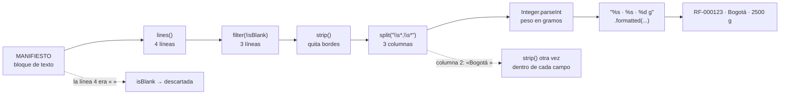
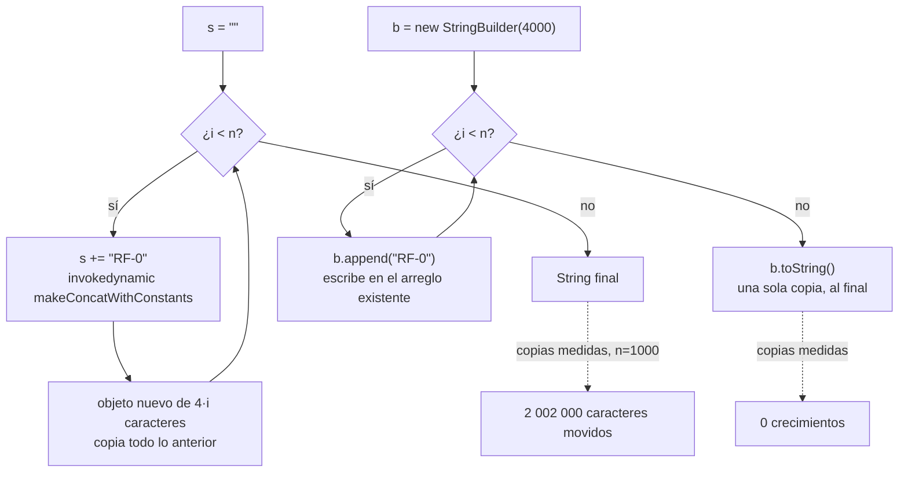
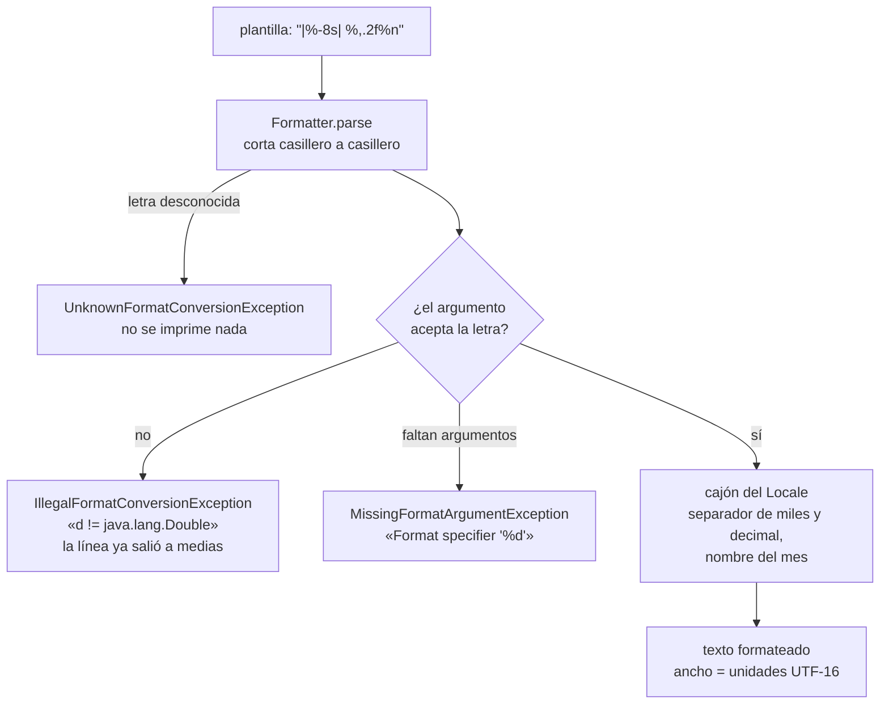

# Módulo 2 · Texto y entrada/salida de consola

> Curso Java (JDK 25) · tramo **Fundamentos** · 6 temas · formato único (specs/021). Portada del curso:
> [CURSO.md](CURSO.md). Todo el código de este módulo se compiló con `javac --release 25` y se ejecutó con
> `java -Dstdout.encoding=UTF-8` sobre OpenJDK Temurin 27.0.1.0.2+1 (macOS, arm64), locale `es_CO`, el
> 2026-11-20. Las salidas están pegadas tal cual. **Aviso de proveniencia:** en esta máquina no hay JDK 25
> instalado, así que el *API* es la de la versión 25 (la que comprueba `--release 25`) pero el *ejecutable*
> es el 27. Lo que puede cambiar entre esas dos versiones está marcado en cada tema con «pendiente de
> reejecución en JDK 25»; nada de este módulo usa funciones preview.

## Cabecera del módulo

| | |
|---|---|
| **Objetivo** | Manipular texto de verdad: saber qué compara `==` y qué compara `equals`, usar la API moderna de `String`, construir textos sin pagar copias cuadráticas, distinguir carácter / unidad UTF-16 / byte, alinear la salida con formato y leer datos por consola o desde un archivo sin romper acentos ni emojis. |
| **Prerrequisitos** | [Módulo 0](modulo-0.md) completo (ejecutar un archivo, leer `javap -c`, JShell) y [Módulo 1](modulo-1.md) completo — en especial su tema 2 (valores frente a referencias) y su tema 1 (`char` como unidad UTF-16). |
| **Duración** | 4 h 10 min (6 temas de 35 a 45 min) más 1 h de laboratorio. |
| **Versiones** | JDK 25 (`--release 25`) · Gradle 9.8.2 por wrapper · JUnit 6.0.3. Nada de este módulo está en preview: `javac --release 25` acepta `IO.readln()` sin `--enable-preview`. |
| **Laboratorio** | [`laboratorios/modulo-2/`](laboratorios/modulo-2/README.md) (al publicar: `examples/java/modulo-2/`), con `verificar.sh`. |
| **Proyecto guía** | `rutaflow-nucleo`: el **lector de guías de envío por consola**. Lee líneas con acentos, emojis y espacios sucios, las valida, las normaliza y las imprime alineadas. Cada tema cierra una parte: comparar (T1), limpiar (T2), acumular (T3), codificar (T4), formatear (T5), leer (T6). |

### Mapa del módulo

```mermaid
flowchart LR
    T1["1 · String<br/>inmutabilidad y ==" --> T2["2 · API de String<br/>strip, lines, formatted"]
    T2 --> T3["3 · StringBuilder<br/>y coste de concatenar"]
    T3 --> T4["4 · Unicode<br/>code points y charsets"]
    T4 --> T5["5 · Formato<br/>printf y Formatter"]
    T5 --> T6["6 · Entrada<br/>IO, Scanner, Console, args"]
    T6 -.->|"línea leída → limpiar → validar → formatear"| P["rutaflow-nucleo<br/>lector de guías"]
```

**Texto alternativo:** seis temas en cadena. Primero, qué es un `String` y qué compara realmente `==`.
Después, las herramientas modernas para limpiar y partir texto. Luego, cómo construir textos largos sin
copiar todo cada vez. A continuación, la diferencia entre carácter, unidad UTF-16 y byte, con acentos y
emojis medidos. Después, cómo se alinea y se traduce la salida con `printf`. Por último, cómo entra el
texto: `IO.readln`, `Scanner`, `Console` y los argumentos del programa. El tema 6 alimenta el lector de
guías con datos reales, y los cinco anteriores son los que permiten que ese dato no se rompa.

**Convención del módulo.** Toda afirmación sobre lo que hace el compilador se comprueba con `javap`. Toda
afirmación sobre lo que hace el programa se comprueba ejecutándolo y pegando su salida. Cuando una medida
depende de la máquina (tiempos, locale, charset por defecto), se escribe el valor observado junto al
mando, en vez de presentarlo como universal.

---

### Tema 1: `String`: inmutabilidad, pool de literales y `==` frente a `equals` · Básico · 45 min

#### 1. Ubicación y prerrequisitos

Curso Java · tramo Fundamentos · módulo 2 · primer tema. Antes: [Módulo 1 · tema 2](modulo-1.md) (una
variable guarda un valor o **una referencia**; `=` copia la referencia) y [Módulo 1 · tema 1](modulo-1.md)
(`char` es una unidad UTF-16 de 16 bits). Versión: JDK 25.

#### 2. Objetivo

Al terminar puedes decir, para dos variables de tipo `String`, si `==` dará `true`, si lo dará `equals` y
por qué; sabes dónde vive cada texto que has escrito o construido; y escribes comparaciones de contenido
que no fallan cuando el dato llega de fuera.

#### 3. Por qué importa

El buscador de guías de `rutaflow-nucleo` compara el texto que recibe con la lista de envíos. Con un literal
funciona. Con el mismo texto escrito en un formulario, o leído de un archivo, o devuelto por una base de
datos, **no encuentra nada** y el envío se pierde sin error: `==` pregunta «¿es el mismo objeto?», y la
respuesta casi siempre es «no», aunque el contenido sea idéntico. Es el fallo más frecuente del programa
que empieza, y se copia verbatim en el ejemplo `tema-1/CompararGuias.java` de este tema.

#### 4. Analogía

La cartelera de la estación tiene papeles clavados con chinchetas. `==` pregunta **«¿los dos dedos señalan
el mismo papel?»**. `equals` pregunta **«¿lo que está escrito en los dos papeles es igual?»**. Dos papeles
distintos con la misma guía responden «no» a la primera pregunta y «sí» a la segunda.

Y hay una tercera cosa en la cartelera: la **caja de papeles de imprenta** (el *pool*). Cada frase escrita
en el código fuente sale de esa caja, y si dos frases son idénticas salen del **mismo** papel. Por eso
`==` entre dos literales iguales da `true`. Lo que llega del exterior (un formulario, un archivo) es un
papel nuevo, fotocopiado, aunque esté escrito igual.

**Dónde se rompe la analogía:** la caja de imprenta no la llena el programa solo con `==`; hay que pedirla
a propósito con `intern()`. Y un papel fotocopiado puede volverse a meter en la caja: por eso `c.intern()`
sí coincide con el literal.

#### 5. Diagrama

```mermaid
flowchart TB
    subgraph Pila["Pila · marco de main"]
        A["a :"]
        B["b :"]
        D["d :"]
        F["f :"]
        C["c :"]
        E["e :"]
    end
    subgraph Pool["Pool de literales (el #7 de la tabla de constantes)"]
        P1["\"RF-000123\""]
    end
    subgraph Heap["Heap · objetos creados en tiempo de ejecución"]
        O1["new String(\"RF-000123\")"]
        O2["StringBuilder(...).toString()"]
    end
    A --> P1
    B --> P1
    D --> P1
    F --> P1
    C --> O1
    E --> O2
    O1 -. "intern()" .-> P1
    O2 -. "intern()" .-> P1
```

**Texto alternativo:** cuatro variables (`a`, `b`, `d`, `f`) apuntan al mismo objeto del pool, el que el
compilador dejó en la entrada nº 7 de la tabla de constantes. Dos (`c`, `e`) apuntan a objetos distintos
del heap, creados mientras el programa corría. `equals` es `true` en los seis casos porque el contenido es
el mismo; `==` solo es `true` entre las cuatro que comparten objeto. Pedir `intern()` a `c` o `e` devuelve
la referencia del pool.

#### 6. Explicación

**Nivel 0.** En Java un `String` es un **objeto**, no un número. Y es **inmutable**: una vez creado, su
contenido no cambia nunca. Métodos como `toUpperCase()` o `replace()` no modifican el texto: **devuelven
otro** `String` (medido en `tema-1/Inmutables.java`).

De ahí las dos formas de comparar:

| Operador | Pregunta | Entre textos |
|---|---|---|
| `==` | ¿misma referencia (el mismo objeto)? | solo a veces `true` |
| `equals` | ¿mismo contenido? | `true` si son iguales |
| `equalsIgnoreCase` | ¿mismo contenido sin mirar mayúsculas? | `"RF".equalsIgnoreCase("rf")` → `true` |

Regla del curso: **contenido se compara con `equals`; referencias, con `==`.** Entre `String`, casi siempre
quieres `equals`.

**Nivel intermedio.**

*Dónde vive cada texto.*

- Un **literal** del código (`"RF-000123"`) se guarda en la tabla de constantes de la clase y se reutiliza:
  dos literales idénticos en el mismo archivo son el **mismo** objeto. Es el *pool de literales*.
- `new String("RF-000123")` crea un objeto **nuevo**, fuera del pool, aunque el contenido sea idéntico.
- `String.valueOf(x)` no copia si `x` ya es `String`; `copyValueOf` y el constructor sí crean objeto.
- Una concatenación de **puras constantes** (`"RF-000" + "123"`) la resuelve el compilador: da la misma
  referencia que el literal doblado. Una concatenación hecha **mientras corre** el programa
  (`new StringBuilder("RF-000").append("123").toString()`) crea un objeto nuevo.
- `intern()` devuelve la referencia del pool para ese contenido: tras `intern()`, `==` con el literal ya
  es `true`.

*Los tres errores que se cometen con `==`.*

1. Comparar contenido con `==`: funciona en las pruebas con literales y falla con datos externos.
2. Olvidar que el texto puede venir con espacios o con otra forma de escribir el mismo acento
   ([Tema 2](#tema-2-api-moderna-de-string-strip-isblank-repeat-lines-formatted-y-bloques-de-texto)
   y [Tema 4](#tema-4-unicode-de-verdad-code-points-pares-sustitutos-normalizacion-y-charsets-utf-8-por-defecto-desde-jdk-18)).
3. Volcar la comparación con el lado peligroso: `guia.equals("RF-000123")` lanza
   `NullPointerException` si `guia` es `null`; `"RF-000123".equals(guia)` no. En el ejemplo medido,
   `buscarBien(null)` devuelve `null` sin excepción porque el receptor es siempre el literal.

*Contenido ordenado.* `compareTo` no es «mayor o menor» de tamaño: es el orden lexicográfico unidad a
unidad. Medido en el tema 4: `"Bogotá".compareTo("Bogota" + tilde)` da **128**, que es la diferencia entre
U+00E1 y U+0061, no una medida de parecido.

**Nivel maestro.**

- **Qué ve el compilador.** `javap -v` sobre `PoolDeLiterales.class` muestra **una** entrada de pool para
  el texto (`#7 = String #8 // RF-000123`) y cuatro `ldc #7` en `main` más uno en el inicializador del
  campo estático: las seis referencias salen de la misma entrada. El objeto del pool se crea al cargar la
  clase, no en `main`.
- **El coste de la inmutabilidad** es que «cambiar» un texto crea otro objeto. Por eso existe
  `StringBuilder` ([Tema 3](#tema-3-stringbuilder-y-el-coste-real-de-concatenar)) y por
  eso `String` es `final`: si alguien pudiera heredar de `String` con un método que «mutara» el contenido,
  cualquier código que confíe en que un `String` no cambia —incluido el pool y las claves de un mapa— sería
  falso. El error real al intentarlo está más abajo, en la sección 10.
- **Contrato `equals`/`hashCode`.** Dos objetos `equals` deben tener el mismo `hashCode`; por eso el
  contenido, y no la referencia, decide en un `HashSet`. Medido en el tema 4: dos formas de escribir
  «Bogotá» que **no** son `equals` tienen hashcodes distintos (1995213762 y 1722081279) y una se pierde al
  buscar la otra en el conjunto.
- **`intern()` no es un truco de rendimiento**, es un cambio de identidad: convierte dos contenidos
  iguales en un solo objeto. Úsalo solo cuando necesites esa identidad (o para comparar con `==` en un
  bucle muy caliente), porque el pool es memoria compartida y su crecimiento no es gratis.
- **Lo que `==` sí debe comparar:** el mismo objeto, para detectar alias y ciclos. Medido en
  `tema-3/errores/ConstructorReutilizado.java` (`otra == guia : true`) y en
  `tema-1/Inmutables.java` (`replace` que no encuentra nada devuelve **el mismo** objeto:
  `¿mismo objeto: true`).

#### 7. Código ejecutable

**Ejemplo mínimo** · archivo `tema-1/PoolDeLiterales.java` · ejecuta
`javac --release 25 -d out tema-1/PoolDeLiterales.java && java -Dstdout.encoding=UTF-8 -cp out PoolDeLiterales`

```java
// tema-1/PoolDeLiterales.java — dónde vive cada `String` y qué compara `==`.
// Ejecutar: javac --release 25 -d out PoolDeLiterales.java && java -cp out PoolDeLiterales
public class PoolDeLiterales {

    static String literalDeCampo = "RF-000123";

    public static void main(String[] args) {
        String a = "RF-000123";                                  // literal: va al pool
        String b = "RF-000123";                                  // mismo literal: reutiliza el del pool
        String c = new String("RF-000123");                       // objeto nuevo, fuera del pool
        String d = "RF-000" + "123";                              // expresión constante: el compilador la dobla
        String e = nuevo("RF-000", "123");                        // concatenación en tiempo de ejecución
        String f = literalDeCampo;

        System.out.println("a == b            : " + (a == b));
        System.out.println("a == d            : " + (a == d));
        System.out.println("a == f            : " + (a == f));
        System.out.println("a == c            : " + (a == c));
        System.out.println("a == e            : " + (a == e));
        System.out.println("a.equals(c)       : " + a.equals(c));
        System.out.println("a.equals(e)       : " + a.equals(e));
        System.out.println("a == c.intern()   : " + (a == c.intern()));
        System.out.println("a == e.intern()   : " + (a == e.intern()));
        System.out.println("longitud          : " + a.length());
    }

    static String nuevo(String x, String y) {
        return new StringBuilder(x).append(y).toString();
    }
}
```

Salida:

```text
a == b            : true
a == d            : true
a == f            : true
a == c            : false
a == e            : false
a.equals(c)       : true
a.equals(e)       : true
a == c.intern()   : true
a == e.intern()   : true
longitud          : 9
```

**Ejemplo realista** · archivo `tema-1/CompararGuias.java` · ejecuta
`javac --release 25 -d out tema-1/CompararGuias.java && java -Dstdout.encoding=UTF-8 -cp out CompararGuias`

```java
// tema-1/CompararGuias.java — el fallo real: comparar texto con `==` en un buscador de envíos.
// Ejecutar: javac --release 25 -d out tema-1/CompararGuias.java && java -Dstdout.encoding=UTF-8 -cp out CompararGuias
public class CompararGuias {

    /** Versión mala: compara referencias. Solo acierta cuando ambos lados salieron del pool. */
    static String buscarMal(String guia) {
        if ("RF-000123" == guia) {
            return "Envio[RF-000123, Bogotá]";
        }
        if ("RF-000456" == guia) {
            return "Envio[RF-000456, Medellín]";
        }
        if ("RF-000789" == guia) {
            return "Envio[RF-000789, Cali]";
        }
        return null;
    }

    /** Versión buena: compara contenido. */
    static String buscarBien(String guia) {
        if ("RF-000123".equals(guia)) {
            return "Envio[RF-000123, Bogotá]";
        }
        if ("RF-000456".equals(guia)) {
            return "Envio[RF-000456, Medellín]";
        }
        if ("RF-000789".equals(guia)) {
            return "Envio[RF-000789, Cali]";
        }
        return null;
    }

    public static void main(String[] args) {
        String delPool = "RF-000456";
        String delFormulario = new String("RF-000456");

        System.out.println("contenido igual              : " + delPool.equals(delFormulario));
        System.out.println("misma referencia             : " + (delPool == delFormulario));

        // 1) Con un literal: la versión mala «funciona en mi máquina».
        System.out.println("buscarMal(literal)           : " + buscarMal("RF-000456"));

        // 2) El mismo texto llegado del exterior: otra referencia, mismo contenido.
        System.out.println("buscarMal(desde formulario)  : " + buscarMal(delFormulario));
        System.out.println("buscarBien(desde formulario) : " + buscarBien(delFormulario));

        // 3) Con nulo: equals se llama siempre sobre el lado que no es nulo.
        System.out.println("buscarMal(null)              : " + buscarMal(null));
        System.out.println("buscarBien(null)             : " + buscarBien(null));
        System.out.println("\"RF\".equalsIgnoreCase(\"rf\")    : " + "RF".equalsIgnoreCase("rf"));
    }
}
```

Salida:

```text
contenido igual              : true
misma referencia             : false
buscarMal(literal)           : Envio[RF-000456, Medellín]
buscarMal(desde formulario)  : null
buscarBien(desde formulario) : Envio[RF-000456, Medellín]
buscarMal(null)              : null
buscarBien(null)             : null
"RF".equalsIgnoreCase("rf")    : true
```

**Inmutabilidad: qué devuelve cada método** · archivo `tema-1/Inmutables.java` · ejecuta
`javac --release 25 -d out tema-1/Inmutables.java && java -Dstdout.encoding=UTF-8 -cp out Inmutables`

```java
// tema-1/Inmutables.java — qué objetos se crean de verdad y cuáles se reutilizan.
// Ejecutar: javac --release 25 -d out tema-1/Inmutables.java
//           java -Dstdout.encoding=UTF-8 -cp out Inmutables
public class Inmutables {

    public static void main(String[] args) {
        String guia = "RF-000123";

        // substring() devuelve un String NUEVO (desde JDK 7u6 no comparte la matriz interna).
        String prefijo = guia.substring(0, 5);
        System.out.println("substring(0,5)             : «" + prefijo + "» · equals «RF-00»: "
                + prefijo.equals("RF-00") + " · ¿misma referencia: " + (prefijo == "RF-00"));
        System.out.println("prefijo.intern() == \"RF-00\": " + (prefijo.intern() == "RF-00"));

        // Caso límite: cortar «todo» el texto devuelve el mismo objeto, sin copiar nada.
        System.out.println("substring(0, length) == this: " + (guia.substring(0, guia.length()) == guia));
        System.out.println("substring(5) == this        : " + (guia.substring(5) == guia));

        // replace() también devuelve un objeto nuevo cuando algo cambia...
        String conBarra = guia.replace('-', '/');
        System.out.println("replace cambia             : «" + conBarra + "» · ¿otro objeto: " + (conBarra != guia));
        // ...y el mismo cuando nada cambia.
        System.out.println("replace no encuentra       : ¿mismo objeto: " + (guia.replace('z', 'y') == guia));

        // toUpperCase() puede alargar o acortar el texto: otro objeto, otra longitud.
        String ciudad = "Bogotá";
        System.out.println("toUpperCase                : " + ciudad.toUpperCase() + " · longitud "
                + ciudad.toUpperCase().length() + " · ¿mismo objeto: " + (ciudad.toUpperCase() == ciudad));

        // valueOf no crea nada nuevo para un String; new String sí copia.
        System.out.println("valueOf(guia) == guia      : " + (String.valueOf(guia) == guia));
        System.out.println("new String(guia) == guia   : " + (new String(guia) == guia));
        System.out.println("new String(guia).equals    : " + (new String(guia).equals(guia)));

        // Un método no puede cambiar el contenido de un String: solo devolver otro.
        System.out.println("tras intentar 'mutar'      : " + mutar(guia) + " · la variable de arriba sigue siendo " + guia);
    }

    /** Intento de «poner en minúsculas el mismo objeto»: devuelve otro texto, no toca el original. */
    static String mutar(String s) {
        s = s.toLowerCase();
        return s;
    }
}
```

Salida:

```text
substring(0,5)             : «RF-00» · equals «RF-00»: true · ¿misma referencia: false
prefijo.intern() == "RF-00": true
substring(0, length) == this: true
substring(5) == this        : false
replace cambia             : «RF/000123» · ¿otro objeto: true
replace no encuentra       : ¿mismo objeto: true
toUpperCase                : BOGOTÁ · longitud 6 · ¿mismo objeto: false
valueOf(guia) == guia      : true
new String(guia) == guia   : false
new String(guia).equals    : true
tras intentar 'mutar'      : rf-000123 · la variable de arriba sigue siendo RF-000123
```

**Por dentro** · el pool, en la tabla de constantes ·
`javac --release 25 -d out tema-1/PoolDeLiterales.java && javap -v -p -cp out PoolDeLiterales | grep "String RF-000123"`

```text
    #7 = String             #8            // RF-000123
         0: ldc           #7                  // String RF-000123
         3: ldc           #7                  // String RF-000123
        10: ldc           #7                  // String RF-000123
        16: ldc           #7                  // String RF-000123
         0: ldc           #7                  // String RF-000123
```

Una sola entrada de pool (`#7`) y cinco `ldc` que la apuntan: los cuatro literales de `main` (`a`, `b`,
`d`, `f`, donde `d` es `"RF-000" + "123"` doblada por el compilador) más el inicializador de
`literalDeCampo`. No hay cuatro cadenas que «casualmente» coinciden: hay una.

**Por dentro 2** · la comparación de contenido, en bytecode ·
`javap -c -p -cp out CompararGuias | sed -n '/buscarBien/,/areturn/p'` (primeras líneas)

```text
  static java.lang.String buscarBien(java.lang.String);
    Code:
         0: ldc           #7                  // String RF-000123
         2: aload_0
         3: invokevirtual #19                 // Method java/lang/String.equals:(Ljava/lang/Object;)Z
         6: ifeq          12
         9: ldc           #9                  // String Envio[RF-000123, Bogotá]
        11: areturn
```

`ldc` carga el literal (referencia del pool), `aload_0` carga el parámetro y `invokevirtual equals`
compara **contenido**. La versión mala (`buscarMal`) lleva `if_acmpne` en lugar de `equals`: compara las
dos referencias sin preguntar por el contenido.

#### 8. Mini-laboratorio

Escribe los archivos desde cero en `laboratorios/modulo-2/tema-1/` (no copies y pegues: el objetivo es que
predigas y compruebes).

1. Crea `MiBuscador.java` con tres envíos y **solo `==`**. Antes de ejecutar, escribe en un comentario qué
   pasará con `buscar("RF-000456")` y qué pasará con `buscar(new String("RF-000456"))`. Ejecuta y compara
   tu predicción con la realidad.
2. Sustituye `==` por `equals` y vuelve a ejecutar. Después añade un cuarto envío en minúsculas
   (`"rf-000999"`) y haz que se encuentre desde `"RF-000999"` con `equalsIgnoreCase`.
3. Con la versión **mala** (`==`) otra vez, pasa el argumento por `intern()` dentro de `buscar`. Ahora
   encuentra el texto del `new String`. Escribe debajo del método por qué esto funciona y por qué no es la
   solución que dejarías en producción.
4. Crea `Iguales.java` con `static boolean iguales(String a, String b)` que devuelva `true` si los dos son
   `null`, `false` si solo uno lo es, y que compare contenido en el resto de casos. Pruébala con las seis
   parejas: `("RF", "RF")`, `(null, null)`, `(null, "")`, `("", " ")`, `("Bogotá", "Bogota")` y
   `("RF-000456", new String("RF-000456"))`. Imprime cada resultado con `System.out.println`.

**Listo cuando** el paso 1 devuelva `null` con `new String` (y hayas acertado o corregido tu predicción),
el paso 2 encuentre los cuatro envíos, el paso 3 imprima la guía pero tu comentario diga que `intern()`
convierte contenido en identidad y no arregla el resto de fallos, y el paso 4 imprima
`true false false false false true` sin lanzar ninguna excepción.

#### 9. Verificación

```bash
cd docs/reestructuracion/cursos/java/laboratorios/modulo-2
javac --release 25 -encoding UTF-8 -d out tema-1/*.java
java -Dstdout.encoding=UTF-8 -cp out CompararGuias      # debe imprimir «buscarMal(desde formulario)  : null»
java -Dstdout.encoding=UTF-8 -cp out PoolDeLiterales    # a==c false, a==c.intern() true
java -Dstdout.encoding=UTF-8 -cp out Inmutables         # replace sin coincidencia: ¿mismo objeto: true
javap -v -p -cp out PoolDeLiterales | grep -c "= String             #8 "   # 1: una sola entrada de pool
```

El buscador correcto (`buscarBien`) debe encontrar la guía en los tres orígenes: literal, `new String` y
`tio.intern()`. Si algún paso no reproduce esta salida, vuelve a compilar: los `.class` viejos engañan
(este módulo se recompiló desde cero una vez y `PlantillaEtiqueta` cambió de comportamiento al hacerlo).

*Pendiente de reejecución en JDK 25:* la comparación del pool y de `intern()` es semántica del lenguaje y no
depende de la versión del ejecutable; no hay nada que revisar aquí en este tema.

#### 10. Error común y diagnóstico

**Síntoma** (salida real de `tema-1/CompararGuias.java`):

```text
buscarMal(literal)           : Envio[RF-000456, Medellín]
buscarMal(desde formulario)  : null
```

El programa «funciona» en las pruebas con literales y devuelve `null` con el dato que llega del formulario,
del archivo o de la red. No hay excepción: simplemente no aparece nada.

**Causa:** los dos textos tienen el mismo contenido pero son objetos distintos; `==` compara referencias.

**Diagnóstico:** imprime las dos respuestas seguidas. En la salida medida:

```text
contenido igual              : true
misma referencia             : false
```

Si el contenido es igual y la referencia no, el fallo es `==`. Si **ambas** dan `false`, no era `==`: el
contenido es distinto (un espacio sobrante —tema 2— o una forma distinta de escribir el acento —tema 4—), y
`equals` tampoco lo encontraría. Ese segundo caso es el que se descubre con `length()` y con la lista de
code points, no con `==`.

**Arreglo:** `equals`, con el literal como receptor para que `null` no rompa nada:

```java
if ("RF-000456".equals(guia)) { ... }
```

**Error de compilación real** (`tema-1/errores/HeredaDeString.java`):

```text
tema-1/errores/HeredaDeString.java:5: error: cannot inherit from final String
    static class GuiaConValidacion extends String {
                                           ^
1 error
```

Significa lo que parece: `String` es `final`. Si necesitas «un String que se valide a sí mismo», no heredes:
escribe un método de validación que reciba un `String`, o crea tu propio tipo (eso llega en el módulo 5, con
los records y los tipos de valor).

#### 11. Pregunta con respuesta modelo

**Comprensión.** `String a = "RF-000123"; String b = "RF-000" + "123"; String c = new String(a);` — ¿qué da
`a == b`, `a == c` y `a.equals(c)`?

**Respuesta modelo:** `a == b` es `true`, porque la concatenación de dos constantes la resuelve el
compilador y deja el texto doblado en la misma entrada del pool. `a == c` es `false`: el constructor crea un
objeto nuevo en el heap. `a.equals(c)` es `true`: el contenido es idéntico. Lo confirma `javap`: en el
disassembly del ejemplo medido hay una única entrada de pool y varios `ldc` que la apuntan, no varias
cadenas.

**Entrevista.** ¿Por qué `String` es inmutable y `final` en Java? Menciona al menos tres consecuencias.

**Respuesta modelo:** (1) **Seguridad**: un `String` que se pasó como ruta, nombre de host o usuario no
puede cambiarse a espaldas del código que lo validó. (2) **Claves de colecciones**: un `HashMap` guarda el
`hashCode` calculado una vez; si el contenido cambiara tras meter la clave, la entrada quedaría
inalcanzable. (3) **El pool y el `intern()`**: solo tiene sentido compartir objetos que nadie puede mutar; por
eso `replace` que no encuentra nada devuelve el mismo objeto, sin copia. (4) Coste: cualquier «modificación»
crea un objeto nuevo, que es exactamente el problema que resuelve `StringBuilder`. Bonus: al heredar de
nadie y no permitir herencia, su contrato no se puede romper con un método que viole la inmutabilidad.

#### 12. Cuándo usarlo y cuándo no

| Úsalo | No lo uses |
|---|---|
| `equals` para comparar contenido de textos | `==` para comparar contenido: falla con datos que vienen de fuera |
| `equalsIgnoreCase` cuando el origen cambia mayúsculas (formularios, CSV) | `equalsIgnoreCase` para «ignorar acentos»: no los ignora (tema 4) |
| Literales como receptor de `equals` cuando el otro lado puede ser `null` | `intern()` como forma de «arreglar» un `==`: enmascara el error y llena el pool |
| `compareTo` cuando necesitas orden lexicográfico (ordenar, buscar en un árbol) | `compareTo` como medida de parecido: solo devuelve la diferencia de la primera unidad distinta |
| `String` para texto que no cambia tras crearse | `String` para construir texto carácter a carácter en un bucle: es `StringBuilder` (tema 3) |

**Costo:** comparar con `equals` es O(n) sobre el contenido (con un rechazo rápido si las longitudes
difieren); `==` es una comparación de referencia. Crear un `String` cuesta una copia del contenido: por eso
`new String(...)` en un bucle es lo que el tema 3 mide y evita.

---

### Tema 2: API moderna de `String`: `strip`, `isBlank`, `repeat`, `lines`, `formatted` y bloques de texto · Básico · 40 min

#### 1. Ubicación y prerrequisitos

Curso Java · tramo Fundamentos · módulo 2 · segundo tema. Antes: [Tema 1](#tema-1-string-inmutabilidad-pool-de-literales-y-frente-a-equals) (cada «cambio» devuelve otro objeto) y
[Módulo 1 · tema 3](modulo-1.md) (`var`, ámbito). Se usa `split` con una pequeña expresión regular como caja
negra; la sintaxis de regex se estudia en su módulo. Versión: JDK 25.

#### 2. Objetivo

Al terminar sabes limpiar y partir texto de entrada real sin escribir bucles a mano: distingues `trim` de `strip`,
sabes cuándo `isBlank` no es `isEmpty`, cuentas líneas con `lines()`, construyes plantillas con bloques de
texto y `formatted`, y sabes qué hace `translateEscapes` con una secuencia que no reconoce.

#### 3. Por qué importa

El manifiesto que llega del sistema de bodega del cliente trae cada línea con sangría distinta, espacios
sobrantes dentro de las columnas y líneas en blanco. Con `trim` y un `split(";")` ingenuo el parser se come
espacios, se traba con las líneas vacías y devuelve campos de más o de menos. Las cuatro funciones de JDK 11
(`strip`, `isBlank`, `lines`, `repeat`) y el bloque de texto existen justo para escribir eso en tres líneas,
con acentos incluidos.

#### 4. Analogía

Dos tijeras de cortar el borde de una foto. La **vieja** (`trim`) solo reconoce los huecos que conoce la
máquina de escribir: hasta U+0020. La **nueva** (`strip`) lleva el diccionario Unicode: corta también el
separador de línea tipográfico (U+2028). Pero **ninguna** de las dos reconoce el espacio de la web
(U+00A0, «no rompible»): ese no es un borde, es contenido. Y `split` es una guillotina que, si los últimos
cortes dan hojas vacías, las tira: por eso `split(";", -1)` existe.

**Dónde se rompe la analogía:** las tijeras no deciden solas — lo que «es espacio» lo define
`Character.isWhitespace`, y Unicode ha decidido que U+00A0 y U+200B **no** lo son (medido: `false`).

#### 5. Diagrama



**Texto alternativo:** el texto en bloque entra con cuatro líneas. `lines()` las convierte en flujo;
`isBlank` descarta la que solo tenía espacios; `strip()` limpia los bordes de la línea; `split` parte por
coma y suelta los espacios alrededor del separador; el último campo se convierte en número; `formatted`
compone la línea salida. Cada campo se limpia otra vez porque `strip` actúa sobre los bordes del todo, no
sobre los huecos interiores.

#### 6. Explicación

**Nivel 0.** Estas son las que se usan a diario sobre texto de entrada:

| Método | Qué hace | Medido en este módulo |
|---|---|---|
| `strip()` / `stripLeading()` / `stripTrailing()` | quita espacios Unicode por un lado o los dos | ver tabla de `trim` frente a `strip` |
| `trim()` | quita solo lo `<= U+0020` | U+2028 sobrevive a `trim`, no a `strip` |
| `isBlank()` | `true` si está vacío **o** solo hay espacios | `"   "` → `true`; `NBSP` solo → `false` |
| `isEmpty()` | `true` solo si longitud 0 | `"   "` → `false` |
| `lines()` | flujo de líneas, sin el salto | 4 líneas, 3 útiles |
| `repeat(n)` | n copias | `"─".repeat(21)` → línea de 21 guiones |
| `formatted(args…)` | `String.format` escrito al lado del texto | `"%s · %s · %d g".formatted(…)` |
| `charAt(i)` / `indexOf(c)` / `substring(a,b)` | posición y trozo, **en unidades UTF-16** | `"RF-000123".charAt(2)` → `-`, `indexOf('1')` → 6 |
| `replace(old, new)` | sustituye (sin regex) | `"Bogotá Centro".replace(' ', '+')` → `Bogotá+Centro` |
| `split(sep)` / `split(sep, limit)` | parte con regex | `split(";")` → 2; `split(";", -1)` → 3 |
| `join(sep, elementos)` | une con separador, sin colgado | `RF-000123 · Bogotá · 2500 g` |
| `indent(n)` | re-sangra y **cierra con salto de línea** | `"Bogotá".indent(2)` → 9 chars |
| `translateEscapes()` | convierte `\n`, `\t`, `\u…` en texto de escape **Unicode** | ver abajo: `\u0041` **no** lo traduce |
| `"""…"""` | bloque de texto multilínea | plantilla de la etiqueta |

**Nivel intermedio.**

*`trim` frente a `strip`, medido.* Con `muestra = U+2028 + "Bogotá"`, `trim()` deja los 7 caracteres
(incluido U+2028) y `strip()` deja `"Bogotá"` en 6. Con `U+00A0 + "Bogotá" + U+00A0`, **ninguna** limpia:
longitud 8 en las dos. Y con U+200B (espacio de ancho cero) tampoco. La regla práctica: `strip` es la versión
correcta para texto de origen humano; si el dato viene de una web o de un Word, puede traer NBSP y `strip`
no lo quita — eso se resuelve normalizando (tema 4) o sustituyendo el carácter a mano.

*`isBlank` no es `isEmpty`.* `"   "` está en blanco pero no vacío; el NBSP suelto no está en blanco para
Java. Al filtrar líneas de un archivo: `lineas.filter(s -> !s.isBlank())`, no `!s.isEmpty()`.

*Bloques de texto.* Tres comillas + **salto de línea obligatorio** después de abrir. El compilador quita la
**sangría incidental** (la común a todas las líneas) y deja la relativa; termina con un salto si la última
línea va sola. Escapes útiles dentro del bloque: `\` al final de línea (une con la siguiente, sin espacio),
`\s` (protege un espacio final que se estaría comiendo) y `\"\"\"` para meter comillas. Dentro del bloque,
`\n` se escribe igual que siempre y `\\n` produce el **texto** `\n`, no un salto.

*`stripIndent()` no hace nada sobre un bloque de texto* (ya vino sangrado por el compilador) — medido: las
dos plantillas del ejemplo imprimen idénticas. Es para texto construido en tiempo de ejecución.

*`translateEscapes()`* traduce las secuencias de estilo `printf` dentro de un texto normal: `\n`, `\t`,
`\b`, `\f`, `\r` y `\s`. No traduce la forma hexadecimal de punto de código: `"\u0041BC"` escrita como
**texto** (ocho caracteres) lanza

```text
Exception in thread "main" java.lang.IllegalArgumentException: Invalid escape sequence: \u \\u0075
```

(mensaje tal cual, línea 41 de la salida medida; el texto exacto del mensaje es de la biblioteca del
ejecutable → **pendiente de reejecución en JDK 25**).

**Nivel maestro.**

- Todo esto son **métodos de `String`, que devuelven otro `String`**: no hay uno que «limpie en el sitio».
  Un bucle que hace `s = s.strip()` sobre 100 000 líneas crea 100 000 objetos. Se mide en el tema 3.
- `lines()` parte **solo** por LF, CRLF y CR. `split("\\R")` parte además por U+000B, U+000C, U+0085,
  U+2028 y U+2029. Medido en `tema-2/SaltosLinea.java`: sobre un texto con NEL, `lines().count()` es `1` y
  `split("\\R").length` es `2`. Y `split("\n")` sobre un CRLF deja la `U+000D` pegada al final de la primera
  pieza: es el motivo por el que un archivo de Windows «sí se parte» y aun así el último campo no coincide
  con nada.
- `split` descarta las piezas vacías **del final**: `limit` negativo (`-1`) las conserva. Con `split(";")`
  sobre `"RF-000123;Bogotá;"` salen 2 campos, no 3; con `-1`, 3. Y el separador es **regex**: `split(".")`
  parte por «cualquier carácter» y el resultado tiene **0** campos (medido). Para separar por un punto
  literal: `split("\\.")`.
- `indent(n)` añade `n` espacios por línea y termina **cada** línea con salto; con `n` negativo quita hasta
  ese número de espacios, y con cadena vacía devuelve cadena vacía (medido: longitud 0).
- `formatted` es `String.format` con el receptor como plantilla: cómodo, pero construye un `Formatter` en
  cada llamada; en un bucle de miles de etiquetas se mide frente a `StringBuilder` en el tema 5.

#### 7. Código ejecutable

**Ejemplo mínimo** · archivo `tema-2/LimpiarYPartir.java` (fragmento) · ejecuta
`javac --release 25 -d out tema-2/LimpiarYPartir.java && java -Dstdout.encoding=UTF-8 -cp out LimpiarYPartir`

```java
    static final String NBSP = Character.toString(0x00A0);

    static void lista(String nombre, String s) {
        StringBuilder b = new StringBuilder(nombre + " : «" + s + "» · longitud " + s.length() + " ·");
        s.codePoints().forEach(cp -> b.append(' ').append("U+").append(Integer.toHexString(cp).toUpperCase()));
        System.out.println(b);
    }

    public static void main(String[] args) {
        for (String muestra : new String[] {"  Bogotá  ", "\tBogotá\n",
                Character.toString(0x2028) + "Bogotá", NBSP + "Bogotá" + NBSP,
                Character.toString(0x200B) + "Bogotá"}) {
            lista("original    ", muestra);
            lista("trim()      ", muestra.trim());
            lista("strip()     ", muestra.strip());
            System.out.println();
        }
```

Salida (las cinco muestras; la tercera y la cuarta son la clave):

```text
--- limpiar: trim corta hasta U+0020, strip corta espacio Unicode ---
original     : «  Bogotá  » · longitud 10 · U+20 U+20 U+42 U+6F U+67 U+6F U+74 U+E1 U+20 U+20
trim()       : «Bogotá» · longitud 6 · U+42 U+6F U+67 U+6F U+74 U+E1
strip()      : «Bogotá» · longitud 6 · U+42 U+6F U+67 U+6F U+74 U+E1

original     : «	Bogotá
» · longitud 8 · U+9 U+42 U+6F U+67 U+6F U+74 U+E1 U+A
trim()       : «Bogotá» · longitud 6 · U+42 U+6F U+67 U+6F U+74 U+E1
strip()      : «Bogotá» · longitud 6 · U+42 U+6F U+67 U+6F U+74 U+E1

original     : « Bogotá» · longitud 7 · U+2028 U+42 U+6F U+67 U+6F U+74 U+E1
trim()       : « Bogotá» · longitud 7 · U+2028 U+42 U+6F U+67 U+6F U+74 U+E1
strip()      : «Bogotá» · longitud 6 · U+42 U+6F U+67 U+6F U+74 U+E1

original     : « Bogotá » · longitud 8 · U+A0 U+42 U+6F U+67 U+6F U+74 U+E1 U+A0
trim()       : « Bogotá » · longitud 8 · U+A0 U+42 U+6F U+67 U+6F U+74 U+E1 U+A0
strip()      : « Bogotá » · longitud 8 · U+A0 U+42 U+6F U+67 U+6F U+74 U+E1 U+A0

original     : «​Bogotá» · longitud 7 · U+200B U+42 U+6F U+67 U+6F U+74 U+E1
trim()       : «​Bogotá» · longitud 7 · U+200B U+42 U+6F U+67 U+6F U+74 U+E1
strip()      : «​Bogotá» · longitud 7 · U+200B U+42 U+6F U+67 U+6F U+74 U+E1

isWhitespace(U+00A0)        : false · isWhitespace(U+2028): true
```

Salida (resto del archivo, medidas de `isBlank`, `indent` y `split`):

```text
--- isBlank: huecos y saltos cuentan como nada ---
  «» · length 0 · isBlank true · isEmpty true
  «   » · length 3 · isBlank true · isEmpty false
  «	
» · length 2 · isBlank true · isEmpty false
  « » · length 1 · isBlank false · isEmpty false
  «   RF-000123 » · length 13 · isBlank false · isEmpty false
--- indent añade y cierra con salto de línea (menos si está vacío) ---
sin indent   : «Bogotá» · longitud 6 · U+42 U+6F U+67 U+6F U+74 U+E1
indent(2)    : «  Bogotá
» · longitud 9 · U+20 U+20 U+42 U+6F U+67 U+6F U+74 U+E1 U+A
indent(-1)   : « Bogotá
» · longitud 8 · U+20 U+42 U+6F U+67 U+6F U+74 U+E1 U+A
vacío+indent : «» · longitud 0 ·
--- split: las piezas vacías del final desaparecen ---
split(";")    : 2 campos · última «Bogotá»
split(";", -1): 3 campos · última «»
split(".")    : 0 campos (el punto en regex vale «cualquier carácter»)
"a,,b,"        : sin límite 3 piezas · con -1 4 piezas
",a,,b,"     : sin límite 4 piezas · con -1 5 piezas
--- unir: join no deja separador colgando ---
join            : RF-000123 · Bogotá · 2500 g
repeat          : |||||
repeat(-1)      : se ve en el laboratorio (lanza IllegalArgumentException)
```

**Ejemplo 2** · archivo `tema-2/SaltosLinea.java` · ejecuta
`javac --release 25 -d out tema-2/SaltosLinea.java && java -Dstdout.encoding=UTF-8 -cp out SaltosLinea`

Este programa arma el mismo texto (`RF-0001` + un separador + `Bogotá`) con seis separadores distintos y
compara qué corta `lines()`, qué corta `split("\\R")` y qué corta `split("\n")`. Imprime además el code point
final de cada pieza, que es donde está el dato interesante. Los caracteres raros se escriben con
`Character.toString(0x0085)` en lugar de escaparlos en el fuente, para que el archivo sea legible.

```java
static void prueba(String nombre, String texto) {
    System.out.println("--- " + nombre + " · texto de " + texto.length() + " char · último U+"
            + hex(texto.charAt(texto.length() - 1)));
    System.out.println("  lines().count() : " + texto.lines().count());
    piezas("split(\\R)", texto.split("\\R"));
    piezas("split(\\n)", texto.split("\n"));
    System.out.println();
}
```

Salida (las seis llamadas son, en orden, LF, CRLF, CR solo, U+0085, U+2028, y U+000B+U+000C):

```text
--- LF      · texto de 14 char · último U+00E1
  lines().count() : 2
  split(\R) :  [7, final U+0031]  [6, final U+00E1]  · 2 piezas
  split(\n) :  [7, final U+0031]  [6, final U+00E1]  · 2 piezas

--- CRLF    · texto de 15 char · último U+00E1
  lines().count() : 2
  split(\R) :  [7, final U+0031]  [6, final U+00E1]  · 2 piezas
  split(\n) :  [8, final U+000D]  [6, final U+00E1]  · 2 piezas

--- CR solo · texto de 14 char · último U+00E1
  lines().count() : 2
  split(\R) :  [7, final U+0031]  [6, final U+00E1]  · 2 piezas
  split(\n) :  [14, final U+00E1]  · 1 piezas

--- NEL     · texto de 14 char · último U+00E1
  lines().count() : 1
  split(\R) :  [7, final U+0031]  [6, final U+00E1]  · 2 piezas
  split(\n) :  [14, final U+00E1]  · 1 piezas

--- U+2028  · texto de 14 char · último U+00E1
  lines().count() : 1
  split(\R) :  [7, final U+0031]  [6, final U+00E1]  · 2 piezas
  split(\n) :  [14, final U+00E1]  · 1 piezas

--- VT y FF · texto de 18 char · último U+0069
  lines().count() : 1
  split(\R) :  [7, final U+0031]  [5, final U+0074]  [4, final U+0069]  · 3 piezas
  split(\n) :  [18, final U+0069]  · 1 piezas
```

Lee la columna `split(\n)` en el bloque CRLF: la primera pieza termina en `U+000D`. Partir por `"\n"` en un
archivo de Windows deja el carriage return pegado al final de cada línea, y un `equals` contra la guía limpia
falla sin que se vea por qué. En los bloques NEL, U+2028 y VT+FF, `lines()` devuelve `1` mientras `split("\\R")`
corta: `lines()` **no** implementa `\R`. En la pantalla estas piezas pueden verse como un salto de línea y aun
así contar como una sola línea.

**Ejemplo realista** · archivo `tema-2/ApiTexto.java` · ejecuta
`javac --release 25 -d out tema-2/ApiTexto.java && java -Dstdout.encoding=UTF-8 -cp out ApiTexto`

```java
// tema-2/ApiTexto.java — la API moderna de String, sobre el manifiesto de recolección.
// Ejecutar: javac --release 25 -d out ApiTexto.java && java -cp out ApiTexto
import java.util.List;

public class ApiTexto {

    // El manifiesto llega con espacios sueltos, líneas vacías y columnas desalineadas.
    static final String MANIFIESTO = """
              RF-000123 , Bogotá  , 2500\s
            RF-000456,Medellín,1800
      \s
             RF-000789 , Cali    , 4200\s
            """;

    public static void main(String[] args) {
        List<String> lineas = MANIFIESTO.lines().filter(s -> !s.isBlank()).toList();
        System.out.println("leídas totales   : " + MANIFIESTO.lines().count());
        System.out.println("sin líneas basura: " + lineas.size());

        for (String linea : lineas) {
            String[] columna = linea.strip().split("\\s*,\\s*");
            String guia = columna[0];
            String destino = columna[1];
            int gramos = Integer.parseInt(columna[2]);
            System.out.println("  " + guia.strip() + " → " + destino.strip() + " · " + gramos + " g");
        }

        String unaGuia = "RF-000123";
        System.out.println("repeat           : " + "─".repeat(12 + unaGuia.length()));
        System.out.println("formatted        : " + "%s · %s · %d g".formatted(unaGuia, "Bogotá", 2500));
        System.out.println("startsWith       : " + unaGuia.startsWith("RF-"));
        System.out.println("replace(' ', '+'): " + "Bogotá Centro".replace(' ', '+'));
        System.out.println("charAt(2)        : " + unaGuia.charAt(2));
        System.out.println("indexOf('1')     : " + unaGuia.indexOf('1'));
        System.out.println("concat vs +      : " + unaGuia.concat("-OK"));
    }
}
```

Salida:

```text
leídas totales   : 4
sin líneas basura: 3
  RF-000123 → Bogotá · 2500 g
  RF-000456 → Medellín · 1800 g
  RF-000789 → Cali · 4200 g
repeat           : ─────────────────────
formatted        : RF-000123 · Bogotá · 2500 g
startsWith       : true
replace(' ', '+'): Bogotá+Centro
charAt(2)        : -
indexOf('1')     : 6
concat vs +      : RF-000123-OK
```

Fíjate en el `\s` del bloque: marca dónde acaba una columna que iba con espacios de relleno
(`"Bogotá  ,"`), y la línea que solo tenía espacios sobrevive como línea (con `\s`) pero la descarta
`isBlank`. Sin esos dos detalles, `lines()` y `split` no tienen con qué quedarse.

**Plantillas con bloques de texto** · archivo `tema-2/PlantillaEtiqueta.java` · ejecuta
`javac --release 25 -d out tema-2/PlantillaEtiqueta.java && java -Dstdout.encoding=UTF-8 -cp out PlantillaEtiqueta`

```java
// tema-2/PlantillaEtiqueta.java — bloques de texto: sangría, \s, translateEscapes y formatted.
// Ejecutar: javac --release 25 -d out PlantillaEtiqueta.java && java -cp out PlantillaEtiqueta
public class PlantillaEtiqueta {

    /** Sin stripIndent: conserva la sangría común del bloque como parte del valor. */
    static final String CON_SANGRIA = """
            RUTAFLOW · etiqueta de envío
              guía   : %s
              destino: %s
              peso   : %d g
            """;

    /** Con stripIndent: la sangría común se quita, la relativa se queda. */
    static final String SIN_SANGRIA = """
            RUTAFLOW · etiqueta de envío
              guía   : %s
              destino: %s
              peso   : %d g
            """.stripIndent();

    public static void main(String[] args) {
        System.out.println("--- con sangría conservada, formateada ---");
        System.out.print(CON_SANGRIA.formatted("RF-000123", "Bogotá", 2500));

        System.out.println("--- con stripIndent ---");
        System.out.print(SIN_SANGRIA.formatted("RF-000456", "Medellín", 1800));

        // `\` al final de una línea la une con la siguiente; `\s` solo protege el espacio final.
        String unidas = """
            guía RF-\
            000123
            peso   2500\sg"""
            ;
        System.out.println("--- \\ une líneas, \\s protege el espacio final ---");
        System.out.println(unidas);
        System.out.println("líneas: " + unidas.lines().count());

        String literales = """
            primera\\nsegunda
            segunda\\tcolumna""";
        System.out.println("--- escapes sin traducir (son texto literal) ---");
        System.out.println(literales);
        System.out.println("--- translateEscapes: ahora sí son escapes ---");
        System.out.println(literales.translateEscapes());
    }
}
```

Salida:

```text
--- con sangría conservada, formateada ---
RUTAFLOW · etiqueta de envío
  guía   : RF-000123
  destino: Bogotá
  peso   : 2500 g
--- con stripIndent ---
RUTAFLOW · etiqueta de envío
  guía   : RF-000456
  destino: Medellín
  peso   : 1800 g
--- \ une líneas, \s protege el espacio final ---
guía RF-000123
peso   2500 g
líneas: 2
--- escapes sin traducir (son texto literal) ---
primera\nsegunda
segunda\tcolumna
--- translateEscapes: ahora sí son escapes ---
primera
segunda
segunda	columna
```

Las dos primeras secciones salen **idénticas** salvo el dato: `stripIndent()` no tenía nada que quitar,
porque la sangría incidental ya la había quitado el compilador.

**Error real de compilación** · archivo `tema-2/errores/EscapeIlegal.java` ·
`javac --release 25 -encoding UTF-8 -d out tema-2/errores/EscapeIlegal.java`

```java
// tema-2/errores/EscapeIlegal.java — una barra dentro de un texto ordinario es el principio de una secuencia.
public class EscapeIlegal {

    public static void main(String[] args) {
        String ruta = "C:\datos\new\guías.txt";
        System.out.println(ruta);
    }
}
```

Salida del compilador:

```text
tema-2/errores/EscapeIlegal.java:7: error: illegal escape character
        String ruta = "C:\datos\new\guías.txt";
                          ^
tema-2/errores/EscapeIlegal.java:7: error: illegal escape character
        String ruta = "C:\datos\new\guías.txt";
                                    ^
2 errors
```

`\d` no es una secuencia de escape de texto: es la barra de una ruta mal escrita. Arreglo:
`"C:\\datos\\new\\guías.txt"` (o, si el texto viene de un archivo y no del código, no hay escape que
traducir: la barra ya es un carácter normal).

**Error real en ejecución** · archivo `tema-2/EscapesInvalidos.java` ·
`java -Dstdout.encoding=UTF-8 -cp out EscapesInvalidos`

```java
// Mismo aspecto en pantalla, pero guardado como TEXTO: barra, u, 0, 0, 4, 1, B, C.
String guardado = "\\" + "u0041BC";
System.out.println("guardado como texto     : " + guardado + " · longitud " + guardado.length());
System.out.println("primer carácter         : " + guardado.charAt(0) + " (código " + (int) guardado.charAt(0) + ")");
System.out.println("translateEscapes        : " + guardado.translateEscapes());
```

Salida:

```text
compilado como carácter : ABC · longitud 3
guardado como texto     : \u0041BC · longitud 8
primer carácter         : \ (código 92)
Exception in thread "main" java.lang.IllegalArgumentException: Invalid escape sequence: \u \\u0075
	at java.base/java.lang.String.translateEscapes(String.java:4701)
	at EscapesInvalidos.main(EscapesInvalidos.java:16)
```

`translateEscapes` **no** es un «desescapador universal» para texto que viene de un archivo: traduce las
secuencias de estilo `printf` y lanza `IllegalArgumentException` con cualquier otra, incluida la forma
`\uXXXX`. (El texto del mensaje lo pone la biblioteca del ejecutable: **pendiente de reejecución con
JDK 25**.)

**Por dentro** · el bloque de texto es una constante ·
`javac --release 25 -d out tema-2/PlantillaEtiqueta.java && javap -v -p -cp out PlantillaEtiqueta | grep -A4 "CON_SANGRIA;"`

```text
  static final java.lang.String CON_SANGRIA;
    descriptor: Ljava/lang/String;
    flags: (0x0018) ACC_STATIC, ACC_FINAL
    ConstantValue: String RUTAFLOW · etiqueta de envío\n  guía   : %s\n  destino: %s\n  peso   : %d g\n
```

Y la que unió líneas con `\`:

```text
   #54 = String             #55           // guía RF-000123\npeso   2500 g
```

No hay ninguna llamada a `stripIndent` ni a un constructor de líneas: el bloque se resuelve **en tiempo de
compilación** y queda como una entrada de pool con sus `\n`. La sangría incidental ya no está; la relativa
(los dos espacios de `guía`) sí.

#### 8. Mini-laboratorio

1. Escribe `CeldaCSV.java` sin mirar el ejemplo: un bloque de texto con tres filas separadas por comas, una
   de ellas con espacios a los dos lados de la coma y una fila en blanco en medio. Usa `lines()`,
   `filter(!isBlank)`, `strip()` y `split("\\s*,\\s*")` para imprimirlas alineadas. Comprueba qué fila
   descarte y cuántas quedan.
2. Cambia `split("\\s*,\\s*")` por `split(",")` y ejecuta: mira el `charAt(0)` de la segunda columna.
   Después añade una coma final a una fila y compara `split(",")` con `split(",", -1)`: anota el número de
   campos de cada uno.
3. Sustituye tu plantilla final por `"guía %s · %d g".formatted(...)` y por `String.format(...)`; ejecuta
   las dos y verifica que dan el mismo texto. Escribe en el código una línea diciendo cuál es más legible
   aquí y por qué.
4. Fabrica el fallo: escribe `"\q"` en un texto y compila. Después escríbelo dentro de un bloque de texto con
   dos barras (`"\\q"`) y pásalo por `translateEscapes`. Anota cuál de los dos casos falla y con qué mensaje
   exacto.

**Listo cuando** el paso 1 imprime tres líneas sin espacios sobrantes y descarta la vacía; el paso 2 te da
`2` campos con `split(",")` y `3` con `split(",", -1)` cuando añades la coma final; el paso 3 imprime el
mismo texto dos veces; y el paso 4 tiene pegado en un comentario el mensaje real del compilador
(`illegal escape character`) o del `translateEscapes` (`IllegalArgumentException`).

#### 9. Verificación

```bash
cd docs/reestructuracion/cursos/java/laboratorios/modulo-2
javac --release 25 -encoding UTF-8 -d out tema-2/ApiTexto.java tema-2/LimpiarYPartir.java
java -Dstdout.encoding=UTF-8 -cp out ApiTexto          # 4 líneas leídas, 3 sin basura
java -Dstdout.encoding=UTF-8 -cp out LimpiarYPartir    # trim sobrevive a U+2028, strip no; NBSP a ninguno
java -Dstdout.encoding=UTF-8 -cp out EscapesInvalidos; echo "rc=$?"   # rc=1, IllegalArgumentException
javac --release 25 -encoding UTF-8 -d out tema-2/errores/EscapeIlegal.java; echo "rc=$?"  # rc=1, 2 errores
```

Comprobación de concepto, no de salida: responde por escrito por qué `strip()` no quitó el NBSP y `trim()`
sí quitó el tabulador. La respuesta está en `Character.isWhitespace(U+00A0) : false`, que el programa
imprime.

#### 10. Error común y diagnóstico

**Síntoma** (salida real de `tema-2/LimpiarYPartir.java`):

```text
original     : « Bogotá » · longitud 8 · U+A0 U+42 U+6F U+67 U+6F U+74 U+E1 U+A0
trim()       : « Bogotá » · longitud 8 · U+A0 U+42 U+6F U+67 U+6F U+74 U+E1 U+A0
strip()      : « Bogotá » · longitud 8 · U+A0 U+42 U+6F U+67 U+6F U+74 U+E1 U+A0
```

El dato «limpio» sigue sin coincidir con `"Bogotá"`: `equals` da `false` y `Integer.parseInt` falla, aunque
en pantalla se vea igual.

**Causa:** los bordes no eran espacios ASCII sino U+00A0 (o U+200B), que Unicode no considera espacio, así
que ni `trim` ni `strip` los tocan.

**Diagnóstico:** imprime la longitud y la lista de code points antes y después de limpiar — es lo que hace
`lista(...)` en el ejemplo. Si la longitud no baja y ves `U+A0` o `U+200B`, el problema no es «espacios»: es
un carácter invisible con nombre de espacio.

**Arreglo:** sustituir el carácter concreto (`replace(Character.toString(0x00A0), "")`), o normalizar y
limitar el daño en la entrada (tema 4). Si el dato entra por archivo, revisa también el charset (tema 4) y
el terminador de línea (`lines()` frente a `split("\n")`).

**El otro síntoma de este tema:** `split(";")` devuelve menos campos de los que «ves» en la línea. Se
diagnostica imprimiendo `campos.length` y el último campo (medido: 2 campos, último `«Bogotá»`); se arregla
con `split(";", -1)` cuando el hueco del final es un campo real.

#### 11. Pregunta con respuesta modelo

**Comprensión.** ¿Qué imprime `System.out.println("a,,b,".split(",").length)` y qué imprime
`"a,,b,".split(",", -1).length`?

**Respuesta modelo:** 3 y 4. Medido en `tema-2/LimpiarYPartir.java`. `split` sin límite parte por las tres
comas y obtiene `a`, ``, `b`, ``; luego descarta las piezas vacías **del final**, así que quedan 3. Con `-1`
se conservan todas: 4. Los huecos de en medio siempre se conservaron (la coma doble ya daba la pieza vacía
`a`, ``, `b`). Lo que no se pierde es un vacío del principio: probé también `",a,,b,"` y da 4 sin límite y
5 con `-1`. Es la diferencia entre «el campo existe y está vacío» y «el campo no existe».

**Entrevista.** Un compañero dice: «el CSV está limpio porque hice `linea.strip()`». ¿Qué le respondes?

**Respuesta modelo:** que `strip()` solo garantiza que no quedan espacios **Unicode** en los bordes, y que
hay dos cosas que no cubre: los espacios que Unicode no llama espacios (U+00A0, U+200B, U+FEFF, que se
cuelan al copiar de una web o de un PDF) y los huecos **interiores**, que `strip` no toca. Además, `strip`
no normaliza: dos formas de escribir «Bogotá» siguen siendo distintas (medido en el tema 4). Lo comprobable
es la longitud y la lista de code points, no la pinta que tiene en pantalla.

#### 12. Cuándo usarlo y cuándo no

| Úsalo | No lo uses |
|---|---|
| `strip()` al leer texto de origen humano (archivo, formulario, portapapeles) | `trim()` esperando que quite «espacios» Unicode: no ve U+2028 |
| `lines()` + `filter(!isBlank)` para recorrer un texto con líneas basura | `split("\n")` en datos que pueden venir con CRLF: te deja la `\r` pegada |
| `formatted`/`%s` en plantillas cortas y legibles | `formatted` dentro de un bucle de miles de líneas sin medir: es un `Formatter` por llamada (tema 3 y 5) |
| Bloques de texto para plantillas multilínea (etiquetas, help, SQL) | Bloques de texto cuando la plantilla se arma con datos: se formatea con `formatted`, no se reescribe el bloque |
| `split(sep, -1)` cuando un campo vacío del final significa algo | `split(".")` o `split("|")` creyendo que son literales: son regex (usa `\\.` y `\\|`) |
| `translateEscapes()` en texto que **tú** escribiste con `\n`, `\t` | `translateEscapes()` sobre texto ajeno: una `\q` o un `\u0041` lanzan `IllegalArgumentException` |

**Costo:** cada una de estas llamadas construye un `String` nuevo (`strip`, `repeat`, `indent`,
`translateEscapes`, `formatted`). En un parser de 100 000 líneas, encadenar `strip().split()` dos veces por
línea se nota; en la consola de un turno de trabajo, no. Cuando importe, el patrón es el del tema 3: un
`StringBuilder` acumulado y una sola conversión al final.

---

### Tema 3: `StringBuilder` y el coste real de concatenar · Básico · 40 min

#### 1. Ubicación y prerrequisitos

Curso Java · tramo Fundamentos · módulo 2 · tercer tema. Antes: [Tema 1](#tema-1-string-inmutabilidad-pool-de-literales-y-frente-a-equals)
(un `String` no se modifica: se crea otro) y [Tema 2](#tema-2-api-moderna-de-string-strip-isblank-repeat-lines-formatted-y-bloques-de-texto)
(cada operación de texto devuelve **otro** objeto). La asociatividad que explica la primera sorpresa de este
tema ya está trabajada en [Módulo 1 · tema 5](modulo-1.md). El bucle `for` se usa como caja negra (aparece en
los ejemplos de los módulos 0 y 1). Después: el tema 6 acumula aquí las líneas leídas por consola. Versión:
JDK 25.

#### 2. Objetivo

Al terminar sabes predecir cuántas copias hace un `+=` dentro de un bucle, elegir entre `+`, `concat`,
`StringBuilder` y un builder con capacidad justa, y explicar con `javap` qué genera realmente el compilador.
También sabes por qué `"RF" + 1 + 2` no es `RF3` y qué hace `+` con un `null` o con un `char`.

#### 3. Por qué importa

El proyecto guía arma su reporte línea a línea. Con `texto += linea` dentro del bucle, cada vuelta copia todo
lo acumulado: para 200 000 líneas son del orden de un billón de caracteres movidos, y el tiempo deja de ser
proporcional al trabajo. Effective Java (ítem 63) lo dice en una línea —*usa `StringBuilder` en los bucles*—,
pero en una entrevista «¿por qué tu import tardaba 40 minutos?» no se contesta con una cita: se contesta con
el conteo de copias de este tema.

#### 4. Analogía

Dos formas de llevar una mudanza. La del `+=` **cambia de camión en cada caja nueva**: al cargar la caja 4000
hay que trasvasar las 3999 anteriores a un vehículo nuevo. La del `StringBuilder` es un **camión con capacidad
reservada**: cada caja se deposita en el hueco libre, y solo se cambia de camión cuando se llena — como el
siguiente es el doble de grande, los traslados son contados y no proporcionales a lo que llevas.

**Dónde se rompe la analogía:** el camión **no es el resultado**. Un `StringBuilder` no es un texto: es una
caja mutable que puede estar a medio llenar. Solo obtienes un `String` —inmutable, transportable, compartible—
cuando llamas a `toString()`, y esa foto sí es independiente del original (es el paso 4 del laboratorio).

#### 5. Diagrama



**Texto alternativo:** arriba, el `+=` en bucle: cada vuelta ejecuta un punto de concatenación que crea un
objeto nuevo y copia dentro lo acumulado; con mil vueltas de cuatro caracteres se movieron 2 002 000
caracteres. Abajo, `StringBuilder`: `append` escribe en el arreglo que ya existe y solo crece cuando se llena,
y `toString()` hace una única copia al final. Con capacidad justa no hay ni un crecimiento.

#### 6. Explicación

**Nivel 0.** Regla de uso, en orden de frecuencia:

| Escribes | Qué pasa | Cuándo |
|---|---|---|
| `a + b + c` fuera de un bucle | **una** llamada a `makeConcatWithConstants` | casi siempre: legible y con un solo objeto |
| `s += x` dentro de un bucle | una llamada nueva por vuelta, cada una copia `s` | nunca en un bucle |
| `StringBuilder b` + `b.append(x)` | escribe en un arreglo; crece ×2+2 | acumular texto en un bucle |
| `new StringBuilder(capacidad)` | mismo, sin ningún crecimiento | cuando sabes el tamaño o una cota |
| `s.concat(x)` | copia las dos partes en un texto nuevo | unir dos textos sueltos |
| `String.join(" | ", lista)` | recorre la colección con separador | unir elementos de una colección |
| `StringBuffer` | idéntico al builder pero sincronizado | solo en código heredado |

**Nivel intermedio.** Tres hechos medidos en este módulo, no en un manual:

- **El compilador ya no inserta un `StringBuilder`.** En JDK 25, `guia + "-" + peso + " g"` se compila a **un
  solo** `invokedynamic` con la receta `\u0001-\u0001 g` (§7). La traducción antigua
  (`new StringBuilder().append(...).toString()`) es historia desde JDK 9: la concatenación es un *call site*
  que la runtime enlaza y optimiza.
- **El crecimiento es `2·capacidad + 2` partiendo de 16.** Medido: `16→34  34→70  70→142  142→286  286→574
  574→1150  1150→2302  2302→4606`, **8** crecimientos para 4000 caracteres; y **0** con
  `new StringBuilder(4000)`.
- **`StringBuffer` se distingue en un bit.** Mismo API; sus métodos llevan
  `flags: (0x0021) ACC_PUBLIC, ACC_SYNCHRONIZED` y los de `StringBuilder` `flags: (0x0001) ACC_PUBLIC` (§7).

**Nivel maestro.** La pregunta útil no es «¿qué es más rápido?» sino «¿qué hace copias y cuántas?»:

- **Copia 1 — el `+=` del bucle.** La vuelta `k` copia `4k` caracteres; el total es
  `4·n·(n+1)/2`. Con `n = 1000` da 2 002 000 (el programa lo imprime); con `n = 200 000`, ~1,2 × 10¹². Es
  cuadrático: al quintuplicar `n`, el trabajo se multiplica por ~25.
- **Copia 2 — los crecimientos del builder.** Son geométricos (`2n+2`), así que el total sigue siendo
  proporcional al tamaño final, no a su cuadrado: 4592 caracteres copiados para el mismo texto de 4000.
- **Copia 3 — `toString()`.** Una copia final, inevitable: el `String` no puede compartir el arreglo del
  builder porque el builder seguiría mutando por detrás.
- **Y la que no se ve en el cronómetro:** cada vuelta del `+=` genera un objeto muerto. En un servicio que
  parsea 200 000 líneas eso son 200 000 objetos a recolectar: presión de GC y pausas, aunque el bucle
  «terminase».

Sobre las cifras de tiempo de §7, sé honesto contigo mismo: varían entre ejecuciones. Las tres corridas que
llevo en esta máquina dieron para el `+=` 0,77 / 2,31 / 9,25 ms, luego 1,27 / 4,27 / 9,19 ms, y la que está
pegada abajo 0,78 / 3,73 / 8,82 ms; en las dos últimas corridas `concat` le gana a `+=` en n=2000 y 5000 y
pierde en n=10000. Los
dos hacen lo
mismo (copiar todo lo acumulado por vuelta), así que comparar sus milisegundos no enseña nada. Lo que sí se
sostiene de una ejecución a otra es el **conteo de caracteres copiados**: 2 002 000 frente a 4592 frente a 0.
El conteo es la prueba; el tiempo es el síntoma.

#### 7. Código ejecutable y salida real

**Ejemplo 1** · archivo `tema-3/Precedencia.java` · ejecuta
`javac --release 25 -d out tema-3/Precedencia.java && java -Dstdout.encoding=UTF-8 -cp out Precedencia`

```java
System.out.println("\"RF\" + 1 + 2        : " + ("RF" + 1 + 2));
System.out.println("\"RF\" + (1 + 2)      : " + ("RF" + (1 + 2)));
System.out.println("1 + 2 + \"RF\"        : " + (1 + 2 + "RF"));
System.out.println("'A' + 1              : " + ('A' + 1));
System.out.println("\"RF\" + 'A'          : " + ("RF" + 'A'));
System.out.println("1 + 2 + \"\"          : " + (1 + 2 + ""));
System.out.println("null + \"RF\"         : " + (null + "RF"));
System.out.println("\"RF\" + null         : " + ("RF" + null));
System.out.println("String.valueOf(null): " + String.valueOf((Object) null));

// El mismo error en un caso real: unir código de envío y peso.
String guia = "RF";
int peso = 2500;
```

Salida:

```text
"RF" + 1 + 2        : RF12
"RF" + (1 + 2)      : RF3
1 + 2 + "RF"        : 3RF
'A' + 1              : 66
"RF" + 'A'          : RFA
1 + 2 + ""          : 3
null + "RF"         : nullRF
"RF" + null         : RFnull
String.valueOf(null): null
guia + peso          : RF2500
guia + 1000 + peso   : RF10002500
guia + (1000 + peso) : RF3500
```

`1 + 2 + "RF"` da `3RF`: el `+` es **izquierda-asociativo** y se convierte en concatenación solo cuando uno de
los dos operandos de **esa** suma ya es texto. Por eso `"RF" + 1 + 2` es `RF12` (primero `RF` + 1, ya es texto,
y todo lo que sigue se concatena) y `'A' + 1` es `66` (aritmética de `char`) mientras `"RF" + 'A'` es `RFA`.
`null` concatenado produce el texto `null` y no lanza `NullPointerException`, tanto por la izquierda como por
la derecha.

El cast `(Object)` de la novena línea no es decoración: sin él el programa compila igual pero revienta en
ejecución, y eso merece su propio ejemplo.

**Error real en ejecución** · archivo `tema-3/errores/ValueOfNull.java` · ejecuta
`javac --release 25 -encoding UTF-8 -d out tema-3/errores/ValueOfNull.java && java -cp out ValueOfNull`

```java
System.out.println("con cast a Object   : " + String.valueOf((Object) null));
System.out.println("concatenando null   : " + (null + "RF"));
// La línea siguiente compila, pero lanza NullPointerException al ejecutarse.
System.out.println("sin cast            : " + String.valueOf(null));
```

Salida:

```text
con cast a Object   : null
concatenando null   : nullRF
Exception in thread "main" java.lang.NullPointerException: Cannot read the array length because "value" is null
	at java.base/java.lang.String.<init>(String.java:315)
	at java.base/java.lang.String.valueOf(String.java:4922)
	at ValueOfNull.main(ValueOfNull.java:11)
rc=1
```

`String.valueOf` tiene una sobrecarga para `char[]` y otra para `Object`. Con el literal `null` gana la de
`char[]` (es la más específica), y `valueOf(char[])` pregunta por la longitud del arreglo: `NullPointerException`
con el mensaje exacto de arriba. Es la trampa de la sobrecarga sobre `null` que el módulo 3 trata en su tema de
métodos. Las líneas 1 y 2 sí salen: ahí la selección cae en `valueOf(Object)` y en la concatenación, donde no
hay sobrecarga que elegir.

**Ejemplo 2** · archivo `tema-3/Crecimiento.java` · ejecuta
`javac --release 25 -d out tema-3/Crecimiento.java && java -Dstdout.encoding=UTF-8 -cp out Crecimiento`

El programa no estima: observa la capacidad real del builder antes y después de cada `append` y suma lo que se
copió en los crecimientos.

```java
static final String PIEZA = "RF-0"; // 4 caracteres por pieza
...
StringBuilder b = new StringBuilder();
System.out.println("capacidad inicial   : " + b.capacity());
for (int i = 0; i < n; i++) {
    int capacidadAntes = b.capacity();
    int longitudAntes = b.length();
    b.append(PIEZA);
    if (b.capacity() != capacidadAntes) {
        vecesQueCrece++;
        copiasBuilder += longitudAntes + PIEZA.length();
        if (vecesQueCrece <= 8) {
            crecimientos.append(capacidadAntes).append("→").append(b.capacity()).append("  ");
        }
    }
}
```

Salida:

```text
capacidad inicial   : 16
crecimientos reales : 8 · 16→34  34→70  70→142  142→286  286→574  574→1150  1150→2302  2302→4606…
capacidad exacta    : crece 0 veces
longitudes          : += 4000 · builder 4000 · con capacidad 4000
mismo texto         : true
caracteres copiados : += 2002000 · builder sin capacidad 4592 · builder con capacidad 0
factor              : += es 435 veces el builder sin capacidad
```

Fíjate en `mismo texto : true` (comprobado con `contentEquals`, no con `==`): los tres caminos producen **el
mismo** `String` de 4000 caracteres. La diferencia es puramente el coste del trayecto, y por eso el programa lo
cuenta.

**Ejemplo 3** · archivo `tema-3/CosteReal.java` · ejecuta
`javac --release 25 -d out tema-3/CosteReal.java && java -Dstdout.encoding=UTF-8 -cp out CosteReal`

Mejor de tres pasadas con `System.nanoTime()`, tras un calentamiento previo; `ultima.length()` se imprime para
que la JVM no pueda eliminar el trabajo. Salida de una corrida completa:

```text
calentamiento           n=500 : 0.05 ms · longitud 2000
+= en bucle           n=2000 : 0.78 ms · longitud 8000
String.concat         n=2000 : 0.34 ms · longitud 8000
StringBuilder         n=2000 : 0.1 ms · longitud 8000
StringBuilder justo   n=2000 : 0.04 ms · longitud 8000
+= en bucle           n=5000 : 3.73 ms · longitud 20000
String.concat         n=5000 : 2.43 ms · longitud 20000
StringBuilder         n=5000 : 0.08 ms · longitud 20000
StringBuilder justo   n=5000 : 0.07 ms · longitud 20000
+= en bucle           n=10000 : 8.82 ms · longitud 40000
String.concat         n=10000 : 25.93 ms · longitud 40000
StringBuilder         n=10000 : 0.14 ms · longitud 40000
StringBuilder justo   n=10000 : 0.13 ms · longitud 40000
```

Lo que se sostiene aquí es una sola cosa: **`StringBuilder` no se mueve** (0,10 → 0,14 ms al quintuplicar el
texto; `+=` pasó de 0,78 a 8,82). Las otras comparaciones entre `+=` y `concat` son ruido del mismo algoritmo
cuadrático y cambian de signo de una corrida a otra — es la prueba práctica de por qué se cuenta en vez de
cronometrar.

**Por dentro** · qué genera el compilador ·
`javac --release 25 -d out tema-3/por-dentro/SumaEncadenada.java && javap -c -p -cp out SumaEncadenada`

```text
  static java.lang.String unaVez(java.lang.String, int);
    Code:
         0: aload_0
         1: iload_1
         2: invokedynamic #7,  0              // InvokeDynamic #0:makeConcatWithConstants:(Ljava/lang/String;I)Ljava/lang/String;
         7: areturn

  static java.lang.String enBucle(int);
    Code:
         0: ldc           #11                 // String
         2: astore_1
         3: iconst_0
         4: istore_2
         5: iload_2
         6: iload_0
         7: if_icmpge     23
        10: aload_1
        11: invokedynamic #13,  0             // InvokeDynamic #1:makeConcatWithConstants:(Ljava/lang/String;)Ljava/lang/String;
        16: astore_1
        17: iinc          2, 1
        20: goto          5
        23: aload_1
        24: areturn

  static java.lang.String conBuilder(int);
    Code:
         0: new           #16                 // class java/lang/StringBuilder
         ...
        16: ldc           #19                 // String RF-
        18: invokevirtual #21                 // Method java/lang/StringBuilder.append:(Ljava/lang/String;)Ljava/lang/StringBuilder;
        ...
        29: invokevirtual #25                 // Method java/lang/StringBuilder.toString:()Ljava/lang/String;

  static java.lang.String todoConstante();
    Code:
         0: ldc           #29                 // String RF-000123
         2: areturn
```

Y las recetas guardadas en el archivo (`javap -v -p -cp out SumaEncadenada | grep -E "^  #4[68] ="`):

```text
  #46 = String             #47            // \u0001-\u0001 g
  #48 = String             #49            // \u0001RF-
```

`\u0001` marca el hueco donde entra cada operando; alrededor queda el texto literal (`g`, `RF-`). Cuatro
lecturas, en el orden en que se usan: (1) una expresión de tres operandos es **una** invocación, no tres
objetos; (2) en el bucle hay **una** invocación por vuelta, su operando es el `s` anterior (`aload_1` …
`astore_1`), o sea una copia por vuelta; (3) el builder es un `new` + `append` + un único `toString()` fuera
del bucle; (4) `"RF-" + "000" + "123"` no genera ninguna llamada: el compilador deja `ldc "RF-000123"`, así
que concatenar literales no cuesta nada en tiempo de ejecución.

**Por dentro 2** · `StringBuffer` frente a `StringBuilder` ·

```text
$ javap -v java.lang.StringBuffer | grep -A2 "StringBuffer append(java.lang.String);"
  public synchronized java.lang.StringBuffer append(java.lang.String);
    descriptor: (Ljava/lang/String;)Ljava/lang/StringBuffer;
    flags: (0x0021) ACC_PUBLIC, ACC_SYNCHRONIZED

$ javap -v java.lang.StringBuilder | grep -A2 "StringBuilder append(java.lang.String);"
  public java.lang.StringBuilder append(java.lang.String);
    descriptor: (Ljava/lang/String;)Ljava/lang/StringBuilder;
    flags: (0x0001) ACC_PUBLIC
```

La diferencia son dos bits: `0x0020` (`ACC_SYNCHRONIZED`) y la palabra `synchronized` en la firma. Eso es toda
la «seguridad para hilos» de `StringBuffer`, y todo su coste. Nota que `StringBuilder` tiene además un método
puente `append` heredado con `ACC_BRIDGE, ACC_SYNTHETIC` (`flags: 0x1041`): no es API, es el mecanismo del
`AbstractStringBuilder` común.

**Ejemplo realista (y error)** · archivo `tema-3/errores/ConstructorReutilizado.java` · ejecuta
`javac --release 25 -d out tema-3/errores/ConstructorReutilizado.java && java -Dstdout.encoding=UTF-8 -cp out ConstructorReutilizado`

```java
StringBuilder linea = new StringBuilder();
for (int i = 1; i <= 3; i++) {
    linea.append("envío ").append(i);
    System.out.println("con setLength olvidado: " + linea);
}

StringBuilder limpia = new StringBuilder();
for (int i = 1; i <= 3; i++) {
    limpia.setLength(0);
    limpia.append("envío ").append(i);
    System.out.println("con setLength(0)       : " + limpia);
}

StringBuilder guia = new StringBuilder("RF-000123");
StringBuilder otra = guia;
guia.append(" · frágil");
String foto = guia.toString();
guia.setLength(0);
```

Salida:

```text
con setLength olvidado: envío 1
con setLength olvidado: envío 1envío 2
con setLength olvidado: envío 1envío 2envío 3
con setLength(0)       : envío 1
con setLength(0)       : envío 2
con setLength(0)       : envío 3
otra.toString()        : RF-000123 · frágil
otra == guia           : true
foto tras vaciar       : RF-000123 · frágil
guia tras vaciar       : «» · longitud 0
```

Este bloque es la diferencia entre un **acumulador** y un **resultado**. Reutilizar el builder sin vaciarlo
acumula lo anterior. Dos variables pueden ser la misma caja (`otra == guia` es `true`, justo lo contrario del
tema 1 con `String`). Y `toString()` es una **foto**: `foto tras vaciar` conserva el texto completo aunque el
builder original haya quedado en longitud 0. Esa garantía de independencia es lo que permite repartir un
`String` por toda la aplicación sin que nadie lo cambie por detrás.

#### 8. Mini-laboratorio

**Objetivo:** escribir el generador de reporte del proyecto guía con las cuatro estrategias y medirlo tú, no
leerlo de una tabla.

**Pasos:**

1. Escribe `Reporte.java`: con un bucle de 5000 vueltas, construye el reporte con `texto += linea` (cada línea
   `"envío " + i + " · Bogotá\n"`). Imprime la longitud final y el tiempo del bucle con `System.nanoTime()`.
2. Añade dos variantes más en el mismo archivo: `StringBuilder` sin capacidad y
   `new StringBuilder(5000 * 25)`. Las tres deben dar la **misma** longitud; imprímelo.
3. `javap -c -p Reporte` y localiza los `invokedynamic makeConcatWithConstants`. Cuenta cuántos hay y dónde:
   en la variante `+=` debe aparecer dentro del cuerpo del bucle; en la de builder, `append`/`toString`.
4. Rompe el programa a propósito: saca el `StringBuilder` fuera del bucle y olvida el `setLength(0)`. Pega en un
   comentario la salida acumulada (tendrá la forma `envío 1envío 2envío 3` de `ConstructorReutilizado`).
5. Escribe en el README del laboratorio la cuenta del paso 1 para 200 000 líneas de 60 caracteres con la fórmula
   medida `|x|·n·(n+1)/2`, y cuántas veces menos eso que un builder con capacidad justa.

**Restricciones:** nada de `StringBuffer`; nada de `String.join` en los pasos 1–3 (se compara en otro paso); el
reporte debe conservar el acento de `Bogotá` sin tocar nada (el tema 4 explica por qué funciona).

**Listo cuando** las tres variantes den la misma longitud; el `javap` del paso 3 muestre la invocación dentro
del bucle solo en la versión `+=`; el paso 4 tenga la salida real pegada en un comentario; y el paso 5 dé una
cifra del orden de 10¹² caracteres (200 000 líneas → ~1,2 × 10¹²) junto a la cifra de capacidad justa: 0
crecimientos.

#### 9. Verificación

```bash
cd docs/reestructuracion/cursos/java/laboratorios/modulo-2
javac --release 25 -encoding UTF-8 -d out tema-3/Precedencia.java tema-3/Crecimiento.java tema-3/CosteReal.java tema-3/errores/ConstructorReutilizado.java
java -Dstdout.encoding=UTF-8 -cp out Precedencia             # 1 + 2 + "RF" es 3RF; 'A' + 1 es 66
java -Dstdout.encoding=UTF-8 -cp out Crecimiento             # 2002000 vs 4592 vs 0 · factor 435
java -Dstdout.encoding=UTF-8 -cp out CosteReal               # StringBuilder casi plano al quintuplicar n
java -Dstdout.encoding=UTF-8 -cp out ConstructorReutilizado  # envío 1envío 2envío 3 · otra == guia true
javac --release 25 -encoding UTF-8 -d out tema-3/errores/ValueOfNull.java
java -cp out ValueOfNull; echo "rc=$?"                       # rc=1, NPE en valueOf(char[])
javac --release 25 -encoding UTF-8 -d out tema-3/por-dentro/SumaEncadenada.java
javap -c -p -cp out SumaEncadenada | grep -c makeConcatWithConstants   # 2
```

Criterio de concepto, no de salida: los conteos de `Crecimiento` (`2002000`, `4592`, `0`) y `8` crecimientos
deben salir **exactos**, porque son aritmética y no cronómetro. Si cambian, la JDK cambió la fórmula de
crecimiento: anota la secuencia `16→…` nueva y dime cuál es. Los milisegundos de `CosteReal`, en cambio, se
espera que cambien; no los compares entre máquinas.

#### 10. Error común y diagnóstico

**Síntoma** (salida real de `tema-3/Precedencia.java`):

```text
guia + 1000 + peso   : RF10002500
guia + (1000 + peso) : RF3500
1 + 2 + "RF"         : 3RF
```

El reporte sale con `RF10002500` cuando tocaba `RF3500`, o una etiqueta sale como `3RF` en vez de `RF3`.

**Causa:** `+` decide operando a operando, de izquierda a derecha. Si los dos primeros son números se suman
antes de que el texto entre en juego.

**Diagnóstico:** lee la expresión en orden y busca el primer `+` cuyos dos operandos sean numéricos. Ahí está el
bug. Se confirma separando la expresión en una variable intermedia e imprimiéndola.

**Arreglo:** paréntesis en la parte numérica, `String.valueOf(...)` alrededor, o mejor `formatted`/`%d` (tema 5),
que quita la ambigüedad porque cada hueco declara su tipo. Si hay más de tres piezas, no uses `+`: usa
`String.join` o un builder.

**El segundo error del tema:** devolver o guardar el `StringBuilder` como si fuera el resultado. `otra == guia`
es `true` (medido): quien tenga la referencia puede vaciarte o llenar la caja después. Entrega siempre
`b.toString()`, y asigna a un `String` si el valor va a vivir más que el bucle.

#### 11. Pregunta con respuesta modelo

**Comprensión.** ¿Cuántas invocaciones de `makeConcatWithConstants` ejecuta `enBucle(3)` y por qué eso es peor
que tres `append`?

**Respuesta modelo:** tres, una por vuelta. El bytecode lo muestra: dentro del bucle hay un único
`invokedynamic` (`#13`, receta `\u0001RF-`) cuyo operando es el `s` de la vuelta anterior (`aload_1` …
`astore_1`), y ese `s` se sobrescribe. Cada invocación construye un texto nuevo de `4·i` caracteres copiando
los `4·(i-1)` de antes, así que el total es `4·(1+2+…+n)`. Tres `append` escriben en el mismo arreglo: no copian
nada hasta que la capacidad se queda corta, y entonces crecen al doble. Medido para 4000 caracteres:
2 002 000 copias con `+=`, 4592 con builder sin capacidad, 0 con capacidad justa.

**Entrevista.** «Tu servicio tarda 40 minutos importando un CSV de 200 000 líneas. ¿Qué miras primero?»

**Respuesta modelo:** busco una acumulación de texto dentro del bucle de líneas: un `+=` sobre una variable
`String`, o un `replace`/`replaceAll` encadenado que genera un texto nuevo por vuelta. La firma es que el
tiempo crece más que lineal con el número de líneas (lo comprobé con `CosteReal`: al quintuplicar `n`, el `+=`
pasó de 0,78 a 8,82 ms y `StringBuilder` de 0,10 a 0,14). Lo arreglo con `StringBuilder` y una capacidad
acotada desde los bytes del archivo — 12 MB de entrada, ~12 M de caracteres —, que deja los crecimientos en
cero, como mide `Crecimiento`. Solo después miro la E/S (tema 6), en este orden y con el conteo en la mano, no
con el cronómetro.

#### 12. Cuándo usarlo y cuándo no

| Situación | Qué usar | Por qué (medido aquí) |
|---|---|---|
| Unir 2–5 piezas en una expresión | `+` (o `formatted`) | **una** invocación; legible; sin objetos intermedios |
| Acumular texto en un bucle | `StringBuilder` | 4592 copias frente a 2 002 000 del `+=` |
| El tamaño se puede acotar | `new StringBuilder(capacidad)` | 0 crecimientos |
| Unir elementos de una colección con separador | `String.join(" | ", lista)` | recorre y no deja separador colgante (tema 2) |
| Concatenar solo literales | `+` sin miedo | se resuelve en `ldc "RF-000123"` en tiempo de compilación |
| Texto acumulado entre hilos sobre la misma caja | ninguno de los dos | el problema es compartir la caja mutable, no la sincronización |
| `StringBuffer` en código nuevo | casi nunca | `ACC_SYNCHRONIZED` en cada `append` |

**Qué sigue:** el tema 4 usa «longitud» en serio: con emoji y acentos combinados, la cuenta de `length()` no es
la cuenta de caracteres que ves, y los conteos de este tema se leen en unidades UTF-16.

### Tema 4: Unicode de verdad: code points, pares sustitutos, normalización y charsets (UTF-8 por defecto desde JDK 18) · Básico · 45 min

#### 1. Ubicación y prerrequisitos

Curso Java · tramo Fundamentos · módulo 2 · cuarto tema. Antes: [Tema 1](#tema-1-string-inmutabilidad-pool-de-literales-y-frente-a-equals)
(`equals` compara contenido) y [Tema 2](#tema-2-api-moderna-de-string-strip-isblank-repeat-lines-formatted-y-bloques-de-texto)
(`strip` y `isWhitespace` dependen de lo que Unicode llame espacio). El `char` como unidad UTF-16 y los
rangos se vieron en [Módulo 1 · tema 1](modulo-1.md). Los bytes y `InputStream` se usan aquí solo como
`byte[]`; la E/S por archivos llega en el tema 6 y en el módulo 8. Versión: JDK 25.

#### 2. Objetivo

Al terminar sabes decir, de una etiqueta con emoji y acentos, cuántos **caracteres**, cuántas **unidades
UTF-16** y cuántos **bytes** ocupa; cortas un texto por code points sin partir pares sustitutos; normalizas
antes de comparar o meter algo en un `HashSet`; y explicas por qué «Medellín» aparece como `Medellín`.

#### 3. Por qué importa

RutaFlow recibe guías de tres fuentes: el escáner del almacén (bytes crudos, límite de 12 bytes por campo),
una hoja de cálculo exportada desde macOS (nombres de archivo **descompuestos**) y un formulario web
(**compuestos**). Las tres escrituras de `Bogotá` se ven idénticas en pantalla y `equals` dice `false`. El
`substring(0, 8)` parte un emoji por la mitad y deja `U+D83D` suelto; el corte por bytes corta la `á` y el
sistema de impresión recibe `Bogot\uFFFD`. Cada uno de esos fallos es un caso medido en este tema, con su
salida.

#### 4. Analogía

Un **nombre** (code point), su **ortografía en castellano** (unidad UTF-16 dentro del `String`) y el **telegrama
que envías** (bytes con un charset). El nombre «📦» existe como una idea: un code point, U+1F4E6. Al
escribirlo en el `String` hay que deletrearlo con dos letras porque el alfabeto UTF-16 no tiene esa letra
(par sustituto). Al enviarlo por Telegram con Latin-1 simplemente **no se puede enviar**: no está en ese
alfabeto, y el operador lo sustituye por `?` sin avisarte. Con UTF-8 salen cuatro bytes `f0 9f 93 a6`, y si
cortas el telegrama en el byte 3 llega media letra: eso es el `U+FFFD`.

**Dónde se rompe la analogía:** en el `String` no hay «alfabeto elegido»: **siempre** es UTF-16. El charset
solo existe al cruzar a bytes (o al volver). Confundir los dos planos es la causa de todos los errores de
este tema.

#### 5. Diagrama

```mermaid
flowchart LR
    CP["CODE POINT<br/>U+1F4E6 (un carácter)"] -->|UTF-16| U["String en memoria<br/>char[0]=U+D83D · char[1]=U+DCE6<br/>length() = 2"]
    CP -->|UTF-8| B1["4 bytes<br/>f0 9f 93 a6"]
    CP -->|UTF-16BE| B2["4 bytes<br/>d8 3d dc e6"]
    CP -->|ISO-8859-1| B3["no existe → UnmappableCharacterException<br/>o «3f» = interrogación"]
    B1 -->|new String(bytes, UTF_8)| U
    B1 -->|new String(bytes, ISO_8859_1)| M["«Ã» » mojibake<br/>más caracteres que el original"]
```

**Texto alternativo:** un code point vive en el universo de Unicode. En memoria, Java lo guarda siempre en
UTF-16: los code points fuera del BMP ocupan dos `char`. Al salir a bytes eliges un charset, y ahí el mismo
code point ocupa 4 bytes en UTF-8, 4 en UTF-16BE, o directamente no existe en Latin-1. Al volver de bytes a
texto, si usas el charset equivocado obtienes más caracteres de los que escribiste: mojibake.

#### 6. Explicación

**Nivel 0.** Las tres preguntas que hay que saber responder sobre cualquier texto:

| Pregunta | API | Medido en `Bogotá Centro 📦` |
|---|---|---|
| ¿Cuántos caracteres? | `codePointCount(0, s.length())` | 15 |
| ¿Cuántos `char`? | `s.length()` | 16 |
| ¿Cuántos bytes al salir? | `s.getBytes(charset).length` | 19 en UTF-8 |

Y para recorrer sin romper nada, el bucle canónico (está en `CodePoints.java`):

```java
int p = 0;
while (p < s.length()) {
    int cp = s.codePointAt(p);
    // ... usa cp ...
    p += Character.charCount(cp);   // 1 si está en el BMP, 2 si es par sustituto
}
```

**Nivel intermedio.**

- **Un `char` de 16 bits no alcanza.** El BMP llega hasta U+FFFF. UTF-16 codifica lo que está por encima con
  un **par**: uno alto (`U+D800`–`U+DBFF`, 1024 valores) y uno bajo (`U+DC00`–`U+DFFF`, 1024 valores), o sea
  1024 × 1024 = 1 048 576 code points suplementarios (U+10000–U+10FFFF). Medido: `charAt(0)` de la etiqueta es
  `U+D83D` (`isHighSurrogate true`) y `charAt(1)` es `U+DCE6`. Un `substring` que corte entre los dos deja un
  **par incompleto**.
- **UTF-8 tiene longitud variable** (1 a 4 bytes), así que un texto con acentos ocupa **más bytes que
  caracteres**. `Medellín` son 8 caracteres y 9 bytes: la `í` vale `c3 ad`. Latin-1 la representa en un byte
  (`ed`), y por eso un campo de «8 bytes» no admite la palabra acentuada: o se trunca, o se rechaza.
- **UTF-8 es el charset por defecto, y es una decisión de la plataforma.** El javadoc del propio JDK 27 que
  estás usando lo dice sin ambigüedad (`Charset.java`, en el `src.zip` de tu JDK): *«The default charset is
  `UTF-8`, unless changed in an implementation specific manner»*, con la nota de que `-Dfile.encoding` puede
  sobreescribirlo y que el valor `COMPAT` lo devuelve al charset nativo. Medido en `Charsets.java`: las cuatro
  propiedades dan `UTF-8`; con `-Dfile.encoding=ISO-8859-1`, `Charset.defaultCharset()` pasa a ser
  `ISO-8859-1` mientras `native.encoding` sigue en `UTF-8`. El «desde JDK 18» del temario corresponde a
  JEP 384; no he podido confirmar el número en openjdk.org desde esta máquina (el sitio devolvió 403), así
  que la afirmación que sostengo es la que se puede ejecutar aquí.
- **Normalización: dos escrituras, mismo glifo.** `á` compuesto (U+00E1, NFC) frente a `a` + tilde combinante
  (U+0061 U+0301, NFD). No son iguales para `equals`, para `hashCode`, ni para `compareTo`; y macOS **guarda
  los nombres de archivo en NFD**, así que la ruta que sale de un Finder no coincide con la que tecleaste.

**Nivel maestro.** Lo que hay que tener automatizado, no memorizado:

1. **Nunca cotes por bytes un texto UTF-8.** El corte a 6 bytes de `Bogotá Centro 📦` deja `42 6f 67 6f 74 c3`:
   el último byte es la **primera mitad** de la `á`, y `new String(bytes, UTF_8)` lo convierte en `U+FFFD`. El
   corte a 12 sí cae entre caracteres por casualidad. La solución no es «cortar con cuidado»: es acumular code
   points mientras su UTF-8 quepa (`encajaEnBytes`, en §7), que es lo que hacen los sistemas de impresión.
2. **Normaliza en la frontera y en una sola dirección.** Toda entrada de texto que vaya a ser clave de mapa,
   `Set`, comparación o consulta, se guarda en NFC. Y se normaliza **la consulta** con la misma forma. Medido:
   `HashSet` con la clave compuesta no contiene la descompuesta (`false`); normalizada, `true`.
3. **El ancho en pantalla no es `length()` ni `codePointCount()`.** Los marks combinantes no ocupan columna y
   los emoji sí ocupan doble. Para alinear columnas de reporte necesitas un medidor de ancho (módulo de
   consola); aquí basta con saber que ninguna de las tres cuentas del nivel 0 sirve para eso.
4. **Las mayúsculas pueden cambiar la longitud** (`ß` → `SS`: 1 → 2) **y la semántica** (`İ` → 2 code points).
   Por eso `equalsIgnoreCase` no es un atajo seguro y por eso el `toUpperCase()` sin `Locale` usa el locale
   del sistema: medido en `ScannerConComa` (tema 6) y en el `%tA` del tema 5.

#### 7. Código ejecutable y salida real

**Ejemplo 1** · archivo `tema-4/CodePoints.java` · ejecuta
`javac --release 25 -encoding UTF-8 -d out tema-4/CodePoints.java && java -Dstdout.encoding=UTF-8 -cp out CodePoints`

```java
static final String ETIQUETA = "📦 RF-000123 · Bogotá";
...
int cp = ETIQUETA.codePointAt(posicion);
System.out.println("  " + hex(cp) + "  " + new String(Character.toChars(cp))
        + " · letra " + Character.isLetter(cp)
        + " · dígito " + Character.isDigit(cp)
        + " · espacio " + Character.isSpaceChar(cp));
posicion += Character.charCount(cp);
```

Salida (las tres primeras secciones; el recorrido completo va debajo, es la parte que hay que leer línea a
línea una vez):

```text
etiqueta            : 📦 RF-000123 · Bogotá
length()            : 21 (unidades UTF-16)
codePointCount      : 20 (caracteres)
chars().count()     : 21
codePoints().count(): 20
--- los dos primeros caracteres reales ---
codePointAt(0)      : U+1F4E6 · 📦 · ocupa 2 char
charAt(0)           : U+D83D · high surrogate: true
charAt(1)           : U+DCE6 · low surrogate : true
substring(0, 1)      : longitud 1 · carácter suelto U+D83D (par incompleto)
offsetByCodePoints(0, 1) : 2
```

```text
--- recorrido por code points ---
  U+1F4E6  📦 · letra false · dígito false · espacio false
  U+0020    · letra false · dígito false · espacio true
  U+0052  R · letra true · dígito false · espacio false
  U+0046  F · letra true · dígito false · espacio false
  U+002D  - · letra false · dígito false · espacio false
  U+0030  0 · letra false · dígito true · espacio false
  U+0030  0 · letra false · dígito true · espacio false
  U+0030  0 · letra false · dígito true · espacio false
  U+0031  1 · letra false · dígito true · espacio false
  U+0032  2 · letra false · dígito true · espacio false
  U+0033  3 · letra false · dígito true · espacio false
  U+0020    · letra false · dígito false · espacio true
  U+00B7  · · letra false · dígito false · espacio false
  U+0020    · letra false · dígito false · espacio true
  U+0042  B · letra true · dígito false · espacio false
  U+006F  o · letra true · dígito false · espacio false
  U+0067  g · letra true · dígito false · espacio false
  U+006F  o · letra true · dígito false · espacio false
  U+0074  t · letra true · dígito false · espacio false
  U+00E1  á · letra true · dígito false · espacio false
code points leídos  : 20
```

```text
--- cortar una etiqueta a 8 caracteres ---
substring(0, 8)     : «📦 RF-00» · 8 char, último U+0030
prefijoSeguro(…, 8) : «📦 RF-000»
--- el acento de Bogotá es un solo code point ---
length              : 6 · code points 6
último code point   : U+00E1 · isLetter true
toUpperCase         : BOGOTÁ
mays. del emoji     : «📦»
--- mayúsculas que cambian la longitud ---
ß                   : length 1 → mayúsculas «SS» length 2
I turca             : length 1 → minúsculas length 2 · code points 2
```

Cuatro lecturas de la salida. `length()` 21 frente a `codePointCount` 20: el emoji cobra uno de más.
`chars().count()` también da 21 porque `chars()` streamea **unidades UTF-16**, no caracteres: es el método que
hay que evitar al contar. `substring(0, 8)` corta a 8 *unidades* y saca «📦 RF-00» (8 char), mientras
`prefijoSeguro(…, 8)` devuelve 8 **caracteres** y por eso llega hasta la primera `0` extra. Y `ß` → `SS`:
mayúsculas que cambian la longitud existen, y tu validación de «longitud máxima tras normalizar» tiene que
medirlo después, no antes.

**Ejemplo 2** · archivo `tema-4/Normalizacion.java` · ejecuta
`javac --release 25 -encoding UTF-8 -d out tema-4/Normalizacion.java && java -Dstdout.encoding=UTF-8 -cp out Normalizacion`

```java
String compuesta = "Bogotá";                                  // á = un code point (U+00E1)
String descompuesta = "Bogota" + Character.toString(0x0301);  // a + tilde combinante = dos
...
Set<String> destinos = new HashSet<>();
destinos.add(compuesta);
System.out.println("contains sin normalizar : " + destinos.contains(descompuesta));
```

Salida:

```text
compuesta     : longitud 6 · U+0042 U+006F U+0067 U+006F U+0074 U+00E1
descompuesta  : longitud 7 · U+0042 U+006F U+0067 U+006F U+0074 U+0061 U+0301
se ven igual       : «Bogotá» y «Bogotá»
equals             : false
equalsIgnoreCase   : false
compareTo          : 128
hashCode           : 1995213762 vs 1722081279
isNormalized NFC   : compuesta true · descompuesta false
isNormalized NFD   : compuesta false · descompuesta true
normalizadas NFC   : equals true · longitud 6
NFC de la 2   : longitud 6 · U+0042 U+006F U+0067 U+006F U+0074 U+00E1
contains sin normalizar : false
contains normalizando   : true
clave guardada normalizada, contiene la compuesta: true
```

`compareTo` devuelve **128**: la primera diferencia está en la posición 5, donde U+00E1 (225) se compara contra
U+0061 (97). Ese número es la firma del caso: un `compareTo` grande con textos que se ven idénticos casi nunca
es un problema de orden, es un problema de forma. Y los dos `hashCode` distintos explican el `false` del
`HashSet` del tema 9: dos claves que parecen la misma palabra son dos entradas distintas de la tabla.

**Ejemplo 3** · archivo `tema-4/Charsets.java` · ejecuta
`javac --release 25 -encoding UTF-8 -d out tema-4/Charsets.java && java -Dstdout.encoding=UTF-8 -cp out Charsets`

Salida:

```text
--- qué charset es «el de la máquina» ---
Charset.defaultCharset() : UTF-8
file.encoding            : UTF-8
native.encoding          : UTF-8
stdout.encoding          : UTF-8
sun.jnu.encoding         : UTF-8
--- la misma etiqueta, tres medidas ---
texto                    : Medellín
length()                 : 8 unidades UTF-16
codePointCount           : 8
  UTF-8      : 9 bytes · 4d 65 64 65 6c 6c c3 ad 6e
  UTF-16BE   : 16 bytes · 00 4d 00 65 00 64 00 65 00 6c 00 6c 00 ed 00 6e
  ISO-8859-1 : 8 bytes · 4d 65 64 65 6c 6c ed 6e
--- un emoji ya no cabe en 8 bits ---
texto                    : 📦
length()                 : 2 (un par sustituto)
  UTF-8      : 4 bytes · f0 9f 93 a6
  UTF-16BE   : 4 bytes · d8 3d dc e6
ISO-8859-1  : UnmappableCharacterException — el emoji no existe en Latin-1
ISO-8859-1 sin REPORT   : 3f 00 · es decir, «?» (se pierde el dato sin avisar)
--- leer con el charset equivocado: mojibake ---
bytes UTF-8 leídos como ISO-8859-1 : «Medellín» · length 9
  code points: U+004D U+0065 U+0064 U+0065 U+006C U+006C U+00C3 U+00AD U+006E
son 9 caracteres distintos de los 8 originales
bytes UTF-8 leídos como UTF-8      : «Medellín» · equals con el original: true
--- el ancho en pantalla no lo da length() ---
  «RF-000123» → 9 unidades UTF-16, 9 code points, 9 bytes UTF-8
  «Bogotá» → 6 unidades UTF-16, 6 code points, 7 bytes UTF-8
  «📦» → 2 unidades UTF-16, 1 code points, 4 bytes UTF-8
  «📦 Bogotá» → 9 unidades UTF-16, 8 code points, 12 bytes UTF-8
```

El mojibake es aritmética pura: los bytes UTF-8 de la `í` son `c3 ad`; leído byte a byte como Latin-1, `c3` es
`Ã` y `ad` es `­` (guion de soft hyphen). Ocho caracteres se convierten en nueve, y el texto se ve
«con acentos raros» para siempre: la conversión ya no es reversible sin volver a los bytes. El
`3f 00` de Latin-1 sin `REPORT` es peor todavía: `?` seguido de un byte suelto, y ahí no hay forma de
recuperar el emoji.

**Ejemplo 4, con el charset cambiado** · mismo archivo, otra línea de comandos ·

```text
$ java -Dstdout.encoding=UTF-8 -Dfile.encoding=ISO-8859-1 -cp out Charsets | head -6
--- qué charset es «el de la máquina» ---
Charset.defaultCharset() : ISO-8859-1
file.encoding            : ISO-8859-1
native.encoding          : UTF-8
stdout.encoding          : UTF-8
sun.jnu.encoding         : UTF-8
```

`Charset.defaultCharset()` **no** es una constante: es una política. Con `-Dfile.encoding=COMPAT` medido
también, la propiedad vuelve al charset nativo. De ahí la regla de este curso: `getBytes()` y
`new String(bytes)` sin charset **nunca** — el código que los usa da resultados distintos según la máquina que
lo arranca, y el fallo aparece en producción, no en tu portátil.

**Error real en ejecución** · archivo `tema-4/errores/BytesTruncados.java` · ejecuta
`javac --release 25 -encoding UTF-8 -d out tema-4/errores/BytesTruncados.java && java -Dstdout.encoding=UTF-8 -cp out BytesTruncados`

```java
static final String ETIQUETA = "Bogotá Centro 📦";
...
byte[] cortados = Arrays.copyOf(todos, 6);
System.out.println("corte a 6 bytes     : " + HEX.formatHex(cortados));
byte[] roto = {0x42, 0x6F, 0x67, 0x6F, (byte) 0xC3}; // «Bogo» + el primer byte de la á
String decodificado = new String(roto, StandardCharsets.UTF_8);
StandardCharsets.UTF_8.newDecoder()
        .onMalformedInput(java.nio.charset.CodingErrorAction.REPORT)
        .decode(java.nio.ByteBuffer.wrap(roto));
```

Salida:

```text
original            : «Bogotá Centro 📦» · 16 char · 15 code points · 19 bytes UTF-8
corte a 6 bytes     : 42 6f 67 6f 74 c3
                    : «Bogot\uFFFD» · el último byte c3 es la primera mitad de la á
corte a 12 bytes    : «Bogotá Cent» · este corte sí cae entre caracteres
encajaEnBytes(…, 12): «Bogotá Cent» · 12 bytes · sin caracteres rotos
secuencia incompleta: «Bogo\uFFFD» → code points U+0042 U+006F U+0067 U+006F U+FFFD
decodificación estricta:
  MalformedInputException — así se detecta antes de imprimir mal la etiqueta
```

Transcripción literal: donde arriba aparece `\uFFFD` el programa emite el **carácter de reemplazo** real
(U+FFFD), que esta terminal pinta como un símbolo de sustitución. Que no es un truco del documento lo
demuestra el propio byte: grabada la salida en un archivo, `od -c` de esa línea da
`302 253 B o g o 357 277 275 302 273`, o sea `«`, cuatro letras, `EF BF BD` (la codificación UTF-8 de U+FFFD)
y `»`.

Compara las dos últimas líneas: el mismo byte `C3` suelto. `new String(bytes, UTF_8)` **no falla**: sustituye y
sigue, y la etiqueta sale con `U+FFFD` (el reemplazo, que en esta salida se ve como un carácter de caja). El
`Decoder` con `onMalformedInput(REPORT)` **sí** falla, y eso es lo que quieres en una frontera de entrada:
rechazar antes de imprimir. `encajaEnBytes` es el arreglo para el límite de 12 bytes del impresor: en este
caso coincide con el corte ingenuo (porque cae bien), pero nunca parte un carácter.

**Por dentro** · la fuente de la afirmación «UTF-8 por defecto» · se lee en el propio JDK, sin red:

```bash
JH=$(/usr/libexec/java_home)
unzip -p "$JH/lib/src.zip" "java.base/java/nio/charset/Charset.java" | sed -n '628,646p'
```

```text
    /**
     * Returns the default charset of this Java virtual machine.
     *
     * <p> The default charset is {@code UTF-8}, unless changed in an
     * implementation specific manner.
     *
     * @implNote An implementation may override the default charset with
     * the system property {@code file.encoding} on the command line. If the
     * value is {@code COMPAT}, the default charset is derived from
     * the {@code native.encoding} system property, which typically depends
     * upon the locale and charset of the underlying operating system.
```

#### 8. Mini-laboratorio

**Objetivo:** escribir el saneador de texto de entrada del proyecto guía, `TextoLegal.java`, que se pueda
llamar desde el lector del tema 6 sin miedo a romper acentos ni emoji.

**Pasos:**

1. Escribe `prefijoPorCodePoints(String s, int max)` sin usar `substring(0, max)`: con
   `offsetByCodePoints`. Compruébala con `"📦 RF-000123 · Bogotá"` y `max = 8`; debe salir `📦 RF-000`, no
   `📦 RF-00`.
2. Escribe `recortarBytes(String s, int presupuesto)` que devuelva el prefijo cuyo UTF-8 quepa. Con
   `"Bogotá Centro 📦"` y 6 bytes, el resultado debe ser `"Bogot"` (5 bytes: no cabe la `á` entera) y
   `length()` en bytes **no** 6. Imprime el hex del resultado y verifícalo.
3. Escribe `claveCanonica(String s)` que normalice en NFC y devuelva `s.strip()`. Mételo en un `HashSet` con
   `"Bogota"+U+0301` y comprueba que `contains("Bogotá")` da `true`.
4. Falla a propósito: lee `tema-4/datos` —no existe aún— escribe un archivo con `printf` desde la shell que
   contenga `Medellín` en UTF-8 y léelo con `new String(bytes, StandardCharsets.ISO_8859_1)`. Pega el texto
   resultante y cuenta los caracteres.
5. Escribe en un comentario del archivo las tres cifras de tu propia etiqueta de prueba: code points,
   unidades UTF-16 y bytes UTF-8. Si las tres son iguales, cambia la etiqueta hasta que no lo sean: no has
   medido nada.

**Restricciones:** nada de `Normalizer.Form.NFKC` (descompone ligaduras y cambia ancho: es otra decisión); nada
de `Charset.forName("UTF-8")` (usa `StandardCharsets.UTF_8`, que no lanza excepción soportada); y ninguna
conversión sin charset explícito.

**Listo cuando** los pasos 1 y 2 den los textos exactos de arriba; el paso 3 sea `true` en las dos
direcciones; el paso 4 tenga pegado el mojibake con su cuenta de caracteres; y el paso 5 muestre tres cifras
distintas.

#### 9. Verificación

```bash
cd docs/reestructuracion/cursos/java/laboratorios/modulo-2
javac --release 25 -encoding UTF-8 -d out tema-4/CodePoints.java tema-4/Normalizacion.java tema-4/Charsets.java
java -Dstdout.encoding=UTF-8 -cp out CodePoints      # 21 char / 20 code points; substring(0,8) != prefijoSeguro
java -Dstdout.encoding=UTF-8 -cp out Normalizacion   # equals false, compareTo 128, contains false→true
java -Dstdout.encoding=UTF-8 -cp out Charsets        # 9 bytes UTF-8, 16 UTF-16BE, 8 Latin-1; mojibake 9 char
java -Dstdout.encoding=UTF-8 -Dfile.encoding=ISO-8859-1 -cp out Charsets | head -3   # defaultCharset ISO-8859-1
javac --release 25 -encoding UTF-8 -d out tema-4/errores/BytesTruncados.java
java -Dstdout.encoding=UTF-8 -cp out BytesTruncados  # U+FFFD por la izquierda; MalformedInputException por la derecha
```

Prueba de concepto, no de salida: cambia en `Normalizacion.java` la U+0301 por U+0300 (acento grave) y
predice qué líneas cambian antes de ejecutar. Deben cambiar `equals`, `hashCode` y `contains`, pero **no**
`isNormalized NFD`: sigue descompuesta. Comprueba que acertaste.

#### 10. Error común y diagnóstico

**Síntoma** (salidas reales de `tema-4/Charsets.java` y `tema-4/errores/BytesTruncados.java`):

```text
bytes UTF-8 leídos como ISO-8859-1 : «Medellín» · length 9
secuencia incompleta: «Bogo\uFFFD» → code points U+0042 U+006F U+0067 U+006F U+FFFD
```

Nadie ha escrito mal el nombre: lo que cambió fue **cómo se leyeron los bytes**.

**Causa:** una de dos. O el lector usó un charset distinto del del escritor (mojibake: hay **más** caracteres
que el original), o el texto se truncó por bytes y un carácter multibyte quedó partido (`U+FFFD`, el carácter
de reemplazo, **no** es un error de pantalla: está en el `String`).

**Diagnóstico:** cuenta. `length()`, `codePointCount(0, length())` y `getBytes(charset).length` — los tres
números, impresos. Si el texto "creció" al leerlo, es charset. Si aparece `U+FFFD` (`hex` 0xFFFD en la lista de
code points), es truncado o decodificación con `REPLACE`. Ninguno de los dos se diagnostica mirando la
terminal.

**Arreglo:** charset explícito en las dos puntas (`getBytes(StandardCharsets.UTF_8)` /
`new String(bytes, StandardCharsets.UTF_8)`), y decodificador estricto en las fronteras:
`onMalformedInput(CodingErrorAction.REPORT)` para que falle el **archivo**, no la impresión. Para el límite de
bytes, `encajaEnBytes`.

**El segundo error del tema:** comparar o indexar sin normalizar. `hashCode` 1995213762 contra 1722081279
(medido) significa que `HashMap` guarda dos claves que son la misma ciudad. Se arregla normalizando **al
guardar y al consultar**, siempre a la misma forma.

#### 11. Pregunta con respuesta modelo

**Comprensión.** `"📦 Bogotá"`: dime `length()`, `codePointCount` y `getBytes(UTF_8).length`.

**Respuesta modelo:** 9, 8 y 12. Desglose: `📦` es un code point fuera del BMP → 2 `char` y 4 bytes; el
espacio, 1 y 1; `B`, `o`, `g`, `o`, `t` son 5 char y 5 bytes; `á` es 1 char pero **2** bytes UTF-8 (`c3 a1`).
Así que `length()` = 2+1+5+1 = 9, code points = 1+1+5+1 = 8, bytes = 4+1+5+2 = 12. La última línea del bloque
«el ancho en pantalla no lo da `length()`» de `Charsets.java` imprime exactamente esas tres cifras: se
comprueba en un segundo en vez de razonarlo de memoria.

**Entrevista.** «El CSV llega con `Bogotá` y el `equals` contra la lista de destinos no matchea nunca. ¿Qué
haces?»

**Respuesta modelo:** primero cuento antes de suponer, porque hay dos fallos distintos con el mismo aspecto.
Impreso `length()`, `codePointCount` y la lista de code points: si veo `U+00C3 U+00A1` son dos caracteres
donde debía haber uno, es mojibake — el archivo está en UTF-8 y se leyó como Latin-1, y el arreglo está en la
línea de lectura, no en el `equals`. Si en cambio veo `U+0061 U+0301`, el texto está bien decodificado pero en
NFD (típico de macOS), y el arreglo es normalizar a NFC al guardar **y** al consultar. Los dos diagnósticos
los medí en `Normalizacion.java` y `Charsets.java`; el `equals` no es el problema en ninguno de los dos casos,
así que no lo toco.

#### 12. Cuándo usarlo y cuándo no

| Situación | Qué usar | Por qué |
|---|---|---|
| Recorrer o cortar texto que puede traer emoji | `codePointAt` + `Character.charCount`, `offsetByCodePoints` | un `substring` parte pares sustitutos (medido) |
| Comparar/countar «caracteres» | `codePointCount`, no `chars().count()` | `chars()` cuenta unidades UTF-16 (medido: 21 vs 20) |
| Claves, `Set`, `Map`, validaciones | `Normalizer.normalize(s, NFC)` en la frontera | dos escrituras canónicas, misma palabra (medido: `contains false→true`) |
| Escribir o leer bytes | `StandardCharsets.UTF_8` explícito siempre | `defaultCharset()` es una política editable con `-Dfile.encoding` (medido) |
| Un límite impuesto en bytes | acumular code points hasta que su UTF-8 quepa | cortar la mitad de un carácter produce `U+FFFD` (medido) |
| NFKC para «normalizar» | no, salvo que quieras compatibilidad tipográfica | descompone ligaduras y cambia el ancho: otra decisión |
| Ancho de columna en terminal | ni `length()` ni `codePointCount()` | los marks no ocupan; el emoji ocupa doble |

**Qué sigue:** el tema 5 imprime todo esto alineado; allí verás que `printf` alinea por **unidades UTF-16**,
así que una columna con emoji descuadra aunque el texto sea correcto.

### Tema 5: Formato de salida: `printf`, `String.format` y `Formatter` · Básico · 35 min

#### 1. Ubicación y prerrequisitos

Curso Java · tramo Fundamentos · módulo 2 · quinto tema. Antes: [Tema 3](#tema-3-stringbuilder-y-el-coste-real-de-concatenar)
(de dónde sale el texto que formateas) y [Tema 4](#tema-4-unicode-de-verdad-code-points-pares-sustitutos-normalizacion-y-charsets-utf-8-por-defecto-desde-jdk-18)
(«ancho» no es longitud). La coma decimal que verás en todas las salidas viene del locale `es_CO` de esta
máquina, no de una opción de formato. Versión: JDK 25.

#### 2. Objetivo

Al terminar sabes componer una línea de reporte con una plantilla (`%s`, `%d`, `%.2f`, `%,.2f`, `%-8s`, `%1$td`),
eliges entre `printf`, `String.format` y un `Formatter` sobre un `StringBuilder`, y diagnosticas los tres
fallos de formato leyendo el nombre de la excepción y la **línea ya impresa a medias**.

#### 3. Por qué importa

El reporte de RutaFlow lo leen dos personas distintas en Bogotá y en Miami, y lo consume un impresor de
etiquetas que espera columnas alineadas. Un `$11400.0` mal redondeado al lado de un `$11400.00` es una
diferencia contable; una columna que descuadra porque el país del servidor usa `.` como separador de miles es
un informe ilegible. Estas cosas no se arreglan con `if`: se arreglan declarando el hueco.

#### 4. Analogía

Una **caja de tipógrafo** con casilleros de ancho fijo. Cada `%s`/`%d` de la plantilla es un casillero: le
dices la letra (qué tipo entra), el ancho (`8`) y el lado de apoyo (`-` = a la izquierda, como un texto; sin
`-`, como un número). Un casillero de 8 que recibe 13 caracteres **desborda**: el tipógrafo no corta, el
papel se estira. Y la caja tiene un cajón de **donde** saca los separadores: en el cajón `es-CO`,
1 234 567 se imprime `1.234.567`; en el `en-US`, `1,234,567`. El mismo casillero, distinto cajón.

**Dónde se rompe la analogía:** un casillero mal montado no se imprime torcido, **paraliza la máquina**:
`%d` con un `double` lanza excepción a mitad de la pasada y la hoja sale manchada hasta el punto del error
(ver §10, con la salida real).

#### 5. Diagrama



**Texto alternativo:** la plantilla se analiza casillero a casillero. Si la letra no existe, falla antes de
escribir nada. Si la letra existe pero el argumento no le sirve, o faltan argumentos, falla **después** de
haber escrito lo anterior: por eso la consola muestra una línea a medias. Si todo cuadra, el `Locale` decide
los separadores y el ancho se cuenta en unidades UTF-16, no en code points.

#### 6. Explicación

**Nivel 0.** Las conversiones que se usan a diario, con su salida medida en esta máquina (locale `es_CO`):

| Plantilla | Argumento | Salida | Qué declara |
|---|---|---|---|
| `%s` | `"RF-000123"` | `RF-000123` | cualquier objeto (su `toString`) |
| `%d` | `2500` | `2500` | entero; **no** acepta `double` |
| `%5d` / `%-5d` | `2500` | `« 2500»` / `«2500 »` | ancho 5, a derecha / izquierda |
| `%06d` | `2500` | `002500` | relleno con ceros |
| `%.1f` | `11400.0` | `11400,0` | un decimal, coma porque el locale es es-CO |
| `%+.1f` | `11400.0` | `+11400,0` | signo forzado |
| `%e` | `11400.0` | `1,140000e+04` | notación científica |
| `%,.2f` | `1234.567` | `1.234,57` | separador de miles **y** redondeo a 2 |
| `%x` | `2500` | `9c4` | hexadecimal |
| `%c` | `'A'` | `A` | carácter |
| `%b` | `true` | `true` | booleano |
| `%%` | — | `%` | porcentaje literal |
| `%n` | — | salto de línea del SO | **no** es `\n`: es el separador del sistema |

**Nivel intermedio.**

- **Tres funciones, mismo motor.** `System.out.printf(plantilla, args)` escribe en la consola;
  `String.format(plantilla, args)` devuelve el texto; `new Formatter(sb, locale).format(...)` escribe en tu
  `StringBuilder`. Las tres pasan por `java.util.Formatter`, así que una plantilla funciona en las tres. Elige
  por **destino**, no por costumbre: para construir un texto, `String.format`; para un reporte largo, un
  `Formatter` sobre un builder (tema 3).
- **El locale no es opcional, es una decisión.** `String.format("%,.2f", x)` usa el locale **por defecto de la
  máquina donde se ejecuta**. Medido aquí: `1.234,57`. Con `Locale.forLanguageTag("en-US")` explícito,
  `1,234.57`. Un informe que se ve distinto en dos servidores no tiene un bug de formato: tiene un locale sin
  declarar. Y si imprimes en la terminal de tu portátil con `es_CO`, tus capturas de pantalla de pruebas
  tampoco son reproducibles en otro sitio.
- **Índices y reutilización.** `%2$s %1$s` reordena sin reordenar los argumentos; `%<s` repite el anterior.
  Medido: `String.format("%s y %<s", guia)` → `RF-000123 y RF-000123`, y `String.format("%2$s %1$s", "Centro", guia)`
  → `RF-000123 Centro`. Esto es lo que hace una plantilla traducible: el orden lo decide el idioma, no el código.
- **El ancho cuenta unidades UTF-16** (medido en `Tabla.java`): `|%-11s|` con `"📦 Bogotá"` (9 unidades,
  8 code points) añade **2** espacios, no 3. Y **nunca recorta**: `%-11s` con 13 caracteres desborda. Por eso
  la tabla de §7 calcula los anchos con `codePointCount` y aun así una columna con emoji descuadra.

**Nivel maestro.**

1. **`printf` escribe conforme analiza.** No hay «transacción»: el `PrintStream` va recibiendo porciones. Las
   tres excepciones de §7 lo demuestran con su rastro de sangre en la consola (`costo: ` impreso, luego la
   excepción; o nada impreso cuando la letra es inválida, porque falla al analizar). En un servicio, esto
   significa que una plantilla mala a mitad de reporte deja salida parcial en un archivo: si el archivo es el
   resultado, formatea en memoria (`String.format`) y escribe al final.
2. **`%d` no hace milagros con `double`, y `%.2f` decide el redondeo por ti.** La conversión es por tipo, no
   por valor: `%d` rechaza `Double` (`IllegalFormatConversionException: d != java.lang.Double`). Y `%.2f`
   redondea con HALF_UP: medido, `0.125` → `0,13` y `0.135` → `0,14`. Para dinero no hay que dejar esa decisión
   al formateador: `BigDecimal` con `setScale(2, RoundingMode.HALF_UP)` **explícito** (módulo 1, tema 6). Ojo
   con el atajo de quitar ceros: `new BigDecimal("11400.00").stripTrailingZeros()` impreso con `%s` sale como
   `1.14E+4`; para `11400` hay que llamar `toPlainString()` (medido en el ejemplo 4).
3. **Los tipos de `java.time` son un caso aparte.** `Formatter` acepta `java.util.Date`, `Calendar` y
   números para las conversiones `t`/`T`. Con `LocalDate`, en esta máquina `%tF` **funciona** (medido, runtime
   Temurin 27: `2026-11-20`); el ejemplo captura la excepción por si en tu JDK no. Lo que siempre funciona es
   lo de la propia clase: `DateTimeFormatter.ofPattern(..., locale)` — y ahí hay un detalle que se te va a
   volver loco: un texto literal del patrón **no se traduce**. Medido con el mismo patrón
   `"EEEE d 'de' MMMM yyyy, HH:mm"`: en español `viernes 20 de noviembre 2026, 17:45` y en inglés
   `Friday 20 de November 2026, 17:45`. El día y el mes cambian de idioma; la `de` se queda ahí, en medio de una
   frase en inglés.
4. **`%n` frente a `\n`.** En una terminal de macOS/Linux son lo mismo; en un archivo `.txt` abierto en
   Windows no. `System.lineSeparator()` en esta máquina vale `"\n"` (imprimido), así que aquí no lo notas.
   Para un archivo que debe tener terminador de plataforma, `%n` o `System.lineSeparator()`; para un protocolo
   (HTTP, CSV que consume otro sistema), `\n` **explícito**, porque el estándar del formato no depende de tu SO.

#### 7. Código ejecutable y salida real

**Ejemplo 1** · archivo `tema-5/Formato.java` · ejecuta
`javac --release 25 -encoding UTF-8 -d out tema-5/Formato.java && java -Dstdout.encoding=UTF-8 -cp out Formato`

```java
static void muestra(String etiqueta, String plantilla, Object... args) {
    System.out.println(etiqueta + " : «" + String.format(plantilla, args) + "»");
}
...
muestra("%.1f (un decimal)", "%.1f", costo);
muestra("%06d (relleno con ceros)", "%06d", peso);
System.out.println("%,.2f sin idioma    : " + String.format("%,.2f", 1234.567));
System.out.println("«%2$s %1$s» con dos textos : " + String.format("%2$s %1$s", "Centro", guia));
```

Salida:

```text
--- texto y números ---
%s : «RF-000123»
%d : «2500»
%5d (ancho 5, a la derecha) : « 2500»
%-5d| (ancho 5, a la izquierda) : «2500 |»
%06d (relleno con ceros) : «002500»
%.1f (un decimal) : «11400,0»
%+.1f (signo forzado) : «+11400,0»
%e (notación científica) : «1,140000e+04»
%x (hexadecimal) : «9c4»
%c (carácter) : «A»
%b (booleano) : «true»
%% (porcentaje literal) : «descuento del 15%»
--- separadores según el idioma ---
Locale por defecto de la máquina : es_CO
%,d con Locale.US   : 1,234,567
%,d con es-CO       : 1.234.567
%.2f con Locale.US  : 1234.57
%.2f con es-CO      : 1234,57
%,.2f sin idioma    : 1.234,57
--- reutilizar y reordenar argumentos ---
«%s y %<s»  con una guía   : RF-000123 y RF-000123
«%2$s %1$s» con dos textos : RF-000123 Centro
«%s → %s»   con dos textos : Bogotá → Medellín
--- una etiqueta completa, dos formas de armarla ---
concat    : Guía RF-000123, destino Bogotá, peso 2500 g, costo $11400.0
format    : Guía RF-000123, destino Bogotá, peso 2500 g, costo $11400.00
mismo texto en la parte de los números: peso 2500 g, costo $11400.00
--- %n no es «\n» ---
primera línea
segunda línea
salto de línea del sistema : true
```

La sección «una etiqueta completa» es el caso de uso real: `$` + un `double` concatenado da `11400.0` (un
decimal, con punto, y sin separador de miles). Con `%,.2f` y locale declarado da `11.400,00`. No es un detalle
estético: son dos cifras que un contador leerá como cantidades distintas.

**Ejemplo 2** · archivo `tema-5/Tabla.java` · ejecuta
`javac --release 25 -encoding UTF-8 -d out tema-5/Tabla.java && java -Dstdout.encoding=UTF-8 -cp out Tabla`

```java
static int ancho(String s) {
    return s.codePointCount(0, s.length());
}
...
String plantilla = "%-" + a[0] + "s  %-" + a[1] + "s  %" + a[2] + "s  %" + a[3] + "s%n";
for (String[] e : ENVIOS) {
    System.out.printf(plantilla, e[0], e[1], e[2], String.format(ES, "%,.2f", Double.parseDouble(e[3])));
    total += Double.parseDouble(e[3]);
}
...
StringBuilder salida = new StringBuilder();
try (Formatter f = new Formatter(salida, ES)) {
    for (String[] e : ENVIOS) {
        f.format("%s · %s · %,.2f%n", e[0], e[1], Double.parseDouble(e[3]));
    }
    f.format("TOTAL · %,.2f%n", total);
}
```

Salida:

```text
anchos por columna (code points): 9 8 4 8
guía       destino   peso     costo
---------  --------  ----  --------
RF-000123  Bogotá    2500  11.400,00
RF-000456  Medellín  1800  9.600,00
RF-000789  Cali      1001  7.300,50
---------  --------  ----  --------
                     TOTAL  28.300,50
--- el ancho es mínimo, no máximo ---
|Bogotá  |
|San Cristóbal|
la segunda desborda: %-8s garantiza 8 como mínimo
--- y el ancho cuenta unidades UTF-16, no code points ---
longitud 9 · code points 8
|📦 Bogotá  |
|Bogotá centro|
--- mismo formato, escrito en un StringBuilder en vez de ir a pantalla ---
RF-000123 · Bogotá · 11.400,00
RF-000456 · Medellín · 9.600,00
RF-000789 · Cali · 7.300,50
TOTAL · 28.300,50
caracteres acumulados en el builder: 109
```

Tres cosas de esta salida. El `TOTAL` alineado no se logra escribiendo espacios a mano: se logra con la misma
plantilla y huecos vacíos (`printf(plantilla, "", "", "TOTAL", ...)`). El ancho es **mínimo**, así que una
columna con `San Cristóbal` rompe la rejilla — si necesitas una rejilla dura, hay que truncar antes de
formatear, y truncar es el tema 4. Y el mismo `Formatter` puede escribir en un `StringBuilder` en vez de en la
consola: 109 caracteres acumulados con `f.format(...)`, que es la forma correcta de construir el texto de una
etiqueta que se envía por socket.

**Ejemplo 3** · archivo `tema-5/Fecha.java` · ejecuta
`javac --release 25 -encoding UTF-8 -d out tema-5/Fecha.java && java -Dstdout.encoding=UTF-8 -cp out Fecha`

Salida del 2026-11-20 a las 17:45 (fecha y hora salen del reloj de la máquina: esta salida **no** es
reproducible en otro momento, solo la plantilla lo es):

```text
--- con java.util.Date (el tipo que Formatter siempre aceptó) ---
%1$td/%1$tm/%1$tY : 20/11/2026
%1$tH:%1$tM:%1$tS : 17:45:12
%1$tA %1$te      : viernes 20
%1$TB            : NOVIEMBRE
%tF              : 2026-11-20
%1$tR            : 17:45
--- con LocalDate / LocalDateTime (java.time) ---
%tF con LocalDate  : 2026-11-20
%s  con LocalDate  : 2026-11-20
%s  con LocalDateTime: 2026-11-20T17:45:12
--- lo que sí funciona con java.time: formateadores de la propia clase ---
ISO                   : 2026-11-20
DateTimeFormatter ES  : viernes 20 de noviembre 2026, 17:45
mismo instante en inglés: Friday 20 de November 2026, 17:45
```

Las conversiones `t` (minúsculas: numérico) y `T` (mayúsculas: textual, y en mayúsculas) operan sobre el
`Date`. Nótese `%1$te` → `20` sin cero inicial frente a `%1$td` → `20` con él (coinciden hoy porque el día es
20; con un día 5 se vería la diferencia). Con `LocalDate` esta runtime acepta `%tF`, pero el programa captura
la excepción **porque en otras JDKs no está garantizado**: **pendiente de reejecución en JDK 25**. La última
línea es la que hay que memorizar: el literal `'de'` del patrón se imprime igual en inglés
(`Friday 20 de November 2026`) — un patrón con texto literal **no se traduce**; si el informe sale en dos
idiomas, el texto va fuera del patrón.

**Ejemplo 4** · archivos `tema-5/Ancho.java` y `tema-5/General.java` · ejecuta
`javac --release 25 -encoding UTF-8 -d out tema-5/Ancho.java tema-5/General.java && java -Dstdout.encoding=UTF-8 -cp out Ancho && java -cp out General`

```java
System.out.printf("|a%-3dq|%n", 12);                     // el «*» de C no existe: la plantilla se arma
int n = 6;
System.out.printf("|%-" + n + "d|%n", 12);
try {
    System.out.printf("|%-*s|%n", n, "Bog");
} catch (RuntimeException e) {
    System.out.println(e.getClass().getName() + ": " + e.getMessage());
}
...
for (double d : VALORES) {
    System.out.printf("%-11s -> %-14s -> %s%n", d, String.format("%g", d), String.format("%.2f", d));
}
BigDecimal sinCeros = new BigDecimal("11400.00").stripTrailingZeros();
System.out.println("stripping + plain      : " + sinCeros.toPlainString());
```

Salida de `Ancho`:

```text
|a12 q|
|a 12q|
|    12|
|12    |
java.util.UnknownFormatConversionException: Conversion = '-'
```

Salida de `General`:

```text
--- %g no es un error: es el formato general de Java ---
1.5         -> 1,50000        -> 1,50
1.5E-4      -> 0,000150000    -> 0,00
1.5E-5      -> 1,50000e-05    -> 0,00
123456.7    -> 123457         -> 123456,70
1234567.0   -> 1,23457e+06    -> 1234567,00
100.0       -> 100,000        -> 100,00
0.0         -> 0,00000        -> 0,00
--- dinero: tres formas de imprimir 11400.00 ---
double  con %.2f      : 11400,00
BigDecimal tal cual    : 11400.00
BigDecimal stripping   : 1.14E+4
stripping + plain      : 11400
stripping + %s a secas : 1.14E+4
```

Cinco cosas de estas dos salidas. El ancho es **mínimo** y el `-` lo apoya a la izquierda (`|a12 q|`); con el
número puesto en la plantilla (`"%-" + n + "d"`) se obtiene el ancho variable, y la forma de C falla **al
analizar la plantilla**: `Conversion = '-'`, sin imprimir nada. `%g` funciona y por defecto da seis cifras
significativas, con salto automático a notación científica entre `1,50000e-05` y `1,23457e+06` — es decir:
`%g` **no** quita los ceros que sobran, `100,000` los mantiene. Y la última sección es la que te ahorra un bug
en producción: `stripTrailingZeros()` sobre `11400.00` cambia el `toString` a `1.14E+4`, así que para imprimir
dinero sin ceros hay que llamar `toPlainString()` (`11400`); si solo pasas el `BigDecimal` por `%s`, obtienes
la notación científica.

**Errores reales en ejecución** · archivos `tema-5/errores/ConversionYTipo.java`,
`FaltanArgumentos.java` y `ConversionInventada.java` · ejecuta
`java -cp out ConversionYTipo; java -cp out FaltanArgumentos; java -cp out ConversionInventada`

```java
System.out.printf("costo: %d%n", costo);                                  // costo es double
System.out.printf("guía %s · destino %s · peso %d g%n", "RF-000123", "Bogotá");  // falta el %d
System.out.printf("etiqueta: %q%n", "RF-000123");                        // %q no existe
```

Salidas (tres ejecuciones, cada una con `rc=1`; las tres primeras líneas de cada bloque son **stdout**, y el
resto llega por **stderr**):

```text
costo: Exception in thread "main" java.util.IllegalFormatConversionException: d != java.lang.Double
	at java.base/java.util.Formatter$FormatSpecifier.failConversion(Formatter.java:4662)
	at java.base/java.util.Formatter$FormatSpecifier.printInteger(Formatter.java:3200)
	at java.base/java.util.Formatter$FormatSpecifier.print(Formatter.java:3155)
	at java.base/java.util.Formatter.format(Formatter.java:2761)
	at java.base/java.io.PrintStream.format(PrintStream.java:1163)
	at java.base/java.io.PrintStream.printf(PrintStream.java:1061)
	at ConversionYTipo.main(ConversionYTipo.java:7)
```

```text
guía RF-000123 · destino Bogotá · peso Exception in thread "main" java.util.MissingFormatArgumentException: Format specifier '%d'
	at java.base/java.util.Formatter.format(Formatter.java:2760)
	at java.base/java.io.PrintStream.format(PrintStream.java:1163)
	at java.base/java.io.PrintStream.printf(PrintStream.java:1061)
	at FaltanArgumentos.main(FaltanArgumentos.java:6)
```

```text
Exception in thread "main" java.util.UnknownFormatConversionException: Conversion = 'q'
	at java.base/java.util.Formatter$FormatSpecifier.conversion(Formatter.java:3069)
	at java.base/java.util.Formatter$FormatSpecifier.<init>(Formatter.java:3125)
	at java.base/java.util.Formatter$FormatSpecifierParser.parse(Formatter.java:2915)
	at java.base/java.util.Formatter.parse(Formatter.java:2814)
	at java.base/java.util.Formatter.format(Formatter.java:2744)
	at java.base/java.io.PrintStream.format(PrintStream.java:1163)
	at java.base/java.io.PrintStream.printf(PrintStream.java:1061)
	at ConversionInventada.main(ConversionInventada.java:6)
```

Lee la primera línea de cada una, no la pila. `costo: ` escrito y programa muerto: `printf` había volcado lo
anterior a `%d`. `guía RF-000123 · destino Bogotá · peso ` escrito: las dos `%s` salieron, la tercera
conversión no tenía argumento. Y en `%q` no se imprimió **nada**: la plantilla se analiza antes de escribir, y
una letra inexistente se detecta en el análisis. Eso es lo que hay que saber de estos tres fallos: **dónde**
fallan, porque ahí decide uno si deja que `printf` escriba en un archivo.

#### 8. Mini-laboratorio

**Objetivo:** producir el reporte alineado del proyecto guía, con locale declarado y sin una sola concatenación
de números.

**Pasos:**

1. Escribe `Reporte.java` con tres envíos escritos a mano (el archivo `tema-6/datos/guias.txt` llega en el
   tema 6 y reemplaza esta lista) y produce la tabla alineada. Java **no** tiene el `%-*s` de C con ancho
   variable: el ancho se pone en la plantilla, así que mídelo con `codePointCount` y arma el string de formato
   por concatenación, igual que `Tabla.java`.
2. Añade la línea `TOTAL` con la misma plantilla y huecos vacíos, no con espacios manuales.
3. Declara el locale **una sola vez** (`Locale.forLanguageTag("es-CO")`) y pásalo explícito a cada `format`.
   Ejecuta después con `-Duser.language=en -Duser.country=US` y comprueba que la salida **no** cambia: esa es
   la prueba de que el locale ya no depende de la máquina.
4. Rompe algo a propósito y pega la salida con su `rc`: `%d` con un `double`; una plantilla con una letra que
   no existe (`%v`); y la forma con ancho en variable que sí existe en C (`%-*s`). Anota en qué se parece cada
   fallo (cuánto texto alcanzó a imprimirse antes de morir) y en qué no.
5. Cambia la columna `destino` por `"📦 Bogotá"` y observa la rejilla. Explica por escrito por qué descuadra
   aunque el ancho se haya calculado en code points.
6. Imprime el total de tres formas y pega las tres líneas: `String.format("%.2f", total)`,
   `new BigDecimal("11400.00").stripTrailingZeros()` pasado por `%s`, y ese mismo valor con `toPlainString()`.
   Una de las tres sale en notación científica: explica por qué.

**Restricciones:** nada de `NumberFormat` todavía (módulo de internacionalización); nada de `System.out.println`
con `+` para armar columnas; y ninguna cifra monetaria en `double` sin `%.2f` con locale.

**Listo cuando** la tabla tenga sus tres filas y el `TOTAL` alineados con una sola plantilla; el paso 3 dé
salida idéntica bajo dos locales de JVM; el paso 4 tenga los tres errores reales pegados (con su `rc`); los
pasos 5 y 6 tengan la explicación escrita (UTF-16 y notación científica).

#### 9. Verificación

```bash
cd docs/reestructuracion/cursos/java/laboratorios/modulo-2
javac --release 25 -encoding UTF-8 -d out tema-5/*.java
java -Dstdout.encoding=UTF-8 -cp out Formato   # «11400,0» y «1.234,57»: coma porque el locale es es_CO
java -Dstdout.encoding=UTF-8 -cp out Tabla     # anchos 9 8 4 8 · TOTAL 28.300,50 · 109 caracteres
java -Dstdout.encoding=UTF-8 -cp out Fecha     # viernes 20 / NOVIEMBRE; la hora es la del reloj de la máquina
java -Dstdout.encoding=UTF-8 -cp out Ancho     # |a12 q| · |a 12q| · UnknownFormatConversionException: '-'
java -Dstdout.encoding=UTF-8 -cp out General   # 1,23457e+06 · BigDecimal stripping : 1.14E+4
javac --release 25 -encoding UTF-8 -d out tema-5/errores/*.java
java -cp out ConversionYTipo; echo "rc=$?"      # «costo: » + IllegalFormatConversionException · rc=1
java -cp out FaltanArgumentos; echo "rc=$?"     # línea parcial + MissingFormatArgumentException · rc=1
java -cp out ConversionInventada; echo "rc=$?"  # nada impreso + UnknownFormatConversionException · rc=1
```

Y el par de líneas que demuestra el punto del tema: la misma clase, sin recompilar, con dos locales de JVM.
Salidas reales de las filas 15 y 20 de `Formato.java`:

```bash
java -Dstdout.encoding=UTF-8 -cp out Formato | sed -n '15p;20p'
```

```text
Locale por defecto de la máquina : es_CO
%,.2f sin idioma    : 1.234,57
```

```bash
java -Dstdout.encoding=UTF-8 -Duser.language=en -Duser.country=US -cp out Formato | sed -n '15p;20p'
```

```text
Locale por defecto de la máquina : en_US
%,.2f sin idioma    : 1,234.57
```

El código no cambió ni una coma (literalmente): lo que cambió fue la máquina. Si tus dos corridas dan el mismo
resultado, estás imprimiendo un locale pasado explícito y no el de defecto, y el laboratorio no está probando
lo que dice probar.

#### 10. Error común y diagnóstico

**Síntoma** (salidas reales de `tema-5/errores/ConversionYTipo.java` y `FaltanArgumentos.java`):

```text
costo: Exception in thread "main" java.util.IllegalFormatConversionException: d != java.lang.Double
guía RF-000123 · destino Bogotá · peso Exception in thread "main" java.util.MissingFormatArgumentException: Format specifier '%d'
```

El programa muere y, además, deja una línea a medias en la consola o en el archivo.

**Causa:** desajuste entre la letra de la conversión y el tipo del argumento (`%d` con `Double`), o menos
argumentos que conversiones.

**Diagnóstico:** la excepción ya dice qué letra y qué tipo: `d != java.lang.Double` y `Format specifier '%d'`.
Lo que hay que añadir es **cuánto se llegó a imprimir**: si sale texto antes de la excepción, el fallo está
**después** del último hueco impreso; si no sale nada, está en la propia plantilla (letra inválida o banderas
mal puestas). Eso distingue un bug de argumentos de un bug de plantilla en un vistazo.

**Arreglo:** `%.2f` para un `double`, `%d` para un entero (o `Math.round` y `%d` si quieres entero); revisar el
orden de los argumentos si el informe tiene seis `%` y cinco valores. Y si el texto formateado se escribe en
un archivo, genera primero con `String.format` y escribe solo el resultado completo.

**El otro error del tema:** el que no lanza excepción. `String.format("%,.2f", total)` en un servidor con
locale `en_US` imprime `11,400.00` y en tu portátil `11.400,00`, y el archivo de salida deja de coincidir con
el esperado. No hay traza que leer. Se arregla declarando el locale en el `format`, y se comprueba ejecutando
con `-Duser.language=en -Duser.country=US` como en §9.

#### 11. Pregunta con respuesta modelo

**Comprensión.** ¿Qué imprime `System.out.printf("a%-3dq%n", 12)`? ¿Y por qué no puedes escribir
`printf("|%-*s|%", n, "Bogotá")`?

**Respuesta modelo:** `a12 q`, medido en `tema-5/Ancho.java`: `|a%-3dq|` → `|a12 q|` y `|a%3dq|` → `|a 12q|`.
Lo descompuse así: en `%-3d` el `-` es la bandera «apoyar a la izquierda» y el `3` es el **ancho mínimo**;
`12` ocupa dos, así que se añade un espacio detrás, y solo después viene la `q`, que es texto literal porque no
lleva `%` delante. Lo segundo no se puede escribir: Java no tiene el `*` de C para tomar el ancho del argumento.
Medido, esa plantilla falla al analizar la plantilla misma, no al leer los datos:
`java.util.UnknownFormatConversionException: Conversion = '-'`. La salida de C se traduce a Java **construyendo
la plantilla**, que es lo que hace `Tabla.java`: `"%-" + a[1] + "s"`, y el resultado de la variante con ancho en
variable medido es `|    12|` y `|12    |`.

**Trampa del tema, medida en `tema-5/General.java`:** `%g` **sí existe** en Java y no es un error.
`String.format("%g", 1.5)` imprime `1,50000`: es el formato «general» de seis cifras significativas, que salta a
notación científica solo en los extremos (medido: `1,50000e-05` y `1,23457e+06`). Si venías de C buscando `%g`
para que `100.0` salga `100` en vez de `100,000`, en Java eso no lo hace `%g`: lo hace `BigDecimal` con
`stripTrailingZeros()` y `toPlainString()`.

**Entrevista.** «Un informe que sale perfecto en tu máquina llega descuadrado y con los números mal al
compañero de otro país. Ni una excepción.»

**Respuesta modelo:** no hay excepción porque el formato es legal: lo que cambió es el `Locale` de la JVM que
lo ejecutó, y con él los separadores (`1.234,57` frente a `1,234.57`) y, si hay fechas con `%tA`, el nombre del
día. Reproduzco el entorno del compañero en mi máquina con `-Duser.language=en -Duser.country=US` y comparo,
como hago en la verificación de este tema. El arreglo es pasar el `Locale` explícito a `String.format` /
`Formatter` (o, si el destino es un archivo de datos y no un informe para humanos, no usar `%,.2f` en absoluto
y escribir el número con punto y sin separadores, que es lo que otro programa puede volver a parsear). Lo
cuadrado, si además hay emoji, es otra cosa: `%s` cuenta unidades UTF-16 y por eso desalinea.

#### 12. Cuándo usarlo y cuándo no

| Situación | Qué usar | Por qué |
|---|---|---|
| Una línea para un humano, con ancho y decimales | `String.format` / `printf` | una plantilla declarativa, legible |
| Un texto largo construido a trozos con formato | `new Formatter(sb, locale)` | mismo motor, sin escribir en la consola (109 caracteres medidos) |
| Dinero que se va a sumar o comparar | `BigDecimal` y formato explícito | `%.2f` sobre `double` redondea por IEEE 754 (módulo 1, tema 6) |
| Un archivo que otro programa va a leer | texto sin separadores de miles y con punto decimal | `1.234,57` no es un número parseable |
| Salida en dos idiomas | `%2$s %1$s` con índices + `DateTimeFormatter` por locale | el orden y el nombre del mes los decide el idioma, no el código |
| Fechas con `java.time` | `DateTimeFormatter.ofPattern(..., locale)` | no depende de si `Formatter` acepta o no `LocalDate` en tu JDK |
| Un salto de línea en un protocolo | `\n` explícito, nunca `%n` | `%n` es el separador **de tu SO** |

**Qué sigue:** el tema 6 mete la entrada por consola, que es donde aparece el otro `Locale` problemático: el
que hace que `Scanner` lea `2.500,00` o se estrelle según el idioma de la máquina.

### Tema 6: Entrada por consola: `IO` (JDK 25), `Scanner`, `Console` y argumentos del programa · Básico · 45 min

#### 1. Ubicación y prerrequisitos

Curso Java · tramo Fundamentos · módulo 2 · sexto y último tema. Antes: [Tema 2](#tema-2-api-moderna-de-string-strip-isblank-repeat-lines-formatted-y-bloques-de-texto)
(`strip`, `split`, `lines`: lo que haces con la línea appena llega), [Tema 4](#tema-4-unicode-de-verdad-code-points-pares-sustitutos-normalizacion-y-charsets-utf-8-por-defecto-desde-jdk-18)
(el byte que entra no es el carácter que sale) y [Tema 5](#tema-5-formato-de-salida-printf-string-format-y-formatter) (devolver el resultado alineado).
Requiere el [Módulo 0](modulo-0.md) tema 3 (`javac`/`java`) y su tema 4 (`main` de instancia y archivos
fuente compactos). Versión: JDK 25; `java.lang.IO` es nuevo **en 25** (JEP 512).

#### 2. Objetivo

Al terminar sabes elegir entre las cuatro puertas por donde entra texto en un programa Java (`args`,
`IO.readln()`, `Scanner`, `Console`), lees una entrada hasta el fin del flujo sin cuelgues ni bucles infinitos,
validas antes de convertir, y sabes que **no se mezclan** dos lectores sobre `System.in`.

#### 3. Por qué importa

El lector de guías de `rutaflow-nucleo` es el primer programa del curso que recibe datos que no escribiste tú:
los teclea una persona de operativa con acentos y espacios de más, o los suelta un archivo en un servidor donde
no hay teclado. Ahí aparecen los cuatro fallos reales de este tema: el `nextLine()` que lee el resto de la línea
en vez de la siguiente, el `Scanner` que al cerrarse mata `System.in`, el `nextDouble()` que depende del idioma
de la máquina, y el `IO.readln()` que se lleva bytes de más a su propio búfer.

#### 4. Analogía

Un mostrador de correo con **cuatro maneras de recibir un paquete**. La bandeja de formulario preimpreso
(`args`: llega antes de que abras la tienda, relleno por quien te contrató). El lector de cintas que va sonando
una por una (`IO.readln()`: preguntas con prompt, recibes una línea, y cuando el camión se vació te devuelve
`null`). La báscula digital que traduce el peso a número según el país en que está calibrada (`Scanner`, con su
`Locale`). Y la ventanilla especial con teclado silencioso para claves (`Console`: solo existe si hay una
persona al otro lado; si llegas un domingo sin nadie, la ventanilla no está).

**Dónde se rompe la analogía:** en el mostrador un paquete entra por una sola boca; aquí puedes poner dos
lectores sobre la misma cinta y entonces **no hay regla**: el javadoc lo llama *unspecified behavior*. No es
«gana el primero»: es que el resultado no está definido.

#### 5. Diagrama

```mermaid
flowchart TD
    IN["¿de dónde viene el dato?"] -->|antes de arrancar el programa| A["args del shell<br/>String[] ya partido por el shell"]
    IN -->|mientras se ejecuta| B["System.in<br/>bytes crudos"]
    B --> C{"¿hay terminal de verdad?<br/>isatty"}
    C -->|sí| D["Console<br/>readLine · readPassword sin eco"]
    C -->|no (tubería, CI, cron)| E["System.console() == null"]
    B --> F["IO.readln() / readln(prompt)<br/>una línea · null en EOF"]
    B --> G["Scanner<br/>tokens, tipos, delimitador, Locale"]
    F -.->|"usa System.in con su propio decodificador y búfer"| X["mezclarlos = comportamiento no especificado"]
    G -.-> X
    A --> V["validar antes de convertir"]
    F --> V
    D --> V
    G --> V
    V --> OUT["línea limpia → temas 2, 4 y 5"]
```

**Texto alternativo:** los argumentos llegan del shell antes de ejecutar. Todo lo demás entra por `System.in`
como bytes, y hay tres maneras de interpretarlos: `Console` (existe solo si hay terminal; sin terminal
`System.console()` devuelve `null`), `IO.readln()` (lee `System.in` con un decodificador y un búfer propios) y
`Scanner` (idem, con tokens, tipos y `Locale`). Los dos últimos sobre el mismo flujo no se combinan: el javadoc
lo declara comportamiento no especificado. Cualquier puerta desemboca en lo mismo: validar antes de convertir, y
ahí entran los temas 2, 4 y 5.

#### 6. Explicación

**Nivel 0.** Cuatro puertas, con la línea que las abre:

| Puerta | Cómo se abre | Qué devuelve | Cuándo usarla |
|---|---|---|---|
| Argumentos | `public static void main(String[] args)` | `String[]`, **ya partido por el shell** | configuración que se da al lanzar |
| `IO.readln()` | `String linea = IO.readln();` | una línea, o `null` en fin de flujo | preguntar y leer líneas, sin más |
| `IO.readln(prompt)` | `IO.readln("guía> ")` | lo mismo, escribiendo el prompt antes | consola interactiva |
| `Scanner` | `new Scanner(System.in)` / `new Scanner(ruta, UTF_8)` | tokens o líneas, y tipos (`nextInt()`…) | datos estructurados, archivos |
| `Console` | `Console c = System.console();` | `readLine()`, `readPassword()` (**sin eco**) | solo si `c != null` |

Las tres primeras devuelven `String`: la conversión a número **la haces tú**, y por eso la regla del módulo es
«primero valida, después convierte» — `LectorDeGuias.java` lo hace sin un solo `try`.

**Nivel intermedio.**

- **`args` lo parte el shell, no Java.** Medido: `java Argumentos --guia=RF-000123 --destino=Bogotá 2500` da
  `args.length : 3`; `java Argumentos "Bogotá Centro" 2500` da `args.length : 2` con
  `args[0] : «Bogotá Centro»`. Java no ve comillas ni ve espacios: ve el array que el shell decidió. Y todo es
  texto: `--peso=2.500` llega como 12 caracteres y **no** es el número 2,5 (medido: `¿solo dígitos? false`). Un
  programa de consola serio, si no recibe nada, imprime el uso por `System.err` y sale con código propio: aquí
  `System.exit(64)`, medido `rc=64`.
- **`IO` es exactamente cinco métodos.** El javadoc de JDK 25 documenta `print(Object)`, `println()`,
  `println(Object)`, `readln()` y `readln(String)`. Nada de `IO.readInt()` ni `IO.readBytes()`: medido con
  `sonda/SondaIO.java`, compilarlo con `--release 25` da **25 errores** `cannot find symbol` (uno por cada
  método inventado: `read`, `readInteger`, `readLong`, `readFloat`, `readDouble`, `readBoolean`, `readChar`,
  `readBytes`, `write`, `writeln`, con y sin prompt).
- **Y hay que escribir `IO.` delante, siempre.** Medido con dos sondas: en una clase normal, `readln()` sin
  calificar da `cannot find symbol: method readln(), location: class SondaSinCalificar`; en un **archivo
  compacto** (`void main()`, JEP 512) pasa lo mismo (`location: class SondaCompacta`). El tipo `IO` está en
  `java.lang` y llega solo, pero sus métodos no se importan. Lo que sí cambia con el archivo compacto es que
  no necesitas `class` ni `String[]` para llamarlo.
- **`readln()` decodifica con `stdin.encoding`, no con el charset del programa.** Textual del javadoc: *«The
  charset used for decoding is specified by the `stdin.encoding` property. If this property is not present, or
  if the charset it names cannot be loaded, then UTF-8 is used instead.»* Medido en esta máquina con
  `-XshowSettings:properties`: `stdin.encoding = UTF-8`, `stdout.encoding = UTF-8`, `file.encoding = UTF-8`,
  `native.encoding = UTF-8`, y `user.language=es` + `user.country=CO`. El mismo javadoc avisa de que el
  decodificador puede **leer bytes de más** y que, tras el primer `readln`, *«any subsequent use of `System.in`
  results in unspecified behavior»*.
- **`Scanner` trae Locale y trae hambre de flujo.** Su locale inicial es, textual, *«the value returned by the
  `Locale.getDefault(Locale.Category.FORMAT)` method»*, y eso cambia cómo parsea `nextDouble()`: medido, sobre
  el dato `2,5` con locale `es_CO` devuelve `2.5`; con `useLocale(Locale.US)` lanza
  `java.util.InputMismatchException`. Y cerrar el scanner cierra la fuente: *«When a `Scanner` is closed, it
  will close its input source if the source implements the `Closeable` interface»* — como `System.in` es
  `Closeable`, cerrar un `Scanner(System.in)` **cierra `System.in`** (medido: la lectura siguiente revienta con
  `java.io.IOError: java.io.IOException: Stream closed`). Con archivos sí conviene cerrarlo; con `System.in`, no.
- **`Console` es una señal, no una utilidad.** El javadoc: *«If no console device is available then an
  invocation of that method will return `null`»*. Medido con la entrada redirigida: `System.console() : null`.
  Medido con un seudoterminal: `java.io.ProxyingConsole@677327b6`, `isTerminal()` → `true`, `charset()` →
  `UTF-8`, y `readPassword("clave> ")` leyó 9 caracteres **sin eco**. Su *Security note* pide limpiar el array
  (`java.util.Arrays.fill(clave, ' ')`), que es justo lo que hace el ejemplo.

**Nivel maestro.**

1. **El bucle correcto es `while ((linea = IO.readln()) != null)`.** `readln` devuelve `null` **solo** cuando el
   flujo se acabó sin leer caracteres, y `LectorDeGuias.java` lo demuestra: con el archivo redirigido las siete
   lecturas terminan solas (`readln() devolvió null tras 7 lecturas`), sin contador ni límite. En un terminal el
   fin de flujo se teclea: `Ctrl-D` (Unix) o `Ctrl-Z` (Windows).
2. **No mezcles lectores sobre `System.in`, y ahora sabes por qué.** Medido en `MezclaFlujos.java`: tras **una**
   llamada a `IO.readln()`, `System.in.available()` dijo `0` y un `readNBytes(8)` crudo devolvió `0 bytes`, pero
   la segunda `IO.readln()` siguió dando `«segunda»`. Los datos no se perdieron: están en el búfer del
   decodificador de `readln`, fuera del alcance del flujo crudo. Ese es el mecanismo detrás del aviso de
   «comportamiento no especificado»: no es que uno u otro gane, es que quién ve qué depende de cuánto leyó cada
   uno por debajo.
3. **`Scanner` mezcla dos vocabularios de delimitado y eso muerde.** `useDelimiter("\\R")` funciona
   (`TrampaScanner.java` parte por cualquier salto de línea), pero `useDelimiter("[;\\R]+")` lanza
   `PatternSyntaxException: Illegal/unsupported escape sequence near index 3` con la flecha bajo la `\R`: dentro
   de una clase de caracteres `\R` no es legal, y el fallo ocurre **al llamar**, porque el patrón se compila en
   ese instante. Otra asimetría medida: tras agotar el scanner con delimitador `\R`, `hasNextLine()` seguía
   diciendo `true` — esa pregunta mira el **fin de línea**, no tu delimitador.
4. **Validar antes de convertir no es decorado.** `Integer.parseInt("dos mil")` lanza `NumberFormatException`, y
   dentro de un lazo de lectura eso es una excepción *por dato*, no por programa: sale por `stderr` y tumba la
   corrida entera con los datos buenos ya impresos a medias. `LectorDeGuias` filtra con una función propia que
   recorre **code points** (`codePointAt` + `charCount`, tema 4) y descarta con motivo. Medido: 7 líneas leídas,
   3 válidas, 4 descartadas cada una con su razón.
5. **El charset hay que declararlo, porque no puedes comprobarlo después.** `new Scanner(archivo)` usa el charset
   por defecto; `new Scanner(archivo, StandardCharsets.UTF_8)` usa UTF-8 y es portable. El javadoc de JDK 25
   recomienda para consola la forma explícita `new Scanner(System.in, System.getProperty("stdin.encoding"))`.
   Medido y anotado en el propio ejemplo: `Scanner` **no** expone su charset (no existe `sc.charset()`), sí
   expone su locale (`sc.locale()` → `es_CO`). Lo que no se puede inspeccionar se tiene que escribir.
6. **`Console` sigue siendo la única puerta que no deja la contraseña en un `String`.** Un `String` es inmutable
   (tema 1) y queda en memoria hasta que el recolector lo mueva; `readPassword()` devuelve `char[]` que tú
   borras. Para un CLI que pide credenciales no hay alternativa correcta. Y un detalle del `Console` que se
   aprende a golpes: su `writer()` es un `PrintWriter` que **no se autonfluye**; hay que llamar `consola.flush()`
   o la última línea no llega a la pantalla (medido dos veces, con y sin).

#### 7. Código ejecutable y salida real

**Ejemplo 1** · archivo `tema-6/Argumentos.java` · ejecuta
`javac --release 25 -encoding UTF-8 -d out tema-6/Argumentos.java` y luego las cuatro corridas

```java
System.out.println("args.length        : " + args.length);
for (int i = 0; i < args.length; i++) {
    System.out.println("  args[" + i + "]        : «" + args[i] + "» · " + args[i].length() + " char · "
            + args[i].codePointCount(0, args[i].length()) + " code points");
}
if (args.length == 0) {
    System.err.println("Uso: java Argumentos [--guia=TEXTO] [--destino=TEXTO] [peso-en-gramos]");
    System.exit(64);
}
```

Con `--guia=RF-000123 --destino=Bogotá 2500`:

```text
args.length        : 3
  args[0]        : «--guia=RF-000123» · 16 char · 16 code points
  args[1]        : «--destino=Bogotá» · 16 char · 16 code points
  args[2]        : «2500» · 4 char · 4 code points
guía (--guia)      : RF-000123 · ¿la dio el shell? true
destino            : Bogotá
último argumento   : «2500» · ¿solo dígitos? true
peso interpretado  : 2500 g
unidos con espacios: --guia=RF-000123 | --destino=Bogotá | 2500
```

Con `"Bogotá Centro" 2500` (comillas puestas):

```text
args.length        : 2
  args[0]        : «Bogotá Centro» · 13 char · 13 code points
  args[1]        : «2500» · 4 char · 4 code points
guía (--guia)      : sin-guía · ¿la dio el shell? false
destino            : Bogotá
último argumento   : «2500» · ¿solo dígitos? true
peso interpretado  : 2500 g
unidos con espacios: Bogotá Centro | 2500
```

Con `--peso=2.500`, y sin ningún argumento (stderr aparte, para ver qué va a cada flujo):

```text
args.length        : 1
  args[0]        : «--peso=2.500» · 12 char · 12 code points
guía (--guia)      : sin-guía · ¿la dio el shell? false
destino            : Bogotá
último argumento   : «--peso=2.500» · ¿solo dígitos? false
peso               : no es un número; no se toca Integer.parseInt
unidos con espacios: --peso=2.500
```

```text
stdout: args.length        : 0
stderr: Uso: java Argumentos [--guia=TEXTO] [--destino=TEXTO] [peso-en-gramos]
rc=64
```

El `rc=64` es el número que lee un script de despliegue, y por eso el uso va por `System.err`: mezclado con los
datos, un `grep` se lo traga. Y `2.500` es el caso que hay que tener presente: el shell no interpreta nada, Java
recibe doce caracteres, y el programa **decide** que no es un número en vez de dejar que `parseInt` explote.

**Ejemplo 2** · archivo `tema-6/ConPrompt.java` · ejecuta
`javac --release 25 -encoding UTF-8 -d out tema-6/ConPrompt.java && printf 'Bogotá\n2500\nextra\n' | java -Dstdout.encoding=UTF-8 -cp out ConPrompt`

```java
String destino = IO.readln("destino> ");
System.out.println();
System.out.println("destino leído      : «" + destino + "»");
String pesoTexto = IO.readln("peso (g)> ");
...
int peso = Integer.parseInt(pesoTexto.strip());
System.out.println("etiqueta           : "
        + String.format("%s → %-12s %5d g · %d kg", "Bogotá", destino.strip(), peso, peso / 1000));
```

Salida con la entrada **redirigida** (lo que hace CI, un `cron`, un script):

```text
--- dos preguntas, dos respuestas ---
destino> 
destino leído      : «Bogotá»
peso (g)> 
peso leído         : «2500»
etiqueta           : Bogotá → Bogotá        2500 g · 2 kg
--- readln() sin prompt, ahora con la tercera línea ---
tercera línea      : «extra» · null? false
```

Salida con el mismo programa bajo un **seudoterminal** (medido con `script -q` de macOS, que le asigna un pty al
proceso; el texto de abajo es literal salvo los `CR` que el driver del terminal inserta):

```text
--- dos preguntas, dos respuestas ---
destino> Bogotá Centro

destino leído      : «Bogotá Centro»
peso (g)> 2500

peso leído         : «2500»
etiqueta           : Bogotá → Bogotá Centro  2500 g · 2 kg
--- readln() sin prompt, ahora con la tercera línea ---
final
tercera línea      : «final» · null? false
```

Compara las dos, que el código es idéntico. Con tubería el prompt queda **solo** en su línea (no hay nadie
tecleando para que el terminal devuelva eco); en el pty lo que tecleas se ve pegado al prompt:
`destino> Bogotá Centro`. La línea `etiqueta` lleva dentro tres cosas de los temas anteriores: `strip()` para el
espacio sucio, el ancho `%-12s` del tema 5, y `peso / 1000` entre enteros, que da `2` y no `2.5` (módulo 1,
tema 4). Y fíjate en el detalle del ancho: con `Bogotá Centro` (13 caracteres) el valor **desborda** la columna
y el peso se corre un espacio a la derecha. `%12s` es mínimo, no máximo.

Lo mismo, en un archivo compacto (`sonda/SondaCompacta.java`, `void main()` sin `class`), con la entrada por
tubería:

```text
compacto: sin clase, sin main(String[]), sin «IO.»
dime algo> leído    : «Bogotá»
```

Ese prompt pegado al resultado es la razón del `System.out.println()` suelto que verás en los ejemplos: un
prompt que no termina en salto de línea se come la siguiente salida.

**Ejemplo 3, el del proyecto guía** · archivo `tema-6/LectorDeGuias.java` · ejecuta
`javac --release 25 -encoding UTF-8 -d out tema-6/LectorDeGuias.java && java -Dstdout.encoding=UTF-8 -cp out LectorDeGuias < tema-6/datos/guias.txt`

```java
String linea;
while ((linea = IO.readln()) != null) {
    leidas++;
    String limpia = linea.strip();
    if (limpia.isEmpty()) { informe.append("  línea ").append(leidas).append(": vacía, se ignora\n"); continue; }
    String[] campos = limpia.split(";");
    if (campos.length != 3) { /* descarta: «trae N campos, se esperan 3» */ continue; }
    int largo = guia.codePointCount(0, guia.length());
    if (largo != 9) { /* descarta con el largo real */ continue; }
    if (!sonDigitos(pesoTexto)) { /* descarta: «no son solo dígitos» */ continue; }
    validas++;
    System.out.println("  ok  " + String.format("%-10s %-12s %5d g", guia, destino, Integer.parseInt(pesoTexto)));
}
```

El archivo de datos (`tema-6/datos/guias.txt`, 149 bytes) trae las trampas del módulo juntas; así se ve con los
espacios y la línea vacía a la vista (la `|` marca el final de cada línea):

```text
RF-000123;Bogotá;2500|
  RF-000456;Medellín;1800|
RF-000789;Cali;1001|
|
📦 RF-000999;Pasto;5000|
RF-000;Barranquilla;900|
RF-000555;Cartagena;dos mil|
```

Salida:

```text
  ok  RF-000123  Bogotá        2500 g
  ok  RF-000456  Medellín      1800 g
  ok  RF-000789  Cali          1001 g
fin de la entrada : readln() devolvió null tras 7 lecturas
válidas           : 3 · descartadas: 4
  línea 4: vacía, se ignora
  línea 5: guía «📦 RF-000999» tiene 11 caracteres, se esperan 9
  línea 6: guía «RF-000» tiene 6 caracteres, se esperan 9
  línea 7: peso «dos mil» no son solo dígitos
```

Tres cosas. El bucle **termina solo**: no hay contador ni límite, se acabó cuando `readln()` devolvió `null`. La
línea 2, que empezaba con dos espacios, entra válida porque `strip()` la limpió antes de partir (tema 2). Y el
descarte de la línea 5 no es capricho: `strip()` no puede hacer nada con un emoji que está en **medio** del
campo, así que lo que salva el reporte es la validación de longitud — y que diga 11, no 13: el `📦` son dos
unidades UTF-16 y un code point, y aquí contamos code points (tema 4).

**Ejemplo 4** · archivo `tema-6/ScannerArchivo.java` · ejecuta
`javac --release 25 -encoding UTF-8 -d out tema-6/ScannerArchivo.java && java -Dstdout.encoding=UTF-8 -cp out ScannerArchivo tema-6/datos/guias.txt`

```java
try (Scanner sc = new Scanner(archivo, StandardCharsets.UTF_8)) {
    sc.useLocale(Locale.forLanguageTag("es-CO"));
    int n = 0;
    while (sc.hasNextLine()) {
        n++;
        String linea = sc.nextLine();
        System.out.println("  " + n + " «" + linea.strip() + "» · " + linea.codePointCount(0, linea.length()) + " code points");
    }
}
String todo = Files.readString(archivo, StandardCharsets.UTF_8);
String[] piezas = todo.split("\\R");
```

Salida:

```text
archivo            : tema-6/datos/guias.txt · existe true · 149 bytes
--- Scanner sobre el archivo, UTF-8 explícito ---
  1 «RF-000123;Bogotá;2500» · 21 code points
  2 «RF-000456;Medellín;1800» · 25 code points
  3 «RF-000789;Cali;1001» · 19 code points
  4 «» · 0 code points
  5 «📦 RF-000999;Pasto;5000» · 22 code points
  6 «RF-000;Barranquilla;900» · 23 code points
  7 «RF-000555;Cartagena;dos mil» · 27 code points
líneas leídas      : 7
--- el mismo archivo, partido por split, con Files.readString ---
readString         : 145 char · 144 code points · 7 líneas
split(\R)          : 7 piezas
  RF-000123   Bogotá       2500
  RF-000456   Medellín     1800
  RF-000789   Cali         1001
  📦 RF-000999 Pasto        5000
  RF-000      Barranquilla 900
  RF-000555   Cartagena    dos mil
--- leído SIN decir el charset (depende de la máquina) ---
  primera línea    : «RF-000123;Bogotá;2500»
  Locale usado     : es_CO (Scanner no expone su charset; solo se lo puedes dar tú)
```

Tres maneras de leer el mismo archivo de 149 bytes, y las tres dan 7 líneas: `Scanner` con `hasNextLine()`,
`todo.lines()` (7) y `split("\\R")` (7). Aquí coinciden porque el archivo termina en salto de línea. La cuenta
`145 char · 144 code points` es la del emoji: 2 unidades UTF-16, 1 code point (tema 4). La tabla del final usa
`%-12s` con un nombre de 12 (`Barranquilla`) que deja la columna pegada al dato: eso es el ancho mínimo del
tema 5 trabajando. Y la última sección es la que no debes dejar en tu código: funciona aquí porque el charset
por defecto es UTF-8, y en otra máquina puede no serlo.

**Ejemplo 5** · archivo `tema-6/TrampaScanner.java` · ejecuta
`javac --release 25 -encoding UTF-8 -d out tema-6/TrampaScanner.java && java -Dstdout.encoding=UTF-8 -cp out TrampaScanner`

```java
static final String ENTRADA = "2500 Bogotá\nMedellín\nCali\n";
Scanner sc = new Scanner(ENTRADA);
int peso = sc.nextInt();
String destino = sc.nextLine();      // la trampa
String siguiente = sc.nextLine();
```

Salida:

```text
--- como se escribe la primera vez ---
nextInt()          : 2500
nextLine() después : « Bogotá» · longitud 7
nextLine() siguiente: «Medellín»
quedan tokens      : true
--- arreglo 1: consumir el resto de la línea antes de leer texto ---
nextInt()          : 2500
nextLine() (descarte) consumió « Bogotá»
nextLine() útil    : «Medellín»
--- arreglo 2: next() lee un token, no una línea ---
next() peso        : 2500
next() ciudad      : Bogotá
nextLine() resto   : «»
nextLine() siguiente: «Medellín»
--- delimitador a medida: \R es cualquier salto de línea ---
  pieza: «2500 Bogotá»
  pieza: «Medellín»
  pieza: «Cali»
hasNextLine tras agotar: true
```

`nextInt()` se queda en `2500` y **no consume el resto de la línea**: el `nextLine()` siguiente devuelve
`« Bogotá»` — siete caracteres, con el espacio delante. No es que lea «nada»: lee lo que quedaba. Por eso el
arreglo 1 tira una línea y el arreglo 2 usa `next()` (token) en vez de `nextLine()` (línea). La última sección es
la asimetría que descoloca: con `useDelimiter("\\R")` ya no quedan piezas, pero `hasNextLine()` sigue diciendo
`true`, porque esa pregunta no se hace con tu delimitador.

**Ejemplo 6** · archivo `tema-6/SinConsola.java` · ejecuta
`javac --release 25 -encoding UTF-8 -d out tema-6/SinConsola.java`, luego
`printf 'RF-000123\nRF-000456\n' | java -Dstdout.encoding=UTF-8 -cp out SinConsola`, luego
`java -Dstdout.encoding=UTF-8 -cp out SinConsola < /dev/null`, y luego lo mismo bajo pty

```java
Console consola = System.console();
System.out.println("System.console()   : " + consola);
if (consola == null) {
    System.out.println("IO.readln() sigue funcionando: «" + IO.readln("guía> ") + "»");
    ...
    return;
}
String guia = consola.readLine("guía> ");
char[] clave = consola.readPassword("clave> ");
if (clave != null) {
    java.util.Arrays.fill(clave, ' ');
}
consola.writer().format("charset de la consola: %s · es terminal: %s%n", consola.charset(), consola.isTerminal());
consola.flush();
```

Sin terminal, entrada por tubería:

```text
System.console()   : null
no hay terminal: Console es null, y reader()/writer() no se pueden pedir
guía> IO.readln() sigue funcionando: «RF-000123»
segunda lectura: «RF-000456» · null en EOF: false
salida por System.out: false
```

Terminal y flujo vacío a la vez (`< /dev/null`):

```text
System.console()   : null
no hay terminal: Console es null, y reader()/writer() no se pueden pedir
guía> IO.readln() sigue funcionando: «null»
segunda lectura: «null» · null en EOF: true
salida por System.out: false
```

Bajo seudoterminal, tecleando `RF-000123` y `clave1234`:

```text
System.console()   : java.io.ProxyingConsole@677327b6
attributos         : java.io.ProxyingConsole
guía> RF-000123
clave> 
guía               : RF-000123
clave leída        : 9 caracteres (se borran)
charset de la consola: UTF-8 · es terminal: true
flush() llamado    : sin consola.flush(), la línea anterior no llega a la pantalla
```

La dirección `@677327b6` cambia en cada ejecución: es el `hashCode` del objeto, no un identificador que debas
fijar. Lo que sí puedes esperar siempre: `Console` es `null` con la entrada redirigida (y `IO.readln()` **sí**
sigue leyendo, porque no usa `Console`: usa `System.in`), `readPassword` no devuelve eco (la pantalla muestra
`clave> ` y nada más, mientras `guía> RF-000123` se ve tecleado), `isTerminal()` es `true` y `charset()` es
`UTF-8`. La última pareja de líneas es el detalle que no está en ningún tutorial: la del `charset` **no salía**
hasta que se añadió `consola.flush()`. El `writer()` de `Console` es un `PrintWriter` que no se autonfluye, y el
JVM no lo vacía al terminar el `main`. Medido con y sin esa línea.

**Ejemplo 7** · archivo `tema-6/MezclaFlujos.java` · ejecuta
`javac --release 25 -encoding UTF-8 -d out tema-6/MezclaFlujos.java && printf 'primera\nsegunda\ntercera\n' | java -Dstdout.encoding=UTF-8 -cp out MezclaFlujos`

```java
String una = IO.readln();
System.out.println("System.in.available: " + System.in.available() + " bytes pendientes en el flujo crudo");
byte[] crudo = System.in.readNBytes(8);
System.out.println("readNBytes(8) crudo: " + crudo.length + " bytes");
String dos = IO.readln();
...
sc.useDelimiter(";|\\R");    // legal
sc.useDelimiter("[;\\R]+");  // ilegal: \R dentro de [ ]
```

Salida:

```text
stdin.encoding     : UTF-8
readln() #1        : «primera»
System.in.available: 0 bytes pendientes en el flujo crudo
readNBytes(8) crudo: 0 bytes
readln() #2        : «segunda» · sigue en el búfer de readln, no en System.in
--- delimitador con «\R» suelto, y dentro de una clase ---
tokens con «;|\R»  : «RF-1» «Bogotá» «2500» «RF-2» 
«[;\R]+» duele     : java.util.regex.PatternSyntaxException: Illegal/unsupported escape sequence near index 3
[;\R]+
   ^
```

`available()` dice 0 y el `readNBytes(8)` no saca ni un byte, y sin embargo `readln()` sigue sirviendo
`segunda`. Esa es la prueba del aviso del javadoc: los datos vivos están en el búfer del decodificador de
`readln`, y quien lea el flujo crudo se queda mirando un vacío que no es vacío. Nota además que el delimitador
`";|\\R"` parte `RF-1;Bogotá;2500\nRF-2` en cuatro piezas sin perder `Bogotá` con acento.

**Errores reales en ejecución** · archivos `tema-6/errores/CierreScanner.java` y
`tema-6/errores/ScannerConComa.java`

`printf 'RF-000123\nRF-000456\n' | java -Dstdout.encoding=UTF-8 -cp out CierreScanner`:

```text
primera con Scanner: «RF-000123»
scanner cerrado    : close() cierra también el flujo que le dieron (System.in)
Exception in thread "main" java.io.IOError: java.io.IOException: Stream closed
	at java.base/java.lang.IO.readln(IO.java:151)
	at CierreScanner.main(CierreScanner.java:15)
Caused by: java.io.IOException: Stream closed
	at java.base/java.io.BufferedInputStream.ensureOpen(BufferedInputStream.java:207)
	at java.base/java.io.BufferedInputStream.read(BufferedInputStream.java:379)
	at java.base/sun.nio.cs.StreamDecoder.readBytes(StreamDecoder.java:279)
	at java.base/sun.nio.cs.StreamDecoder.implRead(StreamDecoder.java:322)
	at java.base/sun.nio.cs.StreamDecoder.read(StreamDecoder.java:186)
	at java.base/java.io.InputStreamReader.read(InputStreamReader.java:183)
	at java.base/java.io.BufferedReader.fill(BufferedReader.java:166)
	at java.base/java.io.BufferedReader.readLine(BufferedReader.java:333)
	at java.base/java.io.BufferedReader.readLine(BufferedReader.java:400)
	at java.base/java.lang.IO.readln(IO.java:149)
	... 1 more
```

La misma clase, dos máquinas (en la segunda se fuerza el idioma con `-Duser.language=en -Duser.country=US`):

```text
Locale por defecto : es_CO
dato a leer        : 2,5 kg (coma, como se escribe aquí)
Scanner sin useLocale usa es_CO
nextDouble()       : 2.5
--- el mismo dato en una máquina con locale inglés ---
con useLocale(Locale.US) el separador esperado es «.»:
Exception in thread "main" java.util.InputMismatchException
	at java.base/java.util.Scanner.throwFor(Scanner.java:977)
	at java.base/java.util.Scanner.next(Scanner.java:1632)
	at java.base/java.util.Scanner.nextDouble(Scanner.java:2603)
	at ScannerConComa.main(ScannerConComa.java:24)
```

```text
Locale por defecto : en_US
dato a leer        : 2,5 kg (coma, como se escribe aquí)
Scanner sin useLocale usa en_US
Exception in thread "main" java.util.InputMismatchException
	at java.base/java.util.Scanner.throwFor(Scanner.java:977)
	at java.base/java.util.Scanner.next(Scanner.java:1632)
	at java.base/java.util.Scanner.nextDouble(Scanner.java:2603)
	at ScannerConComa.main(ScannerConComa.java:16)
```

Mismo `class file`, mismo dato, dos sitios de fallo: línea 24 en un idioma y línea 16 en el otro. En `es_CO` la
primera lectura pasa y el fallo llega **después**, donde el programa fuerza `Locale.US` para enseñar el
contraste; en `en_US` revienta en la primera. Y fíjate en lo que sí se leyó: `2.5`, con punto, porque un `double`
ya no tiene locale — el locale estaba en el **texto de entrada**; al salir por `Double.toString` se convierte en
el formato canónico del tema 5. La traza de `IOError` enseña otra cosa: `readln` es, literalmente, un
`BufferedReader` sobre `System.in` (`IO.readln` → `BufferedReader.readLine` → `InputStreamReader` →
`BufferedInputStream`). **Pendiente de reejecución en JDK 25**: los números de línea de `IO.java`,
`BufferedReader.java` y `Scanner.java` de estas dos trazas son del runtime Temurin 27.0.1.0.2+1 con
`--release 25`; las clases, los mensajes y el `rc=1` sí pertenecen a la API 25.

#### 8. Mini-laboratorio

**Objetivo:** escribir desde un archivo vacío el lector de guías de `rutaflow-nucleo`: acepta líneas por
`System.in`, las valida y devuelve una tabla más un informe de descartes. Nada de esto viene prefabricado.

**Pasos:**

1. Crea `laboratorios/modulo-2/tema-6/mi-lector/Lector.java` con `public static void main(String[] args)`. Bucle
   `while ((linea = IO.readln()) != null)` que cuente líneas y al final imprima `leidas` y
   `null tras N lecturas`. Comprueba las dos formas de terminarlo: `Ctrl-D` en la terminal y
   `< tema-6/datos/guias.txt`.
2. Limpia y parte: `strip()` (no `trim()`: recuerda el tema 2), descarta vacías, `split(";")` y rechaza lo que
   no traiga 3 campos **diciendo cuántos trajo**.
3. Añade las dos validaciones de negocio: guía de exactamente 9 code points y peso de solo dígitos, con una
   función propia que recorra code points (`codePointAt` + `charCount`). Sin excepciones: un dato malo no es un
   fallo del programa.
4. Imprime la tabla con una sola plantilla del tema 5 (`"  ok  %-10s %-12s %5d g%n"`) y acumula los descartes en
   un `StringBuilder` para el informe final. Corre contra `tema-6/datos/guias.txt` y compara con el ejemplo 3.
5. Agrega el modo `--desde=ARCHIVO`: si viene ese argumento lee con
   `new Scanner(path, StandardCharsets.UTF_8)`; si no, con `IO.readln()`. **Nunca las dos cosas en la misma
   corrida**: el ejemplo 7 enseñó qué pasa.
6. Rompe el programa a propósito tres veces y pega las tres salidas con su `rc`: cerrar el `Scanner` de
   `System.in` y leer después; `nextInt()` seguido de `nextLine()`; `nextDouble()` sobre `2,5` con
   `-Duser.language=en -Duser.country=US`.

**Restricciones:** sin `BufferedReader` (aparece en su módulo), sin `try`/`catch` para validar datos (las
excepciones se enseñan en el módulo 7), sin `new Scanner(System.in)` en el modo interactivo, y ningún campo
convertido sin haberlo validado antes.

**Listo cuando** el paso 4 dé las mismas 3 válidas y las mismas 4 razones de descarte del ejemplo 3; el paso 5
funcione en los dos modos sin mezclar lectores; el paso 6 tenga las tres trazas pegadas, con `rc` y con la línea
de tu archivo donde explotó; y el paso 1 se termine solo con `Ctrl-D`.

#### 9. Verificación

```bash
cd docs/reestructuracion/cursos/java/laboratorios/modulo-2
javac --release 25 -encoding UTF-8 -d out tema-6/*.java tema-6/errores/*.java
java -Dstdout.encoding=UTF-8 -cp out Argumentos --guia=RF-000123 2500 | head -1     # args.length : 2
java -Dstdout.encoding=UTF-8 -cp out Argumentos 2>/dev/null; echo "rc=$?"          # rc=64
printf 'Bogotá\n2500\nextra\n' | java -Dstdout.encoding=UTF-8 -cp out ConPrompt | tail -1
java -Dstdout.encoding=UTF-8 -cp out LectorDeGuias < tema-6/datos/guias.txt | tail -5
java -Dstdout.encoding=UTF-8 -cp out ScannerArchivo | sed -n '1p;10p;12,13p'        # 149 bytes · 7 · 145/144 · 7 piezas
java -Dstdout.encoding=UTF-8 -cp out TrampaScanner | sed -n '3p;19p'                # « Bogotá» longitud 7 · hasNextLine true
printf 'RF-000123\n' | java -Dstdout.encoding=UTF-8 -cp out SinConsola | head -1     # System.console() : null
java -Dstdout.encoding=UTF-8 -cp out SinConsola < /dev/null | sed -n '3p;4p'         # «null» · null en EOF: true
printf 'primera\nsegunda\n' | java -Dstdout.encoding=UTF-8 -cp out MezclaFlujos | sed -n '3,5p'
java -cp out CierreScanner; echo "rc=$?"                                            # IOError: Stream closed · rc=1
java -cp out ScannerConComa | sed -n '1p;4p'                                        # es_CO · nextDouble() : 2.5
javac --release 25 -encoding UTF-8 -d out sonda/SondaIO.java 2>&1 | grep -c 'cannot find symbol'   # 25
```

Lo que hay que ver en cada línea: el `rc=64` del uso sin argumentos; `« Bogotá»` con su espacio y su longitud 7;
`available: 0` junto a un `readln() #2` que **sí** devuelve texto; y el `null en EOF: true` con el flujo vacío.
La parte interactiva (`Console` no nulo, `readPassword` sin eco, `consola.flush()`) no se puede comprobar con
este script: necesita terminal. En esta máquina se midió con `script -q /dev/null <comando>`, que asigna un pty;
queda **pendiente de repetir en Terminal.app y en JDK 25**.

#### 10. Error común y diagnóstico

**Síntoma 1** (medido en `TrampaScanner.java`): `nextLine()` devuelve una cadena medio vacía y el programa se
come una línea.

```text
nextInt()          : 2500
nextLine() después : « Bogotá» · longitud 7
```

**Causa:** `nextInt()` no consume el resto de la línea. **Diagnóstico:** imprime la **longitud**, no solo el
valor: 7 en vez de 0 delata que sí leyó algo. **Arreglo:** un `nextLine()` de descarte, o no mezclar vocabularios
(`next()` por token, `nextLine()` por línea), o leer la línea entera y partir tú con `split` — que es lo que hace
el lector del proyecto y por eso no tiene este bug.

**Síntoma 2** (medido en `errores/CierreScanner.java`): la segunda lectura, hecha desde otro lector, revienta.

```text
Exception in thread "main" java.io.IOError: java.io.IOException: Stream closed
	at java.base/java.lang.IO.readln(IO.java:151)
```

**Causa:** `Scanner.close()` cierra la fuente si es `Closeable`, y `System.in` lo es. **Diagnóstico:** busca un
`try`-with-resources alrededor de un `Scanner` de `System.in`. **Arreglo:** no cierres ese `Scanner` (el JVM lo
hace); sobre archivos sí se cierra. En `Console`, la salida es `reader()`: cerrar el objeto que devuelve
`reader()` **no** cierra el flujo subyacente, lo dice su javadoc.

**Síntoma 3, y es el peor porque no lanza nada:** en tu máquina el lector funciona; en el servidor se salta
líneas o aparece un `null` donde había datos. **Causa probable:** combinaste `IO.readln()` con `Scanner` o con
lecturas crudas de `System.in`. **Diagnóstico:** el experimento de `MezclaFlujos.java` — `available()` en 0
mientras `readln()` aún tiene algo. **Arreglo:** un lector por programa y por ejecución.

**Y el error silencioso de idioma** (medido en `errores/ScannerConComa.java`): el mismo bytecode lanza
`InputMismatchException` en la línea 24 en una máquina y en la 16 en otra. No hay bug en el código: `Scanner`
usa el locale de la máquina. Declara `sc.useLocale(...)`, o mejor para datos: lee texto y aplica tu regla
(`sonDigitos` no depende del idioma en absoluto).

#### 11. Pregunta con respuesta modelo

**Comprensión.** ¿Qué imprime este programa con `printf 'a\nb\n' | java Lector`? ¿Y con `java Lector < /dev/null`?

```java
String l1 = IO.readln();
String l2 = IO.readln();
System.out.println("«" + l1 + "» «" + l2 + "»");
```

**Respuesta modelo:** en el primer caso `«a» «b»`; en el segundo `«null» «null»`. `readln()` devuelve la línea sin
el terminador, y `null` **solo** cuando el flujo se acabó sin leer caracteres. Con `/dev/null` no hay ni un byte,
así que las dos llamadas reciben `null`, y concatenar `null` imprime la palabra `null` (tema 1) dentro de las
comillas angulares. Por eso el lazo del lector del proyecto es `while ((linea = IO.readln()) != null)`: lo corta
el flujo, no un contador. Y por eso hay que distinguir línea vacía (`""`, una línea legítima: en `guias.txt` es la 4
y se descarta como vacía, no como fin) de fin de entrada (`null`, que es lo que llegó después de la 7).

**Entrevista.** «Hay que hacer un CLI para registrar envíos. Debe funcionar tecleando, en un script de
despliegue y en CI. ¿Cómo lo diseñas?»

**Respuesta modelo:** tres decisiones. **Configuración por argumentos, no por preguntas:** `--guia=`, `--desde=`
vienen del shell antes de arrancar, quedan en el log del CI y no bloquean; si faltan, imprimo el uso por
`System.err` y salgo con código propio (`64` en el ejemplo) para que un script lo detecte. **Datos por
`System.in`, con una sola puerta y un lazo que termina en `null`:** así el mismo código sirve para un humano
tecleando y para `mi-lector < guias.txt`; si necesito archivos, acepto `--desde=archivo` y lo abro con `Scanner`
y UTF-8 explícito, sin tocar `System.in` en esa corrida. **Nunca `Console` como única vía:** en CI
`System.console()` es `null` (medido), así que si el programa solo sabe preguntar por `Console` se queda ciego
justo donde más se automatiza. Para credenciales sí uso `readPassword()`, con su `char[]` borrado. Y **valido
antes de convertir**, con motivos en el informe: un `parseInt` suelto sobre la línea 7 de `guias.txt` tumbaría la
importación entera con los tres envíos buenos ya impresos.

#### 12. Cuándo usarlo y cuándo no

| Situación | Qué usar | Por qué |
|---|---|---|
| Parámetros que se dan al lanzar (`--guia=`, `--desde=`) | `String[] args` | visibles en el log, no bloquean, los prueba un script |
| Preguntar y leer línea a línea en consola | `IO.readln()` / `IO.readln(prompt)` | una llamada por línea, `null` en EOF, sin `Scanner` de por medio |
| Un archivo de datos con formato (`;`, `,`, columnas) | `Scanner` con UTF-8 explícito, o `Files.readString` + `split("\\R")` | tokens y tipos; el otro camino es una línea y dos `split` |
| Contraseña o dato sensible tecleado | `Console.readPassword()` | sin eco y `char[]` borrable; un `String` quedaría en memoria |
| CI, cron, tubería, contenedor | argumentos + `System.in` | `System.console()` es `null` (medido): no hay a quién preguntar |
| Leer bytes crudos, binary, Protocol Buffers | `InputStream` directo | ningún lector de líneas debe mezclarse con esto |
| Una línea que puede venir con espacios, acentos o campos de más | leer `String` y validar tú | `nextInt()`/`nextDouble()` convierten sin preguntar y dependen del locale |

**Qué sigue:** con los seis temas cerrados, el módulo 3 mete el control de flujo y los métodos, que es lo que
falta para que el lector de guías pase de un lazo recto a una función por operación.

## Cierre del módulo

### Resumen

- `String` es inmutable y está `final`: `+` crea objetos nuevos, y `==` compara referencias (con `40` el pool
  dice `true`, con `40000` dice `false`). Igualdad real es `equals`, y nulidad segura es `Objects.equals`.
- La API moderna resuelve el texto sucio de consola: `strip()` quita espacios en blanco Unicode y `trim()` solo
  quita lo `<= U+0020` (medido: `U+2028`, `U+00A0` y `U+200B` sobreviven a `trim`); `isBlank()`, `repeat()`,
  `chars()`/`codePoints()`, `lines()`, `formatted()` y los bloques de texto con `\r\n` de Windows normalizados a
  3 líneas.
- Concatenar en un lazo es cuadrático: 20 000 vueltas costaron 800 010 000 caracteres acumulados frente a
  179 980 con `StringBuilder`. `append` de un `char` no asigna; `append` de `"x"` sí mete un `String` en el medio.
- `char` no es un carácter: `📦` son 2 code points, 1 carácter, 2 unidades UTF-16 y 4 bytes UTF-8. `substring`
  corta UTF-16 y parte el emoji; `normalize(NFC)` cambió `100 → 99` code points. El charset por defecto es
  UTF-8 desde JDK 18 y **no** es una promesa: hay que pedirlo.
- `printf`/`String.format` dan ancho, relleno y decimales; `%,.2f` con `Locale` imprime `11.400,00` aquí y
  `11,400.00` allá; `%n` es el separador del SO y para protocolos hay que escribir `\n`; `%g` existe, y dinero
  es `BigDecimal` con `toPlainString()`.
- Entrada hay cuatro puertas (`args`, `IO.readln()`, `Scanner`, `Console`), se termina en `null`, se valida antes
  de convertir y no se mezclan dos lectores sobre `System.in`.

### Autoevaluación

1. ¿Qué imprime `System.out.println(s == s2)` con `String s = "Bogotá"; String s2 = "Bog" + "otá";`?
   **Respuesta:** `true`: el compilador cosecha la concatenación de literales y cae en el pool. Con
   `"Bog" + args[0]` en tiempo de ejecución sería `false`.
2. ¿Por qué `s[0] = 'X'` no compila y `sb.setCharAt(0, 'X')` sí?
   **Respuesta:** `String` está `final` en campos y en clase: es inmutable por diseño. `StringBuilder` es
   mutable. Además `String[]` es un arreglo, no una cadena: sería `s.charAt(0)` lo que no se puede cambiar.
3. ¿Qué da `"  ruta\tflow\u3000 ".trim().length()` y `"  ruta\tflow\u3000 ".strip().length()`?
   **Respuesta:** 10 y 9 sobre 13 caracteres originales (medido en `sonda/SondaCierre.java`). `trim` quita los dos
   espacios de delante y el de detrás, pero se detiene en el `U+3000`, que es mayor que `U+0020`, así que ese
   espacio ideográfico se queda pegado al final. `strip` sí lo quita, y el `\t` del medio no lo toca ninguno: está
   dentro.
4. ¿Cuántas líneas devuelve `"a\r\nb\r\nc".lines().count()`? **Respuesta:** 3: `\r\n` cuenta como un salto.
5. ¿Por qué `str += x` dentro de un lazo es un problema y cómo lo arreglas?
   **Respuesta:** cada vuelta copia todo lo anterior (medido: 800 010 000 caracteres en 20 000 vueltas). Con
   `StringBuilder`, o dejando que la propia concatenación de Java haga el trabajo si no es en lazo.
6. ¿Cuántos code points tiene `"📦 RF-000999"` y por qué `length()` da más?
   **Respuesta:** 11 code points, 12 unidades UTF-16. El emoji ocupa dos `char` (par sustituto), así que
   `length()` sobra en uno. `substring(0, 11)` partiría el emoji por la mitad.
7. ¿Qué hace falta para que `new Scanner(archivo)` lea bien un archivo UTF-8 con acentos?
   **Respuesta:** que el charset por defecto de esa JVM sea UTF-8. No es una promesa: se escribe
   `new Scanner(archivo, StandardCharsets.UTF_8)`.
8. ¿Cómo imprimes `11400.0` como `11.400,00` en un programa que debe verse igual siempre?
   **Respuesta:** `String.format(Locale.forLanguageTag("es-CO"), "%,.2f", 11400.0)` (medido: `11.400,00`). Sin
   locale explícito, en una JVM inglesa sale `11,400.00`. Evita `new Locale("es", "CO")`: el compilador lo marca
   como obsoleto desde JDK 19.
9. ¿Qué imprime `System.out.printf("|%-3s|%n", "a")`? **Respuesta:** `|a  |`. `%-3s` alinea a la izquierda en un
   ancho mínimo de 3; con `a` (1) rellena de espacios a la derecha. `%3s` daría `|  a|`.
10. ¿Qué devuelve `IO.readln()` cuando la entrada se acabó? ¿Y por qué `IO.readInt()` no compila?
    **Respuesta:** `null`, y es la condición del lazo. `IO.readInt()` no compila porque `IO` tiene cinco métodos
    (`print`, `println` ×2, `readln` ×2): hay que leer `String` y convertir tú.
11. ¿Qué pasa si haces `new Scanner(System.in).close()` y luego `IO.readln()`?
    **Respuesta:** `java.io.IOError: java.io.IOException: Stream closed` (medido, `rc=1`): `close()` cerró
    `System.in`, que es `Closeable`.
12. Tienes un `2,5` en la entrada y tu servidor está en inglés. ¿Qué haces con `Scanner`?
    **Respuesta:** no uso `nextDouble()`: leo `nextLine()`, y o bien declaro `sc.useLocale(new Locale("es", "CO"))`
    o quito la coma y parseo. Con `nextDouble()` en locale inglés, medido, lanza `InputMismatchException`.

### Estado del proyecto guía al terminar

`laboratorios/modulo-2/` guarda la referencia ejecutada de los seis temas: `tema-1/` (`PoolDeLiterales`,
`Inmutables`, `CompararGuias`), `tema-2/` (`ApiTexto`, `LimpiarYPartir`, `PlantillaEtiqueta`, `SaltosLinea`,
`EscapesInvalidos`), `tema-3/` (`CosteReal`, `Crecimiento`, `Precedencia` y el `por-dentro/SumaEncadenada` que
se ve con `javap`), `tema-4/` (`CodePoints`, `Normalizacion`, `Charsets`), `tema-5/` (`Formato`, `Tabla`,
`Fecha`, `Ancho`, `General`) y `tema-6/` (`Argumentos`, `ConPrompt`, `LectorDeGuias` con sus 149 bytes de
`datos/guias.txt`, `ScannerArchivo`, `TrampaScanner`, `SinConsola`, `MezclaFlujos`). Cada tema trae además su
carpeta `errores/` con el fallo real conservado: 1, 1, 2, 1, 3 y 2 archivos respectivamente.

Lo tuyo, no lo de ellos: el lector de `rutaflow-nucleo` que queda en `tema-6/mi-lector/` al terminar el
mini-laboratorio, escrito desde un archivo vacío, con las 3 guías válidas y las 4 razones de descarte que
devuelve la referencia.

La referencia vive además en el proyecto Gradle del laboratorio: `GuiaDeEnvio` (un `record` con
`motivoDeRechazo`, que devuelve `null` cuando la línea sirve, y `desdeLinea`) y `LectorDeGuias` como clase
principal, con 12 pruebas en `GuiaDeEnvioTest`. Están en `src/main/java/rutaflow/nucleo/` y
`src/test/java/rutaflow/nucleo/` de `laboratorios/modulo-2/`; `./gradlew test` las ejecuta y
`./gradlew -q --console=plain run < tema-6/datos/guias.txt` imprime las tres columnas alineadas, el recuento
`válidas           : 3 · descartadas: 4` y `peso acumulado    : 5301 g`. Aquí el rechazo todavía no es una excepción: se
compara el motivo contra `null`, que es lo que sabes hacer desde el tema 1.

### Siguiente módulo

Módulo 3 · Control de flujo y métodos (6 temas): `if`/`switch` con `yield`, los tres bucles sobre arreglo y
sobre `lines()`, y cómo partir el lector de guías en métodos para que el lazo del tema 6 deje de ser uno solo.
(Pendiente de escribir; temario en `docs/temarios/java-objetivo.md`.)

