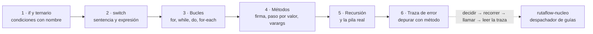
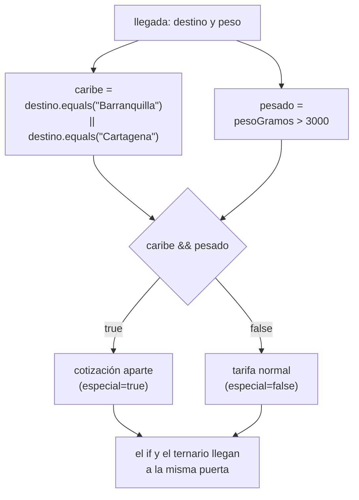
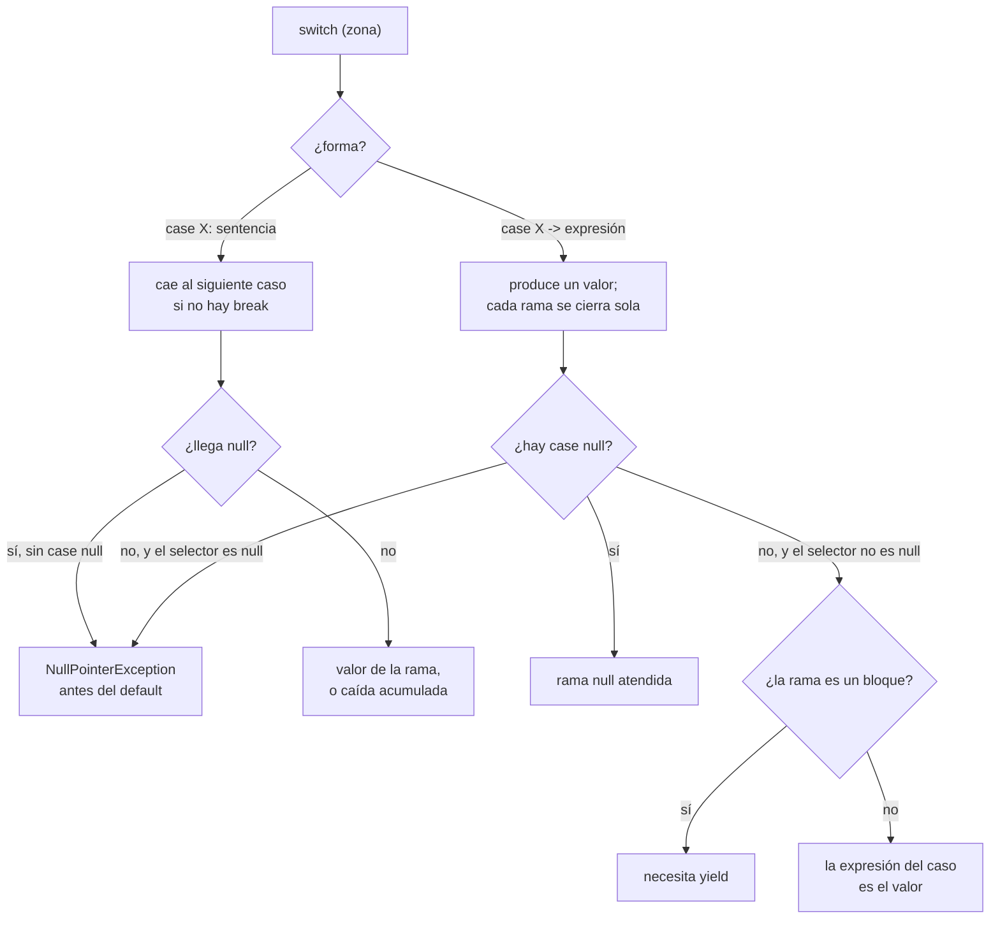
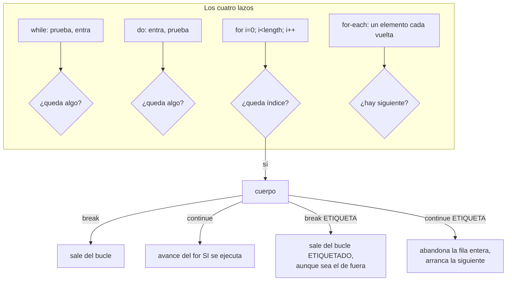
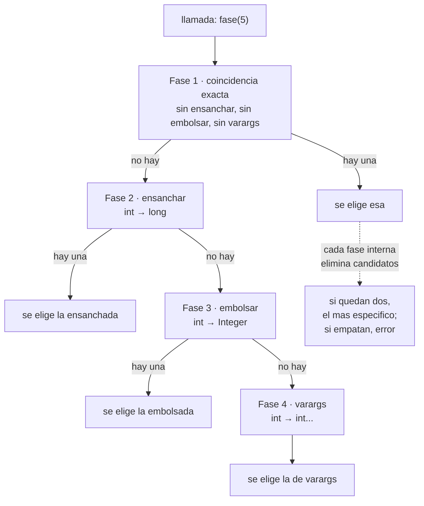
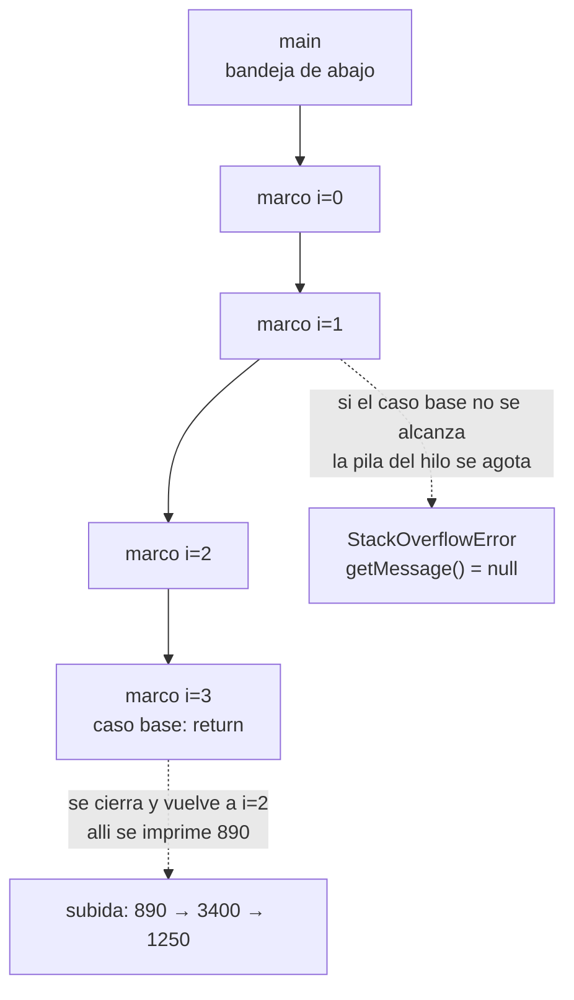
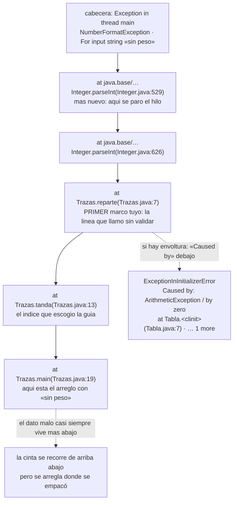

# Módulo 3 · Control de flujo y métodos

> Curso Java (JDK 25) · tramo **Fundamentos** · 6 temas · formato único (specs/021). Portada del curso:
> [CURSO.md](CURSO.md). Todo el código de este módulo se compiló con `javac --release 25` y se ejecutó con
> `java -Dstdout.encoding=UTF-8` sobre OpenJDK Temurin 27.0.1.0.2+1 (macOS, arm64), locale `es_CO`, el
> 2026-11-20. Las salidas están pegadas tal cual. **Aviso de proveniencia:** en esta máquina no hay JDK 25
> instalado, así que el *API* es la de la versión 25 (la que comprueba `--release 25`) pero el *ejecutable*
> es el 27. Lo que puede cambiar entre esas dos versiones está marcado en cada tema con «pendiente de
> reejecución en JDK 25»; nada de este módulo usa funciones preview —y de hecho un tema comprueba que una
> cosa que sí lo es (`switch` con patrones primitivos) **no** compila sin `--enable-preview`.

## Cabecera del módulo

| | |
|---|---|
| **Objetivo** | Escribir las decisiones y los recorridos de un programa sabiendo qué pasa en cada forma: cuándo un `if` se vuelve ilegible y cómo se extrae la condición, qué diferencia a la sentencia `switch` de la expresión `switch` y cuándo hace falta `yield`, cuál de los cuatro lazos conviene y qué hacen exactamente `break`, `continue` y las etiquetas, cómo se declara y se resuelve un método (firma, paso por valor, sobrecarga, varargs), hasta dónde llega la recursión antes de reventar y cómo se lee una traza de error para encontrar el dato culpable sin adivinar. |
| **Prerrequisitos** | [Módulo 0](modulo-0.md) completo (compilar, ejecutar, leer `javap -c`) y [Módulo 1](modulo-1.md) completo —en especial su tema 5 (precedencia, orden de evaluación y cortocircuito)— y [Módulo 2](modulo-2.md) completo (convertir texto a número con `Integer.parseInt`, que es justo lo que revienta en los errores de este módulo). |
| **Duración** | 4 h 05 min (6 temas de 35 a 45 min) más 1 h de laboratorio. |
| **Versiones** | JDK 25 (`--release 25`) · Gradle 9.8.2 por wrapper · JUnit 6.0.3. Los patrones primitivos dentro de `switch` (encajar `case 1000 .. 1999 ->`) siguen siendo *preview* en la 25: medido, `javac --release 25` los rechaza con «primitive patterns are a preview feature and are disabled by default». |
| **Laboratorio** | [`laboratorios/modulo-3/`](laboratorios/modulo-3/README.md) (al publicar: `examples/java/modulo-3/`), con `verificar.sh`: **108 comprobaciones, 0 fallidas** ejecutadas aquí. |
| **Proyecto guía** | `rutaflow-nucleo`: el **despachador de guías**. Decide la tarifa por zona con una expresión `switch` de bloque y `yield`, filtra una tanda con `continue` y `break` con etiqueta, suma los pesos de forma recursiva y rechaza una zona `null` con `case null`. Cada tema cierra una parte: decidir (T1), despachar por zona (T2), recorrer la tanda (T3), firmar los métodos (T4), sumar en recursión (T5) y leer la traza cuando un peso llega como «sin peso» (T6). |

### Mapa del módulo



**Texto alternativo:** seis temas en cadena. Primero las decisiones de dos salidas: `if` y el operador
ternario, y cómo se escribe una condición que se pueda leer. Después la decisión de muchas salidas: `switch`
en sus dos formas, la sentencia que se cae de un caso a otro y la expresión que produce un valor. Luego los
lazos: los cuatro que tiene Java, qué hacen `break` y `continue` y para qué sirven las etiquetas. A
continuación la unidad de reutilización: el método, su firma, cómo recibe los datos y cómo se elige una
sobrecarga. Después la llamada que se llama a sí misma y el techo físico que la detiene: la pila de
llamadas. Por último, qué hacer cuando el programa ya falló: leer la traza y acotar el fallo con método. El
tema 6 es el que cierra el módulo porque es el que usas cuando los cinco anteriores están mal escritos.

**Convención del módulo.** Dos cosas se comprueban de forma distinta. Que el **lenguaje** hace lo que se
afirma se comprueba con `javap` sobre el `.class` generado con `javac --release 25`. Que el **programa**
hace lo que se afirma se comprueba ejecutándolo y pegando su salida. Cuando una medida depende de la
máquina o de la corrida —los marcos de pila que caben, un `hashCode` de identidad— se dicen las corridas
que se hicieron y se marca como inestable; **no** se fija un número así como si fuera un dato del lenguaje.
Lo que no se pudo medir aquí está escrito como pendiente, no como cierto.

---

### Tema 1: `if`, operador ternario y condiciones legibles · Básico · 40 min

#### 1. Ubicación y prerrequisitos

Curso Java · tramo Fundamentos · módulo 3 · primer tema. Antes: [Módulo 1 · tema 5](modulo-1.md)
(precedencia, orden de evaluación y cortocircuito de `&&` y `||`) y [Módulo 2 · tema 6](modulo-2.md) (leer
una línea por consola y convertirla con `Integer.parseInt`). Aquí no entra nada nuevo de la biblioteca: se
usa lo que ya hay. Después: el tema 2 es este mismo `if` cuando la decisión tiene más de dos salidas, y los
temas 3 a 6 ponen condiciones dentro de lazos, llamadas y trazas. Versión: JDK 25.

#### 2. Objetivo

Al terminar sabes escribir una decisión de dos salidas en las dos formas del lenguaje sabiendo cuál te conviene
en cada caso; sabes decir **qué tipo** tiene la expresión `cond ? a : b` antes de compilarla, y por qué a
veces no es el tipo de ninguna de las dos ramas; conviertes una condición de tres líneas en un método con
nombre sin cambiar su comportamiento; y reconoces los cuatro fallos típicos (asignar en vez de comparar,
desempaquetar un `null`, perder rango y mezclar tipos) con el mensaje exacto que da `javac`.

#### 3. Por qué importa

En el despachador de `rutaflow-nucleo` la decisión es «¿esta carga necesita cotización aparte?». Escrita en
una línea dentro del `if` queda así:

```java
if (pesoGramos > 3000 && (destino.equals("Barranquilla") || destino.equals("Cartagena"))) { ... }
```

Funciona. Pero cuando a esa línea le sobra una condición y le falta un paréntesis, el programa **no falla**:
cobra la tarifa equivocada y nadie se entera. Ese es el coste real de las condiciones apretadas: no rompe,
sino que se equivoca en silencio. La alternativa que se escribe en este tema —dos booleanos con nombre y un
`if` que se lee como una frase— es exactamente la forma en que quedó el proyecto guía
(`tema-1/CondicionesLegibles.java`), y la prueba está en que las cuatro combinaciones de la tabla se pueden
leer sin descifrar paréntesis.

#### 4. Analogía

Un andén de carga con una báscula y dos puertas. El operario no decide con una fórmula mental: mira **dos
luces** —«peso alto», «destino caribe»— y la orden está escrita en la pared.

- `if` / `else` es la **hoja de instrucciones**: ocupa varias líneas, y en cada rama puede pasar cualquier
  cosa (imprimir, llamar, lanzar, asignar).
- El ternario `c ? a : b` es la **frase en la pared**: una línea, y obligatoriamente produce un valor. No
  puedes colgar de la pared una orden que no entregue nada.

La regla del andén: si la decisión se lee de una vez, va a la pared; si necesitas dos líneas o una de las
ramas hace algo en lugar de dar un valor, va a la hoja.

**Dónde se rompe la analogía:** en el andén las dos luces son independientes; en Java `a && b` **no evalúa
`b`** si `a` ya es `false` (cortocircuito, módulo 1 · tema 5). Eso hace que una función con efecto dentro de
la primera parte decida si la segunda se ejecuta: la pared del andén no tiene esa trampa.

#### 5. Diagrama



**Texto alternativo:** la llegada aporta dos datos. Cada uno se pliega en un booleano con nombre (`caribe`,
`pesado`), y solo entonces se combinan en una condición de una línea. La condición tiene dos salidas, y por
cada una se muestra el valor medido en `tema-1/CondicionesLegibles.java` (`Barranquilla 3400 g` es la única
de las cuatro combinaciones que sale `especial=true`). Abajo, la nota de que `if` y `?:` son dos escrituras
del mismo salto: no son dos mecanismos.

#### 6. Explicación

**Nivel 0 — las dos formas de la misma decisión.** Java tiene una **sentencia** de dos salidas (`if` /
`else`) y una **expresión** de dos salidas (`cond ? a : b`). La diferencia no es de estilo: la sentencia
ejecuta; la expresión produce un valor que puedes asignar, devolver o meter dentro de otra llamada. Medido en
`tema-1/DecidirPrecedencia.java`, las dos formas de la misma decisión dan la misma etiqueta:

```text
decisión: prioritario · prioritario
```

**Nivel 0 — la condición tiene que ser `boolean`.** Esto parece obvio y por eso sorprende el mensaje de
`javac`: en Java **no** se puede poner un número como condición, ni asignar dentro del `if` «por accidente».
`if (n = 6)` no compila (medido en `tema-1/errores/AsignarEnIf.java`):

```text
error: incompatible types: int cannot be converted to boolean
```

Quien escribe `=` queriendo `==` no produce un bug silencioso: produce un error de compilación. Es una
ventaja del lenguaje frente a los que aceptan enteros como verdad.

**Nivel 1 — qué tipo tiene un ternario (y no es el de una rama).** Cuando las dos ramas son numéricas, Java
**promociona** el resultado al tipo que las contiene a las dos, igual que haría una suma. Medido:

```java
double base = urgente ? 1 : 2.5;
System.out.println(base + " (" + ((Object) base).getClass().getSimpleName() + ")");
```

```text
rama entera contra rama decimal: 1.0 (Double)
```

El `1` se convirtió a `double` **antes** de elegir; por eso sale `1.0` y no `1`. La consecuencia práctica es
que un ternario de `byte`/`short`/`char` puede dar `int`, y ahí se pierde el rango: medido en
`tema-1/errores/ConversionConPerdida.java`, `byte b = pronto ? 200 : 300;` falla con `possible lossy
conversion from int to byte` (las dos ramas son `int`, y 300 no cabe en un `byte` ni siquiera si el `300`
nunca se elige).

Con tipos referencia, `javac` busca el ancestro común más específico **según el destino**. Medido en los dos
sentidos:

```java
Object texto = urgente ? "Bogotá" : Integer.valueOf(2500);   // compila
String texto = urgente ? "Bogotá" : Integer.valueOf(2500);   // NO compila
```

```text
valor guardado en Object: java.lang.String
```

```text
TernarioTipos.java:9: error: incompatible types: bad type in conditional expression
        String texto = urgente ? "Bogotá" : Integer.valueOf(2500);
                                                           ^
    Integer cannot be converted to String
```

**Nivel 2 — legibilidad: la condición se nombra, no se apila.** La reescritura que se enseña aquí consiste
en sacar cada parte de la condición a su propio booleano con nombre y dejar el `if` con una frase. Medido
en `tema-1/CondicionesLegibles.java`, las cuatro combinaciones quedan así:

```text
Bogotá         1200 g  especial=false pesada=false
Bogotá         3400 g  especial=false pesada=false
Barranquilla   1200 g  especial=false pesada=false
Barranquilla   3400 g  especial=true pesada=false
```

Nótese que `Barranquilla 3400 g` es `especial=true` pero `pesada=false`: `pesada` mira otro umbral (5000 g),
y eso es justo lo que se gana nombrando cada parte — la tabla dice qué significaba cada columna sin tener
que descifrar la línea.

Las condiciones compuestas se simplifican con las leyes de De Morgan, y aquí no se cree el lector: se le
imprime la tabla de las cuatro combinaciones (`coinciden=true` en las cuatro filas, medido):

```text
a=true b=true  !(a&&b)=false  (!a||!b)=false  coinciden=true
a=true b=false  !(a&&b)=true  (!a||!b)=true  coinciden=true
a=false b=true  !(a&&b)=true  (!a||!b)=true  coinciden=true
a=false b=false  !(a&&b)=true  (!a||!b)=true  coinciden=true
```

Y una advertencia que sí depende del orden: `&&` y `||` cortocircuitan (módulo 1 · tema 5), así que
`!(a && b)` no es «evalúa `a`, evalúa `b`, niega»: es «evalúa `a`; si ya es `false`, no toca `b`». Cuando
dentro hay una llamada con efectos, reescribir con De Morgan **cambia qué llamadas se hacen**, aunque el
resultado sea el mismo.

**Nivel 3 — por dentro, las dos formas son el mismo salto.** `tema-1/por-dentro/Ramas.java` tiene el máximo
y el mínimo escritos de las dos maneras, y `javap -c -p` muestra la misma prueba condicional en las dos:

```text
  static int porTernario(int, int);
    Code:
         0: iload_0
         1: iload_1
         2: if_icmple     9
         5: iload_0
         6: goto          10
         9: iload_1
        10: ireturn

  static int porIf(int, int);
    Code:
         0: iload_0
         1: iload_1
         2: if_icmple     7
         5: iload_0
         6: ireturn
         7: iload_1
         8: ireturn
```

La única diferencia es la forma del final: el ternario **reúne** las dos ramas en una sola salida (`goto` +
un `ireturn`), porque tiene que producir un valor; el `if` con dos `return` sale por dos sitios distintos.
No hay ninguna llamada, ni objeto, ni coste extra por elegir una u otra forma: es literatura del mismo salto.

#### 7. Código ejecutable

**Ejemplo mínimo** · archivo `tema-1/DecidirPrecedencia.java` · ejecuta
`javac --release 25 -d out tema-1/DecidirPrecedencia.java && java -Dstdout.encoding=UTF-8 -cp out DecidirPrecedencia`

```java
// M3 · Tema 1 · ejemplo minimo: las dos formas de una condicion y que el tipo del ternario no es obvio.
// Java 25. Ejecuta: java -Dstdout.encoding=UTF-8 DecidirPrecedencia.java
public class DecidirPrecedencia {
    public static void main(String[] args) {
        int pesoGramos = 1001;
        boolean urgente = true;

        // Forma 1: if/else. Se lee como pasos.
        String etiqueta;
        if (urgente) {
            etiqueta = "prioritario";
        } else {
            etiqueta = "regular";
        }

        // Forma 2: el mismo decision en una expresion.
        String etiquetaCorta = urgente ? "prioritario" : "regular";

        System.out.println("decisión: " + etiqueta + " · " + etiquetaCorta);

        // El tipo del resultado NO es el de una rama: se promociona.
        double base = urgente ? 1 : 2.5;
        System.out.println("rama entera contra rama decimal: " + base + " (" + ((Object) base).getClass().getSimpleName() + ")");

        // Y con dos tipos referencia distintos, el compilador busca un supremo comun:
        // esto NO compila (mira el error): String texto = urgente ? "Bogotá" : Integer.valueOf(2500);
        Object texto = urgente ? "Bogotá" : Integer.valueOf(2500);
        System.out.println("valor guardado en Object: " + texto.getClass().getName());

        // Tres niveles de ternario anidado: nadie los lee. Se escriben como if/else-if.
        String zona;
        if (pesoGramos > 5000) {
            zona = "carga";
        } else if (pesoGramos > 1000) {
            zona = "mediano";
        } else {
            zona = "liviano";
        }
        System.out.println("peso " + pesoGramos + " g -> " + zona);
    }
}
```

Salida:

```text
decisión: prioritario · prioritario
rama entera contra rama decimal: 1.0 (Double)
valor guardado en Object: java.lang.String
peso 1001 g -> mediano
```

La última línea es la que hay que mirar dos veces: `pesoGramos = 1001` **no** es `liviano`, porque la
frontera está escrita como `> 1000`. Un gramo de más cambia de peldaño, y en el proyecto guía esa misma
frontera está probada con `1000` y `1001` en las dos caras (tema del laboratorio, `DespachadorTest`).

**Ejemplo realista** · archivo `tema-1/CondicionesLegibles.java` · ejecuta
`javac --release 25 -d out tema-1/CondicionesLegibles.java && java -Dstdout.encoding=UTF-8 -cp out CondicionesLegibles`

```java
// M3 · Tema 1 · ejemplo realista: extraer la condicion en un metodo con nombre.
// Java 25. Ejecuta: java -Dstdout.encoding=UTF-8 CondicionesLegibles.java
public class CondicionesLegibles {
    static boolean esCargaDemasiadoPesada(int pesoGramos) {
        return pesoGramos > 5000;
    }

    static boolean requiereCotizacionEspecial(String destino, int pesoGramos) {
        boolean caribe = destino.equals("Barranquilla") || destino.equals("Cartagena");
        boolean pesado = pesoGramos > 3000;
        return caribe && pesado;
    }

    // Morgan: !(a && b) == (!a || !b). Se comprueba con las cuatro combinaciones.
    static boolean noAmbas(boolean a, boolean b) { return !(a && b); }
    static boolean algunaFalsa(boolean a, boolean b) { return !a || !b; }

    public static void main(String[] args) {
        String[] destinos = {"Bogotá", "Barranquilla"};
        int[] pesos = {1200, 3400};
        for (String d : destinos) {
            for (int p : pesos) {
                System.out.printf("%-13s %5d g  especial=%s pesada=%s%n",
                    d, p, requiereCotizacionEspecial(d, p), esCargaDemasiadoPesada(p));
            }
        }
        System.out.println();
        for (boolean a : new boolean[] {true, false}) {
            for (boolean b : new boolean[] {true, false}) {
                System.out.println("a=" + a + " b=" + b + "  !(a&&b)=" + noAmbas(a, b) + "  (!a||!b)=" + algunaFalsa(a, b)
                    + "  coinciden=" + (noAmbas(a, b) == algunaFalsa(a, b)));
            }
        }
    }
}
```

Salida:

```text
Bogotá         1200 g  especial=false pesada=false
Bogotá         3400 g  especial=false pesada=false
Barranquilla   1200 g  especial=false pesada=false
Barranquilla   3400 g  especial=true pesada=false

a=true b=true  !(a&&b)=false  (!a||!b)=false  coinciden=true
a=true b=false  !(a&&b)=true  (!a||!b)=true  coinciden=true
a=false b=true  !(a&&b)=true  (!a||!b)=true  coinciden=true
a=false b=false  !(a&&b)=true  (!a||!b)=true  coinciden=true
```

**Por dentro** · archivo `tema-1/por-dentro/Ramas.java` · ejecuta
`javac --release 25 -d out tema-1/por-dentro/Ramas.java && javap -c -p -cp out Ramas`

```java
// M3 · Tema 1 · por dentro: if y ternario producen el mismo salto; miralo con javap -c.
// Java 25. Ejecuta: javac --release 25 -d out Ramas.java && javap -c -p -cp out Ramas
public class Ramas {
    static int porTernario(int a, int b) { return a > b ? a : b; }
    static int porIf(int a, int b) { if (a > b) { return a; } return b; }
}
```

Salida (los dos métodos, tal cual imprime `javap`):

```text
  static int porTernario(int, int);
    Code:
         0: iload_0
         1: iload_1
         2: if_icmple     9
         5: iload_0
         6: goto          10
         9: iload_1
        10: ireturn

  static int porIf(int, int);
    Code:
         0: iload_0
         1: iload_1
         2: if_icmple     7
         5: iload_0
         6: ireturn
         7: iload_1
         8: ireturn
```

#### 8. Mini-laboratorio

Escribe los archivos desde cero en `laboratorios/modulo-3/tema-1/` (no copies y pegues: el ejercicio es
predecir y comprobar).

1. Crea `MisFronteras.java` con `static String peldaño(int gramos)` que devuelva `"liviano"` por debajo de
   1001, `"mediano"` hasta 5000 y `"carga"` por encima, escrita como `if` / `else if` / `else`. Antes de
   ejecutar, escribe en un comentario qué devuelven exactamente `1000`, `1001`, `5000` y `5001`. Ejecuta y
   compara: si te equivocaste en alguna, corrige el comentario y vuelve a ejecutar.
2. Reescribe `peldaño` con ternarios anidados (`gramos > 5000 ? "carga" : gramos > 1000 ? ...`). Ejecuta las
   mismas cuatro fronteras. Escribe debajo una línea diciendo cuál de las dos versiones leerías tú a las
   tres de la mañana, y por qué.
3. Crea `Cotizacion.java` con `static boolean especial(String destino, int gramos)` escrita **primero** como
   una sola línea apilada y **después** partida en dos booleanos con nombre. Imprime la tabla de las cuatro
   combinaciones de `(Bogotá|Barranquilla) × (1200|3400)`. Las dos versiones deben dar la misma tabla; si no,
   alguna está mal en las dos.
4. Crea `RompeElCompilador.java` y escribe dentro, de uno en uno y comentando el error que sale, los cuatro
   casos del tema: `if (n = 6)`, `byte b = true ? 200 : 300;`,
   `String s = true ? "Bogotá" : Integer.valueOf(2500);` y
   `Integer p = null; int g = true ? p : 0;`. Los tres primeros fallan al compilar con mensajes distintos;
   el cuarto compila y revienta al ejecutar. Pega cada mensaje en un comentario.

**Listo cuando** el paso 1 acierte las cuatro fronteras antes de ejecutar (o correjas las que no), el paso 3
imprima la misma tabla en las dos escrituras, y en el paso 4 sepas decir, para cada error, si lo viste
`javac` o lo vio la JVM — el cuarto es el único que compila y luego lanza
`NullPointerException: Cannot invoke "java.lang.Integer.intValue()"`.

#### 9. Verificación

```bash
cd docs/reestructuracion/cursos/java/laboratorios/modulo-3
javac --release 25 -encoding UTF-8 -d out tema-1/*.java
java -Dstdout.encoding=UTF-8 -cp out DecidirPrecedencia      # «peso 1001 g -> mediano»
java -Dstdout.encoding=UTF-8 -cp out CondicionesLegibles      # solo Barranquilla 3400 g da especial=true
javac --release 25 -d /tmp/m3e tema-1/errores/AsignarEnIf.java        # int cannot be converted to boolean
javac --release 25 -d /tmp/m3e tema-1/errores/ConversionConPerdida.java # possible lossy conversion from int to byte
javac --release 25 -d /tmp/m3e tema-1/errores/TernarioTipos.java      # Integer cannot be converted to String
java -Dstdout.encoding=UTF-8 tema-1/errores/TernarioDesempaqueta.java # rc=1, NullPointerException al desempacar
javac --release 25 -d /tmp/m3b tema-1/por-dentro/Ramas.java && javap -c -p -cp /tmp/m3b Ramas  # if_icmple x2
```

O, todo el módulo de una vez: `GRADLE="./gradlew --offline" ./verificar.sh`. Aquí esas once comprobaciones
pasan con Temurin 27 y `--release 25`; con JDK 25 en el `PATH` basta `./verificar.sh`.

*Pendiente de reejecución en JDK 25:* la promoción del tipo en un ternario es regla del lenguaje y no cambia
entre la 25 y la 27; lo que **sí** conviene mirar con el ejecutable 25 es el texto exacto del
`NullPointerException` al desempaquetar, porque ese mensaje lo construye la JVM y su redacción ha evolucionado
entre versiones.

#### 10. Error común y diagnóstico

**Síntoma 1 — la condición «nunca se cumple» aunque el número esté bien.** Suele ser un `&&` donde tocaba un
`||`, o una cota abierta por el lado equivocado: `gramos > 1000 && gramos < 1000` no se cumple jamás.

**Diagnóstico:** parte la condición en booleanos con nombre e imprime cada uno. Con
`tema-1/CondicionesLegibles.java` eso es literalmente lo que hace la tabla: cuatro filas donde se ve que
`3400 g` en Bogotá no es especial porque la parte `caribe` es `false`. Si imprimes la condición entera
(`System.out.println(d + " " + p + " -> " + (a && b))`) no ves cuál de las dos falló.

**Síntoma 2 — un `NullPointerException` en una línea que no tiene ningún método.**

Salida real de `tema-1/errores/TernarioDesempaqueta.java`:

```text
Exception in thread "main" java.lang.NullPointerException: Cannot invoke "java.lang.Integer.intValue()" because "<local1>" is null
	at TernarioDesempaqueta.main(TernarioDesempaqueta.java:7)
```

**Causa:** `int gramos = tienePeso ? peso : 0;` con `Integer peso = null`. El ternario tiene `int` por un
lado, así que el tipo del resultado es `int`, y para conseguirlo **desempaqueta** la rama que se elige. Es la
regla de la sección 6 al revés: la promoción que te salvó en un caso te hunde en el otro. Fíjate en el
detalle medido: `peso` sí está `null`, pero la excepción sale igual porque la rama elegida (`tienePeso` es
`true`) es precisamente la que desempaca.

**Arreglo:** que el tipo del resultado sea el tipo referencia, o cubre el `null` antes:

```java
Integer gramos = tienePeso ? peso : Integer.valueOf(0);   // sin desempaquetar
int seguro = (peso == null) ? 0 : peso;                    // y aquí ya no puede ser null
```

**Errores de compilación reales** (los tres, medidos con `javac --release 25`):

```text
tema-1/errores/AsignarEnIf.java:6: error: incompatible types: int cannot be converted to boolean
        if (n = 6) {
              ^
tema-1/errores/ConversionConPerdida.java:6: error: incompatible types: possible lossy conversion from int to byte
        byte b = pronto ? 200 : 300;
                        ^
tema-1/errores/TernarioTipos.java:9: error: incompatible types: bad type in conditional expression
        String texto = urgente ? "Bogotá" : Integer.valueOf(2500);
                                                           ^
    Integer cannot be converted to String
```

Los tres se arreglan igual: di **tú** el tipo que quieres. Convierte explícitamente
(`(byte) 300` si de verdad quieres truncar), o escribe `if`/`else` con la variable declarada del tipo que
necesita cada rama.

#### 11. Pregunta con respuesta modelo

**Comprensión.** `boolean c = true; double x = c ? 1 : 2.5;` — ¿qué valor tiene `x` y por qué no es `1`?

**Respuesta modelo:** vale `1.0` y su tipo es `double`. Medido: `rama entera contra rama decimal: 1.0
(Double)`. El tipo de una expresión condicional numérica se calcula **antes** de saber qué rama se elige,
aplicando las mismas promociones que en una aritmética mixta: `int` con `double` da `double`. Por eso la rama
entera se convierte a `1.0`. Si uno quisiera `int` tendría que escribir el `double` de la otra rama como
entero (`c ? 1 : 2`) o hacer el casting explícito en la rama decimal.

**Comprensión.** `if (n = 6)` ¿es un bug que pasa desapercibido?

**Respuesta modelo:** no: no compila. Medido, `javac --release 25` responde
`incompatible types: int cannot be converted to boolean`. En Java una condición tiene que ser un `boolean` de
verdad, y una asignación de un `int` no lo es. Es una diferencia consciente con C, donde esa misma errata sí
es un bug silencioso.

**Entrevista.** ¿Cuándo usarías el ternario y cuándo un `if`? Da un criterio que se pueda defender en una
revisión de código.

**Respuesta modelo:** el ternario cuando la expresión **produce un valor** y las dos ramas son comparables y
cortas: asignación de una etiqueta, elección de un multiplicador, un argumento. El `if` cuando una rama hace
algo (imprimir, lanzar, llamar a varios métodos), cuando hay más de dos salidas, o cuando la condición no cabe
en una lectura. En revisión de código no discuto estilo: pido la tabla. Si el autor no puede imprimir las
combinaciones de entrada con su resultado (`CondicionesLegibles` lo hace en cuatro líneas), la condición está
demasiado apilada para mantenerla. Bonus que suele faltar: el ternario **desempaqueta** — con una rama `int` y
otra `Integer` puede lanzar `NullPointerException` en una línea que no llama a nada.

#### 12. Cuándo usarlo y cuándo no

| Úsalo | No lo uses |
|---|---|
| `if` / `else if` / `else` para más de dos salidas | Ternarios anidados de tres niveles: se leen mal y no aportan nada medible |
| Ternario para producir **un valor** en una línea | Ternario para «hacer cosas»: es una expresión, necesita valor en las dos ramas |
| Booleanos con nombre dentro del `if` cuando hay dos condiciones | Una línea apilada con paréntesis anidados: no se puede probar por partes |
| `equals` en las comparaciones de texto (M2 T1) | `==` sobre `String` dentro de una condición: falla con datos de fuera |
| `!(a && b)` cuando quieres negar una conjunción | Reescribir a `!a \|\| !b` si dentro hay llamadas con efectos: el cortocircuito cambia qué se ejecuta |

**Costo:** las dos formas compilan al mismo salto condicional (medido: `if_icmple` en `porTernario` y en
`porIf`); no hay diferencia de ejecución que justifique elegir por rendimiento. Lo que sí cuesta es el tipo
del ternario: la promoción puede convertir un `byte` en `int` o desempaquetar un `Integer` a `int` con `null`
dentro, y esos dos costes aparecen en los errores de la sección 10.

---

### Tema 2: `switch`: sentencia y expresión, flecha, `yield`, exhaustividad y caída entre casos · Básico · 45 min

#### 1. Ubicación y prerrequisitos

Curso Java · tramo Fundamentos · módulo 3 · segundo tema. Antes: [Tema 1](#tema-1-if-operador-ternario-y-condiciones-legibles)
de este módulo (la decisión de dos salidas) y [Módulo 1 · tema 5](modulo-1.md) (los literales y su tipo). La
forma clásica ya se vio en [Módulo 0 · tema 6](modulo-0.md); aquí se completa con la **expresión** `switch`,
`yield`, la exhaustividad y lo que el compilador hace por dentro. Requiere además el tema 2 del módulo 5 para
el `enum` con campos; en este módulo el `enum` se usa como lista de constantes. Versión: JDK 25.

#### 2. Objetivo

Al terminar distingues la sentencia `switch` (ejecuta, se cae de un caso al siguiente) de la expresión
`switch` (produce un valor, tiene que cubrir todas las entradas) y sabes cuándo hace falta `yield`; escribes
casos agrupados y `case null`; previenes los cuatro fallos del `switch` (caída sin `break`, expresión no
exhaustiva, `null` sin `case null` y un tipo que no es seleccionable); y puedes abrir el `.class` y decir si
ese `switch` salió en una `tableswitch`, una `lookupswitch`, una cadena de `equals` o un `invokedynamic`.

#### 3. Por qué importa

`rutaflow-nucleo` cobra una tarifa distinta por zona. Escrito con `if`/`else if` encadenado sobre `String`,
cada zona nueva es una línea más y el olvido de una zona se convierte en «toca la última rama». Escrito con
la **expresión** `switch`, el compilador te obliga a cubrir el enum entero: si alguien añade `CENTRO` a
`Zona` y no le pone tarifa, el proyecto **no compila** (medido: `the switch expression does not cover all
possible input values`, con la lista de las constantes que faltan). Eso es lo que se gana con exhaustividad:
el olvido pasa de ser un error en producción a ser un error de compilación.

Y hay una segunda parte, silenciosa: la tarifa base se calculaba con `default` para lo no previsto. Medido en
`tema-2/errores/NuloSinCaseNull.java`, **el `default` no atiende al `null`**:

```text
Exception in thread "main" java.lang.NullPointerException: Cannot invoke "String.hashCode()" because "<local1>" is null
	at NuloSinCaseNull.zona(NuloSinCaseNull.java:5)
	at NuloSinCaseNull.main(NuloSinCaseNull.java:11)
```

Si la zona llega de un formulario o de un `Map.get`, esa excepción aparece en producción. La salida es
escribirla: `case null ->`.

#### 4. Analogía

Un **mostrador de despacho con ventanillas numeradas**.

- El `switch` clásico es el mostrador **sin mamparas**: el cliente entra por la ventanilla que dice su
  número y, si no hay tabique (`break`), sigue atendiendo en la ventanilla de al lado, y en la siguiente,
  hasta el final del pasillo. El empleado no «elige» la ventanilla por error: es que no hay pared.
- La expresión `switch` con flecha (`->`) es el mostrador **con mamparas**: cada ventanilla se cierra sola,
  y como no se puede caer a la siguiente, el plano exige que **todas las ventanillas del edificio estén
  tabicadas** (exhaustividad).
- `yield` es la ventanilla que no despacha un papel de una línea sino que hace un cálculo en la trastienda y
  **saca un valor** por la ventanilla. Sin `yield` no hay valor, y el `switch` que produce valores no puede
  devolver «nada».
- `case null` es la ventanilla de la **persona sin expediente**: si no está señalada en el plano, el cliente
  sin expediente no llega ni a la fila — el mostrador tropieza antes de mirar el `default`.

**Dónde se rompe la analogía:** en el mostrador la caída entre ventanillas es física; en Java solo existe en
la forma de sentencia con `case X:`. Y «exhaustivo» no significa «todas las ventanillas del mundo»: el
`default` cuenta como cubierta, por eso un `switch` con `default` sobre un enum **sí** compila aunque no
mencione ninguna constante.

#### 5. Diagrama



**Texto alternativo:** las dos ramas del diagrama son las dos formas del `switch`. La de sentencia se cae de
un caso al siguiente hasta encontrar `break` (medido: `tramos=1 clasico=1110`). La de expresión no se cae,
pero cobra la exhaustividad. Las dos tienen la misma trampa con `null`: sin `case null` escrito, el `null`
lanza antes de que el `default` entre en juego (medido arriba). Dentro de una rama de bloque de la forma de
expresión, `yield` es obligatorio para producir el valor; una rama que solo tiene una expresión no lo usa.

#### 6. Explicación

**Nivel 0 — qué puede ser selector.** En Java 25 un `switch` clásico acepta `char`, `byte`, `short`, `int`,
sus envoltorios, `String` y `enum` (JLS 3.20.0, y es lo que mide este tema). `long`, `float`, `double` y
`boolean` **no** son seleccionables — medido, y el mensaje no es el que uno esperaría (sección 10). Los
`case` de un `switch` tienen que ser constantes o, en un `enum`, los nombres de las constantes sin prefijo.

**Nivel 1 — la sentencia que se cae.** `tema-2/ZonaClasica.java` tiene los tres recargos escritos sin
`break` y los mismos con `break`, y la diferencia se imprime:

```text
tramos=1  clasico=1110  con break=10  nombre=norte
tramos=2  clasico=1100  con break=100  nombre=norte
tramos=3  clasico=1000  con break=1000  nombre=sin asignar
tramos=9  clasico=0  con break=0  nombre=sin asignar
```

Leélo con la analogía del mostrador: `tramos=1` entra por la ventanilla 1, suma 10, no hay tabique, sigue
sumando 100 y 1000 y **también** cae en el `default`, que suma 5 en el otro ejemplo
(`tema-2/errores/SinRomper.java`): `1 tramo -> 1115 (se esperaban 10)`. La caída es el comportamiento, no un
error del compilador: Java **no** avisa. Lo que sí puedes hacer a propósito es agrupar casos que comparten
cuerpo (las líneas `case 1: case 2:` de `nombreZona`), que es exactamente una caída escrita con intención.

**Nivel 2 — la expresión `switch` y `yield`.** Desde Java 14 la forma con flecha puede ser una **expresión**:
el `switch` vale algo. `tema-2/ZonaConFlecha.java` muestra los tres tipos de rama que existen:

```text
NORTE base=1200 con 3400 g=1200
OCCIDENTE base=1500 con 3400 g=1900
CARIBE base=1500 con 3400 g=1900
(zona sin tabla: se cobra la Tarifa Vieja)
SUR base=2100 con 3400 g=2100
avisos: norte: salida 05:00
sur: salida 06:00
```

Tres cosas están pasando ahí y hay que nombrarlas:

1. `case OCCIDENTE, CARIBE -> 1500` agrupa dos constantes en una rama (de ahí que las dos den `1500`).
2. La rama de `OCCIDENTE`/`CARIBE` en `costoConRecargo` es un **bloque** `{ ... yield base + recargo; }`:
   cuando la rama necesita varias líneas, el valor se entrega con `yield`. Sin `yield` no hay valor y no
   compila.
3. El `default` imprimió una línea **antes** de devolver 2100, y la primera pasada del bucle
   (`NORTE`) no imprimió nada: solo las zonas que caen en `default` pasan por el `println` del bloque.

Y la diferencia de exhaustividad, medida: la **sentencia** con flecha no exige cubrir el enum entero — el
método `avisar` solo lista `NORTE` y `SUR` sobre un enum de cuatro constantes y compila sin aviso; en la
salida, `OCCIDENTE` y `CARIBE` simplemente no imprimen nada. La **expresión** con flecha sí:
`tema-2/errores/NoExaustivo.java` responde

```text
error: the switch expression does not cover all possible input values
  missing patterns:
      Zona.CARIBE
      Zona.SUR
```

con las constantes exactas que faltan. `case null` existe desde Java 21 para la forma de expresión, y
convierte el `NullPointerException` de arriba en un valor: `tema-2/CambiosYDias.java` imprime
`null -> sin ciudad`.

**Nivel 2 — `case null, default ->`.** Se pueden juntar las dos en una sola rama; el proyecto guía lo hace
en `ZonaClasica`/`Despachador` y `tema-2/por-dentro/SwitchConNull.java` lo escribe como
`case null, default -> 2100`. Ojo con el orden en las listas de constantes: `case NORTE, null ->` también es
legal, pero el mensaje de qué se cubre se lee mejor al revés.

**Nivel 3 — por dentro: cuatro implementaciones distintas, todas medidas.** El `switch` es azúcar: `javac`
lo traduce, y la traducción depende del tipo y de si escribes `case null`.

*a) `int` con casos juntos → `tableswitch`; casos separados → `lookupswitch`.*

```text
  static int denso(int);
    Code:
         0: iload_0
         1: tableswitch   { // 1 to 4
                       1: 32
                       2: 35
                       3: 38
                       4: 41
                 default: 44
            }

  static long disperso(int);
    Code:
         0: iload_0
         1: lookupswitch  { // 3
                    1000: 36
                    2000: 38
                    3000: 42
                 default: 46
            }
```

`tableswitch` es una tabla indexada: salto directo, y por eso solo sirve si los valores están apretados.
`disperso` usa `lookupswitch`, que es una búsqueda en la lista de pares valor→destino. Con `1, 2, 3, 4` el
compilador usa tabla; con `1000, 2000, 3000` usa lista, porque una tabla del 1 al 1000 sería ridícula.

*b) `String` sin `case null` → `hashCode` + cadena de `equals` + `tableswitch` de índices.*
`SwitchInterno.ciudad`:

```text
         5: invokevirtual  // Method java/lang/String.hashCode:()I
         8: lookupswitch  { // 3
                 2092667: 58
               341269576: 72
              1995213762: 44
```

y después tres `invokevirtual String.equals` para confirmar cuál de las cadenas con ese hash era, y una
`tableswitch // 0 to 2` sobre el índice descubierto. Es decir: **primero se filtra por hash, luego se
compara con `equals`**. Sin el segundo paso, cualquier colisión de hash daría la rama equivocada. El número
de `equals` es el de casos: `diasDelMes` compara doce veces, sus doce meses, y sus hashes caen tan juntos
(`01`=1537 … `12`=1569) que el filtro de hash sale en una `tableswitch   { // 1537 to 1569`, no en lista.

*c) `enum` en la misma unidad de compilación → `ordinal()` directo, sin mapa.*
`SwitchInterno.costo` y `SwitchInterno.salta` (enum declarado dentro del mismo archivo):

```text
         1: invokevirtual  // Method SwitchInterno$Zona.ordinal:()I
         4: tableswitch   { // 0 to 2

         1: invokevirtual  // Method SwitchInterno$Zona.ordinal:()I
         4: lookupswitch  { // 2
                       1: 32
                       3: 39
```

Nótese `salta`: los casos son `OCCIDENTE` (ordinal 1) y `SUR` (ordinal 3), y con dos valores separados sale
`lookupswitch`, no tabla.

*d) `enum` de **otra** unidad → la clase sintética con `$SwitchMap$`.*
`tema-2/por-dentro/UsaZonaExterna.java` hace `switch` sobre `ZonaExt`, que está en otro archivo. `javap`
muestra que `UsaZonaExterna` **no** mira el ordinal del enum directamente, sino un mapa:

```text
  static int tarifario(ZonaExt);
    Code:
         0: getstatic     // Field UsaZonaExterna$1.$SwitchMap$ZonaExt:[I
         3: aload_0
         4: invokevirtual // Method ZonaExt.ordinal:()I
         7: iaload
         8: lookupswitch  { // 2
                       1: 36
                       2: 43
```

y la clase sintética `UsaZonaExterna$1` rellena ese mapa en su bloque estático, con una guarda de
`NoSuchFieldError` por cada escritura (por si la otra unidad se compiló contra una versión del enum que ya
no tiene esa constante):

```text
class UsaZonaExterna$1 {
  static final int[] $SwitchMap$ZonaExt;

  static {};
    Code:
         0: invokestatic  // Method ZonaExt.values:()[LZonaExt;
         3: arraylength
         4: newarray       int
         6: putstatic     // Field $SwitchMap$ZonaExt:[I
        ...
      Exception table:
         from    to  target type
             9    20    23   Class java/lang/NoSuchFieldError
            24    35    38   Class java/lang/NoSuchFieldError
}
```

*Lo que se creía, y dónde se rompe.* La frase «`javac` siempre genera la clase sintética con `$SwitchMap$`
para un `switch` de enum» es falsa dos veces: no la genera cuando el enum está en la misma unidad (caso *c*),
y **tampoco** la genera cuando escribes `case null` — caso que se midió escribiendo este módulo.

*e) Con `case null`, el `switch` cambia de implementación: `invokedynamic` y nada de mapa.*
`tema-2/por-dentro/SwitchConNull.java` es el **mismo** `switch` sobre el **mismo** enum externo, pero con una
rama `case null`. `javap -c` ya no muestra `getstatic $SwitchMap$`:

```text
         6: invokedynamic #7,  0   // InvokeDynamic #0:enumSwitch:(LZonaExt;I)I
        11: tableswitch   { // -1 to 2
                      -1: 58
                       0: 40
                       1: 46
                       2: 52
```

y `javap -v` dice quién lo enlaza, con las constantes como argumentos estáticos:

```text
BootstrapMethods:
  0: #68 REF_invokeStatic java/lang/runtime/SwitchBootstraps.enumSwitch:(...)
    Method arguments:
      #58 NORTE
      #60 OCCIDENTE
      #62 ISLAS
```

Tres consecuencias medidas: **no aparece `SwitchConNull$1.class`** en la salida de `javac -d` (el archivo se
compila contra `ZonaExt` y quedan dos `.class`, no tres); el `null` entra al `tableswitch` como **-1**, no
como un caso aparte; y al enlace solo van **las 3 constantes que el `switch` menciona**, no las 5 del enum —
`CARIBE` y `SUR` se caen al `default`. Su salida:

```text
NORTE -> 1200
OCCIDENTE -> 1500
CARIBE -> 2100
SUR -> 2100
ISLAS -> 1900
null -> 2100
```

Con `String` pasa lo mismo y se llama distinto: `CambiosYDias.zonaPorCiudad` (que **sí** tiene `case null`)
emite `invokedynamic ... typeSwitch` con `Bogotá, Cali, Barranquilla, Cartagena` como argumentos estáticos y
`tableswitch // -1 to 3`, sin `hashCode` ni `equals` por ninguna parte; `diasDelMes` (sin `case null`) sigue
usando `String.hashCode` + `equals`. El proyecto guía está en el mismo caso: `Despachador.tarifaBase` es
`enumSwitch` con las cinco zonas y `tableswitch // -1 to 4`, y en `build/classes` no hay ningún
`Despachador$1.class`.

¿Para qué te sirve esto como programador? Para no razonar mal sobre el coste: un `switch` de `String` sin
`case null` **sí** llama a `hashCode`/`equals` (una comparación de contenido, no una de referencia), y uno con
`case null` delega el enlace a `SwitchBootstraps` la primera vez que se ejecuta. Es O(1) en el primer caso y
no es «gratis» en el segundo; en ninguno de los dos es la cadena de `if`/`equals` que reemplaza.

#### 7. Código ejecutable

**Ejemplo mínimo** · archivo `tema-2/ZonaClasica.java` · ejecuta
`javac --release 25 -d out tema-2/ZonaClasica.java && java -Dstdout.encoding=UTF-8 -cp out ZonaClasica`

```java
// M3 · Tema 2 · ejemplo minimo: switch clasico, donde cada caso SIGUE Ejecutando si no rompe.
// Java 25. Ejecuta: java -Dstdout.encoding=UTF-8 ZonaClasica.java
public class ZonaClasica {
    // El clasico: sin break, los casos se acumulan.
    static int acumuladorClasico(int tramos) {
        int recargo = 0;
        switch (tramos) {
            case 1: recargo += 10;
            case 2: recargo += 100;
            case 3: recargo += 1000;
        }
        return recargo;
    }

    static int acumuladorConBreak(int tramos) {
        int recargo = 0;
        switch (tramos) {
            case 1: recargo += 10; break;
            case 2: recargo += 100; break;
            case 3: recargo += 1000; break;
        }
        return recargo;
    }

    // Agrupar casos que hacen lo mismo, forma clasica.
    static String nombreZona(int codigo) {
        switch (codigo) {
            case 1:
            case 2:
                return "norte";
            default:
                return "sin asignar";
        }
    }

    public static void main(String[] args) {
        for (int t : new int[] {1, 2, 3, 9}) {
            System.out.println("tramos=" + t + "  clasico=" + acumuladorClasico(t)
                + "  con break=" + acumuladorConBreak(t) + "  nombre=" + nombreZona(t));
        }
    }
}
```

Salida:

```text
tramos=1  clasico=1110  con break=10  nombre=norte
tramos=2  clasico=1100  con break=100  nombre=norte
tramos=3  clasico=1000  con break=1000  nombre=sin asignar
tramos=9  clasico=0  con break=0  nombre=sin asignar
```

**Ejemplo realista** · archivo `tema-2/ZonaConFlecha.java` · ejecuta
`javac --release 25 -d out tema-2/ZonaConFlecha.java && java -Dstdout.encoding=UTF-8 -cp out ZonaConFlecha`

```java
// M3 · Tema 2 · ejemplo realista: switch de flecha, como expresion, y cuando hace falta yield.
// Java 25. Ejecuta: java -Dstdout.encoding=UTF-8 ZonaConFlecha.java
public class ZonaConFlecha {
    enum Zona { NORTE, OCCIDENTE, CARIBE, SUR }

    // Expresion: el resultado es el valor del caso.
    static int costoBase(Zona z) {
        return switch (z) {
            case NORTE -> 1200;
            case OCCIDENTE, CARIBE -> 1500;
            default -> 2100;
        };
    }

    // Con bloque: hace falta yield para producir el valor.
    static int costoConRecargo(Zona z, int pesoGramos) {
        return switch (z) {
            case NORTE -> 1200;
            case OCCIDENTE, CARIBE -> {
                int base = 1500;
                int recargo = pesoGramos > 3000 ? 400 : 0;
                yield base + recargo;
            }
            default -> {
                System.out.println("(zona sin tabla: se cobra la Tarifa Vieja)");
                yield 2100;
            }
        };
    }

    // Sentencia de flecha: no necesita ser exhaustiva porque no produce valor.
    static void avisar(Zona z) {
        switch (z) {
            case NORTE -> System.out.println("norte: salida 05:00");
            case SUR -> System.out.println("sur: salida 06:00");
        }
    }

    public static void main(String[] args) {
        for (Zona z : Zona.values()) {
            System.out.println(z + " base=" + costoBase(z) + " con 3400 g=" + costoConRecargo(z, 3400));
        }
        System.out.print("avisos: ");
        for (Zona z : Zona.values()) avisar(z);
    }
}
```

Salida:

```text
NORTE base=1200 con 3400 g=1200
OCCIDENTE base=1500 con 3400 g=1900
CARIBE base=1500 con 3400 g=1900
(zona sin tabla: se cobra la Tarifa Vieja)
SUR base=2100 con 3400 g=2100
avisos: norte: salida 05:00
sur: salida 06:00
```

**`String` y `char`, con `case null`** · archivo `tema-2/CambiosYDias.java` · ejecuta
`javac --release 25 -d out tema-2/CambiosYDias.java && java -Dstdout.encoding=UTF-8 -cp out CambiosYDias`

```java
// M3 · Tema 2 · switch sobre String y sobre char: el compilador resuelve primero el hash.
// Java 25. Ejecuta: java -Dstdout.encoding=UTF-8 CambiosYDias.java
public class CambiosYDias {
    static String zonaPorCiudad(String ciudad) {
        return switch (ciudad) {
            case "Bogotá" -> "norte";
            case "Cali" -> "occidente";
            case "Barranquilla", "Cartagena" -> "caribe";
            case null -> "sin ciudad";
            default -> "otra";
        };
    }

    // 'char' solo sirve para UNA unidad UTF-16; para dos digitos hace falta String.
    static int diasDelMes(String mes) {
        return switch (mes) {
            case "01", "03", "05", "07", "08", "10", "12" -> 31;
            case "04", "06", "09", "11" -> 30;
            case "02" -> 28;
            default -> 0;
        };
    }

    static char prioridad(char letra) {
        return switch (letra) {
            case 'A' -> 'P';
            case 'B', 'C' -> 'S';
            default -> 'R';
        };
    }

    public static void main(String[] args) {
        System.out.println("Bogotá -> " + zonaPorCiudad("Bogotá"));
        System.out.println("Cartagena -> " + zonaPorCiudad("Cartagena"));
        System.out.println("Medellín -> " + zonaPorCiudad("Medellín"));
        System.out.println("null -> " + zonaPorCiudad(null));
        System.out.println("02 -> " + diasDelMes("02") + " · 04 -> " + diasDelMes("04") + " · 13 -> " + diasDelMes("13"));
        System.out.println("A -> " + prioridad('A') + " · C -> " + prioridad('C') + " · Z -> " + prioridad('Z'));
    }
}
```

Salida:

```text
Bogotá -> norte
Cartagena -> caribe
Medellín -> otra
null -> sin ciudad
02 -> 28 · 04 -> 30 · 13 -> 0
A -> P · C -> S · Z -> R
```

Fíjate en `char` frente a `String`: `prioridad` recibe **una** unidad UTF-16. Para un mes de dos dígitos el
selector tiene que ser `String` (`diasDelMes`), no `char`, y por eso los casos van entrecomillados.

**Proyecto guía** · archivo `src/main/java/rutaflow/nucleo/Despachador.java` (fragmento) · ejecuta
`./gradlew --offline run`

```java
    /** Tarifa basica por zona, en pesos, como expresion switch con bloque y yield. */
    public static int tarifaBase(Zona zona) {
        // El default NO cubre null: sin el case null, una zona nula revienta antes de llegar a el.
        return switch (zona) {
            case null -> throw new IllegalArgumentException("sin zona");
            case NORTE -> 9000;
            case OCCIDENTE -> {
                int recargoDeMontana = 3400;
                yield 9000 + recargoDeMontana;
            }
            case CARIBE, SUR -> 11500;
            case CENTRO -> 10200;
            default -> throw new IllegalArgumentException("zona sin tarifa: " + zona);
        };
    }
```

Salida de `run`, la primera sección:

```text
tarifa base por zona:
  NORTE = 9000
  OCCIDENTE = 12400
  CENTRO = 10200
  CARIBE = 11500
  SUR = 11500
```

`case null -> throw ...` es la lección de la sección 3 convertida en código: en lugar de dejar que la zona
nula reviente con un `NullPointerException` de la JVM, se lanza una excepción propia con el mensaje del
dominio. La prueba `todaZonaDelEnumTieneTarifaYLaNulaSeRechaza` de `DespachadorTest` exige exactamente eso
(tema 6 explica por qué se prueba con `assertThrows` y no con un `try`).

#### 8. Mini-laboratorio

Escribe los archivos desde cero en `laboratorios/modulo-3/tema-2/`.

1. Crea `Caída.java` con la forma clásica de tres casos **sin** `break` que sume 10, 100 y 1000. Antes de
   ejecutar, escribe en un comentario el valor que crees que sale para `1`, `2`, `3` y `7`. Ejecuta y corrige
   el comentario con lo que salió.
2. Convierte el mismo método en expresión `switch` con flecha y un `default`, y añade un caso de bloque que
   imprima «calculando» y use `yield` para devolver la suma de dos variables. Imprime las cuatro entradas.
   El comentario de la caída debe seguir diciendo la verdad: la expresión ya no se cae.
3. Crea `SinNull.java` con `switch` de `String` **sin** `case null` y llámalo con `null`. Ejecuta y pega la
   traza. Añade `case null ->` y vuelve a ejecutar. Escribe una línea explicando por qué el `default` no
   sirvió.
4. Crea `Exaustivo.java` con un enum de 4 constantes dentro del archivo y una **expresión** `switch` que solo
   cubra 2, sin `default`. Compila y lee el error: `javac` te da la lista de las que faltan. Añade `default`,
   quita la lista de casos y confirma que sigue compilando.
5. Compila tus dos versiones de `switch` de enum con `javac -d out` y mira `ls out`: ¿cuántos `.class` hay?
   Después copia `tema-2/por-dentro/SwitchConNull.java` y `ZonaExt.java` a tu carpeta, compila y compara con
   el `switch` sin `case null` de `UsaZonaExterna.java`. Escribe debajo qué cambió en la lista de archivos.

**Listo cuando** la salida del paso 2 no se caiga entre casos, el paso 3 pase de excepción a valor impreso,
el paso 4 te muestre las dos constantes que faltaban en el mensaje de error, y en el paso 5 sepas decir por
qué aparece o desaparece un `.class` según escribas o no `case null`.

#### 9. Verificación

```bash
cd docs/reestructuracion/cursos/java/laboratorios/modulo-3
javac --release 25 -encoding UTF-8 -d out tema-2/*.java
java -Dstdout.encoding=UTF-8 -cp out ZonaClasica     # tramos=1  clasico=1110  con break=10
java -Dstdout.encoding=UTF-8 -cp out ZonaConFlecha   # OCCIDENTE y CARIBE comparten 1500; SUR cae al default
java -Dstdout.encoding=UTF-8 -cp out CambiosYDias    # null -> sin ciudad
ls out | grep '\$'                                   # solo ZonaConFlecha$Zona.class: el enum anidado
javac --release 25 -encoding UTF-8 -d out2 tema-2/por-dentro/*.java
ls out2                                              # UsaZonaExterna$1.class SI aparece; SwitchConNull$1 NO
javap -c -p -cp out2 SwitchInterno                   # tableswitch // 1 to 4, lookupswitch, hashCode, ordinal
javap -c -p -cp out2 'UsaZonaExterna$1'              # $SwitchMap$ZonaExt:[I con guarda NoSuchFieldError
javap -c -p -cp out2 SwitchConNull                   # invokedynamic ...enumSwitch, tableswitch // -1 to 2
javap -v -p -cp out CambiosYDias | awk '/^BootstrapMethods:/{f=1} f'   # SwitchBootstraps.typeSwitch, 4 ciudades
```

Y las comprobaciones que no deben compilar: `NoExaustivo`, `CaseDuplicado`, `FaltaReturn`, `SobreLong`,
`LargoConCaseInt`; y las que deben lanzar: `NuloSinCaseNull`. `./verificar.sh` ejecuta las 29 comprobaciones
de este tema (aquí, con Temurin 27 y `--release 25`, pasan las 29).

*Pendiente de reejecución en JDK 25:* los detalles de implementación (`tableswitch` vs `lookupswitch`,
`$SwitchMap$`, `invokedynamic` y el índice `-1`) son del **compilador**, no del lenguaje; en JDK 25 el
enlace de `enumSwitch` lo hace la JVM 25 y puede imprimir cifras distintas. Hay que volver a pasar los
`javap` con el `javac` de la 25. La semántica (caída, exhaustividad, `case null`) no cambia.

#### 10. Error común y diagnóstico

**Síntoma 1 — el `switch` hace «demasiado».** Salida medida de `tema-2/errores/SinRomper.java`:

```text
1 tramo -> 1115 (se esperaban 10)
2 tramos -> 1105 (se esperaban 100)
```

**Causa:** caída entre casos sin `break`. **Diagnóstico:** busca `break` o `return` al final de cada `case`;
si no hay, la ejecución continúa. **Arreglo:** pasar a la forma de flecha, que no tiene caída — y si era una
expresión, ganar además la exhaustividad.

**Síntoma 2 — excepción con un valor que «sí» tiene `default`.** El `NullPointerException` de la sección 3.
**Arreglo:** `case null ->`. **No confundir:** si el selector es un enum de otra unidad, sin `case null` el
mensaje dice `Cannot invoke "…ordinal()" because "<parameter1>" is null` (mira el `ordinal()` en el mensaje
para saber que era un enum); con `String` dice `Cannot invoke "String.hashCode()"`.

**Errores de compilación medidos:**

```text
tema-2/errores/NoExaustivo.java:6: error: the switch expression does not cover all possible input values
  missing patterns:
      Zona.CARIBE
      Zona.SUR
tema-2/errores/CaseDuplicado.java:7: error: duplicate case label
            case 1: return 2;
tema-2/errores/FaltaReturn.java:8: error: missing return statement
tema-2/errores/SobreLong.java:10: error: primitive patterns are a preview feature and are disabled by default.
  (use --enable-preview to enable primitive patterns)
tema-2/errores/LargoConCaseInt.java:9: error: primitive patterns are a preview feature and are disabled by default.
tema-2/errores/LargoConCaseInt.java:10: error: constant label of type int is not compatible with switch selector type long
```

El de `long` merece leerse dos veces. Con `case 1L` (`SobreLong`) solo sale el aviso de preview, porque un
selector `long` **solo** tendría sentido como `switch` de patrones, y eso es *preview* en la 25. Con
`case 1:` (`LargoConCaseInt`) salen dos errores y el segundo es el motivo de una vez:
`constant label of type int is not compatible with switch selector type long`. Y no hay forma de probar la
preview con esta configuración: `javac --release 25 --enable-preview` se niega con
`invalid source release 25 with --enable-preview` porque las preview del compilador instalado son las de la
27, no las de la 25. Conclusión práctica: un peso en `long` se reduce a `int` explícitamente o se decide con
`if`/`else if` por rangos; el `switch` con rangos (`case 1000 .. 1999 ->`) no está disponible en JDK 25.

#### 11. Pregunta con respuesta modelo

**Comprensión.** ¿Imprime algo este método con `switch (z) { case NORTE -> System.out.println("n"); }` sobre
un enum de cuatro constantes, siendo `z == SUR`? ¿Compila?

**Respuesta modelo:** compila e imprime nada. Es una **sentencia** `switch` de flecha: no produce valor, así
que no se le pide exhaustividad, y la flecha no se cae al caso siguiente. Medido en `ZonaConFlecha.avisar`,
donde `OCCIDENTE` y `CARIBE` tampoco imprimen. Si el `switch` fuera una **expresión**, lo primero que haría
`javac` es no compilar y listar las constantes que faltan.

**Comprensión.** Un `switch` de `enum` declarado en otro archivo: ¿qué produce `javac`? ¿Y si además escribes
`case null`?

**Respuesta modelo:** sin `case null`, una clase sintética `X$1` con `static final int[] $SwitchMap$Enum`
rellenada en el bloque estático con una guarda `NoSuchFieldError` por escritura, y el `switch` hace
`getstatic` del mapa + `iaload` + salto. Con `case null` escrito, el mapa desaparece y no se genera ninguna
clase: sale `invokedynamic java/lang/runtime/SwitchBootstraps.enumSwitch` con las constantes **mencionadas**
como argumentos estáticos y un `tableswitch` donde el `null` es **-1**. Medido los dos casos en
`UsaZonaExterna`/`SwitchConNull`.

**Entrevista.** Estás en una revisión de código y ves un `switch` clásico de cuatro casos, uno detrás de otro
con `case A: case B:` sin cuerpo. ¿Qué piensas y qué preguntas?

**Respuesta modelo:** que los dos casos comparten cuerpo, que es la agrupación intencionada y legal. La
pregunta que hago es si el autor lo hizo a propósito o si es un olvido de `break`, porque la caída entre
casos no genera ningún aviso del compilador: la misma línea se lee distinto según la intención. Por eso en
código nuevo prefiero la forma de expresión con flecha: si faltan casos, el compilador lista los que faltan, y
si alguien se salta un `break` ni siquiera puede escribirlo mal. La excepción que acepto es la caída
deliberada, y en ese caso pido un comentario que lo diga. Bonus: si el selector puede venir `null`, un
`default` no protege; hay que ver un `case null` o una comprobación antes.

#### 12. Cuándo usarlo y cuándo no

| Úsalo | No lo uses |
|---|---|
| Expresión `switch` sobre un `enum` cuando cada valor tiene su resultado: la exhaustividad te avisa si el enum crece | `if`/`else if` encadenado sobre constantes del mismo enum: no avisa de los casos nuevos |
| `case null ->` siempre que el selector pueda venir de fuera | `default` como sustituto del `case null`: el `null` lanza antes de llegar |
| Rama de bloque con `yield` cuando el valor cuesta varias líneas | Asignar dentro del `switch` y leer la variable después: `yield` existe para eso |
| Sentencia de flecha sin `default` cuando «no hacer nada» es válido | Sentencia clásica con casos apilados sin `break` ni comentario: no se distingue el olvido de la intención |
| `switch` de `String` para pocas opciones fijas | `switch` de `String` con claves que son rangos numéricos, o con claves que se buscan en un `Map` |

**Costo:** los `case` de un `int` juntos salen en `tableswitch` (salto directo); muy separados, en
`lookupswitch`. Un `String` sin `case null` compara por hash y luego con `equals`. Con `case null`, el enlace
se resuelve la primera vez por `SwitchBootstraps` (`enumSwitch` o `typeSwitch`). Nada de esto se parece al
coste de una cadena de `if`/`equals`, que prueba uno por uno: medido en este mismo tema, `diasDelMes` hace
**una** llamada a `hashCode`, un salto a la casilla del hash y solo `equals` entre las cadenas de esa
casilla; la cadena de `if` equivalente probaría doce.

---

### Tema 3: Bucles `for`, `while`, `do`, for-each, `break`, `continue` y etiquetas · Básico · 45 min

#### 1. Ubicación y prerrequisitos

Curso Java · tramo Fundamentos · módulo 3 · tercer tema. Antes: [Tema 1](#tema-1-if-operador-ternario-y-condiciones-legibles)
(una condición dentro del bucle) y [Tema 2](#tema-2-switch-sentencia-y-expresión-flecha-yield-exhaustividad-y-caída-entre-casos)
(`break` ya apareció allí, dentro del `switch`). Necesitas los arreglos unidimensionales de
[Módulo 1 · tema 3](modulo-1.md) para leer los ejemplos, y `Despachador.guiasAceptadas` del laboratorio
recién visto. Versión: JDK 25.

#### 2. Objetivo

Al terminado distingues los cuatro lazos de Java y eliges el que corresponde a lo que sabes del número de
vueltas; recorres un arreglo con el for clásico y con el for-each y sabes cuál necesitas cuando tienes que
saber la posición; explicas qué hace `break` y `continue` en cada bucle y qué hace cada uno **con etiqueta**
dentro de un bucle anidado; evitas los dos fallos que se pagan caros (el índice que se pasa y la colección
que se muta mientras se recorre); y abres el `.class` y compruebas que `for` y `while` dan el mismo
bytecode.

#### 3. Por qué importa

El despachador del módulo recorre una tanda de guías y deja de aceptar cuando el vehículo se llena:
`Despachador.guiasAceptadas`. Ese bucle tiene dentro las cuatro decisiones de este tema, y cada una cambia
el resultado. Medido con el `run` del proyecto guía, para la tanda de cuatro guías y un tope de 2000 g:

```text
guias aceptadas con tope 2000 g: 1
gramos totales de la tanda     : 5540
```

Una sola cuenta distinta: la primera guía pesa 1250 g (se acepta), la segunda pesa 3400 g y **supera el
tope**, así que el `break TANDA` corta la tanda entera. Por eso sale 1 y no 2 ni 4. Si en lugar de `break`
fuera `continue`, la respuesta sería 3 —se saltaría la guía gorda y seguiría—, y el vehículo saldría
recargado de más. No es un matiz de estilo: es cuánto carga el camión.

Y los dos fallos de este tema son los que producen los bugs más caros de un junior, porque **ninguno de los
dos siempre es un fallo**: `Index 3 out of bounds for length 3` es una excepción que al menos se ve; el
`ConcurrentModificationException` en cambio puede tardar en aparecer (depende de qué casilla borres) y el
bucle que no avanza se convierte en un servicio que deja de responder sin decir nada.

#### 4. Analogía

Un **recorrido de reparto con una hoja de paradas impresA**.

- El `while` es el conductor que mira la hoja **antes** de arrancar: si ya no quedan paradas, no sale del
  depósito. La condición se comprueba de entrada.
- El `do … while` es el conductor que **sale y ya mira la hoja** en la primera parada: el cuerpo se ejecuta
  una vez pase lo que pase. Solo sirve cuando esa primera vuelta es obligada.
- El `for` clásico es el mismo recorrido con el número de parada escrito a lápiz: sabes en qué casilla vas,
  y puedes saltarte una o volver atrás.
- El for-each es una **cinta transportadora**: te pasan las paradas de una en una y no tienes el número
  escrito en ningún sitio. Cómodo, pero no puedes decir «salta la tercera».
- `break` es el **fin del reparto**: el camión vuelve al depósito y no visita nada más. `continue` es una
  **parada cerrada**: no entregas ahí, pero sigues con la lista.
- La **etiqueta** es lo que responde a la pregunta «¿vuelvo al depósito, o solo me salto esta calle?». Sin
  etiqueta, `break` y `continue` solo ven el bucle de dentro; con etiqueta (`break RUTA`) mandan sobre el
  bucle que tú nombres.

**Dónde se rompe la analogía:** la cinta transportadora del for-each no existe como objeto en la JVM: sobre
un arreglo el compilador lo convierte en un `for` con índice y longitud guardados en locales; sobre una
`List` sí usa un `Iterator` de verdad, y ese iterador es el que se defiende si la lista cambia (sección 10).

#### 5. Diagrama



**Texto alternativo:** los cuatro lazos difieren en **cuándo** comprueban (el `do`, después del cuerpo; los
otros tres, antes) y en **qué llevan en la mano** (el `for` clásico lleva el índice; el for-each lleva el
elemento). Dentro del cuerpo hay cuatro salidas posibles, y las dos con etiqueta afectan al bucle exterior:
por eso miden 10 paradas contra 5 y suman 1445 g contra 1895 g, como se ve en la sección 6.

#### 6. Explicación

**Nivel 0 — las cuatro cabeceras.** `tema-3/RecorrerGuias.java` suma la misma tanda de cinco pesos
(`{1250, 3400, 890, 7600, 250}`) con los cuatro lazos. Salida medida, entera:

```text
while    : 13390 g
for      : 13390 g
foreach  : 13390 g
do-while : 5 vueltas para recorrer 5 guias
la guia con 3400 g es la numero 2
for-each sobre List<Integer>: 60 cajas
fuera del bucle queda: 13390
```

Las tres primeras líneas son el punto: **los tres suman igual**, así que la elección no va del resultado, va
de qué necesitas tener en la mano. El `do-while` no suma, cuenta vueltas, y su línea dice la única cosa que
lo justifica: entra aunque la condición ya sea falsa. La quinta línea usa un `for-each` que **devuelve el
elemento**, y para decir «es la número 2» tiene que buscar el índice en otro bucle (`indiceDe`) — ese es el
coste de no llevar el índice. La sexta recorre una `List<Integer>` y la séptima muestra que `i` del `for`
**no existe** al salir: lo que queda fuera es `acumulado`, declarado antes del bucle.

**Nivel 1 — `break`, `continue` y su alcance.** `tema-3/EtiquetasEnMatriz.java` tiene una matriz de 4×3:
filas = vehículos, columnas = paradas, valores = gramos. El tope del vehículo es 800 g, y lo superan el
900 de la fila 1 y el 820 de la fila 3. Salida medida:

```text
paradas visitadas sin etiqueta : 10
paradas visitadas con break    : 5
suma con continue SALTO (filas): 1445
suma con continue solo (paradas): 1895
```

Léelos de a pares:

- `break` **sin etiqueta** corta solo el bucle interior; el exterior arranca la siguiente fila y sigue
  contando paradas → 10. `break RUTA` sale de los dos bucles de golpe → 5 paradas (1 fila entera + 2 de la
  segunda).
- `continue` **sin etiqueta** salta la parada y sigue en la misma fila → suma 1895. `continue SALTO`
  abandona la fila entera y arranca la siguiente → suma 1445. La diferencia son las casillas que quedan
  **detrás** de la que superó el tope: en la fila 1, `{210, 900, 150}`, el `continue` a secas pierde el 900
  pero suma el 150; el `continue SALTO` pierde el 900 **y** el 150. Lo mismo en la fila 3 con el 300. Total
  150 + 300 = 450, que es exactamente 1895 − 1445. Compruébalo tú: es la cuenta que hace el programa.

La etiqueta no es un adorno exótico: el bucle anidado con «sal de todo» aparece cada vez que hay una matriz,
una lista de listas o un «recorre hasta que encuentres algo y para».

**Nivel 1 — el `for` y el `while` son el mismo bytecode.** `tema-3/por-dentro/Bucles.java` mide la creencia
«el `for` es más rápido que el `while`» (o al revés). `javap -c -p` de los dos métodos:

```text
  static int conWhile(int[]);
    Code:
         0: iconst_0
         1: istore_1
         2: iconst_0
         3: istore_2
         4: iload_1
         5: aload_0
         6: arraylength
         7: if_icmpge     22
        10: iload_2
        11: aload_0
        12: iload_1
        13: iaload
        14: iadd
        15: istore_2
        16: iinc          1, 1
        19: goto          4
        22: iload_2
        23: ireturn

  static int conFor(int[]);
    Code:
         0: iconst_0
         1: istore_1
         2: iconst_0
         3: istore_2
         4: iload_2
         5: aload_0
         6: arraylength
         7: if_icmpge     22
        10: iload_1
        11: aload_0
        12: iload_2
        13: iaload
        14: iadd
        15: istore_1
        16: iinc          2, 1
        19: goto          4
        22: iload_1
        23: ireturn
```

Son **la misma secuencia de instrucciones**, casilla por casilla (`iconst_0`, `istore`, `iload`, `aload_0`,
`arraylength`, `if_icmpge`, `iaload`, `iadd`, `istore`, `iinc`, `goto`, `iload`, `ireturn`). Lo único que
cambia es qué local guarda el índice: en `conWhile` el índice es la casilla 1 y la suma la 2; en `conFor` al
revés, porque `int s = 0` se declaró antes de `int i = 0`. `for` y `while` son la misma cosa escrita de dos
maneras, y el bucle se compila a un `if_icmpge` hacia atrás + `iinc` + `goto`.

**Nivel 2 — el for-each sí se compila distinto.** En el mismo archivo, `conForEachArreglo` añade lo que un
`for` no necesita:

```text
         2: aload_0
         3: astore_2
         4: aload_2
         5: arraylength
         6: istore_3
         7: iconst_0
         8: istore        4
        10: iload         4
        12: iload_3
        13: if_icmpge     33
```

La referencia al arreglo se guarda en una local (`astore_2`) y su longitud se calcula **una sola vez** y se
guarda (`istore_3`); el índice vive en la casilla 4. Por eso el for-each sobre arreglo no llama a
`length` cada vuelta y no puede quedarse colgado si el arreglo cambia de tamaño: el límite se congeló al
entrar.

Sobre una `List`, en cambio, el bucle se compila **contra el `Iterator`**, y ahí sí hay llamadas de verdad:

```text
         3: invokeinterface  // InterfaceMethod java/util/List.iterator:()Ljava/util/Iterator;
        10: invokeinterface  // InterfaceMethod java/util/Iterator.hasNext:()Z
        19: invokeinterface  // InterfaceMethod java/util/Iterator.next:()Ljava/lang/Object;
        24: checkcast     // class java/lang/Integer
        27: invokevirtual   // Method java/lang/Integer.intValue:()I
```

Tres consecuencias reales, todas visibles arriba: el bucle depende de que la colección te dé un
`Iterator` (de ahí el `ConcurrentModificationException` de la sección 10), cada vuelta hace un `checkcast` y
un `intValue()` (el desempaquetado del tema 1 del módulo 5), y `hasNext`/`next` son dos llamadas por vuelta.

**Nivel 2 — el alcance de la variable del bucle.** `for (int i = 0; …)` declara `i` **dentro** de la
cabecera: al salir ya no existe, y por eso `RecorrerGuias` imprime `fuera del bucle queda: 13390` leyendo
`acumulado`, no `i`. Si necesitas el índice después de terminar (para saber dónde se cortó la tanda), el
índice tiene que declararse fuera o el bucle tiene que ser un `while`. Es la diferencia práctica entre el
`for` y el `while`, más que ninguna cuestión de rendimiento.

#### 7. Código ejecutable

**Ejemplo mínimo** · archivo `tema-3/RecorrerGuias.java` (extracto) · ejecuta
`javac --release 25 -d out tema-3/RecorrerGuias.java && java -Dstdout.encoding=UTF-8 -cp out RecorrerGuias`

```java
public class RecorrerGuias {
    static final int[] PESOS = {1250, 3400, 890, 7600, 250};

    static int totalWhile() {
        int i = 0, suma = 0;
        while (i < PESOS.length) { suma += PESOS[i]; i++; }
        return suma;
    }

    static int totalFor() {
        int suma = 0;
        for (int i = 0; i < PESOS.length; i++) suma += PESOS[i];
        return suma;
    }

    static int totalForEach() {
        int suma = 0;
        for (int p : PESOS) suma += p;
        return suma;
    }

    static int contadorHastaCero() {
        int veces = 0, restante = PESOS.length;
        do { restante--; veces++; } while (restante > 0);
        return veces;
    }

    public static void main(String[] args) {
        System.out.println("while    : " + totalWhile() + " g");
        System.out.println("for      : " + totalFor() + " g");
        System.out.println("foreach  : " + totalForEach() + " g");
        System.out.println("do-while : " + contadorHastaCero() + " vueltas para recorrer " + PESOS.length + " guias");
    }
}
```

Salida:

```text
while    : 13390 g
for      : 13390 g
foreach  : 13390 g
do-while : 5 vueltas para recorrer 5 guias
```

Repara en `while` frente a `for`: el `while` lleva **tres** piezas repartidas (inicialización fuera, prueba
y avance dentro) y el `for` las lleva juntas. Las tres piezas del `while` son exactamente las tres partes de
la cabecera del `for`, y esa correspondencia es la que explica el bytecode idéntico de arriba —y el fallo de
`AvanceTrasContinue` de la sección 10.

**Ejemplo realista** · archivo `tema-3/EtiquetasEnMatriz.java` (extracto) · ejecuta
`javac --release 25 -d out tema-3/EtiquetasEnMatriz.java && java -Dstdout.encoding=UTF-8 -cp out EtiquetasEnMatriz`

```java
public class EtiquetasEnMatriz {
    static final int[][] CARGA = {
        {120, 340,  90},
        {210, 900, 150},   // el 900 supera el tope del vehiculo 1
        { 80,  60,  45},
        {500, 820, 300},   // y el 820 el del vehiculo 3
    };
    static final int TOPE = 800;

    // Sin etiqueta: break solo corta el bucle interior, el exterior sigue dando vueltas.
    static int sinEtiqueta() {
        int paradasVisitadas = 0;
        for (int fila = 0; fila < CARGA.length; fila++) {
            for (int col = 0; col < CARGA[fila].length; col++) {
                paradasVisitadas++;
                if (CARGA[fila][col] > TOPE) break;
            }
        }
        return paradasVisitadas;
    }

    // Con etiqueta: break RUTA sale de los dos bucles de golpe.
    static int conEtiqueta() {
        int paradasVisitadas = 0;
        RUTA:
        for (int fila = 0; fila < CARGA.length; fila++) {
            for (int col = 0; col < CARGA[fila].length; col++) {
                paradasVisitadas++;
                if (CARGA[fila][col] > TOPE) break RUTA;
            }
        }
        return paradasVisitadas;
    }

    // continue SALTO salta el resto de la FILA (no de la parada) y arranca la siguiente.
    static int saltandoFilas() {
        int suma = 0;
        SALTO:
        for (int fila = 0; fila < CARGA.length; fila++) {
            for (int col = 0; col < CARGA[fila].length; col++) {
                if (CARGA[fila][col] > TOPE) continue SALTO;
                suma += CARGA[fila][col];
            }
        }
        return suma;
    }

    public static void main(String[] args) {
        System.out.println("paradas visitadas sin etiqueta : " + sinEtiqueta());
        System.out.println("paradas visitadas con break    : " + conEtiqueta());
        System.out.println("suma con continue SALTO (filas): " + saltandoFilas());
    }
}
```

Salida:

```text
paradas visitadas sin etiqueta : 10
paradas visitadas con break    : 5
suma con continue SALTO (filas): 1445
```

**Proyecto guía** · archivo `src/main/java/rutaflow/nucleo/Despachador.java` (fragmento) · ejecuta
`./gradlew --offline run`

```java
    /** Ceros por defecto y un bucle con etiqueta: se sale de la tanda si una guia pesa de mas. */
    public static int guiasAceptadas(String[] guias, int topePorGuia) {
        int aceptadas = 0;
        TANDA:
        for (String guia : guias) {
            int gramos = gramosDe(guia);
            if (gramos < 0) continue;                       // guia malformed: se ignora, no corta la tanda
            if (gramos > topePorGuia) break TANDA;          // el vehiculo ya no admite nada mas
            aceptadas++;
        }
        return aceptadas;
    }
```

Salida con la tanda de `main` (`1250`, `3400`, «sin peso», `890`) y tope 2000:

```text
guias aceptadas con tope 2000 g: 1
```

Y aquí están las cuatro cosas del tema en seis líneas: un **for-each** (no necesitas el índice, solo
recorrer en orden), un `continue` **sin etiqueta** que ignora la guía malformed sin cortar la tanda, un
`break` **con etiqueta** que corta la tanda entera, y un contador declarado **fuera** del bucle porque tiene
que sobrevivir a la salida. La prueba `elTopeCortaLaTandaYUnaGuiaSinPesoNoLaCorta` de `DespachadorTest` fija
ese 1 para que nadie lo cambie sin querer.

#### 8. Mini-laboratorio

Escribe los archivos desde cero en `laboratorios/modulo-3/tema-3/`.

1. Crea `Sumas.java` con la tanda `{1250, 3400, 890, 7600, 250}` y tres métodos que la sumen: `while`, `for`
   y `for-each`. Imprime los tres resultados. Tienen que coincidir en 13390; si no coinciden, tienes un
   `i++` en el sitio equivocado.
2. Añade un cuarto método `do-while` que cuente vueltas en vez de sumar. Imprímelo y predice antes de
   ejecutar cuántas vueltas da con un arreglo **vacío**. Ejecuta y anota si acertaste (el `do` entra una vez
   pase lo que pase).
3. Cambia la condición del `for` de `i < PESOS.length` a `i <= PESOS.length` y ejecuta. Pega la excepción
   completa y anota al lado del bucle por qué el índice 3 no existe.
4. Crea `Ruta.java` con un bucle anidado 4×3 como el del ejemplo: tres métodos, uno con `break` sin
   etiqueta, otro con `break RUTA` y otro con `continue SALTO`. Antes de ejecutar escribe en un comentario
   los tres números que crees que van a salir. Ejecuta y corrige el comentario.
5. Crea `ListaRota.java`: un `ArrayList` de tres ciudades y un `for-each` que borre una ciudad de la lista
   mientras recorre. Ejecuta, pega la traza. Luego haz la misma pasada con un `for` clásico hacia atrás
   (`for (int i = lista.size() - 1; i >= 0; i--)`) y comprueba que termina.

**Listo cuando** los tres sumadores den 13390, sepas explicar el `10` contra el `5` del paso 4 sin mirar el
código, la excepción del paso 3 diga `Index 3 out of bounds for length 3`, y en el paso 5 puedas decir por
qué el `for-each` se defiende y el `for` hacia atrás no.

#### 9. Verificación

```bash
cd docs/reestructuracion/cursos/java/laboratorios/modulo-3
javac --release 25 -encoding UTF-8 -d out tema-3/*.java
java -Dstdout.encoding=UTF-8 -cp out RecorrerGuias        # while/for/foreach: 13390 g las tres
java -Dstdout.encoding=UTF-8 -cp out EtiquetasEnMatriz    # 10 · 5 · 1445 · 1895
javac --release 25 -d out2 tema-3/por-dentro/Bucles.java
javap -c -p -cp out2 Bucles | sed -n '/conWhile/,/ireturn/p'   # if_icmpge, iaload, iadd, iinc, goto
javap -c -p -cp out2 Bucles | grep -c 'iinc'                   # 3: conWhile, conFor y el for-each de arreglo
javap -c -p -cp out2 Bucles | grep -c 'Iterator\|checkcast'    # 4: iterator, hasNext, next y el Integer
javac --release 25 -encoding UTF-8 -d out3 tema-3/errores/*.java
java -cp out3 IndiceFuera                               # rc=1, Index 3 out of bounds for length 3
java -cp out3 AvanceTrasContinue                        # 13 vueltas / 3 / 3
java -cp out3 CambiaMientrasRecorres                    # rc=1, ConcurrentModificationException
java -Dstdout.encoding=UTF-8 -cp out3 BorraDetras       # 3 casillas falla; 2 casillas termina en silencio
```

Comprobaciones que pueden fallar y cómo se comprueba: si el `i++` del `while` se te va detrás del `continue`,
la segunda línea de `AvanceTrasContinue` pasa de 3 a 13 vueltas; si el `break RUTA` pierde la etiqueta, la
segunda línea de `EtiquetasEnMatriz` pasa de 5 a 10. `./verificar.sh` ejecuta las 16 comprobaciones de este
tema (aquí, con Temurin 27 y `--release 25`, pasan las 16).

*Pendiente de reejecución en JDK 25:* el `javap` de `Bucles` es salida del **compilador** y puede variar de
número de casilla local entre versiones; lo que se comprueba es la **secuencia** de instrucciones, no los
índices. La semántica de los cuatro lazos y de las etiquetas no cambia.

#### 10. Error común y diagnóstico

**Síntoma 1 — el bucle no para nunca (o tarda y se va al guardia).** Salida medida de
`tema-3/errores/AvanceTrasContinue.java`:

```text
while con continue delante del avance : 13 vueltas para 3 guias
while avanzando antes del continue     : 3 vueltas
for con el mismo continue              : 3 vueltas
```

**Causa:** en el `while`, el avance `i++` es una sentencia **más del cuerpo**, y `continue` salta el resto
del cuerpo, así que `i` no avanza y la condición no cambia nunca. El ejemplo necesita un guardia
(`MAX_VUELTAS = 12`) para poder terminar y enseñar el número: de ahí las **13** vueltas para 3 guías. Las
otras dos líneas son la lección: con `i++` antes del `continue`, 3 vueltas; y en el `for`, **las mismas 3**,
porque la expresión de avance del `for` vive fuera del cuerpo y sí se ejecuta después del `continue`. La
creencia «`continue` en un `for` se salta el avance» es falsa, medida. **Arreglo:** en un `while` con
`continue`, avanza **antes** de continuar; o escribe el bucle como `for`.

**Síntoma 2 — `Index N out of bounds for length N`.** Salida medida de `tema-3/errores/IndiceFuera.java`
(con `i <= PESOS.length`):

```text
casilla 0 = 1250
casilla 1 = 3400
casilla 2 = 890
Exception in thread "main" java.lang.ArrayIndexOutOfBoundsException: Index 3 out of bounds for length 3
	at IndiceFuera.main(IndiceFuera.java:9)
```

**Diagnóstico:** el mensaje dice las dos cifras que necesitas. `length` es la **cantidad** de casillas; el
último índice válido es `length - 1`. Se sale en la última vuelta, no en la primera, así que el bug aparece
con datos reales y no con el arreglo de prueba. **Arreglo:** `i < array.length`, o mejor un `for-each` si no
necesitas el índice.

**Síntoma 3 — `ConcurrentModificationException`.** Salida medida de
`tema-3/errores/CambiaMientrasRecorres.java`, que borra `"medellin"` mientras recorre con `for-each`:

```text
procesando bogota
Exception in thread "main" java.util.ConcurrentModificationException
	at java.base/java.util.ArrayList$Itr.checkForComodification(ArrayList.java:1104)
	at java.base/java.util.ArrayList$Itr.next(ArrayList.java:1058)
	at CambiaMientrasRecorres.main(CambiaMientrasRecorres.java:7)
```

**Causa:** la `List` lleva un contador de modificaciones y el `Iterator` lo compara en cada `next()`; como
el bytecode del for-each sobre `List` llama a `Iterator.next` (medido en la sección 6), la comprobación
ocurre sola. **Por qué parece intermitente, medido en `tema-3/errores/BorraDetras.java`:** el fallo llega
solo si el iterador **todavía cree que queda una vuelta** cuando la lista cambió. Con tres casillas y
borrando `"cali"` (la última, por valor) sí revienta: el cursor apunta a la casilla 1 y la lista se quedó con
2. Con dos casillas y borrando la última, el `hasNext()` siguiente ya dice que no hay más, el `next()` que
comprueba no se llama y el bucle termina **en silencio**, dejando la lista tocada:

```text
tres casillas:
  procesando bogota
  tres casillas, borrar la ultima -> ConcurrentModificationException
dos casillas:
  procesando bogota
  dos casillas, borrar la ultima -> sin excepcion, quedan [bogota]
```

Es el mismo `remove` dentro del mismo `for-each`: falla o no según cuántas casillas queden detrás del
cursor. **Arreglo:** quitar con `iterator.remove()` (avisa al iterador), o recorrer un `for` clásico hacia
atrás, o construir otra lista con lo que quieres conservar.

#### 11. Pregunta con respuesta modelo

**Comprensión.** Un `for` y un `while` que suman el mismo arreglo: ¿cuál ejecuta menos instrucciones? ¿Cómo
lo compruebas?

**Respuesta modelo:** ninguno. `javac` los compila a la misma secuencia de bytecode; lo comprobé con
`javap -c -p` sobre los dos métodos: `iconst_0`, `istore`, `iload`, `aload_0`, `arraylength`, `if_icmpge`,
`iaload`, `iadd`, `istore`, `iinc`, `goto`, `iload`, `ireturn` en los dos, y solo cambia **qué casilla local**
guarda el índice y cuál guarda la suma. La elección entre los dos no es de rendimiento: es si necesitas el
índice fuera del bucle y si la condición se mira antes o después del cuerpo.

**Comprensión.** En un bucle anidado, ¿qué hace `break` a secas y qué hace `break RUTA`? Da los números del
ejemplo.

**Respuesta modelo:** `break` corta solo el bucle más interno; el exterior arranca la siguiente vuelta.
`break RUTA` salta del bucle etiquetado `RUTA`, que es el de fuera, y termina el recorrido entero. Medido en
una matriz 4×3 con un tope que superan la fila 1 y la 3: sin etiqueta se visitan **10** paradas (las tres
primeras filas empiezan), con `break RUTA` se visitan **5**. Si el `break RUTA` pierde la etiqueta, el
programa pasa de 5 a 10 sin avisar: por eso en ese ejemplo la cantidad de paradas es una comprobación.

**Aplicación.** Necesitas procesar una `List` y quitar los elementos que no cumplen. ¿Recorres con `for-each`
hacia adelante?

**Respuesta modelo:** no, y no por gusto. El for-each sobre `List` se compila contra `Iterator.hasNext` y
`Iterator.next`, y `ArrayList` comprueba su contador de modificaciones en cada `next`: si borro con
`lista.remove(...)` mientras recorro, la segunda vuelta lanza `ConcurrentModificationException` — medido,
con la traza apuntando a `ArrayList$Itr.checkForComodification`. Uso `iterator.remove()` porque ese sí avisa
al iterador, o recorro con un `for` clásico hacia atrás porque no depende del iterador, o construyo una
lista nueva con los que conservo —que es lo que prefiero si además estoy filtrando.

**Entrevista.** ¿Para qué sirven las etiquetas en Java y en qué caso concreto las usarías?

**Respuesta modelo:** nombran un bucle para que `break` y `continue` lo afecten a él y no al más interno. El
caso en que las uso es la búsqueda en estructura anidada: «recorre vehículos y paradas hasta que una supere
el tope y entonces para del todo». Sin etiqueta tengo que poner una bandera booleana fuera y comprobarla en
la condición del bucle exterior; con `break RUTA` la bandera desaparece. En un bucle simple no las uso: una
etiqueta en un `for` de una sola nivel es ruido. En el proyecto del módulo el despachador lleva
`break TANDA` precisamente para eso, y hay una prueba que falla si se pierde la etiqueta.

#### 12. Cuándo usarlo y cuándo no

| Úsalo | No lo uses |
|---|---|
| `for-each` cuando solo necesitas los elementos en orden | `for-each` cuando necesitas el índice, o borrar de la colección mientras recorres |
| `for` clásico cuando necesitas la posición, saltar de dos en dos, o recorrer hacia atrás | `for` con `i <= length`: el último índice es `length - 1` |
| `while` cuando el número de vueltas no se conoce y la condición puede ser falsa desde el principio | `while` con `continue` sin avanzar la variable antes del `continue` |
| `do … while` cuando la primera vuelta es obligada (reintentos, leer hasta ver el separador) | `do … while` «por costumbre»: ejecuta una vez aunque no haya nada |
| `break`/`continue` con etiqueta para salir de un bucle anidado | etiquetas en bucles de un solo nivel, ni banderas fuera para simular lo que hace una etiqueta |

**Costo:** `for` y `while` dan el mismo bytecode, medido. El for-each sobre arreglo guarda referencia y
longitud al entrar (una llamada a `arraylength`, no una por vuelta). El for-each sobre `List` cuesta
`iterator()` + un `hasNext()`/`next()` por vuelta + un `checkcast` y un `intValue()` si el elemento está
embolsado. Si ese coste importa, el camino no es reescribir el bucle a mano: es dejar de usar
`List<Integer>` (tema 4 del módulo 5) y medir (módulo 39).

---

### Tema 4: Métodos: parámetros, retorno, paso por valor, sobrecarga y varargs · Básico · 40 min

#### 1. Ubicación y prerrequisitos

Curso Java · tramo Fundamentos · módulo 3 · cuarto tema. Antes: [Tema 1](#tema-1-if-operador-ternario-y-condiciones-legibles)
y [Tema 2](#tema-2-switch-sentencia-y-expresión-flecha-yield-exhaustividad-y-caída-entre-casos) (lo que el
método decide dentro), [Tema 3](#tema-3-bucles-for-while-do-for-each-break-continue-y-etiquetas) (el cuerpo
que se repite) y [Módulo 1 · temas 2 y 4](modulo-1.md) (tipos, ensanchamiento y envoltorios). El `class`
formal, los constructores y los campos llegan en el [Módulo 5](modulo-5.md); aquí solo se usa una clase con
un campo para ver qué le pasa a un objeto al pasarlo. Versión: JDK 25.

#### 2. Objetivo

Al terminar escribes un método leyendo la firma en voz alta (nombre, tipos, retorno), sabes que el tipo de
retorno **no** forma parte de la firma; predices qué sobrecarga se elige antes de compilar; explicas por qué
un método no puede cambiar el `int` que le pasas pero sí el contenido del arreglo; y puedes escribir una
firma `varargs` y decir cuántos arreglos se crean.

#### 3. Por qué importa

El proyecto guía tiene dos métodos con el mismo nombre y uno de ellos con varargs, y los dos se ven en la
salida del `run`:

```java
    public static int tarifa(int gramos) {
        return tarifa(gramos, 1);
    }
```

```text
tarifa(3400 g, 12 envios)      : 12150
tarifa(3400 g)                 : 13500
```

El lector de la línea 13400 no está duplicando la tarifa: está llamando a la sobrecarga de un argumento, y
esa delega en la de dos con `envios = 1`. Eso solo funciona si la sobrecarga se resuelve **por la firma**, y
si tú sabes leerla. Cuando se resuelve mal, el programa no falla: compila, corre y cobra otra cosa. `Llamadas`
tiene tres sobrecargas de `tarifa` (`int`, `int,int`, `double`) y las tres dan un número distinto:

```text
tarifa(int)        : 9000
tarifa(int,int)    : 18000
tarifa(double)     : 9.0
```

`tarifa(800)` → 9000, `tarifa(800, 2)` → 18000, `tarifa(0.8)` → 9.0. Si confundes `int` con `double` en una
tasa, obtienes 9.0 en vez de 9000: mismo nombre, otro mundo. Y la parte de pasar valores es la que decide
quién se entera de lo que el método hizo — `Reparto` lo mide con `pisaPrimera(mias)`, que muda la variable
**del llamador** (`mias[0] = -1`) y, sin embargo, `reasignaElArreglo` no muda nada.

#### 4. Analogía

Un **mostrador de taller con órdenes de trabajo impresos**.

- La **firma** es el impreso: título del trabajo y las **casillas de datos** que pide, en orden y con su tipo.
  Dos trabajos se distinguen por el impreso, no por lo que devuelven: si pides «cambia la rueda» y «pinta el
  capó» y los dos devuelven «hecho», siguen siendo dos trabajos distintos; pero si dos impresos piden lo
  mismo, el jefe de taller no tiene cómo elegir.
- El **paso por valor** es la **fotocopia** del impreso. Le llega al mecánico una copia: puede romperla,
  tacharla, tirarla, y tu original sigue igual. Pero si en el original apuntaste «la caja 12 está en el
  almacén B», la copia tiene la **misma dirección**: con esa dirección el mecánico va al almacén y reordena
  la caja 12, y eso sí lo ves cuando vuelves. Copias la dirección, no el contenido del almacén.
- La **sobrecarga** es tener varios impresos con el mismo título y casillas distintas. El mostrador los
  ordena: primero el que encaja casilla por casilla sin tocar nada; si no, el que encaja **ensanchando**
  (una casilla `int` dentro de una `long`); si no, el que encaja **embolsando** (metiendo el número en un
  sobre); y lo último, el que acepta un manojo suelto.
- Los **varargs** son la **bandeja del manojo**: el mostrador recoge los papeles sueltos, los mete en una
  bandeja nueva y esa bandeja es la que le llega al mecánico. Si tú le das tu propia bandeja, no le hace
  otra: usa la tuya.

**Dónde se rompe la analogía:** la fotocopia del impreso no existe como objeto separado en la JVM; los
argumentos se copian en las **casillas locales** del marco de la llamada (sección 6, `Slots`). Y el orden del
mostrador son tres fases reales del compilador, no una política del taller.

#### 5. Diagrama



**Texto alternativo:** las cuatro cajas son las pasadas reales de la resolución de sobrecarga, en orden de
prioridad. La salida medida de `Sobrecargas` confirma el orden: `orden(5)` se queda en `long` (ensanchar) y
no en `Integer` (embolsar), y `ultima(5)` se queda en `Integer` y no en `int...`. La última caja es el
desempate: si dos candidatas siguen vivas al final de una fase, gana la más específica; si ninguna es más
específica que la otra, `javac` no decide y la llamada **no compila** (medido: `reference to elige is
ambiguous`).

#### 6. Explicación

**Nivel 0 — la firma.** Un método es `modificadores tipo-retorno nombre(lista de parámetros) cuerpo`. La
**firma** es el nombre más la lista de tipos de parámetro. Nada más. Por eso `RepiteFirma` no compila:

```text
tema-4/errores/RepiteFirma.java:7: error: method tarifa(int) is already defined in class RepiteFirma
    static double tarifa(int gramos) { return 9000.0; }
```

Lo que **sí** cambia el mundo y no forma parte de la firma: el tipo de retorno (no permite distinguir dos
métodos, pero sí se propaga: `tarifa(double)` devuelve `9.0` y no `9`), los parámetros `final`, y los
`throws`. La consecuencia práctica es que «sobrecargar» no es «hacer una variante»: son dos métodos con
impreso distinto.

**Nivel 0 — `void` y `return`.** `Llamadas.registrar` declara `void` y escribe `return;` a secas: es legal,
corta antes de tiempo y no lleva valor. Lo que no se puede es asignar el resultado; medido, el intento
`int x = registrar("RF-002");` responde `error: incompatible types: void cannot be converted to int`.

**Nivel 1 — paso por valor, medido hasta el aburrimiento.** `tema-4/PasoPorValor.java` sale entero:

```text
despues de intentaCambiarElNumero(10): n = 10
despues de intentaCambiarLaGuia: guia = RF-001
tras reasignar el arreglo dentro: tanda[0] = 1250
tras mudar el contenido dentro  : tanda[0] = 7
tras reasignar el objeto dentro : e.gramos = 800
tras cambiar un campo dentro    : e.gramos = 3400
```

Las seis líneas son la ley completa, en dos bloques de tres. **Java pasa valores, siempre**: se copia lo que
está en la variable del llamador. Si la variable es un `int`, se copia el número → nada cambia fuera. Si la
variable es una referencia (`String`, arreglo, objeto), se copia **la referencia**: dentro del método,
reasignar la copia apunta a otro sitio y no afecta a nadie (`reasignaElArreglo`, `reasignaElObjeto`), pero
seguir la copia copiada y mudar lo que hay al otro lado se ve fuera (`mudaElContenido`, `cambiaElCampo`).
No hay «paso por referencia para objetos»: hay paso por valor de un valor que es una dirección. Por eso a
esta regla la gente la llama *pass-the-value-of-the-reference* y por eso `e.gramos` pasa de 800 a 3400 pero
`e` reasignado sigue valiendo 800.

**Nivel 2 — las cuatro fases, medidas.** `tema-4/Sobrecargas.java` pone cuatro firmas de `fase` en
competencia y otras tres parejas sueltas:

```text
fase(5)                -> int   (la exacta, con las otras tres esperando)
fase(5L)               -> long
fase(Integer.valueOf(5)) -> Integer
fase(5, 6)             -> int...   (no hay firma de dos int)
orden(5)           -> ensanchado
ultima(5)          -> embolsado
nulo(null)         -> String
nulo("RF-1")        -> String
```

Léelas de a una. `fase(5)` gana la **coincidencia exacta** con `int` aunque existan `long`, `Integer` e
`int...` esperando: la fase 1 ni las mira. `fase(5L)` es exacta para `long`. `fase(5, 6)` no tiene firma de
dos `int`, así que cae a la última fase y se embala en `int...`. Las dos parejas de abajo son las que se
suelen fallar: `orden(5)` se resuelve a `long` (**ensanchar**) y **no** a `Integer` (**embolsar**) —
ensanchar va antes; `ultima(5)` se resuelve a `Integer` y **no** a `int...` — embolsar va antes que varargs.
Y `nulo(null)` elige `String` entre `String`, `Object` y `CharSequence`: `null` es aplicable a cualquier tipo
referencia, y el desempate es el **más específico** (toda `String` es `CharSequence` y es `Object`, pero no
al revés).

**Nivel 2 — varargs es un arreglo, y se nota.** `tema-4/Reparto.java`:

```text
totalCajas(1250, 3400, 890) = 5540
totalCajas(tanda)           = 4650
totalCajas()                = 0
dos llamadas iguales crean arreglos distintos: true
tras pisaPrimera(mias), mias[0] = -1
Bogota con 0 paradas
Bogota con 3 paradas
```

Cinco cosas, todas medidas. `int... pesos` **es** un `int[]` dentro del método: se recorre con `for-each` y
tiene `.length`. Cero argumentos es legal (`totalCajas() = 0`, `Bogota con 0 paradas`). Cada llamada con
elementos sueltos construye un arreglo **nuevo**: `selloDeArreglo(1, 2)` dos veces da dos
`System.identityHashCode` distintos (`true`), así que varargs dentro de un bucle caliente es asignación de
memoria por vuelta. Y si pasas **tu** arreglo (`pisaPrimera(mias)`), no se copia: el método muda tus casillas
(`mias[0] = -1`) — es la misma ley de `mudaElContenido` de antes, ahora con varargs. La regla de colocación
es dura: los varargs cierran la lista, medido en `tema-4/errores/VarArgsNoLast.java`:

```text
tema-4/errores/VarArgsNoLast.java:16: error: varargs parameter must be the last parameter
```

**Nivel 3 — por dentro: las casillas del marco.** `tema-4/por-dentro/Slots.java`, compilado con `-g` y
leído con `javap -c -p -l`, enseña dónde aterrizan los argumentos. Método de instancia:

```text
  int sumaInstancia(int);
    Code:
         0: aload_0
         1: invokevirtual  // Method java/lang/Object.hashCode:()I
         4: iload_1
         5: iadd
         6: ireturn
      LocalVariableTable:
        Start  Length  Slot  Name   Signature
            0       7     0  this   LSlots;
            0       7     1     b   I
```

La casilla **0** de un método de instancia ya está ocupada por `this`; el primer parámetro escrito es la 1.
Por eso en el bytecode el método que solo suma un parámetro empieza con `aload_0` antes de `iload_1`. El
mismo método declarado `static`, sin objeto:

```text
  static int sumaEstatica(int, int);
    Code:
         0: iload_0
         1: iload_1
         2: iadd
         3: ireturn
      LocalVariableTable:
        Start  Length  Slot  Name   Signature
            0       4     0     a   I
            0       4     1     b   I
```

Aquí el primer parámetro sí ocupa la 0: no hay `this` que desplace. Es la diferencia física entre `static` y
de instancia, y también la razón de que `main` tenga que crear el objeto para ver un campo
(`CampoSinObjeto` lo mide con el mensaje exacto, sección 10). Dos detalles más del mismo archivo:

```text
  static long dosCasillas(long);
    Code:
         0: lload_0
         1: lreturn
      LocalVariableTable:
        Start  Length  Slot  Name   Signature
            0       2     0  peso   J

  static void sinParametros();
    Code:
         0: getstatic     // Field java/lang/System.out:Ljava/io/PrintStream;
         ...
      LineNumberTable:
        line 10: 0
```

Un `long` **ocupa dos casillas** (`lload_0` + `lload_1` no existen: se leen las dos desde la 0), aunque se
**declare** en la 0; y el método siguiente del mismo archivo, `trasUnLong(long peso, int siguiente)`, lo
confirma con la tabla:

```text
      LocalVariableTable:
        Start  Length  Slot  Name   Signature
            0       5     0  peso   J
            0       5     2 siguiente   I
```

El `int` no va a la casilla 1 sino a la 2: la 1 la tiene consumida el `long` y nadie la nombra. Y un método
sin parámetros y sin variables locales no tiene `LocalVariableTable` en absoluto: `javap -l` no imprime nada,
no «una tabla vacía». Ese es el motivo de la `-g` del encabezado del archivo: sin `-g` no hay tabla de
locales ni de líneas, y el tema 6 enseña lo que eso le hace a una traza.

**Nivel 3 — qué es «la forma de un método» en código legible.** Tres cosas que este módulo ya aplica en
`Despachador` y que se ven mejor ahora que sabes de qué estás hablando: el nombre es un verbo
(`tarifaBase`, `guiasAceptadas`, `gramosDe`), los parámetros van de lo general a lo específico
(`guiasAceptadas(String[] guias, int topePorGuia)`), y el retorno decide: un `int` cuando siempre hay
respuesta, `-1` cuando el llamador tiene que poder preguntar «¿y si no?» sin excepción (`gramosDe`) — que es
justamente lo que permite que `guiasAceptadas` distinga `continue` de `break` sin lanzar nada.

#### 7. Código ejecutable

**Ejemplo mínimo** · archivo `tema-4/Llamadas.java` (extracto) · ejecuta
`javac --release 25 -d out tema-4/Llamadas.java && java -Dstdout.encoding=UTF-8 -cp out Llamadas`

```java
public class Llamadas {
    // Un metodo sin retorno: se declara void y no se puede escribir «return;» con valor.
    static void registrar(String guia) {
        System.out.println("  registrada " + guia);
        return;               // return a secas es legal en void: solo corta antes de tiempo
    }

    // La firma es nombre + tipos de los parametros. El tipo de retorno NO forma parte de la firma.
    static int tarifa(int gramos) {
        return gramos <= 1000 ? 9000 : gramos <= 5000 ? 13500 : 19000;
    }

    // Sobrecarga: mismo nombre, firma distinta.
    static int tarifa(int gramos, int zonas) {
        return tarifa(gramos) * zonas;
    }

    static double tarifa(double kilos) {
        return tarifa((int) (kilos * 1000)) / 1000.0;
    }

    // Un metodo de instancia ve los campos sin prefijo; desde main hay que crear el objeto.
    private final String conduccion = "ruta 12";
    static String desdeInstancia(Llamadas l) { return l.conduccion; }

    public static void main(String[] args) {
        registrar("RF-001");
        System.out.println("tarifa(int)        : " + tarifa(800));
        System.out.println("tarifa(int,int)    : " + tarifa(800, 2));
        System.out.println("tarifa(double)     : " + tarifa(0.8));
        System.out.println("campo de instancia : " + desdeInstancia(new Llamadas()));
    }
}
```

Salida:

```text
  registrada RF-001
tarifa(int)        : 9000
tarifa(int,int)    : 18000
tarifa(double)     : 9.0
campo de instancia : ruta 12
```

**Ejemplo realista** · archivo `tema-4/Reparto.java` (extracto) · ejecuta
`javac --release 25 -d out tema-4/Reparto.java && java -Dstdout.encoding=UTF-8 -cp out Reparto`

```java
public class Reparto {
    static int totalCajas(int... pesos) { // un int[], no una coleccion magica
        int s = 0;
        for (int p : pesos) s += p;
        return s;
    }

    // Consecuencia 1: cada llamada con elementos sueltos construye un arreglo nuevo.
    static int selloDeArreglo(int... pesos) {
        return System.identityHashCode(pesos);
    }

    // Consecuencia 2: si le pasas TU arreglo, no se copia: el metodo muda tus casillas.
    static void pisaPrimera(int... pesos) { pesos[0] = -1; }

    // varargs tiene que ser lo ultimo; y puede recibir cero argumentos.
    static String etiqueta(String ciudad, int... paradas) {
        return ciudad + " con " + paradas.length + " paradas";
    }

    public static void main(String[] args) {
        System.out.println("totalCajas(1250, 3400, 890) = " + totalCajas(1250, 3400, 890));
        int[] tanda = {1250, 3400};
        System.out.println("totalCajas(tanda)           = " + totalCajas(tanda));
        System.out.println("totalCajas()                = " + totalCajas());

        int a = selloDeArreglo(1, 2);
        int b = selloDeArreglo(1, 2);
        System.out.println("dos llamadas iguales crean arreglos distintos: " + (a != b));

        int[] mias = {500, 600};
        pisaPrimera(mias);
        System.out.println("tras pisaPrimera(mias), mias[0] = " + mias[0]);

        System.out.println(etiqueta("Bogota"));
        System.out.println(etiqueta("Bogota", 1, 2, 3));
    }
}
```

Salida:

```text
totalCajas(1250, 3400, 890) = 5540
totalCajas(tanda)           = 4650
totalCajas()                = 0
dos llamadas iguales crean arreglos distintos: true
tras pisaPrimera(mias), mias[0] = -1
Bogota con 0 paradas
Bogota con 3 paradas
```

**Proyecto guía** · archivo `src/main/java/rutaflow/nucleo/Despachador.java` (fragmento) · ejecuta
`./gradlew --offline run`

```java
    /** varargs para no montar el arreglo antes de llamar. */
    public static long sumaGramos(String... guias) {
        return sumaGramos(guias, 0);
    }

    /** Suma recursiva de la tanda: el caso base es la tanda vacia. */
    public static long sumaGramos(String[] guias, int i) {
        if (i >= guias.length) return 0;
        int gramos = gramosDe(guias[i]);
        return (gramos < 0 ? 0 : gramos) + sumaGramos(guias, i + 1);
    }
```

Salida:

```text
gramos totales de la tanda     : 5540
gramos con varargs sueltos     : 700
```

Fíjate en la pareja de métodos: la versión pública es `varargs` y delega en la versión `arreglo + índice`,
que es la que hace el trabajo. Es la forma canónica de no obligar al llamador a montar el arreglo, y a la vez
no reconstruirlo en cada llamada recursiva (tema 5) — si la recursión llamara a la variante `varargs`, cada
vuelta crearía un arreglo nuevo.

#### 8. Mini-laboratorio

Escribe los archivos desde cero en `laboratorios/modulo-3/tema-4/`.

1. Crea `Impresor.java` con tres métodos: uno `void` que imprima una línea, uno que devuelva `int` y otro
   que devuelva `String`. Desde `main`, intenta asignar el resultado del `void` a un `int`. Compila, pega el
   error y quita la línea.
2. En el mismo archivo, añade `tarifa(int)` y `tarifa(long)` y llama `tarifa(5)`; después añade
   `tarifa(Integer)`. Ejecuta y anotó cuál se eligió. Cambia el orden de declaración y vuelve a compilar: el
   resultado no cambia, y eso es la lección.
3. Crea `Copias.java` con cuatro métodos (`cambiaNumero(int)`, `cambiaArreglo(int[])`,
   `reasignaArreglo(int[])`, `cambiaCampo` sobre una clase interna con un campo `int`) y comprueba desde
   `main` cuáles se ven fuera. Escribe al lado de cada uno «copia» o «misma dirección».
4. Crea `Manojos.java` con un método `String etiqueta(String ciudad, int... paradas)`. Llámalo con cero,
   uno y tres paradas. Después escribe `int[] m = {5, 6}` y llama con `m` después de modificarlo dentro:
   comprueba si cambia fuera.
5. Escribe `static String mal(int... a, String b)` y compila. Pega el mensaje de `javac`. Luego añade dos
   métodos `int elige(Integer a, int b)` y `int elige(int a, Integer b)`, llama `elige(1, 2)` y pega el
   error de ambigüedad.
6. Compila tu `Copias.java` con `-g` y con `-g:none` y compara `javap -l`: ¿qué tabla desaparece?

**Listo cuando** el paso 3 te dé dos «sí» y dos «no» explicables con una sola frase, en el paso 4 sepas
cuántos arreglos se crearon y cuándo, y en el paso 5 puedas decir por qué `javac` no elige.

#### 9. Verificación

```bash
cd docs/reestructuracion/cursos/java/laboratorios/modulo-3
javac --release 25 -encoding UTF-8 -d out tema-4/*.java
java -Dstdout.encoding=UTF-8 -cp out Llamadas        # tarifa(int,int): 18000 · tarifa(double): 9.0
java -Dstdout.encoding=UTF-8 -cp out PasoPorValor    # n = 10 · tanda[0] = 7 · e.gramos = 3400
java -Dstdout.encoding=UTF-8 -cp out Reparto         # totalCajas() = 0 · mias[0] = -1
java -Dstdout.encoding=UTF-8 -cp out Sobrecargas     # fase(5) -> int · orden(5) -> ensanchado
javac --release 25 -g -d out2 tema-4/por-dentro/Slots.java
javap -c -p -l -cp out2 Slots | grep -A13 'int sumaInstancia(int)' | tail -3   # this LSlots · b I en 0 y 1
javap -c -p -l -cp out2 Slots | grep -A9  'static long dosCasillas(long)' | tail -2   # 0  peso   J
javap -c -p -l -cp out2 Slots | grep -A13 'static long trasUnLong(long, int)' | tail -1   # 2 siguiente I
javap -c -p -l -cp out2 Slots | grep -A6  'static void sinParametros()' | tail -1   # LineNumberTable y ya
javac --release 25 -d out3 tema-4/errores/Ambigua.java          # reference to elige is ambiguous
javac --release 25 -d out3 tema-4/errores/RepiteFirma.java      # method tarifa(int) is already defined
javac --release 25 -d out3 tema-4/errores/VarArgsNoLast.java    # varargs parameter must be the last
javac --release 25 -d out3 tema-4/errores/CampoSinObjeto.java   # non-static variable ... static context
```

Las dos últimas líneas de `Slots` son las que comprueban lo que no se puede deducir leyendo: que un `long`
se **declara** en la casilla 0 y que un método sin locales no tiene tabla. `./verificar.sh` ejecuta las 22
comprobaciones de este tema (aquí, con Temurin 27 y `--release 25`, pasan las 22).

*Pendiente de reejecución en JDK 25:* los números de casilla del `LocalVariableTable` son decisión del
compilador; la regla (`this` en la 0 en un método de instancia) es la que se comprueba, y hay que volver a
pasar el `javap` con el `javac` de la 25.

#### 10. Error común y diagnóstico

**Síntoma 1 — «cambié el arreglo dentro del método y afuera se ve».** No es un error, pero lo parece.
Medido en `PasoPorValor`: `reasignaElArreglo` deja `tanda[0] = 1250` (no se enteró nadie) y
`mudaElContenido` deja `tanda[0] = 7` (sí se enteraron). **Diagnóstico:** pregúntate si el método
**reasigna** su parámetro o **lo usa para navegar**. Lo segundo se ve fuera siempre. **Arreglo si quieres
inmunidad:** copia el arreglo en la entrada (`Arrays.copyOf`, módulo 4) o pasa una vista inmutable (módulo 6).

**Síntoma 2 — un método «igual» que no compila.**

```text
tema-4/errores/RepiteFirma.java:7: error: method tarifa(int) is already defined in class RepiteFirma
```

**Causa:** se intentó distinguir dos métodos por el retorno. **Arreglo:** cambiar los parámetros, o cambiar
el nombre: `tarifaDeKilos(double)` en vez de otra `tarifa`.

**Síntoma 3 — la llamada no se resuelve.**

```text
tema-4/errores/Ambigua.java:8: error: reference to elige is ambiguous
        System.out.println(elige(1, 2));
  both method elige(Integer,int) in Ambigua and method elige(int,Integer) in Ambigua match
```

**Causa:** dos sobrecargas que embolsan una parte distinta del argumento, ninguna más específica que la
otra. **Arreglo:** quitar una, o hacer el argumento explícito en la llamada (`elige(Integer.valueOf(1), 2)`).

**Errores de colocación y de alcance medidos:**

```text
tema-4/errores/VarArgsNoLast.java:16: error: varargs parameter must be the last parameter
tema-4/errores/CampoSinObjeto.java:13: error: non-static variable conduccion cannot be referenced from a static context
```

El segundo es el más frecuente del tema. `main` es `static`: no hay objeto, luego no hay campo. **Arreglo:**
crear el objeto (`new Llamadas().conduccion` a través de un método de instancia, como hace
`desdeInstancia(new Llamadas())`), o convertir el campo en `static` si de verdad es uno por clase, o pasar el
valor como parámetro. Lo que no es arreglo: quitarle el `static` al `main` — el lanzador necesita uno.

#### 11. Pregunta con respuesta modelo

**Comprensión.** ¿Qué es la firma de un método? ¿Puedo tener `int f(int)` y `double f(int)` en la misma
clase?

**Respuesta modelo:** la firma es el nombre más la lista de tipos de parámetro; el tipo de retorno, los
modificadores y los `throws` no entran. No, no puedes tener las dos: `javac` responde
`method f(int) is already defined in class` — medido con `RepiteFirma`. Para que existan dos métodos con el
mismo nombre hacen falta parámetros distintos; si solo cambia lo que devuelven, son el mismo método escrito
dos veces.

**Comprensión.** Java es de paso por valor. Entonces, ¿por qué un método puede cambiar el contenido de un
arreglo que le paso?

**Respuesta modelo:** porque el valor que se copia es la referencia. Dentro del método hay una copia del
**puntero**, no del arreglo, y por esa copia llega a las mismas casillas. Si el método reasigna su parámetro
a un arreglo nuevo, la copia del puntero apunta a otro sitio y fuera no se entera: medido, `tanda[0]` sigue
`1250` con `reasignaElArreglo` y pasa a `7` con `mudaElContenido`. Lo mismo con objetos: reasignar el
parámetro no se ve (`e.gramos` sigue en 800) y mudar un campo sí (`3400`).

**Aplicación.** Tienes `tarifa(int)`, `tarifa(long)` y `tarifa(int...)`. ¿Cuál se elige para
`tarifa(5)`? ¿Y para `tarifa(5L)`?

**Respuesta modelo:** `tarifa(int)` para `5`: en la primera pasada hay una coincidencia exacta sin ensanchar,
sin embolsar y sin varargs, y las otras dos ni entran en la competición. Para `5L` se elegiría
`tarifa(long)` por la misma razón. La medición que respalda el orden es `Sobrecargas`: `orden(5)` cae en
`long` y no en `Integer` (ensanchar antes que embolsar) y `ultima(5)` cae en `Integer` y no en `int...`
(embolsar antes que varargs). Si no existiera la exacta, `5` acabaría en la de varargs, que es la última
rueda.

**Entrevista.** ¿Cuándo usas `varargs` y cuándo un arreglo? Dime algo que se te rompe al usarlos.

**Respuesta modelo:** uso varargs cuando el número de elementos es pequeño, lo escribe un humano y cero
elementos es una respuesta válida: `sumaGramos("RF-005|700|NORTE")` se lee mejor que montar un arreglo
primero. Uso el arreglo cuando el llamador ya lo tiene o cuando estoy dentro de un bucle, porque cada llamada
con elementos sueltos **construye un arreglo nuevo**: lo medí comparando `System.identityHashCode` de dos
llamadas idénticas y son distintos. Lo que se rompe: los varargs tienen que ir al final, con
`varargs parameter must be the last parameter`; si paso mi propio arreglo, el método puede mudarme las
casillas, porque no se copia; y si el método es recursivo, cada vuelta tiene que llamar a la variante de
arreglo y no a la de varargs o estaré asignando memoria en cada marco.

#### 12. Cuándo usarlo y cuándo no

| Úsalo | No lo uses |
|---|---|
| Sobrecarga cuando el mismo verbo se aplica a argumentos distintos y el delegante llama al completo | Sobrecargar para «hacer variantes»: dos firmas que hagan cosas distintas con el mismo nombre |
| `varargs` para pocas piezas escritas a mano, con cero válido | `varargs` en un bucle caliente o como única forma de recibir un arreglo que el llamador ya tiene |
| Retornar un valor, con un centinela (`-1`) o una excepción según quién decide | Retornar `null` desde un método que dice `int`: obliga al desempaquetado y puede reventar (tema 1, `TernarioDesempaqueta`) |
| Pasar el arreglo y mudar el contenido cuando el método **es** el que gestiona esa memoria | Confiar en que un método no tocó tus datos: si no puedes permitir el efecto, copia al entrar |
| Métodos cortos con un retorno claro, como `tarifa` y `gramosDe` | Métodos que hacen dos trabajos y devuelven un `boolean` que solo dice «salgo corriendo» |

**Costo:** una llamada es `invokestatic`/`invokevirtual` con los argumentos en las casillas del marco — no es
«más barato un método privado que copiar y pegar». Lo que sí cuesta es la fase de varargs: un arreglo nuevo
por llamada con elementos sueltos, medido. Para resolver una sobrecarga, `javac` hace su trabajo en
compilación: en tiempo de ejecución ya no hay elección, el `.class` lleva el descriptor de la método
seleccionado (`invokestatic  // Method sumaEstatica:(II)I`).

---

### Tema 5: Recursión y la pila de llamadas: leer un `StackOverflowError` · Básico · 40 min

#### 1. Ubicación y prerrequisitos

Curso Java · tramo Fundamentos · módulo 3 · quinto tema. Antes: [Tema 4](#tema-4-métodos-parámetros-retorno-paso-por-valor-sobrecarga-y-varargs)
—en particular su Nivel 3, las casillas del marco, porque una recursión es ese mismo marco repetido muchas
veces— y [Tema 3](#tema-3-bucles-for-while-do-for-each-break-continue-y-etiquetas) (el lazo, que es la
alternativa con la que se compara el coste). De [Módulo 0](modulo-0.md) se usa `javap -c -p`. Las excepciones
como modo de trabajo entran en el [Tema 6](#tema-6-leer-una-traza-de-error-y-depurar-un-programa-pequeño-con-método); aquí
`new Exception().getStackTrace()` y `catch (StackOverflowError)` aparecen solo como **sonda** para medir la
pila, no como forma de tratar el error. Versión: JDK 25.

#### 2. Objetivo

Al terminar escribes una recursión con caso base **y con progreso**, y dices cuántos marcos deja apilados en
el fondo; predices si una línea se imprime en la bajada o en la subida según dónde esté la llamada; explicas
con el bytecode por qué la recursión de cola se desborda igual en Java; y sabes qué cifra de un desbordamiento
es constante en esta JVM (1024 marcos impresos) y cuáles dependen del `-Xss`, del tamaño del marco y de la
corrida.

#### 3. Por qué importa

El proyecto guía suma la tanda de forma recursiva, y esa es la línea que produce el `5540` del `run`:

```java
    /** Suma recursiva de la tanda: el caso base es la tanda vacia. */
    public static long sumaGramos(String[] guias, int i) {
        if (i >= guias.length) return 0;
        int gramos = gramosDe(guias[i]);
        return (gramos < 0 ? 0 : gramos) + sumaGramos(guias, i + 1);
    }
```

```text
gramos totales de la tanda     : 5540
gramos con varargs sueltos     : 700
```

Con tres guías el método deja cuatro marcos vivos más el de `main` — medido, `marcos vivos en el fondo para 3
envios: 5`. Con cien mil guías deja cien mil, y ahí el programa no avisa: se cae. Y el fallo que se cae **no
dice nada**: medido en las cuatro variantes de arranque de la sección 6, `getMessage()` del
`StackOverflowError` es `null`. Lo que sí dice algo es la
forma de la traza, y eso es lo que se entrena aquí para poder leerlo en el tema 6.

La segunda razón es la que nadie espera: el techo **no es un número del lenguaje**. Con la pila por defecto de
esta máquina, `ProfundidadPila` paró en 46 378 marcos en una corrida y en 42 336 en otra del mismo día; con
`-Xss256k` paró en 1478. El mismo código, el mismo `--release 25`, techos distintos. Si memorizas un número,
memorizas el de tu máquina.

#### 4. Analogía

**Una torre de bandejas de correspondencia en el mostrador de una agencia de envíos.**

- Cada vez que una consulta depende de otra consulta, sacas una bandeja nueva, escribes encima lo que llevas
  (los argumentos y la cuenta a medias), la montas arriba de la torre y bajas a la consulta siguiente. La
  bandeja lleva además escrita la dirección de la bandeja de abajo: a ella hay que volver.
- Nadie puede cerrar su bandeja mientras tenga otra encima. Por eso lo que hagas **al montar** la bandeja sale
  en orden de llegada, y lo que hagas **al desmontarla** sale en orden inverso. Es exactamente la diferencia
  entre `recoge` y `suelta` en `CuentaAtras` (sección 6).
- El caso base es la consulta que no depende de ninguna otra: esa bandeja se cierra sola, y entonces —y solo
  entonces— se pueden cerrar las de abajo, una por una.
- El mostrador tiene un alto máximo. No avisa cuando se acerca: cuando la bandeja siguiente no cabe, cae toda
  la torre de golpe y no deja nota. Eso es el `StackOverflowError` sin mensaje.

**Dónde se rompe la analogía:** tres cosas. (a) El alto máximo no se mide en bandejas sino en **bytes** (la
opción de la JVM se llama `ThreadStackSize` y se leyó valiendo 2048 KB por defecto y 256 KB con el flag), así
que cuántas bandejas caben depende de lo gruesa que sea cada una: eso lo mide `MarcoGrande`. (b) Las bandejas
reales se ven todas; en la traza solo se imprimen las 1024 más nuevas, y medido, `main` **no aparece nunca** en
la traza de una recursión desbordada (`grep -c 'SinCasoBase.main'` da 0 sobre la salida completa). (c) La caída
no rompe el mostrador: se puede atrapar el `Error` y seguir usando el programa, como hacen `ProfundidadPila`,
`ColaSinOptimizacion` y `MarcoGrande`, que imprimen sus números y terminan con código 0.

#### 5. Diagrama



**Texto alternativo:** la columna de la izquierda es la bajada: cada llamada apila un marco encima del anterior,
y el de más arriba es el que llegó al caso base (`i=3`). La flecha punteada de la derecha es la subida: al
cerrarse el marco del fondo se retoma la línea que estaba esperando en el marco de abajo, y por eso `suelta`
imprime `890` antes que `1250`, aunque `1250` fue el primero que se miró. La última flecha es el otro final
posible de la bajada: si `i` nunca llega a `TANDA.length`, no hay subida, y la torre se cae entera con un error
que no trae mensaje. Los cinco marcos de la torre dibujada son los que midió `CuentaAtras`: cuatro propios más
`main`.

#### 6. Explicación

**Nivel 0 — la bajada y la subida, impresas.** `tema-5/CuentaAtras.java` sale entero:

```text
recoge (trabajo en el camino de ida):
  recoge 1250 g
  recoge 3400 g
  recoge 890 g
reparte (trabajo en el camino de vuelta):
  suelta 890 g
  suelta 3400 g
  suelta 1250 g
suma recursiva: 5540
marcos vivos en el fondo para 3 envios: 5
los mismos marcos, del mas nuevo al mas viejo:
  CuentaAtras.marcoVivo(CuentaAtras.java:39)
  CuentaAtras.marcoVivo(CuentaAtras.java:42)
  CuentaAtras.marcoVivo(CuentaAtras.java:42)
  CuentaAtras.marcoVivo(CuentaAtras.java:42)
  CuentaAtras.main(CuentaAtras.java:53)
```

Los dos bloques de tres líneas salen del mismo arreglo `{1250, 3400, 890}` y de la misma recursión; lo único
que cambia es **dónde está el `println` respecto de la llamada**:

```java
    static void reparte(int i) {
        if (i >= TANDA.length) return;
        reparte(i + 1);
        System.out.println("  suelta " + TANDA[i] + " g");   // despues: trabaja en la subida
    }

    static void recoge(int i) {
        if (i >= TANDA.length) return;
        System.out.println("  recoge " + TANDA[i] + " g");   // antes: trabaja en la bajada
        recoge(i + 1);
    }
```

Y la lista de marcos enseña a leer una traza de abajo hacia arriba, que es al revés de como se escribe: el
**más nuevo** es el primero (`:39`, el marco que está ahora mismo dentro del caso base), los tres siguientes
son la misma línea (`:42`, la llamada, porque esas tres invocaciones están esperando), y el último es `main`
(`:53`). Cuatro marcos propios para tres envíos: el de `i = 3` es el que no envía nada y por eso existe una
bandeja más que datos.

**Nivel 0 — son dos condiciones, no una.** Hace falta un caso base **y** que la llamada siguiente se le
acerque. `tema-5/errores/SinCasoBase.java` tiene las dos líneas miradas: `if (parada == 0) return 0;` y
`return 1 + siguientesEnLaRuta(parada + 1);`. El caso base mira el `0` y la recursión se aleja sumando `+1`.
No hay ningún error de compilación: compila, corre y revienta.

**Nivel 1 — el techo es físico, y son bytes.** `tema-5/ProfundidadPila.java` cuenta marcos con un contador
`static` (sobrevive al desbordamiento porque vive en el heap, no en la pila) y lee las dos opciones de la propia
JVM mediante `HotSpotDiagnosticMXBean`. Salida de una corrida con arranque por defecto:

```text
ThreadStackSize de la JVM (-Xss): 2048 KB
marcos realmente llamados       : 44248
marcos que aparece en la traza    : 1024
getMessage()                      : null
MaxJavaStackTraceDepth (-XX)       : 1024
```

Lo inestable y lo estable, con las corridas hechas en esta sesión:

| Arranque | Marcos realmente llamados | Marcos en la traza | `getMessage()` |
|---|---|---|---|
| por defecto | 42 336 · 44 248 · 44 900 · 45 527 · 45 639 · 45 921 · 46 159 · 46 378 (8 corridas) | 1024 | `null` |
| `-Xss256k` | 1478 en 12 de 13 corridas; una dio 1717 | 1024 | `null` |
| `-Xss4m` | 95 022 · 97 871 · 98 628 · 116 917 · 135 231 (5 corridas) | 1024 | `null` |

Las once cifras de la izquierda son todas de hoy, en esta máquina, con el mismo `.class`. La columna del medio
es la que se puede citar como dato de esta JVM; la de la izquierda **no**: mide cuánto cupo en una corrida, y la
convención del módulo dice que eso se reporta con las corridas y se marca como inestable, no se fija. Que
`-Xss256k` dé casi siempre el mismo número es una regularidad de esta máquina, no una constante del lenguaje:
una de las trece corridas dio 1717.

**Nivel 1 — hay dos topes distintos y no se tocan.** `-Xss` limita **bytes** de pila por hilo;
`-XX:MaxJavaStackTraceDepth` limita **cuántos marcos se imprimen**. Medido con `-XX:MaxJavaStackTraceDepth=5`
y la pila por defecto: `marcos realmente llamados : 37796`, `marcos que aparece en la traza : 5`,
`MaxJavaStackTraceDepth (-XX) : 5`. Y con `-Xss256k -XX:MaxJavaStackTraceDepth=3`: 1478 llamados, 3 impresos.
Consecuencia práctica, y es la que sorprende a quien depura: **la longitud de una traza nunca te dice hasta
dónde llegaste.**

**Nivel 2 — un marco grande cabe menos veces.** `tema-5/MarcoGrande.java` tiene dos recursiones iguales en
estructura y distintas en tamaño de marco: `sinNada()` no declara nada, `conCuatroLongs(long, long, long, long)`
declara ocho casillas (Tema 4: un `long` ocupa dos). Salida con `-Xss256k`, idéntica en tres corridas:

```text
marcos del metodo sin parametros : 1479
marcos del metodo con 4 longs    : 887
el marco pesado llega MENOS lejos con la misma pila
```

Con la pila por defecto: 46 065 contra 20 087 en una corrida y 42 816 contra 19 428 en otra. Con `-Xss4m`:
146 232 contra 44 533 y 98 870 contra 44 177. Los números absolutos cambian de corrida en corrida; la
**relación** se mantiene en todas: el marco pesado llega menos lejos con el mismo `-Xss`. Eso es lo que hay que
saber, no el 1479.

**Nivel 2 — la recursión de cola no es un bucle.** `tema-5/por-dentro/Recursividad.java` declara las tres
formas de contar el mismo factorial y las tres dan `3628800`:

```text
idaYVuelta(10)      = 3628800
factorialDeCola(10) = 3628800
enBucle(10)         = 3628800
```

El bytecode dice por qué las dos primeras se caen y la tercera no. Versión no-tail:

```text
        11: invokestatic  #7                  // Method idaYVuelta:(I)I
        14: imul
        15: ireturn
```

Después de la llamada queda un `imul` que hacer, así que el marco **tiene** que seguir vivo: guarda la `n` con
la que hay que multiplicar. Versión de cola:

```text
        14: invokestatic  #13                 // Method factorialDeCola:(JJ)J
        17: lreturn
```

Aquí la llamada es lo último que queda — `lreturn` sin más — y en principio el marco ya no es necesario. Aun
así `javac` emitió el `invokestatic`, y seguir emitiendo una llamada es seguir apilando un marco. La medición
lo confirma sin discusión: `tema-5/ColaSinOptimizacion.java` con `-Xss256k` responde

```text
sumaDeCola desbordo; la traza trae 1024 marcos
hondoConCola llamo 1479 veces antes de desbordar
```

y la tercera forma, el bucle, no tiene ni un `invokestatic`:

```text
        12: lmul
        13: lstore_1
        14: iinc          3, 1
        17: goto          4
```

`lstore_1` / `iinc` / `goto`: los acumuladores `r` e `i` viven en el mismo marco de siempre y se sobreescriben.
Un marco en lugar de diez. **En Java la recursión de cola es una convención de escritura, no una garantía de
ejecución.**

**Nivel 3 — por dentro: qué guarda un marco.** Lo que hace caro un marco no es la llamada, es lo que hay que
poder retomar al volver: las casillas de parámetros y locales (Tema 4, `Slots.java`), el punto de retorno y, si
el trabajo es en la subida, el valor pendiente. `marcoVivo` lo deja ver sin interpretación: tres de sus cinco
marcos están parados en la línea 42 —la de la llamada— porque son exactamente los que tienen algo pendiente.

**Nivel 3 — contar marcos de una traza no es medir tu recursión.** Ejecutado el mismo archivo en modo fuente
(`java -Dstdout.encoding=UTF-8 CuentaAtras.java`, sin `javac` previo), `marcos vivos en el fondo` pasa de `5`
a `10`: el lanzador de modo fuente apila los suyos. Es una de las razones por las que el tema 6 insiste en
mirar **qué marco es tuyo** antes de contar nada.

#### 7. Código ejecutable

**Ejemplo mínimo** · archivo `tema-5/CuentaAtras.java` (extracto) · ejecuta
`javac --release 25 -d out tema-5/CuentaAtras.java && java -Dstdout.encoding=UTF-8 -cp out CuentaAtras`

```java
public class CuentaAtras {
    static final int[] TANDA = {1250, 3400, 890};

    // Imprime al DESMONTAR el marco: la ultima llamada en llegar es la primera en imprimir.
    static void reparte(int i) {
        if (i >= TANDA.length) return;
        reparte(i + 1);
        System.out.println("  suelta " + TANDA[i] + " g");
    }

    // Los mismos marcos, pero uno por linea. Se ven dos cosas que el numero solo no dice:
    // que el mas nuevo es el que esta en el caso base, y que el ultimo de la torre siempre es main.
    static void marcoVivo(int i) {
        if (i >= TANDA.length) {
            for (StackTraceElement m : new Exception().getStackTrace()) System.out.println("  " + m);
            return;
        }
        marcoVivo(i + 1);
    }
}
```

Salida (los tres primeros bloques, que son `recoge`, `reparte` y la suma):

```text
  recoge 1250 g
  recoge 3400 g
  recoge 890 g
  suelta 890 g
  suelta 3400 g
  suelta 1250 g
suma recursiva: 5540
```

**Ejemplo realista** · archivo `tema-5/ProfundidadPila.java` · ejecuta
`javac --release 25 -d out tema-5/ProfundidadPila.java` y luego las tres variantes de arranque

```java
public class ProfundidadPila {
    static int marcos = 0;

    static void hondo() {
        marcos++;             // el contador es estatico: sobrevive al desbordamiento
        hondo();
    }

    public static void main(String[] args) {
        int alcanzados = -1;
        int enLaTraza = -1;
        String mensaje = null;
        try {
            hondo();
        } catch (StackOverflowError e) {
            alcanzados = marcos;
            enLaTraza = e.getStackTrace().length;
            mensaje = e.getMessage();
        }
        System.out.println("ThreadStackSize de la JVM (-Xss): " + opcionDeJVM("ThreadStackSize") + " KB");
        System.out.println("marcos realmente llamados       : " + alcanzados);
        System.out.println("marcos que aparece en la traza    : " + enLaTraza);
        System.out.println("getMessage()                      : " + mensaje);
        System.out.println("MaxJavaStackTraceDepth (-XX)       : " + opcionDeJVM("MaxJavaStackTraceDepth"));
    }
```

Salidas medidas, dos arranques distintos del mismo `.class`. Con la pila por defecto:

```text
ThreadStackSize de la JVM (-Xss): 2048 KB
marcos realmente llamados       : 44248
marcos que aparece en la traza    : 1024
getMessage()                      : null
MaxJavaStackTraceDepth (-XX)       : 1024
```

Y con `java -Xss256k -cp out ProfundidadPila` sobre el mismo `.class`:

```text
ThreadStackSize de la JVM (-Xss): 256 KB
marcos realmente llamados       : 1478
marcos que aparece en la traza    : 1024
getMessage()                      : null
MaxJavaStackTraceDepth (-XX)       : 1024
```

**Proyecto guía** · archivo `src/main/java/rutaflow/nucleo/Despachador.java` (fragmento) · ejecuta
`./gradlew --offline run`

```java
    /** varargs para no montar el arreglo antes de llamar. */
    public static long sumaGramos(String... guias) {
        return sumaGramos(guias, 0);
    }

    /** Suma recursiva de la tanda: el caso base es la tanda vacia. */
    public static long sumaGramos(String[] guias, int i) {
        if (i >= guias.length) return 0;
        int gramos = gramosDe(guias[i]);
        return (gramos < 0 ? 0 : gramos) + sumaGramos(guias, i + 1);
    }
```

Salida:

```text
gramos totales de la tanda     : 5540
gramos con varargs sueltos     : 700
```

La pareja de sobrecargas es el detalle del tema 4 aplicado: la variante pública acepta elementos sueltos, pero
la recursión interna llama a la variante `arreglo + índice`. Si llamara a la de varargs, cada marco crearía un
`String[]` nuevo (medido en el tema 4: dos llamadas iguales dan arreglos distintos) y la torre crecería con
heap encima de pila.

#### 8. Mini-laboratorio

Escribe los archivos desde cero en `laboratorios/modulo-3/tema-5/`.

1. Crea `Torre.java` con un arreglo `{1, 2, 3}` y dos métodos: `bajada(int i)` que imprima antes de llamarse a
   sí mismo, y `subida(int i)` que imprima después. Ejecuta y anota el orden de las seis líneas. Predice el
   orden antes de cada ejecución.
2. Añade `marcos(int i)` que en el caso base recorra `new Exception().getStackTrace()` e imprima cada elemento.
   Predice cuántos van a salir con un arreglo de 3 elementos, comprueba el conteo con `grep -c` y después
   ejecuta el archivo en modo fuente (`java Torre.java`) para ver el número moverse.
3. Crea `SinParar.java` con `static int siguientes(int n) { if (n == 0) return 0; return 1 + siguientes(n + 1); }`
   y llámalo con `3`. Ejecuta con `-Xss256k`. Pega la traza y cuenta con `grep -c 'SinParar.java:LINEA'` por
   cuántas líneas se reparte.
4. Crea `Cola.java` con `sumaDeCola(int i, long acc)` que sume hasta un millón. Predice que no se cae porque
   «es de cola», ejecuta con `-Xss256k` y anota lo que pasó. Reescríbela como `for` y vuelve a ejecutar.
5. Crea `Grueso.java` con `vacío()` (sin parámetros) y `lleno(long a, long b, long c, long d)` llamándose a sí
   mismos y contando con dos `static int`. Ejecuta con `-Xss256k`, con la pila por defecto y con `-Xss4m`, tres
   veces cada uno, y anota los seis números y su relación. Marca en la hoja cuáles cambiaron entre corridas.
6. Ejecuta tu `SinParar` con `-XX:MaxJavaStackTraceDepth=5` y después sin ese flag. Cuenta los marcos impresos
   en cada caso y escribe una frase que distinga «profundidad alcanzada» de «profundidad mostrada».

**Listo cuando** en el paso 2 tu predicción del conteo sea correcta (cuatro marcos propios más los que ponga
el arranque), en el paso 4 puedas decir en voz alta por qué la versión de cola se cae igual, y en el paso 5
puedas decir cuál de tus seis números **no** debes citar como dato de Java.

#### 9. Verificación

```bash
cd docs/reestructuracion/cursos/java/laboratorios/modulo-3
javac --release 25 -encoding UTF-8 -d out tema-5/*.java
java -Dstdout.encoding=UTF-8 -cp out CuentaAtras          # recoge 1250 · suelta 890 · marcos vivos: 5
java -Dstdout.encoding=UTF-8 -Xss256k -cp out MarcoGrande  # 1479 contra 887 · «llega MENOS lejos»
java -Dstdout.encoding=UTF-8 -Xss256k -cp out ColaSinOptimizacion   # «sumaDeCola desbordo» · «llamo 1479 veces»
java -cp out ProfundidadPila                               # 2048 KB · traza 1024 · getMessage null
java -XX:MaxJavaStackTraceDepth=5 -cp out ProfundidadPila  # traza 5 · y llamados, muchos mas
javac --release 25 -d out2 tema-5/por-dentro/Recursividad.java
java -Dstdout.encoding=UTF-8 -cp out2 Recursividad         # las tres formas: 3628800
javap -c -p -cp out2 Recursividad | grep -A13 'static int idaYVuelta(int)' | tail -3                       # invokestatic, imul, ireturn
javap -c -p -cp out2 Recursividad | grep -A15 'static long factorialDeCola(long, long)' | tail -2         # invokestatic, lreturn
javap -c -p -cp out2 Recursividad | grep -A15 'static int enBucle(int)' | tail -4                          # iinc, goto: sin invokestatic
javac --release 25 -d out3 tema-5/errores/SinCasoBase.java
java -Xss256k -cp out3 SinCasoBase 2>&1 | sed -n '1,3p'   # cabecera · :7 · :8
java -Xss256k -cp out3 SinCasoBase 2>&1 | grep -c 'SinCasoBase.java:8)'   # 1023
java -Xss256k -cp out3 SinCasoBase 2>&1 | grep -c 'SinCasoBase.main'      # 0: main nunca esta en la traza
```

Las dos últimas líneas son las que no se pueden deducir leyendo: que la repetición es de **1023 marcos en la
línea de la llamada** más **1 en la línea del `if`** (los 1024 de la traza) y que el marco de `main` no aparece.
`./verificar.sh` ejecuta las 16 comprobaciones de este tema (aquí, con Temurin 27 y `--release 25`, pasan las
16, incluidas las tres que comparan conteos en lugar de fijarlos).

*Pendiente de reejecución en JDK 25:* la política de truncado de la traza en un `StackOverflowError`. Medido
aquí con Temurin 27: con el tope amplio la traza empieza en la línea del `if` (`:7`) y con `-XX:MaxJavaStackTraceDepth=3`
o `=5` empieza en la de la llamada (`:8`) y no sale ninguna de `:7`. Las dos cosas están medidas y son
estables por separado; **no verifiqué por qué cambian**, así que queda escrito como observación y no como
regla.

#### 10. Error común y diagnóstico

**Síntoma 1 — «mi programa se cae y el error no dice nada».**

```text
Exception in thread "main" java.lang.StackOverflowError
	at SinCasoBase.siguientesEnLaRuta(SinCasoBase.java:7)
	at SinCasoBase.siguientesEnLaRuta(SinCasoBase.java:8)
```

**Causa:** el `StackOverflowError` no trae mensaje (medido: `getMessage()` es `null` en las cuatro variantes de
arranque), y en cambio repite un mismo método línea tras línea: 1023 marcos en `:8` y 1 en `:7`. **Diagnóstico:**
esa repetición **es** el diagnóstico — una recursión que no progresa. **Arreglo:** mira la línea que se repite
y pregunta en qué dirección mueve el argumento; si se aleja del caso base, o el caso base está mal escrito o la
recursión no tiene término.

**Síntoma 2 — «lo arreglé con `-Xss4m`, ya no se cae».** Medido: con `-Xss4m` la misma recursión llega a
146 232 marcos en una corrida y a 98 870 en otra, así que sí, sube el techo. Pero no arregla nada: sigue
creciendo. **Causa:** se cambió el tamaño del recurso en vez de quitar el consumo. **Arreglo:** convertir la
recursión en el lazo que ya sabes escribir (tema 3) — la prueba de que el lazo no consume marcos está en el
bytecode de `enBucle`, que no tiene `invokestatic`. Si de verdad necesitas el techo más alto, es un cambio de
arranque, y se anota como tal, no como arreglo del código.

**Síntoma 3 — «hice la versión de cola y sigue cayéndose».**

```text
        14: invokestatic  #13                 // Method factorialDeCola:(JJ)J
        17: lreturn
```

**Causa:** con la llamada en el último sitio, el marco *ya no hace falta*, pero `javac` emitió la llamada igual
y el bytecode es una llamada. Medido en `ColaSinOptimizacion`: `sumaDeCola desbordo; la traza trae 1024 marcos`.
**Arreglo:** en Java la versión de cola se escribe para que el lector la convierta en `for` sin esfuerzo, no
para que la JVM la ejecute como bucle. Si la profundidad es grande, escribe el `for`.

**Síntoma 4 — «la traza tiene 1024 marcos, llegué a 1024 de profundidad».** Medido con
`-XX:MaxJavaStackTraceDepth=5`: la traza tuvo 5 marcos y se habían llamado 37 796. **Causa:** se está leyendo
el tope de *impresión* como si fuera el tope de *pila*. **Arreglo:** la profundidad real se mide con un contador
externo a la pila (un `static`, como en `ProfundidadPila`), nunca con `getStackTrace().length`.

#### 11. Pregunta con respuesta modelo

**Comprensión.** ¿Por qué `reparte` imprime los pesos al revés de como los imprime `recoge`?

**Respuesta modelo:** porque el `println` está en lados opuestos de la llamada. `recoge` imprime antes de
llamar, o sea mientras baja la torre, así que el orden es el de llegada: 1250, 3400, 890. `reparte` imprime
después de que la llamada vuelva, o sea en la subida, y la subida empieza por el marco que estaba más arriba:
890, 3400, 1250. Medido en `CuentaAtras`, las seis líneas salen así. El caso base solo devuelve; no imprime.

**Comprensión.** ¿Qué dos cosas necesita una recursión para terminar? ¿Cuál le falta a `SinCasoBase`?

**Respuesta modelo:** un caso base, y que cada llamada se mueva hacia él. `SinCasoBase` tiene el primero
(`parada == 0`) y le falta lo segundo: llama con `parada + 1`, así que desde `3` se aleja del `0` para siempre.
Compila sin quejas y revienta. Lo delata la traza: el mismo método repetido, 1023 marcos en la línea de la
llamada y 1 en la del `if`, y `main` ni aparece porque la traza se corta en 1024.

**Aplicación.** Con `-Xss256k` en esta máquina, `sinNada()` paró en 1479 marcos y
`conCuatroLongs(1L, 2L, 3L, 4L)` en 887. ¿Por qué la diferencia? ¿Y por qué ninguno de los dos números es un
dato de Java?

**Respuesta modelo:** porque `-Xss` fija **bytes**, no llamadas: el tope es el tamaño del hilo y cada marco
consume lo que ocupan sus casillas más lo que haya en la pila interna del método. Cuatro `long` son ocho
casillas (Tema 4 midió que un `long` ocupa dos y que el parámetro siguiente cae en la casilla 2), así que cada
marco de `conCuatroLongs` es más grande y caben menos: la relación medida fue 1479 contra 887, repetida igual
en tres corridas. Que no sean datos del lenguaje es por dos motivos: dependen del flag con el que se arranca —
con la pila por defecto son 46 065 y 20 087, y con `-Xss4m`, 146 232 y 44 533 — y dependen de la corrida, porque
con `-Xss4m` repetí y la segunda corrida dio 98 870 y 44 177. Con `-Xss256k` los dos números sí salieron idénticos
en tres corridas, y aun así `ProfundidadPila` con ese mismo flag dio 1717 una vez de trece: la estabilidad de un
programa no es una garantía del siguiente. Lo que se sostiene en todas las corridas es la comparación: el marco
pesado llega menos lejos.

**Entrevista.** Te pasan un `StackOverflowError` sin mensaje en producción. ¿Qué miras primero y qué decides con
cada respuesta?

**Respuesta modelo:** primero si la traza **repite** el mismo marco. Si repite, es recursión sin progreso o sin
caso base alcanzable: miro la línea repetida y verifico en qué dirección mueve el argumento, y el arreglo es el
caso base o el lazo, no el flag. Si **no** repite pero hay cientos de marcos distintos, es recursión profunda
legítima sobre un caso grande: ahí la decisión es de diseño (iterar, o dividir el trabajo) porque `-Xss` solo
compra tiempo. Tercer caso: la traza es corta, de tres o cuatro marcos, y el `Error` aparece igualmente — puede
que el hilo ya viniera con la pila casi llena, y entonces lo que se mira es de qué hilo viene, porque el tope
es por hilo. Y en ningún caso uso `getStackTrace().length` como profundidad: medido, con
`-XX:MaxJavaStackTraceDepth=5` la traza marcó 5 mientras se habían llamado 37 796 marcos.

#### 12. Cuándo usarlo y cuándo no

| Úsalo | No lo uses |
|---|---|
| Recursión cuando la estructura del dato es recursiva (un árbol, una ruta con escalas) y la profundidad es chica y acotada | Recorrer un arreglo lineal: `for` cuesta un marco, la recursión cuesta `n` |
| Caso base con una condición que se **ve** (`i >= guias.length`) | Caso base con una condición que depende de que otro sitio cambie un estado |
| Progresso demostrable en una línea (`i + 1` hacia `length`) | Mover el argumento «hacia» el caso base sin comprobarlo: `parada + 1` contra `parada == 0` |
| Delegar de `varargs` a `arreglo + índice` dentro de la recursión, como `sumaGramos` | Llamar desde la recursión a la variante de varargs: un arreglo nuevo por marco |
| Escritura en la subida cuando el orden del resultado es inverso al de llegada (`reparte`) | Traba de `StackOverflowError` para «seguir funcionando»: el tope es por hilo y nada garantiza el estado |

**Costo:** por llamada, un marco con sus casillas (Tema 4 midió dónde cae cada parámetro) más el `invokestatic`
que aparece en las dos variantes, tail o no — medido, `factorialDeCola` tiene `invokestatic` seguido de
`lreturn`, y eso es un marco nuevo igual que en la versión no-tail. El bucle del mismo factorial no tiene
ninguna llamada: `iinc` y `goto` sobre dos casillas fijas. Lo que no se optimiza en Java, medido, es la
recursión de cola: `ColaSinOptimizacion` desborda con acumulador y todo.

*Pendiente de reejecución en JDK 25:* nada del comportamiento de este tema depende de una función preview; las
cifras de profundidad sí vuelven a medirse, y se marcan como inestables en la tabla de la sección 6.

---

---

### Tema 6: Leer una traza de error y depurar un programa pequeño con método · Básico · 35 min

#### 1. Ubicación y prerrequisitos

Curso Java · tramo Fundamentos · módulo 3 · sexto y último tema. Antes: [Tema 5](#tema-5-recursión-y-la-pila-de-llamadas-leer-un-stackoverflowerror)
en casi todo —la traza es esa torre de marcos, pero impresa— y [Tema 4](#tema-4-métodos-parámetros-retorno-paso-por-valor-sobrecarga-y-varargs),
porque cada línea de la traza se nombra con la firma de un método. De [Módulo 2](modulo-2.md) se usa
`Integer.parseInt`, que es la llamada que revienta en los tres ejemplos de este tema; de [Módulo 0](modulo-0.md),
`javap -v`. Este tema es el que cierra el módulo porque es el que usas cuando los cinco anteriores salieron mal:
las excepciones como **modo de trabajo** (capturar, envolver, decidir qué se propaga) entran en el módulo 5; aquí
solo se lee lo que la JVM ya imprimió. Versión: JDK 25.

#### 2. Objetivo

Al terminar lees una traza de arriba abajo y dices en dos movimientos en qué línea se paró el hilo y cuál es el
**primer marco tuyo**; distingues un marco de la librería por su prefijo (`java.base/`); explicas qué significa
`Caused by` y qué cuenta la elipsis `... N more` con los números medidos de un mismo programa en dos formas de
arranque; separas «dónde se paró» de «dónde está el dato malo»; aplicas reproducir → particionar → confirmar y
dices cuántas rondas cuesta sobre 8 entradas; y sabes qué le quita a un `.class` la opción `-g:none` y qué no.

#### 3. Por qué importa

Porque el despachador de `rutaflow-nucleo` convierte texto que viene de afuera:

```java
    /** Gramos de una guia: "RF-001:1250" -> 1250. -1 si el peso no es un numero. */
    public static int gramosDe(String guia) {
        int i = guia.indexOf(':');
        if (i < 0) return -1;
        try {
            return Integer.parseInt(guia.substring(i + 1).strip());
        } catch (NumberFormatException e) {
            return -1;                      // guia sin peso: el Tema 3 decide si eso corta o no la tanda
        }
    }
```

Ese `catch` existe porque sin él, una guía mal escrita tira el programa abajo. Y tirado abajo, esto es lo que
sale — medido, `tema-6/Trazas.java`, que es el mismo camino sin el `catch`:

```text
Exception in thread "main" java.lang.NumberFormatException: For input string: "sin peso"
	at java.base/java.lang.NumberFormatException.forInputString(NumberFormatException.java:67)
	at java.base/java.lang.Integer.parseInt(Integer.java:529)
	at java.base/java.lang.Integer.parseInt(Integer.java:626)
	at Trazas.reparte(Trazas.java:7)
	at Trazas.tanda(Trazas.java:13)
	at Trazas.main(Trazas.java:19)
```

Tres cosas están ahí y ninguna se deduce de la primera línea. El **dato culpable** está escrito en el mensaje
(`"sin peso"`). El **marco donde se paró** es `parseInt`, que no tiene ningún defecto. El **primer marco tuyo**
es `Trazas.reparte(Trazas.java:7)`, y la línea donde se mete el dato malo es `:19`, dos marcos más abajo. Leer
trazas es saber bajarse hasta ahí.

La segunda razón es que en un proyecto real la traza llega envuelta en código de otros. Medido en este módulo
con el laboratorio Gradle (`./gradlew test`), con una mutación mínima en `Despachador.tarifa` —cambiar el
multiplicador `9` por `10` en la línea 31— para que la prueba falle de verdad:

```text
org.opentest4j.AssertionFailedError: expected: <8100> but was: <9000>
	at org.junit.jupiter.api.AssertionFailureBuilder.build(AssertionFailureBuilder.java:158)
	at org.junit.jupiter.api.AssertionFailureBuilder.buildAndThrow(AssertionFailureBuilder.java:139)
	at org.junit.jupiter.api.AssertEquals.failNotEqual(AssertEquals.java:201)
	at org.junit.jupiter.api.AssertEquals.assertEquals(AssertEquals.java:152)
	at org.junit.jupiter.api.AssertEquals.assertEquals(AssertEquals.java:147)
	at org.junit.jupiter.api.Assertions.assertEquals(Assertions.java:558)
	at rutaflow.nucleo.DespachadorTest.elVolumenMultiplicaALdiezAVeinteyOcho(DespachadorTest.java:48)
```

Seis marcos de JUnit antes de llegar al tuyo, y el único que te dice algo es el último. El archivo de resultados
de esa corrida decía `tests="12" skipped="0" failures="1" errors="0"`; con el `9` restaurado, la misma tarea dio
`BUILD SUCCESSFUL` y `failures="0"`.

#### 4. Analogía

**El carrusel de equipajes de un aeropuerto.**

- Las maletas salen **al revés** de como entraron: la primera que ves es la última que subió. Eso es el orden de
  una traza: arriba el marco más nuevo, abajo `main`.
- Cada maleta trae una etiqueta con aeropuerto y puerta: `Clase.método(Archivo.java:línea)`. Las maletas que
  viajaron en el avión de la librería traen además el código del hub delante: `java.base/…`,
  `jdk.compiler/…`. Ese prefijo es lo que te dice «esta maleta no la empacaste tú».
- `Caused by` es la segunda etiqueta pegada encima: la maleta llegó reventada a tu cinta, pero el golpe se lo
  dio otra compañía. Y puede haber una tercera y una cuarta, una dentro de otra.
- `... 6 more` es la etiqueta que no se reimprime porque ya está escrita en el ticket de arriba: el aeropuerto
  no repite las seis puertas por las que ya pasó.
- `-g:none` es la maleta que llegó sin etiqueta: existe, está en la cinta, pero no puedes decir de dónde vino.
  Eso es `Unknown Source`.

**Dónde se rompe la analogía:** en tres cosas. (a) El carrusel saca todas las maletas; una traza se corta en
`MaxJavaStackTraceDepth` (1024 por defecto, medido en el tema 5). (b) Una maleta tiene un origen; una traza tiene
una **cadena** de hasta N orígenes anidados, y hay que saber cuál es el que interesa —no siempre el último: en
`ExceptionInInitializerError` el origen (`/ by zero`) es el que dice qué hacer, pero el tipo de arriba es el que
capturas. (c) Ver la maleta en la cinta no la repara: imprimir la traza no cambia el programa. Medido:
`CausaEncadenada`, que la imprime él mismo con `printStackTrace(System.out)`, termina con código **0**; `Trazas`,
que la deja escapar a la JVM, termina con código **1** y no imprime nada por `stdout`.

#### 5. Diagrama



**Texto alternativo:** seis marcos en columna, del más nuevo (arriba, dentro de `Integer.parseInt`) al más viejo
(`Trazas.main`, la línea 19). Los tres de arriba llevan prefijo de módulo (`java.base/`) y son de la librería; los
tres de abajo son tuyos, y el primero que aparece —`reparte` en la 7— es donde tu código llamó a `parseInt` sin
validar. La flecha punteada de la izquierda muestra la otra forma que tiene una traza: un error envuelto con su
`Caused by` y la elipsis `... 1 more` en lugar de repetir el marco de `main` que ya está impreso arriba. La
flecha de la derecha es la regla de lectura: el orden de la cinta es inverso al orden de la culpa, así que se baja
marco a marco hasta encontrar dónde entró el dato.

#### 6. Explicación

**Nivel 0 — la cabecera, y por qué la traza no sale por donde esperas.** La primera línea es la cabecera:
hilo, tipo de excepción y mensaje. Todo lo demás son marcos, y todos van a **stderr**. Medido sobre `Trazas`:

```text
java -cp out Trazas 2>/dev/null | wc -l   ->  0
java -cp out Trazas 2>&1 1>/dev/null      ->  imprime las 7 lineas
java -cp out Trazas ; echo $?             ->  1
```

De ahí los `2>&1` que aparecen en los comandos de este módulo: sin ellos, `grep` no ve la traza y el check falla
«en verde» sin haber mirado nada. La cabecera se lee así: `NumberFormatException` dice **qué**,
`For input string: "sin peso"` dice **contra qué dato**. El mensaje es parte de la excepción, no un adorno:
`NumberFormatException.forInputString` se llama exactamente así para construirlo (es el marco más nuevo de la
traza).

**Nivel 1 — un marco, y de quién es.** Un marco impreso es `Clase.método(Archivo.java:línea)`, y el par
`Archivo.java:línea` sale de los atributos del `.class` (Nivel 4). Para saber si el marco es tuyo, el atajo es el
prefijo: los marcos de la librería traen módulo delante. Medido con `grep -c` sobre esa traza:

```text
at Trazas      -> 3     marcos propios
at java.base   -> 3     marcos de la libreria
at             -> 6     total
```

Los tres marcos propios son los tres métodos que escribiste, y están en orden de retorno: `reparte` (el más
nuevo), su llamador `tanda`, y `main`. Ese orden es la torre del Tema 5 leída hacia abajo.

Los tres de librería merecen una mirada porque hay **dos** marcos de `Integer` para **una** llamada tuya. Medido
sobre la propia JDK con `javap -c -l java.lang.Integer` (nueve líneas a partir de la firma):

```text
  public static int parseInt(java.lang.String) throws java.lang.NumberFormatException;
    Code:
         0: aload_0
         1: bipush        10
         3: invokestatic  #141                // Method parseInt:(Ljava/lang/String;I)I
         6: ireturn
      LineNumberTable:
        line 626: 0
```

O sea: la sobrecarga de un argumento (línea 626) mete el `10` y delega en la de dos, y el lanzamiento ocurre dentro
de esa segunda (línea 529, el `throw` al final). Un solo `parseInt` tuyo produce dos marcos de librería. Nada que
arreglar; sí que saber contar.

**Nivel 2 — `Caused by`, el inicializador de clase y la elipsis.** `tema-6/Tabla.java` tiene un bloque estático
que divide por cero; `tema-6/CausaEncadenada.java` la toca dos veces. Medido, compilado con `javac --release 25`
y ejecutado con `-cp out`:

```text
capturado en el primer acceso: java.lang.ExceptionInInitializerError
java.lang.ExceptionInInitializerError
	at CausaEncadenada.main(CausaEncadenada.java:8)
Caused by: java.lang.ArithmeticException: / by zero
	at Tabla.<clinit>(Tabla.java:7)
	... 1 more
capturado en el segundo acceso: java.lang.NoClassDefFoundError -> Could not initialize class Tabla
```

Cuatro lecturas, todas medidas arriba:

- **Lo que capturas no es lo que falló.** El `catch (Throwable t)` recibe
  `ExceptionInInitializerError` y sale con código 0 (`System.exit` no se llama); el fallo real está dos líneas
  más abajo, en el `Caused by`: `/ by zero`. La envoltura es lo que se propaga desde un `<clinit>`; la causa es
  la que te dice qué cambiar.
- **`Tabla.<clinit>`** es el método que el compilador arma con los inicializadores estáticos (Tema 4). Que el
  marco diga `<clinit>` y no un nombre tuyo significa: el problema está en el arranque de la clase, no en el
  método que la usó.
- **`... 1 more`** cuenta los marcos que se omiten porque ya están impresos más arriba. Aquí se omite uno: el
  `main` que comparten las dos trazas. No es un «más o menos»: es un conteo exacto, y por eso es comprobable.
- **El segundo acceso ya no muestra la causa.** La JVM marca la clase como «inicialización fallida» y de ahí en
  adelante da `NoClassDefFoundError` con el mensaje `Could not initialize class Tabla` y **sin** `Caused by`
  dentro. Es la explicación de un clásico: «el error me aparecía una vez y luego cambia de tipo».

Y la elipsis depende de cuántos marcos haya en común, no del lenguaje. Medido el mismo par en **modo fuente**
(`java CausaEncadenada.java Tabla.java`), la traza de arriba crece con los marcos del lanzador y el conteo de
abajo cambia:

```text
	at CausaEncadenada.main(CausaEncadenada.java:8)
	at java.base/jdk.internal.reflect.DirectMethodHandleAccessor.invoke(DirectMethodHandleAccessor.java:104)
	at java.base/java.lang.reflect.Method.invoke(Method.java:583)
	at jdk.compiler/com.sun.tools.javac.launcher.SourceLauncher.execute(SourceLauncher.java:268)
	at jdk.compiler/com.sun.tools.javac.launcher.SourceLauncher.run(SourceLauncher.java:139)
	at jdk.compiler/com.sun.tools.javac.launcher.SourceLauncher.main(SourceLauncher.java:77)
Caused by: java.lang.ArithmeticException: / by zero
	at Tabla.<clinit>(Tabla.java:7)
	... 6 more
```

En modo fuente `main` no es el fondo de la torre: el fondo es el lanzador que compiló y arrancó tu archivo (los
mismos marcos extra que el Tema 5 contó en `marcosVivos`: `grep -cE 'jdk\.internal\.reflect|jdk\.compiler'` da
**4** sobre esta salida —el quinto, `java.lang.reflect.Method.invoke`, no casa con esos dos patrones—). Por eso
la elipsis dice 6: son `main` más esos cinco. Lo que **no** cambia entre los dos arranques es tu traza:
`Trazas` en modo fuente sigue dando exactamente los mismos 6 marcos y los mismos `:7`, `:13`, `:19`
(`grep -c 'at '` → 6). Lo cual es la regla práctica: si depuras en modo fuente, ignora los del lanzador; tus
líneas no se mueven. *Pendiente de reejecución en JDK 25:* por qué el lanzador aparece en la traza de
`CausaEncadenada` y no en la de `Trazas` (ambas en modo fuente). Las dos salidas están medidas; la razón no se
verificó aquí, así que queda como observación.

**Nivel 3 — depurar con método en vez de adivinar.** `tema-6/DepuraConMetodo.java` tiene ocho guías, una de las
cuales (`"sin peso"`, índice 6) no es un número. En lugar de probar una por una, hace tres cosas: una **sonda**
que no lanza (`trozoMalo`, que captura el `NumberFormatException` y devuelve un booleano), una **bipartición**
del rango, y una **confirmación** con la excepción concreta. Medido:

```text
entradas: 8 · localizadas en 3 rondas
primer indice sospechoso: 6
  el indice 6 es el culpable: For input string: "sin peso"
  marco: DepuraConMetodo.main(DepuraConMetodo.java:49)
```

Tres rondas sobre ocho entradas es `log2(8)`, y eso es lo que se compra con la sonda: cada ronda corta el espacio
de búsqueda a la mitad. La confirmación importa porque la bipartición **no prueba** nada por sí sola: devuelve un
sospechoso, y la única línea que te deja dormir es la que imprime el mensaje de la excepción real.

Nótese el detalle pedagógico: el Tema 5 dijo «no atrapes el `StackOverflowError` para seguir funcionando» y aquí
hay un `catch` en el corazón del método. La diferencia es **para qué** se captura. `trozoMalo` captura para
**preguntar**, y devuelve el control a quien pregunta; no finge que el programa está sano ni sigue ejecutando el
camino normal. Esa es la línea.

La última línea de la salida (`marco: …main(DepuraConMetodo.java:49)`) viene de pedir la pila **sin que exista un
error**: `Thread.currentThread().getStackTrace()` dentro del `for` de la línea 49. El número de línea que sale es
49, o sea el sitio del lazo donde está la ejecución en ese instante, no la línea 41 donde empieza `main`. Pedir
la pila es barato y a veces es la única forma de saber desde qué hilo se llegó a un método que se llama igual
desde varios sitios.

**Nivel 4 — por dentro: qué hace que la traza se pueda leer.** Un marco dice `Archivo.java:11` solo si el `.class`
trae los atributos de depuración. Medido sobre `tema-6/por-dentro/TrazasSinLineas.java`, compilado de tres
maneras:

```text
javac --release 25 -d outg        -> SourceFile 2 · LineNumberTable 4 · LocalVariableTable 0
javac --release 25 -g -d outg2    -> SourceFile 2 · LineNumberTable 4 · LocalVariableTable 4
javac --release 25 -g:none -d outn-> SourceFile 0 · LineNumberTable 0 · LocalVariableTable 0
```

(con `grep -c` sobre `javap -v`). Y las dos trazas, mismo código:

```text
java -cp outg TrazasSinLineas      java -cp outn TrazasSinLineas
  at TrazasSinLineas.reparte(TrazasSinLineas.java:11)     at TrazasSinLineas.reparte(Unknown Source)
  at TrazasSinLineas.main(TrazasSinLineas.java:14)        at TrazasSinLineas.main(Unknown Source)
```

Tres consecuencias, todas medidas: (a) **por defecto `javac` ya mete número de línea** —el modo por defecto
equivale a `-g:lines,source`, y `LocalVariableTable` sale en 0 hasta que pides `-g`—, así que si tu traza dice
`Unknown Source` alguien puso `-g:none` (o el `.class` que se está ejecutando no es el que te imaginas); (b)
`LocalVariableTable` es lo que lee un depurador para enseñarte el **nombre** de las variables locales: no cambia
una coma de la traza impresa; (c) con `-g:none` los marcos del JDK **conservan sus líneas** (`:67`, `:529`,
`:626` salen idénticos en las dos corridas, porque vienen de los `.class` de la librería, no de los tuyos): la
opción no ciega la traza, te ciega **a ti** dentro de la traza.

#### 7. Código ejecutable

**Ejemplo mínimo** · archivo `tema-6/Trazas.java` (extracto) · ejecuta
`javac --release 25 -d out tema-6/Trazas.java && java -cp out Trazas 2>&1`

```java
public class Trazas {
    static int reparte(String[] guias, int i) {
        int peso = Integer.parseInt(guias[i]);      // aqui revienta: la cadena no es un numero
        return peso / 1000;
    }

    static int tanda(String[] guias) {
        int total = 0;
        for (int i = 0; i < guias.length; i++) total += reparte(guias, i);
        return total;
    }

    public static void main(String[] args) {
        String[] guias = {"1250", "3400", "sin peso"};
        System.out.println("tanda: " + tanda(guias));
    }
}
```

Salida (`2>&1`, porque va a stderr):

```text
Exception in thread "main" java.lang.NumberFormatException: For input string: "sin peso"
	at java.base/java.lang.NumberFormatException.forInputString(NumberFormatException.java:67)
	at java.base/java.lang.Integer.parseInt(Integer.java:529)
	at java.base/java.lang.Integer.parseInt(Integer.java:626)
	at Trazas.reparte(Trazas.java:7)
	at Trazas.tanda(Trazas.java:13)
	at Trazas.main(Trazas.java:19)
```

**Ejemplo realista** · archivo `tema-6/DepuraConMetodo.java` (extracto de la sonda y la partición) · ejecuta
`javac --release 25 -d out tema-6/DepuraConMetodo.java && java -cp out DepuraConMetodo`

```java
    // Paso 1: una funcion que dice si un trozo esta bien, sin lanzar.
    static boolean trozoMalo(String[] guias, int desde, int hasta) {
        try { desglosa(guias, desde, hasta); return false; }
        catch (NumberFormatException e) { return true; }
    }

    // Paso 2: particionar por mitades. Con 8 entradas malformadas se localiza la primera en 3 rondas,
    // no probando las 8 una por una.
    static int primerIndiceMalo(String[] guias) {
        rondas = 0;
        int lo = 0, hi = guias.length;
        while (hi - lo > 1) {
            rondas++;
            int medio = (lo + hi) / 2;
            if (trozoMalo(guias, lo, medio)) hi = medio; else lo = medio;
        }
        return lo;
    }
```

Salida completa:

```text
entradas: 8 · localizadas en 3 rondas
primer indice sospechoso: 6
  el indice 6 es el culpable: For input string: "sin peso"
  marco: DepuraConMetodo.main(DepuraConMetodo.java:49)
```

**Causa encadenada** · archivos `tema-6/CausaEncadenada.java` y `tema-6/Tabla.java` · ejecuta
`javac --release 25 -d out tema-6/CausaEncadenada.java tema-6/Tabla.java && java -Dstdout.encoding=UTF-8 -cp out CausaEncadenada`

```java
public class Tabla {
    static final int[] TRAMOS;
    static {
        int divisor = 0;
        TRAMOS = new int[10 / divisor];   // / by zero en el inicializador de la clase
    }
    static final int DE_FALLO = TRAMOS.length;
}
```

Salida: la del Nivel 2 (siete líneas por `stdout`, término con código 0 — aquí la traza la imprime el programa
con `t.printStackTrace(System.out)`, no la JVM).

**Por dentro** · archivo `tema-6/por-dentro/TrazasSinLineas.java` · ejecuta las tres compilaciones del Nivel 4 y
compara `javap -v` con `grep -c`.

#### 8. Mini-laboratorio

Escribe los archivos desde cero en `laboratorios/modulo-3/tema-6/`.

1. Crea `Trazas.java` con los tres métodos de arriba y el arreglo `{"1250", "3400", "sin peso"}`. **Predice**
   cuántas líneas `at` va a imprimir la traza antes de ejecutar. Ejecuta con `2>&1 | tee traza.txt` y cuenta con
   `grep -c 'at ' traza.txt`. Después ejecuta sin `2>&1` y explica por qué `tee` no guardó nada.
2. En la traza, marca con lápiz los marcos que tienen prefijo de módulo y los que no. Escribe una frase por cada
   marco propio diciendo qué papel juega: «donde se paró», «quién llamó sin validar», «quién trajo el dato».
3. Crea `CausaEncadenada.java` y `Tabla.java` como en el tema. Ejecuta y anota el número que sale después de
   `...`. Vuelve a ejecutar en modo fuente (`java CausaEncadenada.java Tabla.java`) y anota el nuevo número y
   los marcos que aparecieron entre `main` y `Caused by`. Explica la diferencia **contando**, no teorizando.
4. Crea `OchoGuias.java` con las ocho guías del ejemplo y escribe la sonda (`boolean trozoMalo(...)`), la
   partición y la confirmación. Cuenta las rondas. Añade una novena guía mala al final y predice las rondas antes
   de ejecutar; vuelve a contar.
5. Compila `Trazas.java` con `-g:none` a una carpeta aparte y ejecuta. Pega las dos líneas tuyas de la traza.
   Luego ejecuta `javap -v -cp <carpeta> Trazas | grep -cE 'SourceFile|LineNumberTable|LocalVariableTable'` y
   anota el 0. Repite sin `-g:none` y con `-g` y llena una tabla de tres filas por tres columnas.
6. Rompe algo de verdad: ejecuta `./gradlew test` del módulo en una copia del proyecto, rompe una aserción a mano
   y pega la traza. Cuenta cuántos marcos hay antes del tuyo. Restaura, vuelve a ejecutar y confirma `BUILD
   SUCCESSFUL`.

**Listo cuando** en el paso 1 tu predicción del número de marcos acierte; en el paso 3 puedas decir por qué la
elipsis cambió de 1 a 6 señalando los marcos concretos; y en el paso 5 puedas afirmar qué **no** cambió en la
traza al compilar con `-g:none` (respuesta correcta: los marcos del JDK).

#### 9. Verificación

```bash
cd docs/reestructuracion/cursos/java/laboratorios/modulo-3
javac --release 25 -encoding UTF-8 -d out tema-6/*.java
java -cp out Trazas 2>&1 | sed -n '1p;5,7p'                # cabecera · :7 · :13 · :19
java -cp out Trazas 2>&1 | grep -c 'at Trazas'             # 3 marcos tuyos
java -cp out Trazas 2>&1 | grep -c 'at java\.base'         # 3 de la libreria
java -cp out Trazas 2>&1 | grep -c 'at '                   # 6 en total
java -cp out Trazas 2>/dev/null | wc -l                    # 0: la traza no sale por stdout
java tema-6/Trazas.java 2>&1 | grep -c 'at '               # 6 tambien en modo fuente
java -cp out CausaEncadenada | sed -n '2,6p'               # Error · main:8 · Caused by · <clinit>:7 · ... 1 more
java -cp out CausaEncadenada | tail -1                     # NoClassDefFoundError -> Could not initialize class Tabla
java tema-6/CausaEncadenada.java tema-6/Tabla.java | grep -E 'more$'        # ... 6 more (modo fuente)
javap -c -l java.lang.Integer | grep -A9 'parseInt(java.lang.String) throws'   # invokestatic a parseInt:(String,int) · line 626: 0
javac --release 25 -d outg tema-6/por-dentro/TrazasSinLineas.java
java -cp outg TrazasSinLineas 2>&1 | tail -2               # TrazasSinLineas.java:11 y :14
javap -v -cp outg TrazasSinLineas | grep -c LocalVariableTable               # 0: el modo por defecto no mete nombres
javac --release 25 -g -d outg2 tema-6/por-dentro/TrazasSinLineas.java
javap -v -cp outg2 TrazasSinLineas | grep -c LocalVariableTable              # 4 con -g explicito
javac --release 25 -g:none -d outn tema-6/por-dentro/TrazasSinLineas.java
java -cp outn TrazasSinLineas 2>&1 | tail -2               # Unknown Source dos veces
javap -v -cp outn TrazasSinLineas | grep -cE 'SourceFile|LineNumberTable|LocalVariableTable'   # 0
java -cp out DepuraConMetodo                               # 8 entradas · 3 rondas · indice 6 · marco :49
```

`./verificar.sh` ejecuta **11 comprobaciones** de este tema (las 11 pasan aquí, con Temurin 27 y `--release 25`),
incluida una que distingue las dos formas de la elipsis: la de `... 1 more` se comprueba sobre la versión
**compilada**, porque en modo fuente el mismo programa imprime `... 6 more`.

*Pendiente de reejecución en JDK 25:* los números de línea de la librería (`Integer.java:529` y `:626`,
`NumberFormatException.java:67`) y los de los marcos de JUnit, que cambian con cada versión de esa librería. Lo
que se sostiene entre versiones es la **forma** (dos marcos de `parseInt` por una llamada, el prefijo de módulo,
la elipsis), no el número.

#### 10. Error común y diagnóstico

**Síntoma 1 — «el error está en la primera línea de la traza».** Medido en `Trazas`: la primera línea es
`java.lang.NumberFormatException.forInputString(NumberFormatException.java:67)`, dentro de la librería.
**Causa:** se lee la traza como si fuera el sitio del bug, cuando es el sitio donde se **creó** el objeto
excepción. **Arreglo:** baja hasta el primer marco sin prefijo de módulo (`Trazas.reparte(Trazas.java:7)`) y de
ahí sigue bajando hasta el marco donde el dato malo entró (`Trazas.main(Trazas.java:19)`). En el ejemplo hay tres
marcos entre los dos.

**Síntoma 2 — «la traza es larguísima, entonces el fallo es complejo».** Medido en la prueba de JUnit: siete
marcos, seis de `org.junit.jupiter.api.*` y uno solo tuyo
(`rutaflow.nucleo.DespachadorTest.elVolumenMultiplicaALdiezAVeinteyOcho(DespachadorTest.java:48)`). **Causa:** el
largo de una traza mide cuántas llamadas hubo, no cuánto error. **Arreglo:** busca el último marco que sea tuyo
antes de `main` (o antes de los marcos del lanzador, si corres en modo fuente) y lee la cabecera y el mensaje: en
el ejemplo, `expected: <8100> but was: <9000>` ya te dice el número que cambiar.

**Síntoma 3 — «capturé la excepción y el programa siguió; ya está».** Medido en `CausaEncadenada`: el primer
acceso captura `ExceptionInInitializerError`, el segundo acceso captura `NoClassDefFoundError`, y el proceso
termina con código **0** las dos veces. **Causa:** capturar el error envuelto sin mirar el `Caused by` deja la
clase marcada como inservible: la segunda vez ni siquiera ves el `/ by zero`, ves
`Could not initialize class Tabla`. **Arreglo:** si capturas un error de inicialización, registra la **cadena
completa** (`printStackTrace`, o el `getCause()` encadenado) en el primer acceso, porque es el único momento en
que el origen está visible.

**Síntoma 4 — «no se reproduce, así que pruebo a cambiar cosas».** Medido en `DepuraConMetodo`: ocho entradas,
tres rondas. **Causa:** sin una sonda que responda «este trozo está mal» sin lanzar, cada prueba es una corrida
completa y no acota nada. **Arreglo:** (1) reproduce con la entrada mínima que falla, (2) escribe la sonda que
devuelve un booleano en vez de lanzar, (3) particiona, (4) confirma con la excepción real. Los cuatro pasos están
en el archivo; el paso 2 es el que casi nadie escribe y es el que convierte ocho pruebas en tres.

**Síntoma 5 — «mi traza dice `Unknown Source`, será otro sitio».** Medido: con `-g:none` el mismo programa da
`TrazasSinLineas.reparte(Unknown Source)` y `TrazasSinLineas.main(Unknown Source)`, y `javap -v` muestra **0**
atributos de depuración. **Causa:** no falló otro sitio; falló este, pero el `.class` se compiló sin líneas.
**Arreglo:** quita `-g:none` del build (o del `javac` suelto) y, si el `.class` viene de un `jar`, comprueba que
estás ejecutando el que crees: `java -cp out X` frente a `java X.java` no son el mismo binario.

#### 11. Pregunta con respuesta modelo

**Comprensión.** En la traza de `Trazas`, ¿por qué hay dos marcos de `Integer.parseInt` si yo llamé una sola vez?

**Respuesta modelo:** porque la sobrecarga de un argumento delega en la de dos. Medido con
`javap -c -l java.lang.Integer`: el cuerpo de `parseInt(java.lang.String)` es `aload_0`, `bipush 10`,
`invokestatic parseInt:(Ljava/lang/String;I)I` e `ireturn`, y su `LineNumberTable` dice `line 626: 0` — o sea que
toda la línea 626 son esos cuatro bytecode, sin comprobación propia. El lanzamiento ocurre dentro de la segunda
(`Integer.java:529`), así que la traza refleja la delegación y no mis llamadas: `forInputString` (67),
`parseInt(String,int)` (529), `parseInt(String)` (626) y después ya son marcos míos.

**Comprensión.** ¿Qué significa `... 1 more` y por qué en modo fuente el mismo programa imprime `... 6 more`?

**Respuesta modelo:** que los marcos que faltarían por imprimir debajo del `Caused by` son idénticos a otros ya
impresos arriba, y la JVM los omite y dice cuántos. En la versión compilada, debajo de
`at Tabla.<clinit>(Tabla.java:7)` solo iría `main`, que ya está impreso en el bloque de arriba: `... 1 more`. En
modo fuente, `main` no es el fondo: están además los cinco marcos del lanzador (`DirectMethodHandleAccessor`,
`Method.invoke` y tres de `SourceLauncher`), así que se omiten seis: `... 6 more`. Contado, no deducido: sobre la
salida en modo fuente, `grep -cE 'jdk\.internal\.reflect|jdk\.compiler'` da 4, porque `java.lang.reflect.Method`
no casa con ninguno de los dos patrones.

**Aplicación.** Te pasan esta traza en un `./gradlew test`: seis marcos
`org.junit.jupiter.api.*`, luego `rutaflow.nucleo.DespachadorTest.elVolumenMultiplicaALdiezAVeinteyOcho(DespachadorTest.java:48)`
y la cabecera `expected: <8100> but was: <9000>`. ¿Qué haces primero y qué **no** haces?

**Respuesta modelo:** lo primero es leer la cabecera: me dice el valor esperado y el obtenido, así que el fallo
está en el cálculo de `tarifa(800, 10)`, no en JUnit. Luego abro la línea 48 del test, veo qué llama, y bajo a
`Despachador.tarifa` (medido en este módulo: cambiar el `9` por un `10` en esa línea reproduce exactamente ese par
de números, y restaurarlo deja `failures="0"`). Lo que **no** hago: tocar los marcos de JUnit, ni poner un
`try/catch` alrededor de la aserción para que «pase», ni cambiar la aserción a `9000` sin decidir cuál de los dos
números es el correcto —eso es borrar el síntoma, y el proyecto guía cobra tarifas.

**Entrevista.** Un servicio en producción lanza una excepción cuyo marco más nuevo es de una librería. ¿Cómo
decides rápido si el bug es tuyo, y qué le pides al build para poder decidir?

**Respuesta modelo:** miro el primer marco sin prefijo de módulo: si existe, el bug está en mi camino de llamada y
sé dónde puse la trampa. Si **no** existe (todos los marcos son de librería), el dato que entró sigue siendo mío:
el mensaje de la excepción suele traerlo, como en `For input string: "sin peso"`. Al build le pido tres cosas:
información de líneas encendida (medido: con `-g:none` mis marcos pasan a `Unknown Source`, y los de la librería
no, así que la ceguera es mía), `-encoding UTF-8` y `--release` fijados, y que la traza llegue a un log (la traza
va a stderr: medido, `java -cp out Trazas 2>/dev/null | wc -l` da 0, o sea que un recolector que solo lea stdout
no ve nada). Y antes de tocar nada, pido reproducirla con la entrada mínima: si no se reproduce, no se arregla.

#### 12. Cuándo usarlo y cuándo no

| Úsalo | No lo uses |
|---|---|
| Como primera lectura de cualquier fallo: cabecera → primer marco propio → marco donde entró el dato | Como segunda lectura: si el marco propio no aparece, revisa cómo se compiló (`-g:none`) antes de revisar el código |
| `2>&1` en todo comando que capture trazas para un check | `grep` sobre `stdout` a secas: medido, la traza no pasa por ahí |
| Cadenas `Caused by` para llegar al origen, contando lo que dice `... N more` | El `catch (Throwable)` que imprime y sigue: el primer acceso muestra el origen; el segundo ya solo muestra `NoClassDefFoundError` |
| Partición con sonda cuando el espacio de búsqueda es una colección o un rango | Partición cuando el fallo depende del estado global del proceso: ahí no hay mitades que comparar |
| Pedir la pila (`getStackTrace`) para saber desde dónde te llamaron | Usar el tamaño de la pila impresa como medida de profundidad (Tema 5: tope de impresión ≠ tope de pila) |

---

## Cierre del módulo

### Resumen

- Un `if` se lee mal cuando tiene tres condiciones y un `||` suelto: cada parte se saca a un booleano con nombre
  (medido: la tabla de las cuatro combinaciones dice qué significaba cada columna sin descifrar la línea). Y el
  ternario no siempre es del tipo de una rama: `Object texto = urgente ? "Bogotá" : Integer.valueOf(2500);`
  compila y guarda un `java.lang.String`, pero la misma línea declarada `String` falla con *incompatible types:
  bad type in conditional expression · Integer cannot be converted to String*. Esos mensajes de `javac` son el
  presupuesto del tema: `if (peso = 5)` da *incompatible types: int cannot be converted to boolean* y
  `byte b = pronto ? 200 : 300;` da *possible lossy conversion from int to byte*.
- La **sentencia** `switch` ejecuta y se cae de un caso al siguiente; la **expresión** `switch` produce y tiene
  que cubrir todo: añadir una constante al enum sin tarifa hace que el proyecto **no compile**. Medido: sin
  `case null`, el `null` no cae en `default`, revienta con `NullPointerException: Cannot invoke
  "String.hashCode()"`. Dentro del bloque de un caso que produce, el valor se saca con `yield`.
- Hay cuatro lazos y se eligen por lo que sabes del número de vueltas. `break` sale del lazo, `continue` salta el
  resto de la vuelta, y con **etiqueta** salen o continúan el externo: medido en el proyecto guía, con tope de
  2000 g la tanda de cuatro guías acepta **1**; con `continue` en vez de `break TANDA` aceptaría 3. `for` y `while`
  dan el mismo bytecode. Los dos fallos caros son `Index 3 out of bounds for length 3` (se ve) y
  `ConcurrentModificationException` (depende de la casilla que borres: medido, borrar el último sí pasa).
- La firma de un método es nombre + tipos de parámetro; el retorno, los modificadores y los `throws` **no** entran
  (medido: `int f(int)` y `double f(int)` dan *method f(int) is already defined in class*). Todo es paso por valor:
  reasignar el parámetro no se ve fuera (`tanda[0]` sigue `1250`) y mudar una casilla sí (`tanda[0]` pasa a `7`),
  porque lo que se copia es la referencia. La sobrecarga se resuelve en **compilación** (primero exacto, luego
  ensanche, luego caja, por último varargs) y `varargs` tiene que ir al final (*varargs parameter must be the last
  parameter*), con un arreglo nuevo por llamada — medido comparando `System.identityHashCode` de dos llamadas
  idénticas.
- La recursión apila un marco por llamada. Medido: `CuentaAtras` dejó **5** marcos vivos en el fondo para 3 envíos
  (cuatro de `marcoVivo` más `main`), y el tope depende de los **bytes** del marco: 1479 contra 887 con el mismo
  `-Xss256k` al agregar cuatro `long`. `javac` emite `invokestatic` en la recursión de cola y HotSpot no la vuelve
  bucle: se desborda igual. El `StackOverflowError` no tiene mensaje (`getMessage()` = `null`, medido en cuatro
  arranques) y su traza repite el mismo marco 1023 veces; `main` nunca aparece porque la traza se corta en
  `MaxJavaStackTraceDepth` (1024, también medido).
- Una traza se lee de arriba abajo pero se arregla donde entró el dato: primero la cabecera (tipo + mensaje), luego
  el primer marco **sin** prefijo de módulo, luego el marco donde el dato malo se metió. La elipsis `... N more`
  cuenta marcos omitidos por idénticos (medidos 1 y 6 en el mismo programa según el arranque), y el segundo acceso
  a una clase con `<clinit>` roto da `NoClassDefFoundError` sin causa visible.
- Depurar es un método, no una corazonada: reproducir, particionar con una sonda que no lance, confirmar con la
  excepción real. Medido: 8 entradas localizadas en 3 rondas. Y sin `-g:lines`, tus marcos dicen
  `Unknown Source` mientras los de la librería conservan sus líneas.

### Autoevaluación

1. `Object texto = urgente ? "Bogotá" : Integer.valueOf(2500);` compila. ¿Qué guarda y por qué la misma línea
   declarada `String` no compila?
   **Respuesta:** guarda un `java.lang.String` (medido: `valor guardado en Object: java.lang.String`). Con
   `String` al lado izquierdo falla con *bad type in conditional expression · Integer cannot be converted to
   String*: el ternario no tiene el tipo de una rama, tiene el tipo común que admite el destino. Con dos ramas
   numéricas hace lo mismo pero promocionando: `double base = urgente ? 1 : 2.5;` da `1.0 (Double)`.
2. ¿Qué pasa si a `enum Zona` le agregas `OCEANIA` y no le pones caso en la expresión `switch` del despachador?
   **Respuesta:** el proyecto no compila: *the switch expression does not cover all possible input values*, con la
   lista de las constantes que faltan. Es la ventaja de la expresión sobre la cadena de `if`: el olvido pasa de
   producción a compilación.
3. En una sentencia `switch` sobre `String`, ¿a dónde va un valor `null`?
   **Respuesta:** a ningún caso y a ningún `default`: lanza `NullPointerException` (medido en
   `NuloSinCaseNull.java`: *Cannot invoke "String.hashCode()" because "<local1>" is null*). Desde Java 21 se
   escribe `case null -> …`.
4. `for (int i = 0; i < t.length; i++)` vs `for (int x : t)`: ¿cuándo necesitas el primero?
   **Respuesta:** cuando necesitas la posición —para escribir en el arreglo, para comparar con el anterior, o para
   cortar desde un índice—. Si solo lees, el for-each. Los dos dan el mismo recorrido; el for-each sobre un arreglo
   no es copia, es el mismo arreglo con un índice escondido.
5. ¿Cuántas guías acepta `guiasAceptadas(TANDA, 2000)` y por qué no dos?
   **Respuesta:** 1, medido. RF-001 pesa 1250 y entra; RF-002 pesa 3400 y supera el tope, así que `break TANDA`
   abandona la tanda entera (contenedor y contenido). Con `continue` habrían entrado 3.
6. `for-each` sobre una `List` con un `remove` dentro: ¿siempre lanza `ConcurrentModificationException`?
   **Respuesta:** no, y ahí está el peligro. Medido en `BorraDetras.java`: con **tres** casillas y borrando la
   última sí lanza; con **dos** casillas y borrando la última el lazo termina en silencio y deja la lista tocada
   (`sin excepcion, quedan [bogota]`). Lo que decide es si el iterador todavía creía que quedaba una vuelta —el
   `next()` es el que compara el contador de modificaciones—, así que el fallo depende de los datos y no del
   estilo del bucle. Se arregla con `iterator.remove()`, con un `for` clásico hacia atrás, o construyendo otra
   lista.
7. Dos métodos `int f(int)` y `double f(int)` en la misma clase: ¿compila?
   **Respuesta:** no. La firma es el nombre más la lista de tipos de parámetro; el retorno, los modificadores y
   los `throws` no entran. Medido en `RepiteFirma`: `javac` responde *method f(int) is already defined in class*.
   Si solo cambia lo que devuelven, es el mismo método escrito dos veces.
8. En `PasoPorValor`, ¿qué vale `tanda[0]` después de `reasignaElArreglo(tanda)` y después de
   `mudaElContenido(tanda)`?
   **Respuesta:** `1250` en el primero y `7` en el segundo (ambos medidos). Java es de paso por valor en los dos
   casos: se copia el valor, y el valor de un parámetro de arreglo es la **referencia**. Reasignar la copia apunta a
   otro sitio y fuera nadie se entera; mudar una casilla escribe en el arreglo de afuera. Con objetos pasa lo mismo
   (`reasignaElObjeto` no se ve; `cambiaElCampo` sí).
9. `CuentaAtras` hace tres envíos recursivos: ¿cuántos marcos hay en el fondo y de quién son?
   **Respuesta:** 5, medidos (`marcos vivos en el fondo para 3 envios: 5`): cuatro de `marcoVivo` —uno en la
   línea del caso base (`:39`) y tres en la línea de la llamada (`:42`)— y `CuentaAtras.main` (`:53`). Con cien
   mil envíos serían cien mil más uno, y revienta antes de que se impriman todos: la traza se corta en 1024.
10. ¿Por qué `factorialDeCola` se desborda si «es de cola»?
    **Respuesta:** porque `javac` emitió `invokestatic` seguido de `lreturn` (medido con `javap -c`) y HotSpot no
    convierte eso en bucle: cada llamada apila. En Java la versión de cola se escribe para que un humano la vea
    como bucle, no para que la JVM la ejecute como bucle.
11. ¿Cuántos marcos de tu código tiene la traza de `Trazas` y cuáles son?
    **Respuesta:** 3 de 6 líneas `at` (`grep -c 'at Trazas'` → 3): `reparte(Trazas.java:7)`,
    `tanda(Trazas.java:13)` y `main(Trazas.java:19)`. Los otros tres llevan `java.base/` delante. El arreglo culpable
    vive en la 19, no en la 7.
12. Escribes `java -cp out Trazas | grep NumberFormat` y no encuentra nada. ¿Qué está pasando?
    **Respuesta:** que la traza va a stderr. Medido: `java -cp out Trazas 2>/dev/null | wc -l` da 0 líneas y el
    proceso sale con código 1. Hay que escribir `2>&1 | grep …`. Lo mismo aplica a cualquier `verificar.sh`: un
    check que no redirige puede estar «pasando» sin haber visto la traza.

### Siguiente módulo

Módulo 4 · Arreglos y primeras colecciones ([modulo-4.md](modulo-4.md), con los temas 1 a 4 escritos y medidos
sobre la salida real; faltan el 5 y el 6; temario en `docs/temarios/java-objetivo.md`): el arreglo como objeto con
`length`, `Arrays` y `ArrayList`, y las dos formas de recorrerlo —el `for` con índice y el for-each que ya
comparaste en `tema-3/RecorrerGuias.java`, y que `Despachador.guiasAceptadas` usa en su versión for-each—, para
que la tanda de guías deje de ser un arreglo suelto y pase a ser una colección con criterio. En el laboratorio de
M4 el mismo manifiesto se resuelve dos veces, con arreglos y con colecciones, y las dos versiones tienen que
cuadrar: `tema-4/por-dentro/RecorridoEnBytecode.java` mide, instrucción a instrucción, que las dos formas de
recorrer dan la misma suma.

