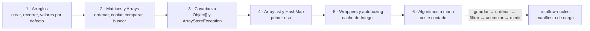
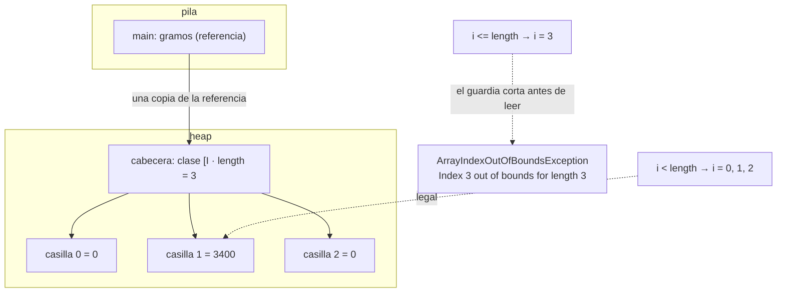
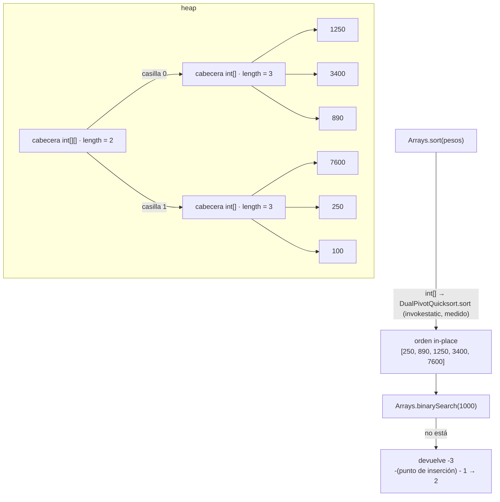
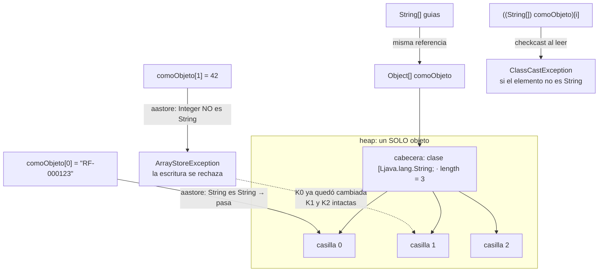
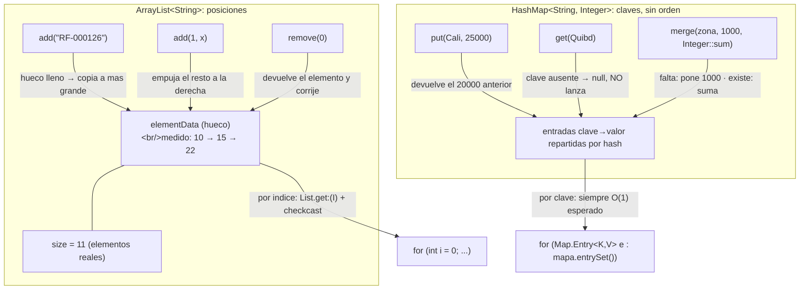

# Módulo 4 · Arreglos y primeras colecciones

> Curso Java (JDK 25) · tramo **Fundamentos** · 6 temas · formato único (specs/021). Portada del curso:
> [CURSO.md](CURSO.md). Todo el código de este módulo se compiló con `javac --release 25` y se ejecutó con
> `java -Dstdout.encoding=UTF-8` sobre OpenJDK Temurin 27.0.1.0.2+1 (macOS, arm64), locale `es_CO`, el
> 2026-11-20. Las salidas están pegadas tal cual. **Aviso de proveniencia:** en esta máquina no hay JDK 25
> instalado, así que el *API* es la de la versión 25 (la que comprueba `--release 25`) pero el *ejecutable* es
> el 27. Ningún tema de este módulo usa funciones *preview*; lo que puede diferir entre los dos ejecutables
> está marcado en cada tema como «pendiente de reejecución en JDK 25», y en este módulo eso es casi siempre el
> **texto** de una excepción —que lo redacta la JVM— y nunca la regla de lenguaje que se enseña.

## Cabecera del módulo

| | |
|---|---|
| **Objetivo** | Escribir un programa que maneja **muchos** datos sabiendo qué tienes debajo en cada caso: las tres formas de crear un arreglo y qué hay dentro antes del primer `=`; cómo se ve una matriz por lo que es (un arreglo cuyos elementos son arreglos) y qué hace exactamente cada método de `Arrays`; por qué un `String[]` sí cabe en un `Object[]` y qué se rompe al escribir por esa puerta; el primer uso de `ArrayList` y `HashMap` con sus operaciones que sí están garantizadas; qué convierte el autoboxing, dónde está su trampa de identidad y dónde su `NullPointerException`; y dos algoritmos escritos a mano con el coste **contado**, no proclamado. |
| **Prerrequisitos** | [Módulo 3](modulo-3.md) completo —en especial su tema 3 (los cuatro lazos y el `for` con etiqueta, que es la forma en que se recorre cualquier arreglo de este módulo) y su tema 4 (parámetros de arreglo: se copia la referencia, medido allí)— y [Módulo 2](modulo-2.md) completo (`String.equals`, `substring`, `Integer.parseInt`: con eso se parten las guías antes de meterlas en un arreglo). Del [Módulo 0](modulo-0.md) se sigue usando `javap -c`. |
| **Duración** | 4 h 10 min (6 temas de 35 a 45 min) más 1 h de laboratorio. |
| **Versiones** | JDK 25 (`--release 25`) · Gradle 9.8.2 por wrapper · JUnit 6.0.3. Nada de este módulo depende de una función *preview*. Dos cosas que la gente cree borradas **siguen ahí** en la 25 y se miden: el constructor `new Integer(int)` (deprecado, no eliminado: `javac --release 25` emite una *Note*, medido en `tema-5/EncajarYDesencajar.java`) y la covarianza de arreglos (JLS §10.5), que es de 1996 y sigue colándose. |
| **Laboratorio** | [`laboratorios/modulo-4/`](laboratorios/modulo-4/README.md) (al publicar: `examples/java/modulo-4/`), con `verificar.sh`: **187 comprobaciones, 0 fallidas** ejecutadas aquí. |
| **Proyecto guía** | `rutaflow-nucleo`: el **manifiesto de carga**. Lee la misma tanda de guías dos veces —con arreglos (`gramos`, `suma`, `mayor`, `mayoresQue`, `sobreElTope`) y con colecciones (`gramosLista`, `mayoresQueLista`, `totalesPorZona`)— y exige que los dos caminos den los mismos números. Cada tema cierra una parte: guardar los pesos (T1), ordenarlos y copiarlos (T2), entender por qué `Object[]` no es una salida (T3), acumular por zona en un mapa (T4), no perder una suma por un `Integer` `null` (T5) y medir el coste del filtro (T6). |

### Mapa del módulo



**Texto alternativo:** el módulo va de la casilla al programa. Primero el arreglo en sí: las tres formas de
crearlo, lo que contiene antes de escribir, y el `ArrayIndexOutOfBoundsException` en sus dos direcciones.
Después la matriz y la clase `Arrays`, que es la biblioteca que opera sobre arreglos —ordenar, copiar,
comparar, buscar— y cuyo abuso más caro (`binarySearch` sin ordenar) se ejecuta aquí. El tema 3 explica por qué
el arreglo, siendo rápido, es **demasiado flexible** para un tipo de referencia: la covarianza y su
`ArrayStoreException`, medida a medio escribir. Con esa experiencia entras en `ArrayList` y `HashMap` (T4), el
par que casi siempre vas a usar en lugar del arreglo suelto. El tema 5 es el peaje de las colecciones tipadas:
los envoltorios, su caché de `-128..127`, el `==` entre cajas y el `NullPointerException` que aparece en una
línea sin métodos. El tema 6 escribe a mano lo que las API hacen por ti y **cuenta** las comparaciones, para
que el resto del curso hable de coste con números y no con etiquetas.

**Convención del módulo.** Tres cosas se comprueban de tres formas distintas. Que el **lenguaje** hace lo que
se afirma se comprueba con `javap -c` sobre el `.class` generado con `javac --release 25` (`newarray`,
`multianewarray`, `aastore`, `Integer.valueOf:(I)Ljava/lang/Integer;`, `List.add:(Ljava/lang/Object;)Z`). Que
el **programa** hace lo que se afirma se comprueba ejecutándolo y pegando su salida. Y que una **frontera**
está donde se dice se comprueba midiendo el primer valor que ya no cumple, en las dos direcciones: el corte de
la caché de `Integer` salió `128` por arriba y `-129` por abajo; el de `Character`, `128` pero desde `0`. Hay
dos familias de datos que **no** se citan como si fueran del lenguaje porque no lo son: el orden interno de un
`HashMap` (se comprueba si `LinkedHashMap` conserva el de inserción y si `HashMap` no, nunca en qué orden
sale) y la caché configurable (`-Djava.lang.Integer.IntegerCache.high=5000` movió el corte a `5001` en esta
misma máquina). Ninguna comprobación de este módulo depende de `System.identityHashCode` de un arreglo, del
`toString` por defecto de una matriz ni de un número de línea dentro de `java.base`. La única excepción es
**declarada**: el hueco interno de `ArrayList` (tema 4) se lee por reflexión sobre el campo privado
`elementData` con `--add-opens java.base/java.util=ALL-UNNAMED`, o sea que es un detalle de esta JDK, no una
regla del lenguaje, y se cita siempre como «medido en Temurin» y nunca como «así crece Java».

---

### Tema 1: Arreglos: creación, valores por defecto, recorrido y `ArrayIndexOutOfBoundsException` · Básico · 40 min

#### 1. Ubicación y prerrequisitos

Curso Java · tramo Fundamentos · módulo 4 · primer tema. Antes: [Módulo 3 · tema 3](modulo-3.md) (los cuatro
lazos: el `for` con índice y el `for`-each que aquí se comparan sobre el mismo arreglo), [Módulo 3 · tema 4](modulo-3.md)
(cómo se pasa un arreglo a un método: se copia la referencia, no el contenido) y [Módulo 2 · tema 1](modulo-2.md)
(`String.length()` —que es un **método** y es justo lo que vas a confundir con el **campo** `length` del
arreglo). Después: el tema 2 aplica todo esto una dimensión más arriba (una matriz es un arreglo cuyos
elementos son arreglos) y añade la clase `Arrays`; el tema 4 sustituye el arreglo por `ArrayList` cuando hace
falta crecer. Versión: JDK 25.

#### 2. Objetivo

Al terminar sabes crear un arreglo de las tres formas que existen y decir cuál aplica en cada sitio (una de
las tres **no compila** fuera de una declaración); sabes qué valor hay en cada casilla de un arreglo recién
creado según su tipo de componente —`0`, `0L`, `0.0`, `false`, el carácter `\u0000` o `null`— y que esas son
seis formas distintas de «cero»; sabes recorrerlo con índice y con `for`-each y decir cuándo necesitas el
índice; sabes que `length` es un campo, que el arreglo es un objeto con clase `[I`, superclase `Object` y las
interfaces `Cloneable` y `Serializable`, y que `clone()` devuelve `Object`; y puedes reproducir los dos
`ArrayIndexOutOfBoundsException` (por arriba y por abajo) leyendo el mensaje, que ya trae el índice y la
longitud.

#### 3. Por qué importa

En `rutaflow-nucleo` el manifiesto de carga es una tanda de guías, y la tanda tiene un número **fijo** por
viaje: entran los pesos de las 6 guías del camión, se ordenan, se filtran por tope. Ese es el caso de uso del
arreglo: cantidad conocida en compilación o en lectura, y acceso por posición. El coste de no saber lo que hay
dentro de un arreglo nuevo es concreto: `new int[3]` suma `0` si lo sumas sin mirar (medido en
`tema-1/ValoresPorDefecto.java`: la suma tras escribir solo `gramos[1] = 3400` es `3400`), y `new String[2]`
no suma nada —lanza— porque sus casillas están en `null`. Y el fallo de recorrido más caro no es el obvio:
`i <= llegada.length` en vez de `i < llegada.length` no se nota en la salida, se nota en la traza, y la traza
dice el índice y la longitud exactos (`Index 5 out of bounds for length 5`), así que arreglarlo es leer, no
adivinar.

#### 4. Analogía

Una hilera de casilleros de gimnasio, **soldados al marco**. El cerrajero no puede añadir un casillero ni
quitar uno: el número de casilleros se decide cuando se suelda el marco, y ese número va grabado en la placa
del extremo (`length`). Cada casillero tiene un número grabado que empieza en `0`, y la llave no es una
bolsa: es una **fórmula** —`base + i × ancho`—, por eso abrir el casillero 4 cuesta lo mismo que abrir el 0.

- `new int[n]` es **soldar n casilleros vacíos**. Vacío no significa sin candado: significa con el valor por
  defecto del tipo del casillero. Casillero de `int` llega con `0` dentro; casillero de `String` llega con
  `null` (es decir: con *ninguna* mochila depositada).
- `new int[] {1250, 3400, 890}` es soldar y **depositar a la vez**.
- `{1250, 3400, 890}` a secas es la lista de depósito que el cerrajero entiende **solo en el momento de
  soldar** (en la declaración). Escrita suelta, sobre casilleros ya soldados, es papel mojado: `javac` la
  rechaza (`illegal start of expression`, medido).
- El `for` con índice es el cerrajero que va casillero por casillero con la fórmula; el `for`-each es el que
  solo mira el contenido. Los dos visitan lo mismo; solo uno puede **escribir**.

**Dónde se rompe la analogía:** los casilleros soldados miden todos lo mismo y están pegados; un arreglo de
`String` guarda **32 o 64 bits de dirección**, no mochilas de tamaño variable, y por eso un `String[]` y un
`int[]` son la misma cosa en estructura aunque muy distintos en contenido. Y sobre todo: la analogía no tiene
un guardia que revise la llave. Java sí: si calculas `i = 5` en una hilera de 5, el guardia corta antes de
abrir, con `ArrayIndexOutOfBoundsException`. En C no hay guardia, y ahí está la diferencia de seguridad que el
tema 3 explota.

#### 5. Diagrama



**Texto alternativo:** `int[] gramos = new int[3]` deja una referencia en la pila y **un objeto** en el heap,
con una cabecera que guarda la clase (`[I`) y la longitud (`3`), y tres casillas con `0` —medido:
`int [3]: 0 0 0 · su clase es class [I`. Escribir `gramos[1] = 3400` no crea otro arreglo ni borra las
vecinas: las tres casillas siguen ahí y la suma da `3400`. El acceso con índice válido usa la fórmula
`base + i × ancho`; el acceso con `i == length` no «lee basura»: la JVM comprueba la cota y lanza, y el
mensaje incluye las dos cifras que necesitabas para encontrar el bug.

#### 6. Explicación

**Nivel 0 — las tres formas de crear un arreglo, y por qué una no vale.** Medido en
`tema-1/CrearYRecorrer.java`:

```text
llegada   : longitud 5 · primer indice 0 = 1250 · ultimo indice 4 = 250
porTamano(3): longitud 3 · su primer valor es 0
porExpresion: longitud 3
```

1. **Literal en la declaración:** `static final int[] LLEGADA = {1250, 3400, 890, 7600, 250};` Solo se puede
   escribir donde estás **declarando** la variable.
2. **Solo tamaño:** `new int[n]` — los huecos existen, el contenido es el valor por defecto. `porTamano(3)`
   devuelve un arreglo de longitud 3 cuyo primer valor es `0`.
3. **Tamaño y contenido como expresión:** `return new int[] {1250, 3400, 890};` Esto **sí** es una expresión:
   vale en un `return`, como argumento, o en una reasignación.

La forma 1 no es una expresión. Por eso el arreglo de arriba se reasigna con `new int[] {...}` y no con las
llaves solas, medido en la misma corrida:

```text
reasignado: empezo con length 5, ahora length 3 · [0] = 1250
```

Fíjate en lo que dice esa línea: `length` pasó de 5 a 3. Reasignar **no** encogió el arreglo original; apuntó
la variable a un arreglo **nuevo** de 3. Un arreglo soldado no se encoge jamás (tema 4: para eso está
`ArrayList`).

**Nivel 0 — `length` es un campo, el índice empieza en 0 y termina en `length - 1`.** Medido en la primera
línea de arriba: longitud 5, primer índice 0, último índice 4. Y el último elemento vale `250`, que es lo que
ocupa la casilla 4. No hay casilla 5 y la JVM lo hace visible con un mensaje que trae las dos cifras.

**Nivel 1 — qué hay dentro antes de escribir nada.** Medido en `tema-1/ValoresPorDefecto.java`, seis tipos,
seis «ceros» distintos:

```text
int    [3]: 0 0 0 · su clase es class [I
long   [2]: 0 0
double [2]: 0.0 0.0
boolean[2]: false false
char   [2]: u+000 (cero) · u+000 (cero)
String [2]: null · null · componente class java.lang.String
```

La regla es la de los campos de una clase (JLS §4.12.5, y la viste en M3): el arreglo **no inicializa** sus
casillas a «nada», las inicializa al valor por defecto del tipo de componente. Lo que hay que saber leer es
que esos valores no son todos iguales: `0` (entero), `0` (largo), `0.0` (decimal), `false` (booleano),
`\u0000` (el carácter **cero**, no el espacio) y `null` (ausencia de referencia). Y que dos de ellos son una
trampa:

```text
0 == false ? no compila; 0.0 == 0 ? true; null == null ? true
```

En Java el `0` **no** es `false` (no hay conversión implícita número↔booleano; eso fue el error del tema 1 de
M3). Pero `0.0 == 0` sí es `true` porque el `int` se promotiona a `double`, y `null == null` es `true`, así que
un `String[]` recién creado **compara igual** contra `null` en cada casilla: el programa sigue y revienta dos
líneas más tarde.

**Nivel 2 — el arreglo es un objeto, de una clase que no escribiste tú.** Medido en
`tema-1/por-dentro/FormaDeUnArreglo.java`:

```text
clase real de un int[]   : [I
clase real de un String[]: [Ljava.lang.String;
clase real de un int[][] : [[I
componente del int[]     : int
componente del String[]  : class java.lang.String
componente del int[][]   : [I
isArray                  : true · superclass: class java.lang.Object · interfaces: [interface java.lang.Cloneable, interface java.io.Serializable]
```

Tres consecuencias prácticas, todas medidas:

- **Se puede pasar como `Object` y se le puede clonar**, pero `clone()` devuelve `Object`:
  `clone devuelve Object    : original[0]=1250 copia[0]=9999` —hubo que escribir `(int[])` en la asignación.
- **No tiene métodos útiles.** Un arreglo no tiene `length()`, ni `add`, ni `equals` que compare contenido
  (eso llega con `Arrays`, tema 2). Su «API» son cuatro cosas: `length`, `clone()`, `getClass()` y lo que
  hacen los métodos estáticos de `java.util.Arrays` y `java.lang.reflect.Array` **sobre** él. Medido con
  reflexión: `reflect.Array.getLength  : 3 · y su elemento 1 es 3400` —la reflexión puede leer la casilla 1
  sin saber en compilación que es un arreglo de `int`, lo que será normal en M21.
- `getComponentType()` es la pregunta que hay que saber hacer: un `int[][]` no es «una matriz», es *un arreglo
  cuyo componente es otro arreglo* (`componente del int[][]   : [I`). Eso explica el tema 2 entero.

**Nivel 3 — lo que emite `javac`.** Medido con `javap -c` sobre `FormaDeUnArreglo.class`:

```text
newarray       int        // new int[4]
anewarray #7   // class java/lang/String   → new String[2]
iastore / iaload           // numericos[0] = 7 / numericos[0]
aastore / aaload           // nombres[1] = "envio" / nombres[1].length()
```

Cuatro instrucciones distintas según el tipo de componente: `newarray` lleva un **tipo básico** como operando
(`T_INT`), `anewarray` lleva una **referencia a clase**; para guardar hay `iastore` (entero) y `aastore`
(referencia), y para leer `iaload` y `aaload`. Nada de esto hace una llamada a método. El acceso a una casilla
es una instrucción de un solo operando implícito: la comprobación de cota y la aritmética están en la JVM. El
método auxiliar devuelve `12`, y eso es `7 + "envio".length()` —es decir, `iaload` y `aaload` en la misma
expresión.

**Los dos recorridos son el mismo recorrido.** Medido sobre `LLEGADA` (cinco pesos):

```text
suma con indice: 13390 · suma con for-each: 13390
```

El `for`-each sobre un arreglo **no copia** el arreglo: el compilador emite un índice escondido, igual que el
`for` clásico (en M3 · tema 3 se comparó el bytecode). Necesitas el índice en tres casos, y los tres aparecen
en este módulo: cuando **escribes** (`gramos[1] = 3400`), cuando comparas con la casilla anterior o siguiente
(tema 6: `ordenado[desde] <= tope`), y cuando recorres hacia atrás o desde en medio (`copyOfRange`).
`arreglo vacio: length 0 · la suma de sus elementos es 0` cierra el caso límite: los dos bucles hacen cero
vueltas sin preguntar.

**La cota existe, y es barata.** Medido en `tema-1/errores/`:

```text
java.lang.ArrayIndexOutOfBoundsException: Index 5 out of bounds for length 5
java.lang.ArrayIndexOutOfBoundsException: Index -1 out of bounds for length 3
```

El mensaje trae el índice y la longitud porque la JVM los tiene en el momento de la comprobación. La primera
es la errata de siempre (`i <= v.length`); la segunda recuerda que el agujero está en **los dos lados**, y que
no hace falta un bucle para caer: una resta (`int anterior = 0 - 1`) basta. Ninguna de las dos se puede
capturar «por si acaso» con sentido: si el índice está mal, el programa está mal; se arregla el límite, no se
añade un `try`.

#### 7. Código ejecutable

**Ejemplo mínimo** · archivo `tema-1/CrearYRecorrer.java` · ejecuta
`javac --release 25 -d out tema-1/CrearYRecorrer.java && java -Dstdout.encoding=UTF-8 -cp out CrearYRecorrer`

```java
// M4 · Tema 1 · Las tres formas de crear un arreglo y como se recorre cada una.
public class CrearYRecorrer {

    // 1. Literal, en la declaracion: solo funciona aqui, no como expresion suelta.
    static final int[] LLEGADA = {1250, 3400, 890, 7600, 250};

    // 2. Tamano primero: se crean los huecos, vacios de contenido.
    static int[] porTamano(int n) {
        return new int[n];
    }

    // 3. Tamano y contenido a la vez, con la expresion new int[] {...}.
    static int[] porExpresion() {
        return new int[] {1250, 3400, 890};
    }

    public static void main(String[] args) {
        System.out.println("llegada   : longitud " + LLEGADA.length + " · primer indice 0 = " + LLEGADA[0]
                + " · ultimo indice " + (LLEGADA.length - 1) + " = " + LLEGADA[LLEGADA.length - 1]);
        System.out.println("porTamano(3): longitud " + porTamano(3).length + " · su primer valor es " + porTamano(3)[0]);
        System.out.println("porExpresion: longitud " + porExpresion().length);

        int suma = 0;
        for (int i = 0; i < LLEGADA.length; i++) {
            suma += LLEGADA[i];
        }
        int sumaForEach = 0;
        for (int peso : LLEGADA) {
            sumaForEach += peso;
        }
        System.out.println("suma con indice: " + suma + " · suma con for-each: " + sumaForEach);

        // length es un campo, no un metodo: no lleva parentesis.
        int[] vacio = new int[0];
        System.out.println("arreglo vacio: length " + vacio.length + " · la suma de sus elementos es " + suma(vacio));

        // Reasignar un arreglo si se puede; lo que exige "new" es que no sea una declaracion.
        int[] salida = new int[5];
        salida = new int[] {1250, 3400, 890};
        System.out.println("reasignado: empezo con length 5, ahora length " + salida.length + " · [0] = " + salida[0]);
    }

    static int suma(int[] v) {
        int s = 0;
        for (int x : v) {
            s += x;
        }
        return s;
    }
}
```

Salida completa, pegada de la corrida:

```text
llegada   : longitud 5 · primer indice 0 = 1250 · ultimo indice 4 = 250
porTamano(3): longitud 3 · su primer valor es 0
porExpresion: longitud 3
suma con indice: 13390 · suma con for-each: 13390
arreglo vacio: length 0 · la suma de sus elementos es 0
reasignado: empezo con length 5, ahora length 3 · [0] = 1250
```

**Ejemplo de valores por defecto** · archivo `tema-1/ValoresPorDefecto.java` · ejecuta
`java -Dstdout.encoding=UTF-8 tema-1/ValoresPorDefecto.java`

```java
int[] gramos = new int[3];
long[] distancia = new long[2];
double[] importe = new double[2];
boolean[] urgente = new boolean[2];
char[] iniciales = new char[2];
String[] guias = new String[2];

System.out.println("int    [3]: " + gramos[0] + " " + gramos[1] + " " + gramos[2]
        + " · su clase es " + gramos.getClass());
// ... las otras cinco
System.out.println("0 == false ? no compila; 0.0 == 0 ? " + (0.0 == 0) + "; null == null ? " + (null == null));

gramos[1] = 3400;   // escribir en una casilla no toca las vecinas
System.out.println("tras gramos[1] = 3400: " + gramos[0] + " " + gramos[1] + " " + gramos[2]
        + " · suma " + (gramos[0] + gramos[1] + gramos[2]));
```

```text
int    [3]: 0 0 0 · su clase es class [I
long   [2]: 0 0
double [2]: 0.0 0.0
boolean[2]: false false
char   [2]: u+000 (cero) · u+000 (cero)
String [2]: null · null · componente class java.lang.String
0 == false ? no compila; 0.0 == 0 ? true; null == null ? true
tras gramos[1] = 3400: 0 3400 0 · suma 3400
```

El detalle que hay que no perderse: `pinta(char)` convierte el carácter a entero y lo imprime como `u+000
(cero)`. Si imprimieras `iniciales[0]` a secas no verías **nada** en la terminal —el carácter cero es
invisible—, y esa es la razón por la que un `char[]` «parece vacío» cuando en realidad está lleno de `\u0000`.

**Por dentro** · `tema-1/por-dentro/FormaDeUnArreglo.java` (`javap -c` incluido en las líneas de Nivel 3).
**Proyecto guía** · `src/main/java/rutaflow/nucleo/Manifiesto.java`, método `gramos(String[])`: crea
`new int[guias.length]` y rellena casilla por casilla —es la forma 2 con valores de la forma 3— y su salida
medida es `gramos leidos : [1250, 3400, -1, 890, 700, 2100]`, donde el `-1` es la guía malformada que **no**
es un peso sino el marcador que el programa acordó (M3 · tema 4).

#### 8. Mini-laboratorio

Escribe los archivos desde cero en `laboratorios/modulo-4/tema-1/` (no copies y pegues: el ejercicio es
predecir y comprobar).

1. Crea `MisCasilleros.java` con tres arreglos de 4 casillas: `int`, `double`, `String`. Imprime cada casilla
   **antes** de escribir en ninguna, y su `getClass().getName()`. Escribe en un comentario qué esperas ver en
   las cuatro de `String` antes de ejecutar. Ejecuta: si el comentario decía `""` está mal; son `null`, y la
   diferencia aparece en el paso 4.
2. En el mismo archivo, suma los cuatro `int` (esperarás `0`), luego escribe `= 1250` en la casilla 2 y vuelve
   a sumar. Imprime las cuatro casillas. Comprueba que las otras tres siguen intactas: eso es lo que significa
   que el arreglo sea memoria contigua con casillas independientes.
3. Recorre `int[] pesos = {1250, 3400, 890, 7600, 250}` de cuatro formas: `for` con índice ascendente, `for`
   con índice descendente, `for`-each, y `while` con un contador fuera. Las cuatro deben imprimir `13390`.
   Después cambia **una sola** letra del primer bucle (`<` por `<=`) y ejecuta: copia el mensaje exacto en un
   comentario y anota la línea que lo produce. Devuelve la letra.
4. Crea `TrampaNull.java` con `String[] guias = new String[3];` y un `for`-each que imprima
   `guia.length()`. Compila (no hay error) y ejecuta: anota qué dice el mensaje y por qué el compilador no te
   avisó. Contrasta con el paso 1: la casilla «vacía» de un arreglo de referencias no es una cadena vacía.
5. Crea `NoCompilan.java` y escribe, de uno en uno, los dos casos que el tema dice que son ilegales:
   `int[] x = new int[5]; x = {1, 2, 3};` y `System.out.println(x.length());` sobre un arreglo. Pega en un
   comentario el mensaje de `javac` de cada uno y escribe por qué el primero es un error de **sintaxis** y el
   segundo de **resolución de símbolos**.

**Listo cuando** el paso 3 produzca `13390` en las cuatro formas; cuando sepas decir, sin ejecutar, el valor
por defecto de `long[]`, `char[]` y `Thread[]` (`0`, `\u0000`, `null`); y cuando el paso 5 te dé dos mensajes
distintos de `javac` que no confundas: `illegal start of expression` es estructura,
`cannot find symbol · method length()` es que estás buscando un método que no existe.

#### 9. Verificación

```bash
cd docs/reestructuracion/cursos/java/laboratorios/modulo-4
javac --release 25 -encoding UTF-8 -d out tema-1/*.java
java -Dstdout.encoding=UTF-8 -cp out CrearYRecorrer        # «suma con indice: 13390 · suma con for-each: 13390»
java -Dstdout.encoding=UTF-8 -cp out ValoresPorDefecto     # seis ceros distintos y «suma 3400»
java -Dstdout.encoding=UTF-8 tema-1/errores/IndiceHastaLength.java     # Index 5 out of bounds for length 5
java -Dstdout.encoding=UTF-8 tema-1/errores/IndiceNegativo.java        # Index -1 out of bounds for length 3
javac --release 25 -d /tmp/m4e tema-1/errores/ConfundeParentesisConLength.java    # cannot find symbol
javac --release 25 -d /tmp/m4e tema-1/errores/InicializadorFueraDeDeclaracion.java # illegal start of expression
javac -d /tmp/m4b tema-1/por-dentro/FormaDeUnArreglo.java && javap -c -cp /tmp/m4b FormaDeUnArreglo  # newarray, iastore
```

O, todo el módulo de una vez: `GRADLE="./gradlew --offline -I .herramienta-local.init.gradle.kts"
./verificar.sh`. Aquí esas **25** comprobaciones del tema pasan con Temurin 27 y `--release 25`; con JDK 25 en
el `PATH` basta `./verificar.sh`.

*Pendiente de reejecución en JDK 25:* el texto de `ArrayIndexOutOfBoundsException` («Index 5 out of bounds for
length 5») lo construye la JVM; la **redacción** la fijó el cambio que añadió las dos cifras, pero conviene
confirmar con el ejecutable 25 que sigue igual que aquí. Lo que **no** cambia entre los dos ejecutables: los
valores por defecto, las firmas `[I` y `[Ljava.lang.String;`, las instrucciones `newarray`/`anewarray`/
`iastore`/`aastore` y la existencia del campo `length`.

#### 10. Error común y diagnóstico

**Síntoma 1 — «el arreglo tiene 5 elementos pero el bucle revienta en el quinto».** Es el límite mal escrito.
Salida real de `tema-1/errores/IndiceHastaLength.java`:

```text
Exception in thread "main" java.lang.ArrayIndexOutOfBoundsException: Index 5 out of bounds for length 5
	at IndiceHastaLength.main(IndiceHastaLength.java:9)
```

**Causa:** `for (int i = 0; i <= llegada.length; i++)`. Con `<=` el bucle da `length + 1` vueltas: la última
pide la casilla que no existe. **Arreglo:** `<`, o mejor, `for (int peso : llegada)` si no escribes. Y si
necesitas el índice y el recorrido es raro, escribe el rango como comentario (`// i = 0..length-1`) antes del
bucle: es lo que hace `tema-1/errores/IndiceNegativo.java` con `// bien: 2, 1, 0. nunca -1`.

**Síntoma 2 — `cannot find symbol` sobre algo que sí existe.** Salida real de
`tema-1/errores/ConfundeParentesisConLength.java`:

```text
ConfundeParentesisConLength.java:9: error: cannot find symbol
        System.out.println("arreglo: " + llegada.length()); // mal: el arreglo tiene campo, no metodo
                                                ^
  symbol:   method length()
  location: variable llegada of type int[]
```

**Causa:** copiar el hábito de `String`. El mensaje es un buen mensaje: dice **qué** buscaba (`method
length()`), **dónde** (`variable llegada of type int[]`) y por tanto **qué tiene** en su lugar. **Arreglo:**
`llegada.length`. Y si de verdad querías saber cuántos caracteres tiene un elemento, `llegada[0]` es un `int`:
no tiene caracteres.

**Síntoma 3 — «sí puse las llaves, ¿por qué ni siquiera compila?». Salida real de
`tema-1/errores/InicializadorFueraDeDeclaracion.java`:**

```text
InicializadorFueraDeDeclaracion.java:7: error: illegal start of expression
        llegada = {1250, 3400, 890};   // mal: las llaves sin "new" solo van en la declaracion
                  ^
InicializadorFueraDeDeclaracion.java:7: error: not a statement
InicializadorFueraDeDeclaracion.java:7: error: ';' expected
```

**Causa:** el inicializador con llaves **sin `new`** solo es válido en una declaración. En una asignación suelta
la gramática no tiene ninguna producción para una llave, así que `javac` emite tres errores del mismo sitio: no
son tres bugs, es uno. **Arreglo:** `llegada = new int[] {1250, 3400, 890};` —o `System.arraycopy` /
`Arrays.copyOf` si querías escribir **dentro** del arreglo existente y no sustituirlo (eso es el tema 2). El
detalle pedagógico: si reasignas, `llegada.length` pasa a `3` y el arreglo de 5 casillas queda para el
recolector. Medido en `CrearYRecorrer`: `empezo con length 5, ahora length 3`.

**Error de ejecución silencioso (no está en `errores/` porque no falla).** Un arreglo de `String` recién
creado y recorrido con `for`-each imprime `null` y **no** lanza; el `NullPointerException` llega cuando alguien
llama a un método en esa casilla. `ValoresPorDefecto` lo muestra sin trampa:
`String [2]: null · null`. La prevención es de tipo de datos, no de bucle: si puede faltar una guía, el modelo
es `Optional` o un centinela explícito (`-1` para los pesos, como hace el proyecto guía), nunca «ya veré el
`null` al recorrer».

#### 11. Pregunta con respuesta modelo

**Comprensión.** `int[] a = new int[3];` — ¿cuánto vale `a[0]` y qué se imprimiría con
`System.out.println(a[0] == false)`?

**Respuesta modelo:** vale `0`, medido (`int    [3]: 0 0 0`). Lo segundo **no compila**: `int` y `boolean` no
se comparan en Java, así que la comparación `a[0] == false` es el mismo error que `if (n = 6)` del tema 1 de
M3. Sí se puede comprobar lo otro: `0.0 == 0` da `true` (promoción a `double`) y `null == null` da `true`, y
eso es lo que hace peligroso un `String[]` nuevo: sus casillas comparan iguales a `null` sin que nada avise.

**Comprensión.** ¿Qué es `[[I`?

**Respuesta modelo:** el nombre de la clase de un `int[][]`, medido en `FormaDeUnArreglo`. Cada `[` es una
dimensión de arreglo, y la letra final es el tipo de la **última** casilla (`I` = `int`, `L` = referencia,
seguida del nombre). La consecuencia que importa: `getComponentType()` de `int[][]` es `[I`, es decir, un
arreglo de `int` —por eso una «matriz» de Java es un arreglo de arreglos y no un bloque rectangular, y por eso
puede ser irregular (tema 2).

**Entrevista.** Te pasan este código y te piden decir qué imprime y qué está mal:

```java
String[] guias = new String[3];
for (String g : guias) System.out.println(g.length());
```

**Respuesta modelo:** compila y lanza. `new String[3]` deja tres `null`, no tres `""` (medido:
`String [2]: null · null`), así que la primera vuelta da `NullPointerException` al llamar `length()`. Y hay un
segundo problema oculto en la pregunta: aunque las casillas trajeran cadenas, el `for`-each **no puede
escribir** —para rellenar un arreglo nuevo necesitas el índice. El arreglo de referencias tiene dos estados
distintos de «vacío» (`null` y `""`) y un programa que no los distinga es el que revienta en producción. El
tercer detalle, si te lo preguntan: `String.length()` es un **método** y `arreglo.length` es un **campo**, y
eso es otra diferencia.

#### 12. Cuándo usarlo y cuándo no

| Úsalo | No lo uses |
|---|---|
| Cantidad de elementos conocida y fija (los pesos de **un** manifiesto leído) | Elementos que llegan y se van: `ArrayList` (tema 4) |
| Acceso por posición y recorridos con salto o hacia atrás | Búsqueda por contenido: un mapa o una lista, no un `for` a mano |
| Tipos primitivos en bloque, sin cajas (`int[]`, `double[]`) | Colección de `int` con `add`/`remove`: `List<Integer>` paga el autoboxing (tema 5) |
| Interop con API que devuelve arreglos (`Arrays.copyOf`, `split`, `args`) | Como tipo de campo expuesto de una clase: devuelves la memoria viva, y quien llama escribe en tus casillas (M3 · tema 4 midió que mudar una casilla **sí** se ve fuera) |

**Costo:** el arreglo no tiene sobrescritura por elemento —acceder es una instrucción (`iaload`/`aaload`) con
una comprobación de cota—, y por eso `new int[n]` seguido de un recorrido es la forma barata. Lo que cuesta es
la **rigidez**: la longitud va en la cabecera del objeto y no cambia nunca (medido: reasignar da otro arreglo,
`length 3`), así que «añadir» un elemento es crear otro arreglo y copiar (tema 2: `Arrays.copyOf`) o cambiar de
estructura (tema 4). Y cuesta la **falsa seguridad** del tipo: un arreglo de referencias acepta `null` sin
preguntar, y eso se arregla en el tema 3 cuando veamos lo que `Object[]` **sí** rechaza, que es otra cosa.

---

### Tema 2: Arreglos multidimensionales y la clase `Arrays`: ordenar, copiar, comparar y buscar · Básico · 45 min

#### 1. Ubicación y prerrequisitos

Curso Java · tramo Fundamentos · módulo 4 · segundo tema. Antes: [Tema 1](#tema-1-arreglos-creacion-valores-por-defecto-recorrido-y-arrayindexoutofboundsexception)
de este módulo (crear, recorrer y los valores por defecto: aquí `new int[3][]` es exactamente ese tema aplicado
dos veces) y [Módulo 3 · tema 3](modulo-3.md) (bucle anidado y `break`/`continue`). Después: el tema 3 usa la
idea de «componente» para explicar la covarianza; el tema 4 usa `Arrays.asList` como puente hacia
`ArrayList`; el tema 6 usa `Arrays.sort` y `Arrays.binarySearch` como la referencia contra la que se miden
los algoritmos escritos a mano. Versión: JDK 25.

#### 2. Objetivo

Al terminar sabes decir qué es realmente una matriz en Java (un arreglo cuyo componente es otro arreglo, y por
eso puede ser irregular) y recorrerla con las dos escrituras sin escribir fuera de una fila; sabes para qué
sirve cada método de `Arrays` que vas a usar a diario (`sort`, `binarySearch`, `copyOf`, `copyOfRange`,
`fill`, `equals`, `mismatch`, `toString`, `deepToString`, `asList`) y qué significa el negativo que devuelve
`binarySearch`; sabes por qué `Arrays.toString` de una matriz no sirve y qué hace `deepToString`; y puedes
reproducir los tres fallos típicos: llamar `pesos.sort()`, dejar las filas en `null`, y esperar una lista de
números de `Arrays.asList(int[])`.

#### 3. Por qué importa

El manifiesto de carga de `rutaflow-nucleo` deja de ser un vector cuando el camión tiene **varias paradas**: lo
que tienes es un arreglo por parada, y eso es una matriz. Si crees que una matriz es un bloque rectangular,
escribes el bucle interno con la longitud de la matriz (`POR_FILA.length` en vez de `POR_FILA[fila].length`) y
el programa se cae en la segunda fila. El dato medido de este tema es justo ese: la misma variable `POR_FILA`
imprime `2 filas`, `3 columnas`, `3 columnas`, y la irregular `filas 3 · longitudes 2 1 4`.
Y la segunda parte —`Arrays`— importa porque es la diferencia entre contar 21 comparaciones o 14 (tema 6) y
entre **ordenar** o buscar en lo desordenado: medido aquí, `binarySearch` sobre un arreglo desordenado dice
que 890 **no está** cuando está en el índice 3. Eso no es lento: es mentira, y llega a producción como un
paquete que no se factura.

#### 4. Analogía

Un **edificio de trasteros** con portales independientes. La «matriz» es la lista de portales: un arreglo
cuyos elementos son otros arreglos (los trasteros de ese portal). No hay un plano único: el conserje solo
tiene una lista de llaveros, y cada llavero tiene su número de huecos. Por eso el portal 1 puede tener 2
trasteros y el portal 3 tener 4 —el edificio no se entera ni se tuerce.

- `Arrays.sort` es **reordenar los llaveros dentro de un llavero**. No pregunta: ordena. `Arrays.binarySearch`
  es la **bibliotecaria** que busca por la mitad: funciona solo si el estante ya está ordenado, y si le das un
  estante desordenado no te dice «no sé»: te dice una posición o te dice que no está. A veces acierta (medido:
  1250 cae en el índice 2 por casualidad) y a veces miente (890 sale `-1`).
- El negativo de `binarySearch` es un **número de calle con dos informaciones**: `-(punto de inserción) - 1`.
  Medido: buscar 1000 en `[250, 890, 1250, 3400, 7600]` devuelve `-3`, y `-(-3) - 1 = 2` es el hueco donde
  tendría que estar.
- `Arrays.copyOf(pesos, 7)` es **cambiar el llavero por uno más largo** y copiar las llaves: el sobrante sale
  con el valor por defecto (`0`), medido: `[250, 890, 1250, 3400, 7600, 0, 0]`. El llavero viejo no crece.
- `Arrays.asList(zonas)` es **un estuche transparente encima del llavero**: ves las mismas llaves, puedes
  cambiarlas de sitio, pero no meter una sexta.

**Dónde se rompe la analogía:** la bibliotecaria de verdad se da cuenta de que el estante está desordenado;
`binarySearch` no hace **ninguna** comprobación de orden (su firma es `binarySearch(int[], int)` y no recibe
criterio). Y el estuche transparente de `asList` es más agresivo de lo parece: no es solo lectura —`set`
escribe **en el arreglo original**, medido: tras `vista.set(0, "Envigado")` el arreglo `zonas` pasa a
`[Envigado, Bogota, Cali]`.

#### 5. Diagrama



**Texto alternativo:** arriba, la matriz real: **un** objeto `int[][]` con dos casillas que apuntan a **dos**
objetos `int[]` distintos, cada uno con su `length`. Nada es contiguo entre filas, y por eso el bucle interno
usa la longitud de la fila. Abajo, la biblioteca: `sort` de `int[]` no llama a ningún comparador —el bytecode
de `java.util.Arrays` muestra `invokestatic java/util/DualPivotQuicksort.sort:([IIII)V`— y deja el arreglo
ordenado en el sitio; sobre ese arreglo ordenado `binarySearch(1000)` devuelve `-3`, que es la fórmula del
hueco, no un error.

#### 6. Explicación

**Nivel 0 — una matriz es un arreglo de arreglos.** Medido en `tema-2/Matrices.java`:

```text
longitud de la matriz : 2 filas
longitud de la fila 0 : 3 columnas
longitud de la fila 1 : 3 columnas
elemento [1][0]       : 7600
```

`POR_FILA.length` responde cuántas **filas**; `POR_FILA[0].length` cuántas columnas tiene *esa* fila. Son dos
campos `length` de dos objetos distintos. `POR_FILA[1][0]` son dos accesos encadenados: primero la casilla 1
(que es una referencia a un `int[]`), luego la casilla 0 de ese arreglo.

**Nivel 0 — el recorrido correcto y por qué el otro no.** El bucle anidado de `Matrices` escribe el límite
interior con la longitud **de la fila**, y hay un error entero (`tema-6/errores/BurbujaFueraDeRango.java` es
ese mismo bug en otro sitio) que se paga con `Index 4 out of bounds for length 4`. Salida medida de los dos
recorridos:

```text
recorrido con dos indices:
  fila 0 suma 5540
  fila 1 suma 7950
recorrido con for-each anidado:
  fila de 3 columnas suma 5540
  fila de 3 columnas suma 7950
```

Nótese qué dice la segunda forma: `for (int[] fila : POR_FILA)` recorre **arreglos**, no enteros. El tipo de la
variable del `for`-each es el **componente** de la matriz. Si te parece raro, es porque el tema 1 ya te dijo
`componente del int[][] : [I`.

**Nivel 1 — irregular es normal.** Medido: `irregular: filas 3 · longitudes 2 1 4`. Se construye en dos pasos:
`new int[3][]` fija las filas y deja las referencias de fila en `null` (¡el valor por defecto del tema 1!);
luego cada `m[i] = new int[] {...}` crea una fila del tamaño que toque. El fallo `errores/FilaNula.java` hace
exactamente eso y olvida el segundo paso:

```text
fila 0: null
recorro las tres filas:
  fila 0 tiene 2 columnas
Exception in thread "main" java.lang.NullPointerException: Cannot read the array length because "porFila[i]" is null
```

El mensaje es el de la JVM con `-g` activado (la variable se nombra): la casilla 0 sí tenía fila porque el
programa la asignó; la casilla 1 nunca se creó, y lo que revienta no es el índice sino **leer `length` de un
`null`**. No es un `ArrayIndexOutOfBoundsException`: es un `NullPointerException`, y esa diferencia es el
diagnóstico.

**Nivel 1 — `final` no significa «inmutable» (tercera vez en el curso, y aquí duele).** `POR_FILA` es
`static final`, y el programa escribe `POR_FILA[0][0] = 9999` sin quejarse:
`tras POR_FILA[0][0] = 9999 -> fila 0: 9999 · fila 1: 7600`. Lo congelado es la referencia a la matriz; las
casillas de las filas son memoria libre. Y `clone()` sobre una matriz es **superficial**, medido:

```text
clone es superficial: original[0][0]=1 · copia[0][0]=1 (misma fila: true)
```

La copia tiene sus propias casillas de fila, pero esas casillas apuntan a **las mismas filas**. `copiado[0] ==
POR_FILA[0]` es `true`, así que escribir en la copia se ve en el original. Copia profunda: bucle explícito o
`Arrays.setAll` (M12), nunca `clone`.

**Nivel 2 — la clase `Arrays` es estática porque los arreglos no tienen métodos.** El error
`errores/SinMetodosPropios.java` es la prueba:

```text
errores/SinMetodosPropios.java:9: error: cannot find symbol
        pesos.sort();                        // mal: int[] no tiene metodo sort
             ^
  symbol:   method sort()
  location: variable pesos of type int[]
```

Medidas, las operaciones del día a día (`tema-2/UsosDeArrays.java`):

```text
antes  : [7600, 250, 1250, 890, 3400]
ordenado: [250, 890, 1250, 3400, 7600]
binarySearch(890)  : 1
binarySearch(1250) : 2
binarySearch(1000) : -3 · deberia ir en el indice 2
copyOf(...,7)      : [250, 890, 1250, 3400, 7600, 0, 0]
copyOfRange(1,3)   : [890, 1250] · length 2
fill(5,7,42)       : [250, 890, 1250, 3400, 7600, 42, 42]
igualdad: == false · equals true · equals del propio true
primeros 2 iguales: true
mismatch           : -1 ( -1 = no difiere en nada)
```

Cuatro lecturas de esa salida:

1. `sort` es **en el sitio**: no devuelve nada, muta el arreglo que le pasas (por eso `antes`/`ordenado` usan
   la misma variable).
2. `binarySearch(1000)` = `-3`. La regla es `-(insersión) - 1`, y el `-1` extra existe para que «debería ir en
   el índice 0» no se confunda con «encontrado en el índice 0» (esos dos son `-1` y `0`).
3. `copyOf` alargar **rellena con el valor por defecto** (`0, 0`): es la misma promesa del tema 1.
   `copyOfRange(1,3)` es el intervalo `[1, 3)`: dos elementos, `length 2` —el extremo derecho no entra, como
   en `substring` de M2.
4. `equals` compara contenido, `==` compara identidad (`== false · equals true`). `mismatch` dice **en qué
   índice** empiezan a diferir y devuelve `-1` cuando no difieren en nada, que es el camino inverso de la
   convención de `binarySearch` —aquí `-1` sí es buena noticia. Compara rangos: `Arrays.equals(pesos, 0, 2,
   gemelo, 0, 2)` da `true`.

**Nivel 2 — con matrices, la capa de `Arrays` se queda arriba.** Medido con `int[][] m = {{1, 2}, {3, 4}}`:

```text
toString            : empieza '[[I' y tiene '@' si · 2 trozos
deepToString        : [[1, 2], [3, 4]]
equals / deepEquals : false / true
```

`Arrays.toString(m)` llama al `toString` de cada **fila**, y un arreglo no tiene `toString` útil: sale
`[[I@610455d6, [[I@5119fb47]`. Por eso el documento no imprime esas direcciones (son *hash de identidad* y
cambian en cada corrida): lo que se comprueba es que **empieza** con `[[I`, que **contiene** `@`, y que corta
en **2 trozos** por la coma —tres hechos deterministas en lugar de una cifra que nadie puede reproducir.
`deepToString` sí baja: `[[1, 2], [3, 4]]`. Y `Arrays.equals(m, n)` es `false` con dos matrices de idéntico
contenido porque compara las filas **por referencia**; `deepEquals` recorre y da `true`. Regla práctica: en
dos dimensiones, todo el que no lleve `deep` compara direcciones.

**Nivel 2 — `asList` es una vista, y esa vista escribe.** Medido:

```text
tras vista.set(0)   : arreglo [Envigado, Bogota, Cali] · vista [Envigado, Bogota, Cali]
```

`Arrays.asList` devuelve una `List` **respaldada** por el arreglo: `set` escribe en el arreglo, y cambiar el
arreglo se ve en la lista. Su longitud es la del arreglo, así que `add` no tiene dónde ir:
`errores/AnadeAAsList.java` lanza `java.lang.UnsupportedOperationException` desde
`java.base/java.util.AbstractList.add(AbstractList.java:155)`. (El número de línea de la biblioteca no es un
dato del curso: lo que se comprueba aquí es el tipo de excepción y que la vista tiene `size 3` antes de fallar.)
Y la trampa del mismo método, medido en `tema-2/UnaListaDeUnArreglo.java`:

```text
List<int[]>  : size 1
               su UNICO elemento es de clase [I
List<Integer>: size 3 · suma 5540
```

`Arrays.asList(int[])` **no** es una lista de números: el parámetro es `T...`, un `int[]` no se convierte en
`Integer[]`, así que `T` se infiere `int[]` y la lista tiene **un** elemento. Con `Integer[]` salen tres. El
mismo error, escrito como asignación a `List<Integer>`, ni siquiera compila
(`errores/AsListDePrimitivos.java`):

```text
error: incompatible types: inference variable T has incompatible bounds
    equality constraints: Integer
    lower bounds: int[]
```

**Nivel 3 — cómo se crea una matriz en bytecode.** Medido con `javap -c` sobre
`tema-2/por-dentro/FormaDeUnaMatriz.class`: `new int[2][3]` es **una sola** instrucción,
`multianewarray #7, 2 // class "[[I"` (el `2` son las dimensiones), mientras que crear fila por fila emite
`anewarray #9 // class "[I"` para el contenedor y luego **un `newarray int` por fila**. Y las dos matrices
«son la misma clase» —medido: `misma clase? : true`—: `[[I` no dice nada de la rectangularidad. Lo rectangular
es una convención tuya, no una propiedad del objeto.

Salida completa de `FormaDeUnaMatriz`:

```text
clase de int[][]     : [[I · filas 2
clase de una fila    : [I · columnas 3
componente del entero: [I
componente de la fila: int
misma clase?         : true
cambiar la fila fuera: r[0][0] = 9999
irregular en columnas: 3 y 7 · misma clase: true
```

**Nivel 3 — y qué elige la biblioteca al ordenar.** No es una etiqueta de manual: `javap -c -p
java.util.Arrays` muestra que `sort(int[])` termina en `invokestatic java/util/DualPivotQuicksort.sort:([IIII)V`
y que `sort(Object[])` mira un flag (`Arrays$LegacyMergeSort.userRequested`) y si no está activado llama a
`invokestatic java/util/ComparableTimSort.sort:...`. Es decir: para primitivos, *quicksort* de dos pivotes *in
place* (no puede usar `compareTo`, no hay objetos que comparar); para referencias, ordenación **estable**
(Timsort), porque aquí sí importa que dos elementos iguales conserven su orden relativo. Esto se usa en serio
en el tema 6 y en M21.

#### 7. Código ejecutable

**Ejemplo mínimo** · archivo `tema-2/Matrices.java` · ejecuta
`javac --release 25 -d out tema-2/Matrices.java && java -Dstdout.encoding=UTF-8 -cp out Matrices`

```java
public class Matrices {
    static final int[][] POR_FILA = {
        {1250, 3400, 890},     // Medellin
        {7600, 250, 100}       // Bogota
    };

    static int[][] irregular() {
        int[][] m = new int[3][];     // solo se fijan las FILAS; las columnas quedan null
        m[0] = new int[] {1250, 3400};
        m[1] = new int[] {890};
        m[2] = new int[] {7600, 250, 100, 45};
        return m;
    }

    public static void main(String[] args) {
        System.out.println("longitud de la matriz : " + POR_FILA.length + " filas");
        System.out.println("longitud de la fila 0 : " + POR_FILA[0].length + " columnas");
        System.out.println("elemento [1][0]       : " + POR_FILA[1][0]);

        for (int fila = 0; fila < POR_FILA.length; fila++) {
            int suma = 0;
            for (int col = 0; col < POR_FILA[fila].length; col++) {   // la longitud DE LA FILA, no la de la matriz
                suma += POR_FILA[fila][col];
            }
            System.out.println("  fila " + fila + " suma " + suma);
        }
        // ... for-each anidado, irregular(), final + mutación, y clone() superficial
    }
}
```

Salida completa medida (las líneas que faltan en el recorte están todas en la sección 6):

```text
longitud de la matriz : 2 filas
longitud de la fila 0 : 3 columnas
longitud de la fila 1 : 3 columnas
elemento [1][0]       : 7600
recorrido con dos indices:
  fila 0 suma 5540
  fila 1 suma 7950
recorrido con for-each anidado:
  fila de 3 columnas suma 5540
  fila de 3 columnas suma 7950
irregular: filas 3 · longitudes 2 1 4
tras POR_FILA[0][0] = 9999 -> fila 0: 9999 · fila 1: 7600
clone es superficial: original[0][0]=1 · copia[0][0]=1 (misma fila: true)
```

**Ejemplo de biblioteca** · `tema-2/UsosDeArrays.java` (todo lo de Nivel 2 anterior, ejecutado). Su salida
íntegra son las 12 líneas citadas más las 3 de la matriz y la del `asList`.

**El fallo silencioso** · `tema-2/BuscaSinOrdenar.java` · salida completa medida:

```text
desordenado: [7600, 250, 1250, 890, 3400]
  binarySearch(1250) = 2 · adivina el indice 2 por casualidad
  binarySearch(890)  = -1 · dice que no esta, y SI esta en el indice 3
ordenado   : [250, 890, 1250, 3400, 7600]
  binarySearch(1250) = 2
  binarySearch(890)  = 1
busco 9999 (no esta) en el desordenado: -6
busco 9999 (no esta) en el ordenado   : -6
```

Las dos últimas líneas son las que hay que leer despacio: **el mismo resultado para los dos arreglos**, cuando
uno está ordenado y el otro no. `binarySearch` no puede decirte que lo usaste mal; `-6` aquí salió por
casividad en el caso desordenado. En cambio `-1` para el 890 presente es un falso negativo con consecuencias:
cualquier `if (buscado < 0) { /* no existe */ }` sobre un arreglo desordenado decide con datos inventados.

**Proyecto guía** · `src/main/java/rutaflow/nucleo/Manifiesto.java`, `mayoresQue(int[], int)`: filtra con
`sinMalformados`, **clona** antes de ordenar (no muta el arreglo del llamador), ordena con `Arrays.sort` y
corta con `Arrays.copyOfRange`. Salida medida con `run`: `sobre el tope 1000 : [1250, 2100, 3400]`, donde el
corte vino después de ordenar y el `copyOfRange` es el `[desde, length)` de este tema.

#### 8. Mini-laboratorio

Escribe los archivos desde cero en `laboratorios/modulo-4/tema-2/`.

1. Crea `MiParada.java` con `int[][] paradas` de **tres** paradas y longitudes 2, 4 y 1 (declárala con el
   inicializador de llaves). Suma por parada con `for` de dos índices y con `for`-each anidado. Imprime las
   tres longitudes. Antes de ejecutar escribe qué imprime `paradas.length` y qué imprime `paradas[1].length`
   (son 3 y 4; si pusiste 4 y 4, confundes las dos preguntas).
2. Crea `OrdenYBusqueda.java` con `int[] pesos = {7600, 250, 1250, 890, 3400}`. Sin ordenar, busca 890 e
   imprime el resultado. Ordena. Vuelve a buscar las cuatro cifras `890`, `1250`, `1000`, `9999` y **predice**
   los cuatro resultados antes de ejecutar; imprime también `-r - 1` para los negativos. Pega la salida en un
   comentario.
3. Crea `CopiasYVistas.java`: haz `int[] original = {1250, 3400, 890}`, `int[] crecido =
   Arrays.copyOf(original, 5)`, `int[] trozo = Arrays.copyOfRange(original, 1, 3)` y `int[] gemelo =
   original.clone()`. Imprime las cuatro longitudes y luego responde con `Arrays.equals`: ¿`crecido` es igual a
   `original`? ¿y `gemelo`? ¿por qué uno da `true` y el otro también, siendo cosas distintas? (Uno es igual
   **en contenido**, el otro es igual **y además** es otra copia del mismo contenido; `==` los separa.)
4. Crea `LaVistaEscribe.java` con `String[] zonas = {"Medellin", "Bogota", "Cali"}`, saca la vista con
   `Arrays.asList`, cambia la casilla 0 de la **vista**, y luego cambia la casilla 1 del **arreglo**. Imprime
   los dos después de cada paso. Termina con `vista.add("Manizales")` en comentario, y anota el tipo exacto de
   excepción que produce al quitar el comentario.
5. Crea `MatrizProfunda.java` con `int[][] m = {{1, 2}, {3, 4}}` y `int[][] n` con el mismo contenido. Imprime
   `Arrays.equals(m, n)` y `Arrays.deepEquals(m, n)`, luego `Arrays.toString(m)` y `Arrays.deepToString(m)`.
   Escribe en un comentario por qué la primera comparación da `false` **siendo iguales** y qué tienen que ver
   las filas con eso.

**Listo cuando** el paso 2 acierte los cuatro resultados antes de ejecutar (o corrijas el comentario); cuando
en el paso 4 sepas decir sin dudar qué dos operaciones escriben en el arreglo original (`set` de la vista y
escribir en el arreglo) y cuál no existe (`add`); y cuando el paso 5 te deje explicando `equals` de matrices
como «compara referencias de fila».

#### 9. Verificación

```bash
cd docs/reestructuracion/cursos/java/laboratorios/modulo-4
java -Dstdout.encoding=UTF-8 tema-2/Matrices.java          # «fila 0 suma 5540», «longitudes 2 1 4», clone superficial
java -Dstdout.encoding=UTF-8 tema-2/UsosDeArrays.java      # «ordenado: [250, 890, 1250, 3400, 7600]», «binarySearch(1000) : -3»
java -Dstdout.encoding=UTF-8 tema-2/BuscaSinOrdenar.java   # «dice que no esta, y SI esta en el indice 3»
java -Dstdout.encoding=UTF-8 tema-2/UnaListaDeUnArreglo.java # «List<int[]> : size 1», «de clase [I»
java -Dstdout.encoding=UTF-8 tema-2/por-dentro/FormaDeUnaMatriz.java
javap -c -cp /tmp/m4b FormaDeUnaMatriz | grep -E 'multianewarray|anewarray'   # una vs. N instrucciones
javac --release 25 -d /tmp/m4e tema-2/errores/SinMetodosPropios.java   # symbol: method sort()
javac --release 25 -d /tmp/m4e tema-2/errores/AsListDePrimitivos.java  # inference variable T has incompatible bounds
java -Dstdout.encoding=UTF-8 tema-2/errores/FilaNula.java              # Cannot read the array length because "porFila[i]" is null
java -Dstdout.encoding=UTF-8 tema-2/errores/AnadeAAsList.java          # UnsupportedOperationException
```

Aquí esas **35** comprobaciones del tema pasan con Temurin 27 y `--release 25`, incluidas las dos de `javap`
(`multianewarray`, `anewarray`) y la que compara el `NullPointerException` **con** y **sin** `-g`: con `-g` el
mensaje nombra la expresión (`because "porFila[i]" is null`), sin ella nombra un registro local
(`because "<local1>[<local2>]" is null`). Es el mismo fenómeno de líneas `Unknown Source` que viste en M3 ·
tema 6, y de la misma causa: información de depuración que no viene en el `.class` por defecto.

*Pendiente de reejecución en JDK 25:* el **texto** del `UnsupportedOperationException` y su marco
`java.base/java.util.AbstractList.add(AbstractList.java:155)` —medido aquí, con los dos marcos de `java.base`
por delante del tuyo—; el tipo de excepción, el `size 1` de `List<int[]>` y el `equals`/`deepEquals` de
matrices son regla del lenguaje (un arreglo primitivo no es `Object[]`, y `equals` de `Arrays` compara
referencias de fila) y no cambian entre los dos ejecutables.

#### 10. Error común y diagnóstico

**Síntoma 1 — «ordeno y luego busco, y a veces no encuentra lo que sí está».** No es *a veces*: es siempre que
el arreglo estaba desordenado y la mitad por la que empezó la búsqueda no era la que tocaba. Medido:

```text
binarySearch(890)  = -1 · dice que no esta, y SI esta en el indice 3
```

**Diagnóstico:** imprime el arreglo **antes** de buscar, o parte la duda: `Arrays.equals(ordenado,
ordenadoAnterior)` no sirve para saber si está ordenado (no hay método «¿está ordenado?» en la biblioteca),
así que la comprobación honesta es tu propia pasada: `for (int i = 1; i < v.length; i++) if (v[i-1] > v[i])
{ ... }`. **Arreglo:** ordenar antes de buscar (y si el arreglo es del llamador, `clone()` primero, como hace
`Manifiesto.mayoresQue`), o no buscar: `linearSearch` del tema 6 no necesita orden y cuesta lo que dice.

**Síntoma 2 — `NullPointerException` al recorrer una matriz, en una línea que sí tiene un índice válido.**
Salida real de `tema-2/errores/FilaNula.java`:

```text
Exception in thread "main" java.lang.NullPointerException: Cannot read the array length because "porFila[i]" is null
```

**Causa:** `new int[3][]` crea **una** arreglo de 3 referencias, todas `null`. Los `new int[n]` de las filas
son otra operación. **Arreglo:** o `new int[3][4]` (rectangular, todas las filas creadas), o el bucle que las
crea. Y si la irregularidad es del dominio (paradas con distinto número de guías), el recorrido debe usar
`porFila[i].length`, nunca un `int columnas` global.

**Síntoma 3 — «`Arrays.asList` me da una lista y no puedo añadir».** No puedes porque la lista **es** el
arreglo con otra cara. Medido: `tamano de la vista: 3` y después `java.lang.UnsupportedOperationException`.
**Arreglo:** `new ArrayList<>(Arrays.asList(zonas))` si quieres una lista que crezca (tema 4), o
`Arrays.copyOf` si quieres un arreglo más largo —y recuerda que el sobrante de `copyOf` son `0`, medido en
`copyOf(...,7) : [..., 0, 0]`, no `null` en un arreglo de primitivos.

**Síntoma 4 — «una lista de los pesos» que imprime `size 1`.** Medido: `List<int[]> : size 1` y `su UNICO
elemento es de clase [I`. **Causa:** `asList` con un arreglo **de primitivos**; `T...` no puede partir un
`int[]`. **Arreglo:** `Integer[]` (con el coste del autoboxing que verás en el tema 5), o mejor: recorre el
arreglo y `add` a una lista (lo que hace `Manifiesto.gramosLista`). Y si intentaste asignar la lista de un
arreglo primitivo a `List<Integer>`, ni compila:

```text
error: incompatible types: inference variable T has incompatible bounds
```

**Errores de compilación reales** (medidos con `javac --release 25`):

```text
SinMetodosPropios.java:9: error: cannot find symbol   · symbol: method sort() · location: variable pesos of type int[]
AsListDePrimitivos.java:10: error: incompatible types: inference variable T has incompatible bounds
```

**El tercero que no es un error de este tema pero aparece aquí:** `Arrays.toString` de una matriz. No lanza, no
avisa, imprime `[[I@610455d6, [[I@5119fb47]`. Si ves un `@` en una salida de logs, alguien está imprimiendo
referencias de arreglo creyendo que imprime datos: `deepToString` existe para eso.

#### 11. Pregunta con respuesta modelo

**Comprensión.** `int[][] m = new int[2][];` — ¿cuánto vale `m[0].length`? ¿Y `m.length`?

**Respuesta modelo:** la primera **lanza**; la segunda vale `2`. `m.length` es la cantidad de casillas de
referencia (2), y `m[0]` es `null` porque nadie creó la fila: medido en `FilaNula.java`, el fallo es
`NullPointerException: Cannot read the array length because "porFila[i]" is null`, no un
`ArrayIndexOutOfBoundsException`. La diferencia de tipo de excepción te está diciendo qué falta: cotas o
creación de filas.

**Comprensión.** `Arrays.binarySearch(v, x)` devuelve `-4`. ¿Qué sabes?

**Respuesta modelo:** que en **ese instante** `x` no está en `v`, si `v` está ordenado —y nada más. El índice
de inserción es `-(-4) - 1 = 3`, medido con `-3 → 2`. Y si `v` **no** está ordenado, no sabes ni una cosa ni la
otra: `BuscaSinOrdenar.java` devuelve `-1` para un valor que está en la casilla 3 y `2` para otro que también
está, pero por casualidad.

**Entrevista.** Te piden «copiar una matriz de tarifas». Escribes `int[][] copia = original.clone();`. ¿Qué
respondes cuando el revisor pregunta qué pasa si alguien modifica `copia`?

**Respuesta modelo:** que la copia es superficial y la modificación se ve en el original, y lo defiendo con el
dato medido: `clone es superficial: original[0][0]=1 · copia[0][0]=1 (misma fila: true)`. El arreglo exterior
es nuevo (sus casillas de fila son copiables sin afectar al original), pero las filas son los mismos objetos.
Copia profunda: `int[][] c = new int[original.length][];` y por fila `original[i].clone()`, o
`Arrays.setAll`. Y la segunda parte de la respuesta, que suele faltar: si el requisito era «inmutable»,
ninguna de las dos sirve —hay que devolver una copia por cada acceso, o una estructura inmutable (tema 4:
`List.of`/`Map.of`, que sí se niegan a crecer).

#### 12. Cuándo usarlo y cuándo no

| Úsalo | No lo uses |
|---|---|
| `Arrays.sort` + `binarySearch` juntos, sobre una **copia** ordenada | `binarySearch` sobre un arreglo que no ordenaste tú y no verificaste |
| `Arrays.copyOf` / `copyOfRange` para cambiar la longitud o extraer un trozo | Para «vaciar» un arreglo: no hay vacío que valga, hay otro arreglo |
| Matrices cuando la segunda dimensión **significa** algo (parada × guía) | Matrices cuando solo necesitas «muchos valores»: un arreglo plano con índice compuesto es más barato y se recorre igual |
| `deepToString` / `deepEquals` en dos o más dimensiones | `toString` / `equals` de `Arrays` sobre matrices, salvo que quieras comparar **filas por identidad** (caso real, pero es la excepción) |
| `asList` como vista barata para leer o `set` | `asList` cuando el código de al lado va a llamar a `add`, o cuando esperas una copia: no lo es |

**Costo:** las cuatro operaciones de biblioteca que más vas a usar son `sort` (dual-pivot *quicksort* para
primitivos, Timsort estable para referencias, ambas medidas en el bytecode de `java.util.Arrays`),
`binarySearch` (log₂, tema 6 lo cuenta), `copyOf`/`copyOfRange` (una copia O(n) y, si alargas, casillas con el
valor por defecto del tema 1) y `asList` (una envoltura O(1), sin copia). El arreglo bidimensional no te da
continuidad: dos niveles de puntero y **una** comprobación de cota por nivel. Cuando eso empiece a doler
(coherencia de caché, matrices grandes), el curso lo trata en M21; en este módulo el requisito es que
recorras la matriz con la longitud de cada fila y que no le pidas a `Arrays.toString` lo que solo
`deepToString` puede darte.

---

### Tema 3: Covarianza de arreglos y `ArrayStoreException`: por qué las listas son más seguras · Básico · 35 min

#### 1. Ubicación y prerrequisitos

Curso Java · tramo Fundamentos · módulo 4 · tercer tema. Antes: [Tema 1](#tema-1-arreglos-creacion-valores-por-defecto-recorrido-y-arrayindexoutofboundsexception)
(la **clase real** del arreglo: `[Ljava.lang.String;`, y sin esa idea aquí no hay nada que explicar) y
[Tema 2](#tema-2-arreglos-multidimensionales-y-la-clase-arrays-ordenar-copiar-comparar-y-buscar) (el
componente como tipo, y `asList` como primera envoltura de referencia). Del [Módulo 3 · tema 4](modulo-3.md)
viene lo que este tema usa sin repetir: pasar un arreglo a un método copia la **referencia**, así que el método
`etiquetaTodo(Object[], String)` puede estar escribiendo en tu arreglo de fuera. Después: el tema 4 usa
`ArrayList` y `HashMap` (la alternativa práctica), el tema 5 paga el precio de meter `int` en una colección
(`Integer`, autoboxing) y M11 desarrolla los genéricos cuya ausencia se ve aquí en el bytecode. Versión:
JDK 25. Fuentes del temario para este tema: JLS §10.5 y *Effective Java* item 28 («Prefer lists to arrays»).

#### 2. Objetivo

Al terminar sabes qué es la covarianza de arreglos (JLS §4.10.3: si `String` es subtipo de `Object`, `String[]`
es subtipo de `Object[]`), y sabes que la asignación no copia ni convierte nada: es la **misma** memoria. Sabes
qué comprueba la JVM en cada escritura (`aastore`) y qué pasa cuando la comprueba falla: un
`ArrayStoreException` **a medio escribir**, con las casillas anteriores tocadas y las siguientes intactas. Sabes
que la misma guarda se hace **una capa más abajo** (`Object[][] vista = new String[2][]` rechaza un `Integer[]`
con mensaje `[Ljava.lang.Integer;`, medido en `por-dentro/MatrizCovariante.java`). Sabes
que el `ClassCastException` de un arreglo aparece al **leer**, y que el cast en sentido inverso compila y
revienta al ejecutar. Y sabes decir por qué un `List<String>` no se puede asignar a `List<Object>`
(`incompatible types: List<String> cannot be converted to List<Object>`, medido), dónde está la protección real
de las colecciones (en `javac`) y dónde su punto ciego (el erasure: si engañas al compilador, la comprobación
queda en un `checkcast` que él insertó en la lectura).

#### 3. Por qué importa

El método de utilidad más peligroso de un proyecto pequeño es el que dice «paso por aquí todas las casillas»,
porque su firma natural es `Object[]`. En el proyecto guía de M3 (`Despachador`, tema 4) la firma honesta era
`String[]`, y aquí ves qué pasa si alguien «la generaliza». Medido en `tema-3/EscribeEnObject.java`: el método
`etiquetaTodo(Object[], String)` funciona **perfecto** con un `String[]` de fuera
(`afuera, ya convertido : [RF-0000, RF-0001, RF-0002]`) y con un `Object[]`
(`dentro del metodo ve un : [Ljava.lang.Object;`). El fallo no está en el método que **rellena**: está en el que
**mezcla**. `escribeMezcla` escribe un `String` válido, luego un `Integer` ilegal, y el arreglo queda
**partido**: la casilla 0 cambió, la 1 y la 2 no, y la excepción llegó en la 1. Eso es exactamente lo que un
servicio de facturación no puede permitirse: un lote a medio etiquetar que nadie puede saber hasta dónde está
etiquetado. La alternativa del tema 4 (`List<Guia>`) no es más rápida ni más corta: es **imposible de llamar
mal**, porque el compilador no te deja convertir `List<String>` en `List<Object>`.

#### 4. Analogía

Una caja de mudanza estampada **VAJILLA**. En el almacén hay una norma: *«todo lo que dice VAJILLA puede
tratarse como si dijera FRÁGIL»*. Por eso el operario puede tomar la caja por el lado que dice FRÁGIL y seguir
manipulándola —no ha cambiado nada: la caja sigue teniendo la etiqueta VAJILLA pegada en el cartón.

- Pasar `String[]` a `Object[]` es **leer la caja por la etiqueta genérica**. No se fabrica otra caja
  (medido: `misma identidad? : true`), y el estampado real no se borra
  (`la clase real NO cambia: [Ljava.lang.String;`).
- Escribir un `String` por esa etiqueta es legal: una taza **es** frágil.
- Escribir un `Integer` es lo que la analogía llama **el golpe en la puerta**: la caja sabe lo que es, y se
  niega en el momento de entrar (`ArrayStoreException`). No espera a que alguien lo saque.
- Sacar lo que hay dentro creyendo que es una taza es lo que la caja **no** puede controlar: si entró algo por
  una abertura que sí aceptaba ese objeto, al sacarlo te llevas lo que hay y el error aparece **en tus manos**
  (`ClassCastException`, medido: aparece al leer, no al escribir).

**Dónde se rompe la analogía:** una caja de cartón no revisa cada objeto al meterlo; la instrucción `aastore`
sí, porque JLS §10.5 dice literalmente que «an assignment to a component of the array is checked at run time to
ensure that the value being assigned is assignable to the component», y si el tipo del valor no es
*assignment-compatible* (§5.2) con el tipo del componente se lanza el `ArrayStoreException`. Y al revés: una caja
**etiquetada con rotulador** por el cliente no se autocomprueba —
eso son las colecciones después del *erasure*, donde la única guarda real es el aviso de `javac` (medido en
`tema-3/por-dentro/ListaSinGuarda.java`: meter un `Integer` en lo que declaraste `List<String>` no lanza
nada, y el error aparece cuando otro método lo lee).

#### 5. Diagrama



**Texto alternativo:** arriba, un solo objeto en el heap con dos nombres encima: la variable tipada `String[]`
y la asignada a `Object[]` —mismo `identityHashCode`, medido como `true`—. La escritura pasa por `aastore`, que
compara el tipo del **objeto** con el **componente real** de la caja: si no encaja, rechaza esa escritura y
deja las anteriores hechas (medido: `el indice 0 SI cambio : si-es-string`, `el resto quedo viejo : RF-0001 ·
RF-0002`). La lectura con cast es otro fallo, en otro momento, y con otra excepción.

#### 6. Explicación

**Nivel 0 — la asignación hacia arriba es gratis y no toca la memoria.** Medido en
`tema-3/Covarianza.java`:

```text
la clase real NO cambia: [Ljava.lang.String;
misma identidad?         : true
por la vista Object      : RF-000123
por el arreglo original  : RF-000123
```

`Object[] comoObjeto = guias;` no convierte un elemento, no copia: es la **regla de subtipo de arreglos**
(JLS §4.10.3, que hace de `String[]` un subtipo de `Object[]` cuando `String` lo es de `Object`; JLS §10.5 es la
parte que se ejecuta). Lo que sí cambia es lo que el compilador te deja **escribir**: por `comoObjeto` puedes
intentar meter cualquier objeto, y la veracidad de la casilla la defiende la JVM, no `javac`.

**Nivel 0 — el arreglo sabe lo que es, y lo dice en el momento de escribir.** `etiquetaTodo(Object[] destino,
String prefijo)` imprime `destino.getClass().getName()` y ve la verdad:

```text
  dentro del metodo ve un  : [Ljava.lang.String;
afuera, ya convertido     : [RF-0000, RF-0001, RF-0002]
  dentro del metodo ve un  : [Ljava.lang.Object;
```

La firma dice `Object[]` en los dos casos; la **cabecera del objeto** dice una cosa distinta, y esa cabecera es
la que manda. De ahí la segunda parte, medida en `escribeMezcla`:

```text
arreglo a medio escribir  : ArrayStoreException · java.lang.Integer
  el indice 0 SI cambio   : si-es-string
  el resto quedo viejo    : RF-0001 · RF-0002
```

Tres lecturas que hay que saber hacer: (1) la excepción **escribe el nombre de la clase rechazada** en el
mensaje (`java.lang.Integer`), (2) el arreglo queda **parcialmente modificado** —la escritura ilegal se
rechaza, las legales ya se hicieron—, y (3) por eso este bug es peor de lo que parece: no es «el método no
hizo nada», es «el método hizo la mitad». El remedio no es capturar la excepción y continuar: es que la firma
no admita el objeto equivocado (tema 4: `List<Guia>`), o validar antes de tocar nada.

Y si el elemento **sí** cabía en la caja pero la lectura esperaba otra cosa, la excepción cambia de sitio.
Medido:

```text
Object[] con un Integer   : 7 de Integer
  el error aparece al leer  : ClassCastException · class java.lang.Integer cannot be cast to class java.lang.String (java.lang.Integer and java.lang.String are in module java.base of loader 'bootstrap')
```

`mixto[1] = 7` fue completamente legal —`Object[]` acepta cualquier cosa— y la mentira aparece tres líneas más
tarde, cuando alguien hace `(String) mixto[1]`. Este es el patrón exacto del dato que entra por un
`Object[]`/`List<Object>` genérico y revienta en un módulo distinto del que lo metió.

**Nivel 1 — el cast hacia abajo compila, y puede ser mentira.** `errores/CastInvalido.java`:

```java
Object[] cajas = new Object[2];
String[] guias = (String[]) cajas;        // compila
System.out.println("esto no se imprime: " + guias.length);
```

```text
Exception in thread "main" java.lang.ClassCastException: class [Ljava.lang.Object; cannot be cast to class [Ljava.lang.String; ([Ljava.lang.Object; and [Ljava.lang.String; are in module java.base of loader 'bootstrap')
	at CastInvalido.main(CastInvalido.java:7)
```

La cast de arreglo se comprueba **contra la clase real del objeto**, igual que `instanceof`. O sea: `String[]`
es subtipo de `Object[]` (hacia arriba, siempre válido), pero `Object[]` **no** es subtipo de `String[]`: solo
se puede castear si lo que hay debajo era un `String[]`. El caso `Covarianza.java` lo hace bien y por eso pasa:
`cast de vuelta : hueco · RF-000124` —`((String[]) comoObjeto)` es legal porque el objeto sigue siendo
`[Ljava.lang.String;`. Fíjate en el detalle medido del programa: `hueco` para la casilla 1 **en el momento de
la línea**, porque `guias[1] = "RF-000124"` se escribe después; es la demostración de que la cast no copia:
ambas variables miran la misma casilla.

**Nivel 1 — los arreglos de primitivos están fuera del juego.** `int[]` no es subtipo de `Object[]`
(`errores/PrimitivosNoSonObjectArray.java`, medido):

```text
errores/PrimitivosNoSonObjectArray.java:7: error: incompatible types: int[] cannot be converted to Object[]
```

pero `int[]` **sí** es un `Object` (el arreglo es un objeto, tema 1): `int[] asignado a Object : [I`. Esa asimetría
es la que hace que `List<int[]>` tenga un elemento y `List<Integer>` tenga tres (tema 2 midió el primero).

**Nivel 1 — la guarda baja de capa: una matriz también es covariante.** `por-dentro/MatrizCovariante.java`
declara `Object[][] vista = new String[2][]`, o sea una matriz cuyo **componente real** es `String[]`:

```text
clase de la vista      : [[Ljava.lang.String; · componente real: [Ljava.lang.String;
rechaza una capa abajo  : ArrayStoreException · [Ljava.lang.Integer;
casilla 1 admitida     : [ok]
casilla 0 sigue siendo : null
```

Lo que se intenta escribir en la casilla 0 no es un `Integer` suelto sino un `Integer[1]` entero, y el
componente de `vista` es `String[]`: la regla de §4.10.3 («si S y T son tipos referencia, `S[]` es supertipo
directo de `T[]` si y solo si S es supertipo directo de T») no alcanza para `Integer[]` frente a `String[]`, así
que §10.5 hace lo único que puede hacer y lanza. El mensaje lo dice con el nombre interno del objeto rechazado
(`[Ljava.lang.Integer;`), no con el de la casilla. Y las dos últimas líneas son la misma lección de antes: la
escritura ilegal no deja nada escrito (`casilla 0 sigue siendo : null`) mientras la legal de la fila de al lado
sí entró (`[ok]`). §10.5 no habla de dimensiones porque no le falta: la comprobación es siempre «el valor debe
ser asignable al **componente**», y en una matriz el componente es otro arreglo.

**Nivel 2 — por qué «las listas son más seguras», dicho con precisión.** La regla de subtipos de
genéricos es **invariante**: `List<String>` no es subtipo de `List<Object>` ni al revés. Medido en
`errores/ListaNoCovariante.java`:

```text
errores/ListaNoCovariante.java:13: error: incompatible types: List<String> cannot be converted to List<Object>
        List<Object> vista = guias;                  // listas: NO pasa, y ese es el punto
```

El arreglo falla **en ejecución** y te deja memoria a medio cambiar; la lista falla **en compilación** y no
llega a pasar nada. Y la razón de fondo se ve en `tema-3/por-dentro/UnaInstruccionParaGuardar.java`: el
bytecode de `guias.add("RF-000123")` es

```text
11: invokeinterface #12, 2   // InterfaceMethod java/util/List.add:(Ljava/lang/Object;)Z
```

sin ninguna mención a `String`. `add` recibe `Object` en tiempo de ejecución (el tipo se borró), así que **no
puede** existir un «`ArrayStoreException` de las listas»: no hay cabecera con el tipo de componente que
comprobar. La protección no la pone la JVM; la pone `javac`. Eso es lo que hace la asignación invariante la
elección correcta: convierte un accidente en tiempo de ejecución en un error de compilación.

**Nivel 3 — y el punto ciego, medido.** `tema-3/por-dentro/ListaSinGuarda.java` engaña al compilador con dos
casteos (`(List<String>) (List<?>) objetos`, anotado con `@SuppressWarnings("unchecked")`) y pasa todo:

```text
anadido sin excepcion   : 1 elementos · un Integer
la trampa compila       : true
mismo objeto en las dos : true
revienta al leer        : ClassCastException
  nombra los dos tipos  : true
```

Nadie protestó al `add`, y `objetos.get(0) == trampa.get(0)` es `true`: **la misma caja**, dos etiquetas. El
`javap` de `primero(List<String>)` enseña dónde vive la única guarda que queda:

```text
 2: invokeinterface  // InterfaceMethod java/util/List.get:(I)Ljava/lang/Object;
 7: checkcast     #13   // class java/lang/String
```

es decir: `get` devuelve `Object`, y `javac` inserta un `checkcast` en el punto de uso. Ese `checkcast` es lo
que lanza. Con `-Xlint:unchecked` y sin la anotación, `javac` avisa del cast (*warning: [unchecked] unchecked
cast*) pero **no lo impide**: en este punto la seguridad es tuya. El contraste pedagógico con el arreglo es
exacto y medido: el arreglo **impide** la escritura (`ArrayStoreException`), la lista **advierte** y luego
confía. De ahí el item 28 de *Effective Java* que el temario cita para este tema: si vas a exponer una
colección con tipo, es la forma en la que el compilador trabaja contigo; si vas a pasar posiciones, el arreglo
es más rápido pero menos expresivo.

**Nivel 3 — lo que hace cada instrucción.** Medido en `por-dentro/UnaInstruccionParaGuardar.class`:
`guardaReferencia` termina en `3: aastore` y `guardaPrimitivo` en `3: iastore`. `aastore` **no lleva tipo**
en el bytecode —el tipo está en la **cabecera del objeto** y se compara con el del valor apilado: por eso
puede lanzar—, mientras que `iastore` no tiene nada que comprobar (`int[]` solo admite `int`, y eso lo decide
`javac`). Salida de los dos métodos juntos:

```text
guardado legal         : RF-000001
guardado ilegal        : ArrayStoreException
primitivo guardado     : 1250
lista declarada String : 2 elementos
clase de la lista      : java.util.ArrayList
```

#### 7. Código ejecutable

**Ejemplo mínimo** · archivo `tema-3/Covarianza.java` · ejecuta
`javac --release 25 -d out tema-3/Covarianza.java && java -Dstdout.encoding=UTF-8 -cp out Covarianza`

```java
public class Covarianza {
    public static void main(String[] args) {
        String[] guias = new String[3];
        Object[] comoObjeto = guias;                 // compila: String[] es subtipo de Object[]

        System.out.println("la clase real NO cambia: " + comoObjeto.getClass().getName());
        System.out.println("misma identidad?         : " + (comoObjeto == guias));

        comoObjeto[0] = "RF-000123";                 // legal: un String SI es un Object
        System.out.println("por la vista Object      : " + comoObjeto[0]);
        System.out.println("por el arreglo original  : " + guias[0]);

        // Y al reves: leer como String funciona mientras el elemento lo sea.
        String leido = ((String[]) comoObjeto)[1] == null ? "hueco" : "relleno";
        guias[1] = "RF-000124";
        System.out.println("cast de vuelta           : " + leido + " · " + ((String[]) comoObjeto)[1]);

        int[] pesos = {1250, 3400};
        Object unObjeto = pesos;                     // esto si vale: el arreglo ES un objeto
        System.out.println("int[] asignado a Object  : " + unObjeto.getClass().getName());
        // y esto NO compila: Object[] comoArregloDeObjetos = pesos;
    }
}
```

Salida completa:

```text
la clase real NO cambia: [Ljava.lang.String;
misma identidad?         : true
por la vista Object      : RF-000123
por el arreglo original  : RF-000123
cast de vuelta           : hueco · RF-000124
estado final             : [RF-000123, RF-000124, null]
int[] asignado a Object  : [I
```

**El método generalizado** · `tema-3/EscribeEnObject.java`. Las dos firmas que importan:

```java
static void etiquetaTodo(Object[] destino, String prefijo) {   // peligrosa solo si quien llama no sabe
    for (int i = 0; i < destino.length; i++) {                 // que esta vista escribe EN su arreglo
        destino[i] = prefijo + i;
    }
    System.out.println("  dentro del metodo ve un  : " + destino.getClass().getName());
}

static void escribeMezcla(Object[] destino) {
    destino[0] = "si-es-string";                 // este SI entra en un String[]
    destino[1] = 42;                             // este NO: ArrayStoreException
    destino[2] = "tampoco llega";
}
```

y el bloque que hay que leer dos veces:

```java
try {
    escribeMezcla(guias);
} catch (ArrayStoreException e) {
    System.out.println("arreglo a medio escribir  : " + e.getClass().getSimpleName()
            + " · " + e.getMessage());
    System.out.println("  el indice 0 SI cambio   : " + guias[0]);
    System.out.println("  el resto quedo viejo    : " + guias[1] + " · " + guias[2]);
}
```

Salida completa medida (7 líneas, todas citadas en la sección 6).

**Por dentro** · `tema-3/por-dentro/UnaInstruccionParaGuardar.java`,
`tema-3/por-dentro/ListaSinGuarda.java` y `tema-3/por-dentro/MatrizCovariante.java`, con los `javap` pegados
arriba. El tercero es el que más sorprende a quien cree que la covarianza «solo vale para la primera fila»:

```java
Object[][] vista = new String[2][];                 // component type real: String[]
System.out.println("clase de la vista      : " + vista.getClass().getName()
        + " · componente real: " + vista.getClass().getComponentType().getName());
try {
    vista[0] = new Integer[1];                      // un Integer[] NO es un String[]
} catch (ArrayStoreException e) {
    System.out.println("rechaza una capa abajo  : ArrayStoreException · " + e.getMessage());
}
vista[1] = new String[] {"ok"};                     // esto si: String[] si es String[]
```

`getComponentType()` es la API que necesitas si quieres **validar antes de escribir**, porque devuelve
exactamente el dato con el que §10.5 compara el valor. Ejecuta el segundo con el aviso activado para ver la
diferencia entre «no compila», «compila con aviso» y «compila y miente»:

```bash
sed 's/@SuppressWarnings("unchecked")//' tema-3/por-dentro/ListaSinGuarda.java > /tmp/ListaSinGuarda.java
javac -Xlint:unchecked --release 25 -d /tmp/lsg /tmp/ListaSinGuarda.java   # warning: [unchecked] unchecked cast
```

**Proyecto guía** · el `Manifiesto` de este módulo **no** expone `Object[]` en ninguna firma: `gramos(String[])`,
`mayoresQue(int[], int)` y `totalesPorZona(String[])` usan el tipo concreto. Es la decisión del item 28 aplicada
al revés: aquí lo que se comparte son **primitivos**, y un arreglo de primitivos no puede contaminarse (nivel 1)
—por eso `int[]` es la firma correcta para los pesos y `Map<String, Integer>` para los totales—.

#### 8. Mini-laboratorio

Escribe los archivos desde cero en `laboratorios/modulo-4/tema-3/`.

1. Crea `MismaCaja.java`: un `String[3]`, una variable `Object[]` apuntando a él, y tres impresiones:
   `getClass().getName()` de las dos, `a == b`, y el contenido con `Arrays.toString` después de escribir por
   **la vista**. Predice las tres antes de ejecutar. Si predijiste `[Ljava.lang.Object;` en la primera, ya sabes
   qué error ibas a cometer en el trabajo real.
2. Crea `MedioLleno.java` con un método `static void pinta(Object[] caja)` que escriba en la casilla 0 un
   `String`, en la 1 un `Integer` y en la 2 un `String`. Llámalo con un `String[3]` dentro de un `try`/`catch`
   y, en el `catch`, **imprime las tres casillas**. Comprueba que la 2 no cambió: eso es «a medio escribir».
   Escribe debajo, en comentario, qué harías en un servicio real: ¿reintentar, abortar el lote, o no tener
   nunca esa firma?
3. Crea `LeeTarde.java`: crea un `Object[2]`, guarda un `Integer` en la casilla 0 (legal), castea la casilla a
   `String` y captura el `ClassCastException`. Imprime el mensaje. Compara con el paso 2: **dos escrituras
   distintas, dos excepciones distintas, dos momentos distintos**.
4. Crea `ColeccionesDicen.java` y escribe tres líneas, una por vez, comentando la respuesta de `javac`:
   `List<Object> v = new ArrayList<String>();`, `List<String> v2 = new ArrayList<Object>();` y
   `List<String> v3 = new ArrayList<>();`. Las dos primeras no compilan y los dos mensajes son **simétricos**,
   medidos: `incompatible types: ArrayList<String> cannot be converted to List<Object>` y `incompatible types:
   ArrayList<Object> cannot be converted to List<String>`. Fíjate en que `javac` nombra el tipo del `new`, no el
   de la variable, y no usa la palabra «covarianza»: para él simplemente no existe esa conversión. La tercera
   compila, y esa es la única forma de escribirlo bien.
5. Crea `MatrizVista.java`: declara `Object[][] m = new String[2][]` e imprime `m.getClass().getName()` y
   `m.getClass().getComponentType().getName()`. **Predice los dos** antes de ejecutar. Después intenta
   `m[0] = new Integer[1]` dentro de un `try/catch` e imprime el mensaje de la excepción, y por último
   `m[1] = new String[]{"ok"}`. Si el mensaje te sorprende por parecer «otro arreglo», es porque la guarda se
   hizo contra `String[]`, el componente, y no contra `Object`.
6. Crea `EnganaAlCompilador.java` con el patrón de `ListaSinGuarda`: una `List<Object>` con un `Integer`, el
   doble cast `(List<String>) (List<?>)`, y un método `static String primero(List<String>)`. Ejecuta sin
   `-Xlint`, luego con `-Xlint:unchecked` y la anotación quitada. Pega el *warning* y la traza del
   `ClassCastException`. Remata con `javap -c` y señala el `checkcast`: **esa línea es el único guardián que
   tenías**.

**Listo cuando** puedas decir, para cada una de las tres excepciones del tema (`ArrayStoreException`,
`ClassCastException` y el error de `javac` de `List<String>`→`List<Object>`), **en qué momento** aparece y
**qué deja tocado** en la memoria.

#### 9. Verificación

```bash
cd docs/reestructuracion/cursos/java/laboratorios/modulo-4
java -Dstdout.encoding=UTF-8 tema-3/Covarianza.java                  # «[Ljava.lang.String;», «misma identidad? : true»
java -Dstdout.encoding=UTF-8 tema-3/EscribeEnObject.java             # «ArrayStoreException · java.lang.Integer», «el resto quedo viejo : RF-0001 · RF-0002»
java -Dstdout.encoding=UTF-8 tema-3/por-dentro/UnaInstruccionParaGuardar.java
java -Dstdout.encoding=UTF-8 tema-3/por-dentro/ListaSinGuarda.java    # «revienta al leer : ClassCastException»
java -Dstdout.encoding=UTF-8 tema-3/por-dentro/MatrizCovariante.java   # «componente real: [Ljava.lang.String;», «ArrayStoreException · [Ljava.lang.Integer;»
java -Dstdout.encoding=UTF-8 tema-3/errores/CastInvalido.java         # class [Ljava.lang.Object; cannot be cast to class [Ljava.lang.String;
javac --release 25 -d /tmp/m4e tema-3/errores/ListaNoCovariante.java        # List<String> cannot be converted to List<Object>
javac --release 25 -d /tmp/m4e tema-3/errores/PrimitivosNoSonObjectArray.java # int[] cannot be converted to Object[]
javac -d /tmp/m4b tema-3/por-dentro/ListaSinGuarda.java && javap -c -cp /tmp/m4b ListaSinGuarda | grep checkcast
```

Aquí las **30** comprobaciones del tema pasan con Temurin 27 y `--release 25`, incluidas las dos de `javap`
(`aastore` / `List.add:(Ljava/lang/Object;)Z` en `UnaInstruccionParaGuardar`, `checkcast` /
`List.get:(I)Ljava/lang/Object;` en `ListaSinGuarda`) y la del aviso: se copia el archivo **sin** la anotación,
se compila con `-Xlint:unchecked` y se comprueba que salga la cadena `unchecked cast`.

*Pendiente de reejecución en JDK 25:* el texto del `ClassCastException` (la coletilla
`… are in module java.base of loader 'bootstrap'`) lo arma la JVM con los nombres de módulo y cargador; conviene
confirmarlo con el ejecutable 25. La regla de covarianza (JLS §10.5), el `ArrayStoreException` y el hecho de que
`add` se borre a `(Ljava/lang/Object;)Z` no cambian entre ejecutables.

#### 10. Error común y diagnóstico

**Síntoma 1 — «el método recibió mi arreglo y ahora tiene números dentro».** Es el caso `mixto[1] = 7`: una
escritura **legal** en `Object[]`. El diagnóstico es leer la excepción con orden: `ClassCastException` al leer
significa que el objeto **entró** por una puerta que lo admitía; `ArrayStoreException` al escribir significa que
alguien intentó meter por la puerta equivocada **otro** objeto. Salida medida de las dos:

```text
Object[] con un Integer   : 7 de Integer
  el error aparece al leer  : ClassCastException · class java.lang.Integer cannot be cast to class java.lang.String …
arreglo a medio escribir  : ArrayStoreException · java.lang.Integer
```

**Arreglo:** si el método solo sabe escribir **un** tipo, decláralo con ese tipo (`String[]`, `Guia[]`) o,
mejor, con la colección tipada del tema 4. Un parámetro `Object[]` solo es honesto cuando se documenta que
**acepta lo que quepa en el arreglo del llamador** —y eso casi nadie lo quiere.

**Síntoma 2 — el lote queda a medio procesar y nadie sabe dónde.** Consecuencia directa de `aastore`: la
comprobación es **por casilla**, así que un `ArrayStoreException` deja escritas las anteriores. Medido:
`el indice 0 SI cambio : si-es-string` y `el resto quedo viejo : RF-0001 · RF-0002`. **Diagnóstico:** imprimir
`getClass().getName()` del arreglo **antes** de tocarlo (es lo que hace el `println` dentro del método) y
validar el tipo con `instanceof` por fuera, o trabajar sobre una copia y sustituir al final (el patrón de
`Manifiesto.mayoresQue`: `clone` + ordenar la copia, nunca el arreglo del llamador). **No arregla esto:**
envolver todo en `try/catch (Exception e)` y seguir; con un arreglo partido, seguir es el daño.

**Síntoma 3 — «en las listas pasa lo mismo, pero sin excepción».** Pasa **peor**: no hay excepción al
escribir. Medido: `anadido sin excepcion : 1 elementos · un Integer` y el fallo aparece en `primero(trampa)`
con `revienta al leer : ClassCastException`. Y la causa de que no exista un «`ArrayStoreException` de listas»
es visible: `invokeinterface … List.add:(Ljava/lang/Object;)Z` —no hay tipo que comprobar en tiempo de
ejecución. **Arreglo:** no hagas el cast de dos pasos salvo que estés escribiendo código de *framework* y
sepas por qué es seguro; si lo haces, quita `@SuppressWarnings` y compila con `-Xlint:unchecked` en el build
para que el aviso no se pierda (eso se configura de serie en M17).

**Errores de compilación reales** (medidos con `javac --release 25`):

```text
errores/ListaNoCovariante.java:13: error: incompatible types: List<String> cannot be converted to List<Object>
errores/PrimitivosNoSonObjectArray.java:7: error: incompatible types: int[] cannot be converted to Object[]
```

El primero **es el arreglo funcionando bien**: Java te está impidiendo escribir el código que en C# (antes de
2007) y en Java con arreglos se convierte en un fallo de producción. El segundo recuerda que la covarianza
existe solo entre arreglos de **referencia**.

#### 11. Pregunta con respuesta modelo

**Comprensión.** Tienes `String[] guias` y escribes `Object[] vista = guias;`. ¿Cuántos arreglos hay en memoria
y qué imprime `vista.getClass().getName()`?

**Respuesta modelo:** **uno**, y el nombre es el original: `[Ljava.lang.String;` (ambos medidos; `==` entre las
dos variables da `true`). La asignación no copia ni re-etiqueta el objeto: la cabecera del arreglo guarda su
clase real y esa clase es la que se comprueba en cada escritura. Lo único que cambia es lo que `javac` te deja
**intentar** escribir.

**Comprensión.** ¿En qué se diferencia `ArrayStoreException` de `ClassCastException` en este contexto?

**Respuesta modelo:** en el momento y en el efecto. `ArrayStoreException` se produce en la **instrucción de
escritura** (`aastore`), la escritura **no ocurre** y las casillas anteriores quedan modificadas
(medido: índice 0 cambiado, 1 y 2 intactos). `ClassCastException` se produce en la **lectura con cast** (o en
el `checkcast` que `javac` insertó después de un `get`), y no deja la memoria en un estado nuevo: te dice que
la suposición del programa sobre el contenido era falsa desde el principio. Las dos son *unchecked*: `javap
java.lang.ArrayStoreException java.lang.ClassCastException` muestra que ambas `extends java.lang.RuntimeException`,
así que ningún método necesita declararlas. Son señales opuestas —una dice «intentaste meter lo que no cabe», la
otra «estabas sacando lo que no esperabas».

**Entrevista.** «¿Por qué los arreglos son covariantes y las listas invariantes? ¿Cuál es mejor?»

**Respuesta modelo:** los arreglos son covariantes por decisión histórica: `Object[]` era la única forma de
escribir código genérico antes de 2004, y el coste fue necesitar una comprobación en ejecución por escritura
(JLS §10.5, y el `ArrayStoreException` que la acompaña). Las listas nacieron con genéricos y **borrado de
tipos**: `List<String>` y `List<Object>` son la misma clase en ejecución, así que Java eligió la invariancia y
dejar la comprobación entera en `javac`. «Mejor» depende de lo que quieras que falle: con la lista, el error de
diseño se ve **antes de ejecutar** (medido: `List<String> cannot be converted to List<Object>`); con el arreglo,
el programa **arranca** y revienta con datos concretos en producción. Por eso el criterio práctico es: tipo de
elemento en el contrato → colección; posición y primitivos en bloque → arreglo; y nunca un `Object[]` público
(sin validar) en el límite de un módulo. Bonus que casi nadie dice: la invariancia de `List` **no** protege si
engañas al compilador; lo que protege es el `checkcast` que `javac` pone en la lectura, y eso es un parche, no
un contrato.

#### 12. Cuándo usarlo y cuándo no

| Úsalo | No lo uses |
|---|---|
| Un parámetro `Object[]` **cuando** vas a leer sin suponer el tipo (`Arrays.toString`, `equals`) | Un parámetro `Object[]` donde el método **escribe** o castea al leer: eso es `escribeMezcla` |
| `instanceof` en el límite de entrada (un payload llega como `Object[]`) para decidir antes de tocar | `catch (ArrayStoreException)` como estrategia: la casilla ya está tocada |
| Colección tipada (`List<Guia>`) cuando el tipo es parte del contrato | `List<Object>` como «acepto cualquier cosa»: eso es un arreglo de referencias con más verbosidad |
| Arreglos de primitivos cuando lo que guardas son números: son **inmunes** a todo este tema | Convertir un arreglo de primitivos a colección tipada «para que sea más seguro»: con `asList` te llevas un elemento (tema 2), y con `List<Integer>` pagas el boxing (tema 5) |

**Costo:** §10.5 dice que la escritura en un arreglo de tipos referencia «is checked at run time», y esa
comprobación es la que hace `aastore`. En una matriz lo que se
compara es el **componente**, que en `Object[][]` es `String[]` —medido en `MatrizCovariante`, el rechazo llega
igual y con el nombre interno del arreglo rechazado—. `List.add` no comprueba nada en ejecución porque no tiene
con qué: §10.5 solo puede existir porque el arreglo guarda un tipo de componente *reifiable* en su cabecera,
mientras que el borrado de tipos deja la firma en `(Ljava/lang/Object;)Z` —medido arriba en
`UnaInstruccionParaGuardar`—. A cambio, la vista covariante no convierte ni copia nada: las dos variables miran
el mismo objeto (medido: `misma identidad? : true`), así que leer por ella es leer por el arreglo original. El
coste real aquí es **de diseño**: una firma
con `Object[]` en la interfaz pública de un módulo convierte un error de tipeo en un incidente con datos
parcialmente modificados.

---

### Tema 4: `ArrayList` y `HashMap`: primer uso · Básico · 45 min

#### 1. Ubicación y prerrequisitos

Curso Java · tramo Fundamentos · módulo 4 · cuarto tema. Antes: [Tema 3](#tema-3-covarianza-de-arreglos-y-arraystoreexception-por-que-las-listas-son-mas-seguras)
—sin su explicación de por qué `List<String>` no cabe en `List<Object>` aquí no se entiende la frase «la
protección la pone `javac`, no la JVM»—, [Tema 2](#tema-2-arreglos-multidimensionales-y-la-clase-arrays-ordenar-copiar-comparar-y-buscar)
(`Arrays.sort` y `Arrays.equals`, que en el mundo de las colecciones se llaman `Collections.sort` y `equals`
comparando elementos: este tema midió las dos parejas) y
[Tema 1](#tema-1-arreglos-creacion-valores-por-defecto-recorrido-y-arrayindexoutofboundsexception) (el recorrido
con índice, que aquí se vuelve contra ti: `length` era un campo y ahora es `size()`). Del
[Módulo 3 · tema 3](modulo-3.md) vienes con el `ConcurrentModificationException` ya visto una vez —allí se
diagnosticó **por qué** aparece y por qué parece intermitente; aquí se escribe la alternativa correcta—, y del
[Módulo 3 · tema 4](modulo-3.md) la firma de métodos. Del [Módulo 2 · tema 6](modulo-2.md) viene el `split` que
parte una guía; de ahí sale el `String[]` que este tema mete en un `List<String>`. Después: el tema 5 explica por
qué `remove(1)` y `remove(Integer.valueOf(1))` son dos cosas distintas, el tema 6 mide el coste de `add` y de
`get`, M5 mete tus propias clases dentro de estas colecciones y M11 desarrolla los genéricos cuyo borrado se ve
aquí en el bytecode. El temario marca este tema como «está pero básico»: en el curso antiguo se entraba de golpe
a todas las implementaciones (`LinkedList`, `TreeMap`, `HashSet`, `PriorityQueue`); aquí el primer contacto es
**solo** `ArrayList` y `HashMap`, y las demás se nombran cuando aportan algo medible. Versión: JDK 25. Fuentes
del temario para este tema: *Cay Horstmann Java 25* cap. 5 · MOOC p. 8 · OCP 5 · YT-EN · 61B.

#### 2. Objetivo

Al terminar sabes crear y usar las dos colecciones que vas a tocar el 90 % del tiempo, y sabes decir **qué
garantiza cada operación** en lugar de adivinarlo: `add` al final y `add(i, x)` (desplaza, no sustituye —medido:
`add(1, ...) : [RF-000123, RF-000123B, RF-000124, RF-000125]`); los **dos** `remove` y su empate letal en
`List<Integer>` (`pesos.remove(1) : [10, 7] · quito la POSICION`, y para valor hay que empaquetar); que el `get`
de un mapa **no lanza nada** cuando la clave no está: devuelve `null` en silencio y el error aparece tres líneas
más tarde al desempaquetar (medido: `desempaquetar el null : NullPointerException`). Sabes elegir entre `put`,
`putIfAbsent`, `replace`, `merge` y `computeIfAbsent` según la decisión que quieras tomar
(`merge acumulando : {Cali=1000, Medellin=3000, Bogota=1000}` es un contador en una línea). Sabes que un `HashMap`
**no** conserva el orden de inserción y un `LinkedHashMap` sí (los dos medidos), que `List.of`/`Map.of` son fijas y
no admiten `null`, y que el remedio no es pelear con ellas sino **copiarlas** (`new ArrayList<>(fijas)`). Sabes
las cuatro formas legales de borrar mientras recorres y por qué la quinta revienta. Y sabes qué bytecode hay
debajo de `for (int p : pesos)` frente a `for (int i = 0; i < pesos.size(); i++)` —`List.iterator:()Ljava/util/Iterator;`
contra `List.get:(I)Ljava/lang/Object;` más un `checkcast`—, que la misma suma sale por los dos caminos
(`conIndice / conForEach : 5540 / 5540`) y que las dos rutas no son igual de rápidas sobre cualquier lista
(`ArrayList es RandomAccess : true`, `LinkedList es RandomAccess: false`).

#### 3. Por qué importa

En el manifiesto de carga del proyecto guía hay un requisito que con arreglos se escribe mal y con mapas se
escribe bien: «el total de gramos por zona». Con el tema 2 todavía abierto en la cabeza, la versión con arreglos
necesita dos arreglos paralelos (`zonas[]` y `totales[]`), buscar la zona de cada guía con un recorrido interno,
y acordarse de cuándo crecer: eso es O(guías × zonas) y tres oportunidades de equivocarse. Con `HashMap` es una
línea dentro del bucle, y es exactamente lo que está en `src/main/java/rutaflow/nucleo/Manifiesto.java:93`:

```java
totales.merge(zona, g, Integer::sum);
```

Ejecutado con el tope por defecto, el reporte del proyecto sale así (medido, sin argumentos):

```text
  totales por zona      : {CENTRO=2100, NORTE=1950, OCCIDENTE=3400, SUR=890}
las dos versiones cuadran: true
```

Y el detalle que justifica el tema entero está en la línea de arriba: `las dos versiones cuadran: true`. La
cantidad de guías por encima del tope la dan dos algoritmos distintos —`Arrays.sort` + `binarySearch` por un lado
(tema 2) y un filtro sobre `ArrayList` por otro— y los dos tienen que coincidir. Con un cliente de logística
delante, la diferencia entre el arreglo y el mapa no es «me gusta más»: es que con el arreglo tuviste que
inventarte el índice por zona y con el mapa el índice **es el dato**.

El segundo motivo es el fallo que este tema previene. Un servicio que suma topes por zona y usa
`mapa.get(zona)` sobre una zona que nunca llegó se cae con `NullPointerException` **en la línea de la suma**, sin
método alguno que señale. Medido en `tema-4/MapaDeZonas.java`: `get de ausente : null · getOrDefault: 0` y
`desempaquetar el null : NullPointerException`. Ese par de líneas es la diferencia entre un aviso de compilador
y un incidente a las 3 de la mañana, y es la razón de que el tema enseñe `getOrDefault` y `merge` en el mismo
bloque que `get`, no como detalle avanzado.

#### 4. Analogía

Un **casillero de consigna** y un **panel de llaves de hotel**.

- El casillero (`ArrayList`) es una fila de huecos numerados. Le entregas el paquete al conserje y él lo mete en
  el primer hueco libre: por eso «el orden de llegada» se conserva (`tras 3 add : [RF-000123, RF-000124, RF-000125]`).
  Si pides meter un paquete **en el hueco 1**, no tira el que estaba: lo empuja a la derecha junto con todos los
  de después —eso es `add(i, x)` y por eso la casilla que ocupaba el 2 ahora guarda otra cosa, medido
  `que habia en el 2? : RF-000124`—.
- Pedir la posición 0 de un casillero **vacío** no es «no está»: es «esa puerta no existe». El conserje protesta:
  `IndexOutOfBoundsException: Index 0 out of bounds for length 0` (medido en `errores/VaciaConIndice.java`).
- El panel del hotel (`HashMap`) no tiene números: tiene **etiquetas con nombre**. Pides «Cali» y te devuelve la
  llave; lo que no sabe el conserje es en qué orden las colgó (`HashMap conserva el orden de insercion? false`).
  Y aquí está la trampa: si pides «Quibd», que no está, el conserje **no protesta**. Te tiende la mano vacía.
  Eso es `null`. El problema no es la mano vacía: es que tú, sin mirar, intentas abrir la puerta con esa mano
  vacía —`leido * 2`— y entonces sí, el golpe (`NullPointerException`).
- `getOrDefault("Quibd", 0)` es la palmadita antes de usar la llave. `merge(zona, 1000, Integer::sum)` es el
  conserje que, si la casilla estaba vacía, mete el sobre nuevo; y si ya había algo, lo suma. Nunca te pregunta
  y nunca te deja la mano vacía.
- `List.of(...)` es una **vitrina sellada**: se ve, no se toca. Meter un paquete produce
  `UnsupportedOperationException` (medido, con mensaje `null`). El remedio no es forzar el cristal: es pedir un
  casillero normal y **copiar** el contenido dentro (`copia en ArrayList: [RF-000123, RF-000124, RF-000125]`
  mientras `original intacta : [RF-000123, RF-000124]`).

**Dónde se rompe la analogía:** un casillero físico tiene un número fijo de huecos; un `ArrayList` no —cuando se
llena, el conserje construye una fila **más larga y copia todos los paquetes** uno a uno, medido como hueco
`10 → 15 → 22`—. Esa copia es invisible para el programa y real para el coste (tema 6), y no existe en ningún
casillero de verdad. Segunda rotura: el panel del hotel tiene una posición física; las entradas de un `HashMap`
se colocan por el `hashCode` de la clave, así que «la posición 0» no significa nada y no hay `get(0)` que valga.

#### 5. Diagrama



**Texto alternativo:** a la izquierda, una lista: un arreglo interno (`elementData`) que puede tener más huecos
que elementos, y un `size` que cuenta los ocupados. El hueco pasa de 10 a 15 y de 15 a 22 —eso se midió por
reflexión y es un detalle de esta JDK, declarado en la convención del módulo, no una regla del lenguaje—. A la
derecha, un mapa: no hay posiciones, hay entradas `clave -> valor`, colocadas por el hash de la clave, así que
`put` devuelve lo que había antes, `get` de una clave ausente devuelve `null` sin avisar, y `merge` decide sola si
tocaba poner o sumar. Abajo, los dos caminos de lectura: la lista se recorre pidiendo posiciones
(`List.get:(I)` seguido del `checkcast` que inserta `javac`) o pidiendo un iterador; el mapa se recorre por
`entrySet()`.

#### 6. Explicación

**Nivel 0 — se declara la interfaz, se instancia la clase.** Medido en `tema-4/ListaDeGuias.java`, primera línea
del programa:

```java
List<String> guias = new ArrayList<>();
System.out.println("vacia                    : size " + guias.size() + " · isEmpty " + guias.isEmpty());
```

```text
vacia                    : size 0 · isEmpty true
tras 3 add               : [RF-000123, RF-000124, RF-000125]
```

El tipo de la **variable** es `List`, el del **objeto** es `ArrayList`, y el `<>` de la derecha se completa solo
con el tipo de la izquierda (tema 3 midió qué pasa si intentas `List<Object> v = new ArrayList<String>()`:
`incompatible types: ArrayList<String> cannot be converted to List<Object>`). Declarar `List` no es un adorno de
estilo: es lo que te permite cambiar la implementación mañana sin tocar los métodos que reciben la lista, y es la
que hace que un parámetro diga «no me importa cómo estás guardada». `size 0` y `isEmpty true` son las dos formas
correctas de preguntar lo mismo; la tercera, `guias == null`, es un error de concepto: una lista vacía **existe**,
no está ausente.

**Nivel 0 — `add(i, x)` desplaza; el índice que crees conocer ya no apunta a lo que creías.**

```java
guias.add(1, "RF-000123B");                  // insertar desplaza, no sustituye
System.out.println("add(1, ...)              : " + guias);
System.out.println("que habia en el 2?       : " + guias.get(2));
```

```text
add(1, ...)              : [RF-000123, RF-000123B, RF-000124, RF-000125]
que habia en el 2?       : RF-000124
contiene / indexOf       : true / 3 · ausente -1
```

Compara con `Map.put`: poner una clave que ya existe **sustituye**; insertar en una posición que ya existe
**empuja**. Esa es la asimetría que más caro sale en un refactor: si después del `add(1, …)` alguien recorre con
`get(2)` esperando lo de antes, tiene otra cosa y ninguna excepción le avisa. `indexOf` es la versión de buscar
por valor: `RF-000125` está en la posición 3 —la lista tiene cuatro elementos después del insertar— y una guía
que no está devuelve `-1`, nunca un índice raro. Ese `-1` es la misma convención que `binarySearch` del tema 2
cuando no encuentra, pero invertida: allí el negativo codifica *dónde debería estar*; aquí significa simplemente
*no está*.

**Nivel 0 — hay dos `remove`, y el compilador no te avisa cuando eliges el malo.** Medido en el mismo archivo:

```java
String quitada = guias.remove(0);            // remove(int)  -> por posicion
boolean salio = guias.remove("RF-000124");   // remove(Object) -> por valor
```

```text
remove(0) por posicion   : devolvio RF-000123 · queda [RF-000123B, RF-000124, RF-000125]
remove("RF-000124")     : true · queda [RF-000123B, RF-000125]
```

Fíjate en los dos **retornos**, que son distintos a propósito: `remove(int)` devuelve **el elemento** (por eso lo
recoges en un `String`), `remove(Object)` devuelve **un boolean** diciendo si encontró algo (por eso va a un
`boolean`). Ahora el caso que muerde:

```java
List<Integer> pesos = new ArrayList<>();
pesos.add(10); pesos.add(1); pesos.add(7);
pesos.remove(1);                             // quita el 1 porque esta en la posicion 1
```

```text
pesos.remove(1)          : [10, 7] · quito la POSICION
remove(Integer.valueOf(7)): [10]
```

Con un `int` literal, `remove(1)` llama a `remove(int)`: borra la **posición** 1, que casualmente contenía el
valor `1`, y por eso el programa «funciona» en la demo y se cae en producción cuando el 1 esté en otra casilla.
La sobrecarga de `Object` solo se elige si el argumento **es** un objeto, y con `Integer` eso obliga a escribir
`Integer.valueOf(7)`. El tema 5 desarrolla por qué se escribe `valueOf` y no `new Integer(7)` —el constructor sigue
existiendo en la 25 pero `javac --release 25` lo marca con una *Note* de deprecación, medido en
`tema-5/EncajarYDesencajar.java`— y dónde está la trampa de identidad (`==` entre cajas) que este ejemplo acaba de
rozar. En un `List<String>` no hay ambigüedad posible: `String` no es
`int`, así que el bug **solo existe en colecciones de números** —que son las que produce un `parseInt` de M2—.

**Nivel 0 — el mapa no protesta cuando la clave no está, y ahí está el daño.**

```java
Integer leido = topePorZona.get("Quibd");
System.out.println("get de ausente           : " + leido + " · getOrDefault: " + topePorZona.getOrDefault("Quibd", 0));
try {
    int doble = leido * 2;                   // aqui llega el NullPointerException
}
```

```text
get de ausente           : null · getOrDefault: 0
desempaquetar el null    : NullPointerException
```

`leido * 2` no tiene ningún método que pueda fallar: lo que falla es el **desempaquetado automático** (tema 5). El
`get` de una clave ausente es la única operación de este tema que **no da ninguna señal** —no lanza, no avisa, no
deja rastro— y por eso merece dos remedios que sí se usan: `getOrDefault(k, 0)` si lo que quieres es un valor
neutro, y `merge`/`computeIfAbsent` si lo que quieres es *crear si falta*. Diagnosticado en la traza: un
`NullPointerException` cuya línea es una suma aritmética, sin método en medio, casi siempre es esto.

**Nivel 1 — los cinco verbos del mapa, cada uno con una decisión distinta.** Medido en `tema-4/MapaDeZonas.java`,
en el orden del programa:

```text
tres puestas             : {Cali=20000, Medellin=30000, Bogota=50000} · size 3
put repetido             : devolvio 20000 · queda 25000
putIfAbsent(Medellin)    : 30000 · sigue 30000
putIfAbsent(Pereira)     : null · ya esta 15000
replace de ausente       : null (null = no estaba)
merge acumulando         : {Cali=1000, Medellin=3000, Bogota=1000}
merge ordenado           : {Bogota=1000, Cali=1000, Medellin=3000}
computeIfAbsent          : {Pereira=500, Cali=1000, Medellin=3000, Bogota=1000}
computeIfAbsent ordenado : {Bogota=1000, Cali=1000, Medellin=3000, Pereira=500}
```

Cinco lecturas que hay que saber hacer de memoria:

1. `put` **siempre** escribe y **devuelve el valor anterior** (o `null` si la clave no estaba): `devolvio 20000 ·
   queda 25000`. Ese retorno es el que permite escribir «cambié el tope, guarda el viejo por si hay que
   deshacerlo» sin una segunda pasada.
2. `putIfAbsent(k, v)` **no pisa**: si la clave ya valía 30000, devuelve 30000 y deja 30000. Su nombre dice
   «pongo solo si falta», y su retorno dice qué había.
3. `replace(k, v)` es el espejo: **solo** escribe si la clave existe; de una clave ausente devuelve `null` y no
   crea nada (`replace de ausente : null (null = no estaba)`). Es la operación que quieres cuando un `put`
   escribiría una clave basura a partir de un identificador mal formateado.
4. `merge(k, v, fn)` decide sola: si falta, asocia `v`; si existe, aplica `fn(antiguo, v)`. El bucle de cinco
   zonas con 1000 g cada una deja `Medellin=3000` (tres apariciones), `Cali=1000`, `Bogota=1000`: **contador sin
   preguntar**, que es el reemplazo directo del `if (mapa.get(k) == null)` que casi todo el mundo escribe.
5. `computeIfAbsent(k, fn)` calcula **solo si falta**, y esto es lo que se comprueba en la salida: la segunda
   llamada es `computeIfAbsent("Medellin", z -> 999999)` y Medellin sigue en `3000`, no en 999999. La función no
   se ejecutó. Con `merge` habría sumado 999999; con `computeIfAbsent` no toca lo existente.

Y ahí están las dos líneas `… ordenado`, que no son decoración: son el **filtro del determinismo**. Compare
`merge acumulando : {Cali=1000, Medellin=3000, Bogota=1000}` con `merge ordenado : {Bogota=1000, Cali=1000,
Medellin=3000}`: mismo mapa, mismo `toString` en potencia, distinto orden, porque la segunda impresión pasa las
claves por un `ArrayList` + `Collections.sort` antes de leer el mapa. La convención del módulo dice que el orden
interno de un `HashMap` **no se cifra** en ninguna comprobación; cuando escribí las dos comprobaciones de este
bloque las cifré igualmente sin darme cuenta (pedían la cadena `{Cali=1000, Medellin=3000, …}` tal cual sale del
`HashMap`), así que el laboratorio se corrigió a sí mismo: hoy `verificar.sh` comprueba las dos líneas
`… ordenado`, que son estables, y las dos líneas crudas siguen imprimiéndose para que veas la diferencia. El
programa añade ese orden con el mismo patrón del proyecto guía:

```java
/** Imprime un mapa POR CLAVE ORDENADA: el orden del HashMap nunca entra en una comprobacion. */
static String porClave(Map<String, Integer> mapa) {
    java.util.List<String> claves = new java.util.ArrayList<>(mapa.keySet());
    java.util.Collections.sort(claves);
    StringBuilder sb = new StringBuilder("{");
    for (int i = 0; i < claves.size(); i++) {
        if (i > 0) sb.append(", ");
        sb.append(claves.get(i)).append('=').append(mapa.get(claves.get(i)));
    }
    return sb.append('}').toString();
}
```

Otra observación honesta sobre `{Cali=1000, Medellin=3000, Bogota=1000}`: el orden en que salen impresas las
claves **no** es el de inserción (`Medellin, Bogota, Cali`). El `println` de un mapa imprime en su orden interno,
así que en la documentación de este curso esa línea se cita por sus **pares** clave→valor y nunca por su
secuencia —y en `verificar.sh` directamente no está: la puerta compara texto literal, y el texto literal de un
`HashMap` es justo lo que no se puede prometer—.

**Nivel 1 — orden: `HashMap` no lo garantiza, `LinkedHashMap` sí, y eso se comprueba.**

```text
HashMap conserva el orden de insercion? false
LinkedHashMap si lo conserva: [Medellin, Bogota, Cali]
```

La comprobación está escrita de forma que solo pueda fallar en una dirección: se pregunta si las claves del
`HashMap` coinciden con la secuencia exacta que se insertó (`[Medellin, Bogota, Cali, Pereira]`) y se exige que la
respuesta sea `false`. Si alguna futura JDK tuviera la «suerte» de conservar el orden, la comprobación salta y
obligamos a mirar el tema; mientras tanto no ciframos en qué orden sale, porque ese orden es política de la
implementación y cambia con el `hashCode` y con la capacidad interna. `LinkedHashMap` sí es una garantía del
contrato —mantiene una lista enlazada sobre las entradas— y por eso ahí sí se cita la secuencia literal: las tres
claves del mapa de orden se insertaron en ese orden (`Medellin`, `Bogota`, `Cali`) y salen en ese orden.

Las tres vistas (`keySet()`, `values()`, `entrySet()`) no cambian la regla: cada una recorre el **mismo** mapa
interno, así que heredan su orden. Las dos líneas de abajo salen del `HashMap`, no del `LinkedHashMap`, y por eso
**no están en `verificar.sh`**: se imprimen para que las veas, y la puerta comprueba los `… ordenado`.

```text
claves                   : [Pereira, Cali, Medellin, Bogota]
valores                  : [15000, 25000, 30000, 50000]
entrada mayor a 25 kg     : Medellin -> 30000
entrada mayor a 25 kg     : Bogota -> 50000
```

Y aquí va la tentación que hay que nombrar porque este corrido la pone delante: los `valores` salieron ordenados
de menor a mayor, y las `claves` en el orden que hace esa secuencia creciente (Pereira 15 000, Cali 25 000,
Medellín 30 000, Bogotá 50 000). Es un accidente del `hashCode` de estas cuatro claves con esta capacidad, **no**
una propiedad de `HashMap`: `HashMap` no ordena ni por clave ni por valor. Por eso el filtro de la sección se
comprueba por el par `clave -> valor` (`Medellin -> 30000`) y no por la posición que ocupa en la impresión, y por
eso ninguna de estas cuatro líneas está en la puerta.

**Nivel 1 — `null`: una política para el mapa, otra para la vitrina.** Medido en `MapaDeZonas.java` y
`FijasYMutables.java`:

```text
clave null               : sin zona asignada · valor null: null · contiene clave true
HashMap con null  : null · la clave si esta: true
List.of + add     : UnsupportedOperationException · mensaje: null
Map.of + put      : UnsupportedOperationException · mensaje: null
List.of con null  : NullPointerException · sin mensaje
```

Un `HashMap` admite **una** clave `null` y cualquier cantidad de valores `null`: `put(null, "sin zona asignada")`
funciona, `get` de una clave con valor `null` devuelve `null` **y además** `containsKey` dice `true` —las dos cosas
a la vez es lo que prueba que `null` como valor es distinto de «clave ausente»—. `List.of` y `Map.of` hacen lo
contrario a propósito: rechazan `null` al construir (NPE) y rechazan cualquier escritura después
(`UnsupportedOperationException`). No es un capricho: una colección que va a viajar entre módulos sin copia no
puede tener huecos que alguien confunda con «dato ausente». Dos detalles de la salida que conviene registrar como
se ven: el mensaje de las dos `UnsupportedOperationException` es literalmente `null` (`mensaje: null`), y por eso
en el texto se cita la **clase** de la excepción y no su mensaje, y el programa que intenta `List.of("a", null)`
lo etiqueta como `sin mensaje` en vez de imprimir el objeto.

**Nivel 2 — borrar mientras recorres: el fallo ya lo viste en M3; aquí van las cuatro salidas.** El error
reproducible `tema-4/errores/IterarYBorrar.java` (medido, con la traza tal cual sale):

```text
visto: RF-000123
Exception in thread "main" java.util.ConcurrentModificationException
	at java.base/java.util.ArrayList$Itr.checkForComodification(ArrayList.java:1104)
	at java.base/java.util.ArrayList$Itr.next(ArrayList.java:1058)
	at IterarYBorrar.main(IterarYBorrar.java:10)
```

La explicación es la del [Módulo 3 · tema 3](modulo-3.md): el iterador lleva la cuenta de modificaciones esperada
y la compara en cada `next()`; si la lista cambió por fuera, protesta. Y el Javadoc de `ArrayList` lo dice en su
párrafo de *fail-fast*, que hay que leer entero porque la última frase es la que manda en un diagnóstico:

> «The iterators returned by this class's `iterator` and `listIterator` methods are *fail-fast*: if the list is
> structurally modified at any time after the iterator is created, in any way except through the iterator's own
> `remove` or `add` methods, the iterator will throw a `ConcurrentModificationException`. […] Note that the
> fail-fast behavior of an iterator cannot be guaranteed as it is, generally speaking, impossible to make any hard
> guarantees in the presence of unsynchronized concurrent modification. Fail-fast iterators throw
> `ConcurrentModificationException` on a best-effort basis. Therefore, it would be wrong to write a program that
> depended on this exception for its correctness: *the fail-fast behavior of iterators should be used only to
> detect bugs.*»

«On a best-effort basis» es exactamente la intermitencia que midió M3, y «only to detect bugs» es la razón de que la
regla del curso sea **no escribir código que dependa de que lance**: o borras por el iterador, o no borras mientras
recorres. Dos cosas más de la traza de arriba: el fallo llega en el `next()` **siguiente**, no en el `remove()`
—por eso viste `visto: RF-000123` antes del golpe—, y las tres líneas `at java.base/...` son del fuente de la JDK:
**ninguna comprobación de este curso mira esos números de línea**, porque cambian entre versiones de Temurin; lo que
es tuyo y sí se lee es `IterarYBorrar.java:10`. Las cuatro formas legales, medidas en
`tema-4/BorrarSinRomper.java` —cada una borra **una guía distinta**, por eso los cuatro resultados difieren y los
cuatro son correctos—:

```text
removeIf                 : [RF-000123, RF-000124, RF-000125]
iterator.remove          : visitados 4 · queda [RF-000123, RF-000125, RF-000900]
recorrer una copia       : [RF-000123, RF-000124, RF-000900]
for con indice al reves  : [RF-000124, RF-000125, RF-000900]
```

La parte de la izquierda dice qué se llevó: `removeIf` quita las que terminan en `900`; `iterator.remove` quita
`RF-000124` **después** de visitar las cuatro (por eso `visitados 4`); el bucle sobre una copia quita
`RF-000125`; y el `for` hacia atrás quita `RF-000123`. Que hacia atrás funcione es una consecuencia directa del
Tema 1: borrar en la posición `i` solo renumera las casillas de **después**, así que descendiendo nunca pisas una
posición que todavía no has mirado. Hacia adelante con índice sí la pisas, y además **te saltas** el vecino que
ocupó su lugar —eso no lanza excepción, simplemente se procesa de menos, que es peor—.

**Nivel 2 — qué hay realmente debajo de los dos `for`.** `tema-4/por-dentro/RecorridoEnBytecode.java` escribe la
misma suma de dos maneras y las ejecuta:

```java
static long conIndice(List<Integer> pesos) {
    long s = 0;
    for (int i = 0; i < pesos.size(); i++) { s += pesos.get(i); }
    return s;
}
static long conForEach(List<Integer> pesos) {
    long s = 0;
    for (int p : pesos) { s += p; }
    return s;
}
```

```text
conIndice / conForEach : 5540 / 5540
con iterator           : 2 vueltas
```

`javap -c` sobre el mismo `.class` (generado con `javac --release 25`) muestra la diferencia de forma:

```text
17: invokeinterface #13,  2   // InterfaceMethod java/util/List.get:(I)Ljava/lang/Object;
22: checkcast     #17         // class java/lang/Integer
```
```text
 3: invokeinterface #22,  1   // InterfaceMethod java/util/List.iterator:()Ljava/util/Iterator;
10: invokeinterface #26,  1   // InterfaceMethod java/util/Iterator.hasNext:()Z
19: invokeinterface #32,  1   // InterfaceMethod java/util/Iterator.next:()Ljava/lang/Object;
24: checkcast     #17         // class java/lang/Integer
```

Cuatro cosas se leen aquí. (1) El `for`-each sobre una `List` **es** un iterador: no hay segunda sintaxis secreta,
hay `List.iterator()` y luego `hasNext`/`next`. (2) Los dos caminos llevan un `checkcast Integer`: el tipo se
borró (tema 3) y la reconstrucción de la expectativa la hace `javac` en el punto de uso. (3) La suma sale **igual
por los dos caminos** (`5540 / 5540`), y eso es el argumento honesto para elegir por legibilidad, no por «creer que
uno es más rápido». (4) Este ejemplo no se inventó una comparación: son literalmente los dos bucles que el Javadoc
de `java.util.RandomAccess` (SE 25) usa como regla para decidir si una lista implementa la marca:

> «As a rule of thumb, a `List` implementation should implement this interface if, for typical instances of the
> class, this loop: `for (int i=0, n=list.size(); i < n; i++) list.get(i);` runs faster than this loop:
> `for (Iterator i=list.iterator(); i.hasNext(); ) i.next();`»

Y dice por qué la marca existe:

> «Marker interface used by `List` implementations to indicate that they support fast (generally constant time)
> random access. The primary purpose of this interface is to allow generic algorithms to alter their behavior to
> provide good performance when applied to either random or sequential access lists. The best algorithms for
> manipulating random access lists (such as `ArrayList`) can produce quadratic behavior when applied to sequential
> access lists (such as `LinkedList`).»

Medido en la propia ejecución: `ArrayList es RandomAccess : true`, `LinkedList es RandomAccess: false`. Es una
**marca vacía** —no aporta ningún método— y lo que informa es que pedir posiciones sueltas en una lista enlazada no
es gratis. El coste con números lo mide el tema 6; aquí te quedas con la regla de dedo del Javadoc: `for`-each si
no necesitas la posición, con índice solo sobre una lista que declare la marca.

Dos contrastes más del mismo archivo, que son confusiones reales con código real:

```text
arreglo.length / lista.size(): 3 / 3
equals de listas          : true · lista.equals(arreglo): false
```

`length` es un **campo** del arreglo (tema 1); `size()` es un **método** de la lista. El valor es el mismo; la
sintaxis no es intercambiable y el error de tipeo más común del primer proyecto es poner `lista.length` (no
compila: `cannot find symbol`) o `arreglo.size()` (tampoco). Y `equals`: dos listas con los mismos elementos en el
mismo orden son `equals` (`true`), mientras una lista **jamás** es `equals` a un arreglo con esos mismos números
(`false`) —los arreglos no redefinen `equals`, tema 2 midió `Arrays.equals` precisamente para eso—.

**Nivel 3 — cómo crece un `ArrayList`, medido por dentro y declarado como excepción.**
`tema-4/por-dentro/Crecimiento.java` lee el campo privado `elementData` por reflexión, así que exige
`java --add-opens java.base/java.util=ALL-UNNAMED`. Con la apertura, medido:

```text
recien creada : size 0 · hueco 0
tras 1 add    : size 1 · hueco 10
tras 10       : size 10 · hueco 10
tras 11       : size 11 · hueco 15
tras 16       : size 16 · hueco 22
los saltos    : 5 y 7 · cada salto es hueco viejo + hueco viejo/2
```

Cuatro hechos: una `ArrayList` recién creada tiene hueco **0** (no reserva los 10 hasta el primer `add`), el primer
`add` lo lleva a 10, el undécimo a 15 y el decimosexto a 22. La regla que reproduce los dos saltos es
«hueco viejo + hueco viejo / 2» (`10 + 5`, `15 + 7`). Hay que mirar esos cuatro números con las dos frases del
Javadoc de `java.util.ArrayList` (SE 25) delante, porque parecen contradicción y no lo son. El constructor sin
argumentos promete otra cosa de la que se ve por reflexión:

> «`ArrayList()` — Constructs an empty list with an initial capacity of ten.»

y la descripción de la clase dice literalmente:

> «Each `ArrayList` instance has a *capacity*. The capacity is the size of the array used to store the elements in
> the list. It is always at least as large as the list size. As elements are added to an ArrayList, its capacity
> grows automatically. **The details of the growth policy are not specified** beyond the fact that adding an element
> has constant amortized time cost.»

O sea: «capacidad inicial diez» es la capacidad **prometida**, y el arreglo que mide `elementData` tiene **0** hasta
el primer `add` porque la asignación es perezosa —`size 0 · hueco 0`, medido en la primera línea del ejemplo—; los
diez se materializan al escribir el primer elemento. Y «the details of the growth policy are not specified» es la
razón exacta de que en este curso el 10, el 15 y el 22 se citen como **medidos** y no como regla: lo que el contrato
sí fija es el coste (`add` en *amortized constant time*, o sea «adding n elements requires O(n) time»), no la
secuencia. El número sale del código de esta JDK; abrí el fuente empaquetado
(`$JAVA_HOME/lib/src.zip` de Temurin 27) y son `java.util.ArrayList:119` `DEFAULT_CAPACITY = 10`, el comentario de
`java.util.ArrayList:137` («*will be expanded to DEFAULT_CAPACITY when the first element is added*») y, en el método
que agranda, `java.util.ArrayList:235`:

```java
int newCapacity = ArraysSupport.newLength(oldCapacity,
        minCapacity - oldCapacity, /* minimum growth */
        oldCapacity >> 1           /* preferred growth */);
```

`oldCapacity >> 1` es literalmente «la mitad del hueco viejo», y de ahí salen los 5 y los 7 medidos. **Sin la
apertura el programa no finge**: imprime `sin la apertura no hay medida: InaccessibleObjectException · usa java
--add-opens java.base/java.util=ALL-UNNAMED` y sale con código **1** (medido). Eso es lo que hace honesta la
comprobación: o se mide, o el laboratorio falla.

**Nivel 3 — colecciones fijas: la solución es copiar, no pelear.** `tema-4/FijasYMutables.java`:

```java
List<String> fijas = List.of("RF-000123", "RF-000124");
Map<String, Integer> fijoMapa = Map.of("Medellin", 30000);
// La solucion no es pelear con la coleccion fija: es copiarla en una que si crece.
List<String> mutables = new ArrayList<>(fijas);
mutables.add("RF-000125");
```

```text
copia en ArrayList: [RF-000123, RF-000124, RF-000125]
original intacta  : [RF-000123, RF-000124]
recibida por un metodo: 200
copia de mapa fijo  : size 2 · el original sigue en 1
```

El constructor de copia es la pieza que une los dos mundos: `new ArrayList<>(cualquierCollection)` y
`new HashMap<>(cualquierMap)` aceptan fijas y devuelven editables, y el `original intacta`/`el original sigue en 1`
de las salidas demuestra que la copia es **de la estructura**, no de los elementos: los `String` y los `Integer`
son compartidos (son inmutables: M2 tema 1 y tema 5). Y `recibida por un metodo: 200` es el premio del diseño:
`totalDe(List<String>)` puede recibir la vitrina sellada sin miedo a que la modifique, porque no puede. Por eso
la recomendación del proyecto guía es la que es: **parámetros y valores de retorno como `List.of`/ colecciones no
editables cuando el llamador no debe tocar nada**, `ArrayList`/`HashMap` cuando sí hay que acumular.

**Qué declara realmente cada tipo (medido con `javap` sobre la propia JDK).**

```text
public class java.util.ArrayList<E> extends java.util.AbstractList<E> implements java.util.List<E>, java.util.RandomAccess, java.lang.Cloneable, java.io.Serializable {
public class java.util.HashMap<K, V> extends java.util.AbstractMap<K, V> implements java.util.Map<K, V>, java.lang.Cloneable, java.io.Serializable {
public class java.util.LinkedHashMap<K, V> extends java.util.HashMap<K, V> implements java.util.SequencedMap<K, V> {
```

Tres lecturas: `ArrayList` **sí** implementa `RandomAccess` —no es una convención de los programadores, es una
marca en la clase, y por eso `instanceof RandomAccess` es una pregunta válida en tiempo de ejecución—; `HashMap`
no la implementa (no tiene sentido: no hay posiciones), y `LinkedHashMap` **extiende** `HashMap` y añade
`SequencedMap`, que es la interfaz que desde JDK 21 formaliza «hay un primer y un último elemento definidos». Ese
es el punto donde la garantía de orden deja de ser folklore: no es que «suele salir en orden», es que la clase
que lo promete está declarada.

#### 7. Código ejecutable

**Ejemplo mínimo** · archivo `tema-4/ListaDeGuias.java` · ejecuta
`javac --release 25 -d out tema-4/ListaDeGuias.java && java -Dstdout.encoding=UTF-8 -cp out ListaDeGuias`

```java
import java.util.ArrayList;
import java.util.List;

public class ListaDeGuias {
    public static void main(String[] args) {
        List<String> guias = new ArrayList<>();
        System.out.println("vacia                    : size " + guias.size() + " · isEmpty " + guias.isEmpty());
        guias.add("RF-000123");
        guias.add("RF-000124");
        guias.add("RF-000125");
        guias.add(1, "RF-000123B");                  // insertar desplaza, no sustituye
        String quitada = guias.remove(0);            // remove(int)  -> por posicion
        boolean salio = guias.remove("RF-000124");   // remove(Object) -> por valor
        guias.addAll(java.util.List.of("RF-000200", "RF-000201"));
        guias.clear();
        System.out.println("clear                    : size " + guias.size() + " · isEmpty " + guias.isEmpty());
    }
}
```

Salida completa (11 líneas; nueve están citadas en la sección 6 y `addAll` y `clear` son las dos que cierran el
programa):

```text
vacia                    : size 0 · isEmpty true
tras 3 add               : [RF-000123, RF-000124, RF-000125]
add(1, ...)              : [RF-000123, RF-000123B, RF-000124, RF-000125]
que habia en el 2?       : RF-000124
contiene / indexOf       : true / 3 · ausente -1
remove(0) por posicion   : devolvio RF-000123 · queda [RF-000123B, RF-000124, RF-000125]
remove("RF-000124")     : true · queda [RF-000123B, RF-000125]
pesos.remove(1)          : [10, 7] · quito la POSICION
remove(Integer.valueOf(7)): [10]
addAll                   : size 4 · [RF-000123B, RF-000125, RF-000200, RF-000201]
clear                    : size 0 · isEmpty true
```

**El mapa** · `tema-4/MapaDeZonas.java`. El bloque que hay que copiar a mano (y que es el patrón que vas a usar
en el resto del curso):

```java
Map<String, Integer> pesosPorZona = new HashMap<>();
for (String zona : new String[] {"Medellin", "Bogota", "Medellin", "Cali", "Medellin"}) {
    pesosPorZona.merge(zona, 1000, Integer::sum);            // contador, sin preguntar si existe
}
System.out.println("merge acumulando         : " + pesosPorZona);
System.out.println("merge ordenado           : " + porClave(pesosPorZona));   // el orden SÍ citable
pesosPorZona.computeIfAbsent("Pereira", z -> 500);           // no estaba: se calcula y entra
pesosPorZona.computeIfAbsent("Medellin", z -> 999999);       // si estaba: la funcion NO se ejecuta
```

Salida completa: 18 líneas, **todas citadas en la sección 6**: dos en el nivel 0 (el `get` de la clave ausente y su
`NullPointerException`) y dieciséis en el nivel 1 (los cinco verbos del mapa con sus dos impresiones ordenadas,
las dos respuestas de orden, las cuatro líneas de vistas y filtro, y la fila del `null`).

**Borrar sin romper** · `tema-4/BorrarSinRomper.java`, las cuatro pasadas sobre la misma lista base
`[RF-000123, RF-000124, RF-000125, RF-000900]`:

```java
List<String> dos = new ArrayList<>(base);
Iterator<String> it = dos.iterator();
int visitados = 0;
while (it.hasNext()) {
    String guia = it.next();
    visitados++;
    if (guia.endsWith("24")) {
        it.remove();                         // legal: borra lo que el iterador acaba de entregar
    }
}
```

y la variante con índice, que funciona porque va **hacia atrás**:

```java
for (int i = cuatro.size() - 1; i >= 0; i--) {
    if (cuatro.get(i).endsWith("23")) { cuatro.remove(i); }
}
```

Salida: las cuatro líneas medidas de la sección 6 (nivel 2).

**Por dentro** · `tema-4/por-dentro/RecorridoEnBytecode.java` (los dos `for` y el `javap` pegado arriba) y
`tema-4/por-dentro/Crecimiento.java` (el hueco por reflexión). El segundo es el único ejemplo del módulo que
necesita una apertura de módulo; sin ella falla en vez de fingir:

```bash
javac --release 25 -d out tema-4/por-dentro/Crecimiento.java
java --add-opens java.base/java.util=ALL-UNNAMED -cp out Crecimiento   # mide
java -cp out Crecimiento                                               # sin la apertura: codigo 1
```

**Proyecto guía** · `src/main/java/rutaflow/nucleo/Manifiesto.java` usa las dos colecciones de este tema para la
mitad del programa: `gramosLista(String[])` devuelve `List<Integer>` construida con `add` (línea 78) y
`totalesPorZona(String[])` acumula con `merge` (línea 93). La tercera pieza que solo podía salir en colecciones es
`totalesOrdenados`, que copia las claves en una `ArrayList`, la ordena con `Collections.sort` y **luego** lee el
mapa por clave —es la forma correcta de imprimir un `HashMap` de manera determinista, y la usan las 9 pruebas del
proyecto para cuadrar las dos versiones:

```java
java.util.Map<String, Integer> crudos = totalesPorZona(guias);
List<String> claves = new ArrayList<>(crudos.keySet());
java.util.Collections.sort(claves);
```

Ejecutado sin argumentos (`java -cp out rutaflow.nucleo.Manifiesto`, medido con `javac --release 25`), el contraste
que demuestra que el orden es una **decisión** y no un accidente:

```text
  sobre el tope 1000  : [1250, 2100, 3400] · contando con binarySearch: 3
  sobre el tope 1000  : [1250, 3400, 2100] · cantidad: 3
```

La versión con arreglos ordena (porque `binarySearch` del tema 2 **exige** orden para valer); la versión con
colecciones conserva el orden de llegada (porque un filtro sobre `ArrayList` no ordena nada). Los dos conjuntos son
el mismo y los dos cuentan 3; las secuencias impresas son distintas. Eso es exactamente lo que la prueba
`lasDosVersionesDelReporteCuadran` no puede comprobar comparando textos, y por eso compara sumas y longitudes.

#### 8. Mini-laboratorio

Escribe los archivos desde cero en `laboratorios/modulo-4/tema-4/`. Antes de ejecutar cada uno, escribe en un
comentario qué crees que va a imprimir; la diferencia entre lo que escribiste y lo que salió **es** el ejercicio.

1. Crea `MiLista.java`: una `List<String>` de guías declarada con la interfaz, tres `add`, un `add(0, ...)` y
   luego imprime `size()`, `get(0)`, `get(1)` y `get(2)`. Predice los tres `get` antes de ejecutar. Si predijiste
   la misma guía dos veces, ya sabes qué hace `add(i, x)`.
2. Crea `DosRemove.java`: una `List<Integer>` con los valores `10, 1, 7` en ese orden; llama a `remove(1)`,
   imprime el resultado, y después llama a `remove(Integer.valueOf(1))` e imprime otra vez. Pega las dos salidas y
   escribe debajo, en comentario, **qué sobrecarga eligió cada línea y por qué el compilador no dijo nada**.
   Remata con una `List<String>` que intente `remove(0)`: aquí el compilador **sí** protesta, y esa asimetría es la
   prueba de que el bug anterior solo existe con números.
3. Crea `ContadorZonas.java`: recibe un `String[]` de guías formato `"RF-000123:1250"` (parte con `split` de M2),
   devuelve un `Map<String, Integer>` con el total de gramos por zona usando **solo** `merge`, e imprime el mapa.
   Después cambia `merge` por `totales.put(zona, g)` y vuelve a ejecutar: la segunda guía de una zona **borra** a
   la primera y el total se cae. Deja las dos salidas pegadas en comentario. (Este es el paso que reproduce el
   fallo que `verificar.sh` caza en el proyecto guía con `losTotalesPorZonaAcumulan`.)
4. Crea `NuloAlDesempacar.java`: un `Map<String, Integer>` con dos zonas, y tres líneas que lean una clave
   ausente: `get` suelto imprimir, `get` dentro de una suma (`int x = mapa.get("Quibd") + 1`) e `int y =
   mapa.getOrDefault("Quibd", 0) + 1`. Pega la traza del `NullPointerException` y anota **en qué columna** falla.
5. Crea `BorraYCamina.java`: parte de `["RF-000123", "RF-000124", "RF-000125", "RF-000900"]` y haz **cinco**
   pasadas: (a) `for`-each con `lista.remove(x)` dentro —pega la traza—, (b) `for` con índice **hacia adelante**
   borrando, (c) `for` con índice hacia atrás, (d) `iterator.remove()`, (e) `removeIf`. Las salidas de (a) y (b)
   cuentan la misma historia con dos síntomas distintos: una lanza, la otra **se salta un elemento en silencio**.
   Demuestra la segunda con un caso de dos coincidencias seguidas, y escribe el por qué en comentario.
6. Crea `FijaYCopia.java`: `List.of("a", "b")`, un `add` dentro de `try/catch` con el mensaje (verás que es
   `null`), un `List.of("a", null)` en otro `try/catch`, y la solución con `new ArrayList<>(fija)`. Termina
   imprimiendo las dos para que quede que la original sigue intacta.
7. Crea `OrdenDeMapa.java`: mete `"Medellin"`, `"Bogota"`, `"Cali"` en un `HashMap` y en un `LinkedHashMap` e
   imprime los dos `keySet()`. Después contesta por escrito: ¿cuál de las dos impresiones puedes citar en un test
   y cuál no, y por qué? (Pista: mira cómo lo resuelve `Manifiesto.totalesOrdenados`.)

**Listo cuando** puedas (1) decir qué devuelve cada una de `add`, `remove(int)`, `remove(Object)`, `put`,
`putIfAbsent`, `replace`, `merge` y `computeIfAbsent` sin abrir el Javadoc, (2) explicar por qué `pesos.remove(1)`
no da error de compilación **y** es un bug, (3) escribir de memoria las cuatro formas de borrar mientras recorres,
y (4) decir qué garantía de orden da `HashMap`, cuál da `LinkedHashMap` y qué hace el proyecto guía para que su
reporte sea determinista.

#### 9. Verificación

```bash
cd docs/reestructuracion/cursos/java/laboratorios/modulo-4
javac --release 25 -d /tmp/a tema-4/*.java && javac --release 25 -d /tmp/b tema-4/por-dentro/*.java
java -Dstdout.encoding=UTF-8 -cp /tmp/a ListaDeGuias        # «pesos.remove(1)          : [10, 7] · quito la POSICION»
java -Dstdout.encoding=UTF-8 -cp /tmp/a MapaDeZonas         # «merge ordenado           : {Bogota=1000, Cali=1000, Medellin=3000}»
java -Dstdout.encoding=UTF-8 -cp /tmp/a BorrarSinRomper     # «iterator.remove          : visitados 4 · queda […]»
java -Dstdout.encoding=UTF-8 -cp /tmp/a FijasYMutables      # «copia de mapa fijo  : size 2 · el original sigue en 1»
java -Dstdout.encoding=UTF-8 -cp /tmp/b RecorridoEnBytecode # «conIndice / conForEach : 5540 / 5540»
java -Dstdout.encoding=UTF-8 --add-opens java.base/java.util=ALL-UNNAMED -cp /tmp/b Crecimiento  # «tras 16       : size 16 · hueco 22»
java -Dstdout.encoding=UTF-8 -cp /tmp/b Crecimiento; echo "codigo=$?"     # sin la apertura: aviso y codigo 1
javac -d /tmp/c tema-4/por-dentro/RecorridoEnBytecode.java
javap -c -cp /tmp/c RecorridoEnBytecode | grep 'List.iterator:()Ljava/util/Iterator;'
javap -c -cp /tmp/c RecorridoEnBytecode | grep 'List.get:(I)Ljava/lang/Object;'
javac --release 25 -d /tmp/d tema-4/errores/IterarYBorrar.java
java -cp /tmp/d IterarYBorrar       # java.util.ConcurrentModificationException  (codigo distinto de 0)
java -cp /tmp/d VaciaConIndice      # IndexOutOfBoundsException: Index 0 out of bounds for length 0
java -cp /tmp/d ImmutablesNoCrecen  # java.lang.UnsupportedOperationException
```

Aquí las **43** comprobaciones del tema pasan con Temurin 27 y `--release 25`, y el total del laboratorio sigue en
**187 / 0 fallidas / 0 omitidas** (el reparto medido bloque a bloque: T1 25 · T2 35 · T3 30 · T4 43 · T5 28 ·
T6 22 · Gradle 4). Dentro de las 43 hay 38 de salida ejecutada, **2 de bytecode**
(`List.iterator:()Ljava/util/Iterator;` y `List.get:(I)Ljava/lang/Object;`, las dos parejas del mismo
`RecorridoEnBytecode`), 3 que exigen código ≠ 0 **y** el texto de la excepción, y 1 que exige el código **1** del
programa sin `--add-opens`. Las dos comprobaciones del contador por zona pedían antes la cadena tal como la imprime
un `HashMap`; hoy piden `merge ordenado` y `computeIfAbsent ordenado`, que son estables, así que el tema dejó de
depender del orden interno del mapa sin perder ni una comprobación.

*Pendiente de reejecución en JDK 25:* los cinco números del hueco (`0, 10, 15, 22` y los saltos `5` y `7`) y la
cadena `cada salto es hueco viejo + hueco viejo/2` son política de implementación de `java.util.ArrayList`; están
fijados en `verificar.sh` contra Temurin 27 y hay que volver a registrarlos con el ejecutable 25 (la *regla* salta
a la vista en la propia salida, así que si el número cambia se ve en la comprobación, no en producción). También es
pendiente el texto de las tres excepciones (`IndexOutOfBoundsException: Index 0 out of bounds for length 0`, el
`UnsupportedOperationException` con mensaje `null` y el `ConcurrentModificationException`), que lo redacta la JDK.
Lo que **no** depende de la versión: la existencia de los dos `remove`, la semántica de `merge`/`computeIfAbsent`,
que `get` de ausente sea `null`, que `LinkedHashMap` conserve el orden de inserción y que `ArrayList` sea
`RandomAccess` mientras `LinkedList` no.

#### 10. Error común y diagnóstico

**Síntoma 1 — `NullPointerException` en una línea que solo suma.** El caso `leido * 2`. No hay ningún método en
esa línea; lo que hubo fue un `get` que devolvió `null` y un desempaquetado automático. Medido:

```text
get de ausente           : null · getOrDefault: 0
desempaquetar el null    : NullPointerException
```

**Arreglo:** decidir **antes** de leer. `getOrDefault(k, 0)` si el neutro es un número; `merge(k, v, Integer::sum)`
si estás acumulando; `computeIfAbsent(k, ...)` si el valor por defecto es una colección nueva. **No arregla esto:**
`try/catch (NullPointerException)` alrededor de la suma —eso convierte un contrato mal pensado en un silencio—.

**Síntoma 2 — «borré un elemento y se fue otro».** `pesos.remove(1)` (medido: `[10, 7] · quito la POSICION`). El
diagnóstico es mirar el **tipo estático del argumento**: `int` → posición; cualquier cosa referencia → valor. Con
cajas hay que empaquetar a propósito: `remove(Integer.valueOf(7))` deja `[10]`. Un truco de revisión que funciona:
si ves `remove(` con un literal numérico dentro de una `List<Integer>`, es un candidato a bug y merece un test con
**tres** valores donde el buscado no esté en su propia posición.

**Síntoma 3 — `ConcurrentModificationException` «a veces».** El caso ya diagnosticado en M3 tema 3, aquí con la
salida escrita. Medido en `errores/IterarYBorrar.java`:

```text
Exception in thread "main" java.util.ConcurrentModificationException
```

con el recorrido partiendo por la mitad (`visto: RF-000123` y nunca llega a `nunca llega aqui`). **Arreglo:** una
de las cuatro que funcionan (`removeIf`, `iterator.remove()`, copiar y recorrer, índice hacia atrás). **Por qué
parece intermitente:** el iterador solo protesta si todavía cree que queda una vuelta; borrando la última posición
el `hasNext()` corta el bucle **sin comprobar** y la lista queda modificada sin ninguna excepción —eso lo midió el
[Módulo 3 · tema 3](modulo-3.md) con `BorraDetras.java`—. Un fallo que a veces lanza y a veces deja los datos
tocados es exactamente el que no aparece en las pruebas.

**Síntoma 4 — «mi servicio no crece: `UnsupportedOperationException`».** Medido dos veces:
`List.of + add : UnsupportedOperationException · mensaje: null` y en la traza de
`errores/ImmutablesNoCrecen.java`:

```text
Exception in thread "main" java.lang.UnsupportedOperationException
	at java.base/java.util.ImmutableCollections.uoe(ImmutableCollections.java:156)
	at java.base/java.util.ImmutableCollections$AbstractImmutableCollection.add(ImmutableCollections.java:161)
	at ImmutablesNoCrecen.main(ImmutablesNoCrecen.java:10)
```

**Causa:** alguien pasó una `List.of` por un parámetro que se usa para acumular. **Arreglo:** decidir en la
frontera, no dentro del método: si el método **acumula**, pide `List` y crea su propia copia; si el método **lee**,
recibe la fija sin miedo (medido: `recibida por un metodo: 200`). Y **no** parches el cristal del `List.of` con
`Collections.unmodifiableList` encima de un `ArrayList` editable que guardas en un campo: eso sigue siendo tuyo.

**Síntoma 5 — «el reporte sale en otro orden y el test falló».** Es `HashMap` cumpliendo su contrato, no
rompiéndolo. Medido: `HashMap conserva el orden de insercion? false`. **Arreglo:** si el orden es parte del
resultado, usa `LinkedHashMap` (que sí lo garantiza y cuya salida sí se puede fijar en un test:
`LinkedHashMap si lo conserva: [Medellin, Bogota, Cali]`) o ordena las claves explícitamente como hace
`Manifiesto.totalesOrdenados` con `Collections.sort`. Lo que nunca se hace es fijar en un test el orden en que sale
un `HashMap`: se pasa hoy y rompe mañana sin que hayas cambiado nada.

**Errores de ejecución reales** (medidos con `java` sobre `--release 25`; los tres **compilan**, que es el punto):

```text
java.util.ConcurrentModificationException                        (IterarYBorrar.java:10)
java.lang.IndexOutOfBoundsException: Index 0 out of bounds for length 0   (VaciaConIndice.java:11)
java.lang.UnsupportedOperationException                            (ImmutablesNoCrecen.java:10)
```

El del medio es el mismo error del tema 1 con otro nombre y otro mensaje: un arreglo dice
`ArrayIndexOutOfBoundsException` con `Index 5 out of bounds for length 5`; una lista dice
`IndexOutOfBoundsException` —la clase base— con `Index 0 out of bounds for length 0`. Que el mensaje sea de
`java.lang` y no de `java.util` es la señal de que vienes de `ArrayList`, que reutiliza las comprobaciones de
índice de la biblioteca.

#### 11. Pregunta con respuesta modelo

**Comprensión.** ¿Cuántas líneas de salida produce `System.out.println(mapa)` si el mapa tiene tres claves, y qué
pasa si le pides una cuarta que no existe?

**Respuesta modelo:** una sola línea con las tres entradas, en el orden interno del mapa —que **no** es el de
inserción, medido como `false`—; por eso el orden de esa línea no se puede usar como aserción. Pedir la cuarta no
produce ninguna excepción: `get` devuelve `null` y el fallo, si llega, llega después al usar ese `null`
(medido: `get de ausente : null · getOrDefault: 0` y luego `desempaquetar el null : NullPointerException`). Si lo
que quieres es el orden garantizado, la clase es `LinkedHashMap`; si lo que quieres es el orden *de mayor a menor
por clave* con coste de búsqueda logarítmico, la clase es `TreeMap` —ahí sí se cita la secuencia, porque el orden
por clave es contrato—, y ese mapa se trabaja en M12 · tema 3 (variantes `Hash`, `LinkedHash` y `Tree`, con
`NavigableMap` y consultas por rango). Si lo que quieres es
determinismo de impresión sobre un `HashMap`, copias `keySet()` a un `ArrayList`, la ordenas con
`Collections.sort` y lees el mapa por clave —eso es literalmente `totalesOrdenados` del proyecto guía—.

**Comprensión.** `List<String> fija = List.of("a", "b"); fija.add("c");` — ¿qué falla en qué momento: compilación o ejecución?

**Respuesta modelo:** en **ejecución**, con `UnsupportedOperationException` y mensaje `null` (ambos medidos). La
compilación no puede protestar porque `add` existe en `List`: la implementación devuelta por `List.of` simplemente
decide no soportarla, que es lo contrario de un arreglo de referencias con el `add` ausente por diseño —una colección
fija se parece a `String` más que a un arreglo—. El remedio no es capturar la excepción: es copiar
(`new ArrayList<>(fija)`), y la prueba de que la copia es superficial es que el original sigue
`[RF-000123, RF-000124]` mientras la copia llegó a tres.

**Comprensión.** ¿Qué hay escrito en el bytecode de un `for`-each sobre una `List` y qué hay en un `for` con
índice? ¿Por qué la suma da lo mismo?

**Respuesta modelo:** el `for`-each se compila a `List.iterator:()Ljava/util/Iterator;` y luego
`Iterator.hasNext:()Z` / `Iterator.next:()Ljava/lang/Object;` con un `checkcast` al tipo declarado; el `for` con
índice se compila a `List.get:(I)Ljava/lang/Object;` más su `checkcast`, llamado una vez por vuelta. La suma da lo
mismo (`5540 / 5540`) porque ambas rutas son semánticamente «recorrer en orden de posición»; se diferencian en el
**coste por vuelta**, que depende de la implementación: `ArrayList` implementa la marca `RandomAccess`, `LinkedList`
no (las dos respuestas, medidas con `instanceof`). El detalle de tipo importa porque ambos caminos desempaquetan y
ambos llevan `checkcast`: el borrado de tipos (tema 3) no desaparece por usar colecciones.

**Entrevista.** «¿Declaro `List<String>` o `ArrayList<String>`? ¿Y `Map` o `HashMap`? ¿Qué gana el `merge` frente a
un `if (get(k) == null)`?»

**Respuesta modelo:** se declara la **interfaz** y se instancia la clase, por tres razones concretas y no
retóricas: (1) permite cambiar la implementación sin tocar a los llamadores, (2) permite que un parámetro acepte
cualquiera (`Map<String, Integer> totales` recibe un `LinkedHashMap` sin que nadie reescriba la firma), (3) hace
que el código dependa de lo que el contrato promete, no de lo que `ArrayList` hace hoy —y «hoy» es justo lo que
falló al medir el hueco 10/15/22: eso es de la implementación y por eso va citado como medido en Temurin—. Sobre
`merge`: la versión con `if (mapa.get(k) == null) mapa.put(k, g); else mapa.put(k, mapa.get(k) + g);` hace dos
`get`, dos búsquedas, y es la que tiene la carrera clásica si alguien la paraleliza; `merge(zona, g, Integer::sum)`
es una sola operación y no tiene la rama mal escrita (la variante más reproducida en la vida real es
`put(k, g)` sin el `else`, que **sobrescribe**: medido en el proyecto guía como mutación, `losTotalesPorZonaAcumulan`
falla y `NORTE` pasa de 1950 a 700, y con ella también `lasDosVersionesDelReporteCuadran`). Bonus: el motivo por el
que `computeIfAbsent` es seguro con colecciones como valores —`computeIfAbsent(k, x -> new ArrayList<>())`— es que
la función **no se ejecuta** si la clave existe; medido con `z -> 999999`, Medellin siguió en 3000.

#### 12. Cuándo usarlo y cuándo no

| Úsalo | No lo uses |
|---|---|
| `ArrayList` cuando hay que recorrer en orden, añadir al final y, si hace falta, ir borrando por posición | `ArrayList` cuando lo que haces es buscar por un identificador: eso es un mapa (o `indexOf` en O(n) sin que nadie te avise) |
| `HashMap` cuando la clave **es** un dato (zona, guía, cliente) y el acceso es «dame el de esta clave» | `HashMap` cuando necesitas el orden: ahí es `LinkedHashMap` (orden de inserción) o `TreeMap` (orden por clave) |
| `merge(k, v, Integer::sum)` para contar o sumar por clave; `computeIfAbsent` cuando el valor ausente es una estructura nueva | `put` dentro de un bucle acumulador: sobrescribe la segunda aparición y no lanza nada |
| `List.of`/`Map.of` como parámetro de salida y como constante compartida, porque no admiten `null` ni escritura | `List.of` cuando vas a acumular después: el `UnsupportedOperationException` llega tarde y en otra capa |
| `getOrDefault`/`values`/`entrySet` con el par `clave -> valor` como unidad | Aserciones sobre el orden de impresión de un `HashMap`, y `System.out.println` de un `toString` de matriz (tema 1 y 2) |

**Costo y criterio.** Todo lo estructural de este tema es política de implementación y se citó como medido: el hueco
`10 → 15 → 22`, la regla `oldCapacity >> 1` (que es el código de `java.util.ArrayList` de esta JDK, no el Javadoc)
y el hecho de que el hueco de una lista vacía sea 0 hasta el primer `add`. Lo que sí puedes usar como criterio sin
medir es lo que cada operación **te obliga a preguntar**: sobre un arreglo necesitas saber la posición, sobre una
lista necesitas un iterador o un índice, sobre un mapa necesitas la clave. De ahí el criterio del curso, que se
va a repetir en M5 y en todos los servicios: **números en bloque y posiciones → arreglo; colección que crece y se
recorre → `ArrayList`; relación entre dos datos → `HashMap`; orden que forma parte del resultado → `LinkedHashMap`
o `TreeMap`; contrato que no se toca → `List.of`/`Map.of`**. Y la regla de tipo que une este tema con el anterior:
declara la interfaz, instancia la clase, porque la seguridad que ganaste en el tema 3 (el compilador no te deja
convertir `List<String>` en `List<Object>`) solo se mantiene si la firma dice `List`.

---
