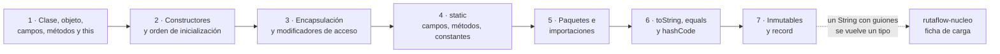
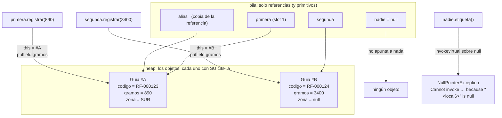
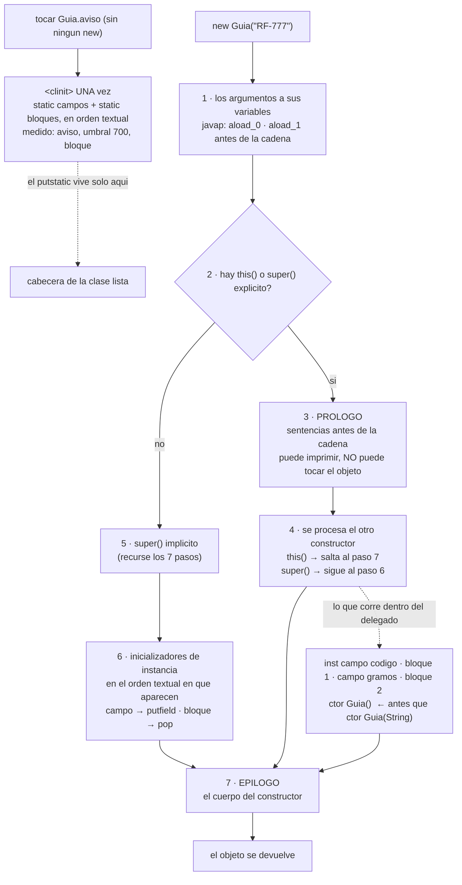
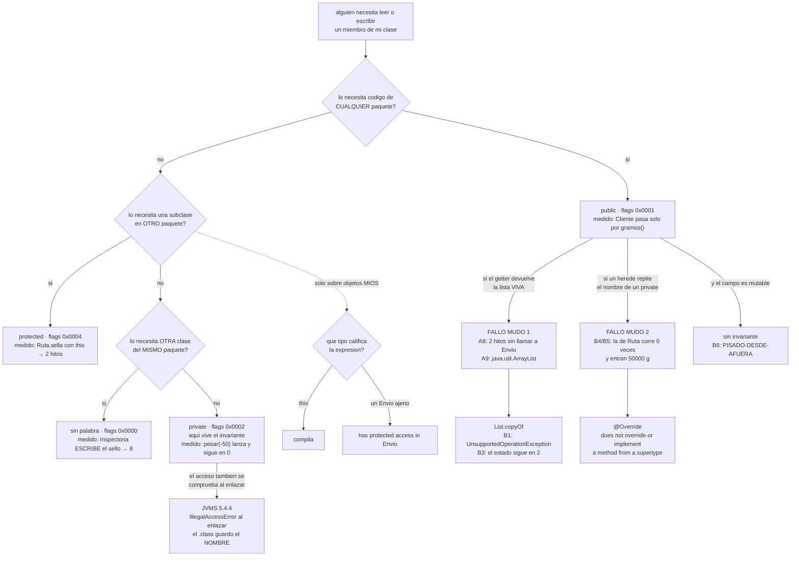

# Módulo 5 · Objetos y clases

> Curso Java (JDK 25) · tramo **Fundamentos** · 7 temas · formato único (specs/021). Portada del curso:
> [CURSO.md](CURSO.md). Todo el código de este módulo se compiló con `javac --release 25` y se ejecutó con
> `java -Dstdout.encoding=UTF-8` sobre OpenJDK Temurin 27.0.1.0.2+1 (macOS, arm64), locale `es_CO`, el
> 2026-11-21. Las salidas están pegadas tal cual.
> **Aviso de proveniencia:** en esta máquina no hay JDK 25 instalado, así que el *API* es la de la versión 25
> (la que comprueba `--release 25`) pero el *ejecutable* es el 27. Ningún tema de este módulo usa funciones
> *preview*; lo que puede diferir entre los dos ejecutables está marcado en cada tema como «pendiente de
> reejecución en JDK 25», y aquí eso es casi siempre el **texto** de una excepción o de un mensaje de `javac`
> —que los redacta la herramienta— y nunca la regla de lenguaje que se enseña. Las citas de la JLS y de la JVMS de
> este módulo se verificaron contra la especificación **Java SE 25** que Oracle sirve hoy como
> «Specifications Latest» (páginas con `dateModified` 2026-09-15; el propio capítulo 12 remite a _The Java
> Virtual Machine Specification, Java SE 25 Edition_): §4.12.5, §6.6, §6.6.1, §6.6.2, §6.6.2.1 (con su
> Ejemplo 6.6.2-1), §7.6, §8.1, §8.1.1.4, §8.2, §8.3, §8.3.2, §8.3.3, §8.4, §8.4.3.2, §8.4.8.1, §8.4.8.3, §8.6,
> §8.7, §8.8, §8.8.7, §8.8.7.1, §8.8.8, §8.8.9, §8.8.10, §12.4.1, §12.4.2, §12.5, §15.8.3, §15.21.3 y el
> capítulo 16 (§16.9); JVMS §2.6.1, §2.9.1, §2.9.2, §4.7.28, §4.7.29, §4.10.1.8, §5.4.3 y §5.4.4.
> **Estado de escritura:** tema 3 de 7. Los temas 4 a 7 están previstos y aún no escritos; el laboratorio tiene
> su puerta para los tres temas escritos (**140 comprobaciones, 0 fallidas, 0 omitidas**: 41 del tema 1, 48 del
> tema 2 y 51 del tema 3), y esta portada no declara horas del módulo completo hasta que los siete estén medidos.

## Cabecera del módulo

| | |
|---|---|
| **Objetivo** | Pasar de «datos sueltos en arreglos» a **un tipo propio**: declarar una clase cuyos campos son su estado y cuyos métodos reciben el objeto como primer argumento, entender que `new` crea un objeto y la variable solo lo señala, seguir el `this` hasta el bytecode, saber **en qué orden** se le llenan las casillas —los siete pasos de §12.5, dónde caen los inicializadores y por qué `this(...)` se salta los propios—, y dominar las tres cosas que más programas rompen: que asignar copie la **referencia** (no el objeto), que `null` sea un valor de referencia y no «un objeto vacío», y que el nivel de acceso es la única barrera que se comprueba sola —un getter que devuelve la lista viva anula tu invariante con el compilador callado, y un método que repite el nombre de un `private` del padre no se ejecuta **nunca**—. |
| **Prerrequisitos** | [Módulo 4](modulo-4.md) completo —en especial su tema 1 (`new Punto[2]` deja casillas `null`: aquí eso mismo pasa con objetos que no son arreglos) y su tema 4 (`ArrayList`/`HashMap`, porque el siguiente paso natural es una lista de objetos)— y [Módulo 3](modulo-3.md) completo, sobre todo su tema 4: **al método se le copia la referencia, no el contenido**; esa regla es la que aquí se ve funcionando dentro de un objeto. Del [Módulo 0](modulo-0.md) se sigue usando `javap -c -p`. |
| **Duración** | Escrito: 120 min (temas 1, 2 y 3, 40 min cada uno). Previstos 7 temas de 40 min · **4 h 40 min** según el temario, cifra que se fija con las cabeceras cuando el módulo esté completo. |
| **Versiones** | JDK 25 (`--release 25`). Nada de este módulo depende de una función *preview*. Cuatro cosas que sí dependen del ejecutable y se tratan como tales: el **texto** del `NullPointerException` con mensajes útiles (lo redacta la JVM 27; el fenómeno es de 14+), el **número** que devuelve `System.identityHashCode` (medido: cambia con `-XX:hashCode=` y no es una cifra del lenguaje), el **número de instrucciones** de cada `<init>` que publica el tema 2 (11 / 6 / 7 con cadena, 11 / 14 / 17 sin ella) —es política del generador de código de `javac`, no regla del lenguaje; lo que §12.5 paso 4 sí exige es el **reparto** de los inicializadores (2 / 0 / 0 frente a 2 / 2 / 2)—, y lo del tema 3: el mismo fuente sale con **`invokespecial`** al llamarse un `private` desde su clase compilando `--release 8` y con **`invokevirtual`** de 11 a 25 (medido release a release), el puente `access$000` solo aparece en el 8, y el nombre interno `ImmutableCollections$List12` que imprime `B2` depende del tamaño de la lista y de la JDK. En los tres casos del tema 3 lo que se enseña es la **regla** (§6.6.2.1, §8.2, §5.4.4 y el rechazo `UnsupportedOperationException`), no el detalle del volcado. |
| **Laboratorio** | [`laboratorios/modulo-5/`](laboratorios/modulo-5/README.md) (al publicar: `examples/java/modulo-5/`), con `verificar.sh`: **140 comprobaciones, 0 fallidas, 0 omitidas** ejecutadas aquí (41 del tema 1, 48 del tema 2 y 51 del tema 3). |
| **Proyecto guía** | `rutaflow-nucleo`: la **ficha de carga**. En M4 una guía era un `String` con guiones que se partía con `split`; aquí pasa a ser un objeto `Guia` con `codigo`, `gramos` y `zona`, su método `etiqueta()` y su constructor. Cada tema cierra una parte: la clase y su receptor (T1), cómo se construye y en qué orden (T2), qué se puede tocar desde fuera (T3), qué pertenece a la clase y no al objeto (T4), dónde vive el archivo (T5), cómo se compara e imprime (T6) y cómo se hace inmutable (T7). |

### Mapa del módulo



**Texto alternativo:** el módulo entero es un cambio de notación. Mientras los datos son `int[]` y `String[]`,
el programa habla de posiciones; cuando declaras `class Guia`, el programa habla de **cosas**. El tema 1 da el
molde y el receptor (`this`). El tema 2 explica cómo nace un objeto y en qué orden se le llenan los campos, que
es donde aparecen los bugs de «uso antes de construir». El tema 3 decide qué se ve desde fuera, y por qué un
getter no es un campo. El tema 4 separa lo que pertenece a la clase de lo que pertenece al objeto. El tema 5
pone el archivo en un paquete y ordena las importaciones. El tema 6 es el contrato de `Object`: sin `equals` y
`hashCode` tus objetos se comparan por identidad y se imprimen con un hash. El tema 7 cierra con el objeto que
no cambia —a mano y con `record`—.

**Convención del módulo.** Igual que en M4: lo que afirma el lenguaje se comprueba con `javap` sobre el
`.class` generado con `--release 25`; lo que afirma el programa se comprueba ejecutándolo y pegando su salida;
y las fronteras se miden en las dos direcciones. Hay tres familias de datos que **no** se citan como si
fueran del lenguaje y por eso se tratan así: el **número** de `System.identityHashCode` (solo se comprueba el
invariante: dos objetos distintos pueden dar el mismo número, y cambiar la estrategia de la JVM cambia los
números), el **texto** de los mensajes de `javac` y de la JVM (se citan literalmente porque así los emite la
herramienta que usamos, pero se marcan como pendientes de reejecución en 25), y cualquier **dirección o hash**
que salga del `toString` por defecto de un objeto (aquello de `Guia@1b6d3586` lleva hash de identidad; el tema
6 lo sustituye por `toString`). Ninguna comprobación de este módulo depende del valor absoluto de un hash ni
del nombre del frame que aparece en un mensaje de `NullPointerException`.

---

### Tema 1: Clases, objetos, campos, métodos y `this` · Básico · 40 min

#### 1. Ubicación y prerrequisitos

Curso Java · tramo Fundamentos · módulo 5 · primer tema. Antes: [Módulo 4 · tema 1](modulo-4.md) (crear un
arreglo de objetos: `new Guia[3]` son tres casillas `null`, y aquí verás por qué), [Módulo 4 · tema 4](modulo-4.md)
(`ArrayList` y `HashMap`, donde ya metiste `String` e `Integer` y ahora meterás tus propios objetos),
[Módulo 3 · tema 4](modulo-3.md) (parámetros, retorno y sobrecarga: al método llega una **copia de la
referencia**, medido allí) y [Módulo 3 · tema 5](modulo-3.md) (la pila de llamadas: el «marco» del que sale la
ranura 0 donde vive `this`). Del [Módulo 0](modulo-0.md): su tema 3 para `javap`, su tema 4 porque ya decidió
que `main` es `static` y su tema 5 para el lanzador de archivo fuente. No se necesita ninguna biblioteca: el
tema entero cabe en un archivo. Fuentes: JLS §8.1 (declaración de clase), §8.2 (miembros), §8.3 (campos), §8.4
(métodos), §4.12.5 (valores por defecto), §15.8.3 (`this`), §15.21.3 (`==` entre referencias), §16 (la variable
local sí exige asignación previa), CJ1 capítulo 4, OCP capítulo 3, JEP 358 (el mensaje del `NPE`).

#### 2. Objetivo

**Al terminar serás capaz de:** declarar una clase con campos y métodos y decir, sin ejecutar nada, cuánto
vale cada campo de un objeto recién creado (`0` para `int`, `null` para `String`) y por qué una variable local
sin asignar **no compila** mientras ese campo sí. Escribir un método de instancia y saber qué objeto es `this`
en cada una de sus llamadas, incluidas las dos formas en que `this` se puede perder: desde un `static` y sobre
`null`. Predecir qué ve un objeto cuando otro nombre cambia uno de sus campos, y distinguir «mismos campos» de
«mismo objeto». Y, si abres el `.class`, señalar en el volcado la instrucción que lee el campo y la que lo
escribe, y decir en qué ranura está el receptor.

#### 3. Por qué importa

Hasta el módulo 4 tus datos viajaban en posiciones: `gramos[i]`, `zonas[i]`. Eso funciona mientras **todo** el
programa recuerde que la casilla 0 de un arreglo pertenece con la casilla 0 de otro. En cuanto el programa pasa
de un tamaño, la correspondencia se rompe en silencio y el fallo aparece como un número mal sumado, no como un
error. La clase convierte esa convención en un tipo: `Guia` lleva su peso **pegado** a su código, y si te
equivocas de objeto no obtienes un número raro —obtienes un error de compilación o un `NullPointerException`
que dice el método.

Y hay una segunda razón, más incómoda: casi todo el Java que vas a leer es esto. Un `record` (tema 7), una
interfaz con implementación (M6), un `enum` (M6) o una entidad de JPA (tramo Aplicación) son un caso particular
de lo que se declara aquí. La parte que la gente aprende «por arriba» —que `this` es el objeto receptor, que
asignar copia la referencia y no el objeto, que un campo `static` no es de cada objeto— es exactamente la parte
que produce los bugs de alias y de estado compartido que luego nadie explica.

Medido en `errores/ThisDesdeStatic.java`: escribir `this` donde no hay objeto no es un estilo desaconsejado, es
un error que `javac` rechaza con `non-static variable this cannot be referenced from a static context`. Medido
en `errores/LocalSinValor.java`: el campo `static int campo` sin inicializar vale `0` y compila; la variable
local `int local` sin inicializar **no compila**. Es la diferencia entre el estado de un objeto, que siempre
está inicializado, y una ranura de un marco de pila, que no existe hasta que le escribes.

#### 4. Analogía

Un **expediente de guía en la bodega**. La clase es el *formato* del expediente: dice qué casillas tiene
(código, peso, zona) y qué se puede hacer con él (registrar un peso, imprimir la etiqueta). El objeto es **un
expediente concreto**, con su folio. `new Guia("RF-000123")` es pedir un folio nuevo y escribirle el código: las
demás casillas quedan **en blanco**, no en cero ni en `""` —en blanco quiere decir `null` para las de texto y
`0` para las numéricas, porque el formulario está impreso pero nadie las ha rellenado.

Ahora la parte que la analogía deja ver bien: de un mismo expediente caben **muchas fotocopias de la carpeta,
pero un solo expediente**. `Guia alias = primera` no fotocopia el expediente: saca otra etiqueta con el mismo
folio. Si quien tiene la etiqueta nueva escribe 890 en la casilla del peso, el expediente **ya está** en 890 y
el primer nombre lo muestra —medido: `por la primera      : 890 (lo cambio quien se llama distinto)`. Y `null`
no es «un expediente en blanco»: es **no tener ninguna etiqueta**. Por eso `nadie.etiqueta()` no devuelve la
etiqueta vacía, sino que revienta —medido: `Cannot invoke "ClaseYObjetos$Guia.etiqueta()" because "<local6>" is null`.

Lo que la analogía traiciona: un expediente físico no puede tener dos pesos; dos objetos sí, y el que cambia uno
no entera al otro (medido: la segunda guía sigue en `3400` mientras la primera ya va en `890`). Los objetos no
comparten casillas: comparten, si acaso, referencias.

#### 5. Diagrama



**Texto alternativo:** la pila guarda nombres y referencias; el heap guarda objetos con sus campos. `primera` y
`alias` apuntan al **mismo** objeto `#A` —medido: `alias misma identidad: true`—, así que una escritura vista
por `alias` (`putfield gramos`) se lee por `primera`. `segunda` es otro objeto `#B` y no se entera. `nadie` no
apunta a un objeto con las casillas vacías: vale `null`, y llamar un método de instancia sobre `null` lanza al
evaluar el receptor. El mismo método, llamado sobre dos objetos distintos, recibe dos `this` distintos: eso es
lo que significa «método de instancia».

#### 6. Explicación

**Nivel 0 — una clase es un tipo nuevo, y `new` crea un objeto con sus campos ya inicializados.**

El archivo `tema-1/ClaseYObjetos.java` declara, dentro de la clase del `main`, una segunda clase:

```java
static class Guia {
    String codigo;   // campo de referencia: valor por defecto null
    int gramos;      // campo primitivo: valor por defecto 0
    String zona;     // sin asignar: el objeto sigue siendo legal
}
```

Tres cosas ocurren con eso. Uno: `Guia` es un tipo, igual que `int` o `String`, y se usa en declaraciones,
parámetros y retornos. Dos: los campos **no son** de la clase, son de cada objeto; `new Guia(...)` reparte
casillas. Tres: esas casillas no están «indeterminadas», tienen el valor por defecto del tipo (JLS §4.12.5:
`0` para numéricos, `false` para `boolean`, `\u0000` para `char`, `null` para referencias). Medido, recién
creado el objeto y antes de escribir en ninguna casilla:

```text
recien creada       : RF-000123 · 0 g · null · yo soy 498931366
```

`0 g` es `gramos` en su valor por defecto; `null` es `zona`, que nadie tocó. Es la misma regla que la del
`String[3]` del módulo 4: una casilla de referencias nace `null`, no nace `""`.

Lo que **no** pasa con las variables locales. `errores/LocalSinValor.java` declara `static int campo;` y una
local `int local;` sin asignar. El campo vale `0` y se puede imprimir; la local produce, medido:

```text
errores/LocalSinValor.java:9: error: variable local might not have been initialized
```

El compilador no te está siendo quisquilloso: los campos tienen un contrato de inicialización garantizado por la
creación del objeto (JLS §12.5), y las locales no. Por eso Java puede prometer «el campo siempre tiene un valor»
y no puede prometer «la variable siempre tiene un valor».

**Nivel 1 — `this` es el receptor: un parámetro que Java te pasa sin que lo escribas.**

`primera.registrar(1250)` y `segunda.registrar(3400)` llaman al **mismo** cuerpo de método. Lo que cambia es el
objeto que viaja delante de los argumentos: `this`. Por eso un método de instancia puede decir «mi peso» sin
saber de qué objeto se trata. Medido en la misma corrida, los dos objetos con su casilla propia:

```text
primera tras 1250: RF-000123 · 1250 g · null · yo soy 498931366
segunda tras 3400: RF-000124 · 3400 g · null · yo soy 414493378
```

Y hay una razón para escribir `this` explícitamente, no estética. Dentro del constructor

```java
Guia(String codigo) {
    this.codigo = codigo;
}
```

el parámetro se llama igual que el campo. Sin `this.`, `codigo = codigo` asigna el parámetro **contra sí mismo**
y el campo sigue en `null`, porque el nombre local oculta al campo (JLS §6.4.1, *Shadowing*). Medido en
`tema-1/SombraDeCampo.java`, que tiene los dos constructores uno al lado del otro:

```text
campo con el parametro tapando : null
campo con this.                : RF-000123
```

Y es un bug **sin aviso**: el mismo archivo compilado con `javac --release 25 -Xlint:all` no emite ni una
advertencia (medido: salida vacía). El `this` ahí no es decoración: es lo que separa «la casilla del objeto» de
«la variable del método».

`this` además **es** una referencia, así que se puede devolver y comparar. Medido:

```text
conZona devuelve el mismo objeto: true · y se queda con SUR
```

donde `conZona` hace `this.zona = nuevaZona; return this;`. Eso es lo que permite la cadena
`g.conZona("NORTE").registrar(1250)`, que verás en estilo de API por todo el curso. Lo importante no es la
cadena: es que **no hubo copia**. Se mutó el mismo objeto y se devolvió el mismo objeto.

Y lo contrario, medido como error de compilación en `errores/ThisDesdeStatic.java` (línea 7) y
`errores/MetodoSinObjeto.java` (línea 14):

```text
error: non-static variable this cannot be referenced from a static context
error: non-static method etiqueta() cannot be referenced from a static context
```

Los dos mensajes dicen lo mismo con otras palabras: un método `static` no recibe receptor, así que no tiene
`this` ni campos de objeto que leer (JLS §8.4.3.2). `main` es `static`; por eso todo lo que haces en `main` pasa
por `new` y un nombre de variable.

**Nivel 2 — referencia y objeto no son lo mismo, y eso tiene tres consecuencias.**

1. **Asignar copia la referencia, no el objeto.** `Guia alias = primera;` pone dos nombres sobre el mismo
   expediente. Medido: `alias misma identidad: true` (`==` entre referencias compara si son el mismo objeto,
   JLS §15.21.3), y después `alias.registrar(890)` deja `por la primera      : 890`. El puente con M3 · tema 4 es
   exacto: lo mismo que le pasaba a un arreglo en un parámetro le pasa a un objeto en un campo, en un retorno y
   en una variable.
2. **Campos iguales no hacen objetos iguales.** Dos guías creadas con el mismo código son dos objetos. Medido:
   `campos iguales       : mismo codigo true · misma referencia false · son dos objetos`, y otra vez en
   `SombraDeCampo.java` con dos objetos de la misma clase: `dos Bien con el mismo codigo   : false`. Esta línea
   es el anticipo del tema 6: hoy Java solo sabe comparar referencias con `==`; `equals` es lo que **tú**
   defines, y hasta definirlo dos objetos con los mismos datos no son «el mismo». Y un extra que conviene saber
   antes de escribir nada: `==` entre referencias exige que los tipos se puedan convertir el uno en el otro por
   cast (§15.21.3), así que comparar dos clases sin parentesco **no compila**. Medido en
   `errores/ComparaTiposDistintos.java`: `incomparable types: Mal and Bien`. Comparar con `Object` sí se puede
   (medido: `contra Object si se puede      : false`). El lenguaje te deja preguntar «¿es el mismo objeto?» entre
   tipos compatibles y te cierra el paso cuando la pregunta no tiene sentido.
3. **`null` es un valor de referencia, no un objeto vacío.** Medido: `null no es un objeto sin datos, es
   ninguna referencia: true` —lo que se compara es el valor de la variable contra el literal `null`, y dos `null`
   entre sí dan `true` porque no hay objeto que distinguir— y, acto seguido, `llamar sobre null   : Cannot
   invoke "ClaseYObjetos$Guia.etiqueta()" because "<local6>" is null`. El mensaje con detalles es el JEP 358,
   dirigido a JDK 14; en este ejecutable viene activo sin opción ninguna (medido: no pasamos ningún `-XX`). En
   esta corrida el nombre del local sale como ranura (`<local6>`) porque compilé sin tabla de depuración.
   Recompilado con `-g` (medido): `because "nadie" is null`. La regla que enseño es la misma en los dos casos,
   pero no finjo que el texto sea idéntico en cualquier compilación.

**Nivel 3 — lo que ve la JVM: el receptor va en la ranura 0 y el campo se lee con `getfield`.**

`tema-1/por-dentro/CamposEnBytecode.java` declara `Punto` con dos métodos que difieren solo en escribir `this.`
en el fuente. Volcado con `javap -c -p` (las instrucciones están tal cual salen):

```text
  int conThis();
    Code:
         0: aload_0
         1: getfield      #7                  // Field x:I
         4: ireturn

  int sinThis();
    Code:
         0: aload_0
         1: getfield      #7                  // Field x:I
         4: ireturn
```

Cuerpo a cuerpo son **la misma secuencia** —el laboratorio lo comprueba comparando las dos, no lo afirma de palabra—: `this`
no cuesta una instrucción, porque no es una cosa que se consulta, es la ranura 0 del marco. Lo mismo para
escribir:

```text
  void mover(int, int);
    Code:
         0: aload_0
         1: aload_0
         2: getfield      #7                  // Field x:I
         5: iload_1
         6: iadd
         7: putfield      #7                  // Field x:I
        10: aload_0
        11: aload_0
        12: getfield      #13                 // Field y:I
        15: iload_2
        16: iadd
        17: putfield      #13                 // Field y:I
        20: return
```

Leído ranura a ranura: la 0 es el receptor (`this`, el objeto al que se le mueve el punto), la 1 es `dx` y la 2
es `dy` —los dos parámetros, desplazados porque la 0 ya está ocupada—; `x` se lee con `getfield` sobre la
referencia de la ranura 0 y se escribe con `putfield` sobre **esa misma referencia** (dos `aload_0` seguidos: uno
alimenta la lectura y otro el destino), y `y` hace lo propio con `#13`.

De ahí salen dos reglas que la gente confunde con las que no. En un método de instancia, `aload_0` es **el
objeto** y los parámetros empiezan en `iload_1`; en un método `static` la ranura 0 ya es el primer parámetro, y
por eso no puede existir `this` (nivel 1) —la prohibición del compilador y la geometría del marco son la misma
cosa vista de dos lados.

Crear el objeto, medido en `Punto.cero()` y en `main`:

```text
  static CamposEnBytecode$Punto cero();
    Code:
         0: new           #8                  // class CamposEnBytecode$Punto
         3: dup
         4: invokespecial #16                 // Method "<init>":()V
         7: areturn
```

Tres pasos seguidos: `new` reserva y pone la referencia en la pila, `dup` la duplica (una la consume el
constructor, la otra es el valor de la expresión), `invokespecial` llama al constructor **con** esa referencia.
Y el constructor propio de `Punto` no hace más que encadenar hacia arriba, medido:

```text
  CamposEnBytecode$Punto();
    Code:
         0: aload_0
         1: invokespecial #1                  // Method java/lang/Object."<init>":()V
         4: return
```

Nadie escribe `x = 0` en el bytecode del constructor de `Punto` **porque sus campos no tienen inicializador
explícito**: el cero viene de la preparación del objeto (JLS §12.5: asignar memoria e inicializar los campos a
su valor por defecto ocurre antes del cuerpo del constructor). Un campo con `= 1250` sí aparecería en `<init>`,
y eso es justo el tema 2.

Cómo se ve la llamada desde fuera, medido en `main` de `CamposEnBytecode`:

```text
  public static void main(java.lang.String[]);
    Code:
         0: new           #7                  // class CamposEnBytecode$Punto
         3: dup
         4: invokespecial #9                  // Method CamposEnBytecode$Punto."<init>":()V
         7: astore_1
         8: aload_1
         9: iconst_3
        10: iconst_4
        11: invokevirtual #10                 // Method CamposEnBytecode$Punto.mover:(II)V
        ...
        36: invokestatic  #37                 // Method CamposEnBytecode$Punto.cero:()LCamposEnBytecode$Punto;
        39: getfield      #41                 // Field CamposEnBytecode$Punto.x:I
```

`mover` se llama con `invokevirtual` (hay receptor: `aload_1` pone el objeto en la pila **antes** de los dos
`int`) y `cero()` con `invokestatic` (no hay receptor: se llama por el nombre de la clase). El descriptor
`(II)V` es la firma que ya viste en M0: dos `int`, devuelve `void`. Y fíjate en `astore_1` a la altura 7: dentro
de un método `static`, la ranura 0 es el primer parámetro (`args`), así que el punto nuevo se guarda en la 1.
Esa es la misma geometría que arriba impedía `this`.

Y el puente con el módulo 4, medido en la salida del mismo programa:

```text
conThis/sinThis    : 3 / 3 · mismo resultado
creado dentro      : 0 (valor por defecto, nadie escribio)
arreglo de Punto   : casilla 0 sin crear es null? true · tras crearla, no: true
```

`new Punto[2]` en bytecode es `anewarray` y **no** construye dos `Punto`: construye dos `null` (en el volcado de
`main` se ve el `aaload` seguido de un `ifnonnull` que es literalmente la comprobación que acabas de imprimir).
Eso explica por qué el módulo 4 te dejaba sumar `0` de un arreglo de `int` pero te reventaba con un arreglo de
`String` al llamar `.length()`.

Por último, la clase anidada. `ClaseYObjetos.java` es **un archivo** y produce **dos** `.class`, medido con
`javac --release 25 -d out ClaseYObjetos.java && ls out`:

```text
ClaseYObjetos$Guia.class
ClaseYObjetos.class
```

El `$` es el nombre binario (JLS §13.1); es lo que estabas leyendo en el mensaje de `NullPointerException` de
nivel 2: `Cannot invoke "ClaseYObjetos$Guia.etiqueta()"`. Y `javap -p` de la anidada, medido:

```text
class ClaseYObjetos$Guia {
  java.lang.String codigo;
  int gramos;
  java.lang.String zona;
  ClaseYObjetos$Guia(java.lang.String);
  java.lang.String etiqueta();
  void registrar(int);
  ClaseYObjetos$Guia conZona(java.lang.String);
}
```

Ningún miembro lleva modificador de acceso: todos quedaron con acceso de paquete (tema 3). La clase exterior
usa `g.codigo` sin problema, y en `javap -v -p` de la exterior aparece el atributo `NestMembers:
ClaseYObjetos$Guia`, con **cero** métodos sintéticos `access$`. Eso es lo que hace la regla «dentro del mismo
`class` se ven los `private`» (JLS §6.6.1) sin pagar el precio de los accessors que Java pagaba antes de la
11. Aquí solo hace falta saber que `static class` = clase anidada que no recibe un objeto exterior (JLS
§8.1.1.4); para este tema la uso porque mantiene el ejemplo en un archivo y se puede ejecutar con el lanzador de
fuente.

Sobre el archivo en sí, medido en `errores/DosPublicasEnUnArchivo.java`:

```text
errores/DosPublicasEnUnArchivo.java:6: error: class Guia is public, should be declared in a file named Guia.java
```

Un archivo fuente admite varias clases, pero **una** `public` y con el nombre del archivo (JLS §7.6). Ese error
lo vas a ver escrito mal cien veces en foros; la regla no es «no se puede», es «no dos `public`».

#### 7. Código ejecutable

**Ejemplo mínimo** · archivo `tema-1/ClaseYObjetos.java` · ejecuta
`javac --release 25 -d out tema-1/ClaseYObjetos.java && java -Dstdout.encoding=UTF-8 -cp out ClaseYObjetos`

```java
public class ClaseYObjetos {

    static class Guia {
        String codigo;          // campo de referencia: su valor por defecto es null
        int gramos;             // campo primitivo: su valor por defecto es 0
        String zona;            // se puede dejar sin asignar y el objeto sigue siendo legal

        Guia(String codigo) {   // el parametro se llama igual que el campo: aqui `this` no es opcional
            this.codigo = codigo;
        }

        String etiqueta() {
            return codigo + " · " + gramos + " g · " + zona + " · yo soy " + System.identityHashCode(this);
        }

        void registrar(int peso) {
            this.gramos = peso;
        }

        Guia conZona(String nuevaZona) {
            this.zona = nuevaZona;
            return this;        // devuelve el mismo objeto, no una copia
        }
    }

    static void muestra(String que, Guia g) {
        System.out.println(que + g.etiqueta());
    }

    public static void main(String[] args) {
        Guia primera = new Guia("RF-000123");
        System.out.println("recien creada       : " + primera.etiqueta());

        Guia segunda = new Guia("RF-000124");
        System.out.println("dos objetos         : primera " + System.identityHashCode(primera)
                + " · segunda " + System.identityHashCode(segunda)
                + " · referencia distinta? " + (primera != segunda));

        primera.registrar(1250);
        segunda.registrar(3400);
        muestra("primera tras 1250: ", primera);
        muestra("segunda tras 3400: ", segunda);

        Guia alias = primera;                             // copia la REFERENCIA, no el objeto
        System.out.println("alias misma identidad: " + (alias == primera));
        alias.registrar(890);
        System.out.println("por la primera      : " + primera.gramos + " (lo cambio quien se llama distinto)");

        primera.conZona("NORTE");
        System.out.println("conZona devuelve el mismo objeto: " + (primera.conZona("SUR") == primera)
                + " · y se queda con " + primera.zona);

        Guia g1 = new Guia("RF-000123");
        Guia g2 = new Guia("RF-000123");
        System.out.println("campos iguales       : mismo codigo " + g1.codigo.equals(g2.codigo)
                + " · misma referencia " + (g1 == g2) + " · son dos objetos");

        Guia nadie = null;
        System.out.println("null no es un objeto sin datos, es ninguna referencia: " + (nadie == null));
        try {
            nadie.etiqueta();
        } catch (NullPointerException e) {
            System.out.println("llamar sobre null   : " + e.getMessage());
        }
    }
}
```

Salida medida (Temurin 27.0.1.0.2+1, `--release 25`, sin `-g`):

```text
recien creada       : RF-000123 · 0 g · null · yo soy 498931366
dos objetos         : primera 498931366 · segunda 414493378 · referencia distinta? true
primera tras 1250: RF-000123 · 1250 g · null · yo soy 498931366
segunda tras 3400: RF-000124 · 3400 g · null · yo soy 414493378
alias misma identidad: true
por la primera      : 890 (lo cambio quien se llama distinto)
conZona devuelve el mismo objeto: true · y se queda con SUR
campos iguales       : mismo codigo true · misma referencia false · son dos objetos
null no es un objeto sin datos, es ninguna referencia: true
llamar sobre null   : Cannot invoke "ClaseYObjetos$Guia.etiqueta()" because "<local6>" is null
```

Los dos números de las dos primeras líneas son los que devolvió **esta** JVM: repetido cinco veces seguidas dio
igual, y forzando la estrategia con `-XX:hashCode=2` los dos se vuelven `1`. Se pegan porque son la salida real,
no porque sean una propiedad del objeto; lo que se enseña es el `true` de `referencia distinta?`, que sí lo es.

**Segundo ejemplo** · `tema-1/por-dentro/CamposEnBytecode.java` · ejecuta
`javac --release 25 -d out tema-1/por-dentro/CamposEnBytecode.java && java -Dstdout.encoding=UTF-8 -cp out CamposEnBytecode`
y después `javap -c -p -cp out 'CamposEnBytecode$Punto'`. Su salida son las tres líneas del nivel 3
(`conThis/sinThis : 3 / 3`, `creado dentro : 0`, `arreglo de Punto : casilla 0 sin crear es null? true · tras
crearla, no: true`) y los volcados pegados arriba.

**Tercer ejemplo** · `tema-1/SombraDeCampo.java` · ejecuta
`javac --release 25 -Xlint:all -d out tema-1/SombraDeCampo.java && java -Dstdout.encoding=UTF-8 -cp out SombraDeCampo`.
Son dos clases con el mismo campo y el mismo parámetro, una con `codigo = codigo` y otra con `this.codigo =
codigo`. Salida medida:

```text
campo con el parametro tapando : null
campo con this.                : RF-000123
dos Bien con el mismo codigo   : false
contra Object si se puede      : false
```

`javac` no emite ninguna advertencia con `-Xlint:all` (medido: salida vacía tras compilar). Es el ejemplo más
importante del tema porque no se ve: el bug está en una línea que parece escrita.

**Los cinco errores** · `tema-1/errores/` son para que los provoques tú:
`ThisDesdeStatic.java`, `MetodoSinObjeto.java`, `LocalSinValor.java`, `DosPublicasEnUnArchivo.java` y
`ComparaTiposDistintos.java`. Ninguno compila, y los cinco mensajes están citados en los niveles 0, 1, 2 y 3.

#### 8. Mini-laboratorio

Escribe los archivos desde cero en `laboratorios/modulo-5/tema-1/` (no copies y pegues: el ejercicio es predecir
y comprobar).

1. Crea `MiGuia.java` con una clase `static class Ficha` dentro de `MiGuia`, con tres campos sin inicializar:
   `String codigo; int gramos; char estado;`. En `main`, crea un objeto y **sin escribir en ningún campo**
   imprime los tres separados por ` | `, después su `getClass().getName()`. Escribe en un comentario qué esperas
   ver antes de ejecutar. Ejecuta: si el comentario decía `null | 0 | ` con espacio, está mal; `char` por defecto
   es `\u0000`, que se imprime como nada y engaña. Cuenta con `ls out` cuántos `.class` produjo un solo `.java`
   y anota por qué hay dos.
2. En el mismo archivo, declara `Ficha a = new Ficha();` y `Ficha b = a;`. Escribe `a.gramos = 1250;` e imprime
   `b.gramos`. Predícelo en un comentario. Después añade `Ficha c = new Ficha(); c.gramos = 1250;` e imprime en
   tres líneas `a == b`, `a == c`, `a.gramos == c.gramos`. Esas tres respuestas juntas son el nivel 2 del tema:
   si no las predijiste bien, vuelve a él.
3. Añade a `Ficha` un constructor `Ficha(String codigo) { codigo = codigo; }` y crea un objeto con él. Imprime el
   campo. Escribe la predicción **antes** de ejecutar, compila con `-Xlint:all` y mira si el compilador dice
   algo. Corrige el constructor con `this.` y vuelve a ejecutar. Los dos mensajes que no llegaron (el de `javac`
   vacío y el `null` en pantalla) son la lección.
4. Crea `OrdenDeSlots.java` con `static class Suma { int total; void subir(int n, int paso) { this.total = this.total + n + paso; } }`.
   Ejecuta `javac -d out OrdenDeSlots.java`, luego `javap -c -p -cp out 'OrdenDeSlots$Suma'`. En un comentario,
   escribe el número de la ranura que usa cada uno de los tres `int` del método (receptor, `n`, `paso`) **antes**
   de mirar el volcado, y después compruébalo. Si escribiste `iload_0` para `n`, lo que te falta es saber quién
   ocupa la 0.
5. Crea `SinReceptor.java` con un método de instancia `String etiqueta()` en una clase anidada y llama
   `System.out.println(MiClase.etiqueta());` desde `main`. Guarda el mensaje exacto de `javac`. Cambia la llamada
   a `System.out.println(new MiClase().etiqueta());`. Ejecuta el primero con el lanzador de fuente para ver el
   fallo otra vez. Ahora, en un comentario, responde con tus palabras qué es lo que **no** existe en el primer
   caso (pista: es la misma palabra que la JVM usa en su mensaje: *static context*).
6. Crea `Nulo.java` con `Ficha nadie = null;` y dos llamadas: `System.out.println(nadie == null);` y
   `nadie.etiqueta();`. Ejecuta y copia el mensaje completo del `NullPointerException`, incluido lo que va
   después de `because`. Vuelve a compilar con `javac -g -d outg Nulo.java` y ejecuta con `-cp outg`: copia ese
   segundo mensaje. Anota la diferencia y qué la produce.

**Listo cuando** puedas decir, sin ejecutar, los valores por defecto de `Ficha` con un campo `double`, uno
`boolean` y uno `Thread` (`0.0`, `false`, `null`); cuando el paso 2 te dé `true`, `false`, `true` sin titubear;
y cuando sepas explicar por qué la respuesta `a.gramos == c.gramos` siendo `true` **no** convierte a `a` y `c`
en el mismo objeto (esa es la pregunta del tema 6).

#### 9. Verificación

```bash
cd docs/reestructuracion/cursos/java/laboratorios/modulo-5
javac --release 25 -encoding UTF-8 -d out tema-1/*.java
java -Dstdout.encoding=UTF-8 -cp out ClaseYObjetos       # «recien creada : RF-000123 · 0 g · null» y «alias misma identidad: true»
javac --release 25 -Xlint:all -d outs tema-1/SombraDeCampo.java   # -Xlint:all no dice nada: salida vacia, medido
java -Dstdout.encoding=UTF-8 -cp outs SombraDeCampo      # «campo con el parametro tapando : null» frente a «this. : RF-000123»
java -Dstdout.encoding=UTF-8 -cp out CamposEnBytecode    # «conThis/sinThis : 3 / 3» y «casilla 0 sin crear es null? true»
javap -c -p -cp out 'CamposEnBytecode$Punto'              # aload_0 · getfield · putfield · iload_1
javac --release 25 -g -d outg tema-1/ClaseYObjetos.java   # el NPE pasa a decir because "nadie" is null
java -XX:+UnlockExperimentalVMOptions -XX:hashCode=2 -cp out ClaseYObjetos   # los dos numeros salen iguales
ls out                                                    # dos .class: ClaseYObjetos.class y ClaseYObjetos$Guia.class
javap -p -cp out 'ClaseYObjetos$Guia'                     # codigo, gramos, zona: sin modificador = acceso de paquete
javac -d /tmp/m5e tema-1/errores/ThisDesdeStatic.java     # non-static variable this cannot be referenced…
javac -d /tmp/m5e tema-1/errores/LocalSinValor.java       # variable local might not have been initialized
```

O, todo el laboratorio del módulo de una vez: `./verificar.sh`. Aquí esas **41** comprobaciones del tema pasan
con Temurin 27 y `--release 25`; con JDK 25 en el `PATH` basta `./verificar.sh`. Reparto medido sobre el propio
script: **16** sobre la salida de `ClaseYObjetos` (dentro van las tres de `identityHashCode` y las dos de
`-g`/sin `-g`), **4** de `SombraDeCampo`, **3** de `CamposEnBytecode` ejecutado, **6** sobre el volcado de `Punto`
(incluida la comparación byte a byte de que los dos cuerpos, con `this.` y sin él, salgan idénticos), **4** sobre
los `.class` de la clase anidada (los dos archivos, el acceso de paquete, `NestMembers` y la ausencia de
`access$`), **3** sobre el volcado de `main` (`aload_1`, `mover:(II)V`, `invokestatic`) y **5** fallos de
compilación esperados. 16 + 4 + 3 + 6 + 4 + 3 + 5 = 41.

*Pendiente de reejecución en JDK 25:* los **mensajes de texto**. El del `NullPointerException`
(`Cannot invoke "…Guia.etiqueta()" because "<local6>" is null`) lo construye la JVM y su redacción cambió en el
paso de 13 a 14; el de `javac` (`non-static variable this cannot be referenced from a static context`, y los
otros cuatro mensajes de los errores esperados, incluido `incomparable types: Mal and Bien`) lo fija el
compilador de la 25 y conviene confirmar que siguen palabra por palabra. La forma del nombre de la posición
(`"<local6>"` frente a `"nadie"`) depende de si compilaste con `-g` y de cuántas variables haya delante, así que
**no es** una cifra del tema ni una comprobación de la puerta.

*Lo que no depende de la versión:* los valores por defecto (JLS §4.12.5), que asignar una variable copie la
referencia, que `==` entre referencias compare identidad (§15.21.3), que `this` sea la ranura 0 del marco y los
parámetros de un método de instancia empiecen en la 1, `getfield`/`putfield` como únicas formas de tocar un
campo, `new` + `dup` + `invokespecial` como los tres pasos de crear un objeto, `aload_0` y `aload_0`/`aload_0`
en el constructor, `invokestatic` sin receptor, el nombre binario con `$`, el atributo `NestMembers`, y que una
clase anidada con `static` no reciba un objeto exterior (§8.1.1.4). Lo único de este tema que sí es del
ejecutable y no del lenguaje es **el número** de `System.identityHashCode`, y por eso la puerta no lo compara
contra una cifra: compara que con `-XX:hashCode=2` los dos objetos dan el mismo número y que con
`-XX:hashCode=0` no, y con eso queda probado que **no puede** usarse como prueba de identidad.

#### 10. Error común y diagnóstico

**Síntoma 1 — «mi objeto tiene los campos en `null`/`0` y no sé quién los borró».** Casi nunca los borró nadie:
nunca los escribió. Causa típica, el constructor con el parámetro que tapa al campo —las dos líneas reales de
`tema-1/SombraDeCampo.java`, la 9 y la 17:

```java
Mal(String codigo)  { codigo = codigo; }      // asigna el parametro contra si mismo: el campo no se toca
Bien(String codigo) { this.codigo = codigo; } // la mano izquierda dice de que objeto es la casilla
```

El mensaje no existe: `javac --release 25 -Xlint:all` sobre ese archivo no emite ni una línea (medido: salida
vacía). Esto es lo que sale al ejecutarlo:

```text
campo con el parametro tapando : null
campo con this.                : RF-000123
```

Diagnóstico: imprime el campo recién creado —`recien creada : RF-000123 · 0 g · null` en el ejemplo— o busca en
el cuerpo del constructor una asignación cuya mano izquierda no lleve `this.` ni un nombre de objeto. Salida real
de `errores/MetodoSinObjeto.java` al intentar lo contrario (usar el método como si fuera de la clase):

```text
errores/MetodoSinObjeto.java:14: error: non-static method etiqueta() cannot be referenced from a static context
```

**Síntoma 2 — «cambié el objeto en un método y se me cambió otro que no tocaba».** No es un bug de Java: es
que el parámetro y la variable son el mismo objeto. Esto no es una hipótesis; es el medidor del tema:
`alias misma identidad: true` seguido de `por la primera      : 890`. El arreglo de M4 · tema 4 y la guía de
hoy son el mismo fenómeno. Diagnóstico en producción: antes de suponer que «algo lo puso a 890», pregúntate
cuántos nombres tiene el objeto. Si la respuesta es «debería tener uno solo», el bug está en un setter que
devuelve `this` y se reusa, o en un campo de clase (`static`) que creíste de objeto —eso es el tema 4, medido
allí.

**Síntoma 3 — «comparo dos guías con `==` y no son iguales aunque traigan el mismo código».** Es correcto, y
salir de ahí tiene precio. Medido: `mismo codigo true · misma referencia false · son dos objetos`. Diagnóstico:
si lo que quieres comparar son los datos, `equals` (tema 6). Si lo que quieres es **una sola guía por código**,
no confíes en que alguien te pase el mismo objeto: busca en un `HashMap` (M4 · tema 4) o normaliza en una
fábrica (tema 4). Y si te apareció la tentación de comparar `System.identityHashCode(a) == System.identityHashCode(b)`:
la puerta tiene una comprobación que demuestra por qué está mal, y es que con `-XX:hashCode=2` los dos números
salen `1` para objetos distintos. No es un identificador: es un hash.

**Síntoma 4 — «uso `this` en un método utilitario y el compilador me dice algo de static context».**
`main`, y cualquier método que quieras llamar sin objeto, no tiene receptor (medido en
`errores/ThisDesdeStatic.java`). Dos salidas, ambas válidas: pasar el objeto como parámetro (la forma que ya
usaste en `muestra(String, Guia)` de `ClaseYObjetos.java`) o declarar el método de instancia y crear el objeto.
La tercera opción, «lo pongo `static` y listo», es la que produce el bug de estado compartido del tema 4.

**Síntoma 5 — «pongo dos clases `public` en el mismo archivo y no me deja».** Medido:
`class Guia is public, should be declared in a file named Guia.java`. La solución **no** es borrar la segunda
clase: es quitarle `public` (una clase de paquete sigue siendo utilizable desde el mismo paquete, que es justo
lo que necesitas mientras el tema 3 no decida otra cosa). Diagnóstico rápido: el mensaje te está diciendo el
nombre de archivo que espera; si la clase debe ser pública, cárgala a su propio archivo.

#### 11. Pregunta con respuesta modelo

**Comprensión.** Tienes `Ficha f;` como campo de una clase y `Ficha g;` como variable local dentro de un método.
¿Puedes imprimir `f == null` y `g == null` sin haber asignado nada?

**Respuesta modelo:** lo primero sí, y da `true`: los campos del objeto se inicializan a `null` al crearlo
(JLS §4.12.5) —medido en `recien creada : … · null`. Lo segundo **no compila**, medido con el mensaje
`variable local might not have been initialized`, porque el capítulo 16 (asignación definida) no garantiza el
contenido de una ranura de pila. La diferencia no es de estilo: un campo siempre tiene un valor porque el objeto
se construyó, una local puede no tenerlo porque nadie la ha escrito todavía.

**Comprensión.** ¿Qué pasa en `System.out.println(nadie.etiqueta())` si `nadie` vale `null`? ¿Y en
`System.out.println(nadie == null)`?

**Respuesta modelo:** la primera lanza —medido: `Cannot invoke "ClaseYObjetos$Guia.etiqueta()" because
"<local6>" is null`—, la segunda imprime `true` y no lanza. La razón es que `==` entre referencias (§15.21.3) es
un operador que compara el **valor** (una referencia, que puede ser `null`) mientras la llamada a un método de
instancia necesita un objeto para ponerlo en la ranura 0. `null` es un valor perfecto para comparar y un
receptor imposible. Y un detalle de entrevista: en Java 14+ el mensaje dice el método y la variable o ranura, así
que no hace falta el depurador; antes de 14 el `NPE` llegaba sin ninguna de las dos pistas.

**Aplicación.** Un compañero escribe esto y dice que «el bug es que `equals` falla»:

```java
Guia a = new Guia("RF-000123");
Guia b = new Guia("RF-000123");
if (a == b) System.out.println("misma guía");
```

**Respuesta modelo:** no hay bug en `==`: da `false` porque son dos objetos, y eso es lo que `==` promete
(medido: `mismo codigo true · misma referencia false · son dos objetos`). Lo que está mal es el **modelo**. Dos
expedientes con el mismo código pueden ser la misma guía o dos guías distintas, y el programa tiene que decir
cuál de las dos cosas quiso. Si quiso «el mismo objeto», `a == b` es correcto y el bug está en que alguien creó
una segunda `Guia` en vez de reusar la primera (normalízalas en una fábrica o guárdalas en un mapa por código).
Si quiso «la misma guía según su código», `==` es la herramienta equivocada: hay que comparar el código con
`equals` hoy y definir `equals`/`hashCode` en el tema 6, con su contrato, porque si no tus objetos no van a
funcionar dentro de `HashMap`. Y un tercer candidato que conviene descartar en la entrevista: no se salva la
comparación con `identityHashCode`, porque dos objetos distintos pueden compartir número (medido con
`-XX:hashCode=2`: `primera 1 · segunda 1`).

#### 12. Cuándo usarlo y cuándo no

| Úsalo | No lo uses |
|---|---|
| Un conjunto de datos que siempre viaja junto (código + peso + zona de la misma guía) | Dos arreglos paralelos indexados por posición: el día que uno se ordena, la correspondencia se rompe (M4 midió el filtro con `binarySearch`; aquí eso no puede pasar) |
| Conducta que depende del estado del dato (`registrar`, `etiqueta`) | Métodos `static` que reciben el objeto para «parecerse» a una función de otro lenguaje: si no usan estado, son una función; si lo usan, es un método |
| Tipos propios que el compilador puede comprobar (`List<Guia>`) | `Object[]` con casts, o `Map<String, Object>` con claves que son campos: pierdes el tipo y recuperas los bugs de posición |
| Una clase anidada `static` para un tipo auxiliar de un solo archivo (aquí `Guia`) | Clases anidadas **no** `static` cuando no hacen falta: cada instancia arrastra una referencia al objeto exterior (§8.1.3), y eso es memoria y ciclo de vida que no pediste |

**Costo:** un objeto cuesta su cabecera más el tamaño de sus campos, y leer un campo es una instrucción
(`getfield`) — no es gratis pero es lo más barato que hay en Java, y por eso `Guia` con tres campos le gana a
tres arreglos paralelos en claridad sin perder en velocidad. Lo que cuesta de verdad es la **mutabilidad por
referencia**: si expones el objeto, expones su memoria viva, y cualquier nombre puede escribir. La defensa es
encapsular (tema 3), decidir quién construye (tema 2) y, cuando el dato no debe cambiar, hacerlo inmutable
(tema 7). Lo que este tema **no** resuelve y no finge resolver: `toString` (sigue saliendo el hash de identidad
si imprimes el objeto), `equals`/`hashCode` (nivel 2, consecuencia 2) y el orden exacto en que se llenan los
campos cuando hay inicializadores y bloques —eso es el tema 2, y es donde la gente cree que sabe algo y no lo
sabe—.

---

### Tema 2: Constructores, encadenamiento con `this(...)`, bloques y orden de inicialización · Básico · 40 min

#### 1. Ubicación y prerrequisitos

Curso Java · tramo Fundamentos · módulo 5 · segundo tema. Antes: [M5 · tema 1](#tema-1-clases-objetos-campos-métodos-y-this) —
sin campos no hay nada que inicializar, y sin `this` como receptor no se entiende quién ejecuta el paso 6;
[M5 · tema 4 de M3](modulo-3.md) (al método se le copia la referencia: un constructor es un método más de esa
misma pila) y [M3 · tema 5](modulo-3.md) (el marco y sus ranuras: `javap` muestra `args_size=3` para un
constructor con dos argumentos porque el receptor va delante); del [Módulo 0](modulo-0.md), su tema 3 para
`javap -c -p -v` y su tema 4 porque ya decidió que un `static` no necesita objeto. Se supone del tema 1 el
valor por defecto de los campos (§4.12.5): aquí se ve el momento exacto en que ese valor deja de ser el
por defecto. Ninguna biblioteca: los cuatro fuentes del tema caben en dos carpetas. Fuentes: JLS §8.3.2
(inicializadores de campo), §8.3.3 (orden de ejecución), §8.6 (bloques de instancia y de clase), §8.7
(cuerpos), §8.8 (declaración de constructor), §8.8.7 (invocación de constructor: prólogo y epílogo), §8.8.7.1
(contexto de construcción temprano), §8.8.8 (constructor por defecto), §8.8.9 (lo que declara el compilador,
incluido su Ejemplo 8.8.9-1), §8.8.10, §12.4.1 y §12.4.2 (inicialización de la clase), §12.5 pasos 1–7, §16.9
(campos `final`), JVMS §2.6.1 (ranura 0), §2.9.1 (`<init>`), §2.9.2 (`<clinit>`).

#### 2. Objetivo

**Al terminar serás capaz de:** escribir los siete pasos de §12.5 y decir en cuál caen los inicializadores de
instancia, en cuál el cuerpo del constructor y en cuál el `super()` implícito. Predecir —sin ejecutar— el
**orden** de las 37 líneas que imprime `tema-2/ConstructoresYOrden.java`, incluidas las tres que delatan que un
inicializador leyó un campo antes de que el constructor lo escribiese. Decir cuántas veces corre un `static`
y cuántas un inicializador de instancia cuando se crean tres objetos (medido: **1** y **3**). Elegir entre
`this(...)` y repetir código con números delante: el mismo constructor cuesta **6 instrucciones delegando y 14
sin delegar**, y los valores impresos no cambian ni una coma (§12.5 paso 4). Detectar el bug que ningún aviso
cuenta —escribir un campo **antes** de `this(...)` compila mudo con `-Xlint:all` y el valor se pierde (medido:
`v = 9` cuando se escribió `5`)— y explicar por qué esa misma escritura antes de `super()` sí es error de
compilación. Y, si abres el `.class`, señalar dónde está el `<clinit>`, por qué un bloque de instancia acaba en
`pop` y un campo en `putfield`, y en qué constructor cayó la copia de los inicializadores.

#### 3. Por qué importa

El tema 1 enseñó a **declarar** el objeto; este decide en qué orden se le llenan las casillas, y casi todo el
código de arranque de un programa vive ahí. Tres razones medidas, en este orden de molestia.

La primera es el **silencio**. `tema-2/EncadenamientoSilencioso.java` escribe `this.v = nuevo;` y después
`this();`: el fuente es legal, `javac --release 25 -Xlint:all` no emite ni una línea y el valor que el programa
intentaba poner en el objeto es otro (medido: `escribir antes de this() : v = 9`). No es una excentricidad: es
lo que pasa cada vez que alguien "ordena" las sentencias de un constructor como le parecen, y produce el mismo
síntoma que el `codigo = codigo` del tema 1 pero con una causa distinta —allí era un nombre; aquí es el
**orden**—.

La segunda es que **`this(...)` no es estética**. Un objeto con cinco constructores escritos a mano copia los
inicializadores en los cinco `<init>` del `.class`: medido en `tema-2/por-dentro/`, el constructor con dos
argumentos pasa de **7 instrucciones** (encadenando) a **17** (sin encadenar) y el `invokestatic` de los
inicializadores aparece **2 veces en cada uno** en vez de una sola. Y sobre eso está la parte que la gente
confunde: los valores impresos son **los mismos** en las dos versiones, así que nadie lo nota ejecutando; lo que
se paga es duplicación de código y, peor, dos sitios que hay que mantener iguales. La razón de peso no es el
tamaño sino el **invariante**: con `final`, §16.9 obliga a asignar el campo en *todo* constructor que no
delega, y delegar es lo que te deja escribir la asignación una vez.

La tercera es la frontera real, que no es la que circula. Se repite como regla que "`this()` o `super()` tienen
que ser la **primera** sentencia". Falso, y medido: `System.out.println("esto si puede ir antes");` antes de
`this()` compila (`tema-2/errores/ThisAntesDeTiempo.java`, líneas 13 y 14: la primera es legal, la segunda es
el error). Lo prohibido en el prólogo es **tocar el objeto** —§8.8.7.1 llama a eso *early construction
context*—, porque el objeto todavía no está construido: `reference to this may only appear after an explicit
constructor invocation`. Saber dónde está la línea exacta es lo que separa un "no compila y no sé por qué" de
un diagnóstico en diez segundos.

#### 4. Analogía

Un **formulario preimpreso en la cinta de la bodega**, y un operario con bolígrafo.

La clase es el puesto de trabajo. El `static` es el **cartel del puesto**: se escribe cuando el puesto abre,
**una vez por turno**, y da igual cuántos paquetes pasen —medido, al crear tres objetos la línea
`static campo aviso : clase inicializada` sale **una** vez y `inst campo gramos` sale **tres**—. El
inicializador de campo es la **caja preimpresa** del formulario: `"sin-codigo"`, `0` —eso ya está escrito
cuando el paquete nace, no lo decide nadie—. El bloque de instancia es una **línea de instrucciones impresa**
en el formulario que se ejecuta pero no escribe en ninguna caja (en el bytecode se ve literalmente: el bloque
termina en `pop`, el campo termina en `putfield`). El cuerpo del constructor es **la letra del operario**, y
siempre va encima de lo impreso: por eso `b = RF-777` y no `b = sin-codigo`.

Y ahora `this(...)`, que es la parte que la analogía explica mejor que ninguna definición. Encadenar es **subir
el paquete a la estación de arriba**. La estación de arriba hace el ciclo completo —su cartel si no está
puesto, su formulario preimpreso, su letra— y **después** te lo devuelve; el lenguaje dice explícitamente que
quien sube el paquete se salta su propio formulario (§12.5 paso 4: "continue from step 7"). Por eso escribir
`this.v = 5` **antes** de `this()` es garabatear en la caja y luego meter el paquete en la cinta: la estación
de arriba vuelve a escribir `9` encima. Y por eso `this.v = 5` **después** de `this()` sí vale: es la última
letra, encima de todo (medido: `v = 5`).

Lo que la analogía traiciona: un formulario físico solo se imprime una vez; aquí el formulario preimpreso se
**reimprime para cada objeto** —los cuatro inicializadores vuelven a salir en `[5]` y en `[6]`—, y el puesto de
trabajo (la clase) se abre en cuanto alguien **toca** el cartel, sin que nadie haya creado un solo paquete
todavía (medido: `[2] leer Guia.aviso fuerza la inicializacion de la clase`, antes de cualquier `new`).

#### 5. Diagrama



**Texto alternativo:** hay dos relojes, no uno. El de la **clase** (`<clinit>`) corre una sola vez y se dispara
con el primer *toque* de la clase —leer un campo `static` basta, no hace falta ningún `new`—; el del **objeto**
son los siete pasos de §12.5, que corren por cada `new`. Dentro de los siete pasos lo que importa es la
bifurcación 2→4: si el constructor encadena con `this(...)`, procesa el otro constructor de arriba a abajo y
**vuelve saltándose su propio paso 6**; por eso los inicializadores no se repiten. El prólogo (paso 3) corre
*antes* de subir el paquete a la cinta, y por eso lo que ahí se escriba en un campo lo pisa el delegado. El
volcado del `.class` muestra las dos cosas: en el paso 6 un campo acaba en `putfield` y un bloque en `pop`, y
en el paso 4 hay un `invokespecial // Method "&lt;init&gt;":()V` en lugar de los inicializadores.

#### 6. Explicación

**Nivel 0 — un objeto no lo construye el constructor: lo construye un procedimiento de siete pasos, y el cuerpo del constructor es el último.**

No es una forma elegante de hablar. JLS §12.5 fija el procedimiento, y los pasos que importan aquí son estos
(citados de la especificación, edición Java SE 25):

1. *«Assign the arguments for the constructor to newly created parameter variables»* — antes que nada, los
   parámetros. En el bytecode se ve como las cargas que preceden a la cadena: `ConstructoresYOrden$Guia(String,
   int)` empieza `0: aload_0 · 1: aload_1 · 2: invokespecial`.
2. *«If this constructor does not contain an explicit constructor invocation then continue from step 5.»*
3. *«Execute the BlockStatements, if any, of the **prologue** of the constructor body.»* — el prólogo es todo lo
   que va **antes** de `this()`/`super()` (§8.8.7). Corre antes de delegar.
4. *«…process the constructor invocation recursively using these same seven steps. … continue from step 7 if
   the invocation is of another constructor in the same class, and continue from step 6 if the invocation is of
   a superclass constructor.»* — la frase que decide todo el tema: **con `this()` te saltas tus inicializadores;
   con `super()` no.**
5. El `super()` implícito si no había invocación explícita.
6. *«Execute the instance initializers and instance variable initializers for this class … **in the
   left-to-right order in which they appear textually** in the source code»* — orden textual, campo y bloque
   mezclados, en el orden en que los escribiste.
7. *«Execute the BlockStatements, if any, of the **epilogue** of this constructor.»* — el cuerpo después de la
   cadena. Y «antes de que se devuelva la referencia al objeto recién creado» (§12.5, párrafo previo): el
   objeto no existe para el que llama hasta pasar el 7.

El archivo `tema-2/ConstructoresYOrden.java` está escrito para que el propio objeto imprima en qué paso está.
Declaración (líneas 18–35):

```java
    static class Guia {
        // ---- se ejecuta UNA vez, al inicializar la clase, en orden textual ----
        static String aviso   = da("static campo aviso  ", "clase inicializada");
        static int    umbral  = da("static campo umbral ", 700);
        static { da("static bloque       ", 0); }

        // ---- se ejecuta en CADA objeto, en orden textual, antes del cuerpo del constructor ----
        String codigo = da("inst   campo codigo ", "sin-codigo");
        { da("inst   bloque 1     ", 0); }
        int gramos  = da("inst   campo gramos ", 0);
        { da("inst   bloque 2     ", 0); }

        Guia()                                    { paso("  ctor   Guia()            (cuerpo)"); }
        Guia(String codigo)                       { this();          paso("  ctor   Guia(String)        (cuerpo)"); this.codigo = codigo; }
        Guia(String codigo, int gramos)           { this(codigo);    paso("  ctor   Guia(String,int)    (cuerpo)"); this.gramos = gramos; }

        String etiqueta() { return codigo + " · " + gramos + " g · umbral " + umbral; }
    }
```

Los tres primeros objetos de `main` producen, literalmente (medido; la salida completa son 37 líneas y está
pegada entera en la sección 7):

```text
[4] new Guia() — el constructor que no delega:
  inst   campo codigo  : sin-codigo
  inst   bloque 1      : 0
  inst   campo gramos  : 0
  inst   bloque 2      : 0
  ctor   Guia()            (cuerpo)
    a = sin-codigo · 0 g · umbral 700
[5] new Guia("RF-777") — delega con this() hacia Guia():
  inst   campo codigo  : sin-codigo
  inst   bloque 1      : 0
  inst   campo gramos  : 0
  inst   bloque 2      : 0
  ctor   Guia()            (cuerpo)
  ctor   Guia(String)        (cuerpo)
    b = RF-777 · 0 g · umbral 700
```

Lee `[5]` con los siete pasos delante. `Guia(String)` **no** tiene inicializadores propios en su cuerpo: los
cuatro que salen son el paso 6 del constructor delegado, y `ctor Guia()` (paso 7 del delegado) aparece **antes**
de `ctor Guia(String)` (paso 7 del que delega). Y fíjate en el valor final: `b = RF-777 · 0 g`. El `codigo` es
`RF-777` porque el epílogo lo escribió encima del `"sin-codigo"` del formulario; el `gramos` sigue en `0` porque
nadie lo tocó después del paso 6. El objeto no es «lo que puso el constructor»: es lo que quedó después de los
siete pasos.

El `.class` dice lo mismo sin palabras. Volcado íntegro del `<init>` del constructor que no delega (`javap -c -p
-cp out 'ConstructoresYOrden$Guia'`, medido):

```text
  ConstructoresYOrden$Guia();
    Code:
         0: aload_0
         1: invokespecial #1                  // Method java/lang/Object."<init>":()V
         4: aload_0
         5: ldc           #7                  // String inst   campo codigo
         7: ldc           #9                  // String sin-codigo
         9: invokestatic  #11                 // Method ConstructoresYOrden.da:(Ljava/lang/String;Ljava/lang/String;)Ljava/lang/String;
        12: putfield      #17                 // Field codigo:Ljava/lang/String;
        15: ldc           #23                 // String inst   bloque 1
        17: iconst_0
        18: invokestatic  #25                 // Method ConstructoresYOrden.da:(Ljava/lang/String;I)I
        21: pop
        22: aload_0
        23: ldc           #28                 // String inst   campo gramos
        25: iconst_0
        26: invokestatic  #25                 // Method ConstructoresYOrden.da:(Ljava/lang/String;I)I
        29: putfield      #30                 // Field gramos:I
        32: ldc           #34                 // String inst   bloque 2
        34: iconst_0
        35: invokestatic  #25                 // Method ConstructoresYOrden.da:(Ljava/lang/String;I)I
        38: pop
        39: ldc           #36                 // String   ctor   Guia()            (cuerpo)
        41: invokestatic  #38                 // Method ConstructoresYOrden.paso:(Ljava/lang/String;)V
        44: return
```

Cuatro cosas, todas leíbles ahí mismo. La posición **1** es el paso 5: `invokespecial Object."<init>"` porque
este constructor no encadena a ninguno de la clase. Las posiciones **4 a 38** son el paso 6: los cuatro
inicializadores, en orden textual —`campo codigo`, `bloque 1`, `campo gramos`, `bloque 2`—, que es exactamente el
orden en que los escribió el fuente y el orden en que salieron por pantalla. La diferencia entre un **campo** y
un **bloque** es la última instrucción de cada uno: `putfield` contra `pop` (§8.3.2 y §8.6: el bloque descarta
el valor de su expresión; el campo lo guarda). Y las posiciones **39 a 41** son el paso 7: el cuerpo del
constructor, después de todo. Nada de lo impreso en pantalla contradice el volcado: la puerta del tema compara
las dos cosas (líneas 188–190 de `verificar.sh`, que exigen que `static bloque` aparezca antes que `inst campo
codigo` y que `ctor Guia()` salga antes que `ctor Guia(String)`).

**Nivel 1 — el `static` y el de instancia son dos relojes distintos: uno corre por clase, otro por objeto.**

`main` empieza tocando un campo `static`, no un objeto (líneas 52–58 del fuente). Salida medida:

```text
[1] main empieza; la clase Guia todavia no se ha tocado
[2] leer Guia.aviso fuerza la inicializacion de la clase:
  static campo aviso   : clase inicializada
  static campo umbral  : 700
  static bloque        : 0
    leido = clase inicializada
[3] volver a leerla NO repite el static:
    leido = clase inicializada
```

Léelo con §12.4.1: la inicialización de una clase se dispara en el primer *acceso* a un campo `static` de esa
clase, entre otras situaciones; no en el `new`, ni en el `main`, ni «al cargar la clase». Aquí el disparo es la
lectura de `Guia.aviso`, y por eso los tres `static` aparecen **antes** del primer `new Guia()` del paso [4] —no
por cortesía del orden de impresión, sino porque `aviso` ya estaba escrito cuando hizo falta leer `umbral` dentro
de `etiqueta()` (`a = sin-codigo · 0 g · umbral 700`). El `[3]` es el detalle gordo: volver a leer el campo no
repite nada. La puerta lo cuenta en lugar de afirmarlo —`veces "el static corre UNA sola vez aunque se creen
tres objetos" … 1` y `veces "los inicializadores de instancia corren una vez POR OBJETO" … 3` (medido sobre las
37 líneas)—.

El `<clinit>` es un método de verdad, y por eso también se ve: sin argumentos, `void`, marcado `static`, y el
único sitio donde vive el campo de clase (JVMS §2.9.2). En `tema-2/por-dentro/OrdenEnBytecode.java` el campo
`static int contador = 100;` produce esto (volcado medido):

```text
  static {};
    Code:
         0: bipush        100
         2: putstatic     #24                 // Field contador:I
         5: return
```

y la comprobación `cero "ningun <init> de instancia toca ese campo static"` verifica que `putstatic` aparece **1
vez** en `<clinit>` y **0 veces** en `<init>` —extraído el miembro por su cabecera exacta, no por su descriptor,
porque `javap` imprime `Guia();` y `static {};` con el mismo `()V` y ninguna búsqueda por descriptor los
separa—. Ese `0` es el que de verdad enseña algo: un campo de clase no se reescribe por objeto; si tu programa
necesita que algo sea distinto por objeto, no es `static` (eso es el tema 4).

**Nivel 2 — `this(...)` es el salto del paso 4 al paso 7, y se ve en el bytecode como un `invokespecial` a otro descriptor.**

`tema-2/por-dentro/OrdenEnBytecode.java` tiene tres constructores: `Guia()`, `Guia(int)` que encadena a `this()`,
y `Guia(int, int)` que encadena a `this(x)` —dos saltos—. Salida medida del programa:

```text
new Guia()        : a/b = 2 / 3
new Guia(5)       : a/b = 5 / 3
new Guia(5, 6)    : a/b = 5 / 6
contador static   : 100
```

Volcado de los tres `<init>` (los mismos que la puerta corta por cabecera con su helper `miembro`):

```text
  OrdenEnBytecode$Guia();
    Code:
         0: aload_0
         1: invokespecial #1                  // Method java/lang/Object."<init>":()V
         4: aload_0
         5: iconst_1
         6: invokestatic  #7                  // Method mas:(I)I
         9: putfield      #13                 // Field a:I
        12: aload_0
        13: iconst_2
        14: invokestatic  #7                  // Method mas:(I)I
        17: putfield      #17                 // Field b:I
        20: return

  OrdenEnBytecode$Guia(int);
    Code:
         0: aload_0
         1: invokespecial #20                 // Method "<init>":()V
         4: aload_0
         5: iload_1
         6: putfield      #13                 // Field a:I
         9: return

  OrdenEnBytecode$Guia(int, int);
    Code:
         0: aload_0
         1: iload_1
         2: invokespecial #21                 // Method "<init>":(I)V
         5: aload_0
         6: iload_2
         7: putfield      #17                 // Field b:I
        10: return
```

Cuenta `invokestatic` por constructor: **2, 0, 0** (medido, y es lo que afirma §12.5 paso 4). El constructor que
no delega lleva los dos inicializadores; los otros dos no llevan **ninguno**, porque en su posición 1 (o 2) hay
un `invokespecial` al *otro* constructor: `Method "<init>":()V` para el salto corto y `Method "<init>":(I)V`
para el largo. Fíjate en la forma del enlace: no es `OrdenEnBytecode$Guia."<init>"`, va **sin nombre de clase**,
porque es una invocación a otro `<init>` de la misma clase (§8.8.7); el que sí lleva clase es el `Object` del
paso 5. Y el enlace se hace **por descriptor**: el último constructor llama a `(I)V`, no a `()V`, así que la
cadena es de dos saltos y la puerta lo comprueba con un `cuenta` sobre ese patrón (`igual "y el ultimo salta al
del medio, no al primero" "1"`).

Dos detalles del volcado que se convierten en reglas prácticas. Primero, en `Guia(int, int)` el `iload_1` va
**antes** del `invokespecial` (posiciones 0, 1, 2): cargar el argumento en la pila de operadores es legal en el
prólogo porque no toca el objeto; usar el objeto no lo es (nivel 3). Segundo, el orden de ejecución de la cadena
es *dentro-fuera*: los tres objetos del ejemplo `ConstructoresYOrden` imprimen `ctor Guia()` antes que
`ctor Guia(String)` antes que `ctor Guia(String,int)`; el constructor delegado termina su vida entera antes de
que el que delega escriba la primera línea de su epílogo. Eso es lo que hace que asignar en el epílogo sea
seguro y asignar en el prólogo, no.

**Nivel 3 — lo que `this(...)` ahorra está medido y no son valores; y hay dos fronteras, una ruidosa y una muda.**

*La duplicación, medida en las dos direcciones.* `tema-2/por-dentro/SinEncadenar.java` es el mismo caso sin
ningún `this()`: tres constructores independientes, cada uno con sus dos inicializadores de campo y sus
asignaciones. Salida del programa:

```text
sin encadenar, new Guia()     : a/b = 2 / 3
sin encadenar, new Guia(5)    : a/b = 5 / 3
sin encadenar, new Guia(5, 6) : a/b = 5 / 6
```

**Los mismos valores.** La puerta lo comprueba comparando las tres líneas de los dos programas (`igual_no_vacio
"encadenar o no encadenar deja los MISMOS valores en los tres objetos"`), porque si no, la afirmación «cuesta
más» sería humo: nadie puede notar la diferencia ejecutando. Lo que cambia es el tamaño de cada método, contado
instrucción a instrucción sobre el volcado (medido con `--release 25`):

| constructor | con `this(...)` | sin `this(...)` | `invokestatic` dentro del `<init>` |
|---|---|---|---|
| `Guia()`      | 11 instrucciones | 11 instrucciones | 2 en las dos versiones (es el que no delega) |
| `Guia(int)`   | **6**            | **14**           | 2 encadenando → **0**; 2 siempre sin cadena |
| `Guia(int, int)` | **7**         | **17**           | idem |

O sea: el que no delega no ahorra nada —y no puede—, y cada constructor que delega se queda con **la mitad o
menos** de bytecode. Sin la cadena, los dos inicializadores se **copian** en los tres `<init>` (`invokestatic`
2/2/2 frente a 2/0/0). Con seis o siete constructores, la cuenta se va haciendo ridícula; pero el argumento
fuerte no es el tamaño, es §16.9: un campo `final` debe quedar asignado **en todo constructor que no delega**,
así que la cadena es el mecanismo que te permite tener ocho constructores y **una** sola línea donde se escribe
el invariante. `tema-2/errores/FinalSinAsignar.java` es el caso sin cadena, y el error lo firma el propio
constructor:

```text
FinalSinAsignar.java:11: error: variable codigo might not have been initialized
        Guia() { }
                 ^
```

*La frontera ruidosa: tocar el objeto antes de la cadena.* Lo prohíbe §8.8.7.1 (*early construction context*),
y el mensaje es literalmente ése. Medido en `tema-2/errores/ThisAntesDeTiempo.java`, cuyo constructor es:

```java
        Guia(String codigo) {
            System.out.println("esto si puede ir antes");
            System.out.println(this.codigo);
            this();
        }
```

```text
ThisAntesDeTiempo.java:14: error: reference to this may only appear after an explicit constructor invocation
            System.out.println(this.codigo);
                               ^
```

La línea 13 compila, la 14 no. Borrar la 14 deja el fuente **legal**: la regla no es «primera sentencia», es «no
toques el objeto todavía». Con `super()` la frontera es aún más estrecha y otro mensaje, medido en
`errores/CampoAntesDeSuper.java` (una subclase cuyo constructor escribe `this.v = 7` antes de `super()`):

```text
CampoAntesDeSuper.java:15: error: reference to v may only appear after an explicit constructor invocation
            this.v = 7;
                ^
```

Y aquí está la asimetría que conviene tener clara, porque es la que explica el bug silencioso: con `super()` el
compilador **te para** —la parte heredada del objeto aún no está construida—; con `this()` **no te dice nada** —
el campo es tuyo y existe desde el paso 1 de la asignación de valores por defecto—, pero lo que escribas se
pisará. El mismo gesto, dos destinos, y solo uno te avisa.

*La frontera muda: escribir antes de `this()`.* `tema-2/EncadenamientoSilencioso.java`:

```java
    static class Antes {
        int v;
        Antes() { this.v = 9; }
        Antes(int nuevo) {
            this.v = nuevo;   // legal: escribe 5 en la casilla...
            this();           // ...y el constructor delegado la vuelve a escribir con 9
        }
    }
```

Salida medida, con `javac --release 25 -Xlint:all` **mudo** (puerta: `vacio "javac -Xlint:all no avisa de ese
campo pisado: el bug sale mudo"`):

```text
escribir antes de this() : v = 9
escribir despues de this(): v = 5
```

Es el paso 3 del nivel 0 ejecutándose antes del paso 4. El programa no está roto: está exactamente donde dice la
especificación, y ese es el problema —no hay síntoma, solo un valor que no es el que alguien escribió. Hay una
frase de §12.5 que es la salida profesional a esto: *«Classes can avoid unwanted exposure of uninitialized state
by assigning to their fields in the prologue of the constructor body»* —el prólogo existe y tiene un uso
legítimo (asignar antes de que el delegado lea algo), y quien no lo conoce escribe ahí un valor que se pisa.

*Lo que el compilador pone por ti.* Si no escribes ningún constructor, aparece un constructor por defecto
(§8.8.8) y `new Vacia()` funciona: medido, `[8] … v = null | 0`, y su `<init>` es el mínimo absoluto —tres
instrucciones, el paso 5 y nada más, porque ningún campo tiene inicializador—:

```text
  ConstructoresYOrden$Vacia();
    Code:
         0: aload_0
         1: invokespecial #1                  // Method java/lang/Object."<init>":()V
         4: return
```

Su acceso no es arbitraria: §8.8.9 dice que el constructor por defecto copia el modificador de acceso de la
clase, y si la clase no tiene ninguno, queda con acceso de paquete. Medido sobre los dos `.class` del mismo
archivo —una clase `public` y una anidada sin modificador—:

```text
public ConstructoresYOrden();
ConstructoresYOrden$Vacia();
```

El `public` aparece en la exterior y no aparece en la anidada (`grep -c public` sobre su volcado: **0**). Es la
versión de constructor de lo que ya viste en el tema 1 con los campos, y la puerta lo mide igual: `flags:
(0x0000)` en el `-v` de `Vacia`.

Y dos efectos más de escribir un constructor, ambos con su mensaje medido. Poner uno **borra** el que venía
gratis: `SinConstructorPorDefecto.java` declara solo `Guia(String)` y llama `new Guia()`:

```text
SinConstructorPorDefecto.java:13: error: constructor Guia in class Guia cannot be applied to given types;
        Guia g = new Guia();
                 ^
  required: String
  found:    no arguments
  reason: actual and formal argument lists differ in length
```

Encadenarse a sí mismo —directa o indirectamente— está prohibido por texto (§8.8.7.1: *«It is a compile-time
error for a constructor to directly or indirectly invoke itself through a series of one or more alternate
constructor invocations»*), y `errores/ConstructorRecursivo.java` lo comprueba con el mensaje corto que emite
`javac`: `recursive constructor invocation`. Por último, el orden textual tiene una restricción de lectura: un
inicializador no puede mirar hacia abajo en el fuente (`errores/ReferenciaAdelantada.java`, `int a = b;` antes
de `int b = 1;`) → `illegal forward reference`; eso es §8.3.3, no el capítulo 16, y es la razón de que el paso 6
se defina «en el orden en que aparecen textualmente» en vez de «en algún orden».

#### 7. Código ejecutable

**Ejemplo mínimo** · archivo `tema-2/ConstructoresYOrden.java` · ejecuta
`javac --release 25 -encoding UTF-8 -d out tema-2/ConstructoresYOrden.java && java -Dstdout.encoding=UTF-8 -cp out ConstructoresYOrden`
y después `javap -c -p -cp out 'ConstructoresYOrden$Guia'`. Los 8 bloques numerados de su salida son la
explicación entera del tema; va completa por si quieres comparar línea a línea (medido, 37 líneas):

```text
[1] main empieza; la clase Guia todavia no se ha tocado
[2] leer Guia.aviso fuerza la inicializacion de la clase:
  static campo aviso   : clase inicializada
  static campo umbral  : 700
  static bloque        : 0
    leido = clase inicializada
[3] volver a leerla NO repite el static:
    leido = clase inicializada
[4] new Guia() — el constructor que no delega:
  inst   campo codigo  : sin-codigo
  inst   bloque 1      : 0
  inst   campo gramos  : 0
  inst   bloque 2      : 0
  ctor   Guia()            (cuerpo)
    a = sin-codigo · 0 g · umbral 700
[5] new Guia("RF-777") — delega con this() hacia Guia():
  inst   campo codigo  : sin-codigo
  inst   bloque 1      : 0
  inst   campo gramos  : 0
  inst   bloque 2      : 0
  ctor   Guia()            (cuerpo)
  ctor   Guia(String)        (cuerpo)
    b = RF-777 · 0 g · umbral 700
[6] new Guia("RF-888", 1250) — dos saltos de this() antes de los inicializadores:
  inst   campo codigo  : sin-codigo
  inst   bloque 1      : 0
  inst   campo gramos  : 0
  inst   bloque 2      : 0
  ctor   Guia()            (cuerpo)
  ctor   Guia(String)        (cuerpo)
  ctor   Guia(String,int)    (cuerpo)
    c = RF-888 · 1250 g · umbral 700
[7] un inicializador que lee un campo que el constructor aun no ha escrito:
  Trampa campo etiqueta  : gramos al inicializar = 0
    gramos al inicializar = 0 | y al leerlo despues, gramos = 1250
[8] clase sin constructores: el compilador pone el suyo
    v = null | 0
```

`javac --release 25 -Xlint:all` sobre este archivo no emite ninguna línea (medido). El bloque `[7]` es el que la
gente acierta menos: el campo `etiqueta` se inicializa con una expresión que **lee `gramos`** en el momento del
paso 6, cuando `gramos` todavía vale `0`; el constructor le escribe `1250` después, en el paso 7. Por eso las dos
mitades de esa línea son distintas: `gramos al inicializar = 0 | y al leerlo despues, gramos = 1250`. No hay
ningún error: el inicializador capturó el valor que había, no el que iba a haber.

**Segundo ejemplo** · `tema-2/por-dentro/OrdenEnBytecode.java` · ejecuta
`javac --release 25 -d outb tema-2/por-dentro/OrdenEnBytecode.java && javap -c -p -cp outb 'OrdenEnBytecode$Guia'`.
Sus tres `<init>` y su `static {}` están pegados en los niveles 1 y 2; su salida como programa son las cuatro
líneas `a/b = 2 / 3`, `5 / 3`, `5 / 6`, `contador static : 100`.

**Tercer ejemplo (la comparación)** · `tema-2/por-dentro/SinEncadenar.java` · el mismo caso, sin ninguna cadena.
Compílalo en el **mismo** `outb` y compara el volcado de `SinEncadenar$Guia(int);` con el de
`OrdenEnBytecode$Guia(int);` de arriba: catorce instrucciones frente a seis y los dos `invokestatic` de vuelta.
La puerta hace esa comparación de forma explícita, incluido el contraste de que los valores impresos sean
idénticos.

**Cuarto ejemplo (el bug silencioso)** · `tema-2/EncadenamientoSilencioso.java` · dos clases con el mismo
constructor delegado, una que escribe antes de `this()` y otra después. Salida: `v = 9` y `v = 5`, y `-Xlint:all`
vacío. Es el ejemplo más importante del tema por la misma razón que `SombraDeCampo.java` lo era del tema 1: la
línea que está mal no molesta a nadie.

**Los seis errores** · `tema-2/errores/`: `ThisAntesDeTiempo.java`, `CampoAntesDeSuper.java`,
`ConstructorRecursivo.java`, `FinalSinAsignar.java`, `ReferenciaAdelantada.java` y
`SinConstructorPorDefecto.java`. Ninguno compila; los seis mensajes están citados arriba, palabra por palabra.

#### 8. Mini-laboratorio

Escribe los archivos desde cero en `laboratorios/modulo-5/tema-2/` (no copies y pegues: el ejercicio es predecir
el orden y luego discutir con la salida).

1. Crea `MiOrden.java` con una `static class Guia` que tenga, **en este orden textual y no en otro**: un campo
   `static String cartel = etiqueta("static campo");`, un bloque `static { etiqueta("static bloque"); }`, un
   campo `String codigo = etiqueta("campo codigo");`, un bloque `{ etiqueta("bloque de instancia"); }` y un
   campo `int gramos = etiqueta("campo gramos");` (escribe tú `etiqueta`, que imprime y devuelve). En `main`,
   lee primero `Guia.cartel` y **después** crea dos objetos. Escribe en un comentario el orden completo de líneas
   que esperas, con números. Ejecuta y corrige el comentario. Si esperabas ver los `static` después del primer
   `new`, tu error es §12.4.1: el disparo fue la lectura del campo.
2. Añade tres constructores a `Guia`: `Guia()`, `Guia(int x)` con `this()` y `Guia(int x, int y)` con `this(x)`,
   cada uno imprimiendo su nombre al final del cuerpo. Ejecuta y anota cuántas veces se imprime cada uno de los
   cinco mensajes al crear los tres objetos. Después compila
   `javap -c -p -cp out 'MiOrden$Guia'` y cuenta los `invokestatic` **por método**, no en el archivo: si no usas
   la cabecera exacta para cortar, `Guia();` y `Guia(int);` se te mezclan (empiezan igual) y `<init>` y
   `static {}` comparten descriptor `()V`. Anota los tres números.
3. Crea `Duplicado.java` con los **mismos** tres constructores pero **sin** ningún `this()`. Ejecuta el tuyo y el
   del paso 2 y compara lo que imprimen los objetos: debe ser idéntico. Compara los volcados: ya no lo es. Escribe
   en un comentario cuántas instrucciones tiene cada `<init>` en las dos versiones y por qué eso, y no los
   valores, es lo que cambia. (Pista: §12.5 paso 4, y §16.9 para la parte que importa.)
4. Crea `Pisado.java` calcando `Antes` y `Despues` de `EncadenamientoSilencioso.java` pero con tus nombres.
   Predice en comentario los dos valores, compila con `-Xlint:all` y **cuenta con los dedos lo que te dijo el
   compilador**. Ejecuta. Ahora cambia solo el orden de las dos sentencias de `Antes`. Ese par de líneas es el
   bug del tema: escríbelo en el comentario con las palabras «paso 3» y «paso 7».
5. Provoca los dos mensajes de frontera y guárdalos en un comentario: primero `System.out.println(this.codigo);`
   antes de `this();` en un constructor de una clase propia; después `this.campo = 1;` antes de `super();` en una
   subclase. Anota la diferencia entre los dos mensajes y responde por qué uno es error y el otro ni siquiera es
   advertencia. (Si te sale `illegal start of expression` u otro texto, no has escrito lo que dice el paso:
   vuelve a mirarlo.)
6. Crea `CeroConstructores.java` con una anidada **sin modificador de acceso** y ningún constructor. Crea un
   objeto, imprime sus campos y ejecuta `javap -p` sobre las **dos** clases del archivo. Copia las dos líneas de
   constructor y explica por qué una lleva `public` y la otra no. Después añade un constructor con un parámetro,
   no borres nada, y llama `new SinConstructores()` en `main`: guarda el mensaje completo, incluidos los tres
   renglones `required` / `found` / `reason`.

**Listo cuando** puedas escribir de memoria los siete pasos de §12.5 y decir en cuáles caen los inicializadores
de instancia, el `super()` implícito y el cuerpo; cuando predigas el `b = RF-777 · 0 g` del ejemplo mínimo
(saberes que el `gramos` **no** lo toca nadie); cuando los conteos del paso 2 te salgan 2/0/0 y los del paso 3
2/2/2 sin volver a abrir el volcado; y cuando sepas explicar por qué `this.v = 5` antes de `this()` compila mudo
y `this.v = 7` antes de `super()` no compila.

#### 9. Verificación

```bash
cd docs/reestructuracion/cursos/java/laboratorios/modulo-5
javac --release 25 -encoding UTF-8 -d out tema-2/ConstructoresYOrden.java
java  -Dstdout.encoding=UTF-8 -cp out ConstructoresYOrden   # 37 lineas: static una vez, inst tres veces
javap -c -p -cp out 'ConstructoresYOrden$Guia'              # campo -> putfield · bloque -> pop · cuerpo al final
javap -p    -cp out ConstructoresYOrden 'ConstructoresYOrden$Vacia'   # public …(); y ConstructoresYOrden$Vacia();
javac --release 25 -encoding UTF-8 -d outb tema-2/por-dentro/OrdenEnBytecode.java tema-2/por-dentro/SinEncadenar.java
javap -c -p -cp outb 'OrdenEnBytecode$Guia'                  # invokestatic 2 / 0 / 0  · invokespecial "<init>":()V
javap -c -p -cp outb 'SinEncadenar$Guia'                     # invokestatic 2 / 2 / 2  · 14 y 17 instrucciones
java  -Dstdout.encoding=UTF-8 -cp outb OrdenEnBytecode       # a/b = 2 / 3 · 5 / 3 · 5 / 6
java  -Dstdout.encoding=UTF-8 -cp outb SinEncadenar          # LOS MISMOS 2 / 3 · 5 / 3 · 5 / 6
javac --release 25 -Xlint:all -d oute tema-2/EncadenamientoSilencioso.java   # mudo: salida vacia, medido
java  -Dstdout.encoding=UTF-8 -cp oute EncadenamientoSilencioso              # antes de this() = 9 · despues = 5
javap -p -v -cp out ConstructoresYOrden | sed -n '/NestMembers/,+3p'          # las tres anidadas
javap -p -v -cp out 'ConstructoresYOrden$Vacia' | grep NestHost               # y cada anidada su exterior
javac -d /tmp/m5e tema-2/errores/ThisAntesDeTiempo.java       # reference to this may only appear after…
javac -d /tmp/m5e tema-2/errores/CampoAntesDeSuper.java       # reference to v may only appear after…
javac -d /tmp/m5e tema-2/errores/FinalSinAsignar.java         # variable codigo might not have been initialized
javac -d /tmp/m5e tema-2/errores/SinConstructorPorDefecto.java # required: String / found: no arguments
```

O el laboratorio entero del módulo: `./verificar.sh`. Esas **48** comprobaciones del tema pasan aquí con Temurin
27 y `--release 25` (el módulo va en **89**, con las 41 del tema 1); con JDK 25 en el `PATH` basta
`./verificar.sh`. Reparto medido sobre el propio `verificar.sh`, grupo por grupo y no sumado de memoria: **11**
sobre `ConstructoresYOrden` ejecutado (5 de texto esperado, 3 conteos `veces` —el `static` **1** vez y los
inicializadores de instancia **3**— y 3 relaciones de orden `antes`); **12** sobre los volcados de
`OrdenEnBytecode` (4 enlaces e instrucciones leídos con `espera`: el `<init>` de `Object`, el `astore_1` de quien
ejecuta `new` y los descriptores `(I)V` y `(II)V`; 4 conteos con `cuenta`: los dos inicializadores del que no
delega, los dos saltos de `"<init>"`; 3 ceros guardados por `cero`: los dos `<init>` delegados y el `putstatic`
dentro de un `<init>`; y 1 `distinto` entre los dos cuerpos); **11** de la comparación con `SinEncadenar` (1
`igual_no_vacio` de los tres valores, 1 salida ejecutada y 9 conteos de instrucciones e `invokestatic` en los dos
archivos); **3** de `EncadenamientoSilencioso` (2 salidas y el `-Xlint:all` vacío exigido con `vacio`); **5** de
anidación y acceso (`NestMembers`, `NestHost`, `access$` en cero y los dos descriptores del constructor por
defecto); y **6** fallos de compilación esperados. 11 + 12 + 11 + 3 + 5 + 6 = 48. Cinco de esas 48 son de la
familia «debe salir cero», y las tres que se le piden al volcado pasan por el helper `cero` —que falla si el
miembro no aparece en el corte, porque un `0` sacado de un volcado vacío no prueba nada—: fue un fallo real de
esta puerta en su primera versión y se cerró con esa guarda, no bajando el listón.

*Pendiente de reejecución en JDK 25:* el **texto** de los seis mensajes de `javac` (`reference to this may only
appear after an explicit constructor invocation`, `… reference to v …`, `recursive constructor invocation`,
`variable codigo might not have been initialized`, `illegal forward reference` y el trío
`required`/`found`/`reason` de `cannot be applied to given types`) los redacta el compilador y conviene
confirmarlos palabra por palabra. Y los **números de tamaño de método** —11, 6, 7, 14, 17 instrucciones— son
política de `javac`, no regla del lenguaje: cambian si cambia el generador de código, así que la puerta los fija
porque aquí hay una sola herramienta medida, pero lo que enseña el tema es la **distribución** 2/0/0 frente a
2/2/2, que eso sí lo exige §12.5 paso 4.

*Lo que no depende de la versión:* los siete pasos de §12.5 y su bifurcación (paso 4: `this()` → 7, `super()` →
6); que los inicializadores de instancia corran en orden textual y **una vez por objeto** (§8.3.3, §12.5 paso 6);
que el `static` corra **una vez por clase** y se dispare al tocar la clase (§12.4.1, JVMS §2.9.2); que los
inicializadores vivan en un único `<init>` de la clase que no delega y los demás salten por descriptor a otro
`<init>` (JVMS §2.9.1, §2.6.1 ranura 0); que el prólogo no pueda tocar el objeto (§8.8.7.1) mientras escribir un
campo antes de `this()` sí compile (§12.5 paso 3 antes del 4); que el constructor por defecto copie el acceso de
la clase y que poner un constructor lo borre (§8.8.8, §8.8.9); la obligación de `final` en todo constructor no
delegante (§16.9); y el atributo `NestHost`/`NestMembers` que da acceso entre anidada y exterior sin métodos
sintéticos `access$`.

#### 10. Error común y diagnóstico

**Síntoma 1 — «puse `codigo = valor` en el constructor y el objeto sale con el otro valor».** Antes de mirar el
tema 1, mira el **orden** de tu constructor. Si hay un `this(...)` por debajo, las asignaciones que van delante
se ejecutan primero y el delegado las pisa (medido: `escribir antes de this() : v = 9` cuando se escribió `5`,
con `-Xlint:all` mudo). Diagnóstico en dos segundos: busca `this(` en el constructor; si aparece, todo lo que le
precede es prólogo (§12.5 paso 3) y compite con el delegado. La corrección es mover la asignación **detrás**, o
mejor, escribirla en el único sitio que manda: el constructor que no delega. Y si no hay `this(...)`, entonces sí
es el tema 1: `codigo = codigo` con el parámetro tapando el campo.

**Síntoma 2 — «me dice `reference to this may only appear after an explicit constructor invocation` y yo no he puesto nada raro».**
Has puesto algo que **toca el objeto** en el prólogo: un `this.algocampo`, una llamada a un método de instancia,
un `this` a secas. No es la regla de «primera sentencia», es §8.8.7.1, y la prueba es que la línea de al lado
(`System.out.println("esto si puede ir antes");`) compila y la tuya no (medido en
`errores/ThisAntesDeTiempo.java`, 13 legal · 14 error). Dos salidas según lo que quisieras: mover esa línea al
epílogo (después de la cadena) o meter eso que necesitas en el constructor delegado, que es justo para lo que
existe `this(...)`.

**Síntoma 3 — «mi contador de inicialización sube doble» / «tengo cinco constructores y el invariante se me
escapa».** Es el mismo síntoma con dos causas, y la única forma de distinguirlas es contar en el volcado. Si los
constructores **no** encadenan, cada `<init>` lleva su copia de los inicializadores: medido, `invokestatic` 2 en
los tres métodos sin cadena frente a 2/0/0 con ella, y `Guia(int, int)` pasa de 7 a 17 instrucciones. Los valores
son idénticos, así que no lo verás ejecutando —lo verás cuando un día cambies el inicializador en un sitio y no
en los otros cuatro—. Diagnóstico: `javap -c -p` y cuenta por **cabecera de método**; si un patrón aparece en más
de un `<init>` y no debe, te falta una cadena. Causa «sube doble» de verdad: un `static` que escribiste como
inicializador de instancia (o al revés) —eso es el tema 4.

**Síntoma 4 — «el `static` se me ejecuta antes de crear nada / no se me ejecuta cuando creo el objeto».**
Los dos son correctos y son §12.4.1: la clase se inicializa en el **primer acceso** a uno de sus `static`, y
después no vuelve a correr (medido: `[2]` imprime los tres `static`, `[3]` vuelve a leer y no imprime nada, y los
tres `new` posteriores no repiten ni una línea). Si necesitas algo por objeto, no es un `static`. Si necesitas
algo **una vez aunque no haya objetos**, un `static` de la clase que te interesa se dispara… solo cuando alguien
la toca: por eso una constante que nadie lee no inicializa nada, y por eso un `Class.forName` aparece en las
fábricas.

**Síntoma 5 — «le he añadido un constructor a la clase y se me han roto veinte sitios».** Medido:
`constructor Guia in class Guia cannot be applied to given types; required: String · found: no arguments ·
reason: actual and formal argument lists differ in length` (`errores/SinConstructorPorDefecto.java`). El
constructor sin argumentos no era tuyo: lo ponía el compilador mientras no hubiera ningún constructor escrito
(§8.8.8). Diagnóstico y arreglo en un renglón: escribe `Guia() { this("sin-codigo"); }` —una línea, y de paso el
invariante queda donde debe (§16.9 si hay `final`)—. Lo que **no** arregla esto es el acceso: si la clase era
pública, su constructor por defecto también lo era (§8.8.9, medido: `public ConstructoresYOrden();`), así que si
escribes `Guia()` sin modificador dentro de una clase `public` has estrechado la API sin querer.

#### 11. Pregunta con respuesta modelo

**Comprensión.** Una clase tiene `int gramos = 500;` y dos constructores, `Guia()` y `Guia(int x)` con `this()`
como primera sentencia. ¿Cuántas veces se ejecuta el inicializador al crear un objeto con cada uno? ¿Y cuántas
veces aparece su `putfield` en el `.class`?

**Respuesta modelo:** se ejecuta **una vez** en los dos casos, y en el `<init>` del **primero** (el que no
delega). En el bytecode, el `putfield` del inicializador aparece **una** vez, no dos; el segundo `<init>` tiene un
`invokespecial` al descriptor del primero y se va directo al paso 7 de §12.5. Medido sobre el caso análogo con dos
inicializadores: `invokestatic` = 2 / 0 / 0 en las tres cabeceras `Guia();`, `Guia(int);`, `Guia(int, int);`. Y
un detalle que se atraganta en la entrevista: si en vez de encadenar escribes los dos `new` contra dos clases
distintas —una con cadena y otra sin ella—, el número de instrucciones del constructor con un argumento pasa de 6
a 14. No es una diferencia de comportamiento; es una diferencia de **dónde está escrito el comportamiento**.

**Comprensión.** ¿Qué diferencia hay entre estas dos líneas puestas en el prólogo de un constructor, y por qué?
`System.out.println("aviso");` y `this.v = 7;` —si la cadena es `this()`; y `this.v = 7;` si la cadena es
`super()`.

**Respuesta modelo:** el `println` compila en los dos casos y `this.v = 7` **compila con `this()` y no con
`super()`**. Con `this()` el campo ya existe —el objeto se repartió y sus campos se pusieron a valor por defecto
antes del paso 1, §12.5—, pero el delegado lo va a reescribir, así que la línea es legal y **silenciosamente
inútil** (medido: `v = 9`, `-Xlint:all` vacío). Con `super()` la parte heredada todavía no está construida, y ahí
§8.8.7.1 lo prohíbe: `CampoAntesDeSuper.java:15: error: reference to v may only appear after an explicit
constructor invocation`. Es el mismo gesto con dos destinos, y por eso la pregunta vale: la frontera no es
«dónde está la sentencia», es «qué existe ya».

**Aplicación.** Un compañero escribe la clase de entidad con seis constructores (uno por cada combinación de
filtrado), cada uno con sus propias asignaciones de los cinco campos, y dice que «así cada uno es explícito».
¿Qué le contestas, con números y con el nombre de la sección de la especificación?

**Respuesta modelo:** que está pagando en duplicación por una claridad que no existe, y hay tres hechos y no una
opinión. Primero §12.5 paso 4: los inicializadores solo corren en el constructor que no delega, así que los otros
cinco tienen que escribir **a mano** lo mismo, y lo que escriban en el prólogo de un delegado se pisa. Segundo,
medido: duplicar los inicializadores convierte un `<init>` de 7 instrucciones en uno de 17; con cinco constructores
esa es la cuenta que se mantiene, no la del tamaño real del programa. Tercero, y es el decisivo: si algún campo es
`final`, §16.9 obliga a asignarlo en **cada** constructor que no delega —los seis—, con lo que el invariante
«esta guía siempre tiene código» vive en seis sitios. Lo que se quiere es la cadena en escalera: `Guia(a)` →
`this(a, valorPorDefecto)`, un único `Guia(a, b)` que no delegue y ahí el invariante; y si las combinaciones son
muchísimas, un constructor canónico con un builder o una fábrica —eso es el tema 7 con `record` y el tramo
Aplicación—.

#### 12. Cuándo usarlo y cuándo no

| Hazlo | No lo hagas |
|---|---|
| Encadenar con `this(...)` hacia **un** constructor cuando hay varios: el invariante se escribe una vez y los inicializadores caen en un solo `<init>` (medido: 2/0/0) | Encadenar «porque sí» desde el único constructor que hay: no ahorra nada y añade un salto —y el que no delega es igual de largo con cadena o sin ella, 11 instrucciones en las dos versiones— |
| Dejar los inicializadores de campo (`int gramos = 0;`) para lo que es valor por defecto universal, y el cuerpo para lo que depende del argumento | Poner en el cuerpo del delegado lo que es un valor por defecto: §12.5 paso 4 lo pisa si el otro constructor lo escribe después, y duplicarlo en todos los `<init>` es el coste medido |
| Escribir las asignaciones **después** de `this(...)`/`super()` cuando necesites el valor del argumento por encima del inicializado (medido: `v = 5` frente a `v = 9`) | Usar el prólogo para escribir campos. En el prólogo van cosas que no tocan el objeto (imprimir, validar argumentos) y, si acaso, asignar antes de exponer estado —§12.5 lo permite; pisarlo, no— |
| Declarar los campos con inicializadores cuando el valor no depende de nadie: cubre a los tres constructores sin repetir una línea | Confiar en que «el constructor siempre los pone» cuando hay un constructor delegante y `final` de por medio: §16.9 te hará asignarlo en cada constructor no delegante, y el error (`variable codigo might not have been initialized`) llegará en el momento menos oportuno |

**Costo:** la cadena se paga una vez por objeto en profundidad de pila —cada `<init>` de la escalera es una
invocación real (`invokespecial`, §12.5 paso 4 recursivo)— y se compra con la mitad de bytecode en cada
constructor delegado (6 frente a 14 instrucciones medidas). Nada de eso es observable en pantalla, y por eso este
tema termina con números y no con una sensación: la diferencia visible entre las dos versiones del ejemplo es
cero, y la invisible es exactamente lo que un refactor se come cuando tiene que mantener cinco copias del mismo
invariante. Lo que este tema **no** resuelve y no finge resolver: qué se puede *tocar* desde fuera cuando ya está
construido (tema 3), qué campos son de la clase y no del objeto (tema 4, donde el `static` de este tema se vuelve
el problema central), dónde vive el archivo (tema 5), `equals`/`hashCode`/`toString` (tema 6) y la forma corta de
todo esto cuando el objeto no debe cambiar —`record` y sus propios pasos de construcción, tema 7——.

---

### Tema 3: Encapsulación y modificadores de acceso · Básico · 40 min

#### 1. Ubicación y prerrequisitos

Es el tercero de los siete temas del módulo. El tema 1 te dio los campos y el `this`; el tema 2 te dio el
constructor como único sitio donde un objeto se llena. Este tema responde la pregunta que esos dos dejan abierta:
**¿quién puede tocarlos?** Es la puerta de entrada al resto del módulo —el `static` del tema 4 se entiende como
«algo que no pertenece a ningún objeto y por tanto hay que proteger distinto», y `equals`/`hashCode` del tema 6
solo tienen sentido sobre un estado que alguien puede modificar—.

Necesitas tener cerrado:

- **Tema 1 de este módulo**: campo, método de instancia y `this`. Aquí se reutiliza literalmente: `gramos()` es un
  método de instancia que lee un campo del receptor, y la barrera de acceso se aplica sobre ese receptor.
- **Tema 2 de este módulo**: el constructor como única ruta de entrada. Aquí se le añade la otra mitad: si el
  invariante vive en el constructor, el campo que lo guarda no puede estar abierto.
- **Módulo 3, tema 4**: *al método se le copia la referencia, no el contenido*. Sin esa regla no se entiende por
  qué un getter que devuelve una `List` no devuelve «un dato» sino **tu lista**. Es el corazón del primer fallo de
  este tema.
- **Módulo 4, tema 4**: `ArrayList`. Aquí `List.copyOf` y `UnsupportedOperationException` aparecen como mecanismo,
  no como novedad.
- **Módulo 0**: `javap -p` y `javap -v`. Este tema es el primero del curso donde el volcado no es un adorno: los
  cuatro niveles **son** los bits del `.class`.

Una advertencia de orden, porque es real: este tema usa **dos paquetes** (`bodega` y `afuera`) antes de que el
tema 5 explique los paquetes. No se enseña aquí la regla de empaquetado, solo se la necesita: la barrera de
acceso de paquete no existe si todo está en un paquete, así que los ejemplos se compilan en dos árboles. Las
etiquetas `package …;`, la correspondencia directorio-paquete y `import` se tratan en el tema 5.

Laboratorio: [`laboratorios/modulo-5/tema-3/`](laboratorios/modulo-5/tema-3) — `src/bodega/{Envio,Inspectoria,Demo}.java`,
`src/afuera/{Ruta,Cliente}.java`, seis recortes en `errores/`, `por-dentro/{NivelesEnClass,NidoPrivate}.java` y el
trío `por-dentro/jvm/` (`Lector.java` más dos versiones de `bodega/Envio.java`).

#### 2. Objetivo

**Enunciado**: dado un miembro de una clase tuya, eliges uno de los cuatro niveles de acceso **diciendo qué se
rompe si se ve**, y reconoces los dos cambios de acceso que ningún aviso del compilador denuncia.

Al terminar eres capaz de:

1. Escribir los cuatro niveles en una misma clase y decir, para cada uno, quién queda dentro y quién fuera —
   incluido el caso que la gente no espera: que `private` **no** se relaja porque el vecino esté en tu mismo
   paquete.
2. Explicar `protected` con la regla real (§6.6.2.1: el *tipo que califica* la expresión), no con la regla que se
   repite en las entrevistas («protected = para mis subclases»), y provocar el error que sale cuando la regla
   falsa se aplica a un objeto ajeno.
3. Detectar el getter que devuelve el objeto interno vivo **sin que nadie te avise**, demostrándolo con el tipo
   devuelto, y escribir la versión con copia defensiva.
4. Detectar el método `private` que un herede vuelve a declarar creyendo que lo sustituye, sabiendo que no se
   hereda (§8.2), que por tanto no hay sobreescritura (§8.4.8.1) y que `@Override` es la única pieza del lenguaje
   que convierte ese silencio en un error.
5. Afirmar con la salida delante que el acceso no es solo una comprobación de `javac`: un `.class` ya compilado
   contra un campo `public` revienta en tiempo de ejecución con `IllegalAccessError` cuando el `.class` de ese
   campo pasa a `private`.

#### 3. Por qué importa

La especificación dice para qué existe esto, y lo dice como objetivo, no como estilo:

> *«The Java programming language provides mechanisms for access control, to prevent the users of a package or
> class from depending on unnecessary details of the implementation of that package or class.»* — JLS §6.6

Y añade una frase que este tema comprueba con `javap` y no de memoria:

> *«Note that accessibility is a static property that can be determined at compile time; it depends only on types
> and declaration modifiers.»* — JLS §6.6

Esa propiedad estática es la que hace que el `if` de tu validación y el modificador de tu campo sean la misma
decisión: si un dato modificable está accesible, cualquier código puede dejar al objeto en un estado que tu
invariante juraba imposible, y **nadie te avisa de que acabas de romperlo**. Aquí «nadie avisa» es una medición, no
una retórica: el `javac --release 25 -Xlint:all` de los once archivos de este tema imprime **cero bytes** (aserto
número 1 de `verificar.sh`), y sin embargo dos de sus líneas documentan invariantes rotos.

El temario del módulo etiqueta este tema como «encapsulación y modificadores de acceso (§6.6, EJ 15–16)», y la
ficha de estado del curso dejó escrito que hacía falta **acceso de paquete, `protected` real y criterio**. Es
justamente lo que trae: el acceso de paquete como ausencia de bandera, `protected` con su regla de *cualifying
type*, y un criterio de elección que se puede aplicar sin gustos —«¿qué invariante se rompe si esto se ve?»—.

Dos palabras de honestidad sobre el criterio, para que no cites cosas que no están. Primero: la frase
«minimiza la accesibilidad todo lo posible» es de Effective Java (ítem 15), **no** de la JLS —busqué en el capítulo
6 de la edición SE 25 cualquier `minimi…` / `as inaccessible as possible` y no está—; aquí el texto normativo es
el de arriba, sobre «detalles innecesarios de la implementación». Segundo: el criterio no es «cuanto más privado,
mejor»; es «el nivel más alto que aún deja romper el invariante solo desde dentro». Bajar un campo a `private`
obligando a cinco getters que filtran es peaje sin barrera, y el tema 6 lo pagará en verbosidad.

Lo que se ve sin este tema, medido en la propia salida:

- `A8 · afuera metio un hito sin pasar por un metodo : 2 · [creado, MANIPULADO-DESDE-AFUERA]` — el paquete
  `afuera` escribió dentro del estado de un `Envio` sin invocar un solo método de `Envio`. No hubo error, ni
  aviso, ni `@SuppressWarnings`. `A9` da la razón en una línea: `java.util.ArrayList`.
- `B5 · la que correra es la de bodega, y entro : 50000 g` — una subclase declaró la validación «más estricta» y
  nunca se ejecutó. Contado sobre la salida: la comprobación de `bodega` corre **3** veces y la de `afuera`, **0**.

Y hay una segunda mitad que casi nadie enseña, porque no se ve hasta que un `.class` viejo se encuentra con una
clase nueva: el control de acceso también se aplica **al enlazar**, dentro de la JVM (JVMS §5.4.4), y allí no
devuelve un error de compilación sino `IllegalAccessError`. La línea que importa de esa medición es *qué* guardaba
el llamante: no guardó «el campo era público», guardó `Field bodega/Envio.gramos:I` —el **nombre** completo—.

#### 4. Analogía

Imagina una bodega con mostrador al público, y tres puertas interiores distintas.

- **`public`** es el mostrador: lo que aparece en el cartel de la calle. Quien sea puede leer y, si el cartel dice
  que ahí se dejan paquetes, puede dejarlos. Un campo `public` es un mostrador **abierto sin cartel**: cualquiera
  no solo lo ve, lo mueve (medido: `B6 · un campo publico lo pisa quien quiera : PISADO-DESDE-AFUERA`).
- **`private`** es la sala de la báscula. Su única abertura hacia el mostrador es una ventanilla (`gramos()`), y el
  único camino hacia la báscula es el procedimiento escrito en la pared (`pesar`). El sello no se abre porque el
  que llama sea un compañero de oficina: es la puerta, no el pasillo.
- **Acceso de paquete** —sin escribir nada— es el pasillo interno. Para el personal de la bodega
  (`Inspectoria`, en `bodega`) ese pasillo está tan abierto como el mostrador: entran y **escriben**
  `selloDePaquete` sin pedir permiso a nadie (`A1` dice `8`, que es `7 + 1`). Para el que viene de fuera
  (`afuera`), ese mismo pasillo es una pared, aunque vea la puerta. Y aquí viene el detalle que descoloca: el
  pasillo no tiene cartel. En el `.class` no hay una «bandera de paquete»; hay **ausencia** de bandera, `flags:
  (0x0000)`.
- **`protected`** es el andén de carga. Lo pueden usar dos tipos de gente: el personal de la bodega, y las
  empresas que *descienden* de ti (tus subclases). Pero la regla del andén no es «si eres mi heredero puedes
  cargar cualquier cosa»: es «puedes cargar **mientras estés montando un envío tuyo**». Por eso `hitos.add(...)`
  dentro de `Ruta.sella()` funciona —el tipo que califica es `this`, o sea `Ruta`, que hereda a `Envio`— y por eso
  `otro.hitos` desde el mismo cuerpo se cae, aunque `otro` sea un `Envio` y tú seas su heredero: ahí el andén está
  sirviendo un envío de otro.
- **Devolver la lista viva** es prestar la llave maestra en vez de una fotocopia. La llave abre exactamente la
  misma puerta que abre tu propio personal, y por eso `afuera` metió un hito. La fotocopia (`List.copyOf`) no es
  «más educada»: es **otro objeto**, y eso se ve en el tipo que devuelve la llamada.
- **El `private` que un herede «sustituye»** es el transportista que cuelga en su propia nave un cartel más
  estricto que el tuyo y se queda tan tranquilo. Cuando un cliente llega a tu bodega y pide un peso imposible, la
  comprobación que se ejecuta es la de tu pared, y el cartel de la nave de al lado nadie lo lee. `@Override` es el
  inspector que, en cuanto escribes esa intención de sustituir, te pregunta *a qué cartel de la bodega estás
  sustituyendo* —y como no hay ninguno, porque el tuyo estaba cerrado por dentro, te corta el paso:
  `does not override or implement a method from a supertype`.

#### 5. Diagrama



**Texto alternativo:** el diagrama es un árbol de **tres preguntas**, no una lista de palabras clave, y se responde
de fuera hacia dentro: ¿lo necesita cualquier paquete? → `public`. ¿Basta con que lo necesite una subclase mía en
otro paquete? → `protected`, con la rama punteada que casi nadie dibuja: el nivel solo vale *sobre objetos míos*, y
eso lo decide el tipo que califica la expresión, no tu parentesco. ¿Basta con otra clase de mi paquete? → no
escribo nada, y en el `.class` eso es `flags: (0x0000)`, la **ausencia** de bandera. Y si ninguna de las tres,
`private`, que es el único sitio donde el invariante está cerrado del todo (`pesar(-50)` lanza y el objeto sigue en
`0`). Las tres aristas que salen de `public` hacia la derecha son las que no producen ningún aviso: la lista viva
(`A8`/`A9`), el `private` que un herede repite creyendo que sustituye (`B4`/`B5`) y el campo mutable puesto al
mostrador (`B6`); cada una tiene su corrección dibujada debajo, medida ella también. El último rectángulo es la
capa que no se ve desde el fuente: el mismo control de acceso lo vuelve a aplicar la JVM al enlazar, y allí el
`.class` del llamante solo recordaba el **nombre** del campo.

#### 6. Explicación

**Nivel 0 — los cuatro niveles no son cuatro palabras del fuente: son bits del `.class`, y el acceso de paquete es la ausencia de uno de ellos.**

JLS §6.6.1 es la que decide qué palabra significa qué, y sus frases son cortas. Citadas de la edición Java SE 25:

- `public`: *«If the member or constructor is declared `public`, then access is permitted.»* — e inmediatamente
  debajo, algo que se olvida siempre y que este tema mide: *«All members of interfaces lacking access modifiers are
  implicitly `public`.»*
- Sin modificador en un miembro de clase: *«A class member or constructor declared without an access modifier
  implicitly has package access.»*, y su regla de acceso: *«If the member or constructor is declared with package
  access, then access is permitted only when the access occurs from within the package in which the class,
  interface, type parameter, or reference type is declared.»*
- `private`: *«A `private` class member or constructor is accessible only within the body of the top level class
  (§7.6) that encloses the declaration of the member or constructor. It is not inherited by subclasses.»* —Ejemplo
  6.6-5, y su remate: *«the private members `ID`, `masterID`, and `setMasterID` may be used only within the body of
  class `Point`»*.
- `protected`: *«access is permitted only when one of the following is true: Access to the member or constructor
  occurs from within the package containing the class in which the `protected` member or constructor is declared.
  Access is correct as described in §6.6.2.»* —lése **dos** sitios, no uno: el paquete propio **y** lo que diga
  §6.6.2. Es la prueba textual de que `protected` no es un `private` ampliando: también cubre a todo el paquete.

Ahora el volcado, que es donde la palabra se convierte en bit. `por-dentro/NivelesEnClass.java` declara los cuatro
campos seguidos y un método sin modificador; `javap -v -p` sobre ese `.class` (medido con `--release 25`; debajo de
cada miembro va su línea `flags:` tal cual sale):

```text
  public int publico;
    flags: (0x0001) ACC_PUBLIC
  protected int protegido;
    flags: (0x0004) ACC_PROTECTED
  int dePaquete;
    flags: (0x0000)
  private int privado;
    flags: (0x0002) ACC_PRIVATE
  void llamar();
    flags: (0x0000)
```

Mira la tercera: **no existe una bandera de paquete**. `(0x0000)` es el valor con todos los bits sin poner, y por
eso el acceso de paquete es la **abstracción de la visibilidad**, no un nivel con su propio número. Dos
consecuencias prácticas, ambas medidas: en el `javap -p` de siempre el miembro sale **desnudo**, `int dePaquete;`,
porque `javap` no tiene ninguna palabra que imprimir (el arnés lo comprueba con `cero_en` sobre la palabra
`package` en todo el volcado), y el cuarto campo en cambio sí se llama a sí mismo: `flags: (0x0002) ACC_PRIVATE`,
exactamente el bit que el fuente escribió como palabra.

Lo mismo en el nivel de clase, medido sobre las dos clases de `src/bodega`:

```text
bodega.Envio        →   flags: (0x0021) ACC_PUBLIC, ACC_SUPER
bodega.Inspectoria  →   flags: (0x0020) ACC_SUPER
```

`Inspectoria` está declarada sin `public` y su único bit es `ACC_SUPER` (el de toda clase que no es un `interface`
antigua): es una clase de paquete con miembros `public` dentro. O sea que **puedes tener una API de paquete
completamente `public` y seguir siendo invisible desde fuera**: la barrera de la clase top-level va por delante de
la de sus miembros.

Y la regla implícita de las interfaces, medida sobre la anidada `interface Tarifa { int calcula(); }` —en el fuente
no hay ni una palabra de acceso; en el volcado sí hay dos—:

```text
interface NivelesEnClass$Tarifa {
  public abstract int calcula();
}
```

Un `private` **no** se relaja porque el vecino esté en tu pasillo. §6.6.1 dice *dentro del cuerpo de la clase
top-level*, y punto. `bodega.Inspectoria` está en `bodega`, es del mismo proyecto, se compiló en la misma orden que
`Envio` —los dos árboles cayeron en un solo `javac`—, y no puede tocar `Envio.gramos`. La prueba no es un párrafo
suyo ni mío, es el mensaje del compilador (`errores/PrivadoEnOtraClaseDelPaquete.java`, medido con `-cp` apuntando
a las clases ya compiladas):

```text
errores/PrivadoEnOtraClaseDelPaquete.java:8: error: gramos has private access in Envio
        return e.gramos;
                ^
```

**Nivel 1 — `protected` habla del objeto que estás implementando, no de tu parentesco; y la accesibilidad decide qué se hereda y qué se puede sobrescribir.**

La regla de `protected` fuera del paquete está en §6.6.2, y es una frase sobre el *código*, no sobre la clase:

> *«A `protected` member or constructor of an object may be accessed from outside the package in which it is
> declared only by code that is responsible for the implementation of that object.»*

Y §6.6.2.1 la convierte en una comprobación mecánica sobre **el tipo que califica** la expresión:

> *«… then access to the instance field `Id` is permitted if and only if the qualifying type is S or a subclass of
> S. The qualifying type is the type of the ExpressionName or Primary, or the type denoted by TypeName.»*

`S` es tu subclase. El *qualifying type* es el tipo de lo que está a la izquierda del punto. Con `this.hitos` dentro
de `afuera.Ruta`, el qualifying type es `Ruta`, subclase de `Envio` → permitido. Con `otro.hitos` donde `otro` es un
`Envio`, el qualifying type es `Envio`, que no es `Ruta` ni subclase de `Ruta` → cortado. Medido en
`errores/ProtegidoConReferenciaDelPadre.java`, y fíjate **dónde** pone el caret, porque ahí está toda la regla:

```text
errores/ProtegidoConReferenciaDelPadre.java:17: error: hitos has protected access in Envio
        this.hitos.addAll(otro.hitos);
                              ^
```

Una sola línea, los dos accesos son al mismo campo `protected` del mismo padre, desde el mismo cuerpo de la misma
subclase, y el compilador marca **solo el segundo**. Es exactamente el ejemplo `delta`/`delta3d` de la propia JLS,
que zanja el porqué sin dejar margen:

> *«A compile-time error occurs in the method `delta` here: it cannot access the `protected` members `x` and `y` of
> its parameter `p`, because while `Point3d` (the class in which the references to fields `x` and `y` occur) is a
> subclass of `Point`, it is not involved in the implementation of a `Point` … The method `delta3d` can access the
> `protected` members of its parameter `q`, because the class `Point3d` is a subclass of `Point` and is involved in
> the implementation of a `Point3d`.»* — JLS §6.6.2.1, Ejemplo 6.6.2-1

La consecuencia ejecutada de este tema es `A6 · protected con this desde afuera : 2 hitos`: `Ruta.sella()` añadió
`"sellado"` a la lista `protected` de **su propio** envío, desde otro paquete, sin que nadie le diera permiso
adicional. Y la consecuencia que hay que aprender de memoria: «`protected` es para mis subclases» es falsa tal cual;
«`protected` es para mis subclases mientras estén implementando un objeto suyo» es la que se puede compilar.

Los otros dos recortes los fija §6.6 en una frase — *«Accessibility affects inheritance of class members (§8.2),
including hiding and method overriding (§8.4.8.1).»*— y §8.2 en dos reglas medidas:

- *«Only members of a class that are declared `protected` or `public` are inherited by subclasses declared in a
  package other than the one in which the class is declared.»* → **ser heredero no abre lo de paquete**. Por eso
  `errores/HerederoDeOtroPaqueteLeeLoDelPaquete.java` y `errores/PaqueteDesdeOtroPaquete.java` dan **el mismo
  mensaje**, palabra por palabra, aunque uno sea una subclase directa y el otro un extraño:

```text
errores/PaqueteDesdeOtroPaquete.java:9: error: selloDePaquete is not public in Envio; cannot be accessed from outside package
        return e.selloDePaquete;
                ^
errores/HerederoDeOtroPaqueteLeeLoDelPaquete.java:15: error: selloDePaquete is not public in Envio; cannot be accessed from outside package
        return this.selloDePaquete;
                   ^
```

  Que los dos salgan idénticos no es un dato de estilo: es un aserto del arnés, y es la demostración más limpia del
  tema. El heredero ni siquiera gana nada **escribiendo `this`** —el qualifying type de §6.6.2.1 solo ayuda con
  `protected`, y lo de paquete no tiene esa salida.
- Los `private` *«are not inherited by subclasses»* (§6.6.1) → un herede no puede sobreescribirlos porque no hay
  nada que sobreescribir; y la otra mitad la pone §8.4.8.3: *«The access modifier of an overriding or hiding method
  must provide at least as much access as the overridden or hidden method, as follows: If the overridden or hidden
  method is `public`, then the overriding or hiding method must be `public`»*. Medido en
  `errores/ReducirAccesoAlSobreescribir.java`, donde el hijo intenta cerrar el setter del padre:

```text
errores/ReducirAccesoAlSobreescribir.java:16: error: pesar(int) in ReducirAccesoAlSobreescribir cannot override pesar(int) in Envio
    private void pesar(int nuevo) {
                 ^
  attempting to assign weaker access privileges; was public
```

Que una sobreescritura no pueda reducir el acceso no es una manía de estilo: si un herede pudiera cerrar lo que su
padre abrió, un código que tuviera una referencia `Envio` dejaría de compilar según qué objeto hubiera acabado
dentro de esa referencia —la sustitución del polimorfismo se rompería en el compilador, que es justamente lo que
§8.4.8.3 evita.

**Nivel 2 — los dos fallos que ningún aviso menciona, y las dos líneas que los cierran.**

*Fallo 1: el getter comodín.* `Envio.hitos()` devuelve el campo tal cual. No hay nada ilegal en ello: es tu propio
campo, devuelto desde tu propio método, y el compilador no tiene forma de saber qué vas a hacer con esa referencia.
Por eso `javac --release 25 -Xlint:all` sobre los cinco fuentes de `src/` sacó **cero bytes** de salida —el arnés lo
llama `vacio`, y el éxito aquí es que el compilador no diga nada—. Y esto es lo que da `java bodega.Demo`
(después de las 18 líneas, el proceso terminó con código 0):

```text
A7 · la lista viva, antes de que nadie la toque    : 1 · [creado]
A8 · afuera metio un hito sin pasar por un metodo   : 2 · [creado, MANIPULADO-DESDE-AFUERA]
A9 · y la razon cabe en una linea: el tipo devuelto : java.util.ArrayList
```

Entre `A7` y `A8` no se ejecutó ningún método de `Envio` que añada hitos: `afuera.Cliente.manipula(e)` hizo
`e.hitos().add("MANIPULADO-DESDE-AFUERA")`. El invariante «los hitos los escribe `Envio`» dejó de existir en el
instante en que el getter devolvió la lista, no un dato **sobre** la lista. `A9` es el diagnóstico completo en una
línea: el tipo devuelto es `java.util.ArrayList`, o sea **la misma**. Aquí trabaja el prerequisito del tema 4 del
módulo 3: al método le copiaron la referencia, la referencia señala tu objeto, y por eso esa copia es tu objeto.

La corrección no es «tener cuidado», es cambiar el tipo devuelto:

```text
B1 · la copia defensiva si se defiende              : rechazado con UnsupportedOperationException
B2 · el tipo devuelto esta vez                       : java.util.ImmutableCollections$List12
B3 · y el estado interno no cambio                    : 2
```

`B3` con `2` es la línea que importa: `2` son los dos hitos legítimos que ya estaban (`creado` y el `MANIPULADO`
que entró antes de la copia, cuando no había copia). La lista nueva rechazó la escritura y tu estado interno ni se
enteró. Y ojo a quién lanza: el `UnsupportedOperationException` **no** lo lanza tu código —lo lanza la lista que
devolviste, que es otra cosa que tú—. Medido de una vez para que no quede mitología sobre el nombre del tipo: en
esta JDK, `List.of()` da `java.util.ImmutableCollections$ListN`, `List.copyOf` con 1 o 2 elementos da
`…$List12` y con 3+ vuelve a `…$ListN`. El nombre depende del tamaño y de la implementación; lo que sostiene la
especificación de `List` es el rechazo, no el identificador interno.

*Fallo 2: el `private` que un herede vuelve a declarar.* `Envio.comprueba(int)` es `private`; `afuera.Ruta`
declara `public void comprueba(int nuevo)` con una comprobación **más estricta** (vetar más de 30 000 g). Nada de
eso está prohibido: son dos métodos **distintos**. §6.6.1/§8.2 dicen que el privado no se hereda, y sin herencia no
hay sobreescritura (§8.4.8.1). Lo que ocurre al ejecutarlo, medido:

```text
B4 · Ruta promete vetar mas de 30 000 g; se le pesan 50 000:
   bodega: la comprobacion de Envio corre
B5 · la que correra es la de bodega, y entro           : 50000 g
```

Contado sobre la salida completa por el arnés, no sobre el fragmento: la comprobación de `bodega` corre **3** veces
en toda la demo y la de `Ruta` **0**; y en la cola que va desde `B4` en adelante, 1 la de `bodega` y 0 la de `Ruta`.
La red de seguridad del herede jamás se ejecutó y entraron 50 000 gramos en un envío que prometía no pasar de
30 000, con el proceso terminando bien (código 0) y el compilador callado.

`@Override` es la única pieza del lenguaje que convierte esto en ruido, porque obliga a contestar «¿a qué método de
un supertipo estás sustituyendo?». Medido en `errores/OverrideDeUnPrivado.java` —el mismo método, anotado, y el
mismo par padre/hijo en otro paquete—:

```text
errores/OverrideDeUnPrivado.java:15: error: comprueba(int) in OverrideDeUnPrivado does not override or implement a method from a supertype
    @Override
    ^
```

Y para saber hacia dónde se corrige, el experimento inverse (mutación 5 del laboratorio, ejecutada sobre una copia
del tema en `/tmp`): pasar `Envio.comprueba` de `private` a `protected` **sin tocar nada más**. Entonces la demo
mutada llega hasta la línea 16 y muere:

```text
B4 · Ruta promete vetar mas de 30 000 g; se le pesan 50 000:
   afuera: la comprobacion mas estricta de Ruta corre
Exception in thread "main" java.lang.IllegalStateException: peso fuera de contrato: 50000
	at afuera.Ruta.comprueba(Ruta.java:27)
	at bodega.Envio.pesar(Envio.java:37)
	at bodega.Demo.main(Demo.java:51)
```

La línea que hay que leer es la segunda del *stack trace*: `bodega.Envio.pesar` llamando a `afuera.Ruta.comprueba`.
El método del padre, ejecutándose dentro del padre, **enlazando con el del hijo** —eso es el dispatch dinámico del
tema 1 trabajando, y es la razón por la que el gancho de validación se declara `protected` y no `private`. Con esa
única palabra cambiada, la comprobación de `Ruta` pasa de 0 ejecuciones a 1, `pesar(50_000)` lanza, y el arnés lo
nota: **14** de sus 140 asertos fallan, y así se reparten, leídos uno a uno sobre la salida del script mutado:
**7** son `espera` que relanzan la JVM y fallan por el código 1 aunque su texto (`A1`, `A2`, `A3`, `A5`, `A6`, `B1`,
`B6`) se imprimió bien; **1** es el aserto del propio código de salida, que ahora falla el primero y nombra la
cascada; **4** son conteos `veces` que se invierten (la de `bodega` pasa de 3 a 2, la de `Ruta` de 0 a 1, y lo mismo
en la cola desde `B4`); **1** es el valor comparado de `B5`, que ya no existe porque el programa muere antes; y **1**
es el corte del compilador, `errores/OverrideDeUnPrivado`, que **deja de dar error** —con el padre abierto, ahora
sí hay a quién sustituir—.

*Tercera cara, la más barata:* `public String codigo` es parte de la interfaz declarada, y un campo `public`
mutable no tiene invariante aunque tú quieras defenderlo. `B6 · un campo publico lo pisa quien quiera :
PISADO-DESDE-AFUERA`, escrito desde `afuera.Cliente.pisaCodigo(e)` con un `e.codigo = "…"` corriente, sin abrir
nada.

**Nivel 3 — el control de acceso también ocurre al enlazar, dentro de la JVM; y allí el `.class` guarda el nombre, no la visibilidad.**

Todo lo anterior es tiempo de compilación, y §6.6 lo dice: *«… accessibility is a static property that can be
determined at compile time.»*. Pero la máquina lo vuelve a comprobar, y con otro resultado. JVMS §5.4.4 abre así:

> *«Access control is applied during resolution (§5.4.3) to ensure that a reference to a class, interface, field,
> or method is permitted.»*

Y para campos y métodos da **cuatro** ramas, que son la respuesta en el lado de la JVM a «qué permite cada nivel»
—las cuatro, literales, medidas sobre los ejemplos de este tema—:

- *«R is `public`.»*
- *«R is `protected` and is declared in a class C, and D is either a subclass of C or C itself. Furthermore, if R
  is not `static`, then the symbolic reference to R must contain a symbolic reference to a class T, such that T is
  either a subclass of D, a superclass of D, or D itself.»* —y añade que ya en la verificación de `D` se exigió que
  el destino del acceso sea una instancia de `D` o de una subclase (§4.10.1.8). Es la traducción exacta, a bits, del
  *qualifying type* de §6.6.2.1: la regla del «objeto que estás implementando» existe también dentro de la máquina.
- *«R is either `protected` or has default access (that is, neither `public` nor `protected` nor `private`), and is
  declared by a class in the same run-time package as D.»* —fíjate en el paréntesis: la JVM llama *default access* a
  lo que `javac` llama *package access*, y aquí es donde se ve que «sin bandera» no es «sin regla».
- *«R is `private` and is declared by a class or interface C that belongs to the same nest as D, according to the
  nestmate test below.»*

Y el incumplimiento no es un aviso:

> *«If R is not accessible to D, then access control throws an `IllegalAccessError`.»*

`por-dentro/jvm/` monta el experimento con dos versiones de la MISMA clase (`bodega.Envio`, mismo nombre completo) y
un `Lector` que se compila **solo contra la primera**, donde el campo era `public`:

```text
mientras el campo es publico, el Lector ya compilado funciona:
Lector leo gramos: 1250

el mismo Lector.class, SIN recompilar, con la Envio.class de delante poniendo el campo private:
Exception in thread "main" java.lang.IllegalAccessError: class Lector tried to access private field bodega.Envio.gramos (Lector and bodega.Envio are in unnamed module of loader 'app')
	at Lector.main(Lector.java:6)
```

Lo decisivo está en lo que `Lector.class` guardó en su *constant pool* (medido con `javap -c -p` sobre el `Lector`
compilado contra `v1`):

```text
        12: getfield      #16                 // Field bodega/Envio.gramos:I
```

**Nombre completo y descriptor, no visibilidad.** Por eso una biblioteca que cambie un campo `public` a `private` no
rompe a quien vuelve a compilar —a ese se lo dice `javac`—, rompe a quien **no** recompila, y lo hace en producción
con un error que no señala la línea culpable de nadie: señala la tuya (`Lector.java:6`). Este es el argumento real
contra los campos `public` en una API, y no es estético: publicar un campo es prometer que no podrás cerrarlo sin
romper binarios.

Las dos especificaciones coinciden en permitir el `private` entre *nestmates*, y ahí está la última medición del
tema, que además justifica una cosa que los temas 1 y 2 ya usaron sin explicarla: **por qué no hay ningún método
sintético `access$` en los volcados de este módulo**. La definición de §5.4.4:

> *«A *nest* is a set of classes and interfaces that allow mutual access to their `private` members. One of the
> classes or interfaces is the *nest host*. It enumerates the classes and interfaces which belong to the nest,
> using the `NestMembers` attribute (§4.7.29). Each of them in turn designates it as the nest host, using the
> `NestHost` attribute (§4.7.28). A class or interface which lacks a `NestHost` attribute belongs to the nest
> hosted by itself; if it also lacks a `NestMembers` attribute, then this nest is a singleton consisting only of
> the class or interface itself.»*

Esa última frase es la que hay que tener delante para no confundir *paquete* con *nest*: `bodega.Envio` y
`bodega.Inspectoria` están en el mismo paquete y **no** forman un nest —contado sobre sus volcados `-v`: **0**
apariciones de `NestHost` o `NestMembers`, o sea dos nidos de una sola pieza cada uno—, y por eso `Inspectoria` no
puede leer `Envio.gramos` (nivel 0). Un nest es una clase top-level **con sus anidadas**, y el contraste se midió
compilando `por-dentro/NidoPrivate.java` con el mismo `javac` en dos releases:

```text
--release 8   · javap -p NidoPrivate:
  private int secreto;
  static int access$000(NidoPrivate);            ← javac se inventa un puente estatico
--release 8   · javap -c -p 'NidoPrivate$Visitor', cuerpo de int lee(NidoPrivate):
  1: invokestatic  #7   // Method NidoPrivate.access$000:(LNidoPrivate;)I
--release 25  · javap -p NidoPrivate:
  private int secreto;                            (ningun access$: conteo medido = 0)
--release 25  · javap -c -p 'NidoPrivate$Visitor', cuerpo de int lee(NidoPrivate):
  1: getfield      #7   // Field NidoPrivate.secreto:I
--release 25  · javap -v -p 'NidoPrivate$Visitor':
  NestHost: class NidoPrivate
--release 25  · javap -v -p NidoPrivate:
  NestMembers:
    NidoPrivate$Visitor
```

Y las dos versiones, ejecutadas, imprimen el mismo `el visitor lee el privado: 42`. Es un cambio de
**representación**, no de comportamiento: antes `javac` teaba el acceso en un método estático del dueño del campo;
desde que existen los nests, el `.class` declara «estos somos nosotros» y la JVM deja leer el campo en directo.

El mismo par de releases cambia otra cosa que este tema creía saber, y por eso se midió: la instrucción con la que
se llama a un método `private` **desde la propia clase**. Cuerpo de `llamar()` de `NivelesEnClass`, medido:

```text
--release 8 :   1: invokevirtual #23  // Method visible:()V      ·   5: invokespecial #27  // Method oculto:()V
--release 25:   1: invokevirtual #23  // Method visible:()V      ·   5: invokevirtual #27  // Method oculto:()V
```

Con `--release 25`, un método `private` y uno `public` invocados desde dentro de la misma clase salen con **la misma
instrucción** (`oculto` se ve en el mismo slot, #27, solo que con otro código de operación). Barrido release a
release con este `javac` —8, 11, 17, 21, 25— el cambio está entre el 8 y el 11, que es donde entran los nest.
Afirmación honesta de lo que esto **no** demuestra: que las dos cosas (nests y `invokevirtual` en privados) cambiaran
juntas en el generador de código no prueba que una cause la otra, y `invokespecial` sigue siendo perfectamente
correcto —lo emiten compiladores distintos, incluido este `javac` cuando el *target* es 8—. Lo que sí queda medido, y
es lo que importa al leer un volcado: **contar `invokespecial` es una forma pésima de reconocer un método privado en
bytecode actual**. Con `--release 25` y `javap -c`, este `.class` no distingue los dos niveles por la instrucción;
los distingue por la **bandera** del método y por la accesibilidad que comprueba el compilador.

#### 7. Código ejecutable

Cuatro archivos en dos paquetes de carpeta son el tema entero: `bodega` declara los cuatro niveles y `afuera`
intentar pasar por encima de ellos. Pegados tal cual están en
`laboratorios/modulo-5/tema-3/src/` (solo se quitaron los comentarios de las tres primeras líneas de cada uno); el
quinto, `bodega/Demo.java`, es el que los ejecuta y cuya salida está más abajo.

```java
// src/bodega/Envio.java
package bodega;

import java.util.ArrayList;
import java.util.List;

public class Envio {

    public String codigo;                                   // public: parte de la interfaz

    protected final List<String> hitos = new ArrayList<>(); // protected: lo escriben las subclases

    int selloDePaquete = 7;                                 // paquete: sin modificador, lo ve bodega

    private int gramos;                                     // private: el invariante

    public Envio(String codigo) {
        this.codigo = codigo;
        hitos.add("creado");
    }

    public int gramos() {
        return gramos;
    }

    // El unico camino al campo: aqui se rompe el invariante si alguien trae un peso absurdo.
    public void pesar(int nuevo) {
        comprueba(nuevo);
        gramos = nuevo;
    }

    // Privada: no se hereda (§8.2), asi que quien la llama es SIEMPRE este cuerpo, nunca un herede.
    private void comprueba(int nuevo) {
        System.out.println("   bodega: la comprobacion de Envio corre");
        if (nuevo < 0) {
            throw new IllegalStateException("gramos no puede ser negativo: " + nuevo);
        }
    }

    // Version «comoda» del getter: devuelve la lista VIVA del objeto.
    public List<String> hitos() {
        return hitos;
    }

    // Version con copia: lista inmutable, el llamante no puede tocar lo mio.
    public List<String> hitosSeguros() {
        return List.copyOf(hitos);
    }
}
```

```java
// src/bodega/Inspectoria.java — otra clase del MISMO paquete
package bodega;

class Inspectoria {

    static String informe(Envio e) {
        // Lee y ESCRIBE el campo de paquete: el modificador ausente permite las dos cosas dentro de bodega.
        e.selloDePaquete = e.selloDePaquete + 1;
        return "sello de paquete leido y escrito desde bodega: " + e.selloDePaquete;
    }

    static String porFuera(Envio e) {
        // El privado de Envio NO se ve aqui aunque estemos en el mismo paquete y en el mismo proyecto.
        // Esta clase solo puede usar la puerta publica: el getter.
        return "gramos por la puerta publica desde otra clase del paquete: " + e.gramos();
    }
}
```

```java
// src/afuera/Ruta.java — subclase en OTRO paquete
package afuera;

import bodega.Envio;

public class Ruta extends Envio {

    public Ruta(String codigo) {
        super(codigo);
    }

    // protected + this: el tipo que califica es Ruta, subclase de Envio. §6.6.2.1 lo permite.
    public void sella() {
        hitos.add("sellado");
    }

    public int cuenta() {
        return hitos.size();
    }

    // Mismo nombre y misma firma que el metodo privado de Envio. NO lo sobreescribe: los metodos
    // privados no se heredan (§8.2), asi que esto es un metodo nuevo de Ruta y punto.
    public void comprueba(int nuevo) {
        System.out.println("   afuera: la comprobacion mas estricta de Ruta corre");
        if (nuevo > 30_000) {
            throw new IllegalStateException("peso fuera de contrato: " + nuevo);
        }
    }
}
```

```java
// src/afuera/Cliente.java — un cliente normal de OTRO paquete, sin heredar nada
package afuera;

import bodega.Envio;
import java.util.List;

public class Cliente {

    // Escribe el campo publico sin permiso de nadie: por eso un campo publico no tiene invariante.
    public static String pisaCodigo(Envio e) {
        e.codigo = "PISADO-DESDE-AFUERA";
        return e.codigo;
    }

    // El getter que devuelve la lista viva deja meter un hito sin llamar a ningun metodo de Envio.
    public static void manipula(Envio e) {
        List<String> viva = e.hitos();
        viva.add("MANIPULADO-DESDE-AFUERA");
    }

    // La copia defensiva, en cambio, si rechaza: el NEGARSE no esta en mi codigo, esta en el tipo de
    // lista que devuelvo (java.util.ImmutableCollections), y ahi es donde la barrera deja de ser cortesia.
    public static String conCopia(Envio e) {
        try {
            e.hitosSeguros().add("intento");
            return "la copia acepto la escritura: el estado interno ya no es mio";
        } catch (UnsupportedOperationException ex) {
            return "rechazado con " + ex.getClass().getSimpleName();
        }
    }

    // Lo unico que este cliente puede leer sin que se lo den hecho: la interfaz publica.
    public static int porLaPuerta(Envio e) {
        return e.gramos();
    }
}
```

Compile los cinco **juntos** —es la única forma de que exista un «otro paquete» que intente pasar—:

```bash
javac --release 25 -encoding UTF-8 -Xlint:all -d out src/bodega/*.java src/afuera/*.java
java  -Dstdout.encoding=UTF-8 -cp out bodega.Demo
```

El `-Xlint:all` es parte del ejercicio: en esta máquina su salida fueron **cero bytes**, y todo lo que sigue es lo
que imprimió la demo esos cero avisos no mencionaron (18 líneas, código de salida 0):

```text
A1 · paquete, escrito desde otra clase del paquete : sello de paquete leido y escrito desde bodega: 8
A2 · private, desde otra clase del paquete         : gramos por la puerta publica desde otra clase del paquete: 0
   bodega: la comprobacion de Envio corre
A3 · el setter rechaza -50                      : gramos no puede ser negativo: -50
A4 · y tras el rechazo el objeto sigue             : 0
   bodega: la comprobacion de Envio corre
A5 · lo que el cliente de afuera puede leer         : 1250 (solo por el getter)
A6 · protected con this desde afuera               : 2 hitos
A7 · la lista viva, antes de que nadie la toque    : 1 · [creado]
A8 · afuera metio un hito sin pasar por un metodo   : 2 · [creado, MANIPULADO-DESDE-AFUERA]
A9 · y la razon cabe en una linea: el tipo devuelto : java.util.ArrayList
B1 · la copia defensiva si se defiende              : rechazado con UnsupportedOperationException
B2 · el tipo devuelto esta vez                       : java.util.ImmutableCollections$List12
B3 · y el estado interno no cambio                    : 2
B4 · Ruta promete vetar mas de 30 000 g; se le pesan 50 000:
   bodega: la comprobacion de Envio corre
B5 · la que correra es la de bodega, y entro           : 50000 g
B6 · un campo publico lo pisa quien quiera            : PISADO-DESDE-AFUERA
```

Tres lecturas de esas 18 líneas, y las tres son mediciones y no opiniones: `A3` imprime la rama del `catch` y `A4`
devuelve `0`, o sea que el rechazo dejó el objeto **como estaba** —el invariante funcionó porque el campo estaba
detrás del setter y no porque nadie tuviera buena voluntad—; `A8` sube el contador de 1 a 2 sin que se ejecute ni
una línea de `Envio`; y entre `B4` y `B5` se interpone una tercera línea que **no es de `Ruta`**, que es el fallo 2
entero en un salto de línea.

Y los dos ficheros que no son de `src/` pero sostienen el nivel 3, tal cual están:

```java
// por-dentro/NidoPrivate.java — el private de una clase leido desde su anidada
public class NidoPrivate {
    private int secreto = 42;

    static class Visitor {
        int lee(NidoPrivate n) {
            return n.secreto;          // privado, y desde otra clase: solo el nest lo permite
        }
    }

    public static void main(String[] args) {
        System.out.println("el visitor lee el privado: " + new Visitor().lee(new NidoPrivate()));
    }
}
```

```java
// por-dentro/jvm/Lector.java — se compila UNA vez, contra la Envio donde el campo era publico
import bodega.Envio;

public class Lector {
    public static void main(String[] args) {
        Envio e = new Envio();
        System.out.println("Lector leo gramos: " + e.gramos);   // getfield: guarda el nombre, no la visibilidad
    }
}
```

#### 8. Mini-laboratorio

Escribe todo desde cero dentro de `laboratorios/modulo-5/tema-3/`, en dos paquetes de carpeta: `src/mipaq/` y
`src/otro/`. El ejercicio **no** es copiar los cuatro niveles: es intentar los accesos y quedarte con el mensaje
exacto de cada rechazo. Si un paso tuyo compila donde el mío no, has escrito otra cosa: vuelve al modificador.

1. **Los cuatro, seguidos.** Crea `src/mipaq/Marca.java` (`public class`) con cuatro campos pegados uno tras otro:
   `public String visible`, `protected String hereda`, `String dePaquete` y `private String oculto`, más un método
   `void llamar()` sin modificador que no haga nada. Crea `src/mipaq/Vecina.java` (`class`, sin `public`) que lea
   los cuatro campos de un `Marca`. Antes de compilar, escribe en comentario cuántas de esas cuatro líneas compilan.
   `javac --release 25 -d out src/mipaq/*.java`. **Tres**: verás que el `private` es el único cortado y que
   `Vecina`, siendo de paquete, ve `dePaquete` sin pedir permiso. Si te salió una, pusiste los cuatro `public`; si
   te salieron cuatro, no has escrito los cuatro niveles seguidos.
2. **La misma fila desde fuera.** Crea `src/otro/Ajeno.java` que lea los cuatro campos de un `Marca`, y
   `src/otro/Heredera extends Marca` con dos métodos: uno que lea `this.visible`, `this.hereda` y `this.dePaquete`, y
   otro que lea exactamente lo mismo sobre un parámetro `Marca otro`. `javac --release 25 -cp out -d out2
   src/otro/*.java`. Obtendrás **seis** errores, que son solo **tres mensajes** distintos, y el reparto es el tema
   entero: ante `Ajeno` caen `hereda`, `dePaquete` y `oculto` (un extraño solo ve `public`); ante `Heredera` caen
   `this.dePaquete`, `otro.hereda` y `otro.dePaquete`. Los dos que hay que comparar, uno a uno: `dePaquete` da
   **el mismo texto** desde el extraño y desde la subclase, incluso escrito `this.dePaquete` —§8.2, heredar no abre
   el paquete, y el `this` no es ninguna salida porque la salida se llama `protected`—; y `hereda` se cae **solo en
   la versión del parámetro**, mientras que `this.hereda` compila en la misma clase y en la misma línea en que su
   vecino falla (§6.6.2.1, el tipo que califica). Copia los seis mensajes literales, con sus carets, y escribe al
   lado de cada uno qué aserto del tema te acaba de pagar.
3. **El invariante.** Añade a `Marca` `private int gramos`, un `public void pesar(int)` que llame a una
   `private void comprueba(int)` y la lance si el peso es negativo. Escribe un `main` que intente `pesar(-5)` y
   luego `pesar(10)`, **cada uno dentro de su `try`/`catch`**, e imprima el campo después de cada intento. Si no
   pones el `try`, el programa muere en el primer intento y no llegas a ver la línea que importa. **Listo cuando**
   veas que tras el rechazo `gramos` sigue en `0` —no en `-5`, que es lo que el llamante pidió escribir— y que en
   cambio el `pesar(10)` posterior sí lo deja en `10`.
4. **El `private` que tu herede no sustituye.** Pon en `Marca` una `private void comprueba(int)` que solo imprima
   `mipaq: corre la de Marca`, y en `src/otro/Heredera` una `public void comprueba(int)` que imprima
   `otro: corre la de Heredera` y vete además los pesos mayores de 30 000. Llama `new Heredera().pesar(50_000)` y
   **predice en comentario cuál de las dos líneas se imprime**. Ejecuta: sale la de `mipaq`. Después pon
   `@Override` sobre el método de `Heredera` y compila de nuevo:
   `comprueba(int) in Heredera does not override or implement a method from a supertype`. Guarda ese mensaje con la
   `@Override` en su línea y el caret debajo. Y ahora el paso que de verdad enseña el precio: cambia en `Marca` el
   `private` de `comprueba` a `protected` y vuelve a ejecutar sin tocar nada más. La línea que se imprime es la de
   `Heredera`, `pesar(50_000)` lanza, y el *stack trace* te lo enseña: `mipaq.Marca.pesar` llamando a
   `otro.Heredera.comprueba`, el método del padre enlazando con el del hijo. **Míralo dos veces antes de darlo por
   bueno**: en esa misma ejecución, `pesar(-5)` deja `gramos` en `-5`, porque al abrir el gancho la comprobación del
   padre desapareció —la sustituyó la del hijo, que solo miraba arriba—. Eso es encapsular de verdad: el nivel no es
   una estética, es decidir **quién** mantiene el invariante.
5. **La lista viva.** Añade `private final List<String> notas = new ArrayList<>()` con un getter
   `public List<String> notas()` que devuelva el campo tal cual. Desde `src/otro`, mete un elemento sin llamar a
   ningún método de `Marca` e imprime tamaño, contenido y `.getClass().getName()`. Cambia **solo** el cuerpo del
   getter a `return List.copyOf(notas);` y repite las tres impresiones, ahora intentando la escritura dentro de un
   `try`/`catch`. Escribe en comentario: por qué la corrección está en el tipo devuelto y no en tu buena voluntad;
   quién lanza el `UnsupportedOperationException`; y con cuántos elementos te salió `…$List12` y con cuántos
   `…$ListN` en tu JDK.
6. **Los bits, no las palabras.** `javap -v -p -cp out Marca` y anota la línea `flags:` de los cuatro campos, la del
   método `llamar()` y la de la propia clase. Busca a mano si existe una bandera que signifique «paquete» y
   transcribe el número que has encontrado. Compara con `javap -p -cp out Marca`: el campo que no tiene bandera
   tampoco tiene palabra.
7. **La frontera de enlace.** Crea `v1/mipaq/Marca.java` con `public int gramos = 1250` y compílalo a `out1`. Crea
   `Lector.java` que lea ese campo, compílalo con `-cp out1` a `outl` y ejecútalo: funciona. Ahora **sin recompilar
   `Lector`**, cambia `v1` a `private int gramos`, compílalo a `out2` y ejecuta
   `java -cp outl:out2 Lector`. Copia el error entero, incluido el final que dice `in unnamed module of loader
   'app'`. Saca con `javap -c -p -cp outl Lector` qué es exactamente lo que el `.class` del llamante tenía guardado, y
   escribe por qué eso hace que cerrar un campo `public` sea un cambio **binario** incompatible y no un retoque de
   estilo.
8. **El puente que ya no existe.** Compila `NidoPrivate` con `--release 8` en un directorio y con `--release 25` en
   otro, con el mismo `javac`. Para cada uno: `javap -p` sobre la clase (busca `access$`) y `javap -c -p` sobre la
   anidada (mira si es `invokestatic` o `getfield`). Ejecuta los dos: el mismo número. Y ejecuta con los dos sobre
   una clase tuya con un método `private` llamado desde sí misma: `javap -c -p` y compara la instrucción.

**Listo cuando** puedas decir, para cualquier miembro de una clase tuya, qué nivel le toca **y qué invariante se
rompe exactamente un nivel más arriba**; cuando predigas sin compilar que una clase vecina de paquete ve `dePaquete`
pero no `oculto`; cuando expliques por qué `this.hitos` compila y `otro.hitos` no con la frase «el tipo que
califica»; cuando sepas que el método que un herede puso con el nombre de un `private` del padre **no se ejecuta
nunca** y que `@Override` es lo único que te lo dice antes del incidente; y cuando puedas escribir de memoria el
`IllegalAccessError` que sale al poner `private` un campo que alguien ya compiló contra `public`, y decir por qué eso
no es un error de compilación.

#### 9. Verificación

```bash
cd docs/reestructuracion/cursos/java/laboratorios/modulo-5/tema-3

# 1) los cinco fuentes del tema, juntos, y el compilador callando
javac --release 25 -encoding UTF-8 -Xlint:all -d out src/bodega/*.java src/afuera/*.java   # 0 bytes de aviso
java  -Dstdout.encoding=UTF-8 -cp out bodega.Demo                                          # 18 lineas, codigo 0

# 2) los bits de las dos clases de bodega
javap -v -cp out bodega.Envio        | grep -m1 flags:    # (0x0021) ACC_PUBLIC, ACC_SUPER
javap -v -cp out bodega.Inspectoria  | grep -m1 flags:    # (0x0020) ACC_SUPER  ← sin ACC_PUBLIC
javap -v -cp out bodega.Envio        | grep -c 'Nest\(Host\|Members\)'          # 0: nest de uno

# 3) los cuatro niveles como banderas, y la ausencia de una
javac --release 25 -d outp por-dentro/NivelesEnClass.java
javap -v -p -cp outp NivelesEnClass | grep -A2 'int dePaquete;'                  # flags: (0x0000)
javap -p    -cp outp NivelesEnClass | grep -c 'package'                          # 0: no hay palabra
javap -p    -cp outp 'NivelesEnClass$Tarifa'                                     # public abstract int calcula();

# 4) como se llama a un private desde su propia clase, en dos releases
javap -c -p -cp outp NivelesEnClass | sed -n '/void llamar();/,/return/p'         # invokevirtual · invokevirtual
javac --release 8 -d outp8 por-dentro/NivelesEnClass.java 2>/dev/null             # (3 avisos de option obsolete)
javap -c -p -cp outp8 NivelesEnClass | sed -n '/void llamar();/,/return/p'        # invokevirtual · INVOKESPECIAL

# 5) por que pudo cambiar: access$ frente a NestHost/NestMembers
javac --release 8  -d outn8  por-dentro/NidoPrivate.java
javac --release 25 -d outn25 por-dentro/NidoPrivate.java
javap -p    -cp outn8  NidoPrivate | grep 'access\$'                              # static int access$000(NidoPrivate);
javap -p    -cp outn25 NidoPrivate | grep -c 'access\$'                           # 0
javap -c -p -cp outn8  'NidoPrivate$Visitor' | sed -n '/int lee/,/return/p'       # invokestatic … access$000
javap -c -p -cp outn25 'NidoPrivate$Visitor' | sed -n '/int lee/,/return/p'       # getfield … NidoPrivate.secreto:I
javap -v -p -cp outn25 'NidoPrivate$Visitor' | grep NestHost                      # NestHost: class NidoPrivate
javap -v -p -cp outn25 NidoPrivate | grep -A1 NestMembers                         # NestMembers: NidoPrivate$Visitor
java  -Dstdout.encoding=UTF-8 -cp outn8  NidoPrivate                             # el visitor lee el privado: 42
java  -Dstdout.encoding=UTF-8 -cp outn25 NidoPrivate                             # el visitor lee el privado: 42

# 6) el acceso tambien se comprueba al enlazar (JVMS 5.4.4)
cd por-dentro/jvm
javac --release 25 -d v1out v1/bodega/Envio.java
javac --release 25 -d v2out v2/bodega/Envio.java
javac --release 25 -cp v1out -d lout Lector.java
javap -c -p -cp lout Lector | grep 'getfield'                                     # Field bodega/Envio.gramos:I
java  -Dstdout.encoding=UTF-8 -cp lout:v1out Lector                               # Lector leo gramos: 1250
java  -Dstdout.encoding=UTF-8 -cp lout:v2out Lector                               # IllegalAccessError · codigo 1

# 7) los seis cortes del compilador, con su mensaje literal
cd ../../..
javac --release 25 -cp out -d err errores/PrivadoEnOtraClaseDelPaquete.java        # gramos has private access in Envio
javac --release 25 -cp out -d err errores/PaqueteDesdeOtroPaquete.java             # … not public in Envio; …
javac --release 25 -cp out -d err errores/HerederoDeOtroPaqueteLeeLoDelPaquete.java  # MISMO mensaje que el anterior
javac --release 25 -cp out -d err errores/ProtegidoConReferenciaDelPadre.java      # hitos has protected access in Envio
javac --release 25 -cp out -d err errores/ReducirAccesoAlSobreescribir.java        # attempting to assign weaker access…
javac --release 25 -cp out -d err errores/OverrideDeUnPrivado.java                 # … does not override or implement …
```

O el laboratorio del módulo entero: `cd .. && ./verificar.sh`. Esas **51** comprobaciones del tema pasan aquí con
Temurin 27 y `--release 25`, y llevan el módulo a **140** (41 del tema 1, 48 del tema 2 y 51 de esta); con JDK 25 en
el `PATH` basta `./verificar.sh`. Reparto contado sobre el propio `verificar.sh` y no sumado de memoria: **1** sobre
la compilación conjunta (`-Xlint:all` vacío, que es la prueba de que el fallo 1 no avisa); **21** sobre
`bodega.Demo` (7 `espera` que relanzan la JVM, 1 su código de salida, 9 comparaciones de valores ya capturados —7
`igual`, 1 `cero_en` de que la rama de éxito no aparezca y 1 `distinto` entre los dos tipos devueltos— y 4 conteos
`veces` de cuál comprobación corre y cuál no); **11** sobre `NivelesEnClass` (5 `bandera` sobre el volcado `-v`, 1
`cero_en` de la palabra `package`, 1 interface implícitamente pública y 4 `lleva` del `invokevirtual` frente al
`invokespecial` en dos releases); **9** sobre `NidoPrivate` (2 conteos de `access$`, 6 salidas de volcado y
ejecución, 1 `cero_en` de que los atributos `Nest` no existan en release 8); **3** sobre el trío `jvm/` y **6**
fallos de compilación esperados. 1 + 21 + 11 + 9 + 3 + 6 = 51, y por tipo: 16 `espera`, 10 `igual`, 7 `falla_con`, 5
`bandera`, 4 `veces`, 4 `lleva`, 3 `cero_en`, 1 `vacio`, 1 `distinto` = 51.

Tres guardas existen porque algo salió mal escribiendo el tema; en los tres casos se arregló el reconocimiento, no
el listón:

- `bandera` corta el volcado `-v` en la **cabecera exacta del miembro** y devuelve la línea `flags:` que la sigue, y
  compara la línea entera. Sus tres primeras llamadas fallaron al primer intento: había escrito `int publico;`
  cuando `javap` imprime `public int publico;`. Como está construida con `igual_no_vacio`, un extractor que no
  encuentra al miembro **no** puede dar ok —la mutación 4 del tema lo demuestra: al pasar `privado` a `public` la
  cabecera desaparece, el extractor devuelve vacío y el arnés falla con la palabra `texto vacio`—.
- `lleva` y `cero_en` comprueban sobre texto **ya capturado**, porque el `invokevirtual` de `--release 25` y el
  `invokespecial` de `--release 8` del mismo fuente hay que **compararlos**, no volver a lanzarlos. Y la de
  `Nest\(Host\|Members\)` se escribió con el patrón entre escapes a propósito: buscar `Nest` pelado casaba con el
  nombre del directorio temporal y habría dado un éxito falso.
- El `igual` sobre el **código de salida** de la demo es el que corta la cascada. Sin él, la mutación 5 producía
  fallos que culpaban a `A1`, que había impreso perfectamente; ahora ese aserto va el primero y nombra lo que pasó.

*Pendiente de reejecución en JDK 25:* los **textos** —los seis mensajes de `javac` de arriba, el
`IllegalAccessError` con su paréntesis final `(Lector and bodega.Envio are in unnamed module of loader 'app')`, que
lo redacta la JVM, y el `IllegalStateException` del *stack trace* de la mutación—; el nombre interno
`java.util.ImmutableCollections$List12` de `B2`, medido como `List12` con 1 y 2 elementos y `ListN` con 0 y con 3+;
y la instrucción con la que `javac` llama a un `private` propio (`invokespecial` en `--release 8`, `invokevirtual`
de 11 a 25), que es política del generador de código y no regla del lenguaje. Tres de esas cuatro cosas pueden
caducar **por el ejecutable**, no por el lenguaje: si una JDK dejara de aceptar `--release 8`, o si cambiara el
nombre de la lista inmutable, o si moviera el punto de corte del `invokespecial`, el arnés falla con nombre propio y
el recuento baja —no se las envuelve en un `|| true`—.

*Lo que no depende de la versión:* los cuatro niveles y que la accesibilidad sea una propiedad estática
determinable en compilación (§6.6, §6.6.1); que un `private` sea accesible solo dentro del cuerpo de la clase
top-level y **no** se herede (§6.6.1, §8.2); que un miembro de clase sin modificador sea de paquete y un miembro de
interface sin modificador sea implícitamente `public` (§6.6.1); la regla del tipo que califica para `protected` fuera
del paquete (§6.6.2, §6.6.2.1, Ejemplo 6.6.2-1); que fuera del paquete propio solo se hereden `protected` y `public`
(§8.2); que una sobreescritura pueda ampliar el acceso pero nunca reducirlo (§8.4.8.3); que el control de acceso se
aplique también durante la resolución y dé `IllegalAccessError` (JVMS §5.4.4, con sus cuatro ramas); la definición de
nest por `NestHost`/`NestMembers` y el caso del nido de uno (JVMS §5.4.4, §4.7.28, §4.7.29); y el **fenómeno** —no el
nombre— de que una lista inmutable rechace la escritura con `UnsupportedOperationException`.

#### 10. Error común y diagnóstico

**Síntoma 1 — «puse el getter, ¿por qué mi lista cambia desde fuera?»** El getter devolvió el objeto, no un dato.
Diagnóstico en una línea: imprime `loQueDevuelvo.getClass().getName()` —medido: `java.util.ArrayList` en la versión
comodín, `java.util.ImmutableCollections$List12` en la de copia—. Si el tipo devuelto es el de tu campo mutable, la
barrera no existe: lo que el llamante tiene es **tu referencia**. Y no sirve de nada poner `private` al campo **y**
devolverlo: el `private` protege el *nombre* del campo, no el objeto que ese nombre señala —`A8` subió el contador de
1 a 2 con el campo privado, exactamente igual—. La corrección es cambiar el tipo devuelto: `List.copyOf`,
`Map.copyOf`, `Arrays.copyOf`, un tipo que no admita escritura, o no devolver nada y exponer un método que haga el
trabajo. Y el detalle fino: la barrera que has instalado no es tuya, es del tipo —el `UnsupportedOperationException`
de `B1` lo lanza la lista, no tu código—, así que funciona aunque el llamante no tenga la menor intención.

**Síntoma 2 — «en mi subclase reescribí la validación del padre y se aceptan valores imposibles».** Casi seguro
estás repitiendo el nombre de un método `private` del padre. Diagnóstico: pon `@Override` sobre tu método y compila;
si sale `does not override or implement a method from a supertype`, no estabas sustituyendo nada (§8.2: los privados
no se heredan). Medido en la demo: la comprobación del padre corre 3 veces, la del hijo 0, y el peso imposible pasa.
La corrección tiene dos mitades y las dos están en el fuente: en el padre, el gancho que debe poder sustituirse se
declara `protected`; en el hijo, se anota. **Pero lee el paso 4 del mini-laboratorio antes de hacerlo**: al abrir el
gancho, la comprobación del padre deja de correr, y si el hijo no llama a `super.comprueba(...)`, el invariante del
padre se apaga —medido: `pesar(-5)` acabó con el campo en `-5`—. No es un defecto del mecanismo: es que acabas de
mover la propiedad del invariante a manos del herede. Y si el padre no es tuyo y no quieres abrirlo, entonces no
había nada que sustituir: tu método es un método nuevo, y ponle otro nombre para que el siguiente no lo confunda.

**Síntoma 3 — «me sale `X is not public in Y; cannot be accessed from outside package` y yo juré que eso era
público».** Este tema lo tuvo escribiéndolo, compilando, y no era el campo: eran los **métodos auxiliares** del
cliente de otro paquete, que quedaron sin modificador —cuatro errores de una vez, uno por método, porque `Demo` vive
en `bodega` y los llamaba desde `afuera`—. El mensaje vale igual para un campo, un método o una clase, y lo que estás
viendo es el nivel de paquete. Tres diagnósticos, en este orden: **(a)** mira el fuente de `Y`: si el miembro no
tiene palabra, es de paquete, y necesitas `public` o meter el llamante en ese paquete; **(b)** si el miembro **sí**
dice `public`, mira la **clase** `Y`: una clase de paquete con miembros `public` sigue siendo invisible fuera —el
volcado de `Inspectoria` sale `flags: (0x0020) ACC_SUPER`, sin `ACC_PUBLIC`—; **(c)** si todo es `public` y sigues
fuera, ya no es un problema de acceso sino de **empaquetado**: el `package` del fuente no coincide con el del
`.class` que estás cargando (carpetas que no bajan del `src`, un `-cp` que apunta a un `out` viejo). Ahí `javap` de la
clase cargada te dice el nombre real, y normalmente no es el que creías.

**Síntoma 4 — «funcionaba con la versión anterior de la librería y ahora revienta con `IllegalAccessError`, que ni
siquiera es un error de compilación».** Alguien bajó la visibilidad de un miembro que tú ya tenías compilado. El
`.class` viejo guardó el **nombre** (`Field bodega/Envio.gramos:I`), no la visibilidad, y la JVM aplica el control al
enlazar (JVMS §5.4.4). Diagnóstico: el miembro que nombra el mensaje es el que cambió; compruébalo con `javap -p`
sobre la clase nueva frente a la referencia que usa tu binario. Dos consecuencias para tu código, y las dos son
decisiones de este tema: publicar un campo `public` es prometer que nunca podrás cerrarlo sin romper binarios —de ahí
`B6`—; y si necesitas cerrar, el orden es **añadir** la puerta pública primero (getter), deprecando el campo, y
bajar el acceso después, en la siguiente *major*, no en un parche.

**Y el error de concepto que los resume:** creer que `protected` es «`private` pero para mis hijos». Es al revés en
un eje y más estricto en otro. §6.6.1 lo dice en la propia definición de `protected`: el acceso es correcto *«when
one of the following is true: Access … occurs from within the package containing the class in which the protected
member … is declared [**or**] Access is correct as described in §6.6.2»* —o sea, `protected` **incluye** a todo el
paquete y **además** llega a otros paquetes por la herencia, pero allí solo sobre objetos del tipo del herede. Lo que
no puede ser, y se comprueba en dos líneas del mini-laboratorio, es que `protected` sea más cerrado que el paquete:
`Ajeno` (extraño) ve menos que `Heredera` (subclase en otro paquete), y `Heredera` ve lo de paquete **cero**.

#### 11. Pregunta con respuesta modelo

**Pregunta.** Tienes `public class Envio` con `private List<String> hitos`, `int selloDePaquete`,
`protected String transportista` y `private void comprueba(int)`. Responde: **(a)** qué se rompe si
`selloDePaquete` pasa a `public`; **(b)** por qué `hitos()` devolviendo el campo no está protegido por el `private`;
**(c)** si una subclase en otro paquete puede hacer `otroEnvio.transportista = "x"`; **(d)** qué pasa si esa subclase
declara su propio `comprueba(int)` con un `if` más estricto.

**Respuesta modelo.**

**(a)** Se pierde la barrera de colaboración y se gana un cambio binario futuro. Medido: con el modificador ausente,
`bodega.Inspectoria` **escribe** el campo sin getter y sin setter (`A1` devuelve `8`, que es `7 + 1`) —eso es el
nivel de paquete, y funciona porque las dos clases están en `bodega` aunque vivan en árboles de carpeta
distintos—; pero cualquiera de fuera queda cortado con `selloDePaquete is not public in Envio`. Al hacerlo `public`,
ese mensaje deja de existir para el mundo: ya no puedes garantizar «el sello se pone una vez al salir de bodega», y
además quedas atado, porque cerrarlo después no rompe al que recompila (eso lo avisa `javac`) sino al que **no**
recompila, con `IllegalAccessError` al enlazar (JVMS §5.4.4). Un campo `public` es una promesa de API a largo plazo
escrita en una línea.

**(b)** Porque `private` protege el *nombre* del campo, no el objeto que ese nombre señala. `return hitos;` copia la
referencia —tema 4 del módulo 3: al método le copiaron el valor, y el valor es una referencia a tu lista— y el
llamante tiene **la misma** lista: puede añadir sin pasar por ningún método de `Envio`. Medido en tres líneas
sucesivas: `A7` `1 · [creado]`, `A8` `2 · [creado, MANIPULADO-DESDE-AFUERA]` y `A9`
`el tipo devuelto : java.util.ArrayList`; y `javac -Xlint:all` sobre todo el tema sacó cero avisos. Con
`List.copyOf` el mismo intento produce `UnsupportedOperationException` (`B1`) y el estado interno no se entera
(`B3` sigue en `2`). La diferencia no es de intención ni de estilo: es de **tipo devuelto**, y el tipo se imprime.

**(c)** No. §6.6.2.1: el acceso a un campo de instancia `protected` desde fuera del paquete se permite *«if and only
if the qualifying type is S or a subclass of S»*, siendo `S` tu subclase. El tipo que califica `otroEnvio` es
`Envio`, y `Envio` no es `Transporte` ni subclase de `Transporte` → error de compilación. Medido en el caso
equivalente del laboratorio, y fíjate que la línea tiene los dos accesos y el caret cae solo en el segundo:

```text
error: hitos has protected access in Envio
        this.hitos.addAll(otro.hitos);
                              ^
```

Sí puede `this.transportista = …`, que es `Ruta.sella()` escribiendo en su propia lista `protected` desde otro
paquete y dando `A6 · 2 hitos`. Es la regla del ejemplo `delta`/`delta3d` de la JLS: el `protected` lejano es para el
que está *implementando un objeto suyo*, no para el que mira objetos ajenos.

**(d)** Nada útil, y sin ningún aviso: `comprueba` es `private` en el padre, los privados no se heredan (§6.6.1,
§8.2), así que el método del hijo **no** sobrescribe nada (§8.4.8.1) y `Envio.pesar` sigue llamando a su propia
comprobación. Medido: `pesar(50_000)` sobre una `Ruta` imprime `bodega: la comprobacion de Envio corre`, la del hijo
corre **0** veces en toda la demo y `gramos` acaba en `50000`. Lo detectas solo si anotas `@Override`, que entonces
sale `comprueba(int) in OverrideDeUnPrivado does not override or implement a method from a supertype`; y si lo que
quieres es que el hijo amplíe la validación, el gancho se declara `protected` en el padre **asumiendo que el invariante
del padre pasa a manos del hijo** —eso cuesta que `pesar(-5)` deje de estar vetado si el hijo no llama a
`super.comprueba`—. Y en cualquier caso, la visibilidad del método sustituto no puede ser menor que la del
sustituido (§8.4.8.3): `attempting to assign weaker access privileges; was public`.

#### 12. Cuándo usarlo y cuándo no

| Hazlo | No lo hagas |
|---|---|
| Empezar cada miembro nuevo en `private` y subirlo un nivel solo cuando tengas un llamante concreto y una razón dicha en voz alta | Decidir el nivel «por si acaso», dejando campos sin modificador en una clase `public`: sin llamante no sabes lo que estás abriendo, y cerrarlo después es un cambio binario incompatible |
| Devolver copias (`List.copyOf`, `Map.copyOf`, `Arrays.copyOf`) o tipos que no admitan escritura por todo estado interno mutable | Devolver el objeto interno «porque es más rápido» sin haber medido nada, o devolverlo y escribir un comentario pidiendo cuidado: `A8` demostró que el cuidado no es una barrera |
| Declarar `protected` **solo** el gancho que un herede deba sustituir, anotarlo con `@Override` en el hijo y decir quién se queda el invariante al abrirlo | Confiar en que tu método de la subclase con el nombre de un `private` del padre se ejecuta: no se hereda, no se sobrescribe, y nunca corre |
| Poner el invariante en un único sitio (`pesar` → `comprueba`) y dejar el campo detrás de esa puerta | Exponer un campo `public` mutable y añadir getters y setters encima: son dos puertas para el mismo estado y ninguna de las dos comprueba |
| Usar el acceso de paquete para lo que es un secreto de **colaboración** dentro del paquete (aquí, `Inspectoria` escribiendo `selloDePaquete`), sabiendo que es una promesa de compilación y no de diseño | Escribir `protected` donde querías decir «de paquete»: `protected` lo ve también todo tu paquete (§6.6.1) y, además, cualquier subclase del mundo |
| Aceptar que al sobreescribir se puede ampliar el acceso pero nunca reducirlo (§8.4.8.3) | Bajar de `public` a `private` en una versión nueva fiándote de que «todo el mundo recompila» |

**Costo.** El nivel de acceso cuesta, en tiempo de ejecución, **cero**: es una comprobación estática del compilador
más una del enlazador, y la diferencia de instrucciones entre llamar a un método `private` y llamar a uno `public`
desde la misma clase es exactamente **0** con `--release 25`, medido sobre `llamar()`, donde los dos salen
`invokevirtual` en el mismo slot (#23 y #27) y con el mismo patrón `aload_0` delante. Lo que cuesta es en código y en
promesas: la copia defensiva copia cada vez que se llama (`List.copyOf` recorre la lista), y un setter que valida es
dos líneas más que un campo abierto. La decisión económica de verdad es **dónde pagas**: abrir un campo hoy se paga
en la siguiente versión, con un `IllegalAccessError` en casa de un cliente que no recompiló; cerrarlo hoy se paga en
veinte segundos de getter.

Lo que este tema **no** resuelve, y no finge resolver: qué pasa cuando lo que se comparte es *de la clase* y no del
objeto —tema 4, `static`, donde `flags` gana el bit `0x0008` y el inicializador `<clinit>` ya viste en el tema 2 que
corre una vez—; dónde vive realmente el fuente y qué significa `import module` (tema 5, JEP 511, donde el «paquete»
de este tema deja de ser una convención entre dos carpetas y pasa a tener nombre en un archivo); cómo se compara y
cómo se imprime un objeto cerrado sin `toString` (tema 6); y la forma inmutable corta que convierte la copia
defensiva en el caso por defecto en lugar de una corrección: `record`, tema 7. Y una frontera que aquí solo se rozó:
cuando hay **módulos** (JPMS), un miembro `public` en un paquete no exportado sigue siendo inaccesible —JVMS §5.4.4
lo pone como primera rama de cada nivel—, y todo lo de este tema se midió con classpath, que es el caso en el que esa
quinta pared no existe: de ahí el `unnamed module of loader 'app'` que aparece en el error.

---

## Temas que faltan de este módulo

Quedan cuatro temas del temario: **4** `static` (§8.3, §8.7, §12.4), **5** paquetes e importaciones incluyendo
`import module` (JEP 511), **6** los métodos de `Object` y **7** objetos inmutables y `record` (§8.10, EJ 17). Cada
uno traerá sus ejemplos, sus errores reproducibles y sus comprobaciones a `verificar.sh`; el `Laboratorio` y la
`Duración` de esta portada se reescriben con las cifras medidas cuando el módulo esté completo.
