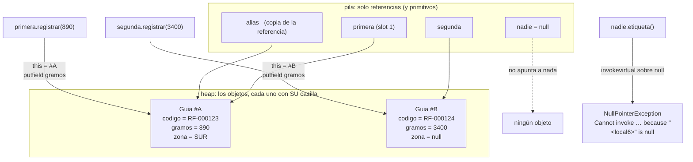

# Módulo 5 · Objetos y clases

> Curso Java (JDK 25) · tramo **Fundamentos** · 7 temas · formato único (specs/021). Portada del curso:
> [CURSO.md](CURSO.md). Todo el código de este módulo se compiló con `javac --release 25` y se ejecutó con
> `java -Dstdout.encoding=UTF-8` sobre OpenJDK Temurin 27.0.1.0.2+1 (macOS, arm64), locale `es_CO`, el
> 2026-11-21. Las salidas están pegadas tal cual.
> **Aviso de proveniencia:** en esta máquina no hay JDK 25 instalado, así que el *API* es la de la versión 25
> (la que comprueba `--release 25`) pero el *ejecutable* es el 27. Ningún tema de este módulo usa funciones
> *preview*; lo que puede diferir entre los dos ejecutables está marcado en cada tema como «pendiente de
> reejecución en JDK 25», y aquí eso es casi siempre el **texto** de una excepción o de un mensaje de `javac`
> —que los redacta la herramienta— y nunca la regla de lenguaje que se enseña. Las citas de la JLS de este
> módulo se verificaron contra el índice publicado de la especificación (edición Java SE 27, 2026-08-03), que
> es la que Oracle sirve hoy: §4.12.5, §7.6, §8.1, §8.1.1.4, §8.3, §8.4, §8.4.3.2, §12.5, §15.8.3, §15.21.3 y
> el capítulo 16.
> **Estado de escritura:** tema 1 de 7. Los temas 2 a 7 están previstos y aún no escritos; el laboratorio tiene
> su puerta únicamente para el tema 1 (**41 comprobaciones, 0 fallidas, 0 omitidas**), y esta portada no declara
> horas del módulo completo hasta que los siete estén medidos.

## Cabecera del módulo

| | |
|---|---|
| **Objetivo** | Pasar de «datos sueltos en arreglos» a **un tipo propio**: declarar una clase cuyos campos son su estado y cuyos métodos reciben el objeto como primer argumento, entender que `new` crea un objeto y la variable solo lo señala, seguir el `this` hasta el bytecode, y dominar las dos cosas que más programas rompen: que asignar copie la **referencia** (no el objeto) y que `null` sea un valor de referencia, no «un objeto vacío». |
| **Prerrequisitos** | [Módulo 4](modulo-4.md) completo —en especial su tema 1 (`new Punto[2]` deja casillas `null`: aquí eso mismo pasa con objetos que no son arreglos) y su tema 4 (`ArrayList`/`HashMap`, porque el siguiente paso natural es una lista de objetos)— y [Módulo 3](modulo-3.md) completo, sobre todo su tema 4: **al método se le copia la referencia, no el contenido**; esa regla es la que aquí se ve funcionando dentro de un objeto. Del [Módulo 0](modulo-0.md) se sigue usando `javap -c -p`. |
| **Duración** | Escrito: 40 min (tema 1). Previstos 7 temas de 40 min · **4 h 40 min** según el temario, cifra que se fija con las cabeceras cuando el módulo esté completo. |
| **Versiones** | JDK 25 (`--release 25`). Nada de este módulo depende de una función *preview*. Dos cosas que sí dependen del ejecutable y se tratan como tales: el **texto** del `NullPointerException` con mensajes útiles (lo redacta la JVM 27; el fenómeno es de 14+) y el **número** que devuelve `System.identityHashCode` (medido: cambia con `-XX:hashCode=` y no es una cifra del lenguaje). |
| **Laboratorio** | [`laboratorios/modulo-5/`](laboratorios/modulo-5/README.md) (al publicar: `examples/java/modulo-5/`), con `verificar.sh`: **41 comprobaciones, 0 fallidas** ejecutadas aquí (tema 1). |
| **Proyecto guía** | `rutaflow-nucleo`: la **ficha de carga**. En M4 una guía era un `String` con guiones que se partía con `split`; aquí pasa a ser un objeto `Guia` con `codigo`, `gramos` y `zona`, su método `etiqueta()` y su constructor. Cada tema cierra una parte: la clase y su receptor (T1), cómo se construye y en qué orden (T2), qué se puede tocar desde fuera (T3), qué pertenece a la clase y no al objeto (T4), dónde vive el archivo (T5), cómo se compara e imprime (T6) y cómo se hace inmutable (T7). |

### Mapa del módulo


**Texto alternativo:** el módulo entero es un cambio de notación. Mientras los datos son `int[]` y `String[]`,
el programa habla de posiciones; cuando declaras `class Guia`, el programa habla de **cosas**. El tema 1 da el
molde y el receptor (`this`). El tema 2 explica cómo nace un objeto y en qué orden se le llenan los campos, que
es donde aparecen los bugs de «uso antes de construir». El tema 3 decide qué se ve desde fuera, y por qué un
getter no es un campo. El tema 4 separa lo que pertenece a la clase de lo que pertenece al objeto. El tema 5
pone el archivo en un paquete y ordena las importaciones. El tema 6 es el contrato de `Object`: sin `equals` y
`hashCode` tus objetos se comparan por identidad y se imprimen con un hash. El tema 7 cierra con el objeto que
no cambia —a mano y con `record`—.

**Convención del módulo.** Igual que en M4: lo que afirma el lenguaje se comprueba con `javap` sobre el
`.class` generado con `--release 25`; lo que afirma el programa se comprueba ejecutándolo y pegando su salida;
y las fronteras se miden en las dos direcciones. Hay tres familias de datos que **no** se citan como si
fueran del lenguaje y por eso se tratan así: el **número** de `System.identityHashCode` (solo se comprueba el
invariante: dos objetos distintos pueden dar el mismo número, y cambiar la estrategia de la JVM cambia los
números), el **texto** de los mensajes de `javac` y de la JVM (se citan literalmente porque así los emite la
herramienta que usamos, pero se marcan como pendientes de reejecución en 25), y cualquier **dirección o hash**
que salga del `toString` por defecto de un objeto (aquello de `Guia@1b6d3586` lleva hash de identidad; el tema
6 lo sustituye por `toString`). Ninguna comprobación de este módulo depende del valor absoluto de un hash ni
del nombre del frame que aparece en un mensaje de `NullPointerException`.

---

### Tema 1: Clases, objetos, campos, métodos y `this` · Básico · 40 min

#### 1. Ubicación y prerrequisitos

Curso Java · tramo Fundamentos · módulo 5 · primer tema. Antes: [Módulo 4 · tema 1](modulo-4.md) (crear un
arreglo de objetos: `new Guia[3]` son tres casillas `null`, y aquí verás por qué), [Módulo 4 · tema 4](modulo-4.md)
(`ArrayList` y `HashMap`, donde ya metiste `String` e `Integer` y ahora meterás tus propios objetos),
[Módulo 3 · tema 4](modulo-3.md) (parámetros, retorno y sobrecarga: al método llega una **copia de la
referencia**, medido allí) y [Módulo 3 · tema 5](modulo-3.md) (la pila de llamadas: el «marco» del que sale la
ranura 0 donde vive `this`). Del [Módulo 0](modulo-0.md): su tema 3 para `javap`, su tema 4 porque ya decidió
que `main` es `static` y su tema 5 para el lanzador de archivo fuente. No se necesita ninguna biblioteca: el
tema entero cabe en un archivo. Fuentes: JLS §8.1 (declaración de clase), §8.2 (miembros), §8.3 (campos), §8.4
(métodos), §4.12.5 (valores por defecto), §15.8.3 (`this`), §15.21.3 (`==` entre referencias), §16 (la variable
local sí exige asignación previa), CJ1 capítulo 4, OCP capítulo 3, JEP 358 (el mensaje del `NPE`).

#### 2. Objetivo

**Al terminar serás capaz de:** declarar una clase con campos y métodos y decir, sin ejecutar nada, cuánto
vale cada campo de un objeto recién creado (`0` para `int`, `null` para `String`) y por qué una variable local
sin asignar **no compila** mientras ese campo sí. Escribir un método de instancia y saber qué objeto es `this`
en cada una de sus llamadas, incluidas las dos formas en que `this` se puede perder: desde un `static` y sobre
`null`. Predecir qué ve un objeto cuando otro nombre cambia uno de sus campos, y distinguir «mismos campos» de
«mismo objeto». Y, si abres el `.class`, señalar en el volcado la instrucción que lee el campo y la que lo
escribe, y decir en qué ranura está el receptor.

#### 3. Por qué importa

Hasta el módulo 4 tus datos viajaban en posiciones: `gramos[i]`, `zonas[i]`. Eso funciona mientras **todo** el
programa recuerde que la casilla 0 de un arreglo pertenece con la casilla 0 de otro. En cuanto el programa pasa
de un tamaño, la correspondencia se rompe en silencio y el fallo aparece como un número mal sumado, no como un
error. La clase convierte esa convención en un tipo: `Guia` lleva su peso **pegado** a su código, y si te
equivocas de objeto no obtienes un número raro —obtienes un error de compilación o un `NullPointerException`
que dice el método.

Y hay una segunda razón, más incómoda: casi todo el Java que vas a leer es esto. Un `record` (tema 7), una
interfaz con implementación (M6), un `enum` (M6) o una entidad de JPA (tramo Aplicación) son un caso particular
de lo que se declara aquí. La parte que la gente aprende «por arriba» —que `this` es el objeto receptor, que
asignar copia la referencia y no el objeto, que un campo `static` no es de cada objeto— es exactamente la parte
que produce los bugs de alias y de estado compartido que luego nadie explica.

Medido en `errores/ThisDesdeStatic.java`: escribir `this` donde no hay objeto no es un estilo desaconsejado, es
un error que `javac` rechaza con `non-static variable this cannot be referenced from a static context`. Medido
en `errores/LocalSinValor.java`: el campo `static int campo` sin inicializar vale `0` y compila; la variable
local `int local` sin inicializar **no compila**. Es la diferencia entre el estado de un objeto, que siempre
está inicializado, y una ranura de un marco de pila, que no existe hasta que le escribes.

#### 4. Analogía

Un **expediente de guía en la bodega**. La clase es el *formato* del expediente: dice qué casillas tiene
(código, peso, zona) y qué se puede hacer con él (registrar un peso, imprimir la etiqueta). El objeto es **un
expediente concreto**, con su folio. `new Guia("RF-000123")` es pedir un folio nuevo y escribirle el código: las
demás casillas quedan **en blanco**, no en cero ni en `""` —en blanco quiere decir `null` para las de texto y
`0` para las numéricas, porque el formulario está impreso pero nadie las ha rellenado.

Ahora la parte que la analogía deja ver bien: de un mismo expediente caben **muchas fotocopias de la carpeta,
pero un solo expediente**. `Guia alias = primera` no fotocopia el expediente: saca otra etiqueta con el mismo
folio. Si quien tiene la etiqueta nueva escribe 890 en la casilla del peso, el expediente **ya está** en 890 y
el primer nombre lo muestra —medido: `por la primera      : 890 (lo cambio quien se llama distinto)`. Y `null`
no es «un expediente en blanco»: es **no tener ninguna etiqueta**. Por eso `nadie.etiqueta()` no devuelve la
etiqueta vacía, sino que revienta —medido: `Cannot invoke "ClaseYObjetos$Guia.etiqueta()" because "<local6>" is null`.

Lo que la analogía traiciona: un expediente físico no puede tener dos pesos; dos objetos sí, y el que cambia uno
no entera al otro (medido: la segunda guía sigue en `3400` mientras la primera ya va en `890`). Los objetos no
comparten casillas: comparten, si acaso, referencias.

#### 5. Diagrama



**Texto alternativo:** la pila guarda nombres y referencias; el heap guarda objetos con sus campos. `primera` y
`alias` apuntan al **mismo** objeto `#A` —medido: `alias misma identidad: true`—, así que una escritura vista
por `alias` (`putfield gramos`) se lee por `primera`. `segunda` es otro objeto `#B` y no se entera. `nadie` no
apunta a un objeto con las casillas vacías: vale `null`, y llamar un método de instancia sobre `null` lanza al
evaluar el receptor. El mismo método, llamado sobre dos objetos distintos, recibe dos `this` distintos: eso es
lo que significa «método de instancia».

#### 6. Explicación

**Nivel 0 — una clase es un tipo nuevo, y `new` crea un objeto con sus campos ya inicializados.**

El archivo `tema-1/ClaseYObjetos.java` declara, dentro de la clase del `main`, una segunda clase:

```java
static class Guia {
    String codigo;   // campo de referencia: valor por defecto null
    int gramos;      // campo primitivo: valor por defecto 0
    String zona;     // sin asignar: el objeto sigue siendo legal
}
```

Tres cosas ocurren con eso. Uno: `Guia` es un tipo, igual que `int` o `String`, y se usa en declaraciones,
parámetros y retornos. Dos: los campos **no son** de la clase, son de cada objeto; `new Guia(...)` reparte
casillas. Tres: esas casillas no están «indeterminadas», tienen el valor por defecto del tipo (JLS §4.12.5:
`0` para numéricos, `false` para `boolean`, `\u0000` para `char`, `null` para referencias). Medido, recién
creado el objeto y antes de escribir en ninguna casilla:

```text
recien creada       : RF-000123 · 0 g · null · yo soy 498931366
```

`0 g` es `gramos` en su valor por defecto; `null` es `zona`, que nadie tocó. Es la misma regla que la del
`String[3]` del módulo 4: una casilla de referencias nace `null`, no nace `""`.

Lo que **no** pasa con las variables locales. `errores/LocalSinValor.java` declara `static int campo;` y una
local `int local;` sin asignar. El campo vale `0` y se puede imprimir; la local produce, medido:

```text
errores/LocalSinValor.java:9: error: variable local might not have been initialized
```

El compilador no te está siendo quisquilloso: los campos tienen un contrato de inicialización garantizado por la
creación del objeto (JLS §12.5), y las locales no. Por eso Java puede prometer «el campo siempre tiene un valor»
y no puede prometer «la variable siempre tiene un valor».

**Nivel 1 — `this` es el receptor: un parámetro que Java te pasa sin que lo escribas.**

`primera.registrar(1250)` y `segunda.registrar(3400)` llaman al **mismo** cuerpo de método. Lo que cambia es el
objeto que viaja delante de los argumentos: `this`. Por eso un método de instancia puede decir «mi peso» sin
saber de qué objeto se trata. Medido en la misma corrida, los dos objetos con su casilla propia:

```text
primera tras 1250: RF-000123 · 1250 g · null · yo soy 498931366
segunda tras 3400: RF-000124 · 3400 g · null · yo soy 414493378
```

Y hay una razón para escribir `this` explícitamente, no estética. Dentro del constructor

```java
Guia(String codigo) {
    this.codigo = codigo;
}
```

el parámetro se llama igual que el campo. Sin `this.`, `codigo = codigo` asigna el parámetro **contra sí mismo**
y el campo sigue en `null`, porque el nombre local oculta al campo (JLS §6.4.1, *Shadowing*). Medido en
`tema-1/SombraDeCampo.java`, que tiene los dos constructores uno al lado del otro:

```text
campo con el parametro tapando : null
campo con this.                : RF-000123
```

Y es un bug **sin aviso**: el mismo archivo compilado con `javac --release 25 -Xlint:all` no emite ni una
advertencia (medido: salida vacía). El `this` ahí no es decoración: es lo que separa «la casilla del objeto» de
«la variable del método».

`this` además **es** una referencia, así que se puede devolver y comparar. Medido:

```text
conZona devuelve el mismo objeto: true · y se queda con SUR
```

donde `conZona` hace `this.zona = nuevaZona; return this;`. Eso es lo que permite la cadena
`g.conZona("NORTE").registrar(1250)`, que verás en estilo de API por todo el curso. Lo importante no es la
cadena: es que **no hubo copia**. Se mutó el mismo objeto y se devolvió el mismo objeto.

Y lo contrario, medido como error de compilación en `errores/ThisDesdeStatic.java` (línea 7) y
`errores/MetodoSinObjeto.java` (línea 14):

```text
error: non-static variable this cannot be referenced from a static context
error: non-static method etiqueta() cannot be referenced from a static context
```

Los dos mensajes dicen lo mismo con otras palabras: un método `static` no recibe receptor, así que no tiene
`this` ni campos de objeto que leer (JLS §8.4.3.2). `main` es `static`; por eso todo lo que haces en `main` pasa
por `new` y un nombre de variable.

**Nivel 2 — referencia y objeto no son lo mismo, y eso tiene tres consecuencias.**

1. **Asignar copia la referencia, no el objeto.** `Guia alias = primera;` pone dos nombres sobre el mismo
   expediente. Medido: `alias misma identidad: true` (`==` entre referencias compara si son el mismo objeto,
   JLS §15.21.3), y después `alias.registrar(890)` deja `por la primera      : 890`. El puente con M3 · tema 4 es
   exacto: lo mismo que le pasaba a un arreglo en un parámetro le pasa a un objeto en un campo, en un retorno y
   en una variable.
2. **Campos iguales no hacen objetos iguales.** Dos guías creadas con el mismo código son dos objetos. Medido:
   `campos iguales       : mismo codigo true · misma referencia false · son dos objetos`, y otra vez en
   `SombraDeCampo.java` con dos objetos de la misma clase: `dos Bien con el mismo codigo   : false`. Esta línea
   es el anticipo del tema 6: hoy Java solo sabe comparar referencias con `==`; `equals` es lo que **tú**
   defines, y hasta definirlo dos objetos con los mismos datos no son «el mismo». Y un extra que conviene saber
   antes de escribir nada: `==` entre referencias exige que los tipos se puedan convertir el uno en el otro por
   cast (§15.21.3), así que comparar dos clases sin parentesco **no compila**. Medido en
   `errores/ComparaTiposDistintos.java`: `incomparable types: Mal and Bien`. Comparar con `Object` sí se puede
   (medido: `contra Object si se puede      : false`). El lenguaje te deja preguntar «¿es el mismo objeto?» entre
   tipos compatibles y te cierra el paso cuando la pregunta no tiene sentido.
3. **`null` es un valor de referencia, no un objeto vacío.** Medido: `null no es un objeto sin datos, es
   ninguna referencia: true` —lo que se compara es el valor de la variable contra el literal `null`, y dos `null`
   entre sí dan `true` porque no hay objeto que distinguir— y, acto seguido, `llamar sobre null   : Cannot
   invoke "ClaseYObjetos$Guia.etiqueta()" because "<local6>" is null`. El mensaje con detalles es el JEP 358,
   dirigido a JDK 14; en este ejecutable viene activo sin opción ninguna (medido: no pasamos ningún `-XX`). En
   esta corrida el nombre del local sale como ranura (`<local6>`) porque compilé sin tabla de depuración.
   Recompilado con `-g` (medido): `because "nadie" is null`. La regla que enseño es la misma en los dos casos,
   pero no finjo que el texto sea idéntico en cualquier compilación.

**Nivel 3 — lo que ve la JVM: el receptor va en la ranura 0 y el campo se lee con `getfield`.**

`tema-1/por-dentro/CamposEnBytecode.java` declara `Punto` con dos métodos que difieren solo en escribir `this.`
en el fuente. Volcado con `javap -c -p` (las instrucciones están tal cual salen):

```text
  int conThis();
    Code:
         0: aload_0
         1: getfield      #7                  // Field x:I
         4: ireturn

  int sinThis();
    Code:
         0: aload_0
         1: getfield      #7                  // Field x:I
         4: ireturn
```

Cuerpo a cuerpo son **la misma secuencia** —el laboratorio lo comprueba comparando las dos, no lo afirma de palabra—: `this`
no cuesta una instrucción, porque no es una cosa que se consulta, es la ranura 0 del marco. Lo mismo para
escribir:

```text
  void mover(int, int);
    Code:
         0: aload_0
         1: aload_0
         2: getfield      #7                  // Field x:I
         5: iload_1
         6: iadd
         7: putfield      #7                  // Field x:I
        10: aload_0
        11: aload_0
        12: getfield      #13                 // Field y:I
        15: iload_2
        16: iadd
        17: putfield      #13                 // Field y:I
        20: return
```

Leído ranura a ranura: la 0 es el receptor (`this`, el objeto al que se le mueve el punto), la 1 es `dx` y la 2
es `dy` —los dos parámetros, desplazados porque la 0 ya está ocupada—; `x` se lee con `getfield` sobre la
referencia de la ranura 0 y se escribe con `putfield` sobre **esa misma referencia** (dos `aload_0` seguidos: uno
alimenta la lectura y otro el destino), y `y` hace lo propio con `#13`.

De ahí salen dos reglas que la gente confunde con las que no. En un método de instancia, `aload_0` es **el
objeto** y los parámetros empiezan en `iload_1`; en un método `static` la ranura 0 ya es el primer parámetro, y
por eso no puede existir `this` (nivel 1) —la prohibición del compilador y la geometría del marco son la misma
cosa vista de dos lados.

Crear el objeto, medido en `Punto.cero()` y en `main`:

```text
  static CamposEnBytecode$Punto cero();
    Code:
         0: new           #8                  // class CamposEnBytecode$Punto
         3: dup
         4: invokespecial #16                 // Method "<init>":()V
         7: areturn
```

Tres pasos seguidos: `new` reserva y pone la referencia en la pila, `dup` la duplica (una la consume el
constructor, la otra es el valor de la expresión), `invokespecial` llama al constructor **con** esa referencia.
Y el constructor propio de `Punto` no hace más que encadenar hacia arriba, medido:

```text
  CamposEnBytecode$Punto();
    Code:
         0: aload_0
         1: invokespecial #1                  // Method java/lang/Object."<init>":()V
         4: return
```

Nadie escribe `x = 0` en el bytecode del constructor de `Punto` **porque sus campos no tienen inicializador
explícito**: el cero viene de la preparación del objeto (JLS §12.5: asignar memoria e inicializar los campos a
su valor por defecto ocurre antes del cuerpo del constructor). Un campo con `= 1250` sí aparecería en `<init>`,
y eso es justo el tema 2.

Cómo se ve la llamada desde fuera, medido en `main` de `CamposEnBytecode`:

```text
  public static void main(java.lang.String[]);
    Code:
         0: new           #7                  // class CamposEnBytecode$Punto
         3: dup
         4: invokespecial #9                  // Method CamposEnBytecode$Punto."<init>":()V
         7: astore_1
         8: aload_1
         9: iconst_3
        10: iconst_4
        11: invokevirtual #10                 // Method CamposEnBytecode$Punto.mover:(II)V
        ...
        36: invokestatic  #37                 // Method CamposEnBytecode$Punto.cero:()LCamposEnBytecode$Punto;
        39: getfield      #41                 // Field CamposEnBytecode$Punto.x:I
```

`mover` se llama con `invokevirtual` (hay receptor: `aload_1` pone el objeto en la pila **antes** de los dos
`int`) y `cero()` con `invokestatic` (no hay receptor: se llama por el nombre de la clase). El descriptor
`(II)V` es la firma que ya viste en M0: dos `int`, devuelve `void`. Y fíjate en `astore_1` a la altura 7: dentro
de un método `static`, la ranura 0 es el primer parámetro (`args`), así que el punto nuevo se guarda en la 1.
Esa es la misma geometría que arriba impedía `this`.

Y el puente con el módulo 4, medido en la salida del mismo programa:

```text
conThis/sinThis    : 3 / 3 · mismo resultado
creado dentro      : 0 (valor por defecto, nadie escribio)
arreglo de Punto   : casilla 0 sin crear es null? true · tras crearla, no: true
```

`new Punto[2]` en bytecode es `anewarray` y **no** construye dos `Punto`: construye dos `null` (en el volcado de
`main` se ve el `aaload` seguido de un `ifnonnull` que es literalmente la comprobación que acabas de imprimir).
Eso explica por qué el módulo 4 te dejaba sumar `0` de un arreglo de `int` pero te reventaba con un arreglo de
`String` al llamar `.length()`.

Por último, la clase anidada. `ClaseYObjetos.java` es **un archivo** y produce **dos** `.class`, medido con
`javac --release 25 -d out ClaseYObjetos.java && ls out`:

```text
ClaseYObjetos$Guia.class
ClaseYObjetos.class
```

El `$` es el nombre binario (JLS §13.1); es lo que estabas leyendo en el mensaje de `NullPointerException` de
nivel 2: `Cannot invoke "ClaseYObjetos$Guia.etiqueta()"`. Y `javap -p` de la anidada, medido:

```text
class ClaseYObjetos$Guia {
  java.lang.String codigo;
  int gramos;
  java.lang.String zona;
  ClaseYObjetos$Guia(java.lang.String);
  java.lang.String etiqueta();
  void registrar(int);
  ClaseYObjetos$Guia conZona(java.lang.String);
}
```

Ningún miembro lleva modificador de acceso: todos quedaron con acceso de paquete (tema 3). La clase exterior
usa `g.codigo` sin problema, y en `javap -v -p` de la exterior aparece el atributo `NestMembers:
ClaseYObjetos$Guia`, con **cero** métodos sintéticos `access$`. Eso es lo que hace la regla «dentro del mismo
`class` se ven los `private`» (JLS §6.6.1) sin pagar el precio de los accessors que Java pagaba antes de la
11. Aquí solo hace falta saber que `static class` = clase anidada que no recibe un objeto exterior (JLS
§8.1.1.4); para este tema la uso porque mantiene el ejemplo en un archivo y se puede ejecutar con el lanzador de
fuente.

Sobre el archivo en sí, medido en `errores/DosPublicasEnUnArchivo.java`:

```text
errores/DosPublicasEnUnArchivo.java:6: error: class Guia is public, should be declared in a file named Guia.java
```

Un archivo fuente admite varias clases, pero **una** `public` y con el nombre del archivo (JLS §7.6). Ese error
lo vas a ver escrito mal cien veces en foros; la regla no es «no se puede», es «no dos `public`».

#### 7. Código ejecutable

**Ejemplo mínimo** · archivo `tema-1/ClaseYObjetos.java` · ejecuta
`javac --release 25 -d out tema-1/ClaseYObjetos.java && java -Dstdout.encoding=UTF-8 -cp out ClaseYObjetos`

```java
public class ClaseYObjetos {

    static class Guia {
        String codigo;          // campo de referencia: su valor por defecto es null
        int gramos;             // campo primitivo: su valor por defecto es 0
        String zona;            // se puede dejar sin asignar y el objeto sigue siendo legal

        Guia(String codigo) {   // el parametro se llama igual que el campo: aqui `this` no es opcional
            this.codigo = codigo;
        }

        String etiqueta() {
            return codigo + " · " + gramos + " g · " + zona + " · yo soy " + System.identityHashCode(this);
        }

        void registrar(int peso) {
            this.gramos = peso;
        }

        Guia conZona(String nuevaZona) {
            this.zona = nuevaZona;
            return this;        // devuelve el mismo objeto, no una copia
        }
    }

    static void muestra(String que, Guia g) {
        System.out.println(que + g.etiqueta());
    }

    public static void main(String[] args) {
        Guia primera = new Guia("RF-000123");
        System.out.println("recien creada       : " + primera.etiqueta());

        Guia segunda = new Guia("RF-000124");
        System.out.println("dos objetos         : primera " + System.identityHashCode(primera)
                + " · segunda " + System.identityHashCode(segunda)
                + " · referencia distinta? " + (primera != segunda));

        primera.registrar(1250);
        segunda.registrar(3400);
        muestra("primera tras 1250: ", primera);
        muestra("segunda tras 3400: ", segunda);

        Guia alias = primera;                             // copia la REFERENCIA, no el objeto
        System.out.println("alias misma identidad: " + (alias == primera));
        alias.registrar(890);
        System.out.println("por la primera      : " + primera.gramos + " (lo cambio quien se llama distinto)");

        primera.conZona("NORTE");
        System.out.println("conZona devuelve el mismo objeto: " + (primera.conZona("SUR") == primera)
                + " · y se queda con " + primera.zona);

        Guia g1 = new Guia("RF-000123");
        Guia g2 = new Guia("RF-000123");
        System.out.println("campos iguales       : mismo codigo " + g1.codigo.equals(g2.codigo)
                + " · misma referencia " + (g1 == g2) + " · son dos objetos");

        Guia nadie = null;
        System.out.println("null no es un objeto sin datos, es ninguna referencia: " + (nadie == null));
        try {
            nadie.etiqueta();
        } catch (NullPointerException e) {
            System.out.println("llamar sobre null   : " + e.getMessage());
        }
    }
}
```

Salida medida (Temurin 27.0.1.0.2+1, `--release 25`, sin `-g`):

```text
recien creada       : RF-000123 · 0 g · null · yo soy 498931366
dos objetos         : primera 498931366 · segunda 414493378 · referencia distinta? true
primera tras 1250: RF-000123 · 1250 g · null · yo soy 498931366
segunda tras 3400: RF-000124 · 3400 g · null · yo soy 414493378
alias misma identidad: true
por la primera      : 890 (lo cambio quien se llama distinto)
conZona devuelve el mismo objeto: true · y se queda con SUR
campos iguales       : mismo codigo true · misma referencia false · son dos objetos
null no es un objeto sin datos, es ninguna referencia: true
llamar sobre null   : Cannot invoke "ClaseYObjetos$Guia.etiqueta()" because "<local6>" is null
```

Los dos números de las dos primeras líneas son los que devolvió **esta** JVM: repetido cinco veces seguidas dio
igual, y forzando la estrategia con `-XX:hashCode=2` los dos se vuelven `1`. Se pegan porque son la salida real,
no porque sean una propiedad del objeto; lo que se enseña es el `true` de `referencia distinta?`, que sí lo es.

**Segundo ejemplo** · `tema-1/por-dentro/CamposEnBytecode.java` · ejecuta
`javac --release 25 -d out tema-1/por-dentro/CamposEnBytecode.java && java -Dstdout.encoding=UTF-8 -cp out CamposEnBytecode`
y después `javap -c -p -cp out 'CamposEnBytecode$Punto'`. Su salida son las tres líneas del nivel 3
(`conThis/sinThis : 3 / 3`, `creado dentro : 0`, `arreglo de Punto : casilla 0 sin crear es null? true · tras
crearla, no: true`) y los volcados pegados arriba.

**Tercer ejemplo** · `tema-1/SombraDeCampo.java` · ejecuta
`javac --release 25 -Xlint:all -d out tema-1/SombraDeCampo.java && java -Dstdout.encoding=UTF-8 -cp out SombraDeCampo`.
Son dos clases con el mismo campo y el mismo parámetro, una con `codigo = codigo` y otra con `this.codigo =
codigo`. Salida medida:

```text
campo con el parametro tapando : null
campo con this.                : RF-000123
dos Bien con el mismo codigo   : false
contra Object si se puede      : false
```

`javac` no emite ninguna advertencia con `-Xlint:all` (medido: salida vacía tras compilar). Es el ejemplo más
importante del tema porque no se ve: el bug está en una línea que parece escrita.

**Los cinco errores** · `tema-1/errores/` son para que los provoques tú:
`ThisDesdeStatic.java`, `MetodoSinObjeto.java`, `LocalSinValor.java`, `DosPublicasEnUnArchivo.java` y
`ComparaTiposDistintos.java`. Ninguno compila, y los cinco mensajes están citados en los niveles 0, 1, 2 y 3.

#### 8. Mini-laboratorio

Escribe los archivos desde cero en `laboratorios/modulo-5/tema-1/` (no copies y pegues: el ejercicio es predecir
y comprobar).

1. Crea `MiGuia.java` con una clase `static class Ficha` dentro de `MiGuia`, con tres campos sin inicializar:
   `String codigo; int gramos; char estado;`. En `main`, crea un objeto y **sin escribir en ningún campo**
   imprime los tres separados por ` | `, después su `getClass().getName()`. Escribe en un comentario qué esperas
   ver antes de ejecutar. Ejecuta: si el comentario decía `null | 0 | ` con espacio, está mal; `char` por defecto
   es `\u0000`, que se imprime como nada y engaña. Cuenta con `ls out` cuántos `.class` produjo un solo `.java`
   y anota por qué hay dos.
2. En el mismo archivo, declara `Ficha a = new Ficha();` y `Ficha b = a;`. Escribe `a.gramos = 1250;` e imprime
   `b.gramos`. Predícelo en un comentario. Después añade `Ficha c = new Ficha(); c.gramos = 1250;` e imprime en
   tres líneas `a == b`, `a == c`, `a.gramos == c.gramos`. Esas tres respuestas juntas son el nivel 2 del tema:
   si no las predijiste bien, vuelve a él.
3. Añade a `Ficha` un constructor `Ficha(String codigo) { codigo = codigo; }` y crea un objeto con él. Imprime el
   campo. Escribe la predicción **antes** de ejecutar, compila con `-Xlint:all` y mira si el compilador dice
   algo. Corrige el constructor con `this.` y vuelve a ejecutar. Los dos mensajes que no llegaron (el de `javac`
   vacío y el `null` en pantalla) son la lección.
4. Crea `OrdenDeSlots.java` con `static class Suma { int total; void subir(int n, int paso) { this.total = this.total + n + paso; } }`.
   Ejecuta `javac -d out OrdenDeSlots.java`, luego `javap -c -p -cp out 'OrdenDeSlots$Suma'`. En un comentario,
   escribe el número de la ranura que usa cada uno de los tres `int` del método (receptor, `n`, `paso`) **antes**
   de mirar el volcado, y después compruébalo. Si escribiste `iload_0` para `n`, lo que te falta es saber quién
   ocupa la 0.
5. Crea `SinReceptor.java` con un método de instancia `String etiqueta()` en una clase anidada y llama
   `System.out.println(MiClase.etiqueta());` desde `main`. Guarda el mensaje exacto de `javac`. Cambia la llamada
   a `System.out.println(new MiClase().etiqueta());`. Ejecuta el primero con el lanzador de fuente para ver el
   fallo otra vez. Ahora, en un comentario, responde con tus palabras qué es lo que **no** existe en el primer
   caso (pista: es la misma palabra que la JVM usa en su mensaje: *static context*).
6. Crea `Nulo.java` con `Ficha nadie = null;` y dos llamadas: `System.out.println(nadie == null);` y
   `nadie.etiqueta();`. Ejecuta y copia el mensaje completo del `NullPointerException`, incluido lo que va
   después de `because`. Vuelve a compilar con `javac -g -d outg Nulo.java` y ejecuta con `-cp outg`: copia ese
   segundo mensaje. Anota la diferencia y qué la produce.

**Listo cuando** puedas decir, sin ejecutar, los valores por defecto de `Ficha` con un campo `double`, uno
`boolean` y uno `Thread` (`0.0`, `false`, `null`); cuando el paso 2 te dé `true`, `false`, `true` sin titubear;
y cuando sepas explicar por qué la respuesta `a.gramos == c.gramos` siendo `true` **no** convierte a `a` y `c`
en el mismo objeto (esa es la pregunta del tema 6).

#### 9. Verificación

```bash
cd docs/reestructuracion/cursos/java/laboratorios/modulo-5
javac --release 25 -encoding UTF-8 -d out tema-1/*.java
java -Dstdout.encoding=UTF-8 -cp out ClaseYObjetos       # «recien creada : RF-000123 · 0 g · null» y «alias misma identidad: true»
javac --release 25 -Xlint:all -d outs tema-1/SombraDeCampo.java   # -Xlint:all no dice nada: salida vacia, medido
java -Dstdout.encoding=UTF-8 -cp outs SombraDeCampo      # «campo con el parametro tapando : null» frente a «this. : RF-000123»
java -Dstdout.encoding=UTF-8 -cp out CamposEnBytecode    # «conThis/sinThis : 3 / 3» y «casilla 0 sin crear es null? true»
javap -c -p -cp out 'CamposEnBytecode$Punto'              # aload_0 · getfield · putfield · iload_1
javac --release 25 -g -d outg tema-1/ClaseYObjetos.java   # el NPE pasa a decir because "nadie" is null
java -XX:+UnlockExperimentalVMOptions -XX:hashCode=2 -cp out ClaseYObjetos   # los dos numeros salen iguales
ls out                                                    # dos .class: ClaseYObjetos.class y ClaseYObjetos$Guia.class
javap -p -cp out 'ClaseYObjetos$Guia'                     # codigo, gramos, zona: sin modificador = acceso de paquete
javac -d /tmp/m5e tema-1/errores/ThisDesdeStatic.java     # non-static variable this cannot be referenced…
javac -d /tmp/m5e tema-1/errores/LocalSinValor.java       # variable local might not have been initialized
```

O, todo el laboratorio del módulo de una vez: `./verificar.sh`. Aquí esas **41** comprobaciones del tema pasan
con Temurin 27 y `--release 25`; con JDK 25 en el `PATH` basta `./verificar.sh`. Reparto medido sobre el propio
script: **16** sobre la salida de `ClaseYObjetos` (dentro van las tres de `identityHashCode` y las dos de
`-g`/sin `-g`), **4** de `SombraDeCampo`, **3** de `CamposEnBytecode` ejecutado, **6** sobre el volcado de `Punto`
(incluida la comparación byte a byte de que los dos cuerpos, con `this.` y sin él, salgan idénticos), **4** sobre
los `.class` de la clase anidada (los dos archivos, el acceso de paquete, `NestMembers` y la ausencia de
`access$`), **3** sobre el volcado de `main` (`aload_1`, `mover:(II)V`, `invokestatic`) y **5** fallos de
compilación esperados. 16 + 4 + 3 + 6 + 4 + 3 + 5 = 41.

*Pendiente de reejecución en JDK 25:* los **mensajes de texto**. El del `NullPointerException`
(`Cannot invoke "…Guia.etiqueta()" because "<local6>" is null`) lo construye la JVM y su redacción cambió en el
paso de 13 a 14; el de `javac` (`non-static variable this cannot be referenced from a static context`, y los
otros cuatro mensajes de los errores esperados, incluido `incomparable types: Mal and Bien`) lo fija el
compilador de la 25 y conviene confirmar que siguen palabra por palabra. La forma del nombre de la posición
(`"<local6>"` frente a `"nadie"`) depende de si compilaste con `-g` y de cuántas variables haya delante, así que
**no es** una cifra del tema ni una comprobación de la puerta.

*Lo que no depende de la versión:* los valores por defecto (JLS §4.12.5), que asignar una variable copie la
referencia, que `==` entre referencias compare identidad (§15.21.3), que `this` sea la ranura 0 del marco y los
parámetros de un método de instancia empiecen en la 1, `getfield`/`putfield` como únicas formas de tocar un
campo, `new` + `dup` + `invokespecial` como los tres pasos de crear un objeto, `aload_0` y `aload_0`/`aload_0`
en el constructor, `invokestatic` sin receptor, el nombre binario con `$`, el atributo `NestMembers`, y que una
clase anidada con `static` no reciba un objeto exterior (§8.1.1.4). Lo único de este tema que sí es del
ejecutable y no del lenguaje es **el número** de `System.identityHashCode`, y por eso la puerta no lo compara
contra una cifra: compara que con `-XX:hashCode=2` los dos objetos dan el mismo número y que con
`-XX:hashCode=0` no, y con eso queda probado que **no puede** usarse como prueba de identidad.

#### 10. Error común y diagnóstico

**Síntoma 1 — «mi objeto tiene los campos en `null`/`0` y no sé quién los borró».** Casi nunca los borró nadie:
nunca los escribió. Causa típica, el constructor con el parámetro que tapa al campo —las dos líneas reales de
`tema-1/SombraDeCampo.java`, la 9 y la 17:

```java
Mal(String codigo)  { codigo = codigo; }      // asigna el parametro contra si mismo: el campo no se toca
Bien(String codigo) { this.codigo = codigo; } // la mano izquierda dice de que objeto es la casilla
```

El mensaje no existe: `javac --release 25 -Xlint:all` sobre ese archivo no emite ni una línea (medido: salida
vacía). Esto es lo que sale al ejecutarlo:

```text
campo con el parametro tapando : null
campo con this.                : RF-000123
```

Diagnóstico: imprime el campo recién creado —`recien creada : RF-000123 · 0 g · null` en el ejemplo— o busca en
el cuerpo del constructor una asignación cuya mano izquierda no lleve `this.` ni un nombre de objeto. Salida real
de `errores/MetodoSinObjeto.java` al intentar lo contrario (usar el método como si fuera de la clase):

```text
errores/MetodoSinObjeto.java:14: error: non-static method etiqueta() cannot be referenced from a static context
```

**Síntoma 2 — «cambié el objeto en un método y se me cambió otro que no tocaba».** No es un bug de Java: es
que el parámetro y la variable son el mismo objeto. Esto no es una hipótesis; es el medidor del tema:
`alias misma identidad: true` seguido de `por la primera      : 890`. El arreglo de M4 · tema 4 y la guía de
hoy son el mismo fenómeno. Diagnóstico en producción: antes de suponer que «algo lo puso a 890», pregúntate
cuántos nombres tiene el objeto. Si la respuesta es «debería tener uno solo», el bug está en un setter que
devuelve `this` y se reusa, o en un campo de clase (`static`) que creíste de objeto —eso es el tema 4, medido
allí.

**Síntoma 3 — «comparo dos guías con `==` y no son iguales aunque traigan el mismo código».** Es correcto, y
salir de ahí tiene precio. Medido: `mismo codigo true · misma referencia false · son dos objetos`. Diagnóstico:
si lo que quieres comparar son los datos, `equals` (tema 6). Si lo que quieres es **una sola guía por código**,
no confíes en que alguien te pase el mismo objeto: busca en un `HashMap` (M4 · tema 4) o normaliza en una
fábrica (tema 4). Y si te apareció la tentación de comparar `System.identityHashCode(a) == System.identityHashCode(b)`:
la puerta tiene una comprobación que demuestra por qué está mal, y es que con `-XX:hashCode=2` los dos números
salen `1` para objetos distintos. No es un identificador: es un hash.

**Síntoma 4 — «uso `this` en un método utilitario y el compilador me dice algo de static context».**
`main`, y cualquier método que quieras llamar sin objeto, no tiene receptor (medido en
`errores/ThisDesdeStatic.java`). Dos salidas, ambas válidas: pasar el objeto como parámetro (la forma que ya
usaste en `muestra(String, Guia)` de `ClaseYObjetos.java`) o declarar el método de instancia y crear el objeto.
La tercera opción, «lo pongo `static` y listo», es la que produce el bug de estado compartido del tema 4.

**Síntoma 5 — «pongo dos clases `public` en el mismo archivo y no me deja».** Medido:
`class Guia is public, should be declared in a file named Guia.java`. La solución **no** es borrar la segunda
clase: es quitarle `public` (una clase de paquete sigue siendo utilizable desde el mismo paquete, que es justo
lo que necesitas mientras el tema 3 no decida otra cosa). Diagnóstico rápido: el mensaje te está diciendo el
nombre de archivo que espera; si la clase debe ser pública, cárgala a su propio archivo.

#### 11. Pregunta con respuesta modelo

**Comprensión.** Tienes `Ficha f;` como campo de una clase y `Ficha g;` como variable local dentro de un método.
¿Puedes imprimir `f == null` y `g == null` sin haber asignado nada?

**Respuesta modelo:** lo primero sí, y da `true`: los campos del objeto se inicializan a `null` al crearlo
(JLS §4.12.5) —medido en `recien creada : … · null`. Lo segundo **no compila**, medido con el mensaje
`variable local might not have been initialized`, porque el capítulo 16 (asignación definida) no garantiza el
contenido de una ranura de pila. La diferencia no es de estilo: un campo siempre tiene un valor porque el objeto
se construyó, una local puede no tenerlo porque nadie la ha escrito todavía.

**Comprensión.** ¿Qué pasa en `System.out.println(nadie.etiqueta())` si `nadie` vale `null`? ¿Y en
`System.out.println(nadie == null)`?

**Respuesta modelo:** la primera lanza —medido: `Cannot invoke "ClaseYObjetos$Guia.etiqueta()" because
"<local6>" is null`—, la segunda imprime `true` y no lanza. La razón es que `==` entre referencias (§15.21.3) es
un operador que compara el **valor** (una referencia, que puede ser `null`) mientras la llamada a un método de
instancia necesita un objeto para ponerlo en la ranura 0. `null` es un valor perfecto para comparar y un
receptor imposible. Y un detalle de entrevista: en Java 14+ el mensaje dice el método y la variable o ranura, así
que no hace falta el depurador; antes de 14 el `NPE` llegaba sin ninguna de las dos pistas.

**Aplicación.** Un compañero escribe esto y dice que «el bug es que `equals` falla»:

```java
Guia a = new Guia("RF-000123");
Guia b = new Guia("RF-000123");
if (a == b) System.out.println("misma guía");
```

**Respuesta modelo:** no hay bug en `==`: da `false` porque son dos objetos, y eso es lo que `==` promete
(medido: `mismo codigo true · misma referencia false · son dos objetos`). Lo que está mal es el **modelo**. Dos
expedientes con el mismo código pueden ser la misma guía o dos guías distintas, y el programa tiene que decir
cuál de las dos cosas quiso. Si quiso «el mismo objeto», `a == b` es correcto y el bug está en que alguien creó
una segunda `Guia` en vez de reusar la primera (normalízalas en una fábrica o guárdalas en un mapa por código).
Si quiso «la misma guía según su código», `==` es la herramienta equivocada: hay que comparar el código con
`equals` hoy y definir `equals`/`hashCode` en el tema 6, con su contrato, porque si no tus objetos no van a
funcionar dentro de `HashMap`. Y un tercer candidato que conviene descartar en la entrevista: no se salva la
comparación con `identityHashCode`, porque dos objetos distintos pueden compartir número (medido con
`-XX:hashCode=2`: `primera 1 · segunda 1`).

#### 12. Cuándo usarlo y cuándo no

| Úsalo | No lo uses |
|---|---|
| Un conjunto de datos que siempre viaja junto (código + peso + zona de la misma guía) | Dos arreglos paralelos indexados por posición: el día que uno se ordena, la correspondencia se rompe (M4 midió el filtro con `binarySearch`; aquí eso no puede pasar) |
| Conducta que depende del estado del dato (`registrar`, `etiqueta`) | Métodos `static` que reciben el objeto para «parecerse» a una función de otro lenguaje: si no usan estado, son una función; si lo usan, es un método |
| Tipos propios que el compilador puede comprobar (`List<Guia>`) | `Object[]` con casts, o `Map<String, Object>` con claves que son campos: pierdes el tipo y recuperas los bugs de posición |
| Una clase anidada `static` para un tipo auxiliar de un solo archivo (aquí `Guia`) | Clases anidadas **no** `static` cuando no hacen falta: cada instancia arrastra una referencia al objeto exterior (§8.1.3), y eso es memoria y ciclo de vida que no pediste |

**Costo:** un objeto cuesta su cabecera más el tamaño de sus campos, y leer un campo es una instrucción
(`getfield`) — no es gratis pero es lo más barato que hay en Java, y por eso `Guia` con tres campos le gana a
tres arreglos paralelos en claridad sin perder en velocidad. Lo que cuesta de verdad es la **mutabilidad por
referencia**: si expones el objeto, expones su memoria viva, y cualquier nombre puede escribir. La defensa es
encapsular (tema 3), decidir quién construye (tema 2) y, cuando el dato no debe cambiar, hacerlo inmutable
(tema 7). Lo que este tema **no** resuelve y no finge resolver: `toString` (sigue saliendo el hash de identidad
si imprimes el objeto), `equals`/`hashCode` (nivel 2, consecuencia 2) y el orden exacto en que se llenan los
campos cuando hay inicializadores y bloques —eso es el tema 2, y es donde la gente cree que sabe algo y no lo
sabe—.

---

## Temas que faltan de este módulo

Quedan seis temas del temario: **2** constructores, encadenamiento con `this(...)`, bloques de inicialización y
orden exacto (§8.6–8.8, §12.5), **3** encapsulación y modificadores de acceso (§6.6, EJ 15–16), **4** `static`
(§8.3, §8.7, §12.4), **5** paquetes e importaciones incluyendo `import module` (JEP 511), **6** los métodos de
`Object` y **7** objetos inmutables y `record` (§8.10, EJ 17). Cada uno traerá su ejemplo, sus errores
reproducibles y sus comprobaciones a `verificar.sh`; el `Laboratorio` y la `Duración` de esta portada se
reescriben con las cifras medidas cuando el módulo esté completo.
