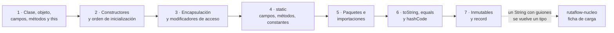
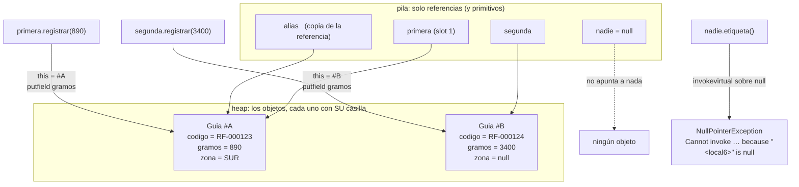
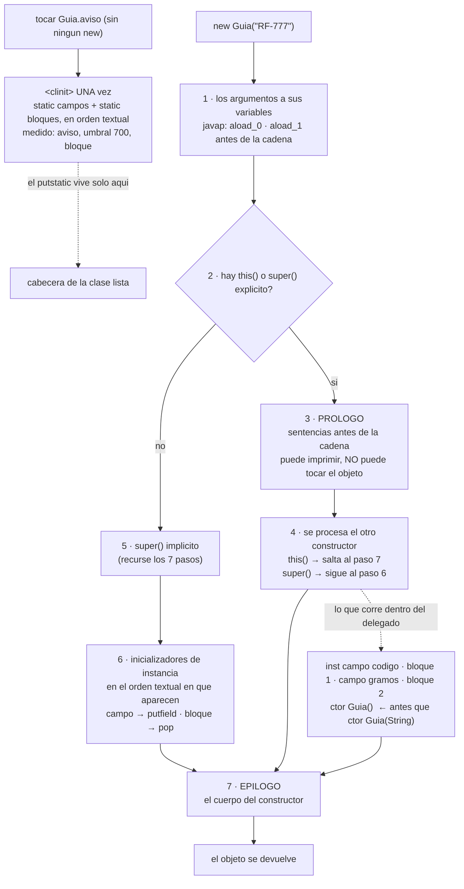
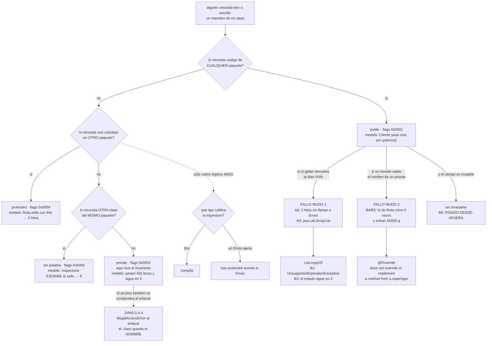
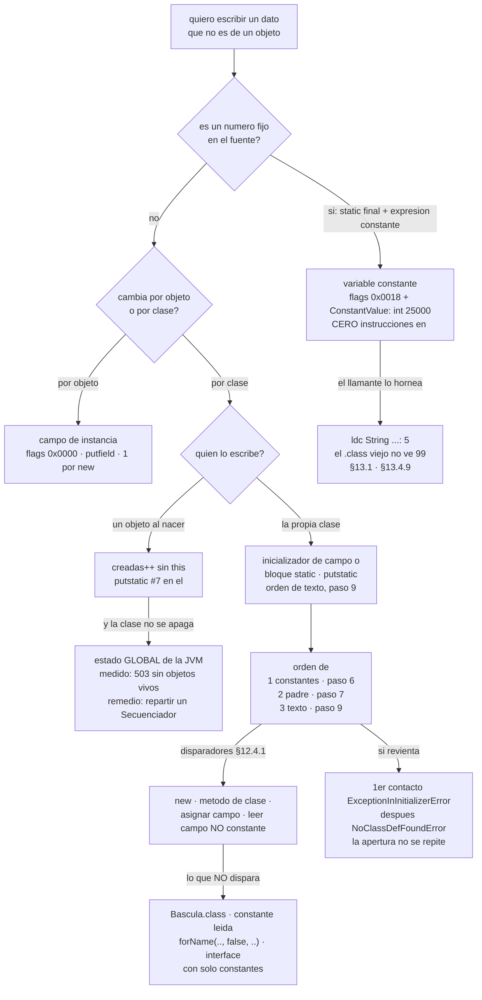

# Módulo 5 · Objetos y clases

> Curso Java (JDK 25) · tramo **Fundamentos** · 7 temas · formato único (specs/021). Portada del curso:
> [CURSO.md](CURSO.md). Todo el código de este módulo se compiló con `javac --release 25` y se ejecutó con
> `java -Dstdout.encoding=UTF-8` sobre OpenJDK Temurin 27.0.1.0.2+1 (macOS, arm64), locale `es_CO`, el
> 2026-11-21. Las salidas están pegadas tal cual.
> **Aviso de proveniencia:** en esta máquina no hay JDK 25 instalado, así que el *API* es la de la versión 25
> (la que comprueba `--release 25`) pero el *ejecutable* es el 27. Ningún tema de este módulo usa funciones
> *preview*; lo que puede diferir entre los dos ejecutables está marcado en cada tema como «pendiente de
> reejecución en JDK 25», y aquí eso es casi siempre el **texto** de una excepción o de un mensaje de `javac`
> —que los redacta la herramienta— y nunca la regla de lenguaje que se enseña. Las citas de la JLS y de la JVMS de
> este módulo se verificaron contra la especificación **Java SE 25** que Oracle sirve hoy como
> «Specifications Latest» (páginas con `dateModified` 2026-09-15; el propio capítulo 12 remite a _The Java
> Virtual Machine Specification, Java SE 25 Edition_). JLS: §4.12.4, §4.12.5, §6.1, §6.3, §6.4.1, §6.6, §6.6.1,
> §6.6.2, §6.6.2.1 (con su Ejemplo 6.6.2-1), §6.7, §7.1, §7.2, §7.3, §7.4, §7.4.1, §7.4.2, §7.4.3, §7.5, §7.5.1,
> §7.5.2, §7.5.3, §7.5.5, §7.6, §7.7.5, §8.1, §8.1.1.4, §8.1.3, §8.1.8, §8.2, §8.3, §8.3.1.1, §8.3.2, §8.3.3, §8.4,
> §8.4.3.2, §8.4.8.1, §8.4.8.2 (con su Ejemplo 8.4.8.2-1 «Goodnight, Dick»), §8.4.8.3, §8.6, §8.7, §8.8, §8.8.7,
> §8.8.7.1, §8.8.8, §8.8.9, §8.8.10, §8.10, §9.3, §9.3.1, §9.6.4.4, §12.4.1, §12.4.2, §12.5, §12.6, §12.7, §13.1,
> §13.4.9, §14.22, §15.8.3, §15.11.1, §15.12.4, §15.12.4.1, §15.21.3, §15.29 y el capítulo 16 (§16.1.1 y §16.9).
> JVMS: §2.6.1, §2.9.1, §2.9.2, §4.7.2, §4.7.28, §4.7.29, §4.10.1.8, §5.3.2, §5.4.3, §5.4.4 y §5.5. JEP: 358 (los
> mensajes del `NullPointerException`), 395 (miembros `static` en clases internas), 511 (imports de módulo) y 512
> (unidad de compilación compacta y método `main` de instancia) —los dos, del tema 5—.
> **Estado de escritura:** tema 5 de 7. Los temas 6 y 7 están previstos y aún no escritos; el laboratorio tiene
> su puerta para los cinco temas escritos (**417 comprobaciones, 0 fallidas, 0 omitidas**: 41 del tema 1, 48 del
> tema 2, 51 del tema 3, 103 del tema 4 y 174 del tema 5), y esta portada no declara horas del módulo completo hasta
> que los siete estén medidos.

## Cabecera del módulo

| | |
|---|---|
| **Objetivo** | Pasar de «datos sueltos en arreglos» a **un tipo propio**: declarar una clase cuyos campos son su estado y cuyos métodos reciben el objeto como primer argumento, entender que `new` crea un objeto y la variable solo lo señala, seguir el `this` hasta el bytecode, saber **en qué orden** se le llenan las casillas —los siete pasos de §12.5, dónde caen los inicializadores y por qué `this(...)` se salta los propios—, y dominar las tres cosas que más programas rompen: que asignar copie la **referencia** (no el objeto), que `null` sea un valor de referencia y no «un objeto vacío», y que el nivel de acceso es la única barrera que se comprueba sola —un getter que devuelve la lista viva anula tu invariante con el compilador callado, y un método que repite el nombre de un `private` del padre no se ejecuta **nunca**—, y que hay casillas que no viven en el objeto sino en la **clase**: una sola encarnación aunque ya no quede ningún objeto, un método de clase que se escoge por el tipo del fuente y no por el objeto, y una constante que se hornea dentro del archivo que la lee y por eso no ve el valor nuevo aunque se recompile quien la declara. |
| **Prerrequisitos** | [Módulo 4](modulo-4.md) completo —en especial su tema 1 (`new Punto[2]` deja casillas `null`: aquí eso mismo pasa con objetos que no son arreglos) y su tema 4 (`ArrayList`/`HashMap`, porque el siguiente paso natural es una lista de objetos)— y [Módulo 3](modulo-3.md) completo, sobre todo su tema 4: **al método se le copia la referencia, no el contenido**; esa regla es la que aquí se ve funcionando dentro de un objeto. Del [Módulo 0](modulo-0.md) se sigue usando `javap -c -p`. |
| **Duración** | Escrito: 200 min (temas 1 a 5, 40 min cada uno). Previstos 7 temas de 40 min · **4 h 40 min** según el temario, cifra que se fija con las cabeceras cuando el módulo esté completo. |
| **Versiones** | JDK 25 (`--release 25`). Nada de este módulo depende de una función *preview*. Cinco cosas que sí dependen del ejecutable y se tratan como tales: el **texto** del `NullPointerException` con mensajes útiles (lo redacta la JVM 27; el fenómeno es de 14+), el **número** que devuelve `System.identityHashCode` (medido: cambia con `-XX:hashCode=` y no es una cifra del lenguaje), el **número de instrucciones** de cada `<init>` que publica el tema 2 (11 / 6 / 7 con cadena, 11 / 14 / 17 sin ella) —es política del generador de código de `javac`, no regla del lenguaje; lo que §12.5 paso 4 sí exige es el **reparto** de los inicializadores (2 / 0 / 0 frente a 2 / 2 / 2)—, y lo del tema 3: el mismo fuente sale con **`invokespecial`** al llamarse un `private` desde su clase compilando `--release 8` y con **`invokevirtual`** de 11 a 25 (medido release a release), el puente `access$000` solo aparece en el 8, y el nombre interno `ImmutableCollections$List12` que imprime `B2` depende del tamaño de la lista y de la JDK; y las del tema 4: la redacción de los cinco avisos `[static]` y de los seis cortes de `javac`, el nombre de ranura `<local4>` que la JVM escoge para el `NullPointerException`, los conteos de instrucciones del `.class` (5 `getstatic` de `creadas`, 0 `getfield`, 2 `invokevirtual` de `describe`, 0 `aload_0` en `sumar`) y la cota del JEP 395, que para medirse necesita que la JDK todavía acepte `--release 15`; y las del tema 5: la
redacción literal de los errores del capítulo 7 que comprueba el guion (los escribe `javac`), y el hecho de que la
frontera 24↔25 **no es simétrica** —el mismo fuente ilegal da dos errores en `--release 24` y uno en `25`, y hasta
cambia la lista de tokens del mensaje—, por lo que esas cinco comprobaciones se afirmaron ejecutándolas en las dos
cotas y no deducándolas de una. En los tres casos del tema 3 lo que se enseña es la **regla** (§6.6.2.1, §8.2, §5.4.4
y el rechazo `UnsupportedOperationException`), no el detalle del volcado; en el tema 5 lo mismo: la regla es de la JLS
(§7.4, §7.5, §7.6, §7.7) y lo que se reejecuta es el texto. |
| **Laboratorio** | [`laboratorios/modulo-5/`](laboratorios/modulo-5/README.md) (al publicar: `examples/java/modulo-5/`), con `verificar.sh`: **417 comprobaciones, 0 fallidas, 0 omitidas** ejecutadas aquí (41 del tema 1, 48 del tema 2, 51 del tema 3, 103 del tema 4 y 174 del tema 5). |
| **Proyecto guía** | `rutaflow-nucleo`: la **ficha de carga**. En M4 una guía era un `String` con guiones que se partía con `split`; aquí pasa a ser un objeto `Guia` con `codigo`, `gramos` y `zona`, su método `etiqueta()` y su constructor. Cada tema cierra una parte: la clase y su receptor (T1), cómo se construye y en qué orden (T2), qué se puede tocar desde fuera (T3), qué pertenece a la clase y no al objeto (T4), dónde vive el archivo (T5), cómo se compara e imprime (T6) y cómo se hace inmutable (T7). |

### Mapa del módulo



**Texto alternativo:** el módulo entero es un cambio de notación. Mientras los datos son `int[]` y `String[]`,
el programa habla de posiciones; cuando declaras `class Guia`, el programa habla de **cosas**. El tema 1 da el
molde y el receptor (`this`). El tema 2 explica cómo nace un objeto y en qué orden se le llenan los campos, que
es donde aparecen los bugs de «uso antes de construir». El tema 3 decide qué se ve desde fuera, y por qué un
getter no es un campo. El tema 4 separa lo que pertenece a la clase de lo que pertenece al objeto. El tema 5
pone el archivo en un paquete y ordena las importaciones. El tema 6 es el contrato de `Object`: sin `equals` y
`hashCode` tus objetos se comparan por identidad y se imprimen con un hash. El tema 7 cierra con el objeto que
no cambia —a mano y con `record`—.

**Convención del módulo.** Igual que en M4: lo que afirma el lenguaje se comprueba con `javap` sobre el
`.class` generado con `--release 25`; lo que afirma el programa se comprueba ejecutándolo y pegando su salida;
y las fronteras se miden en las dos direcciones. Hay tres familias de datos que **no** se citan como si
fueran del lenguaje y por eso se tratan así: el **número** de `System.identityHashCode` (solo se comprueba el
invariante: dos objetos distintos pueden dar el mismo número, y cambiar la estrategia de la JVM cambia los
números), el **texto** de los mensajes de `javac` y de la JVM (se citan literalmente porque así los emite la
herramienta que usamos, pero se marcan como pendientes de reejecución en 25), y cualquier **dirección o hash**
que salga del `toString` por defecto de un objeto (aquello de `Guia@1b6d3586` lleva hash de identidad; el tema
6 lo sustituye por `toString`). Ninguna comprobación de este módulo depende del valor absoluto de un hash ni
del nombre del frame que aparece en un mensaje de `NullPointerException`.

---

### Tema 1: Clases, objetos, campos, métodos y `this` · Básico · 40 min

#### 1. Ubicación y prerrequisitos

Curso Java · tramo Fundamentos · módulo 5 · primer tema. Antes: [Módulo 4 · tema 1](modulo-4.md) (crear un
arreglo de objetos: `new Guia[3]` son tres casillas `null`, y aquí verás por qué), [Módulo 4 · tema 4](modulo-4.md)
(`ArrayList` y `HashMap`, donde ya metiste `String` e `Integer` y ahora meterás tus propios objetos),
[Módulo 3 · tema 4](modulo-3.md) (parámetros, retorno y sobrecarga: al método llega una **copia de la
referencia**, medido allí) y [Módulo 3 · tema 5](modulo-3.md) (la pila de llamadas: el «marco» del que sale la
ranura 0 donde vive `this`). Del [Módulo 0](modulo-0.md): su tema 3 para `javap`, su tema 4 porque ya decidió
que `main` es `static` y su tema 5 para el lanzador de archivo fuente. No se necesita ninguna biblioteca: el
tema entero cabe en un archivo. Fuentes: JLS §8.1 (declaración de clase), §8.2 (miembros), §8.3 (campos), §8.4
(métodos), §4.12.5 (valores por defecto), §15.8.3 (`this`), §15.21.3 (`==` entre referencias), §16 (la variable
local sí exige asignación previa), CJ1 capítulo 4, OCP capítulo 3, JEP 358 (el mensaje del `NPE`).

#### 2. Objetivo

**Al terminar serás capaz de:** declarar una clase con campos y métodos y decir, sin ejecutar nada, cuánto
vale cada campo de un objeto recién creado (`0` para `int`, `null` para `String`) y por qué una variable local
sin asignar **no compila** mientras ese campo sí. Escribir un método de instancia y saber qué objeto es `this`
en cada una de sus llamadas, incluidas las dos formas en que `this` se puede perder: desde un `static` y sobre
`null`. Predecir qué ve un objeto cuando otro nombre cambia uno de sus campos, y distinguir «mismos campos» de
«mismo objeto». Y, si abres el `.class`, señalar en el volcado la instrucción que lee el campo y la que lo
escribe, y decir en qué ranura está el receptor.

#### 3. Por qué importa

Hasta el módulo 4 tus datos viajaban en posiciones: `gramos[i]`, `zonas[i]`. Eso funciona mientras **todo** el
programa recuerde que la casilla 0 de un arreglo pertenece con la casilla 0 de otro. En cuanto el programa pasa
de un tamaño, la correspondencia se rompe en silencio y el fallo aparece como un número mal sumado, no como un
error. La clase convierte esa convención en un tipo: `Guia` lleva su peso **pegado** a su código, y si te
equivocas de objeto no obtienes un número raro —obtienes un error de compilación o un `NullPointerException`
que dice el método.

Y hay una segunda razón, más incómoda: casi todo el Java que vas a leer es esto. Un `record` (tema 7), una
interfaz con implementación (M6), un `enum` (M6) o una entidad de JPA (tramo Aplicación) son un caso particular
de lo que se declara aquí. La parte que la gente aprende «por arriba» —que `this` es el objeto receptor, que
asignar copia la referencia y no el objeto, que un campo `static` no es de cada objeto— es exactamente la parte
que produce los bugs de alias y de estado compartido que luego nadie explica.

Medido en `errores/ThisDesdeStatic.java`: escribir `this` donde no hay objeto no es un estilo desaconsejado, es
un error que `javac` rechaza con `non-static variable this cannot be referenced from a static context`. Medido
en `errores/LocalSinValor.java`: el campo `static int campo` sin inicializar vale `0` y compila; la variable
local `int local` sin inicializar **no compila**. Es la diferencia entre el estado de un objeto, que siempre
está inicializado, y una ranura de un marco de pila, que no existe hasta que le escribes.

#### 4. Analogía

Un **expediente de guía en la bodega**. La clase es el *formato* del expediente: dice qué casillas tiene
(código, peso, zona) y qué se puede hacer con él (registrar un peso, imprimir la etiqueta). El objeto es **un
expediente concreto**, con su folio. `new Guia("RF-000123")` es pedir un folio nuevo y escribirle el código: las
demás casillas quedan **en blanco**, no en cero ni en `""` —en blanco quiere decir `null` para las de texto y
`0` para las numéricas, porque el formulario está impreso pero nadie las ha rellenado.

Ahora la parte que la analogía deja ver bien: de un mismo expediente caben **muchas fotocopias de la carpeta,
pero un solo expediente**. `Guia alias = primera` no fotocopia el expediente: saca otra etiqueta con el mismo
folio. Si quien tiene la etiqueta nueva escribe 890 en la casilla del peso, el expediente **ya está** en 890 y
el primer nombre lo muestra —medido: `por la primera      : 890 (lo cambio quien se llama distinto)`. Y `null`
no es «un expediente en blanco»: es **no tener ninguna etiqueta**. Por eso `nadie.etiqueta()` no devuelve la
etiqueta vacía, sino que revienta —medido: `Cannot invoke "ClaseYObjetos$Guia.etiqueta()" because "<local6>" is null`.

Lo que la analogía traiciona: un expediente físico no puede tener dos pesos; dos objetos sí, y el que cambia uno
no entera al otro (medido: la segunda guía sigue en `3400` mientras la primera ya va en `890`). Los objetos no
comparten casillas: comparten, si acaso, referencias.

#### 5. Diagrama



**Texto alternativo:** la pila guarda nombres y referencias; el heap guarda objetos con sus campos. `primera` y
`alias` apuntan al **mismo** objeto `#A` —medido: `alias misma identidad: true`—, así que una escritura vista
por `alias` (`putfield gramos`) se lee por `primera`. `segunda` es otro objeto `#B` y no se entera. `nadie` no
apunta a un objeto con las casillas vacías: vale `null`, y llamar un método de instancia sobre `null` lanza al
evaluar el receptor. El mismo método, llamado sobre dos objetos distintos, recibe dos `this` distintos: eso es
lo que significa «método de instancia».

#### 6. Explicación

**Nivel 0 — una clase es un tipo nuevo, y `new` crea un objeto con sus campos ya inicializados.**

El archivo `tema-1/ClaseYObjetos.java` declara, dentro de la clase del `main`, una segunda clase:

```java
static class Guia {
    String codigo;   // campo de referencia: valor por defecto null
    int gramos;      // campo primitivo: valor por defecto 0
    String zona;     // sin asignar: el objeto sigue siendo legal
}
```

Tres cosas ocurren con eso. Uno: `Guia` es un tipo, igual que `int` o `String`, y se usa en declaraciones,
parámetros y retornos. Dos: los campos **no son** de la clase, son de cada objeto; `new Guia(...)` reparte
casillas. Tres: esas casillas no están «indeterminadas», tienen el valor por defecto del tipo (JLS §4.12.5:
`0` para numéricos, `false` para `boolean`, `\u0000` para `char`, `null` para referencias). Medido, recién
creado el objeto y antes de escribir en ninguna casilla:

```text
recien creada       : RF-000123 · 0 g · null · yo soy 498931366
```

`0 g` es `gramos` en su valor por defecto; `null` es `zona`, que nadie tocó. Es la misma regla que la del
`String[3]` del módulo 4: una casilla de referencias nace `null`, no nace `""`.

Lo que **no** pasa con las variables locales. `errores/LocalSinValor.java` declara `static int campo;` y una
local `int local;` sin asignar. El campo vale `0` y se puede imprimir; la local produce, medido:

```text
errores/LocalSinValor.java:9: error: variable local might not have been initialized
```

El compilador no te está siendo quisquilloso: los campos tienen un contrato de inicialización garantizado por la
creación del objeto (JLS §12.5), y las locales no. Por eso Java puede prometer «el campo siempre tiene un valor»
y no puede prometer «la variable siempre tiene un valor».

**Nivel 1 — `this` es el receptor: un parámetro que Java te pasa sin que lo escribas.**

`primera.registrar(1250)` y `segunda.registrar(3400)` llaman al **mismo** cuerpo de método. Lo que cambia es el
objeto que viaja delante de los argumentos: `this`. Por eso un método de instancia puede decir «mi peso» sin
saber de qué objeto se trata. Medido en la misma corrida, los dos objetos con su casilla propia:

```text
primera tras 1250: RF-000123 · 1250 g · null · yo soy 498931366
segunda tras 3400: RF-000124 · 3400 g · null · yo soy 414493378
```

Y hay una razón para escribir `this` explícitamente, no estética. Dentro del constructor

```java
Guia(String codigo) {
    this.codigo = codigo;
}
```

el parámetro se llama igual que el campo. Sin `this.`, `codigo = codigo` asigna el parámetro **contra sí mismo**
y el campo sigue en `null`, porque el nombre local oculta al campo (JLS §6.4.1, *Shadowing*). Medido en
`tema-1/SombraDeCampo.java`, que tiene los dos constructores uno al lado del otro:

```text
campo con el parametro tapando : null
campo con this.                : RF-000123
```

Y es un bug **sin aviso**: el mismo archivo compilado con `javac --release 25 -Xlint:all` no emite ni una
advertencia (medido: salida vacía). El `this` ahí no es decoración: es lo que separa «la casilla del objeto» de
«la variable del método».

`this` además **es** una referencia, así que se puede devolver y comparar. Medido:

```text
conZona devuelve el mismo objeto: true · y se queda con SUR
```

donde `conZona` hace `this.zona = nuevaZona; return this;`. Eso es lo que permite la cadena
`g.conZona("NORTE").registrar(1250)`, que verás en estilo de API por todo el curso. Lo importante no es la
cadena: es que **no hubo copia**. Se mutó el mismo objeto y se devolvió el mismo objeto.

Y lo contrario, medido como error de compilación en `errores/ThisDesdeStatic.java` (línea 7) y
`errores/MetodoSinObjeto.java` (línea 14):

```text
error: non-static variable this cannot be referenced from a static context
error: non-static method etiqueta() cannot be referenced from a static context
```

Los dos mensajes dicen lo mismo con otras palabras: un método `static` no recibe receptor, así que no tiene
`this` ni campos de objeto que leer (JLS §8.4.3.2). `main` es `static`; por eso todo lo que haces en `main` pasa
por `new` y un nombre de variable.

**Nivel 2 — referencia y objeto no son lo mismo, y eso tiene tres consecuencias.**

1. **Asignar copia la referencia, no el objeto.** `Guia alias = primera;` pone dos nombres sobre el mismo
   expediente. Medido: `alias misma identidad: true` (`==` entre referencias compara si son el mismo objeto,
   JLS §15.21.3), y después `alias.registrar(890)` deja `por la primera      : 890`. El puente con M3 · tema 4 es
   exacto: lo mismo que le pasaba a un arreglo en un parámetro le pasa a un objeto en un campo, en un retorno y
   en una variable.
2. **Campos iguales no hacen objetos iguales.** Dos guías creadas con el mismo código son dos objetos. Medido:
   `campos iguales       : mismo codigo true · misma referencia false · son dos objetos`, y otra vez en
   `SombraDeCampo.java` con dos objetos de la misma clase: `dos Bien con el mismo codigo   : false`. Esta línea
   es el anticipo del tema 6: hoy Java solo sabe comparar referencias con `==`; `equals` es lo que **tú**
   defines, y hasta definirlo dos objetos con los mismos datos no son «el mismo». Y un extra que conviene saber
   antes de escribir nada: `==` entre referencias exige que los tipos se puedan convertir el uno en el otro por
   cast (§15.21.3), así que comparar dos clases sin parentesco **no compila**. Medido en
   `errores/ComparaTiposDistintos.java`: `incomparable types: Mal and Bien`. Comparar con `Object` sí se puede
   (medido: `contra Object si se puede      : false`). El lenguaje te deja preguntar «¿es el mismo objeto?» entre
   tipos compatibles y te cierra el paso cuando la pregunta no tiene sentido.
3. **`null` es un valor de referencia, no un objeto vacío.** Medido: `null no es un objeto sin datos, es
   ninguna referencia: true` —lo que se compara es el valor de la variable contra el literal `null`, y dos `null`
   entre sí dan `true` porque no hay objeto que distinguir— y, acto seguido, `llamar sobre null   : Cannot
   invoke "ClaseYObjetos$Guia.etiqueta()" because "<local6>" is null`. El mensaje con detalles es el JEP 358,
   dirigido a JDK 14; en este ejecutable viene activo sin opción ninguna (medido: no pasamos ningún `-XX`). En
   esta corrida el nombre del local sale como ranura (`<local6>`) porque compilé sin tabla de depuración.
   Recompilado con `-g` (medido): `because "nadie" is null`. La regla que enseño es la misma en los dos casos,
   pero no finjo que el texto sea idéntico en cualquier compilación.

**Nivel 3 — lo que ve la JVM: el receptor va en la ranura 0 y el campo se lee con `getfield`.**

`tema-1/por-dentro/CamposEnBytecode.java` declara `Punto` con dos métodos que difieren solo en escribir `this.`
en el fuente. Volcado con `javap -c -p` (las instrucciones están tal cual salen):

```text
  int conThis();
    Code:
         0: aload_0
         1: getfield      #7                  // Field x:I
         4: ireturn

  int sinThis();
    Code:
         0: aload_0
         1: getfield      #7                  // Field x:I
         4: ireturn
```

Cuerpo a cuerpo son **la misma secuencia** —el laboratorio lo comprueba comparando las dos, no lo afirma de palabra—: `this`
no cuesta una instrucción, porque no es una cosa que se consulta, es la ranura 0 del marco. Lo mismo para
escribir:

```text
  void mover(int, int);
    Code:
         0: aload_0
         1: aload_0
         2: getfield      #7                  // Field x:I
         5: iload_1
         6: iadd
         7: putfield      #7                  // Field x:I
        10: aload_0
        11: aload_0
        12: getfield      #13                 // Field y:I
        15: iload_2
        16: iadd
        17: putfield      #13                 // Field y:I
        20: return
```

Leído ranura a ranura: la 0 es el receptor (`this`, el objeto al que se le mueve el punto), la 1 es `dx` y la 2
es `dy` —los dos parámetros, desplazados porque la 0 ya está ocupada—; `x` se lee con `getfield` sobre la
referencia de la ranura 0 y se escribe con `putfield` sobre **esa misma referencia** (dos `aload_0` seguidos: uno
alimenta la lectura y otro el destino), y `y` hace lo propio con `#13`.

De ahí salen dos reglas que la gente confunde con las que no. En un método de instancia, `aload_0` es **el
objeto** y los parámetros empiezan en `iload_1`; en un método `static` la ranura 0 ya es el primer parámetro, y
por eso no puede existir `this` (nivel 1) —la prohibición del compilador y la geometría del marco son la misma
cosa vista de dos lados.

Crear el objeto, medido en `Punto.cero()` y en `main`:

```text
  static CamposEnBytecode$Punto cero();
    Code:
         0: new           #8                  // class CamposEnBytecode$Punto
         3: dup
         4: invokespecial #16                 // Method "<init>":()V
         7: areturn
```

Tres pasos seguidos: `new` reserva y pone la referencia en la pila, `dup` la duplica (una la consume el
constructor, la otra es el valor de la expresión), `invokespecial` llama al constructor **con** esa referencia.
Y el constructor propio de `Punto` no hace más que encadenar hacia arriba, medido:

```text
  CamposEnBytecode$Punto();
    Code:
         0: aload_0
         1: invokespecial #1                  // Method java/lang/Object."<init>":()V
         4: return
```

Nadie escribe `x = 0` en el bytecode del constructor de `Punto` **porque sus campos no tienen inicializador
explícito**: el cero viene de la preparación del objeto (JLS §12.5: asignar memoria e inicializar los campos a
su valor por defecto ocurre antes del cuerpo del constructor). Un campo con `= 1250` sí aparecería en `<init>`,
y eso es justo el tema 2.

Cómo se ve la llamada desde fuera, medido en `main` de `CamposEnBytecode`:

```text
  public static void main(java.lang.String[]);
    Code:
         0: new           #7                  // class CamposEnBytecode$Punto
         3: dup
         4: invokespecial #9                  // Method CamposEnBytecode$Punto."<init>":()V
         7: astore_1
         8: aload_1
         9: iconst_3
        10: iconst_4
        11: invokevirtual #10                 // Method CamposEnBytecode$Punto.mover:(II)V
        ...
        36: invokestatic  #37                 // Method CamposEnBytecode$Punto.cero:()LCamposEnBytecode$Punto;
        39: getfield      #41                 // Field CamposEnBytecode$Punto.x:I
```

`mover` se llama con `invokevirtual` (hay receptor: `aload_1` pone el objeto en la pila **antes** de los dos
`int`) y `cero()` con `invokestatic` (no hay receptor: se llama por el nombre de la clase). El descriptor
`(II)V` es la firma que ya viste en M0: dos `int`, devuelve `void`. Y fíjate en `astore_1` a la altura 7: dentro
de un método `static`, la ranura 0 es el primer parámetro (`args`), así que el punto nuevo se guarda en la 1.
Esa es la misma geometría que arriba impedía `this`.

Y el puente con el módulo 4, medido en la salida del mismo programa:

```text
conThis/sinThis    : 3 / 3 · mismo resultado
creado dentro      : 0 (valor por defecto, nadie escribio)
arreglo de Punto   : casilla 0 sin crear es null? true · tras crearla, no: true
```

`new Punto[2]` en bytecode es `anewarray` y **no** construye dos `Punto`: construye dos `null` (en el volcado de
`main` se ve el `aaload` seguido de un `ifnonnull` que es literalmente la comprobación que acabas de imprimir).
Eso explica por qué el módulo 4 te dejaba sumar `0` de un arreglo de `int` pero te reventaba con un arreglo de
`String` al llamar `.length()`.

Por último, la clase anidada. `ClaseYObjetos.java` es **un archivo** y produce **dos** `.class`, medido con
`javac --release 25 -d out ClaseYObjetos.java && ls out`:

```text
ClaseYObjetos$Guia.class
ClaseYObjetos.class
```

El `$` es el nombre binario (JLS §13.1); es lo que estabas leyendo en el mensaje de `NullPointerException` de
nivel 2: `Cannot invoke "ClaseYObjetos$Guia.etiqueta()"`. Y `javap -p` de la anidada, medido:

```text
class ClaseYObjetos$Guia {
  java.lang.String codigo;
  int gramos;
  java.lang.String zona;
  ClaseYObjetos$Guia(java.lang.String);
  java.lang.String etiqueta();
  void registrar(int);
  ClaseYObjetos$Guia conZona(java.lang.String);
}
```

Ningún miembro lleva modificador de acceso: todos quedaron con acceso de paquete (tema 3). La clase exterior
usa `g.codigo` sin problema, y en `javap -v -p` de la exterior aparece el atributo `NestMembers:
ClaseYObjetos$Guia`, con **cero** métodos sintéticos `access$`. Eso es lo que hace la regla «dentro del mismo
`class` se ven los `private`» (JLS §6.6.1) sin pagar el precio de los accessors que Java pagaba antes de la
11. Aquí solo hace falta saber que `static class` = clase anidada que no recibe un objeto exterior (JLS
§8.1.1.4); para este tema la uso porque mantiene el ejemplo en un archivo y se puede ejecutar con el lanzador de
fuente.

Sobre el archivo en sí, medido en `errores/DosPublicasEnUnArchivo.java`:

```text
errores/DosPublicasEnUnArchivo.java:6: error: class Guia is public, should be declared in a file named Guia.java
```

Un archivo fuente admite varias clases, pero **una** `public` y con el nombre del archivo (JLS §7.6). Ese error
lo vas a ver escrito mal cien veces en foros; la regla no es «no se puede», es «no dos `public`».

#### 7. Código ejecutable

**Ejemplo mínimo** · archivo `tema-1/ClaseYObjetos.java` · ejecuta
`javac --release 25 -d out tema-1/ClaseYObjetos.java && java -Dstdout.encoding=UTF-8 -cp out ClaseYObjetos`

```java
public class ClaseYObjetos {

    static class Guia {
        String codigo;          // campo de referencia: su valor por defecto es null
        int gramos;             // campo primitivo: su valor por defecto es 0
        String zona;            // se puede dejar sin asignar y el objeto sigue siendo legal

        Guia(String codigo) {   // el parametro se llama igual que el campo: aqui `this` no es opcional
            this.codigo = codigo;
        }

        String etiqueta() {
            return codigo + " · " + gramos + " g · " + zona + " · yo soy " + System.identityHashCode(this);
        }

        void registrar(int peso) {
            this.gramos = peso;
        }

        Guia conZona(String nuevaZona) {
            this.zona = nuevaZona;
            return this;        // devuelve el mismo objeto, no una copia
        }
    }

    static void muestra(String que, Guia g) {
        System.out.println(que + g.etiqueta());
    }

    public static void main(String[] args) {
        Guia primera = new Guia("RF-000123");
        System.out.println("recien creada       : " + primera.etiqueta());

        Guia segunda = new Guia("RF-000124");
        System.out.println("dos objetos         : primera " + System.identityHashCode(primera)
                + " · segunda " + System.identityHashCode(segunda)
                + " · referencia distinta? " + (primera != segunda));

        primera.registrar(1250);
        segunda.registrar(3400);
        muestra("primera tras 1250: ", primera);
        muestra("segunda tras 3400: ", segunda);

        Guia alias = primera;                             // copia la REFERENCIA, no el objeto
        System.out.println("alias misma identidad: " + (alias == primera));
        alias.registrar(890);
        System.out.println("por la primera      : " + primera.gramos + " (lo cambio quien se llama distinto)");

        primera.conZona("NORTE");
        System.out.println("conZona devuelve el mismo objeto: " + (primera.conZona("SUR") == primera)
                + " · y se queda con " + primera.zona);

        Guia g1 = new Guia("RF-000123");
        Guia g2 = new Guia("RF-000123");
        System.out.println("campos iguales       : mismo codigo " + g1.codigo.equals(g2.codigo)
                + " · misma referencia " + (g1 == g2) + " · son dos objetos");

        Guia nadie = null;
        System.out.println("null no es un objeto sin datos, es ninguna referencia: " + (nadie == null));
        try {
            nadie.etiqueta();
        } catch (NullPointerException e) {
            System.out.println("llamar sobre null   : " + e.getMessage());
        }
    }
}
```

Salida medida (Temurin 27.0.1.0.2+1, `--release 25`, sin `-g`):

```text
recien creada       : RF-000123 · 0 g · null · yo soy 498931366
dos objetos         : primera 498931366 · segunda 414493378 · referencia distinta? true
primera tras 1250: RF-000123 · 1250 g · null · yo soy 498931366
segunda tras 3400: RF-000124 · 3400 g · null · yo soy 414493378
alias misma identidad: true
por la primera      : 890 (lo cambio quien se llama distinto)
conZona devuelve el mismo objeto: true · y se queda con SUR
campos iguales       : mismo codigo true · misma referencia false · son dos objetos
null no es un objeto sin datos, es ninguna referencia: true
llamar sobre null   : Cannot invoke "ClaseYObjetos$Guia.etiqueta()" because "<local6>" is null
```

Los dos números de las dos primeras líneas son los que devolvió **esta** JVM: repetido cinco veces seguidas dio
igual, y forzando la estrategia con `-XX:hashCode=2` los dos se vuelven `1`. Se pegan porque son la salida real,
no porque sean una propiedad del objeto; lo que se enseña es el `true` de `referencia distinta?`, que sí lo es.

**Segundo ejemplo** · `tema-1/por-dentro/CamposEnBytecode.java` · ejecuta
`javac --release 25 -d out tema-1/por-dentro/CamposEnBytecode.java && java -Dstdout.encoding=UTF-8 -cp out CamposEnBytecode`
y después `javap -c -p -cp out 'CamposEnBytecode$Punto'`. Su salida son las tres líneas del nivel 3
(`conThis/sinThis : 3 / 3`, `creado dentro : 0`, `arreglo de Punto : casilla 0 sin crear es null? true · tras
crearla, no: true`) y los volcados pegados arriba.

**Tercer ejemplo** · `tema-1/SombraDeCampo.java` · ejecuta
`javac --release 25 -Xlint:all -d out tema-1/SombraDeCampo.java && java -Dstdout.encoding=UTF-8 -cp out SombraDeCampo`.
Son dos clases con el mismo campo y el mismo parámetro, una con `codigo = codigo` y otra con `this.codigo =
codigo`. Salida medida:

```text
campo con el parametro tapando : null
campo con this.                : RF-000123
dos Bien con el mismo codigo   : false
contra Object si se puede      : false
```

`javac` no emite ninguna advertencia con `-Xlint:all` (medido: salida vacía tras compilar). Es el ejemplo más
importante del tema porque no se ve: el bug está en una línea que parece escrita.

**Los cinco errores** · `tema-1/errores/` son para que los provoques tú:
`ThisDesdeStatic.java`, `MetodoSinObjeto.java`, `LocalSinValor.java`, `DosPublicasEnUnArchivo.java` y
`ComparaTiposDistintos.java`. Ninguno compila, y los cinco mensajes están citados en los niveles 0, 1, 2 y 3.

#### 8. Mini-laboratorio

Escribe los archivos desde cero en `laboratorios/modulo-5/tema-1/` (no copies y pegues: el ejercicio es predecir
y comprobar).

1. Crea `MiGuia.java` con una clase `static class Ficha` dentro de `MiGuia`, con tres campos sin inicializar:
   `String codigo; int gramos; char estado;`. En `main`, crea un objeto y **sin escribir en ningún campo**
   imprime los tres separados por ` | `, después su `getClass().getName()`. Escribe en un comentario qué esperas
   ver antes de ejecutar. Ejecuta: si el comentario decía `null | 0 | ` con espacio, está mal; `char` por defecto
   es `\u0000`, que se imprime como nada y engaña. Cuenta con `ls out` cuántos `.class` produjo un solo `.java`
   y anota por qué hay dos.
2. En el mismo archivo, declara `Ficha a = new Ficha();` y `Ficha b = a;`. Escribe `a.gramos = 1250;` e imprime
   `b.gramos`. Predícelo en un comentario. Después añade `Ficha c = new Ficha(); c.gramos = 1250;` e imprime en
   tres líneas `a == b`, `a == c`, `a.gramos == c.gramos`. Esas tres respuestas juntas son el nivel 2 del tema:
   si no las predijiste bien, vuelve a él.
3. Añade a `Ficha` un constructor `Ficha(String codigo) { codigo = codigo; }` y crea un objeto con él. Imprime el
   campo. Escribe la predicción **antes** de ejecutar, compila con `-Xlint:all` y mira si el compilador dice
   algo. Corrige el constructor con `this.` y vuelve a ejecutar. Los dos mensajes que no llegaron (el de `javac`
   vacío y el `null` en pantalla) son la lección.
4. Crea `OrdenDeSlots.java` con `static class Suma { int total; void subir(int n, int paso) { this.total = this.total + n + paso; } }`.
   Ejecuta `javac -d out OrdenDeSlots.java`, luego `javap -c -p -cp out 'OrdenDeSlots$Suma'`. En un comentario,
   escribe el número de la ranura que usa cada uno de los tres `int` del método (receptor, `n`, `paso`) **antes**
   de mirar el volcado, y después compruébalo. Si escribiste `iload_0` para `n`, lo que te falta es saber quién
   ocupa la 0.
5. Crea `SinReceptor.java` con un método de instancia `String etiqueta()` en una clase anidada y llama
   `System.out.println(MiClase.etiqueta());` desde `main`. Guarda el mensaje exacto de `javac`. Cambia la llamada
   a `System.out.println(new MiClase().etiqueta());`. Ejecuta el primero con el lanzador de fuente para ver el
   fallo otra vez. Ahora, en un comentario, responde con tus palabras qué es lo que **no** existe en el primer
   caso (pista: es la misma palabra que la JVM usa en su mensaje: *static context*).
6. Crea `Nulo.java` con `Ficha nadie = null;` y dos llamadas: `System.out.println(nadie == null);` y
   `nadie.etiqueta();`. Ejecuta y copia el mensaje completo del `NullPointerException`, incluido lo que va
   después de `because`. Vuelve a compilar con `javac -g -d outg Nulo.java` y ejecuta con `-cp outg`: copia ese
   segundo mensaje. Anota la diferencia y qué la produce.

**Listo cuando** puedas decir, sin ejecutar, los valores por defecto de `Ficha` con un campo `double`, uno
`boolean` y uno `Thread` (`0.0`, `false`, `null`); cuando el paso 2 te dé `true`, `false`, `true` sin titubear;
y cuando sepas explicar por qué la respuesta `a.gramos == c.gramos` siendo `true` **no** convierte a `a` y `c`
en el mismo objeto (esa es la pregunta del tema 6).

#### 9. Verificación

```bash
cd docs/reestructuracion/cursos/java/laboratorios/modulo-5
javac --release 25 -encoding UTF-8 -d out tema-1/*.java
java -Dstdout.encoding=UTF-8 -cp out ClaseYObjetos       # «recien creada : RF-000123 · 0 g · null» y «alias misma identidad: true»
javac --release 25 -Xlint:all -d outs tema-1/SombraDeCampo.java   # -Xlint:all no dice nada: salida vacia, medido
java -Dstdout.encoding=UTF-8 -cp outs SombraDeCampo      # «campo con el parametro tapando : null» frente a «this. : RF-000123»
java -Dstdout.encoding=UTF-8 -cp out CamposEnBytecode    # «conThis/sinThis : 3 / 3» y «casilla 0 sin crear es null? true»
javap -c -p -cp out 'CamposEnBytecode$Punto'              # aload_0 · getfield · putfield · iload_1
javac --release 25 -g -d outg tema-1/ClaseYObjetos.java   # el NPE pasa a decir because "nadie" is null
java -XX:+UnlockExperimentalVMOptions -XX:hashCode=2 -cp out ClaseYObjetos   # los dos numeros salen iguales
ls out                                                    # dos .class: ClaseYObjetos.class y ClaseYObjetos$Guia.class
javap -p -cp out 'ClaseYObjetos$Guia'                     # codigo, gramos, zona: sin modificador = acceso de paquete
javac -d /tmp/m5e tema-1/errores/ThisDesdeStatic.java     # non-static variable this cannot be referenced…
javac -d /tmp/m5e tema-1/errores/LocalSinValor.java       # variable local might not have been initialized
```

O, todo el laboratorio del módulo de una vez: `./verificar.sh`. Aquí esas **41** comprobaciones del tema pasan
con Temurin 27 y `--release 25`; con JDK 25 en el `PATH` basta `./verificar.sh`. Reparto medido sobre el propio
script: **16** sobre la salida de `ClaseYObjetos` (dentro van las tres de `identityHashCode` y las dos de
`-g`/sin `-g`), **4** de `SombraDeCampo`, **3** de `CamposEnBytecode` ejecutado, **6** sobre el volcado de `Punto`
(incluida la comparación byte a byte de que los dos cuerpos, con `this.` y sin él, salgan idénticos), **4** sobre
los `.class` de la clase anidada (los dos archivos, el acceso de paquete, `NestMembers` y la ausencia de
`access$`), **3** sobre el volcado de `main` (`aload_1`, `mover:(II)V`, `invokestatic`) y **5** fallos de
compilación esperados. 16 + 4 + 3 + 6 + 4 + 3 + 5 = 41.

*Pendiente de reejecución en JDK 25:* los **mensajes de texto**. El del `NullPointerException`
(`Cannot invoke "…Guia.etiqueta()" because "<local6>" is null`) lo construye la JVM y su redacción cambió en el
paso de 13 a 14; el de `javac` (`non-static variable this cannot be referenced from a static context`, y los
otros cuatro mensajes de los errores esperados, incluido `incomparable types: Mal and Bien`) lo fija el
compilador de la 25 y conviene confirmar que siguen palabra por palabra. La forma del nombre de la posición
(`"<local6>"` frente a `"nadie"`) depende de si compilaste con `-g` y de cuántas variables haya delante, así que
**no es** una cifra del tema ni una comprobación de la puerta.

*Lo que no depende de la versión:* los valores por defecto (JLS §4.12.5), que asignar una variable copie la
referencia, que `==` entre referencias compare identidad (§15.21.3), que `this` sea la ranura 0 del marco y los
parámetros de un método de instancia empiecen en la 1, `getfield`/`putfield` como únicas formas de tocar un
campo, `new` + `dup` + `invokespecial` como los tres pasos de crear un objeto, `aload_0` y `aload_0`/`aload_0`
en el constructor, `invokestatic` sin receptor, el nombre binario con `$`, el atributo `NestMembers`, y que una
clase anidada con `static` no reciba un objeto exterior (§8.1.1.4). Lo único de este tema que sí es del
ejecutable y no del lenguaje es **el número** de `System.identityHashCode`, y por eso la puerta no lo compara
contra una cifra: compara que con `-XX:hashCode=2` los dos objetos dan el mismo número y que con
`-XX:hashCode=0` no, y con eso queda probado que **no puede** usarse como prueba de identidad.

#### 10. Error común y diagnóstico

**Síntoma 1 — «mi objeto tiene los campos en `null`/`0` y no sé quién los borró».** Casi nunca los borró nadie:
nunca los escribió. Causa típica, el constructor con el parámetro que tapa al campo —las dos líneas reales de
`tema-1/SombraDeCampo.java`, la 9 y la 17:

```java
Mal(String codigo)  { codigo = codigo; }      // asigna el parametro contra si mismo: el campo no se toca
Bien(String codigo) { this.codigo = codigo; } // la mano izquierda dice de que objeto es la casilla
```

El mensaje no existe: `javac --release 25 -Xlint:all` sobre ese archivo no emite ni una línea (medido: salida
vacía). Esto es lo que sale al ejecutarlo:

```text
campo con el parametro tapando : null
campo con this.                : RF-000123
```

Diagnóstico: imprime el campo recién creado —`recien creada : RF-000123 · 0 g · null` en el ejemplo— o busca en
el cuerpo del constructor una asignación cuya mano izquierda no lleve `this.` ni un nombre de objeto. Salida real
de `errores/MetodoSinObjeto.java` al intentar lo contrario (usar el método como si fuera de la clase):

```text
errores/MetodoSinObjeto.java:14: error: non-static method etiqueta() cannot be referenced from a static context
```

**Síntoma 2 — «cambié el objeto en un método y se me cambió otro que no tocaba».** No es un bug de Java: es
que el parámetro y la variable son el mismo objeto. Esto no es una hipótesis; es el medidor del tema:
`alias misma identidad: true` seguido de `por la primera      : 890`. El arreglo de M4 · tema 4 y la guía de
hoy son el mismo fenómeno. Diagnóstico en producción: antes de suponer que «algo lo puso a 890», pregúntate
cuántos nombres tiene el objeto. Si la respuesta es «debería tener uno solo», el bug está en un setter que
devuelve `this` y se reusa, o en un campo de clase (`static`) que creíste de objeto —eso es el tema 4, medido
allí.

**Síntoma 3 — «comparo dos guías con `==` y no son iguales aunque traigan el mismo código».** Es correcto, y
salir de ahí tiene precio. Medido: `mismo codigo true · misma referencia false · son dos objetos`. Diagnóstico:
si lo que quieres comparar son los datos, `equals` (tema 6). Si lo que quieres es **una sola guía por código**,
no confíes en que alguien te pase el mismo objeto: busca en un `HashMap` (M4 · tema 4) o normaliza en una
fábrica (tema 4). Y si te apareció la tentación de comparar `System.identityHashCode(a) == System.identityHashCode(b)`:
la puerta tiene una comprobación que demuestra por qué está mal, y es que con `-XX:hashCode=2` los dos números
salen `1` para objetos distintos. No es un identificador: es un hash.

**Síntoma 4 — «uso `this` en un método utilitario y el compilador me dice algo de static context».**
`main`, y cualquier método que quieras llamar sin objeto, no tiene receptor (medido en
`errores/ThisDesdeStatic.java`). Dos salidas, ambas válidas: pasar el objeto como parámetro (la forma que ya
usaste en `muestra(String, Guia)` de `ClaseYObjetos.java`) o declarar el método de instancia y crear el objeto.
La tercera opción, «lo pongo `static` y listo», es la que produce el bug de estado compartido del tema 4.

**Síntoma 5 — «pongo dos clases `public` en el mismo archivo y no me deja».** Medido:
`class Guia is public, should be declared in a file named Guia.java`. La solución **no** es borrar la segunda
clase: es quitarle `public` (una clase de paquete sigue siendo utilizable desde el mismo paquete, que es justo
lo que necesitas mientras el tema 3 no decida otra cosa). Diagnóstico rápido: el mensaje te está diciendo el
nombre de archivo que espera; si la clase debe ser pública, cárgala a su propio archivo.

#### 11. Pregunta con respuesta modelo

**Comprensión.** Tienes `Ficha f;` como campo de una clase y `Ficha g;` como variable local dentro de un método.
¿Puedes imprimir `f == null` y `g == null` sin haber asignado nada?

**Respuesta modelo:** lo primero sí, y da `true`: los campos del objeto se inicializan a `null` al crearlo
(JLS §4.12.5) —medido en `recien creada : … · null`. Lo segundo **no compila**, medido con el mensaje
`variable local might not have been initialized`, porque el capítulo 16 (asignación definida) no garantiza el
contenido de una ranura de pila. La diferencia no es de estilo: un campo siempre tiene un valor porque el objeto
se construyó, una local puede no tenerlo porque nadie la ha escrito todavía.

**Comprensión.** ¿Qué pasa en `System.out.println(nadie.etiqueta())` si `nadie` vale `null`? ¿Y en
`System.out.println(nadie == null)`?

**Respuesta modelo:** la primera lanza —medido: `Cannot invoke "ClaseYObjetos$Guia.etiqueta()" because
"<local6>" is null`—, la segunda imprime `true` y no lanza. La razón es que `==` entre referencias (§15.21.3) es
un operador que compara el **valor** (una referencia, que puede ser `null`) mientras la llamada a un método de
instancia necesita un objeto para ponerlo en la ranura 0. `null` es un valor perfecto para comparar y un
receptor imposible. Y un detalle de entrevista: en Java 14+ el mensaje dice el método y la variable o ranura, así
que no hace falta el depurador; antes de 14 el `NPE` llegaba sin ninguna de las dos pistas.

**Aplicación.** Un compañero escribe esto y dice que «el bug es que `equals` falla»:

```java
Guia a = new Guia("RF-000123");
Guia b = new Guia("RF-000123");
if (a == b) System.out.println("misma guía");
```

**Respuesta modelo:** no hay bug en `==`: da `false` porque son dos objetos, y eso es lo que `==` promete
(medido: `mismo codigo true · misma referencia false · son dos objetos`). Lo que está mal es el **modelo**. Dos
expedientes con el mismo código pueden ser la misma guía o dos guías distintas, y el programa tiene que decir
cuál de las dos cosas quiso. Si quiso «el mismo objeto», `a == b` es correcto y el bug está en que alguien creó
una segunda `Guia` en vez de reusar la primera (normalízalas en una fábrica o guárdalas en un mapa por código).
Si quiso «la misma guía según su código», `==` es la herramienta equivocada: hay que comparar el código con
`equals` hoy y definir `equals`/`hashCode` en el tema 6, con su contrato, porque si no tus objetos no van a
funcionar dentro de `HashMap`. Y un tercer candidato que conviene descartar en la entrevista: no se salva la
comparación con `identityHashCode`, porque dos objetos distintos pueden compartir número (medido con
`-XX:hashCode=2`: `primera 1 · segunda 1`).

#### 12. Cuándo usarlo y cuándo no

| Úsalo | No lo uses |
|---|---|
| Un conjunto de datos que siempre viaja junto (código + peso + zona de la misma guía) | Dos arreglos paralelos indexados por posición: el día que uno se ordena, la correspondencia se rompe (M4 midió el filtro con `binarySearch`; aquí eso no puede pasar) |
| Conducta que depende del estado del dato (`registrar`, `etiqueta`) | Métodos `static` que reciben el objeto para «parecerse» a una función de otro lenguaje: si no usan estado, son una función; si lo usan, es un método |
| Tipos propios que el compilador puede comprobar (`List<Guia>`) | `Object[]` con casts, o `Map<String, Object>` con claves que son campos: pierdes el tipo y recuperas los bugs de posición |
| Una clase anidada `static` para un tipo auxiliar de un solo archivo (aquí `Guia`) | Clases anidadas **no** `static` cuando no hacen falta: cada instancia arrastra una referencia al objeto exterior (§8.1.3), y eso es memoria y ciclo de vida que no pediste |

**Costo:** un objeto cuesta su cabecera más el tamaño de sus campos, y leer un campo es una instrucción
(`getfield`) — no es gratis pero es lo más barato que hay en Java, y por eso `Guia` con tres campos le gana a
tres arreglos paralelos en claridad sin perder en velocidad. Lo que cuesta de verdad es la **mutabilidad por
referencia**: si expones el objeto, expones su memoria viva, y cualquier nombre puede escribir. La defensa es
encapsular (tema 3), decidir quién construye (tema 2) y, cuando el dato no debe cambiar, hacerlo inmutable
(tema 7). Lo que este tema **no** resuelve y no finge resolver: `toString` (sigue saliendo el hash de identidad
si imprimes el objeto), `equals`/`hashCode` (nivel 2, consecuencia 2) y el orden exacto en que se llenan los
campos cuando hay inicializadores y bloques —eso es el tema 2, y es donde la gente cree que sabe algo y no lo
sabe—.

---

### Tema 2: Constructores, encadenamiento con `this(...)`, bloques y orden de inicialización · Básico · 40 min

#### 1. Ubicación y prerrequisitos

Curso Java · tramo Fundamentos · módulo 5 · segundo tema. Antes: [M5 · tema 1](#tema-1-clases-objetos-campos-métodos-y-this) —
sin campos no hay nada que inicializar, y sin `this` como receptor no se entiende quién ejecuta el paso 6;
[M5 · tema 4 de M3](modulo-3.md) (al método se le copia la referencia: un constructor es un método más de esa
misma pila) y [M3 · tema 5](modulo-3.md) (el marco y sus ranuras: `javap` muestra `args_size=3` para un
constructor con dos argumentos porque el receptor va delante); del [Módulo 0](modulo-0.md), su tema 3 para
`javap -c -p -v` y su tema 4 porque ya decidió que un `static` no necesita objeto. Se supone del tema 1 el
valor por defecto de los campos (§4.12.5): aquí se ve el momento exacto en que ese valor deja de ser el
por defecto. Ninguna biblioteca: los cuatro fuentes del tema caben en dos carpetas. Fuentes: JLS §8.3.2
(inicializadores de campo), §8.3.3 (orden de ejecución), §8.6 (bloques de instancia y de clase), §8.7
(cuerpos), §8.8 (declaración de constructor), §8.8.7 (invocación de constructor: prólogo y epílogo), §8.8.7.1
(contexto de construcción temprano), §8.8.8 (constructor por defecto), §8.8.9 (lo que declara el compilador,
incluido su Ejemplo 8.8.9-1), §8.8.10, §12.4.1 y §12.4.2 (inicialización de la clase), §12.5 pasos 1–7, §16.9
(campos `final`), JVMS §2.6.1 (ranura 0), §2.9.1 (`<init>`), §2.9.2 (`<clinit>`).

#### 2. Objetivo

**Al terminar serás capaz de:** escribir los siete pasos de §12.5 y decir en cuál caen los inicializadores de
instancia, en cuál el cuerpo del constructor y en cuál el `super()` implícito. Predecir —sin ejecutar— el
**orden** de las 37 líneas que imprime `tema-2/ConstructoresYOrden.java`, incluidas las tres que delatan que un
inicializador leyó un campo antes de que el constructor lo escribiese. Decir cuántas veces corre un `static`
y cuántas un inicializador de instancia cuando se crean tres objetos (medido: **1** y **3**). Elegir entre
`this(...)` y repetir código con números delante: el mismo constructor cuesta **6 instrucciones delegando y 14
sin delegar**, y los valores impresos no cambian ni una coma (§12.5 paso 4). Detectar el bug que ningún aviso
cuenta —escribir un campo **antes** de `this(...)` compila mudo con `-Xlint:all` y el valor se pierde (medido:
`v = 9` cuando se escribió `5`)— y explicar por qué esa misma escritura antes de `super()` sí es error de
compilación. Y, si abres el `.class`, señalar dónde está el `<clinit>`, por qué un bloque de instancia acaba en
`pop` y un campo en `putfield`, y en qué constructor cayó la copia de los inicializadores.

#### 3. Por qué importa

El tema 1 enseñó a **declarar** el objeto; este decide en qué orden se le llenan las casillas, y casi todo el
código de arranque de un programa vive ahí. Tres razones medidas, en este orden de molestia.

La primera es el **silencio**. `tema-2/EncadenamientoSilencioso.java` escribe `this.v = nuevo;` y después
`this();`: el fuente es legal, `javac --release 25 -Xlint:all` no emite ni una línea y el valor que el programa
intentaba poner en el objeto es otro (medido: `escribir antes de this() : v = 9`). No es una excentricidad: es
lo que pasa cada vez que alguien "ordena" las sentencias de un constructor como le parecen, y produce el mismo
síntoma que el `codigo = codigo` del tema 1 pero con una causa distinta —allí era un nombre; aquí es el
**orden**—.

La segunda es que **`this(...)` no es estética**. Un objeto con cinco constructores escritos a mano copia los
inicializadores en los cinco `<init>` del `.class`: medido en `tema-2/por-dentro/`, el constructor con dos
argumentos pasa de **7 instrucciones** (encadenando) a **17** (sin encadenar) y el `invokestatic` de los
inicializadores aparece **2 veces en cada uno** en vez de una sola. Y sobre eso está la parte que la gente
confunde: los valores impresos son **los mismos** en las dos versiones, así que nadie lo nota ejecutando; lo que
se paga es duplicación de código y, peor, dos sitios que hay que mantener iguales. La razón de peso no es el
tamaño sino el **invariante**: con `final`, §16.9 obliga a asignar el campo en *todo* constructor que no
delega, y delegar es lo que te deja escribir la asignación una vez.

La tercera es la frontera real, que no es la que circula. Se repite como regla que "`this()` o `super()` tienen
que ser la **primera** sentencia". Falso, y medido: `System.out.println("esto si puede ir antes");` antes de
`this()` compila (`tema-2/errores/ThisAntesDeTiempo.java`, líneas 13 y 14: la primera es legal, la segunda es
el error). Lo prohibido en el prólogo es **tocar el objeto** —§8.8.7.1 llama a eso *early construction
context*—, porque el objeto todavía no está construido: `reference to this may only appear after an explicit
constructor invocation`. Saber dónde está la línea exacta es lo que separa un "no compila y no sé por qué" de
un diagnóstico en diez segundos.

#### 4. Analogía

Un **formulario preimpreso en la cinta de la bodega**, y un operario con bolígrafo.

La clase es el puesto de trabajo. El `static` es el **cartel del puesto**: se escribe cuando el puesto abre,
**una vez por turno**, y da igual cuántos paquetes pasen —medido, al crear tres objetos la línea
`static campo aviso : clase inicializada` sale **una** vez y `inst campo gramos` sale **tres**—. El
inicializador de campo es la **caja preimpresa** del formulario: `"sin-codigo"`, `0` —eso ya está escrito
cuando el paquete nace, no lo decide nadie—. El bloque de instancia es una **línea de instrucciones impresa**
en el formulario que se ejecuta pero no escribe en ninguna caja (en el bytecode se ve literalmente: el bloque
termina en `pop`, el campo termina en `putfield`). El cuerpo del constructor es **la letra del operario**, y
siempre va encima de lo impreso: por eso `b = RF-777` y no `b = sin-codigo`.

Y ahora `this(...)`, que es la parte que la analogía explica mejor que ninguna definición. Encadenar es **subir
el paquete a la estación de arriba**. La estación de arriba hace el ciclo completo —su cartel si no está
puesto, su formulario preimpreso, su letra— y **después** te lo devuelve; el lenguaje dice explícitamente que
quien sube el paquete se salta su propio formulario (§12.5 paso 4: "continue from step 7"). Por eso escribir
`this.v = 5` **antes** de `this()` es garabatear en la caja y luego meter el paquete en la cinta: la estación
de arriba vuelve a escribir `9` encima. Y por eso `this.v = 5` **después** de `this()` sí vale: es la última
letra, encima de todo (medido: `v = 5`).

Lo que la analogía traiciona: un formulario físico solo se imprime una vez; aquí el formulario preimpreso se
**reimprime para cada objeto** —los cuatro inicializadores vuelven a salir en `[5]` y en `[6]`—, y el puesto de
trabajo (la clase) se abre en cuanto alguien **toca** el cartel, sin que nadie haya creado un solo paquete
todavía (medido: `[2] leer Guia.aviso fuerza la inicializacion de la clase`, antes de cualquier `new`).

#### 5. Diagrama



**Texto alternativo:** hay dos relojes, no uno. El de la **clase** (`<clinit>`) corre una sola vez y se dispara
con el primer *toque* de la clase —leer un campo `static` basta, no hace falta ningún `new`—; el del **objeto**
son los siete pasos de §12.5, que corren por cada `new`. Dentro de los siete pasos lo que importa es la
bifurcación 2→4: si el constructor encadena con `this(...)`, procesa el otro constructor de arriba a abajo y
**vuelve saltándose su propio paso 6**; por eso los inicializadores no se repiten. El prólogo (paso 3) corre
*antes* de subir el paquete a la cinta, y por eso lo que ahí se escriba en un campo lo pisa el delegado. El
volcado del `.class` muestra las dos cosas: en el paso 6 un campo acaba en `putfield` y un bloque en `pop`, y
en el paso 4 hay un `invokespecial // Method "&lt;init&gt;":()V` en lugar de los inicializadores.

#### 6. Explicación

**Nivel 0 — un objeto no lo construye el constructor: lo construye un procedimiento de siete pasos, y el cuerpo del constructor es el último.**

No es una forma elegante de hablar. JLS §12.5 fija el procedimiento, y los pasos que importan aquí son estos
(citados de la especificación, edición Java SE 25):

1. *«Assign the arguments for the constructor to newly created parameter variables»* — antes que nada, los
   parámetros. En el bytecode se ve como las cargas que preceden a la cadena: `ConstructoresYOrden$Guia(String,
   int)` empieza `0: aload_0 · 1: aload_1 · 2: invokespecial`.
2. *«If this constructor does not contain an explicit constructor invocation then continue from step 5.»*
3. *«Execute the BlockStatements, if any, of the **prologue** of the constructor body.»* — el prólogo es todo lo
   que va **antes** de `this()`/`super()` (§8.8.7). Corre antes de delegar.
4. *«…process the constructor invocation recursively using these same seven steps. … continue from step 7 if
   the invocation is of another constructor in the same class, and continue from step 6 if the invocation is of
   a superclass constructor.»* — la frase que decide todo el tema: **con `this()` te saltas tus inicializadores;
   con `super()` no.**
5. El `super()` implícito si no había invocación explícita.
6. *«Execute the instance initializers and instance variable initializers for this class … **in the
   left-to-right order in which they appear textually** in the source code»* — orden textual, campo y bloque
   mezclados, en el orden en que los escribiste.
7. *«Execute the BlockStatements, if any, of the **epilogue** of this constructor.»* — el cuerpo después de la
   cadena. Y «antes de que se devuelva la referencia al objeto recién creado» (§12.5, párrafo previo): el
   objeto no existe para el que llama hasta pasar el 7.

El archivo `tema-2/ConstructoresYOrden.java` está escrito para que el propio objeto imprima en qué paso está.
Declaración (líneas 18–35):

```java
    static class Guia {
        // ---- se ejecuta UNA vez, al inicializar la clase, en orden textual ----
        static String aviso   = da("static campo aviso  ", "clase inicializada");
        static int    umbral  = da("static campo umbral ", 700);
        static { da("static bloque       ", 0); }

        // ---- se ejecuta en CADA objeto, en orden textual, antes del cuerpo del constructor ----
        String codigo = da("inst   campo codigo ", "sin-codigo");
        { da("inst   bloque 1     ", 0); }
        int gramos  = da("inst   campo gramos ", 0);
        { da("inst   bloque 2     ", 0); }

        Guia()                                    { paso("  ctor   Guia()            (cuerpo)"); }
        Guia(String codigo)                       { this();          paso("  ctor   Guia(String)        (cuerpo)"); this.codigo = codigo; }
        Guia(String codigo, int gramos)           { this(codigo);    paso("  ctor   Guia(String,int)    (cuerpo)"); this.gramos = gramos; }

        String etiqueta() { return codigo + " · " + gramos + " g · umbral " + umbral; }
    }
```

Los tres primeros objetos de `main` producen, literalmente (medido; la salida completa son 37 líneas y está
pegada entera en la sección 7):

```text
[4] new Guia() — el constructor que no delega:
  inst   campo codigo  : sin-codigo
  inst   bloque 1      : 0
  inst   campo gramos  : 0
  inst   bloque 2      : 0
  ctor   Guia()            (cuerpo)
    a = sin-codigo · 0 g · umbral 700
[5] new Guia("RF-777") — delega con this() hacia Guia():
  inst   campo codigo  : sin-codigo
  inst   bloque 1      : 0
  inst   campo gramos  : 0
  inst   bloque 2      : 0
  ctor   Guia()            (cuerpo)
  ctor   Guia(String)        (cuerpo)
    b = RF-777 · 0 g · umbral 700
```

Lee `[5]` con los siete pasos delante. `Guia(String)` **no** tiene inicializadores propios en su cuerpo: los
cuatro que salen son el paso 6 del constructor delegado, y `ctor Guia()` (paso 7 del delegado) aparece **antes**
de `ctor Guia(String)` (paso 7 del que delega). Y fíjate en el valor final: `b = RF-777 · 0 g`. El `codigo` es
`RF-777` porque el epílogo lo escribió encima del `"sin-codigo"` del formulario; el `gramos` sigue en `0` porque
nadie lo tocó después del paso 6. El objeto no es «lo que puso el constructor»: es lo que quedó después de los
siete pasos.

El `.class` dice lo mismo sin palabras. Volcado íntegro del `<init>` del constructor que no delega (`javap -c -p
-cp out 'ConstructoresYOrden$Guia'`, medido):

```text
  ConstructoresYOrden$Guia();
    Code:
         0: aload_0
         1: invokespecial #1                  // Method java/lang/Object."<init>":()V
         4: aload_0
         5: ldc           #7                  // String inst   campo codigo
         7: ldc           #9                  // String sin-codigo
         9: invokestatic  #11                 // Method ConstructoresYOrden.da:(Ljava/lang/String;Ljava/lang/String;)Ljava/lang/String;
        12: putfield      #17                 // Field codigo:Ljava/lang/String;
        15: ldc           #23                 // String inst   bloque 1
        17: iconst_0
        18: invokestatic  #25                 // Method ConstructoresYOrden.da:(Ljava/lang/String;I)I
        21: pop
        22: aload_0
        23: ldc           #28                 // String inst   campo gramos
        25: iconst_0
        26: invokestatic  #25                 // Method ConstructoresYOrden.da:(Ljava/lang/String;I)I
        29: putfield      #30                 // Field gramos:I
        32: ldc           #34                 // String inst   bloque 2
        34: iconst_0
        35: invokestatic  #25                 // Method ConstructoresYOrden.da:(Ljava/lang/String;I)I
        38: pop
        39: ldc           #36                 // String   ctor   Guia()            (cuerpo)
        41: invokestatic  #38                 // Method ConstructoresYOrden.paso:(Ljava/lang/String;)V
        44: return
```

Cuatro cosas, todas leíbles ahí mismo. La posición **1** es el paso 5: `invokespecial Object."<init>"` porque
este constructor no encadena a ninguno de la clase. Las posiciones **4 a 38** son el paso 6: los cuatro
inicializadores, en orden textual —`campo codigo`, `bloque 1`, `campo gramos`, `bloque 2`—, que es exactamente el
orden en que los escribió el fuente y el orden en que salieron por pantalla. La diferencia entre un **campo** y
un **bloque** es la última instrucción de cada uno: `putfield` contra `pop` (§8.3.2 y §8.6: el bloque descarta
el valor de su expresión; el campo lo guarda). Y las posiciones **39 a 41** son el paso 7: el cuerpo del
constructor, después de todo. Nada de lo impreso en pantalla contradice el volcado: la puerta del tema compara
las dos cosas (líneas 188–190 de `verificar.sh`, que exigen que `static bloque` aparezca antes que `inst campo
codigo` y que `ctor Guia()` salga antes que `ctor Guia(String)`).

**Nivel 1 — el `static` y el de instancia son dos relojes distintos: uno corre por clase, otro por objeto.**

`main` empieza tocando un campo `static`, no un objeto (líneas 52–58 del fuente). Salida medida:

```text
[1] main empieza; la clase Guia todavia no se ha tocado
[2] leer Guia.aviso fuerza la inicializacion de la clase:
  static campo aviso   : clase inicializada
  static campo umbral  : 700
  static bloque        : 0
    leido = clase inicializada
[3] volver a leerla NO repite el static:
    leido = clase inicializada
```

Léelo con §12.4.1: la inicialización de una clase se dispara en el primer *acceso* a un campo `static` de esa
clase, entre otras situaciones; no en el `new`, ni en el `main`, ni «al cargar la clase». Aquí el disparo es la
lectura de `Guia.aviso`, y por eso los tres `static` aparecen **antes** del primer `new Guia()` del paso [4] —no
por cortesía del orden de impresión, sino porque `aviso` ya estaba escrito cuando hizo falta leer `umbral` dentro
de `etiqueta()` (`a = sin-codigo · 0 g · umbral 700`). El `[3]` es el detalle gordo: volver a leer el campo no
repite nada. La puerta lo cuenta en lugar de afirmarlo —`veces "el static corre UNA sola vez aunque se creen
tres objetos" … 1` y `veces "los inicializadores de instancia corren una vez POR OBJETO" … 3` (medido sobre las
37 líneas)—.

El `<clinit>` es un método de verdad, y por eso también se ve: sin argumentos, `void`, marcado `static`, y el
único sitio donde vive el campo de clase (JVMS §2.9.2). En `tema-2/por-dentro/OrdenEnBytecode.java` el campo
`static int contador = 100;` produce esto (volcado medido):

```text
  static {};
    Code:
         0: bipush        100
         2: putstatic     #24                 // Field contador:I
         5: return
```

y la comprobación `cero "ningun <init> de instancia toca ese campo static"` verifica que `putstatic` aparece **1
vez** en `<clinit>` y **0 veces** en `<init>` —extraído el miembro por su cabecera exacta, no por su descriptor,
porque `javap` imprime `Guia();` y `static {};` con el mismo `()V` y ninguna búsqueda por descriptor los
separa—. Ese `0` es el que de verdad enseña algo: un campo de clase no se reescribe por objeto; si tu programa
necesita que algo sea distinto por objeto, no es `static` (eso es el tema 4).

**Nivel 2 — `this(...)` es el salto del paso 4 al paso 7, y se ve en el bytecode como un `invokespecial` a otro descriptor.**

`tema-2/por-dentro/OrdenEnBytecode.java` tiene tres constructores: `Guia()`, `Guia(int)` que encadena a `this()`,
y `Guia(int, int)` que encadena a `this(x)` —dos saltos—. Salida medida del programa:

```text
new Guia()        : a/b = 2 / 3
new Guia(5)       : a/b = 5 / 3
new Guia(5, 6)    : a/b = 5 / 6
contador static   : 100
```

Volcado de los tres `<init>` (los mismos que la puerta corta por cabecera con su helper `miembro`):

```text
  OrdenEnBytecode$Guia();
    Code:
         0: aload_0
         1: invokespecial #1                  // Method java/lang/Object."<init>":()V
         4: aload_0
         5: iconst_1
         6: invokestatic  #7                  // Method mas:(I)I
         9: putfield      #13                 // Field a:I
        12: aload_0
        13: iconst_2
        14: invokestatic  #7                  // Method mas:(I)I
        17: putfield      #17                 // Field b:I
        20: return

  OrdenEnBytecode$Guia(int);
    Code:
         0: aload_0
         1: invokespecial #20                 // Method "<init>":()V
         4: aload_0
         5: iload_1
         6: putfield      #13                 // Field a:I
         9: return

  OrdenEnBytecode$Guia(int, int);
    Code:
         0: aload_0
         1: iload_1
         2: invokespecial #21                 // Method "<init>":(I)V
         5: aload_0
         6: iload_2
         7: putfield      #17                 // Field b:I
        10: return
```

Cuenta `invokestatic` por constructor: **2, 0, 0** (medido, y es lo que afirma §12.5 paso 4). El constructor que
no delega lleva los dos inicializadores; los otros dos no llevan **ninguno**, porque en su posición 1 (o 2) hay
un `invokespecial` al *otro* constructor: `Method "<init>":()V` para el salto corto y `Method "<init>":(I)V`
para el largo. Fíjate en la forma del enlace: no es `OrdenEnBytecode$Guia."<init>"`, va **sin nombre de clase**,
porque es una invocación a otro `<init>` de la misma clase (§8.8.7); el que sí lleva clase es el `Object` del
paso 5. Y el enlace se hace **por descriptor**: el último constructor llama a `(I)V`, no a `()V`, así que la
cadena es de dos saltos y la puerta lo comprueba con un `cuenta` sobre ese patrón (`igual "y el ultimo salta al
del medio, no al primero" "1"`).

Dos detalles del volcado que se convierten en reglas prácticas. Primero, en `Guia(int, int)` el `iload_1` va
**antes** del `invokespecial` (posiciones 0, 1, 2): cargar el argumento en la pila de operadores es legal en el
prólogo porque no toca el objeto; usar el objeto no lo es (nivel 3). Segundo, el orden de ejecución de la cadena
es *dentro-fuera*: los tres objetos del ejemplo `ConstructoresYOrden` imprimen `ctor Guia()` antes que
`ctor Guia(String)` antes que `ctor Guia(String,int)`; el constructor delegado termina su vida entera antes de
que el que delega escriba la primera línea de su epílogo. Eso es lo que hace que asignar en el epílogo sea
seguro y asignar en el prólogo, no.

**Nivel 3 — lo que `this(...)` ahorra está medido y no son valores; y hay dos fronteras, una ruidosa y una muda.**

*La duplicación, medida en las dos direcciones.* `tema-2/por-dentro/SinEncadenar.java` es el mismo caso sin
ningún `this()`: tres constructores independientes, cada uno con sus dos inicializadores de campo y sus
asignaciones. Salida del programa:

```text
sin encadenar, new Guia()     : a/b = 2 / 3
sin encadenar, new Guia(5)    : a/b = 5 / 3
sin encadenar, new Guia(5, 6) : a/b = 5 / 6
```

**Los mismos valores.** La puerta lo comprueba comparando las tres líneas de los dos programas (`igual_no_vacio
"encadenar o no encadenar deja los MISMOS valores en los tres objetos"`), porque si no, la afirmación «cuesta
más» sería humo: nadie puede notar la diferencia ejecutando. Lo que cambia es el tamaño de cada método, contado
instrucción a instrucción sobre el volcado (medido con `--release 25`):

| constructor | con `this(...)` | sin `this(...)` | `invokestatic` dentro del `<init>` |
|---|---|---|---|
| `Guia()`      | 11 instrucciones | 11 instrucciones | 2 en las dos versiones (es el que no delega) |
| `Guia(int)`   | **6**            | **14**           | 2 encadenando → **0**; 2 siempre sin cadena |
| `Guia(int, int)` | **7**         | **17**           | idem |

O sea: el que no delega no ahorra nada —y no puede—, y cada constructor que delega se queda con **la mitad o
menos** de bytecode. Sin la cadena, los dos inicializadores se **copian** en los tres `<init>` (`invokestatic`
2/2/2 frente a 2/0/0). Con seis o siete constructores, la cuenta se va haciendo ridícula; pero el argumento
fuerte no es el tamaño, es §16.9: un campo `final` debe quedar asignado **en todo constructor que no delega**,
así que la cadena es el mecanismo que te permite tener ocho constructores y **una** sola línea donde se escribe
el invariante. `tema-2/errores/FinalSinAsignar.java` es el caso sin cadena, y el error lo firma el propio
constructor:

```text
FinalSinAsignar.java:11: error: variable codigo might not have been initialized
        Guia() { }
                 ^
```

*La frontera ruidosa: tocar el objeto antes de la cadena.* Lo prohíbe §8.8.7.1 (*early construction context*),
y el mensaje es literalmente ése. Medido en `tema-2/errores/ThisAntesDeTiempo.java`, cuyo constructor es:

```java
        Guia(String codigo) {
            System.out.println("esto si puede ir antes");
            System.out.println(this.codigo);
            this();
        }
```

```text
ThisAntesDeTiempo.java:14: error: reference to this may only appear after an explicit constructor invocation
            System.out.println(this.codigo);
                               ^
```

La línea 13 compila, la 14 no. Borrar la 14 deja el fuente **legal**: la regla no es «primera sentencia», es «no
toques el objeto todavía». Con `super()` la frontera es aún más estrecha y otro mensaje, medido en
`errores/CampoAntesDeSuper.java` (una subclase cuyo constructor escribe `this.v = 7` antes de `super()`):

```text
CampoAntesDeSuper.java:15: error: reference to v may only appear after an explicit constructor invocation
            this.v = 7;
                ^
```

Y aquí está la asimetría que conviene tener clara, porque es la que explica el bug silencioso: con `super()` el
compilador **te para** —la parte heredada del objeto aún no está construida—; con `this()` **no te dice nada** —
el campo es tuyo y existe desde el paso 1 de la asignación de valores por defecto—, pero lo que escribas se
pisará. El mismo gesto, dos destinos, y solo uno te avisa.

*La frontera muda: escribir antes de `this()`.* `tema-2/EncadenamientoSilencioso.java`:

```java
    static class Antes {
        int v;
        Antes() { this.v = 9; }
        Antes(int nuevo) {
            this.v = nuevo;   // legal: escribe 5 en la casilla...
            this();           // ...y el constructor delegado la vuelve a escribir con 9
        }
    }
```

Salida medida, con `javac --release 25 -Xlint:all` **mudo** (puerta: `vacio "javac -Xlint:all no avisa de ese
campo pisado: el bug sale mudo"`):

```text
escribir antes de this() : v = 9
escribir despues de this(): v = 5
```

Es el paso 3 del nivel 0 ejecutándose antes del paso 4. El programa no está roto: está exactamente donde dice la
especificación, y ese es el problema —no hay síntoma, solo un valor que no es el que alguien escribió. Hay una
frase de §12.5 que es la salida profesional a esto: *«Classes can avoid unwanted exposure of uninitialized state
by assigning to their fields in the prologue of the constructor body»* —el prólogo existe y tiene un uso
legítimo (asignar antes de que el delegado lea algo), y quien no lo conoce escribe ahí un valor que se pisa.

*Lo que el compilador pone por ti.* Si no escribes ningún constructor, aparece un constructor por defecto
(§8.8.8) y `new Vacia()` funciona: medido, `[8] … v = null | 0`, y su `<init>` es el mínimo absoluto —tres
instrucciones, el paso 5 y nada más, porque ningún campo tiene inicializador—:

```text
  ConstructoresYOrden$Vacia();
    Code:
         0: aload_0
         1: invokespecial #1                  // Method java/lang/Object."<init>":()V
         4: return
```

Su acceso no es arbitraria: §8.8.9 dice que el constructor por defecto copia el modificador de acceso de la
clase, y si la clase no tiene ninguno, queda con acceso de paquete. Medido sobre los dos `.class` del mismo
archivo —una clase `public` y una anidada sin modificador—:

```text
public ConstructoresYOrden();
ConstructoresYOrden$Vacia();
```

El `public` aparece en la exterior y no aparece en la anidada (`grep -c public` sobre su volcado: **0**). Es la
versión de constructor de lo que ya viste en el tema 1 con los campos, y la puerta lo mide igual: `flags:
(0x0000)` en el `-v` de `Vacia`.

Y dos efectos más de escribir un constructor, ambos con su mensaje medido. Poner uno **borra** el que venía
gratis: `SinConstructorPorDefecto.java` declara solo `Guia(String)` y llama `new Guia()`:

```text
SinConstructorPorDefecto.java:13: error: constructor Guia in class Guia cannot be applied to given types;
        Guia g = new Guia();
                 ^
  required: String
  found:    no arguments
  reason: actual and formal argument lists differ in length
```

Encadenarse a sí mismo —directa o indirectamente— está prohibido por texto (§8.8.7.1: *«It is a compile-time
error for a constructor to directly or indirectly invoke itself through a series of one or more alternate
constructor invocations»*), y `errores/ConstructorRecursivo.java` lo comprueba con el mensaje corto que emite
`javac`: `recursive constructor invocation`. Por último, el orden textual tiene una restricción de lectura: un
inicializador no puede mirar hacia abajo en el fuente (`errores/ReferenciaAdelantada.java`, `int a = b;` antes
de `int b = 1;`) → `illegal forward reference`; eso es §8.3.3, no el capítulo 16, y es la razón de que el paso 6
se defina «en el orden en que aparecen textualmente» en vez de «en algún orden».

#### 7. Código ejecutable

**Ejemplo mínimo** · archivo `tema-2/ConstructoresYOrden.java` · ejecuta
`javac --release 25 -encoding UTF-8 -d out tema-2/ConstructoresYOrden.java && java -Dstdout.encoding=UTF-8 -cp out ConstructoresYOrden`
y después `javap -c -p -cp out 'ConstructoresYOrden$Guia'`. Los 8 bloques numerados de su salida son la
explicación entera del tema; va completa por si quieres comparar línea a línea (medido, 37 líneas):

```text
[1] main empieza; la clase Guia todavia no se ha tocado
[2] leer Guia.aviso fuerza la inicializacion de la clase:
  static campo aviso   : clase inicializada
  static campo umbral  : 700
  static bloque        : 0
    leido = clase inicializada
[3] volver a leerla NO repite el static:
    leido = clase inicializada
[4] new Guia() — el constructor que no delega:
  inst   campo codigo  : sin-codigo
  inst   bloque 1      : 0
  inst   campo gramos  : 0
  inst   bloque 2      : 0
  ctor   Guia()            (cuerpo)
    a = sin-codigo · 0 g · umbral 700
[5] new Guia("RF-777") — delega con this() hacia Guia():
  inst   campo codigo  : sin-codigo
  inst   bloque 1      : 0
  inst   campo gramos  : 0
  inst   bloque 2      : 0
  ctor   Guia()            (cuerpo)
  ctor   Guia(String)        (cuerpo)
    b = RF-777 · 0 g · umbral 700
[6] new Guia("RF-888", 1250) — dos saltos de this() antes de los inicializadores:
  inst   campo codigo  : sin-codigo
  inst   bloque 1      : 0
  inst   campo gramos  : 0
  inst   bloque 2      : 0
  ctor   Guia()            (cuerpo)
  ctor   Guia(String)        (cuerpo)
  ctor   Guia(String,int)    (cuerpo)
    c = RF-888 · 1250 g · umbral 700
[7] un inicializador que lee un campo que el constructor aun no ha escrito:
  Trampa campo etiqueta  : gramos al inicializar = 0
    gramos al inicializar = 0 | y al leerlo despues, gramos = 1250
[8] clase sin constructores: el compilador pone el suyo
    v = null | 0
```

`javac --release 25 -Xlint:all` sobre este archivo no emite ninguna línea (medido). El bloque `[7]` es el que la
gente acierta menos: el campo `etiqueta` se inicializa con una expresión que **lee `gramos`** en el momento del
paso 6, cuando `gramos` todavía vale `0`; el constructor le escribe `1250` después, en el paso 7. Por eso las dos
mitades de esa línea son distintas: `gramos al inicializar = 0 | y al leerlo despues, gramos = 1250`. No hay
ningún error: el inicializador capturó el valor que había, no el que iba a haber.

**Segundo ejemplo** · `tema-2/por-dentro/OrdenEnBytecode.java` · ejecuta
`javac --release 25 -d outb tema-2/por-dentro/OrdenEnBytecode.java && javap -c -p -cp outb 'OrdenEnBytecode$Guia'`.
Sus tres `<init>` y su `static {}` están pegados en los niveles 1 y 2; su salida como programa son las cuatro
líneas `a/b = 2 / 3`, `5 / 3`, `5 / 6`, `contador static : 100`.

**Tercer ejemplo (la comparación)** · `tema-2/por-dentro/SinEncadenar.java` · el mismo caso, sin ninguna cadena.
Compílalo en el **mismo** `outb` y compara el volcado de `SinEncadenar$Guia(int);` con el de
`OrdenEnBytecode$Guia(int);` de arriba: catorce instrucciones frente a seis y los dos `invokestatic` de vuelta.
La puerta hace esa comparación de forma explícita, incluido el contraste de que los valores impresos sean
idénticos.

**Cuarto ejemplo (el bug silencioso)** · `tema-2/EncadenamientoSilencioso.java` · dos clases con el mismo
constructor delegado, una que escribe antes de `this()` y otra después. Salida: `v = 9` y `v = 5`, y `-Xlint:all`
vacío. Es el ejemplo más importante del tema por la misma razón que `SombraDeCampo.java` lo era del tema 1: la
línea que está mal no molesta a nadie.

**Los seis errores** · `tema-2/errores/`: `ThisAntesDeTiempo.java`, `CampoAntesDeSuper.java`,
`ConstructorRecursivo.java`, `FinalSinAsignar.java`, `ReferenciaAdelantada.java` y
`SinConstructorPorDefecto.java`. Ninguno compila; los seis mensajes están citados arriba, palabra por palabra.

#### 8. Mini-laboratorio

Escribe los archivos desde cero en `laboratorios/modulo-5/tema-2/` (no copies y pegues: el ejercicio es predecir
el orden y luego discutir con la salida).

1. Crea `MiOrden.java` con una `static class Guia` que tenga, **en este orden textual y no en otro**: un campo
   `static String cartel = etiqueta("static campo");`, un bloque `static { etiqueta("static bloque"); }`, un
   campo `String codigo = etiqueta("campo codigo");`, un bloque `{ etiqueta("bloque de instancia"); }` y un
   campo `int gramos = etiqueta("campo gramos");` (escribe tú `etiqueta`, que imprime y devuelve). En `main`,
   lee primero `Guia.cartel` y **después** crea dos objetos. Escribe en un comentario el orden completo de líneas
   que esperas, con números. Ejecuta y corrige el comentario. Si esperabas ver los `static` después del primer
   `new`, tu error es §12.4.1: el disparo fue la lectura del campo.
2. Añade tres constructores a `Guia`: `Guia()`, `Guia(int x)` con `this()` y `Guia(int x, int y)` con `this(x)`,
   cada uno imprimiendo su nombre al final del cuerpo. Ejecuta y anota cuántas veces se imprime cada uno de los
   cinco mensajes al crear los tres objetos. Después compila
   `javap -c -p -cp out 'MiOrden$Guia'` y cuenta los `invokestatic` **por método**, no en el archivo: si no usas
   la cabecera exacta para cortar, `Guia();` y `Guia(int);` se te mezclan (empiezan igual) y `<init>` y
   `static {}` comparten descriptor `()V`. Anota los tres números.
3. Crea `Duplicado.java` con los **mismos** tres constructores pero **sin** ningún `this()`. Ejecuta el tuyo y el
   del paso 2 y compara lo que imprimen los objetos: debe ser idéntico. Compara los volcados: ya no lo es. Escribe
   en un comentario cuántas instrucciones tiene cada `<init>` en las dos versiones y por qué eso, y no los
   valores, es lo que cambia. (Pista: §12.5 paso 4, y §16.9 para la parte que importa.)
4. Crea `Pisado.java` calcando `Antes` y `Despues` de `EncadenamientoSilencioso.java` pero con tus nombres.
   Predice en comentario los dos valores, compila con `-Xlint:all` y **cuenta con los dedos lo que te dijo el
   compilador**. Ejecuta. Ahora cambia solo el orden de las dos sentencias de `Antes`. Ese par de líneas es el
   bug del tema: escríbelo en el comentario con las palabras «paso 3» y «paso 7».
5. Provoca los dos mensajes de frontera y guárdalos en un comentario: primero `System.out.println(this.codigo);`
   antes de `this();` en un constructor de una clase propia; después `this.campo = 1;` antes de `super();` en una
   subclase. Anota la diferencia entre los dos mensajes y responde por qué uno es error y el otro ni siquiera es
   advertencia. (Si te sale `illegal start of expression` u otro texto, no has escrito lo que dice el paso:
   vuelve a mirarlo.)
6. Crea `CeroConstructores.java` con una anidada **sin modificador de acceso** y ningún constructor. Crea un
   objeto, imprime sus campos y ejecuta `javap -p` sobre las **dos** clases del archivo. Copia las dos líneas de
   constructor y explica por qué una lleva `public` y la otra no. Después añade un constructor con un parámetro,
   no borres nada, y llama `new SinConstructores()` en `main`: guarda el mensaje completo, incluidos los tres
   renglones `required` / `found` / `reason`.

**Listo cuando** puedas escribir de memoria los siete pasos de §12.5 y decir en cuáles caen los inicializadores
de instancia, el `super()` implícito y el cuerpo; cuando predigas el `b = RF-777 · 0 g` del ejemplo mínimo
(saberes que el `gramos` **no** lo toca nadie); cuando los conteos del paso 2 te salgan 2/0/0 y los del paso 3
2/2/2 sin volver a abrir el volcado; y cuando sepas explicar por qué `this.v = 5` antes de `this()` compila mudo
y `this.v = 7` antes de `super()` no compila.

#### 9. Verificación

```bash
cd docs/reestructuracion/cursos/java/laboratorios/modulo-5
javac --release 25 -encoding UTF-8 -d out tema-2/ConstructoresYOrden.java
java  -Dstdout.encoding=UTF-8 -cp out ConstructoresYOrden   # 37 lineas: static una vez, inst tres veces
javap -c -p -cp out 'ConstructoresYOrden$Guia'              # campo -> putfield · bloque -> pop · cuerpo al final
javap -p    -cp out ConstructoresYOrden 'ConstructoresYOrden$Vacia'   # public …(); y ConstructoresYOrden$Vacia();
javac --release 25 -encoding UTF-8 -d outb tema-2/por-dentro/OrdenEnBytecode.java tema-2/por-dentro/SinEncadenar.java
javap -c -p -cp outb 'OrdenEnBytecode$Guia'                  # invokestatic 2 / 0 / 0  · invokespecial "<init>":()V
javap -c -p -cp outb 'SinEncadenar$Guia'                     # invokestatic 2 / 2 / 2  · 14 y 17 instrucciones
java  -Dstdout.encoding=UTF-8 -cp outb OrdenEnBytecode       # a/b = 2 / 3 · 5 / 3 · 5 / 6
java  -Dstdout.encoding=UTF-8 -cp outb SinEncadenar          # LOS MISMOS 2 / 3 · 5 / 3 · 5 / 6
javac --release 25 -Xlint:all -d oute tema-2/EncadenamientoSilencioso.java   # mudo: salida vacia, medido
java  -Dstdout.encoding=UTF-8 -cp oute EncadenamientoSilencioso              # antes de this() = 9 · despues = 5
javap -p -v -cp out ConstructoresYOrden | sed -n '/NestMembers/,+3p'          # las tres anidadas
javap -p -v -cp out 'ConstructoresYOrden$Vacia' | grep NestHost               # y cada anidada su exterior
javac -d /tmp/m5e tema-2/errores/ThisAntesDeTiempo.java       # reference to this may only appear after…
javac -d /tmp/m5e tema-2/errores/CampoAntesDeSuper.java       # reference to v may only appear after…
javac -d /tmp/m5e tema-2/errores/FinalSinAsignar.java         # variable codigo might not have been initialized
javac -d /tmp/m5e tema-2/errores/SinConstructorPorDefecto.java # required: String / found: no arguments
```

O el laboratorio entero del módulo: `./verificar.sh`. Esas **48** comprobaciones del tema pasan aquí con Temurin
27 y `--release 25` (el módulo va en **89**, con las 41 del tema 1); con JDK 25 en el `PATH` basta
`./verificar.sh`. Reparto medido sobre el propio `verificar.sh`, grupo por grupo y no sumado de memoria: **11**
sobre `ConstructoresYOrden` ejecutado (5 de texto esperado, 3 conteos `veces` —el `static` **1** vez y los
inicializadores de instancia **3**— y 3 relaciones de orden `antes`); **12** sobre los volcados de
`OrdenEnBytecode` (4 enlaces e instrucciones leídos con `espera`: el `<init>` de `Object`, el `astore_1` de quien
ejecuta `new` y los descriptores `(I)V` y `(II)V`; 4 conteos con `cuenta`: los dos inicializadores del que no
delega, los dos saltos de `"<init>"`; 3 ceros guardados por `cero`: los dos `<init>` delegados y el `putstatic`
dentro de un `<init>`; y 1 `distinto` entre los dos cuerpos); **11** de la comparación con `SinEncadenar` (1
`igual_no_vacio` de los tres valores, 1 salida ejecutada y 9 conteos de instrucciones e `invokestatic` en los dos
archivos); **3** de `EncadenamientoSilencioso` (2 salidas y el `-Xlint:all` vacío exigido con `vacio`); **5** de
anidación y acceso (`NestMembers`, `NestHost`, `access$` en cero y los dos descriptores del constructor por
defecto); y **6** fallos de compilación esperados. 11 + 12 + 11 + 3 + 5 + 6 = 48. Cinco de esas 48 son de la
familia «debe salir cero», y las tres que se le piden al volcado pasan por el helper `cero` —que falla si el
miembro no aparece en el corte, porque un `0` sacado de un volcado vacío no prueba nada—: fue un fallo real de
esta puerta en su primera versión y se cerró con esa guarda, no bajando el listón.

*Pendiente de reejecución en JDK 25:* el **texto** de los seis mensajes de `javac` (`reference to this may only
appear after an explicit constructor invocation`, `… reference to v …`, `recursive constructor invocation`,
`variable codigo might not have been initialized`, `illegal forward reference` y el trío
`required`/`found`/`reason` de `cannot be applied to given types`) los redacta el compilador y conviene
confirmarlos palabra por palabra. Y los **números de tamaño de método** —11, 6, 7, 14, 17 instrucciones— son
política de `javac`, no regla del lenguaje: cambian si cambia el generador de código, así que la puerta los fija
porque aquí hay una sola herramienta medida, pero lo que enseña el tema es la **distribución** 2/0/0 frente a
2/2/2, que eso sí lo exige §12.5 paso 4.

*Lo que no depende de la versión:* los siete pasos de §12.5 y su bifurcación (paso 4: `this()` → 7, `super()` →
6); que los inicializadores de instancia corran en orden textual y **una vez por objeto** (§8.3.3, §12.5 paso 6);
que el `static` corra **una vez por clase** y se dispare al tocar la clase (§12.4.1, JVMS §2.9.2); que los
inicializadores vivan en un único `<init>` de la clase que no delega y los demás salten por descriptor a otro
`<init>` (JVMS §2.9.1, §2.6.1 ranura 0); que el prólogo no pueda tocar el objeto (§8.8.7.1) mientras escribir un
campo antes de `this()` sí compile (§12.5 paso 3 antes del 4); que el constructor por defecto copie el acceso de
la clase y que poner un constructor lo borre (§8.8.8, §8.8.9); la obligación de `final` en todo constructor no
delegante (§16.9); y el atributo `NestHost`/`NestMembers` que da acceso entre anidada y exterior sin métodos
sintéticos `access$`.

#### 10. Error común y diagnóstico

**Síntoma 1 — «puse `codigo = valor` en el constructor y el objeto sale con el otro valor».** Antes de mirar el
tema 1, mira el **orden** de tu constructor. Si hay un `this(...)` por debajo, las asignaciones que van delante
se ejecutan primero y el delegado las pisa (medido: `escribir antes de this() : v = 9` cuando se escribió `5`,
con `-Xlint:all` mudo). Diagnóstico en dos segundos: busca `this(` en el constructor; si aparece, todo lo que le
precede es prólogo (§12.5 paso 3) y compite con el delegado. La corrección es mover la asignación **detrás**, o
mejor, escribirla en el único sitio que manda: el constructor que no delega. Y si no hay `this(...)`, entonces sí
es el tema 1: `codigo = codigo` con el parámetro tapando el campo.

**Síntoma 2 — «me dice `reference to this may only appear after an explicit constructor invocation` y yo no he puesto nada raro».**
Has puesto algo que **toca el objeto** en el prólogo: un `this.algocampo`, una llamada a un método de instancia,
un `this` a secas. No es la regla de «primera sentencia», es §8.8.7.1, y la prueba es que la línea de al lado
(`System.out.println("esto si puede ir antes");`) compila y la tuya no (medido en
`errores/ThisAntesDeTiempo.java`, 13 legal · 14 error). Dos salidas según lo que quisieras: mover esa línea al
epílogo (después de la cadena) o meter eso que necesitas en el constructor delegado, que es justo para lo que
existe `this(...)`.

**Síntoma 3 — «mi contador de inicialización sube doble» / «tengo cinco constructores y el invariante se me
escapa».** Es el mismo síntoma con dos causas, y la única forma de distinguirlas es contar en el volcado. Si los
constructores **no** encadenan, cada `<init>` lleva su copia de los inicializadores: medido, `invokestatic` 2 en
los tres métodos sin cadena frente a 2/0/0 con ella, y `Guia(int, int)` pasa de 7 a 17 instrucciones. Los valores
son idénticos, así que no lo verás ejecutando —lo verás cuando un día cambies el inicializador en un sitio y no
en los otros cuatro—. Diagnóstico: `javap -c -p` y cuenta por **cabecera de método**; si un patrón aparece en más
de un `<init>` y no debe, te falta una cadena. Causa «sube doble» de verdad: un `static` que escribiste como
inicializador de instancia (o al revés) —eso es el tema 4.

**Síntoma 4 — «el `static` se me ejecuta antes de crear nada / no se me ejecuta cuando creo el objeto».**
Los dos son correctos y son §12.4.1: la clase se inicializa en el **primer acceso** a uno de sus `static`, y
después no vuelve a correr (medido: `[2]` imprime los tres `static`, `[3]` vuelve a leer y no imprime nada, y los
tres `new` posteriores no repiten ni una línea). Si necesitas algo por objeto, no es un `static`. Si necesitas
algo **una vez aunque no haya objetos**, un `static` de la clase que te interesa se dispara… solo cuando alguien
la toca: por eso una constante que nadie lee no inicializa nada, y por eso un `Class.forName` aparece en las
fábricas.

**Síntoma 5 — «le he añadido un constructor a la clase y se me han roto veinte sitios».** Medido:
`constructor Guia in class Guia cannot be applied to given types; required: String · found: no arguments ·
reason: actual and formal argument lists differ in length` (`errores/SinConstructorPorDefecto.java`). El
constructor sin argumentos no era tuyo: lo ponía el compilador mientras no hubiera ningún constructor escrito
(§8.8.8). Diagnóstico y arreglo en un renglón: escribe `Guia() { this("sin-codigo"); }` —una línea, y de paso el
invariante queda donde debe (§16.9 si hay `final`)—. Lo que **no** arregla esto es el acceso: si la clase era
pública, su constructor por defecto también lo era (§8.8.9, medido: `public ConstructoresYOrden();`), así que si
escribes `Guia()` sin modificador dentro de una clase `public` has estrechado la API sin querer.

#### 11. Pregunta con respuesta modelo

**Comprensión.** Una clase tiene `int gramos = 500;` y dos constructores, `Guia()` y `Guia(int x)` con `this()`
como primera sentencia. ¿Cuántas veces se ejecuta el inicializador al crear un objeto con cada uno? ¿Y cuántas
veces aparece su `putfield` en el `.class`?

**Respuesta modelo:** se ejecuta **una vez** en los dos casos, y en el `<init>` del **primero** (el que no
delega). En el bytecode, el `putfield` del inicializador aparece **una** vez, no dos; el segundo `<init>` tiene un
`invokespecial` al descriptor del primero y se va directo al paso 7 de §12.5. Medido sobre el caso análogo con dos
inicializadores: `invokestatic` = 2 / 0 / 0 en las tres cabeceras `Guia();`, `Guia(int);`, `Guia(int, int);`. Y
un detalle que se atraganta en la entrevista: si en vez de encadenar escribes los dos `new` contra dos clases
distintas —una con cadena y otra sin ella—, el número de instrucciones del constructor con un argumento pasa de 6
a 14. No es una diferencia de comportamiento; es una diferencia de **dónde está escrito el comportamiento**.

**Comprensión.** ¿Qué diferencia hay entre estas dos líneas puestas en el prólogo de un constructor, y por qué?
`System.out.println("aviso");` y `this.v = 7;` —si la cadena es `this()`; y `this.v = 7;` si la cadena es
`super()`.

**Respuesta modelo:** el `println` compila en los dos casos y `this.v = 7` **compila con `this()` y no con
`super()`**. Con `this()` el campo ya existe —el objeto se repartió y sus campos se pusieron a valor por defecto
antes del paso 1, §12.5—, pero el delegado lo va a reescribir, así que la línea es legal y **silenciosamente
inútil** (medido: `v = 9`, `-Xlint:all` vacío). Con `super()` la parte heredada todavía no está construida, y ahí
§8.8.7.1 lo prohíbe: `CampoAntesDeSuper.java:15: error: reference to v may only appear after an explicit
constructor invocation`. Es el mismo gesto con dos destinos, y por eso la pregunta vale: la frontera no es
«dónde está la sentencia», es «qué existe ya».

**Aplicación.** Un compañero escribe la clase de entidad con seis constructores (uno por cada combinación de
filtrado), cada uno con sus propias asignaciones de los cinco campos, y dice que «así cada uno es explícito».
¿Qué le contestas, con números y con el nombre de la sección de la especificación?

**Respuesta modelo:** que está pagando en duplicación por una claridad que no existe, y hay tres hechos y no una
opinión. Primero §12.5 paso 4: los inicializadores solo corren en el constructor que no delega, así que los otros
cinco tienen que escribir **a mano** lo mismo, y lo que escriban en el prólogo de un delegado se pisa. Segundo,
medido: duplicar los inicializadores convierte un `<init>` de 7 instrucciones en uno de 17; con cinco constructores
esa es la cuenta que se mantiene, no la del tamaño real del programa. Tercero, y es el decisivo: si algún campo es
`final`, §16.9 obliga a asignarlo en **cada** constructor que no delega —los seis—, con lo que el invariante
«esta guía siempre tiene código» vive en seis sitios. Lo que se quiere es la cadena en escalera: `Guia(a)` →
`this(a, valorPorDefecto)`, un único `Guia(a, b)` que no delegue y ahí el invariante; y si las combinaciones son
muchísimas, un constructor canónico con un builder o una fábrica —eso es el tema 7 con `record` y el tramo
Aplicación—.

#### 12. Cuándo usarlo y cuándo no

| Hazlo | No lo hagas |
|---|---|
| Encadenar con `this(...)` hacia **un** constructor cuando hay varios: el invariante se escribe una vez y los inicializadores caen en un solo `<init>` (medido: 2/0/0) | Encadenar «porque sí» desde el único constructor que hay: no ahorra nada y añade un salto —y el que no delega es igual de largo con cadena o sin ella, 11 instrucciones en las dos versiones— |
| Dejar los inicializadores de campo (`int gramos = 0;`) para lo que es valor por defecto universal, y el cuerpo para lo que depende del argumento | Poner en el cuerpo del delegado lo que es un valor por defecto: §12.5 paso 4 lo pisa si el otro constructor lo escribe después, y duplicarlo en todos los `<init>` es el coste medido |
| Escribir las asignaciones **después** de `this(...)`/`super()` cuando necesites el valor del argumento por encima del inicializado (medido: `v = 5` frente a `v = 9`) | Usar el prólogo para escribir campos. En el prólogo van cosas que no tocan el objeto (imprimir, validar argumentos) y, si acaso, asignar antes de exponer estado —§12.5 lo permite; pisarlo, no— |
| Declarar los campos con inicializadores cuando el valor no depende de nadie: cubre a los tres constructores sin repetir una línea | Confiar en que «el constructor siempre los pone» cuando hay un constructor delegante y `final` de por medio: §16.9 te hará asignarlo en cada constructor no delegante, y el error (`variable codigo might not have been initialized`) llegará en el momento menos oportuno |

**Costo:** la cadena se paga una vez por objeto en profundidad de pila —cada `<init>` de la escalera es una
invocación real (`invokespecial`, §12.5 paso 4 recursivo)— y se compra con la mitad de bytecode en cada
constructor delegado (6 frente a 14 instrucciones medidas). Nada de eso es observable en pantalla, y por eso este
tema termina con números y no con una sensación: la diferencia visible entre las dos versiones del ejemplo es
cero, y la invisible es exactamente lo que un refactor se come cuando tiene que mantener cinco copias del mismo
invariante. Lo que este tema **no** resuelve y no finge resolver: qué se puede *tocar* desde fuera cuando ya está
construido (tema 3), qué campos son de la clase y no del objeto (tema 4, donde el `static` de este tema se vuelve
el problema central), dónde vive el archivo (tema 5), `equals`/`hashCode`/`toString` (tema 6) y la forma corta de
todo esto cuando el objeto no debe cambiar —`record` y sus propios pasos de construcción, tema 7——.

---

### Tema 3: Encapsulación y modificadores de acceso · Básico · 40 min

#### 1. Ubicación y prerrequisitos

Es el tercero de los siete temas del módulo. El tema 1 te dio los campos y el `this`; el tema 2 te dio el
constructor como único sitio donde un objeto se llena. Este tema responde la pregunta que esos dos dejan abierta:
**¿quién puede tocarlos?** Es la puerta de entrada al resto del módulo —el `static` del tema 4 se entiende como
«algo que no pertenece a ningún objeto y por tanto hay que proteger distinto», y `equals`/`hashCode` del tema 6
solo tienen sentido sobre un estado que alguien puede modificar—.

Necesitas tener cerrado:

- **Tema 1 de este módulo**: campo, método de instancia y `this`. Aquí se reutiliza literalmente: `gramos()` es un
  método de instancia que lee un campo del receptor, y la barrera de acceso se aplica sobre ese receptor.
- **Tema 2 de este módulo**: el constructor como única ruta de entrada. Aquí se le añade la otra mitad: si el
  invariante vive en el constructor, el campo que lo guarda no puede estar abierto.
- **Módulo 3, tema 4**: *al método se le copia la referencia, no el contenido*. Sin esa regla no se entiende por
  qué un getter que devuelve una `List` no devuelve «un dato» sino **tu lista**. Es el corazón del primer fallo de
  este tema.
- **Módulo 4, tema 4**: `ArrayList`. Aquí `List.copyOf` y `UnsupportedOperationException` aparecen como mecanismo,
  no como novedad.
- **Módulo 0**: `javap -p` y `javap -v`. Este tema es el primero del curso donde el volcado no es un adorno: los
  cuatro niveles **son** los bits del `.class`.

Una advertencia de orden, porque es real: este tema usa **dos paquetes** (`bodega` y `afuera`) antes de que el
tema 5 explique los paquetes. No se enseña aquí la regla de empaquetado, solo se la necesita: la barrera de
acceso de paquete no existe si todo está en un paquete, así que los ejemplos se compilan en dos árboles. Las
etiquetas `package …;`, la correspondencia directorio-paquete y `import` se tratan en el tema 5.

Laboratorio: [`laboratorios/modulo-5/tema-3/`](laboratorios/modulo-5/tema-3) — `src/bodega/{Envio,Inspectoria,Demo}.java`,
`src/afuera/{Ruta,Cliente}.java`, seis recortes en `errores/`, `por-dentro/{NivelesEnClass,NidoPrivate}.java` y el
trío `por-dentro/jvm/` (`Lector.java` más dos versiones de `bodega/Envio.java`).

#### 2. Objetivo

**Enunciado**: dado un miembro de una clase tuya, eliges uno de los cuatro niveles de acceso **diciendo qué se
rompe si se ve**, y reconoces los dos cambios de acceso que ningún aviso del compilador denuncia.

Al terminar eres capaz de:

1. Escribir los cuatro niveles en una misma clase y decir, para cada uno, quién queda dentro y quién fuera —
   incluido el caso que la gente no espera: que `private` **no** se relaja porque el vecino esté en tu mismo
   paquete.
2. Explicar `protected` con la regla real (§6.6.2.1: el *tipo que califica* la expresión), no con la regla que se
   repite en las entrevistas («protected = para mis subclases»), y provocar el error que sale cuando la regla
   falsa se aplica a un objeto ajeno.
3. Detectar el getter que devuelve el objeto interno vivo **sin que nadie te avise**, demostrándolo con el tipo
   devuelto, y escribir la versión con copia defensiva.
4. Detectar el método `private` que un herede vuelve a declarar creyendo que lo sustituye, sabiendo que no se
   hereda (§8.2), que por tanto no hay sobreescritura (§8.4.8.1) y que `@Override` es la única pieza del lenguaje
   que convierte ese silencio en un error.
5. Afirmar con la salida delante que el acceso no es solo una comprobación de `javac`: un `.class` ya compilado
   contra un campo `public` revienta en tiempo de ejecución con `IllegalAccessError` cuando el `.class` de ese
   campo pasa a `private`.

#### 3. Por qué importa

La especificación dice para qué existe esto, y lo dice como objetivo, no como estilo:

> *«The Java programming language provides mechanisms for access control, to prevent the users of a package or
> class from depending on unnecessary details of the implementation of that package or class.»* — JLS §6.6

Y añade una frase que este tema comprueba con `javap` y no de memoria:

> *«Note that accessibility is a static property that can be determined at compile time; it depends only on types
> and declaration modifiers.»* — JLS §6.6

Esa propiedad estática es la que hace que el `if` de tu validación y el modificador de tu campo sean la misma
decisión: si un dato modificable está accesible, cualquier código puede dejar al objeto en un estado que tu
invariante juraba imposible, y **nadie te avisa de que acabas de romperlo**. Aquí «nadie avisa» es una medición, no
una retórica: el `javac --release 25 -Xlint:all` de los once archivos de este tema imprime **cero bytes** (aserto
número 1 de `verificar.sh`), y sin embargo dos de sus líneas documentan invariantes rotos.

El temario del módulo etiqueta este tema como «encapsulación y modificadores de acceso (§6.6, EJ 15–16)», y la
ficha de estado del curso dejó escrito que hacía falta **acceso de paquete, `protected` real y criterio**. Es
justamente lo que trae: el acceso de paquete como ausencia de bandera, `protected` con su regla de *cualifying
type*, y un criterio de elección que se puede aplicar sin gustos —«¿qué invariante se rompe si esto se ve?»—.

Dos palabras de honestidad sobre el criterio, para que no cites cosas que no están. Primero: la frase
«minimiza la accesibilidad todo lo posible» es de Effective Java (ítem 15), **no** de la JLS —busqué en el capítulo
6 de la edición SE 25 cualquier `minimi…` / `as inaccessible as possible` y no está—; aquí el texto normativo es
el de arriba, sobre «detalles innecesarios de la implementación». Segundo: el criterio no es «cuanto más privado,
mejor»; es «el nivel más alto que aún deja romper el invariante solo desde dentro». Bajar un campo a `private`
obligando a cinco getters que filtran es peaje sin barrera, y el tema 6 lo pagará en verbosidad.

Lo que se ve sin este tema, medido en la propia salida:

- `A8 · afuera metio un hito sin pasar por un metodo : 2 · [creado, MANIPULADO-DESDE-AFUERA]` — el paquete
  `afuera` escribió dentro del estado de un `Envio` sin invocar un solo método de `Envio`. No hubo error, ni
  aviso, ni `@SuppressWarnings`. `A9` da la razón en una línea: `java.util.ArrayList`.
- `B5 · la que correra es la de bodega, y entro : 50000 g` — una subclase declaró la validación «más estricta» y
  nunca se ejecutó. Contado sobre la salida: la comprobación de `bodega` corre **3** veces y la de `afuera`, **0**.

Y hay una segunda mitad que casi nadie enseña, porque no se ve hasta que un `.class` viejo se encuentra con una
clase nueva: el control de acceso también se aplica **al enlazar**, dentro de la JVM (JVMS §5.4.4), y allí no
devuelve un error de compilación sino `IllegalAccessError`. La línea que importa de esa medición es *qué* guardaba
el llamante: no guardó «el campo era público», guardó `Field bodega/Envio.gramos:I` —el **nombre** completo—.

#### 4. Analogía

Imagina una bodega con mostrador al público, y tres puertas interiores distintas.

- **`public`** es el mostrador: lo que aparece en el cartel de la calle. Quien sea puede leer y, si el cartel dice
  que ahí se dejan paquetes, puede dejarlos. Un campo `public` es un mostrador **abierto sin cartel**: cualquiera
  no solo lo ve, lo mueve (medido: `B6 · un campo publico lo pisa quien quiera : PISADO-DESDE-AFUERA`).
- **`private`** es la sala de la báscula. Su única abertura hacia el mostrador es una ventanilla (`gramos()`), y el
  único camino hacia la báscula es el procedimiento escrito en la pared (`pesar`). El sello no se abre porque el
  que llama sea un compañero de oficina: es la puerta, no el pasillo.
- **Acceso de paquete** —sin escribir nada— es el pasillo interno. Para el personal de la bodega
  (`Inspectoria`, en `bodega`) ese pasillo está tan abierto como el mostrador: entran y **escriben**
  `selloDePaquete` sin pedir permiso a nadie (`A1` dice `8`, que es `7 + 1`). Para el que viene de fuera
  (`afuera`), ese mismo pasillo es una pared, aunque vea la puerta. Y aquí viene el detalle que descoloca: el
  pasillo no tiene cartel. En el `.class` no hay una «bandera de paquete»; hay **ausencia** de bandera, `flags:
  (0x0000)`.
- **`protected`** es el andén de carga. Lo pueden usar dos tipos de gente: el personal de la bodega, y las
  empresas que *descienden* de ti (tus subclases). Pero la regla del andén no es «si eres mi heredero puedes
  cargar cualquier cosa»: es «puedes cargar **mientras estés montando un envío tuyo**». Por eso `hitos.add(...)`
  dentro de `Ruta.sella()` funciona —el tipo que califica es `this`, o sea `Ruta`, que hereda a `Envio`— y por eso
  `otro.hitos` desde el mismo cuerpo se cae, aunque `otro` sea un `Envio` y tú seas su heredero: ahí el andén está
  sirviendo un envío de otro.
- **Devolver la lista viva** es prestar la llave maestra en vez de una fotocopia. La llave abre exactamente la
  misma puerta que abre tu propio personal, y por eso `afuera` metió un hito. La fotocopia (`List.copyOf`) no es
  «más educada»: es **otro objeto**, y eso se ve en el tipo que devuelve la llamada.
- **El `private` que un herede «sustituye»** es el transportista que cuelga en su propia nave un cartel más
  estricto que el tuyo y se queda tan tranquilo. Cuando un cliente llega a tu bodega y pide un peso imposible, la
  comprobación que se ejecuta es la de tu pared, y el cartel de la nave de al lado nadie lo lee. `@Override` es el
  inspector que, en cuanto escribes esa intención de sustituir, te pregunta *a qué cartel de la bodega estás
  sustituyendo* —y como no hay ninguno, porque el tuyo estaba cerrado por dentro, te corta el paso:
  `does not override or implement a method from a supertype`.

#### 5. Diagrama



**Texto alternativo:** el diagrama es un árbol de **tres preguntas**, no una lista de palabras clave, y se responde
de fuera hacia dentro: ¿lo necesita cualquier paquete? → `public`. ¿Basta con que lo necesite una subclase mía en
otro paquete? → `protected`, con la rama punteada que casi nadie dibuja: el nivel solo vale *sobre objetos míos*, y
eso lo decide el tipo que califica la expresión, no tu parentesco. ¿Basta con otra clase de mi paquete? → no
escribo nada, y en el `.class` eso es `flags: (0x0000)`, la **ausencia** de bandera. Y si ninguna de las tres,
`private`, que es el único sitio donde el invariante está cerrado del todo (`pesar(-50)` lanza y el objeto sigue en
`0`). Las tres aristas que salen de `public` hacia la derecha son las que no producen ningún aviso: la lista viva
(`A8`/`A9`), el `private` que un herede repite creyendo que sustituye (`B4`/`B5`) y el campo mutable puesto al
mostrador (`B6`); cada una tiene su corrección dibujada debajo, medida ella también. El último rectángulo es la
capa que no se ve desde el fuente: el mismo control de acceso lo vuelve a aplicar la JVM al enlazar, y allí el
`.class` del llamante solo recordaba el **nombre** del campo.

#### 6. Explicación

**Nivel 0 — los cuatro niveles no son cuatro palabras del fuente: son bits del `.class`, y el acceso de paquete es la ausencia de uno de ellos.**

JLS §6.6.1 es la que decide qué palabra significa qué, y sus frases son cortas. Citadas de la edición Java SE 25:

- `public`: *«If the member or constructor is declared `public`, then access is permitted.»* — e inmediatamente
  debajo, algo que se olvida siempre y que este tema mide: *«All members of interfaces lacking access modifiers are
  implicitly `public`.»*
- Sin modificador en un miembro de clase: *«A class member or constructor declared without an access modifier
  implicitly has package access.»*, y su regla de acceso: *«If the member or constructor is declared with package
  access, then access is permitted only when the access occurs from within the package in which the class,
  interface, type parameter, or reference type is declared.»*
- `private`: *«A `private` class member or constructor is accessible only within the body of the top level class
  (§7.6) that encloses the declaration of the member or constructor. It is not inherited by subclasses.»* —Ejemplo
  6.6-5, y su remate: *«the private members `ID`, `masterID`, and `setMasterID` may be used only within the body of
  class `Point`»*.
- `protected`: *«access is permitted only when one of the following is true: Access to the member or constructor
  occurs from within the package containing the class in which the `protected` member or constructor is declared.
  Access is correct as described in §6.6.2.»* —lése **dos** sitios, no uno: el paquete propio **y** lo que diga
  §6.6.2. Es la prueba textual de que `protected` no es un `private` ampliando: también cubre a todo el paquete.

Ahora el volcado, que es donde la palabra se convierte en bit. `por-dentro/NivelesEnClass.java` declara los cuatro
campos seguidos y un método sin modificador; `javap -v -p` sobre ese `.class` (medido con `--release 25`; debajo de
cada miembro va su línea `flags:` tal cual sale):

```text
  public int publico;
    flags: (0x0001) ACC_PUBLIC
  protected int protegido;
    flags: (0x0004) ACC_PROTECTED
  int dePaquete;
    flags: (0x0000)
  private int privado;
    flags: (0x0002) ACC_PRIVATE
  void llamar();
    flags: (0x0000)
```

Mira la tercera: **no existe una bandera de paquete**. `(0x0000)` es el valor con todos los bits sin poner, y por
eso el acceso de paquete es la **abstracción de la visibilidad**, no un nivel con su propio número. Dos
consecuencias prácticas, ambas medidas: en el `javap -p` de siempre el miembro sale **desnudo**, `int dePaquete;`,
porque `javap` no tiene ninguna palabra que imprimir (el arnés lo comprueba con `cero_en` sobre la palabra
`package` en todo el volcado), y el cuarto campo en cambio sí se llama a sí mismo: `flags: (0x0002) ACC_PRIVATE`,
exactamente el bit que el fuente escribió como palabra.

Lo mismo en el nivel de clase, medido sobre las dos clases de `src/bodega`:

```text
bodega.Envio        →   flags: (0x0021) ACC_PUBLIC, ACC_SUPER
bodega.Inspectoria  →   flags: (0x0020) ACC_SUPER
```

`Inspectoria` está declarada sin `public` y su único bit es `ACC_SUPER` (el de toda clase que no es un `interface`
antigua): es una clase de paquete con miembros `public` dentro. O sea que **puedes tener una API de paquete
completamente `public` y seguir siendo invisible desde fuera**: la barrera de la clase top-level va por delante de
la de sus miembros.

Y la regla implícita de las interfaces, medida sobre la anidada `interface Tarifa { int calcula(); }` —en el fuente
no hay ni una palabra de acceso; en el volcado sí hay dos—:

```text
interface NivelesEnClass$Tarifa {
  public abstract int calcula();
}
```

Un `private` **no** se relaja porque el vecino esté en tu pasillo. §6.6.1 dice *dentro del cuerpo de la clase
top-level*, y punto. `bodega.Inspectoria` está en `bodega`, es del mismo proyecto, se compiló en la misma orden que
`Envio` —los dos árboles cayeron en un solo `javac`—, y no puede tocar `Envio.gramos`. La prueba no es un párrafo
suyo ni mío, es el mensaje del compilador (`errores/PrivadoEnOtraClaseDelPaquete.java`, medido con `-cp` apuntando
a las clases ya compiladas):

```text
errores/PrivadoEnOtraClaseDelPaquete.java:8: error: gramos has private access in Envio
        return e.gramos;
                ^
```

**Nivel 1 — `protected` habla del objeto que estás implementando, no de tu parentesco; y la accesibilidad decide qué se hereda y qué se puede sobrescribir.**

La regla de `protected` fuera del paquete está en §6.6.2, y es una frase sobre el *código*, no sobre la clase:

> *«A `protected` member or constructor of an object may be accessed from outside the package in which it is
> declared only by code that is responsible for the implementation of that object.»*

Y §6.6.2.1 la convierte en una comprobación mecánica sobre **el tipo que califica** la expresión:

> *«… then access to the instance field `Id` is permitted if and only if the qualifying type is S or a subclass of
> S. The qualifying type is the type of the ExpressionName or Primary, or the type denoted by TypeName.»*

`S` es tu subclase. El *qualifying type* es el tipo de lo que está a la izquierda del punto. Con `this.hitos` dentro
de `afuera.Ruta`, el qualifying type es `Ruta`, subclase de `Envio` → permitido. Con `otro.hitos` donde `otro` es un
`Envio`, el qualifying type es `Envio`, que no es `Ruta` ni subclase de `Ruta` → cortado. Medido en
`errores/ProtegidoConReferenciaDelPadre.java`, y fíjate **dónde** pone el caret, porque ahí está toda la regla:

```text
errores/ProtegidoConReferenciaDelPadre.java:17: error: hitos has protected access in Envio
        this.hitos.addAll(otro.hitos);
                              ^
```

Una sola línea, los dos accesos son al mismo campo `protected` del mismo padre, desde el mismo cuerpo de la misma
subclase, y el compilador marca **solo el segundo**. Es exactamente el ejemplo `delta`/`delta3d` de la propia JLS,
que zanja el porqué sin dejar margen:

> *«A compile-time error occurs in the method `delta` here: it cannot access the `protected` members `x` and `y` of
> its parameter `p`, because while `Point3d` (the class in which the references to fields `x` and `y` occur) is a
> subclass of `Point`, it is not involved in the implementation of a `Point` … The method `delta3d` can access the
> `protected` members of its parameter `q`, because the class `Point3d` is a subclass of `Point` and is involved in
> the implementation of a `Point3d`.»* — JLS §6.6.2.1, Ejemplo 6.6.2-1

La consecuencia ejecutada de este tema es `A6 · protected con this desde afuera : 2 hitos`: `Ruta.sella()` añadió
`"sellado"` a la lista `protected` de **su propio** envío, desde otro paquete, sin que nadie le diera permiso
adicional. Y la consecuencia que hay que aprender de memoria: «`protected` es para mis subclases» es falsa tal cual;
«`protected` es para mis subclases mientras estén implementando un objeto suyo» es la que se puede compilar.

Los otros dos recortes los fija §6.6 en una frase — *«Accessibility affects inheritance of class members (§8.2),
including hiding and method overriding (§8.4.8.1).»*— y §8.2 en dos reglas medidas:

- *«Only members of a class that are declared `protected` or `public` are inherited by subclasses declared in a
  package other than the one in which the class is declared.»* → **ser heredero no abre lo de paquete**. Por eso
  `errores/HerederoDeOtroPaqueteLeeLoDelPaquete.java` y `errores/PaqueteDesdeOtroPaquete.java` dan **el mismo
  mensaje**, palabra por palabra, aunque uno sea una subclase directa y el otro un extraño:

```text
errores/PaqueteDesdeOtroPaquete.java:9: error: selloDePaquete is not public in Envio; cannot be accessed from outside package
        return e.selloDePaquete;
                ^
errores/HerederoDeOtroPaqueteLeeLoDelPaquete.java:15: error: selloDePaquete is not public in Envio; cannot be accessed from outside package
        return this.selloDePaquete;
                   ^
```

  Que los dos salgan idénticos no es un dato de estilo: es un aserto del arnés, y es la demostración más limpia del
  tema. El heredero ni siquiera gana nada **escribiendo `this`** —el qualifying type de §6.6.2.1 solo ayuda con
  `protected`, y lo de paquete no tiene esa salida.
- Los `private` *«are not inherited by subclasses»* (§6.6.1) → un herede no puede sobreescribirlos porque no hay
  nada que sobreescribir; y la otra mitad la pone §8.4.8.3: *«The access modifier of an overriding or hiding method
  must provide at least as much access as the overridden or hidden method, as follows: If the overridden or hidden
  method is `public`, then the overriding or hiding method must be `public`»*. Medido en
  `errores/ReducirAccesoAlSobreescribir.java`, donde el hijo intenta cerrar el setter del padre:

```text
errores/ReducirAccesoAlSobreescribir.java:16: error: pesar(int) in ReducirAccesoAlSobreescribir cannot override pesar(int) in Envio
    private void pesar(int nuevo) {
                 ^
  attempting to assign weaker access privileges; was public
```

Que una sobreescritura no pueda reducir el acceso no es una manía de estilo: si un herede pudiera cerrar lo que su
padre abrió, un código que tuviera una referencia `Envio` dejaría de compilar según qué objeto hubiera acabado
dentro de esa referencia —la sustitución del polimorfismo se rompería en el compilador, que es justamente lo que
§8.4.8.3 evita.

**Nivel 2 — los dos fallos que ningún aviso menciona, y las dos líneas que los cierran.**

*Fallo 1: el getter comodín.* `Envio.hitos()` devuelve el campo tal cual. No hay nada ilegal en ello: es tu propio
campo, devuelto desde tu propio método, y el compilador no tiene forma de saber qué vas a hacer con esa referencia.
Por eso `javac --release 25 -Xlint:all` sobre los cinco fuentes de `src/` sacó **cero bytes** de salida —el arnés lo
llama `vacio`, y el éxito aquí es que el compilador no diga nada—. Y esto es lo que da `java bodega.Demo`
(después de las 18 líneas, el proceso terminó con código 0):

```text
A7 · la lista viva, antes de que nadie la toque    : 1 · [creado]
A8 · afuera metio un hito sin pasar por un metodo   : 2 · [creado, MANIPULADO-DESDE-AFUERA]
A9 · y la razon cabe en una linea: el tipo devuelto : java.util.ArrayList
```

Entre `A7` y `A8` no se ejecutó ningún método de `Envio` que añada hitos: `afuera.Cliente.manipula(e)` hizo
`e.hitos().add("MANIPULADO-DESDE-AFUERA")`. El invariante «los hitos los escribe `Envio`» dejó de existir en el
instante en que el getter devolvió la lista, no un dato **sobre** la lista. `A9` es el diagnóstico completo en una
línea: el tipo devuelto es `java.util.ArrayList`, o sea **la misma**. Aquí trabaja el prerequisito del tema 4 del
módulo 3: al método le copiaron la referencia, la referencia señala tu objeto, y por eso esa copia es tu objeto.

La corrección no es «tener cuidado», es cambiar el tipo devuelto:

```text
B1 · la copia defensiva si se defiende              : rechazado con UnsupportedOperationException
B2 · el tipo devuelto esta vez                       : java.util.ImmutableCollections$List12
B3 · y el estado interno no cambio                    : 2
```

`B3` con `2` es la línea que importa: `2` son los dos hitos legítimos que ya estaban (`creado` y el `MANIPULADO`
que entró antes de la copia, cuando no había copia). La lista nueva rechazó la escritura y tu estado interno ni se
enteró. Y ojo a quién lanza: el `UnsupportedOperationException` **no** lo lanza tu código —lo lanza la lista que
devolviste, que es otra cosa que tú—. Medido de una vez para que no quede mitología sobre el nombre del tipo: en
esta JDK, `List.of()` da `java.util.ImmutableCollections$ListN`, `List.copyOf` con 1 o 2 elementos da
`…$List12` y con 3+ vuelve a `…$ListN`. El nombre depende del tamaño y de la implementación; lo que sostiene la
especificación de `List` es el rechazo, no el identificador interno.

*Fallo 2: el `private` que un herede vuelve a declarar.* `Envio.comprueba(int)` es `private`; `afuera.Ruta`
declara `public void comprueba(int nuevo)` con una comprobación **más estricta** (vetar más de 30 000 g). Nada de
eso está prohibido: son dos métodos **distintos**. §6.6.1/§8.2 dicen que el privado no se hereda, y sin herencia no
hay sobreescritura (§8.4.8.1). Lo que ocurre al ejecutarlo, medido:

```text
B4 · Ruta promete vetar mas de 30 000 g; se le pesan 50 000:
   bodega: la comprobacion de Envio corre
B5 · la que correra es la de bodega, y entro           : 50000 g
```

Contado sobre la salida completa por el arnés, no sobre el fragmento: la comprobación de `bodega` corre **3** veces
en toda la demo y la de `Ruta` **0**; y en la cola que va desde `B4` en adelante, 1 la de `bodega` y 0 la de `Ruta`.
La red de seguridad del herede jamás se ejecutó y entraron 50 000 gramos en un envío que prometía no pasar de
30 000, con el proceso terminando bien (código 0) y el compilador callado.

`@Override` es la única pieza del lenguaje que convierte esto en ruido, porque obliga a contestar «¿a qué método de
un supertipo estás sustituyendo?». Medido en `errores/OverrideDeUnPrivado.java` —el mismo método, anotado, y el
mismo par padre/hijo en otro paquete—:

```text
errores/OverrideDeUnPrivado.java:15: error: comprueba(int) in OverrideDeUnPrivado does not override or implement a method from a supertype
    @Override
    ^
```

Y para saber hacia dónde se corrige, el experimento inverse (mutación 5 del laboratorio, ejecutada sobre una copia
del tema en `/tmp`): pasar `Envio.comprueba` de `private` a `protected` **sin tocar nada más**. Entonces la demo
mutada llega hasta la línea 16 y muere:

```text
B4 · Ruta promete vetar mas de 30 000 g; se le pesan 50 000:
   afuera: la comprobacion mas estricta de Ruta corre
Exception in thread "main" java.lang.IllegalStateException: peso fuera de contrato: 50000
	at afuera.Ruta.comprueba(Ruta.java:27)
	at bodega.Envio.pesar(Envio.java:37)
	at bodega.Demo.main(Demo.java:51)
```

La línea que hay que leer es la segunda del *stack trace*: `bodega.Envio.pesar` llamando a `afuera.Ruta.comprueba`.
El método del padre, ejecutándose dentro del padre, **enlazando con el del hijo** —eso es el dispatch dinámico del
tema 1 trabajando, y es la razón por la que el gancho de validación se declara `protected` y no `private`. Con esa
única palabra cambiada, la comprobación de `Ruta` pasa de 0 ejecuciones a 1, `pesar(50_000)` lanza, y el arnés lo
nota: **14** de sus 140 asertos fallan, y así se reparten, leídos uno a uno sobre la salida del script mutado:
**7** son `espera` que relanzan la JVM y fallan por el código 1 aunque su texto (`A1`, `A2`, `A3`, `A5`, `A6`, `B1`,
`B6`) se imprimió bien; **1** es el aserto del propio código de salida, que ahora falla el primero y nombra la
cascada; **4** son conteos `veces` que se invierten (la de `bodega` pasa de 3 a 2, la de `Ruta` de 0 a 1, y lo mismo
en la cola desde `B4`); **1** es el valor comparado de `B5`, que ya no existe porque el programa muere antes; y **1**
es el corte del compilador, `errores/OverrideDeUnPrivado`, que **deja de dar error** —con el padre abierto, ahora
sí hay a quién sustituir—.

*Tercera cara, la más barata:* `public String codigo` es parte de la interfaz declarada, y un campo `public`
mutable no tiene invariante aunque tú quieras defenderlo. `B6 · un campo publico lo pisa quien quiera :
PISADO-DESDE-AFUERA`, escrito desde `afuera.Cliente.pisaCodigo(e)` con un `e.codigo = "…"` corriente, sin abrir
nada.

**Nivel 3 — el control de acceso también ocurre al enlazar, dentro de la JVM; y allí el `.class` guarda el nombre, no la visibilidad.**

Todo lo anterior es tiempo de compilación, y §6.6 lo dice: *«… accessibility is a static property that can be
determined at compile time.»*. Pero la máquina lo vuelve a comprobar, y con otro resultado. JVMS §5.4.4 abre así:

> *«Access control is applied during resolution (§5.4.3) to ensure that a reference to a class, interface, field,
> or method is permitted.»*

Y para campos y métodos da **cuatro** ramas, que son la respuesta en el lado de la JVM a «qué permite cada nivel»
—las cuatro, literales, medidas sobre los ejemplos de este tema—:

- *«R is `public`.»*
- *«R is `protected` and is declared in a class C, and D is either a subclass of C or C itself. Furthermore, if R
  is not `static`, then the symbolic reference to R must contain a symbolic reference to a class T, such that T is
  either a subclass of D, a superclass of D, or D itself.»* —y añade que ya en la verificación de `D` se exigió que
  el destino del acceso sea una instancia de `D` o de una subclase (§4.10.1.8). Es la traducción exacta, a bits, del
  *qualifying type* de §6.6.2.1: la regla del «objeto que estás implementando» existe también dentro de la máquina.
- *«R is either `protected` or has default access (that is, neither `public` nor `protected` nor `private`), and is
  declared by a class in the same run-time package as D.»* —fíjate en el paréntesis: la JVM llama *default access* a
  lo que `javac` llama *package access*, y aquí es donde se ve que «sin bandera» no es «sin regla».
- *«R is `private` and is declared by a class or interface C that belongs to the same nest as D, according to the
  nestmate test below.»*

Y el incumplimiento no es un aviso:

> *«If R is not accessible to D, then access control throws an `IllegalAccessError`.»*

`por-dentro/jvm/` monta el experimento con dos versiones de la MISMA clase (`bodega.Envio`, mismo nombre completo) y
un `Lector` que se compila **solo contra la primera**, donde el campo era `public`:

```text
mientras el campo es publico, el Lector ya compilado funciona:
Lector leo gramos: 1250

el mismo Lector.class, SIN recompilar, con la Envio.class de delante poniendo el campo private:
Exception in thread "main" java.lang.IllegalAccessError: class Lector tried to access private field bodega.Envio.gramos (Lector and bodega.Envio are in unnamed module of loader 'app')
	at Lector.main(Lector.java:6)
```

Lo decisivo está en lo que `Lector.class` guardó en su *constant pool* (medido con `javap -c -p` sobre el `Lector`
compilado contra `v1`):

```text
        12: getfield      #16                 // Field bodega/Envio.gramos:I
```

**Nombre completo y descriptor, no visibilidad.** Por eso una biblioteca que cambie un campo `public` a `private` no
rompe a quien vuelve a compilar —a ese se lo dice `javac`—, rompe a quien **no** recompila, y lo hace en producción
con un error que no señala la línea culpable de nadie: señala la tuya (`Lector.java:6`). Este es el argumento real
contra los campos `public` en una API, y no es estético: publicar un campo es prometer que no podrás cerrarlo sin
romper binarios.

Las dos especificaciones coinciden en permitir el `private` entre *nestmates*, y ahí está la última medición del
tema, que además justifica una cosa que los temas 1 y 2 ya usaron sin explicarla: **por qué no hay ningún método
sintético `access$` en los volcados de este módulo**. La definición de §5.4.4:

> *«A *nest* is a set of classes and interfaces that allow mutual access to their `private` members. One of the
> classes or interfaces is the *nest host*. It enumerates the classes and interfaces which belong to the nest,
> using the `NestMembers` attribute (§4.7.29). Each of them in turn designates it as the nest host, using the
> `NestHost` attribute (§4.7.28). A class or interface which lacks a `NestHost` attribute belongs to the nest
> hosted by itself; if it also lacks a `NestMembers` attribute, then this nest is a singleton consisting only of
> the class or interface itself.»*

Esa última frase es la que hay que tener delante para no confundir *paquete* con *nest*: `bodega.Envio` y
`bodega.Inspectoria` están en el mismo paquete y **no** forman un nest —contado sobre sus volcados `-v`: **0**
apariciones de `NestHost` o `NestMembers`, o sea dos nidos de una sola pieza cada uno—, y por eso `Inspectoria` no
puede leer `Envio.gramos` (nivel 0). Un nest es una clase top-level **con sus anidadas**, y el contraste se midió
compilando `por-dentro/NidoPrivate.java` con el mismo `javac` en dos releases:

```text
--release 8   · javap -p NidoPrivate:
  private int secreto;
  static int access$000(NidoPrivate);            ← javac se inventa un puente estatico
--release 8   · javap -c -p 'NidoPrivate$Visitor', cuerpo de int lee(NidoPrivate):
  1: invokestatic  #7   // Method NidoPrivate.access$000:(LNidoPrivate;)I
--release 25  · javap -p NidoPrivate:
  private int secreto;                            (ningun access$: conteo medido = 0)
--release 25  · javap -c -p 'NidoPrivate$Visitor', cuerpo de int lee(NidoPrivate):
  1: getfield      #7   // Field NidoPrivate.secreto:I
--release 25  · javap -v -p 'NidoPrivate$Visitor':
  NestHost: class NidoPrivate
--release 25  · javap -v -p NidoPrivate:
  NestMembers:
    NidoPrivate$Visitor
```

Y las dos versiones, ejecutadas, imprimen el mismo `el visitor lee el privado: 42`. Es un cambio de
**representación**, no de comportamiento: antes `javac` teaba el acceso en un método estático del dueño del campo;
desde que existen los nests, el `.class` declara «estos somos nosotros» y la JVM deja leer el campo en directo.

El mismo par de releases cambia otra cosa que este tema creía saber, y por eso se midió: la instrucción con la que
se llama a un método `private` **desde la propia clase**. Cuerpo de `llamar()` de `NivelesEnClass`, medido:

```text
--release 8 :   1: invokevirtual #23  // Method visible:()V      ·   5: invokespecial #27  // Method oculto:()V
--release 25:   1: invokevirtual #23  // Method visible:()V      ·   5: invokevirtual #27  // Method oculto:()V
```

Con `--release 25`, un método `private` y uno `public` invocados desde dentro de la misma clase salen con **la misma
instrucción** (`oculto` se ve en el mismo slot, #27, solo que con otro código de operación). Barrido release a
release con este `javac` —8, 11, 17, 21, 25— el cambio está entre el 8 y el 11, que es donde entran los nest.
Afirmación honesta de lo que esto **no** demuestra: que las dos cosas (nests y `invokevirtual` en privados) cambiaran
juntas en el generador de código no prueba que una cause la otra, y `invokespecial` sigue siendo perfectamente
correcto —lo emiten compiladores distintos, incluido este `javac` cuando el *target* es 8—. Lo que sí queda medido, y
es lo que importa al leer un volcado: **contar `invokespecial` es una forma pésima de reconocer un método privado en
bytecode actual**. Con `--release 25` y `javap -c`, este `.class` no distingue los dos niveles por la instrucción;
los distingue por la **bandera** del método y por la accesibilidad que comprueba el compilador.

#### 7. Código ejecutable

Cuatro archivos en dos paquetes de carpeta son el tema entero: `bodega` declara los cuatro niveles y `afuera`
intentar pasar por encima de ellos. Pegados tal cual están en
`laboratorios/modulo-5/tema-3/src/` (solo se quitaron los comentarios de las tres primeras líneas de cada uno); el
quinto, `bodega/Demo.java`, es el que los ejecuta y cuya salida está más abajo.

```java
// src/bodega/Envio.java
package bodega;

import java.util.ArrayList;
import java.util.List;

public class Envio {

    public String codigo;                                   // public: parte de la interfaz

    protected final List<String> hitos = new ArrayList<>(); // protected: lo escriben las subclases

    int selloDePaquete = 7;                                 // paquete: sin modificador, lo ve bodega

    private int gramos;                                     // private: el invariante

    public Envio(String codigo) {
        this.codigo = codigo;
        hitos.add("creado");
    }

    public int gramos() {
        return gramos;
    }

    // El unico camino al campo: aqui se rompe el invariante si alguien trae un peso absurdo.
    public void pesar(int nuevo) {
        comprueba(nuevo);
        gramos = nuevo;
    }

    // Privada: no se hereda (§8.2), asi que quien la llama es SIEMPRE este cuerpo, nunca un herede.
    private void comprueba(int nuevo) {
        System.out.println("   bodega: la comprobacion de Envio corre");
        if (nuevo < 0) {
            throw new IllegalStateException("gramos no puede ser negativo: " + nuevo);
        }
    }

    // Version «comoda» del getter: devuelve la lista VIVA del objeto.
    public List<String> hitos() {
        return hitos;
    }

    // Version con copia: lista inmutable, el llamante no puede tocar lo mio.
    public List<String> hitosSeguros() {
        return List.copyOf(hitos);
    }
}
```

```java
// src/bodega/Inspectoria.java — otra clase del MISMO paquete
package bodega;

class Inspectoria {

    static String informe(Envio e) {
        // Lee y ESCRIBE el campo de paquete: el modificador ausente permite las dos cosas dentro de bodega.
        e.selloDePaquete = e.selloDePaquete + 1;
        return "sello de paquete leido y escrito desde bodega: " + e.selloDePaquete;
    }

    static String porFuera(Envio e) {
        // El privado de Envio NO se ve aqui aunque estemos en el mismo paquete y en el mismo proyecto.
        // Esta clase solo puede usar la puerta publica: el getter.
        return "gramos por la puerta publica desde otra clase del paquete: " + e.gramos();
    }
}
```

```java
// src/afuera/Ruta.java — subclase en OTRO paquete
package afuera;

import bodega.Envio;

public class Ruta extends Envio {

    public Ruta(String codigo) {
        super(codigo);
    }

    // protected + this: el tipo que califica es Ruta, subclase de Envio. §6.6.2.1 lo permite.
    public void sella() {
        hitos.add("sellado");
    }

    public int cuenta() {
        return hitos.size();
    }

    // Mismo nombre y misma firma que el metodo privado de Envio. NO lo sobreescribe: los metodos
    // privados no se heredan (§8.2), asi que esto es un metodo nuevo de Ruta y punto.
    public void comprueba(int nuevo) {
        System.out.println("   afuera: la comprobacion mas estricta de Ruta corre");
        if (nuevo > 30_000) {
            throw new IllegalStateException("peso fuera de contrato: " + nuevo);
        }
    }
}
```

```java
// src/afuera/Cliente.java — un cliente normal de OTRO paquete, sin heredar nada
package afuera;

import bodega.Envio;
import java.util.List;

public class Cliente {

    // Escribe el campo publico sin permiso de nadie: por eso un campo publico no tiene invariante.
    public static String pisaCodigo(Envio e) {
        e.codigo = "PISADO-DESDE-AFUERA";
        return e.codigo;
    }

    // El getter que devuelve la lista viva deja meter un hito sin llamar a ningun metodo de Envio.
    public static void manipula(Envio e) {
        List<String> viva = e.hitos();
        viva.add("MANIPULADO-DESDE-AFUERA");
    }

    // La copia defensiva, en cambio, si rechaza: el NEGARSE no esta en mi codigo, esta en el tipo de
    // lista que devuelvo (java.util.ImmutableCollections), y ahi es donde la barrera deja de ser cortesia.
    public static String conCopia(Envio e) {
        try {
            e.hitosSeguros().add("intento");
            return "la copia acepto la escritura: el estado interno ya no es mio";
        } catch (UnsupportedOperationException ex) {
            return "rechazado con " + ex.getClass().getSimpleName();
        }
    }

    // Lo unico que este cliente puede leer sin que se lo den hecho: la interfaz publica.
    public static int porLaPuerta(Envio e) {
        return e.gramos();
    }
}
```

Compile los cinco **juntos** —es la única forma de que exista un «otro paquete» que intente pasar—:

```bash
javac --release 25 -encoding UTF-8 -Xlint:all -d out src/bodega/*.java src/afuera/*.java
java  -Dstdout.encoding=UTF-8 -cp out bodega.Demo
```

El `-Xlint:all` es parte del ejercicio: en esta máquina su salida fueron **cero bytes**, y todo lo que sigue es lo
que imprimió la demo esos cero avisos no mencionaron (18 líneas, código de salida 0):

```text
A1 · paquete, escrito desde otra clase del paquete : sello de paquete leido y escrito desde bodega: 8
A2 · private, desde otra clase del paquete         : gramos por la puerta publica desde otra clase del paquete: 0
   bodega: la comprobacion de Envio corre
A3 · el setter rechaza -50                      : gramos no puede ser negativo: -50
A4 · y tras el rechazo el objeto sigue             : 0
   bodega: la comprobacion de Envio corre
A5 · lo que el cliente de afuera puede leer         : 1250 (solo por el getter)
A6 · protected con this desde afuera               : 2 hitos
A7 · la lista viva, antes de que nadie la toque    : 1 · [creado]
A8 · afuera metio un hito sin pasar por un metodo   : 2 · [creado, MANIPULADO-DESDE-AFUERA]
A9 · y la razon cabe en una linea: el tipo devuelto : java.util.ArrayList
B1 · la copia defensiva si se defiende              : rechazado con UnsupportedOperationException
B2 · el tipo devuelto esta vez                       : java.util.ImmutableCollections$List12
B3 · y el estado interno no cambio                    : 2
B4 · Ruta promete vetar mas de 30 000 g; se le pesan 50 000:
   bodega: la comprobacion de Envio corre
B5 · la que correra es la de bodega, y entro           : 50000 g
B6 · un campo publico lo pisa quien quiera            : PISADO-DESDE-AFUERA
```

Tres lecturas de esas 18 líneas, y las tres son mediciones y no opiniones: `A3` imprime la rama del `catch` y `A4`
devuelve `0`, o sea que el rechazo dejó el objeto **como estaba** —el invariante funcionó porque el campo estaba
detrás del setter y no porque nadie tuviera buena voluntad—; `A8` sube el contador de 1 a 2 sin que se ejecute ni
una línea de `Envio`; y entre `B4` y `B5` se interpone una tercera línea que **no es de `Ruta`**, que es el fallo 2
entero en un salto de línea.

Y los dos ficheros que no son de `src/` pero sostienen el nivel 3, tal cual están:

```java
// por-dentro/NidoPrivate.java — el private de una clase leido desde su anidada
public class NidoPrivate {
    private int secreto = 42;

    static class Visitor {
        int lee(NidoPrivate n) {
            return n.secreto;          // privado, y desde otra clase: solo el nest lo permite
        }
    }

    public static void main(String[] args) {
        System.out.println("el visitor lee el privado: " + new Visitor().lee(new NidoPrivate()));
    }
}
```

```java
// por-dentro/jvm/Lector.java — se compila UNA vez, contra la Envio donde el campo era publico
import bodega.Envio;

public class Lector {
    public static void main(String[] args) {
        Envio e = new Envio();
        System.out.println("Lector leo gramos: " + e.gramos);   // getfield: guarda el nombre, no la visibilidad
    }
}
```

#### 8. Mini-laboratorio

Escribe todo desde cero dentro de `laboratorios/modulo-5/tema-3/`, en dos paquetes de carpeta: `src/mipaq/` y
`src/otro/`. El ejercicio **no** es copiar los cuatro niveles: es intentar los accesos y quedarte con el mensaje
exacto de cada rechazo. Si un paso tuyo compila donde el mío no, has escrito otra cosa: vuelve al modificador.

1. **Los cuatro, seguidos.** Crea `src/mipaq/Marca.java` (`public class`) con cuatro campos pegados uno tras otro:
   `public String visible`, `protected String hereda`, `String dePaquete` y `private String oculto`, más un método
   `void llamar()` sin modificador que no haga nada. Crea `src/mipaq/Vecina.java` (`class`, sin `public`) que lea
   los cuatro campos de un `Marca`. Antes de compilar, escribe en comentario cuántas de esas cuatro líneas compilan.
   `javac --release 25 -d out src/mipaq/*.java`. **Tres**: verás que el `private` es el único cortado y que
   `Vecina`, siendo de paquete, ve `dePaquete` sin pedir permiso. Si te salió una, pusiste los cuatro `public`; si
   te salieron cuatro, no has escrito los cuatro niveles seguidos.
2. **La misma fila desde fuera.** Crea `src/otro/Ajeno.java` que lea los cuatro campos de un `Marca`, y
   `src/otro/Heredera extends Marca` con dos métodos: uno que lea `this.visible`, `this.hereda` y `this.dePaquete`, y
   otro que lea exactamente lo mismo sobre un parámetro `Marca otro`. `javac --release 25 -cp out -d out2
   src/otro/*.java`. Obtendrás **seis** errores, que son solo **tres mensajes** distintos, y el reparto es el tema
   entero: ante `Ajeno` caen `hereda`, `dePaquete` y `oculto` (un extraño solo ve `public`); ante `Heredera` caen
   `this.dePaquete`, `otro.hereda` y `otro.dePaquete`. Los dos que hay que comparar, uno a uno: `dePaquete` da
   **el mismo texto** desde el extraño y desde la subclase, incluso escrito `this.dePaquete` —§8.2, heredar no abre
   el paquete, y el `this` no es ninguna salida porque la salida se llama `protected`—; y `hereda` se cae **solo en
   la versión del parámetro**, mientras que `this.hereda` compila en la misma clase y en la misma línea en que su
   vecino falla (§6.6.2.1, el tipo que califica). Copia los seis mensajes literales, con sus carets, y escribe al
   lado de cada uno qué aserto del tema te acaba de pagar.
3. **El invariante.** Añade a `Marca` `private int gramos`, un `public void pesar(int)` que llame a una
   `private void comprueba(int)` y la lance si el peso es negativo. Escribe un `main` que intente `pesar(-5)` y
   luego `pesar(10)`, **cada uno dentro de su `try`/`catch`**, e imprima el campo después de cada intento. Si no
   pones el `try`, el programa muere en el primer intento y no llegas a ver la línea que importa. **Listo cuando**
   veas que tras el rechazo `gramos` sigue en `0` —no en `-5`, que es lo que el llamante pidió escribir— y que en
   cambio el `pesar(10)` posterior sí lo deja en `10`.
4. **El `private` que tu herede no sustituye.** Pon en `Marca` una `private void comprueba(int)` que solo imprima
   `mipaq: corre la de Marca`, y en `src/otro/Heredera` una `public void comprueba(int)` que imprima
   `otro: corre la de Heredera` y vete además los pesos mayores de 30 000. Llama `new Heredera().pesar(50_000)` y
   **predice en comentario cuál de las dos líneas se imprime**. Ejecuta: sale la de `mipaq`. Después pon
   `@Override` sobre el método de `Heredera` y compila de nuevo:
   `comprueba(int) in Heredera does not override or implement a method from a supertype`. Guarda ese mensaje con la
   `@Override` en su línea y el caret debajo. Y ahora el paso que de verdad enseña el precio: cambia en `Marca` el
   `private` de `comprueba` a `protected` y vuelve a ejecutar sin tocar nada más. La línea que se imprime es la de
   `Heredera`, `pesar(50_000)` lanza, y el *stack trace* te lo enseña: `mipaq.Marca.pesar` llamando a
   `otro.Heredera.comprueba`, el método del padre enlazando con el del hijo. **Míralo dos veces antes de darlo por
   bueno**: en esa misma ejecución, `pesar(-5)` deja `gramos` en `-5`, porque al abrir el gancho la comprobación del
   padre desapareció —la sustituyó la del hijo, que solo miraba arriba—. Eso es encapsular de verdad: el nivel no es
   una estética, es decidir **quién** mantiene el invariante.
5. **La lista viva.** Añade `private final List<String> notas = new ArrayList<>()` con un getter
   `public List<String> notas()` que devuelva el campo tal cual. Desde `src/otro`, mete un elemento sin llamar a
   ningún método de `Marca` e imprime tamaño, contenido y `.getClass().getName()`. Cambia **solo** el cuerpo del
   getter a `return List.copyOf(notas);` y repite las tres impresiones, ahora intentando la escritura dentro de un
   `try`/`catch`. Escribe en comentario: por qué la corrección está en el tipo devuelto y no en tu buena voluntad;
   quién lanza el `UnsupportedOperationException`; y con cuántos elementos te salió `…$List12` y con cuántos
   `…$ListN` en tu JDK.
6. **Los bits, no las palabras.** `javap -v -p -cp out Marca` y anota la línea `flags:` de los cuatro campos, la del
   método `llamar()` y la de la propia clase. Busca a mano si existe una bandera que signifique «paquete» y
   transcribe el número que has encontrado. Compara con `javap -p -cp out Marca`: el campo que no tiene bandera
   tampoco tiene palabra.
7. **La frontera de enlace.** Crea `v1/mipaq/Marca.java` con `public int gramos = 1250` y compílalo a `out1`. Crea
   `Lector.java` que lea ese campo, compílalo con `-cp out1` a `outl` y ejecútalo: funciona. Ahora **sin recompilar
   `Lector`**, cambia `v1` a `private int gramos`, compílalo a `out2` y ejecuta
   `java -cp outl:out2 Lector`. Copia el error entero, incluido el final que dice `in unnamed module of loader
   'app'`. Saca con `javap -c -p -cp outl Lector` qué es exactamente lo que el `.class` del llamante tenía guardado, y
   escribe por qué eso hace que cerrar un campo `public` sea un cambio **binario** incompatible y no un retoque de
   estilo.
8. **El puente que ya no existe.** Compila `NidoPrivate` con `--release 8` en un directorio y con `--release 25` en
   otro, con el mismo `javac`. Para cada uno: `javap -p` sobre la clase (busca `access$`) y `javap -c -p` sobre la
   anidada (mira si es `invokestatic` o `getfield`). Ejecuta los dos: el mismo número. Y ejecuta con los dos sobre
   una clase tuya con un método `private` llamado desde sí misma: `javap -c -p` y compara la instrucción.

**Listo cuando** puedas decir, para cualquier miembro de una clase tuya, qué nivel le toca **y qué invariante se
rompe exactamente un nivel más arriba**; cuando predigas sin compilar que una clase vecina de paquete ve `dePaquete`
pero no `oculto`; cuando expliques por qué `this.hitos` compila y `otro.hitos` no con la frase «el tipo que
califica»; cuando sepas que el método que un herede puso con el nombre de un `private` del padre **no se ejecuta
nunca** y que `@Override` es lo único que te lo dice antes del incidente; y cuando puedas escribir de memoria el
`IllegalAccessError` que sale al poner `private` un campo que alguien ya compiló contra `public`, y decir por qué eso
no es un error de compilación.

#### 9. Verificación

```bash
cd docs/reestructuracion/cursos/java/laboratorios/modulo-5/tema-3

# 1) los cinco fuentes del tema, juntos, y el compilador callando
javac --release 25 -encoding UTF-8 -Xlint:all -d out src/bodega/*.java src/afuera/*.java   # 0 bytes de aviso
java  -Dstdout.encoding=UTF-8 -cp out bodega.Demo                                          # 18 lineas, codigo 0

# 2) los bits de las dos clases de bodega
javap -v -cp out bodega.Envio        | grep -m1 flags:    # (0x0021) ACC_PUBLIC, ACC_SUPER
javap -v -cp out bodega.Inspectoria  | grep -m1 flags:    # (0x0020) ACC_SUPER  ← sin ACC_PUBLIC
javap -v -cp out bodega.Envio        | grep -c 'Nest\(Host\|Members\)'          # 0: nest de uno

# 3) los cuatro niveles como banderas, y la ausencia de una
javac --release 25 -d outp por-dentro/NivelesEnClass.java
javap -v -p -cp outp NivelesEnClass | grep -A2 'int dePaquete;'                  # flags: (0x0000)
javap -p    -cp outp NivelesEnClass | grep -c 'package'                          # 0: no hay palabra
javap -p    -cp outp 'NivelesEnClass$Tarifa'                                     # public abstract int calcula();

# 4) como se llama a un private desde su propia clase, en dos releases
javap -c -p -cp outp NivelesEnClass | sed -n '/void llamar();/,/return/p'         # invokevirtual · invokevirtual
javac --release 8 -d outp8 por-dentro/NivelesEnClass.java 2>/dev/null             # (3 avisos de option obsolete)
javap -c -p -cp outp8 NivelesEnClass | sed -n '/void llamar();/,/return/p'        # invokevirtual · INVOKESPECIAL

# 5) por que pudo cambiar: access$ frente a NestHost/NestMembers
javac --release 8  -d outn8  por-dentro/NidoPrivate.java
javac --release 25 -d outn25 por-dentro/NidoPrivate.java
javap -p    -cp outn8  NidoPrivate | grep 'access\$'                              # static int access$000(NidoPrivate);
javap -p    -cp outn25 NidoPrivate | grep -c 'access\$'                           # 0
javap -c -p -cp outn8  'NidoPrivate$Visitor' | sed -n '/int lee/,/return/p'       # invokestatic … access$000
javap -c -p -cp outn25 'NidoPrivate$Visitor' | sed -n '/int lee/,/return/p'       # getfield … NidoPrivate.secreto:I
javap -v -p -cp outn25 'NidoPrivate$Visitor' | grep NestHost                      # NestHost: class NidoPrivate
javap -v -p -cp outn25 NidoPrivate | grep -A1 NestMembers                         # NestMembers: NidoPrivate$Visitor
java  -Dstdout.encoding=UTF-8 -cp outn8  NidoPrivate                             # el visitor lee el privado: 42
java  -Dstdout.encoding=UTF-8 -cp outn25 NidoPrivate                             # el visitor lee el privado: 42

# 6) el acceso tambien se comprueba al enlazar (JVMS 5.4.4)
cd por-dentro/jvm
javac --release 25 -d v1out v1/bodega/Envio.java
javac --release 25 -d v2out v2/bodega/Envio.java
javac --release 25 -cp v1out -d lout Lector.java
javap -c -p -cp lout Lector | grep 'getfield'                                     # Field bodega/Envio.gramos:I
java  -Dstdout.encoding=UTF-8 -cp lout:v1out Lector                               # Lector leo gramos: 1250
java  -Dstdout.encoding=UTF-8 -cp lout:v2out Lector                               # IllegalAccessError · codigo 1

# 7) los seis cortes del compilador, con su mensaje literal
cd ../../..
javac --release 25 -cp out -d err errores/PrivadoEnOtraClaseDelPaquete.java        # gramos has private access in Envio
javac --release 25 -cp out -d err errores/PaqueteDesdeOtroPaquete.java             # … not public in Envio; …
javac --release 25 -cp out -d err errores/HerederoDeOtroPaqueteLeeLoDelPaquete.java  # MISMO mensaje que el anterior
javac --release 25 -cp out -d err errores/ProtegidoConReferenciaDelPadre.java      # hitos has protected access in Envio
javac --release 25 -cp out -d err errores/ReducirAccesoAlSobreescribir.java        # attempting to assign weaker access…
javac --release 25 -cp out -d err errores/OverrideDeUnPrivado.java                 # … does not override or implement …
```

O el laboratorio del módulo entero: `cd .. && ./verificar.sh`. Esas **51** comprobaciones del tema pasan aquí con
Temurin 27 y `--release 25`, y llevan el módulo a **140** (41 del tema 1, 48 del tema 2 y 51 de esta); con JDK 25 en
el `PATH` basta `./verificar.sh`. Reparto contado sobre el propio `verificar.sh` y no sumado de memoria: **1** sobre
la compilación conjunta (`-Xlint:all` vacío, que es la prueba de que el fallo 1 no avisa); **21** sobre
`bodega.Demo` (7 `espera` que relanzan la JVM, 1 su código de salida, 9 comparaciones de valores ya capturados —7
`igual`, 1 `cero_en` de que la rama de éxito no aparezca y 1 `distinto` entre los dos tipos devueltos— y 4 conteos
`veces` de cuál comprobación corre y cuál no); **11** sobre `NivelesEnClass` (5 `bandera` sobre el volcado `-v`, 1
`cero_en` de la palabra `package`, 1 interface implícitamente pública y 4 `lleva` del `invokevirtual` frente al
`invokespecial` en dos releases); **9** sobre `NidoPrivate` (2 conteos de `access$`, 6 salidas de volcado y
ejecución, 1 `cero_en` de que los atributos `Nest` no existan en release 8); **3** sobre el trío `jvm/` y **6**
fallos de compilación esperados. 1 + 21 + 11 + 9 + 3 + 6 = 51, y por tipo: 16 `espera`, 10 `igual`, 7 `falla_con`, 5
`bandera`, 4 `veces`, 4 `lleva`, 3 `cero_en`, 1 `vacio`, 1 `distinto` = 51.

Tres guardas existen porque algo salió mal escribiendo el tema; en los tres casos se arregló el reconocimiento, no
el listón:

- `bandera` corta el volcado `-v` en la **cabecera exacta del miembro** y devuelve la línea `flags:` que la sigue, y
  compara la línea entera. Sus tres primeras llamadas fallaron al primer intento: había escrito `int publico;`
  cuando `javap` imprime `public int publico;`. Como está construida con `igual_no_vacio`, un extractor que no
  encuentra al miembro **no** puede dar ok —la mutación 4 del tema lo demuestra: al pasar `privado` a `public` la
  cabecera desaparece, el extractor devuelve vacío y el arnés falla con la palabra `texto vacio`—.
- `lleva` y `cero_en` comprueban sobre texto **ya capturado**, porque el `invokevirtual` de `--release 25` y el
  `invokespecial` de `--release 8` del mismo fuente hay que **compararlos**, no volver a lanzarlos. Y la de
  `Nest\(Host\|Members\)` se escribió con el patrón entre escapes a propósito: buscar `Nest` pelado casaba con el
  nombre del directorio temporal y habría dado un éxito falso.
- El `igual` sobre el **código de salida** de la demo es el que corta la cascada. Sin él, la mutación 5 producía
  fallos que culpaban a `A1`, que había impreso perfectamente; ahora ese aserto va el primero y nombra lo que pasó.

*Pendiente de reejecución en JDK 25:* los **textos** —los seis mensajes de `javac` de arriba, el
`IllegalAccessError` con su paréntesis final `(Lector and bodega.Envio are in unnamed module of loader 'app')`, que
lo redacta la JVM, y el `IllegalStateException` del *stack trace* de la mutación—; el nombre interno
`java.util.ImmutableCollections$List12` de `B2`, medido como `List12` con 1 y 2 elementos y `ListN` con 0 y con 3+;
y la instrucción con la que `javac` llama a un `private` propio (`invokespecial` en `--release 8`, `invokevirtual`
de 11 a 25), que es política del generador de código y no regla del lenguaje. Tres de esas cuatro cosas pueden
caducar **por el ejecutable**, no por el lenguaje: si una JDK dejara de aceptar `--release 8`, o si cambiara el
nombre de la lista inmutable, o si moviera el punto de corte del `invokespecial`, el arnés falla con nombre propio y
el recuento baja —no se las envuelve en un `|| true`—.

*Lo que no depende de la versión:* los cuatro niveles y que la accesibilidad sea una propiedad estática
determinable en compilación (§6.6, §6.6.1); que un `private` sea accesible solo dentro del cuerpo de la clase
top-level y **no** se herede (§6.6.1, §8.2); que un miembro de clase sin modificador sea de paquete y un miembro de
interface sin modificador sea implícitamente `public` (§6.6.1); la regla del tipo que califica para `protected` fuera
del paquete (§6.6.2, §6.6.2.1, Ejemplo 6.6.2-1); que fuera del paquete propio solo se hereden `protected` y `public`
(§8.2); que una sobreescritura pueda ampliar el acceso pero nunca reducirlo (§8.4.8.3); que el control de acceso se
aplique también durante la resolución y dé `IllegalAccessError` (JVMS §5.4.4, con sus cuatro ramas); la definición de
nest por `NestHost`/`NestMembers` y el caso del nido de uno (JVMS §5.4.4, §4.7.28, §4.7.29); y el **fenómeno** —no el
nombre— de que una lista inmutable rechace la escritura con `UnsupportedOperationException`.

#### 10. Error común y diagnóstico

**Síntoma 1 — «puse el getter, ¿por qué mi lista cambia desde fuera?»** El getter devolvió el objeto, no un dato.
Diagnóstico en una línea: imprime `loQueDevuelvo.getClass().getName()` —medido: `java.util.ArrayList` en la versión
comodín, `java.util.ImmutableCollections$List12` en la de copia—. Si el tipo devuelto es el de tu campo mutable, la
barrera no existe: lo que el llamante tiene es **tu referencia**. Y no sirve de nada poner `private` al campo **y**
devolverlo: el `private` protege el *nombre* del campo, no el objeto que ese nombre señala —`A8` subió el contador de
1 a 2 con el campo privado, exactamente igual—. La corrección es cambiar el tipo devuelto: `List.copyOf`,
`Map.copyOf`, `Arrays.copyOf`, un tipo que no admita escritura, o no devolver nada y exponer un método que haga el
trabajo. Y el detalle fino: la barrera que has instalado no es tuya, es del tipo —el `UnsupportedOperationException`
de `B1` lo lanza la lista, no tu código—, así que funciona aunque el llamante no tenga la menor intención.

**Síntoma 2 — «en mi subclase reescribí la validación del padre y se aceptan valores imposibles».** Casi seguro
estás repitiendo el nombre de un método `private` del padre. Diagnóstico: pon `@Override` sobre tu método y compila;
si sale `does not override or implement a method from a supertype`, no estabas sustituyendo nada (§8.2: los privados
no se heredan). Medido en la demo: la comprobación del padre corre 3 veces, la del hijo 0, y el peso imposible pasa.
La corrección tiene dos mitades y las dos están en el fuente: en el padre, el gancho que debe poder sustituirse se
declara `protected`; en el hijo, se anota. **Pero lee el paso 4 del mini-laboratorio antes de hacerlo**: al abrir el
gancho, la comprobación del padre deja de correr, y si el hijo no llama a `super.comprueba(...)`, el invariante del
padre se apaga —medido: `pesar(-5)` acabó con el campo en `-5`—. No es un defecto del mecanismo: es que acabas de
mover la propiedad del invariante a manos del herede. Y si el padre no es tuyo y no quieres abrirlo, entonces no
había nada que sustituir: tu método es un método nuevo, y ponle otro nombre para que el siguiente no lo confunda.

**Síntoma 3 — «me sale `X is not public in Y; cannot be accessed from outside package` y yo juré que eso era
público».** Este tema lo tuvo escribiéndolo, compilando, y no era el campo: eran los **métodos auxiliares** del
cliente de otro paquete, que quedaron sin modificador —cuatro errores de una vez, uno por método, porque `Demo` vive
en `bodega` y los llamaba desde `afuera`—. El mensaje vale igual para un campo, un método o una clase, y lo que estás
viendo es el nivel de paquete. Tres diagnósticos, en este orden: **(a)** mira el fuente de `Y`: si el miembro no
tiene palabra, es de paquete, y necesitas `public` o meter el llamante en ese paquete; **(b)** si el miembro **sí**
dice `public`, mira la **clase** `Y`: una clase de paquete con miembros `public` sigue siendo invisible fuera —el
volcado de `Inspectoria` sale `flags: (0x0020) ACC_SUPER`, sin `ACC_PUBLIC`—; **(c)** si todo es `public` y sigues
fuera, ya no es un problema de acceso sino de **empaquetado**: el `package` del fuente no coincide con el del
`.class` que estás cargando (carpetas que no bajan del `src`, un `-cp` que apunta a un `out` viejo). Ahí `javap` de la
clase cargada te dice el nombre real, y normalmente no es el que creías.

**Síntoma 4 — «funcionaba con la versión anterior de la librería y ahora revienta con `IllegalAccessError`, que ni
siquiera es un error de compilación».** Alguien bajó la visibilidad de un miembro que tú ya tenías compilado. El
`.class` viejo guardó el **nombre** (`Field bodega/Envio.gramos:I`), no la visibilidad, y la JVM aplica el control al
enlazar (JVMS §5.4.4). Diagnóstico: el miembro que nombra el mensaje es el que cambió; compruébalo con `javap -p`
sobre la clase nueva frente a la referencia que usa tu binario. Dos consecuencias para tu código, y las dos son
decisiones de este tema: publicar un campo `public` es prometer que nunca podrás cerrarlo sin romper binarios —de ahí
`B6`—; y si necesitas cerrar, el orden es **añadir** la puerta pública primero (getter), deprecando el campo, y
bajar el acceso después, en la siguiente *major*, no en un parche.

**Y el error de concepto que los resume:** creer que `protected` es «`private` pero para mis hijos». Es al revés en
un eje y más estricto en otro. §6.6.1 lo dice en la propia definición de `protected`: el acceso es correcto *«when
one of the following is true: Access … occurs from within the package containing the class in which the protected
member … is declared [**or**] Access is correct as described in §6.6.2»* —o sea, `protected` **incluye** a todo el
paquete y **además** llega a otros paquetes por la herencia, pero allí solo sobre objetos del tipo del herede. Lo que
no puede ser, y se comprueba en dos líneas del mini-laboratorio, es que `protected` sea más cerrado que el paquete:
`Ajeno` (extraño) ve menos que `Heredera` (subclase en otro paquete), y `Heredera` ve lo de paquete **cero**.

#### 11. Pregunta con respuesta modelo

**Pregunta.** Tienes `public class Envio` con `private List<String> hitos`, `int selloDePaquete`,
`protected String transportista` y `private void comprueba(int)`. Responde: **(a)** qué se rompe si
`selloDePaquete` pasa a `public`; **(b)** por qué `hitos()` devolviendo el campo no está protegido por el `private`;
**(c)** si una subclase en otro paquete puede hacer `otroEnvio.transportista = "x"`; **(d)** qué pasa si esa subclase
declara su propio `comprueba(int)` con un `if` más estricto.

**Respuesta modelo.**

**(a)** Se pierde la barrera de colaboración y se gana un cambio binario futuro. Medido: con el modificador ausente,
`bodega.Inspectoria` **escribe** el campo sin getter y sin setter (`A1` devuelve `8`, que es `7 + 1`) —eso es el
nivel de paquete, y funciona porque las dos clases están en `bodega` aunque vivan en árboles de carpeta
distintos—; pero cualquiera de fuera queda cortado con `selloDePaquete is not public in Envio`. Al hacerlo `public`,
ese mensaje deja de existir para el mundo: ya no puedes garantizar «el sello se pone una vez al salir de bodega», y
además quedas atado, porque cerrarlo después no rompe al que recompila (eso lo avisa `javac`) sino al que **no**
recompila, con `IllegalAccessError` al enlazar (JVMS §5.4.4). Un campo `public` es una promesa de API a largo plazo
escrita en una línea.

**(b)** Porque `private` protege el *nombre* del campo, no el objeto que ese nombre señala. `return hitos;` copia la
referencia —tema 4 del módulo 3: al método le copiaron el valor, y el valor es una referencia a tu lista— y el
llamante tiene **la misma** lista: puede añadir sin pasar por ningún método de `Envio`. Medido en tres líneas
sucesivas: `A7` `1 · [creado]`, `A8` `2 · [creado, MANIPULADO-DESDE-AFUERA]` y `A9`
`el tipo devuelto : java.util.ArrayList`; y `javac -Xlint:all` sobre todo el tema sacó cero avisos. Con
`List.copyOf` el mismo intento produce `UnsupportedOperationException` (`B1`) y el estado interno no se entera
(`B3` sigue en `2`). La diferencia no es de intención ni de estilo: es de **tipo devuelto**, y el tipo se imprime.

**(c)** No. §6.6.2.1: el acceso a un campo de instancia `protected` desde fuera del paquete se permite *«if and only
if the qualifying type is S or a subclass of S»*, siendo `S` tu subclase. El tipo que califica `otroEnvio` es
`Envio`, y `Envio` no es `Transporte` ni subclase de `Transporte` → error de compilación. Medido en el caso
equivalente del laboratorio, y fíjate que la línea tiene los dos accesos y el caret cae solo en el segundo:

```text
error: hitos has protected access in Envio
        this.hitos.addAll(otro.hitos);
                              ^
```

Sí puede `this.transportista = …`, que es `Ruta.sella()` escribiendo en su propia lista `protected` desde otro
paquete y dando `A6 · 2 hitos`. Es la regla del ejemplo `delta`/`delta3d` de la JLS: el `protected` lejano es para el
que está *implementando un objeto suyo*, no para el que mira objetos ajenos.

**(d)** Nada útil, y sin ningún aviso: `comprueba` es `private` en el padre, los privados no se heredan (§6.6.1,
§8.2), así que el método del hijo **no** sobrescribe nada (§8.4.8.1) y `Envio.pesar` sigue llamando a su propia
comprobación. Medido: `pesar(50_000)` sobre una `Ruta` imprime `bodega: la comprobacion de Envio corre`, la del hijo
corre **0** veces en toda la demo y `gramos` acaba en `50000`. Lo detectas solo si anotas `@Override`, que entonces
sale `comprueba(int) in OverrideDeUnPrivado does not override or implement a method from a supertype`; y si lo que
quieres es que el hijo amplíe la validación, el gancho se declara `protected` en el padre **asumiendo que el invariante
del padre pasa a manos del hijo** —eso cuesta que `pesar(-5)` deje de estar vetado si el hijo no llama a
`super.comprueba`—. Y en cualquier caso, la visibilidad del método sustituto no puede ser menor que la del
sustituido (§8.4.8.3): `attempting to assign weaker access privileges; was public`.

#### 12. Cuándo usarlo y cuándo no

| Hazlo | No lo hagas |
|---|---|
| Empezar cada miembro nuevo en `private` y subirlo un nivel solo cuando tengas un llamante concreto y una razón dicha en voz alta | Decidir el nivel «por si acaso», dejando campos sin modificador en una clase `public`: sin llamante no sabes lo que estás abriendo, y cerrarlo después es un cambio binario incompatible |
| Devolver copias (`List.copyOf`, `Map.copyOf`, `Arrays.copyOf`) o tipos que no admitan escritura por todo estado interno mutable | Devolver el objeto interno «porque es más rápido» sin haber medido nada, o devolverlo y escribir un comentario pidiendo cuidado: `A8` demostró que el cuidado no es una barrera |
| Declarar `protected` **solo** el gancho que un herede deba sustituir, anotarlo con `@Override` en el hijo y decir quién se queda el invariante al abrirlo | Confiar en que tu método de la subclase con el nombre de un `private` del padre se ejecuta: no se hereda, no se sobrescribe, y nunca corre |
| Poner el invariante en un único sitio (`pesar` → `comprueba`) y dejar el campo detrás de esa puerta | Exponer un campo `public` mutable y añadir getters y setters encima: son dos puertas para el mismo estado y ninguna de las dos comprueba |
| Usar el acceso de paquete para lo que es un secreto de **colaboración** dentro del paquete (aquí, `Inspectoria` escribiendo `selloDePaquete`), sabiendo que es una promesa de compilación y no de diseño | Escribir `protected` donde querías decir «de paquete»: `protected` lo ve también todo tu paquete (§6.6.1) y, además, cualquier subclase del mundo |
| Aceptar que al sobreescribir se puede ampliar el acceso pero nunca reducirlo (§8.4.8.3) | Bajar de `public` a `private` en una versión nueva fiándote de que «todo el mundo recompila» |

**Costo.** El nivel de acceso cuesta, en tiempo de ejecución, **cero**: es una comprobación estática del compilador
más una del enlazador, y la diferencia de instrucciones entre llamar a un método `private` y llamar a uno `public`
desde la misma clase es exactamente **0** con `--release 25`, medido sobre `llamar()`, donde los dos salen
`invokevirtual` en el mismo slot (#23 y #27) y con el mismo patrón `aload_0` delante. Lo que cuesta es en código y en
promesas: la copia defensiva copia cada vez que se llama (`List.copyOf` recorre la lista), y un setter que valida es
dos líneas más que un campo abierto. La decisión económica de verdad es **dónde pagas**: abrir un campo hoy se paga
en la siguiente versión, con un `IllegalAccessError` en casa de un cliente que no recompiló; cerrarlo hoy se paga en
veinte segundos de getter.

Lo que este tema **no** resuelve, y no finge resolver: qué pasa cuando lo que se comparte es *de la clase* y no del
objeto —tema 4, `static`, donde `flags` gana el bit `0x0008` y el inicializador `<clinit>` ya viste en el tema 2 que
corre una vez—; dónde vive realmente el fuente y qué significa `import module` (tema 5, JEP 511, donde el «paquete»
de este tema deja de ser una convención entre dos carpetas y pasa a tener nombre en un archivo); cómo se compara y
cómo se imprime un objeto cerrado sin `toString` (tema 6); y la forma inmutable corta que convierte la copia
defensiva en el caso por defecto en lugar de una corrección: `record`, tema 7. Y una frontera que aquí solo se rozó:
cuando hay **módulos** (JPMS), un miembro `public` en un paquete no exportado sigue siendo inaccesible —JVMS §5.4.4
lo pone como primera rama de cada nivel—, y todo lo de este tema se midió con classpath, que es el caso en el que esa
quinta pared no existe: de ahí el `unnamed module of loader 'app'` que aparece en el error.

### Tema 4: `static`: campos, métodos, constantes e inicialización de clase · Básico · 40 min

#### 1. Ubicación y prerrequisitos

Es el cuarto de los siete temas. El tema 1 te dio el campo del objeto y el `this`; el tema 2 te dio el orden en que
ese objeto se llena (`<init>` y los siete pasos de §12.5); el tema 3 decidió quién puede tocarlo. Este tema añade
**la otra mitad del almacén**: hay datos que no están dentro de ningún objeto, y hay un momento de ejecución —el
arranque de la clase— que no es un constructor y que **corre una sola vez**.

Necesitas tener cerrado:

- **Tema 1 de este módulo**: campo de instancia, método de instancia y `this`. Todo este tema es una oposición con
  esos tres: un campo de clase no está en la hoja de campos del objeto y un método de clase no recibe receptor.
- **Tema 2 de este módulo**: `<init>`, los inicializadores de campo y el orden de §12.5. Aquí aparece su gemelo
  `<clinit>`, y la diferencia es la puerta del tema: **uno corre por objeto, el otro una vez por clase**. Fíjate en
  que el orden no es el mismo: en el objeto los inicializadores caen *después* del `super()` (paso 6 de §12.5); en la
  clase las constantes caen *antes* que cualquier bloque `static` (pasos 6 y 9 de §12.4.2) y todo ello antes de que
  exista el primer objeto.
- **Tema 3 de este módulo**: los bits de `flags`. Aquí se suma un bit a la misma tabla —`0x0008 ACC_STATIC`— y lo
  verás **sumarse** a los que ya conoces: `static final int` sale con `flags: (0x0018) ACC_STATIC, ACC_FINAL`.
- **Módulo 3, tema 4**: al método se le copia la referencia, no el contenido. Aquí se necesita al revés: un método
  de clase **no tiene referencia que copiar**, y esa es la razón de que `this` y `super` estén prohibidos dentro.
- **Módulo 0**: `javap -v -p` (banderas, atributos) y `javap -c -p` (instrucciones). En este tema la diferencia
  entre los dos volcados no es estética: el atributo `ConstantValue` solo se ve con `-v` y la instrucción que lo
  sustituye solo se ve con `-c`.

Dos advertencias de orden, porque son reales. La primera: `Errores` y `InicializacionBajoDemanda` usan
`Class.forName(...)`. No es un ejercicio de reflexión y la reflexión no se enseña en este módulo: se usa como
**sonda**, porque es la única palanca del lenguaje que te deja elegir en qué momento se inicializa una clase y
probar así que las otras tres vías no la inicializan. Nada de lo que se demuestra aquí depende de conocer la API.
La segunda: `errores/CaseNoConstante.java` importa `java.util.concurrent.ThreadLocalRandom` con un solo fin, que el
inicializador **no** sea una expresión constante. No se da la clase en este curso: cualquier llamada vale, y el
propio tema usa `System.nanoTime()` para lo mismo en `por-dentro/FlagsEstaticos.java`.

Laboratorio: [`laboratorios/modulo-5/tema-4/`](laboratorios/modulo-5/tema-4) — `CamposEstaticos.java`,
`InicializacionBajoDemanda.java`, `ContadorCompartido.java`, `por-dentro/FlagsEstaticos.java`, el trío
`por-dentro/constante/` (`Lector.java` más dos versiones de `Config.java`) y ocho fuentes en `errores/`.

#### 2. Objetivo

**Enunciado**: dado un miembro que quieres escribir, decides si es **del objeto o de la clase** diciendo quién lo
escribe y cuándo se apaga, y sabes en qué momento exacto corre el código de la clase y qué ve un `.class` que ya
estaba compilado.

Al terminar eres capaz de:

1. Escribir los cuatro miembros de clase (campo, método, bloque `static` y constante) y **reconocerlos en el
   `.class`**: por el bit `0x0008`, por la ausencia de `aload_0` en sus ranuras y por la presencia o ausencia del
   atributo `ConstantValue`.
2. Predecir a qué implementación llega una llamada escrita igual: `p.describe()` busca en el **objeto** (imprime
   `hijo`) y `p.total()` busca en el **tipo del fuente** (imprime la versión de `CamposEstaticos` aunque `p` sea un
   `Ruta`), y provocar los dos cortes del compilador cuando se confunden las dos cosas.
3. Decir, acceso por acceso, si dispara la inicialización: `Bascula.class` no, `Bascula.CONSTANTE` no,
   `Class.forName(.., false, ..)` no, `Class.forName(..)` sí, `new` sí, leer un campo no constante sí —y citar el
   motivo en §12.4.1 o en §13.1 según el caso.
4. Predecir el **orden** del `<clinit>`: primero las constantes (paso 6, sin ninguna instrucción en el bytecode),
   luego el padre (paso 7), después inicializadores de campo y bloques `static` en orden de texto (paso 9).
5. Diagnosticar un `<clinit>` que revienta: por qué el primer contacto da `ExceptionInInitializerError` y el
   segundo `NoClassDefFoundError`, y por qué en el segundo **no** se vuelve a ejecutar nada.
6. Elegir entre variable constante y casilla de clase con el argumento de compatibilidad delante, medido y no de
   oído: subir el valor de una constante a 99 deja a un `.class` viejo diciendo `5` sin error ni aviso.

#### 3. Por qué importa

La especificación describe el mecanismo, y lo describe en dos frases que son la base de todo el tema:

> *«If a field is declared `static`, there exists exactly one incarnation of the field, no matter how many
> instances (possibly zero) of the class may eventually be created. A `static` field, sometimes called a _class
> variable_, is incarnated when the class is initialized (§12.4).»* — JLS §8.3.1.1

> *«A class method is always invoked without reference to a particular object. […] Notably, the keywords `this` and
> `super` are prohibited in a static context, as are unqualified references to instance variables, instance
> methods, and type parameters of lexically enclosing declarations.»* — JLS §8.4.3.2

Y el momento de ejecución es una lista cerrada de cuatro casos, no una intuición:

> *«A class or interface T will be initialized immediately before the first occurrence of any one of the following:
> T is a class and an instance of T is created. / A `static` method declared by T is invoked. / A `static` field
> declared by T is assigned. / A `static` field declared by T is used and the field is not a constant variable
> (§4.12.4).»* — JLS §12.4.1

Cierro la cita con la frase que la hace verificable, porque es la que casi nadie recuerda:
*«A class or interface will not be initialized under any other circumstance.»* (§12.4.1). Todo lo que hace el tema 4
es **buscarle la esquina a esa frase**, y las cuatro salidas medidas de este tema son esas esquinas:

- `#1 · RF-000999` en el bloque A y `#3 · RF-000999` en el bloque B. Es el **mismo** `println` del mismo fuente con
  el mismo `new`, y el número cambia porque el contador no estaba en el objeto: estaba en la clase, y la clase ya
  había trabajado antes. Dos líneas de salida y tienes demostrado por qué un test aislado no es un test reproducible.
- `500 solicitudes ya inexistentes: la clase sigue en 503`. Ni un solo objeto vivo y el número no se apagó: «no
  depende de los objetos vivos» no es una metáfora, es lo que imprime el programa.
- **Cero bytes** de salida con `javac --release 25` a secas sobre las seis fuentes que compilan del tema, y
  **cinco** avisos `[static]` en cuanto añades `-Xlint:static` (o `-Xlint:all`, que lo incluye) cerrados con la
  línea `5 warnings`. Es el único fallo de este tema que el compilador ve y calla por defecto:
  `static variable should be qualified by type name, CamposEstaticos, instead of by an expression`.
- `LIMITE_CONSTANTE como lo vio el Lector: 5` contra `LIMITE_VIVO como lo vio el Lector: 99` usando el **mismo**
  `Lector.class` compilado contra la versión vieja. Y en el bytecode del llamante se ve por qué: el `ldc` dice
  `// String LIMITE_CONSTANTE como lo vio el Lector: 5` —el valor está **dentro del literal del llamante**— mientras
  lo vivo conserva `getstatic Field Config.LIMITE_VIVO:I`. §13.1 lo exige: *«A reference to a field that is a
  constant variable (§4.12.4) must be resolved at compile time to the value V denoted by the constant variable's
  initializer.»*
- El `<clinit>` que revienta: `ExceptionInInitializerError` la primera vez, y `NoClassDefFoundError: Could not
  initialize class InitQueRevienta$Rompe` en todo intento posterior, con la causa colgando
  `[in thread "main"]`. Eso es §12.4.2 pasos 11, 12 y 5 escritos en dos ejecuciones.

Dos palabras de honestidad, para que no cites cosas que no están. Primera: la JLS **no prohíbe** el estado de
clase; lo describe. No hay en el capítulo 8 ninguna frase que diga que `static` es peligroso: lo que hay es la
definición de arriba y el procedimiento de inicialización. La recomendación de diseño —no escribir acumuladores de
clase y repartir en cambio un objeto que lleva la cuenta— es criterio de este curso y de Effective Java, no norma
del lenguaje; la norma del lenguaje es la de §8.3.1.1 y se cumple en los dos casos. Segunda: el patrón de la clase
de utilidad con constructor privado que lanza `AssertionError` (`Tarifas` en el ejemplo) es el **ítem 4** de
Effective Java («enforce an instantiability decision»), no una regla del lenguaje: el lenguaje te deja escribir ese
constructor y llamarlo, y por eso en `CamposEstaticos` la línea `new Tarifas();` **compila** y lo que produce es el
`AssertionError: no se instancia` en tiempo de ejecución.

Y hay una frontera histórica que hoy es invisible y que conviene tener medida, porque es la que explica el 90 % del
código `static` viejo: hasta Java 15 una clase interna no estática no podía declarar nada `static`. La JLS SE 25
dice lo contrario, en §8.1.3: *«All of the rules that apply to nested classes apply to inner classes. In
particular, an inner class may declare and inherit `static` members (§8.2), and declare static initializers (§8.7),
even though the inner class itself is not `static`.»*, y el JEP 395 lo justifica en una frase: *«We relax this
restriction in order to allow an inner class to declare members that are either explicitly or implicitly static.»*.
Medido con tu propio compilador: el mismo fuente da **dos errores** con `--release 15` y compila limpio con
`--release 16` y con `--release 25`.

#### 4. Analogía

Piensa en un depósito de reparto con furgonetas y una sala de máquinas.

- **Campo de instancia** es la cajonera de cada furgoneta: hay una por furgoneta, se monta cuando la furgoneta se
  fabrica (`<init>`) y se va con ella a la chatarra.
- **Campo de clase** es el tablero clavado en la pared del depósito. No está dentro de ninguna furgoneta: puedes
  fabricar quinientas y chatarrear las quinientas y el número del tablero **sigue puesto** (medido: `503`). Y puedes
  tener el depósito sin una sola furgoneta y el tablero ya existe, porque se colgó al abrir el depósito, no al
  fabricar el primer vehículo.
- **`<clinit>`** es la apertura de la mañana: se hace **una sola vez**, antes del primer reparto, en el orden del
  cartel de la pared (los papeles clavados se leen de arriba abajo, como los escribe el electricista). Si esa
  mañana revienta la caldera, el primer repartidor ve el reventón y el humo (`ExceptionInInitializerError`), y los
  que llegan después ven un cartel distinto —«depósito cerrado» (`NoClassDefFoundError`)— que ya no dice qué pasó:
  la apertura no se repite.
- **Método de instancia** es el mecánico: lo llamas **señalando una furgoneta**, y viene a esa. **Método de clase**
  es el altavoz del depósito: no se señala ninguna furgoneta, y por eso dentro no existe «esta furgoneta» (`this`
  prohibido). Que en el parte hayas escrito «vehículo de la flota A» o «vehículo de la flota B» no cambia qué
  altavoz suena: el altavoz se elige por **lo que pusiste en el parte** (el tipo del fuente), no por el vehículo que
  hay debajo. Esa es la ocultación, y es literal: `p.total()` con `p` declarado `CamposEstaticos` suena al altavoz
  de `CamposEstaticos` aunque el vehículo sea un `Ruta`.
- **Ocultar** no es sustituir: sustituir es cambiar el procedimiento colgado en **la misma** pared del vehículo
  (tabla de métodos del objeto); ocultar es colgar un cartel con el mismo nombre en la pared de la oficina. Como no
  es la misma pared, no hay nada sustituido, y por eso `@Override` protesta: pregunta *a qué cartel de la pared del
  vehículo estás sustituyendo* y no hay ninguno.
- **Variable constante** es el reglamento **fotocopiado en la guantera** al firmar: si mañana enmiendas el
  reglamento, las guanteras viejas siguen con el papel viejo y nadie te avisa. **Casilla de clase** es el cartel en
  la pared: lo que leas hoy es lo que hay hoy. La diferencia entre las dos no se ve en el fuente —las dos son
  `static final int`—; se ve en `ConstantValue` y en que la guantera no tiene ni una instrucción en la apertura.
- **El contador global mal puesto** es el numerador de tickets clavado en la pared del depósito: da igual cuántas
  furgonetas haya, lo que salga depende de todo lo que se repartió antes. El remedio no es «borrar el numerador»: es
  **comprar un numerador por mostrador** y repartirlo, que es exactamente el `Secuenciador` del tercer ejemplo —y
  por eso los dos mostradores dan `#1` el uno y `#1` el otro, cada uno empezando de cero.

#### 5. Diagrama



**Texto alternativo:** el diagrama es una decisión de **tres preguntas** y luego el mecanismo que las une. ¿Es un
valor fijo escrito en el fuente? Si es `static final` con expresión constante, no es una casilla: es un valor que se
**enlaza al compilar** y por eso en `<clinit>` no hay ni una instrucción para él (medido: `ConstantValue: int
25000` y `ldc` con el 5 ya horneado dentro del literal del llamante, §13.1). ¿Cambia por objeto o por clase? Si
cambia por objeto, es un campo normal y corriente (`flags: (0x0000)`, `putfield`). Si cambia por clase, la tercera
pregunta decide el diseño: ¿lo escribe la propia clase (bloque `static` o inicializador de campo) o lo escribe un
objeto al nacer (`creadas++` sin `this`, que es un `putstatic` dentro de `<init>`)? Esta última rama es la que
produce el estado global: la casilla sigue en 503 cuando ya no queda ningún objeto vivo, y el remedio dibujado es
sustituir la casilla por un objeto que repartes. Todo lo de clase confluye en la caja de la derecha: el orden real
del `<clinit>` es constantes → padre → texto (§12.4.2 pasos 6, 7 y 9), y sus cuatro disparadores son exactamente los
de §12.4.1 —con sus tres negatives medidos, que son la parte que la gente no sabe: el literal de clase, leer una
constante y `Class.forName(.., false, ..)` **no** inicializan nada—. Abajo a la derecha está la segunda lección del
orden: si la apertura falla, el primer contacto recibe la causa y los siguientes reciben `NoClassDefFoundError`.

#### 6. Explicación

**Nivel 0 — `static` no es un modificador de «visibilidad»: es una dirección. Hay cuatro cosas que puedes hacer de
clase, y las cuatro se reconocen en el `.class`.**

En el fuente son una palabra delante de lo de siempre:

```java
public class CamposEstaticos {

    String codigo;                        // UNO POR OBJETO
    int gramos;

    static int creadas = 0;               // UNO SOLO PARA LA CLASE
    static int fueraDePeso = 0;

    static final int PESO_MAXIMO = 25000; // variable constante: valor enlazado al compilar
    static int umbralVivo = 25000;        // la misma pinta en el fuente, otra cosa en el .class

    CamposEstaticos(String codigo) {
        creadas++;                        // sin `this.`: escribe la casilla de la clase
        this.codigo = codigo;
    }

    static String total() {               // metodo de CLASE: no recibe this
        return "creadas=" + creadas + " · fueraDePeso=" + fueraDePeso;
    }

    static { /* y tambien hay bloque static, el <clinit> escrito a mano */ }
}
```

La cuarta cosa es el **bloque** `static` (§8.7, y el teletipo de la especificación es literalmente *«A static
initializer declared in a class is executed when the class is initialized (§12.4.2). Together with any field
initializers for class variables (§8.3.2), static initializers may be used to initialize the class variables of the
class.»*). Junto a él está la regla de forma que casi nadie cita y que sí te va a pasar: *«It is a compile-time error
if a static initializer cannot complete normally (§14.22).»* —un bloque `static` que solo lanza se corta en la
compilación, no en la ejecución.

Y este es el arranque del volcado de campos sobre ese mismo fuente, con las seis cabeceras que hay, pegado tal
cual:

```
  java.lang.String codigo;
    descriptor: Ljava/lang/String;
    flags: (0x0000)
  int gramos;
    descriptor: I
    flags: (0x0000)
  static int creadas;
    descriptor: I
    flags: (0x0008) ACC_STATIC
  static int fueraDePeso;
    descriptor: I
    flags: (0x0008) ACC_STATIC
  static final int PESO_MAXIMO;
    descriptor: I
    flags: (0x0018) ACC_STATIC, ACC_FINAL
    ConstantValue: int 25000
  static int umbralVivo;
    descriptor: I
    flags: (0x0008) ACC_STATIC
```

Fíjate en lo que **no** está: `umbralVivo` tiene las mismas banderas de clase y el mismo `descriptor: I` que
`PESO_MAXIMO`, y en cambio no tiene `ConstantValue`. Esa línea ausente es el tema entero, y se reproduce en
`por-dentro/FlagsEstaticos.java` con un caso que engaña más todavía:

```java
static final int CONSTANTE = 42;               // variable constante: vive en el atributo ConstantValue
static final long VIVA = System.nanoTime();    // `final` sin ser constante: se calcula en <clinit>
```

```
  static final int CONSTANTE;
    descriptor: I
    flags: (0x0018) ACC_STATIC, ACC_FINAL
    ConstantValue: int 42
  static final long VIVA;
    descriptor: J
    flags: (0x0018) ACC_STATIC, ACC_FINAL
```

Las dos son `static final` y solo una es una **variable constante**. La definición (§4.12.4) es corta y exige dos
cosas a la vez: *«A constant variable is a final variable of primitive type or type String that is initialized with a
constant expression (§15.29).»* `final` es la primera; «inicializado con una expresión constante» es la segunda, y
`System.nanoTime()` no lo es. Por eso `VIVA` conserva su casilla y su `putstatic` en `<clinit>`, y por eso la
definición añade en la frase siguiente que esto *«may have implications with respect to class initialization
(§12.4.1), binary compatibility (§13.1), reachability (§14.22), and definite assignment (§16.1.1)»* —las cuatro
cosas que se comprueban más abajo.

Lo segundo que se ve en el volcado es que un método de clase **no tiene receptor**. En `FlagsEstaticos`, los dos
métodos que hacen lo mismo uno con y sin `static`:

```
  static int sumar(int, int);
    descriptor: (II)I
    flags: (0x0008) ACC_STATIC
    Code:
      stack=2, locals=2, args_size=2
         0: getstatic     #7                  // Field contador:I
         3: iload_0
         4: iadd
         5: iload_1
         6: iadd
         7: putstatic     #7                  // Field contador:I
        10: getstatic     #7                  // Field contador:I
        13: ireturn
```

Contrástala con `mover(int paso)`, que hace lo mismo sobre un campo del objeto:

```
  int mover(int);
    Code:
         0: aload_0
         1: aload_0
         2: getfield      #13                 // Field destino:I
         5: iload_1
         6: iadd
         7: putfield      #13                 // Field destino:I
```

Dos `aload_0` en vez de ninguno, y el parámetro en la ranura **1** (`iload_1`) porque la 0 la ocupa el `this`. En
`sumar`, en cambio, `args_size=2` son los dos `int`, `locals=2` son esos dos y **no** hay ranura de receptor: el
primer parámetro cae en la 0, por eso el cuerpo empieza con `getstatic` y sigue con `iload_0`. El arnés lo cuenta
literalmente: **cero** `aload_0` dentro de `sumar`. De ahí sale la regla práctica que este nivel te deja aplicar sin
gusto: si dentro de un `static` necesitas «esto», el compilador te corta
(`non-static variable codigo cannot be referenced from a static context`) porque no hay ningún objeto al que señalar,
como dice §8.4.3.2.

**Nivel 1 — el acceso a lo de clase se resuelve por el TIPO DEL FUENTE, y eso no es una metáfora: es la línea que
imprime `p.total()`.**

`CamposEstaticos` tiene un hijo `Ruta` con dos métodos de clase propios: `describe()` redefinido (de instancia, con
`@Override`) y `total()` **ocultado** (misma firma, `static`). El mismo objeto, llamado desde una variable del
padre:

```
el objeto real         : Ruta
metodo de instancia    : hijo   (busca en el objeto)
metodo de clase        : creadas=3 · fueraDePeso=1   (busca en el tipo del fuente)
el mismo por su nombre : creadas=3 · hitos=1
```

Es decir: la línea de instancia mira **el objeto** (`Ruta` → `hijo`); la línea de clase mira **la declaración de la
variable** (`CamposEstaticos` → `fueraDePeso=1`), y si quieres la otra tienes que escribirla por su nombre
(`Ruta.total()` → `hitos=1`). Esto no es una rareza de implementación: el ejemplo oficial de §8.4.8.2 de la JLS es
exactamente ese reparto —un `Super s = new Sub()` que imprime `Goodnight, Dick`— y su explicación dice, literal:

> *«because the invocation of `greeting` uses the type of `s`, namely `Super`, to figure out, at compile time, which
> class method to invoke, whereas the invocation of `name` uses the class of `s`, namely `Sub`, to figure out, at run
> time, which instance method to invoke.»* — JLS §8.4.8.2

Las dos consecuencias normativas, medidas con `javac`:

- Un método de instancia **no puede** sustituir a uno de clase: `total() in Hijo cannot override total() in Padre`,
  y javac añade la razón en una línea suelta —`overridden method is static`— porque si no el programador busca el
  error en el sitio equivocado. (§8.4.8.1: *«It is a compile-time error if the overridden method, mA, is a static
  method.»*)
- Y al revés tampoco sirve de nada fingirlo: escribir `@Override` sobre un `static` del hijo se corta con
  `static method total() in Hijo cannot be annotated with @Override` (§9.6.4.4 exige que una de las tres condiciones
  de sobreescritura se cumpla, y un método de clase no cumple ninguna).

Lo tercero que se resuelve aquí es `null`. Una variable `null` **no** estorba para lo de clase, y la razón no es que
se compruebe que no es `null`: es que **no se mira**. Las dos frases que lo dicen, hoy, en SE 25:

> §15.11.1: *«If the field is static: The Primary expression is evaluated, and the result is discarded.»*
> §15.12.4.1: *«If the invocation mode is static, then there is no target reference. The ExpressionName is
> evaluated, but the result is then discarded.»*

Y su lectura en la salida:

```
de clase via null      : creadas=3 · fueraDePeso=1
campo de clase via null: 3
de instancia via null  : NullPointerException · Cannot invoke "CamposEstaticos.describe()" because "<local4>" is null
```

Dos matices que se pierden si te quedas con «`static` ignora el `null`». Primero: **sí se evalúa la expresión**
(§15.11.1 lo dice y el Ejemplo 15.11.1-2 de la JLS lo presume: *«Even though the result of favorite() is null, a
NullPointerException is not thrown»*, porque *only its type, not its value, is used*); si tu expresión objetivo hace
algo, ese algo ocurre. Segundo: la rama de instancia no solo se comprueba, **se nombra**: el mensaje de la JVM te
dice el método (`describe()`) y la ranura (`<local4>`), y por eso el fallo de una variable `null` se diagnostica en
una línea. Y hay un tercero, administrativo: el compilador ve estos accesos y **no avisa por defecto**.
`javac --release 25 -encoding UTF-8` a secas sobre las seis fuentes que compilan del tema no emite ni una línea (y
`por-dentro/FlagsEstaticos.java` sigue callado incluso con `-Xlint:all`); en cuanto pides `-Xlint:static` —o
`-Xlint:all`, que lo incluye— salen **cinco** avisos `[static]`, dos de ellos en la misma línea 80,
`(a.creadas == b.creadas)`, y cierra con `5 warnings`. El texto que sale es una corrección, no una advertencia de
peligro: *«static variable should be qualified by type name, CamposEstaticos, instead of by an expression»*.

**Nivel 2 — `<clinit>` corre una vez, en un orden que puedes predecir, y solo lo dispara una de cuatro cosas.**

Este es el ejercicio completo: `tema-4/InicializacionBajoDemanda.java`, nueve pasos, salida pegada tal cual:

```
paso 1 · literal de clase: no debe imprimir nada
      leido Bascula.class, la clase es Bascula
paso 2 · leer una constante: tampoco
      Bascula.CONSTANTE = 7
paso 3 · Class.forName con false: tampoco
      forName(.., false, ..) devolvio la Class sin inicializar
paso 4 · Class.forName normal: aqui SI, y en orden de texto
      arranca(): inicializador de campo (texto 1)
      bloque static explicito (texto 2)
      forName(..) ya termino
paso 5 · leer el campo NO constante: ya estaba inicializada, nada nuevo
      Bascula.viva = 1
paso 6 · dos objetos: <clinit> una vez, <init> dos veces
      <init> de Bascula
      <init> de Bascula
      dos basculas creadas, vivas siguen siendo 1 (objetos distintos)
paso 7 · tocar al hijo inicializa al padre primero
      <clinit> de Padre
      <clinit> de Hijo
      Hijo.deHijo = 2
paso 8 · una interface con solo constantes no se inicializa al leerla
      ConConstante.LIMITE = 25000
paso 9 · leer lo de Padre suelto ya no repite su <clinit>
      Padre.dePadre = 1
```

Cada paso tiene su norma, y las tres primeras son la lista cerrada de §12.4.1 leída al revés: el literal de clase no
es un uso, la constante leída está excluida expresamente («*used and the field is not a constant variable*») y
`forName(.., false, ..)` pide la `Class` sin inicializar. Y la contrapartida, que es la que convierte esto en un
diagnóstico: *«Invocation of certain reflective methods in class `Class` […] also causes class or interface
initialization»* (§12.4.1) —paso 4— y *«A class or interface will not be initialized under any other circumstance»*.

Los pasos 4 a 7 fijan el orden, y el orden es el procedimiento de §12.4.2 con sus pasos numerados:

- **Paso 6**: *«initialize the `static` fields of C which are constant variables»* —las constantes **antes** que
  nada, y no por azar: las reparte el cargador desde el atributo `ConstantValue`. JVMS §5.5 lo dice con esa
  literalidad: *«Initialization of a class or interface involves assigning any ConstantValue attribute values to its
  static fields and executing any declared class or interface initialization method (§2.9.2)»*, y §4.7.2 añade el
  detalle que explica que no haya instrucciones: *«If the ACC_STATIC flag […] is set, then the field […] is assigned
  the value represented by its ConstantValue attribute as part of the initialization of the class or interface
  declaring the field (§5.5). This occurs prior to the invocation of the class or interface initialization method of
  that class or interface.»*
- **Paso 7**: el padre (y las superinterfaces con métodos de instancia no abstractos) antes que tú, con su misma
  recursión —paso 7: `<clinit> de Padre` antes que `<clinit> de Hijo`.
- **Paso 9**: *«execute either the class variable initializers and static initializers of the class […] in textual
  order, as though they were a single block»* —de ahí el «texto 1» antes que el «bloque static explícito (texto 2)»
  del paso 4, que es **el orden del fuente**, no el orden de una lista de banderas.
- Y sobre las interfaces, dos frases que se contradicen si las lees a medias: §9.3 *«Every field declaration in the
  body of an interface declaration is implicitly `public`, `static`, and `final`»* (paso 8: una constante de
  interface no inicializa nada) y §9.3.1 *«interface fields that are constant variables are initialized before other
  interface fields… Such fields will never be observed to have their default initial values, even by devious
  programs»*.

El paso 6 te deja, además, la comprobación más limpia del tema. El `<clinit>` de `CamposEstaticos`, volcado tal
cual:

```
  static {};
    Code:
         0: iconst_0
         1: putstatic     #7                  // Field creadas:I
         4: iconst_0
         5: putstatic     #17                 // Field fueraDePeso:I
         8: sipush        25000
        11: putstatic     #102                // Field umbralVivo:I
        14: return
```

Tres casillas de clase se llenan… y `PESO_MAXIMO` **no aparece**, no porque javac lo haya optimizado, sino porque
nunca fue una casilla: vive en el atributo `ConstantValue` y en el `ldc` de cada llamante. En el `<init>` del
constructor en cambio sí hay un `putstatic` —el `creadas++` sin `this`—, mezclado con los `putfield` de lo que sí es
del objeto. Ese contraste entre los dos `<…init>` es lo que hay que saber de memoria.

Y el último tramo del orden es el que duele en producción: si el inicializador revienta, la clase queda **marcada
como fallida**. `errores/InitQueRevienta.java` tiene un único campo cuyo inicializador lanza
`IllegalStateException`, y se ejecuta dos veces (la segunda con un argumento para saltar el `if`):

```
primer contacto: java.lang.ExceptionInInitializerError · la causa es java.lang.IllegalStateException: no hay configuracion
Exception in thread "main" java.lang.NoClassDefFoundError: Could not initialize class InitQueRevienta$Rompe
	at InitQueRevienta.main(InitQueRevienta.java:25)
Caused by: java.lang.ExceptionInInitializerError: Exception java.lang.IllegalStateException: no hay configuracion [in thread "main"]
```

Es §12.4.2 leído en voz alta: paso 11 ( *«If the class of E is not Error or one of its subclasses, then create a new
instance of the class ExceptionInInitializerError, with E as the argument»* ), paso 12 ( *«label the Class object for
C as erroneous»* ) y paso 5 ( *«If the Class object for C is in an erroneous state, then initialization is not
possible. Release LC and throw a NoClassDefFoundError»* ). Tres consecuencias prácticas: el error que **ves** no es
el que se produjo (hay que abrir `getCause()`, y por eso la primera línea del programa imprime la causa en vez de
solo el nombre); el reintento **no vuelve a intentarlo** —la línea que lanza dentro del inicializador no se imprime
nunca más, medido como «cero veces»—; y el segundo fallo **no repite la causa en el mensaje**, solo la enlaza con
`[in thread "main"]`, que es la pista de que la clase ya había muerto antes.

**Nivel 3 — la casilla de clase es estado global del proceso: tres preguntas para decidir, y un remedio que se
mide.**

`ContadorCompartido.java` es el caso real, con el reparto de un mostrador de solicitudes:

```
bloque A · una consulta y despues dos altas
      consulta · por dentro crea #1 · RF-000999
      alta 1: #2 · RF-000123
      alta 2: #3 · RF-000124
paso · el contador no depende de los objetos vivos
      500 solicitudes ya inexistentes: la clase sigue en 503
bloque B · el MISMO codigo, con la consulta al final
      alta 1: #1 · RF-000123
      alta 2: #2 · RF-000124
      consulta · por dentro crea #3 · RF-000999
      la misma guia RF-000999 salio antes con #1 y ahora con #3
remedio · la cuenta la lleva un objeto, y cada objeto empieza en 1
      mostrador 1: #1 · RF-000123
      mostrador 2: #1 · RF-000123
      y para reventar el numero de A hay que llamar a su metodo, no escribirlo
```

Tres cosas están demostradas en esas doce líneas, y las tres se te olvidan cuando escribes `static int contador`:

1. **El orden de ejecución del resto del programa forma parte del resultado.** El número de la guía `RF-000999` es
   `#1` o `#3` según dónde esté la consulta, y no hay ningún `if` en el fuente que lo explique. Esto es lo que
   convierte un test en «pasa en mi máquina»: con `static`, el segundo test hereda el estado del primero.
2. **La casilla no se apaga al morir los objetos.** `503` después de chatarrear 500 solicitudes. Y es
   **escribible**: la línea `Solicitud.secuencial = 0;` del bloque B funciona porque el campo no es `final` —el
   arnés comprueba que en el fuente original no hay `final` y que la asignación compila—. Un contador que cualquiera
   puede poner a cero desde fuera no es un contador.
3. **El remedio no es «quitar `static`», es mover la cuenta a un objeto que repartes.** `Secuenciador` tiene un
   campo `private int ultimo` sin `static`, y `SolicitudLocal` lo recibe por parámetro. Salida: los dos mostradores
   dan `#1`. Y la última línea del bloque —«para reventar el número de A hay que llamar a su método, no
   escribirlo»— está ahí porque esa es la diferencia de diseño real: en A el estado es accesible y escribible desde
   cualquier punto del programa; en B solo cambia por el método de un objeto que tú decidiste crear.

Las tres preguntas que deja este tema, aplicables a cualquier `static` que escribas:

- **¿Puede haber dos?** Si la respuesta es «no, esto es uno por proceso» (una constante, una tabla de factores, un
  `ObjectMapper` reutilizable), lo de clase está bien. Si la respuesta es «debería haber uno por cliente, por hilo,
  por test», no es un campo de clase: es un campo de instancia mal colocado.
- **¿Quién lo escribe, y se puede escribir desde fuera?** `creadas++` sin `this` es legítimo si la casilla es `private`
  y solo la mueve el constructor; el `static int secuencial` de `ContadorCompartido` con el que el propio ejemplo
  pone a cero el contador es el mismo mecanismo puesto en público.
- **¿Qué ve un binario ya compilado?** Si es una **variable constante**, nadie ve el cambio (§13.1: *«no reference to
  the field should be present in the code in a binary file, including the class or interface which declared the
  field»*; §13.4.9: *«pre-existing binaries do not see the new value at all»*), y medido es exacto: `Lector.class`
  compilado contra `v1` imprime `5` contra `v1` y `5` contra `v2`, mientras lo vivo imprime `5` y `99`. Si es una
  casilla de clase, todos la ven al instante, y eso también es una decisión: `static` **más** `final` no te da
  inmutabilidad si el inicializador no es una expresión constante.

Y la cota histórica, que ya se citó en la sección 3 y aquí es medible con tu propio `javac`, en las dos direcciones:
el mismo fuente `errores/StaticEnClaseInterna.java` da dos errores con `--release 15` —uno por el campo y otro por el
método, con el mensaje viejo `modifier 'static' is only allowed in constant variable declarations`—, y compila limpio
con `--release 16` y con `--release 25`. El punto de corte es el 16 (JEP 395), y el mensaje viejo te lo dice con
palabras: «only allowed in constant variable declarations», o sea que la única cosa que ya podías poner `static`
dentro de una `inner` era precisamente una **variable constante** (§4.12.4), que es la misma noción que decide si hay
casilla o si hay valor horneado.

Lo que este tema **no** mide, y por tanto no afirma: si la misma clase cargada por dos cargadores distintos tiene
una casilla o dos (eso exige un `ClassLoader` a medida y JVMS §5.3.2, y aquí no lo hemos montado); qué garantiza el
modelo de memoria cuando dos hilos escriben la misma casilla de clase —`creadas++` en el constructor de
`CamposEstaticos` lo hace—, que es materia del capítulo 17 de la JLS y no de este módulo; y cómo se comporta un
`<clinit>` dentro de un contenedor de dependencias. Las tres cosas quedan como preguntas abiertas con nombre, no
como respuestas recordadas.

#### 7. Código ejecutable

Seis fuentes compilan y ocho no (a propósito). Pegados tal cual están en `laboratorios/modulo-5/tema-4/` —solo se
quitaron de abajo los tres primeras líneas de comentario de cada uno—, y estas son las dos piezas centrales.

```java
// CamposEstaticos.java
public class CamposEstaticos {

    // UNO POR OBJETO
    String codigo;
    int gramos;

    // UNO SOLO PARA LA CLASE: no esta en la hoja de campos de ningun objeto
    static int creadas = 0;
    static int fueraDePeso = 0;

    static final int PESO_MAXIMO = 25000;   // variable constante: su valor se enlaza al compilar
    static int umbralVivo = 25000;          // la misma pinta, pero es una casilla de la clase

    CamposEstaticos(String codigo) {
        creadas++;                          // sin `this.`: escribe la casilla de la clase
        this.codigo = codigo;
    }

    // metodo de CLASE: no recibe `this`, solo ve los miembros de clase
    static String total() {
        return "creadas=" + creadas + " · fueraDePeso=" + fueraDePeso;
    }

    // metodo de instancia: ve lo suyo y lo de la clase
    String etiqueta() {
        return codigo + " · " + gramos + " g";
    }

    String describe() {
        return "padre";
    }

    void pesa(int gramos) {
        if (gramos > PESO_MAXIMO) fueraDePeso++;
        this.gramos = gramos;
    }

    static class Ruta extends CamposEstaticos {
        static int hitos = 0;

        Ruta(String codigo) {
            super(codigo);
            hitos++;
        }

        @Override String describe() {
            return "hijo";
        }

        // MISMA firma y `static`: esto OCULTA, no sustituye
        static String total() {
            return "creadas=" + creadas + " · hitos=" + hitos;
        }
    }

    // la forma de una clase de utilidad: metodos de clase y constructor que nadie puede llamar
    static final class Tarifas {
        private Tarifas() {
            throw new AssertionError("no se instancia");
        }

        static double recargo(boolean urgente) {
            return urgente ? 1.25 : 1.0;
        }
    }

    interface Topes {
        int LIMITE = 25000;                 // implicitamente public static final
    }

    public static void main(String[] args) {
        CamposEstaticos a = new CamposEstaticos("RF-000123");
        System.out.println("tras crear a           : " + total());
        CamposEstaticos b = new CamposEstaticos("RF-000124");
        System.out.println("tras crear b           : " + total() + "   (un contador, no dos)");
        System.out.println("lo de cada objeto      : " + a.codigo + " / " + b.codigo);
        System.out.println("los dos ven el mismo   : " + (a.creadas == b.creadas));

        a.pesa(30000);
        System.out.println("un golpe en lo de clase: " + total() + "   (a pesaba 30000, b no)");

        CamposEstaticos p = new Ruta("RF-000125");
        System.out.println("el objeto real         : " + p.getClass().getSimpleName());
        System.out.println("metodo de instancia    : " + p.describe() + "   (busca en el objeto)");
        System.out.println("metodo de clase        : " + p.total() + "   (busca en el tipo del fuente)");
        System.out.println("el mismo por su nombre : " + Ruta.total());

        CamposEstaticos nula = null;
        System.out.println("de clase via null      : " + nula.total());
        System.out.println("campo de clase via null: " + nula.creadas);
        try {
            System.out.println("de instancia via null  : " + nula.describe());
        } catch (NullPointerException e) {
            System.out.println("de instancia via null  : " + e.getClass().getSimpleName() + " · " + e.getMessage());
        }

        System.out.println("la constante           : " + PESO_MAXIMO + " · el umbral vivo: " + umbralVivo);
        System.out.println("en una interface       : " + Topes.LIMITE);
        System.out.println("utileria sin objetos   : " + Tarifas.recargo(true));
        try {
            new Tarifas();
        } catch (Throwable t) {
            System.out.println("su constructor privado : " + t.getClass().getSimpleName() + ": " + t.getMessage());
        }
    }
}
```

Salida de `java -Dstdout.encoding=UTF-8 CamposEstaticos`, las dieciséis líneas:

```text
tras crear a           : creadas=1 · fueraDePeso=0
tras crear b           : creadas=2 · fueraDePeso=0   (un contador, no dos)
lo de cada objeto      : RF-000123 / RF-000124
los dos ven el mismo   : true
un golpe en lo de clase: creadas=2 · fueraDePeso=1   (a pesaba 30000, b no)
el objeto real         : Ruta
metodo de instancia    : hijo   (busca en el objeto)
metodo de clase        : creadas=3 · fueraDePeso=1   (busca en el tipo del fuente)
el mismo por su nombre : creadas=3 · hitos=1
de clase via null      : creadas=3 · fueraDePeso=1
campo de clase via null: 3
de instancia via null  : NullPointerException · Cannot invoke "CamposEstaticos.describe()" because "<local4>" is null
la constante           : 25000 · el umbral vivo: 25000
en una interface       : 25000
utileria sin objetos   : 1.25
su constructor privado : AssertionError: no se instancia
```

Cuatro líneas de esas dieciséis son el tema entero, y conviene tenerlas numeradas: la 8 frente a la 7 (el mismo
objeto, dos reglas de búsqueda distintas), la 10 y la 11 frente a la 12 (`null` no estorba para lo de clase y sí
para lo de instancia), la 13 (las dos constantes que son la misma cosa en el fuente y otra cosa en el `.class`) y la
16 (el constructor privado de una utilidad se puede *llamar*: compila, y lo que suelta es `AssertionError`).

El tercero del par `static`-pero-no-constante, `por-dentro/FlagsEstaticos.java`, es el que se mira con `javap`:

```java
public class FlagsEstaticos {

    int destino;                                   // casilla del OBJETO
    static int contador;                           // casilla de la CLASE
    static final int CONSTANTE = 42;               // variable constante: vive en el atributo ConstantValue
    static final long VIVA = System.nanoTime();    // `final` sin ser constante: se calcula en <clinit>

    interface Topes {
        int LIMITE = 25000;                        // implicitamente public static final
    }

    static int sumar(int a, int b) {               // sin this: el primer parametro cae en la ranura 0
        contador = contador + a + b;
        return contador;
    }

    int mover(int paso) {                          // con this: el parametro cae en la ranura 1
        destino = destino + paso;
        return destino;
    }

    void usarLosDos() {
        mover(2);
        FlagsEstaticos.sumar(1, 4);
    }

    public static void main(String[] args) {
        System.out.println("constante=" + CONSTANTE + " · viva es positiva=" + (VIVA > 0));
        FlagsEstaticos f = new FlagsEstaticos();
        System.out.println("mover(5)  =" + f.mover(5) + " · contador=" + FlagsEstaticos.contador);
        System.out.println("sumar(1,2)=" + FlagsEstaticos.sumar(1, 2) + " · destino del objeto=" + f.destino);
        System.out.println("limite de la interface=" + Topes.LIMITE);
        f.usarLosDos();
        System.out.println("tras usar los dos: contador=" + FlagsEstaticos.contador + " · destino=" + f.destino);
    }
}
```

```text
constante=42 · viva es positiva=true
mover(5)  =5 · contador=0
sumar(1,2)=3 · destino del objeto=5
limite de la interface=25000
tras usar los dos: contador=8 · destino=7
```

Las dos últimas líneas de esa salida llevan la cuenta de las dos casillas por separado: `contador` pasó de `3` a `8`
(`sumar(1, 4)` dentro de `usarLosDos()`), y `destino` de `5` a `7` (`mover(2)`), o sea que el método de clase movió
**la casilla de la clase** y el de instancia movió **la del objeto**, aunque los dos se llamaron desde el mismo
objeto. Y `contador=0` en la segunda línea es la prueba inversa: `mover` no toca lo de clase.

La pareja que demuestra el enlace de la constante, `por-dentro/constante/`, son tres archivos cortos:

```java
// Lector.java · el llamante, que NO se recompila entre las dos versiones
public class Lector {

    public static void main(String[] args) {
        System.out.println("LIMITE_CONSTANTE como lo vio el Lector: " + Config.LIMITE_CONSTANTE);
        System.out.println("LIMITE_VIVO      como lo vio el Lector: " + Config.LIMITE_VIVO);
    }
}

// v1/Config.java · dos campos `static final int` con la MISMA pinta
public class Config {

    public static final int LIMITE_CONSTANTE = 5;     // expresion constante: se ENLAZA al compilar al llamante
    public static final int LIMITE_VIVO = Calculo.cinco();

    static class Calculo {
        static int cinco() {
            return 5;
        }
    }
}

// v2/Config.java · misma clase, mismos dos campos, valores nuevos
public class Config {

    public static final int LIMITE_CONSTANTE = 99;    // se cambia el valor...
    public static final int LIMITE_VIVO = Calculo.noventaYNueve();

    static class Calculo {
        static int noventaYNueve() {                  // ...y tambien la forma de calcularlo
            return 99;
        }
    }
}
```

Ejecutado el **mismo** `Lector.class` contra las dos versiones (`java -cp out_del_lector:out_v1 Lector` y luego
`java -cp out_del_lector:out_v2 Lector`), cuatro líneas:

```text
LIMITE_CONSTANTE como lo vio el Lector: 5
LIMITE_VIVO      como lo vio el Lector: 5
LIMITE_CONSTANTE como lo vio el Lector: 5
LIMITE_VIVO      como lo vio el Lector: 99
```

Y el porqué, en el volcado del llamante, tal cual:

```
public static void main(java.lang.String[]);
    Code:
         0: getstatic     #7                  // Field java/lang/System.out:Ljava/io/PrintStream;
         3: ldc           #15                 // String LIMITE_CONSTANTE como lo vio el Lector: 5
         5: invokevirtual #17                 // Method java/io/PrintStream.println:(Ljava/lang/String;)V
         8: getstatic     #7                  // Field java/lang/System.out:Ljava/io/PrintStream;
        11: getstatic     #23                 // Field Config.LIMITE_VIVO:I
        14: invokedynamic #27,  0             // InvokeDynamic #0:makeConcatWithConstants:(I)Ljava/lang/String;
        19: invokevirtual #17                 // Method java/io/PrintStream.println:(Ljava/lang/String;)V
        22: return
```

Línea 3 contra línea 11: en la primera **no hay ninguna referencia a `Config`** —el 5 está dentro del literal,
`ldc // String …: 5`—, y en la segunda sí la hay (`getstatic Field Config.LIMITE_VIVO:I`) y por eso el `Lector` sin
recompilar lee 99. Los otros dos programas del tema, `InicializacionBajoDemanda.java` y
`ContadorCompartido.java`, están ya en la sección 6 con sus salidas completas pegadas (nueve pasos y doce líneas
respectivamente), porque son el material del que se habla allí; su código es exactamente el de
`laboratorios/modulo-5/tema-4/`.

#### 8. Mini-laboratorio

Todo desde cero en una carpeta vacía `laboratorios/modulo-5/tema-4-ejercicio/`. El ejercicio no es escribir
`static`: es **decidir antes de ejecutar** dónde está la casilla, cuándo se llenó y qué vería un binario viejo, y
que la salida te lleve la contraria. Si algún paso tuyo imprime lo que yo imprimo a la primera, has copiado en vez
de deducir: vuelve al paso.

1. **Las dos hojas del almacén.** Crea `Medidor.java` con `String lote`, `int gramos`, `static int calibradas = 0` y
   un constructor que haga `calibradas++;` (sin `this.`) y `this.lote = lote;`. En `main` crea dos objetos, llama a
   un método de instancia que lea `lote` y a uno de clase que devuelva `"calibradas=" + calibradas`, y **escribe
   antes de ejecutar** cuántas veces esperas que se ejecute el cuerpo del constructor y cuántas veces se escribe la
   casilla. Compila con `javac --release 25 -d out Medidor.java`, ejecuta y después
   `javap -v -p -cp out Medidor | grep -B2 'ACC_STATIC'`. Deben salirte **tres** cabeceras con `ACC_STATIC` en su
   línea `flags:`: el campo, tu método de clase y `main` —esta con `0x0009`, no `0x0008`, porque a `ACC_STATIC` se le
   suma `ACC_PUBLIC`—. El `-B2` no es un capricho: probado con `-B1` sobre los ejemplos del tema, no aparece **ni una**
   cabecera, solo las líneas `descriptor:` que las separan de `flags:`. Y en el `<init>` del constructor tiene que
   aparecer un `putstatic` mezclado con los `putfield`: eso es que el objeto, al nacer, escribe en la pared del
   depósito.
2. **La constante que no es casilla.** Añade a `Medidor.java` dos líneas hermanas:
   `static final int COTA = 25000;` y `static int cotaViva = 25000;`. Vuelve a `javap -v -p` y busca las dos
   cabeceras: una tendrá `ConstantValue: int 25000` y la otra no, y la que **no** lo tiene aparecerá en el
   `<clinit>` (`javap -c -p`) con su `sipush 25000` + `putstatic`, mientras la otra no aparece en ninguna
   instrucción. Ese par es la diferencia entre `PESO_MAXIMO` y `umbralVivo`, y es la que decide qué ve un binario
   viejo.
3. **Ocultar no es sustituir, medido.** Crea `Hereda.java` con `class Hereda extends Medidor` y **dos** métodos
   llamados igual que dos de `Medidor`: uno de instancia `@Override String loteDesc()` que devuelva `"hijo"`, y otro
   `static String resumen()` que devuelva algo distinto del `resumen()` de `Medidor`. Declara la variable del tipo del
   padre y asigna el hijo: `Medidor m = new Hereda();`. Escribe las dos llamadas, `m.loteDesc()` y `m.resumen()`, y
   **predice** cuál de las dos va a dar la versión del hijo. Ejecuta. La respuesta no es intuición: la de instancia
   busca en el objeto (`hijo`), la de clase busca en el tipo declarado (`Medidor`). Si te equivocaste en la segunda,
   has entendido el tema; si te equivocaste en la primera, vuelve al tema 1.
4. **Los cinco avisos que no ves.** Sin tocar nada más, compila el `Medidor.java` del paso 1 de forma que leas el
   campo de clase a través del objeto (`m.calibradas`) y llames al método de clase a través del objeto
   (`m.resumen()`). Primero con `javac --release 25 -d out2 Medidor.java Hereda.java` (no va a decir nada: el acceso
   por objeto de un miembro de clase es legal, solo ruidoso) y luego con `-Xlint:static`. Cuenta los avisos y léelos:
   te dicen el nombre del tipo con el que hay que escribirlo. Ese par de ejecuciones es la mitad del criterio de este
   tema: **el código compila y está mal**, y solo la bandera del compilador lo revela.
5. **Cuándo se llenó.** Crea `Arranque.java` con una clase interna `static class Caldera` que tenga, en este orden:
   un campo `static int nivel = enciende();`, un `static { System.out.println("bloque explicito"); }` y un
   `static final int COTA = 7;`, más un método `static int enciende()` que imprima `"encendido"` y devuelva 1. En
   `main` escribe en este orden: `Class<Caldera> c = Caldera.class;`, luego
   `System.out.println("leido el literal");`, después `System.out.println(Caldera.COTA);` y por último
   `System.out.println(Caldera.nivel);`. **Escribe tu predicción** de cuántas líneas se imprimen antes de
   `leido el literal` y de dónde cae el `7` respecto a `encendido`. Compila y ejecuta; aquí salió
   `leido el literal / 7 / encendido / bloque explicito / 1`: cero líneas antes del literal, el `7` **antes** de que
   corra el inicializador (§12.4.1: leer una variable constante no es disparador) y el par `encendido` +
   `bloque explicito` en orden de texto (§12.4.2 paso 9). Ahora inserta una línea
   `Class.forName("Arranque$Caldera");` justo después del `leido el literal` y vuelve a ejecutar sin mover nada más:
   el orden pasa a `leido el literal / encendido / bloque explicito / 7 / 1`. Moviste el arranque metiendo una línea,
   no cambiando el orden del fuente: ese par de runs es §12.4.1 y §12.4.2 con tus propias manos, y la lista de
   disparadores es cerrada («will not be initialized under any other circumstance»).
6. **El arranque que revienta, y el cartel de cerrado.** Cambia `enciende()` para que lance
   `new IllegalStateException("no hay gas")` y ejecuta dos accesos consecutivos al campo dentro de un `try/catch`
   que imprima `t.getClass().getName()` y luego `String.valueOf(t.getCause())`. Verás `ExceptionInInitializerError`
   con causa en el primero y `NoClassDefFoundError` en el segundo, y el segundo **sin** volver a imprimir
   `"no hay gas"` por sí solo: la apertura del depósito no se repite. Si querías leer la causa real del segundo, la
   tienes que sacar del `getCause()` del *primero*, que ya no está: esa es la razón por la que un fallo de
   `<clinit>` se diagnostica buscando el primer error del log, no el último.

**Listo cuando** puedas, sin mirar el fuente, decir de un miembro si está en la hoja de campos del objeto o en la
casilla de la clase **y** en qué momento exacto se escribió por última vez; cuando al ver dos métodos `static` con
la misma firma en padre e hijo sepas qué llamada hay que escribir para ejecutar el del hijo; cuando sepas
diferenciar `static final int X = 5;` de `static final int X = algoDeUnaFuncion()` con `javap` delante y sin
dudarlo; y cuando, ante un `NoClassDefFoundError: Could not initialize class …`, lo primero que busques es el
`ExceptionInInitializerError` que lo causó **antes** en el log, no la pila de ese segundo error.

#### 9. Verificación

```bash
cd docs/reestructuracion/cursos/java/laboratorios/modulo-5/tema-4

# 1) las cuatro piezas que compilan, y el compilador callando por defecto
javac --release 25 -encoding UTF-8 -d out *.java                                        # sin un solo aviso
javac --release 25 -encoding UTF-8 -Xlint:all -d out2 \
      *.java por-dentro/FlagsEstaticos.java por-dentro/constante/Lector.java \
      por-dentro/constante/v1/Config.java                                               # 5 avisos [static]
javac --release 25 -encoding UTF-8 -Xlint:all -d out3 por-dentro/FlagsEstaticos.java    # 0 bytes
java -Dstdout.encoding=UTF-8 -cp out CamposEstaticos                                    # 16 lineas, codigo 0
java -Dstdout.encoding=UTF-8 -cp out InicializacionBajoDemanda                           # 9 pasos, codigo 0
java -Dstdout.encoding=UTF-8 -cp out ContadorCompartido                                 # 12 lineas, codigo 0

# 2) que es lo de clase dentro del .class: bandera, atributo e instrucciones
javap -v -p -cp out CamposEstaticos | sed -n '/codigo;/,/umbralVivo;/p'                 # 0x0008 · ConstantValue
javap -c -p -cp out CamposEstaticos | sed -n '/String);/,/return/p'                       # putstatic y putfield juntos
javap -c -p -cp out CamposEstaticos | grep -c 'getstatic.*Field creadas:I'                # 5
javap -c -p -cp out CamposEstaticos | grep -c 'getfield.*Field creadas'                   # 0
javap -c -p -cp out CamposEstaticos | sed -n '/^  static {};/,/return/p'                 # sin PESO_MAXIMO
javap -c -p -cp out CamposEstaticos | grep -c 'invokevirtual.*Method describe:()'          # 2 · por el objeto
javap -c -p -cp out CamposEstaticos | grep -c '// Method total:()Ljava/lang/String;'       # 5 · invokestatic
javap -c -p -cp out CamposEstaticos | grep -c 'invokevirtual.*// Method total'             # 0 · jamas virtual

# 3) ranuras: un metodo de clase no tiene receptor
javac --release 25 -d outp por-dentro/FlagsEstaticos.java
javap -v -p -cp outp FlagsEstaticos | grep -A3 'static int sumar'                         # args_size=2 · 0 aload_0
javap -c -p -cp outp FlagsEstaticos | sed -n '/int mover(int);/,/iadd/p'                    # 0: aload_0 · iload_1

# 4) el enlace de la constante: el MISMO Lector.class contra dos Config
cd por-dentro/constante
javac --release 25 -d k1 v1/Config.java Lector.java
javac --release 25 -d k2 v2/Config.java
java  -Dstdout.encoding=UTF-8 -cp k1 Lector                                               # 5 · 5
java  -Dstdout.encoding=UTF-8 -cp k2:k1 Lector                                            # 5 · 99  ← sin recompilar
javap -c -p -cp k1 Lector | sed -n '/main/,/return/p'                                      # ldc String ...: 5 vs getstatic

# 5) cuando corre <clinit> · los nueve pasos y su orden
cd ../../..
java -Dstdout.encoding=UTF-8 -cp out InicializacionBajoDemanda | sed -n '/paso 1/,/paso 5/p'   # texto1 antes que texto2
java -Dstdout.encoding=UTF-8 -cp out InicializacionBajoDemanda | sed -n '/paso 7/,/paso 8/p'   # Padre antes que Hijo

# 6) el contador global y su remedio
java -Dstdout.encoding=UTF-8 -cp out ContadorCompartido | sed -n '/bloque A/,/bloque B/p'      # #1 y #3, misma guia
java -Dstdout.encoding=UTF-8 -cp out ContadorCompartido | grep 'la clase sigue en'             # 503 · sin objetos vivos

# 7) los cortes del compilador, con su mensaje literal
cd errores
javac --release 25 -d ../oute CampoDeInstanciaDesdeStatic.java      # non-static variable codigo cannot be referenced…
javac --release 25 -d ../oute CaseNoConstante.java                   # constant expression required
javac --release 25 -d ../oute FinalEstaticoEnBlanco.java             # cannot assign a value to static final variable LOTE
javac --release 25 -d ../oute FinalEstaticoNuncaAsignado.java        # variable LOTE might not have been initialized
javac --release 25 -d ../oute InstanceOverrideDeStatic.java          # … cannot override … · overridden method is static
javac --release 25 -d ../oute OverrideDeUnStatic.java                # static method total() in Hijo cannot be annotated…

# 8) la cota del JEP 395, medida en las dos direcciones
javac --release 25 -d ../oute StaticEnClaseInterna.java              # compila limpio
javac --release 16 -d ../out16 StaticEnClaseInterna.java             # compila limpio
javac --release 15 -d ../out15 StaticEnClaseInterna.java             # 2 errores · modifier 'static' is only allowed…

# 9) el inicializador que revienta · dos ejecuciones distintas del mismo .class
javac --release 25 -d outi InitQueRevienta.java
java  -Dstdout.encoding=UTF-8 -cp outi InitQueRevienta                # ExceptionInInitializerError + causa
java  -Dstdout.encoding=UTF-8 -cp outi InitQueRevienta con-argumento  # ExceptionInInitializerError · luego NoClassDefFoundError
```

O el laboratorio del módulo entero: `cd .. && ./verificar.sh`. Esas **103** comprobaciones del tema pasan aquí con
Temurin 27 y `--release 25`, y llevan el módulo a **243** (41 del tema 1, 48 del tema 2, 51 del tema 3 y 103 de
esta); con JDK 25 en el `PATH` basta `./verificar.sh`. Reparto contado sobre el propio `verificar.sh` y no sumado de
memoria: **3** abren el tema (los dos `vacio` de las compilaciones guardianas —`javac` mudo con los tres ejemplos y
mudo `FlagsEstaticos` con `-Xlint:all`— más el `igual` sobre el código de salida 0 de `CamposEstaticos`); **11**
sobre el par campo-de-clase/campo-de-objeto (5 `lleva` de la salida, 2 `cuenta_en` del `<init>` —un `putstatic` y un
`putfield`—, 2 `igual` de conteos de instrucciones y 2 `flags_de` sobre el volcado `-v`); **10** de ocultación frente
a sustitución (4 `lleva`, 1 `antes`, 2 `igual` de conteos, 1 `cero_en` de que `total` jamás sea `invokevirtual` y 2
`lleva`/`igual` del pool y del `@Override` cortado); **3** del `null` como objetivo; **10** de constante frente a
casilla viva; **5** del `-Xlint:static` (incluido el `igual` sobre el `5` de `5 warnings`); **12** de qué es
`static` dentro del `.class` (7 `flags_de`/`cuenta_en` de banderas y ranuras, 5 de `aload_0` ausente y `ConstantValue`
presente); **6** del enlace de la constante en el llamante con el `Lector` sin recompilar; **21** de cuándo y en qué
orden corre `<clinit>` (los nueve pasos, el `no_entre` de que entre el paso 1 y el 4 no corre el inicializador, el
orden del padre, la interface con solo constantes y el `vacio` de las cotas `--release`); **4** del contador global;
**7** de los cortes del compilador (5 `no_compila` y 2 de las dos líneas del mensaje de `InstanceOverrideDeStatic`);
**4** de la cota del JEP 395 en las dos direcciones; y **7** del inicializador que revienta.
3 + 11 + 10 + 3 + 10 + 5 + 12 + 6 + 21 + 4 + 7 + 4 + 7 = 103, y por tipo: 50 `lleva`, 11 `igual`, 8 `flags_de`,
6 `cuenta_en`, 6 `cero_en`, 5 `vacio`, 5 `no_compila`, 4 `veces`, 4 `antes`, 3 `no_entre`, 1 `igual_no_vacio` = 103.

Tres guardas se escribieron para este tema, y las tres existen porque algo salió mal antes de funcionar:

- `cuenta_en` corta el volcado **en la cabecera de un miembro** y cuenta ocurrencias de una instrucción dentro de
  ese cuerpo. Falló seis llamadas al primer intento por dos motivos distintos: en cuatro me olvidé el argumento del
  volcado (el patrón caía en la posición de la cabecera y el corte salía vacío) y en las otras seis apuntaba a
  `$VC`, el volcado `javap -v -p`, donde entre la cabecera y las instrucciones se interponen `descriptor:`, `flags:`
  y `stack=`. Hubo que crear una captura nueva, `$CF`, con `javap -c -p` puro. Lo que **no** se hizo fue relajar el
  corte para que el `-v` pasara: un extractor que devuelve vacío y da ok es un contador roto, no un contador
  tolerante.
- `flags_de` lee la línea `flags:` que sigue a una cabecera exacta del `-v`, y sus primeras llamadas fallaron porque
  escribí `int codigo;` cuando `javap` imprime `java.lang.String codigo;`. Se arregló el texto buscado, no la guarda:
  si la cabecera no está, la comprobación tiene que fallar.
- `no_entre` comprueba que una cadena **no** aparece entre dos anclas de la salida, y hace falta porque el paso 1 y
  el paso 4 de `InicializacionBajoDemanda` comparten con el inicializador el prefijo de sangrado (`      `): un
  `grep` plano sobre la salida entera habría encontrado `arranca(): inicializador de campo` y habría dado por bueno
  un programa que imprime el inicializador en el paso 1. La mutación es la que manda: al revés del orden del texto,
  el `no_entre` del paso 4 se cae.

*Pendiente de reejecución en JDK 25:* los **textos**, que los redacta la herramienta —los cinco avisos
`[static]` con su redacción exacta y la línea final `5 warnings`; los seis mensajes de `javac` de los cortes
(incluido `constant expression required`, que es lo que javac imprime aunque en el fuente el comentario diga otra
cosa, y las dos líneas de `InstanceOverrideDeStatic`); el `Cannot invoke "CamposEstaticos.describe()" because
"<local4>" is null` del NPE, cuyo nombre de ranura decide la JVM; y el `Could not initialize class …` con su
`[in thread "main"]`—. Y los **conteos de instrucciones** del `.class` (5 `getstatic` de `creadas`, 0 `getfield`,
2 `invokevirtual` de `describe`, 5 `invokestatic` de `total`, 0 `aload_0` en `sumar`): son salida de `javac`, no
regla del lenguaje; lo que §12.4.2 y §8.4.3.2 exigen es el **reparto** (que lo de clase se cargue con `getstatic` y
que un método de clase no reciba receptor), no el número. Tres de esas cosas pueden caducar por el ejecutable: si
una JDK dejara de aceptar `--release 15` la cota del JEP 395 no se podría medir aquí, y el arnés fallaría con nombre
propio en lugar de omitirla.

*Lo que no depende de la versión:* que un campo `static` tenga **exactamente una encarnación** por clase y se
encarne al inicializar la clase (§8.3.1.1); que un método de clase se invoque sin referencia a un objeto y que `this`
y `super` estén prohibidos dentro (§8.4.3.2); que un método de instancia no pueda sustituir a uno de clase
(§8.4.8.1) y que un `static` que oculta no pueda llevar `@Override` (§8.4.8.2 y §9.6.4.4); que en un acceso de clase
la expresión objetivo se evalúe y se **descarte** su valor, sin mirar si es `null` (§15.11.1 y §15.12.4.1); los
cuatro disparadores de la inicialización y que no haya ninguno más (§12.4.1); el procedimiento con sus pasos 5, 6,
7, 9, 11 y 12 (§12.4.2), incluido el orden de texto «as though they were a single block» y el estado
*erróneo→`NoClassDefFoundError`*; la definición de variable constante y sus cuatro implicaciones (§4.12.4); que la
referencia a una constante se resuelva en compilación al valor y que un binario viejo no vea nunca el valor nuevo
(§13.1, §13.4.9); que un campo de interface sea implícitamente `public static final` y que las constantes de
interface se inicialicen antes que el resto (§9.3, §9.3.1); que un bloque `static` se ejecute al inicializar la clase
y que sea un error que no pueda completar normalmente (§8.7, §14.22); que los atributos `ConstantValue` se asignen
**antes** de invocar `<clinit>` y que sin `ACC_STATIC` el atributo se ignore (JVMS §4.7.2, §5.5); y que una clase
interna pueda hoy declarar miembros `static` (§8.1.3 en SE 25, JEP 395).

#### 10. Error común y diagnóstico

**Síntoma 1 — «mis tests pasan en bloque y fallan sueltos (o al revés)».** Hay un contador o un acumulador `static`
en algún sitio, y el segundo test hereda lo que escribió el primero. Medido, sin hacer nada raro: la guía
`RF-000999` sale `#1` cuando la consulta va antes y `#3` cuando va después, con el mismo fuente y el mismo `new`.
Diagnóstico en una línea: `Solicitud.secuencial` es legible y **escribible** desde fuera —el propio ejemplo lo pone
a cero con `Solicitud.secuencial = 0;`, y eso solo compila porque el campo no es `final`—. La corrección no es
`secuencial = 0` en un `@BeforeEach`: es mover la cuenta a un objeto que tú creas por test (paso 6 del
mini-laboratorio y el `Secuenciador` de `ContadorCompartido`), que da `#1` en los dos mostradores.

**Síntoma 2 — «puse el `static` del padre en el hijo con `@Override` y me da un error, o sin `@Override` no se me
ejecuta nunca».** Las dos caras del mismo malentendido, y las dos cortadas:

- Con `@Override` sobre el `static` del hijo: `static method total() in Hijo cannot be annotated with @Override`
  (§9.6.4.4 no cumple ninguna de sus tres condiciones, porque un método de clase **no se sobrescribe**).
- Sin `@Override` y con el hijo declarando un método de **instancia** con la firma del `static` del padre:
  `total() in Hijo cannot override total() in Padre` seguido de `overridden method is static` —la segunda línea es
  la que te dice dónde mirar, y la borré una vez de mi diagnóstico creyendo que era ruido—.

Lo que **no** te va a aparecer nunca es un error: si el hijo declara su propio `static`, compila, y `p.total()` con
`p` declarado del padre ejecuta el del padre (medido: `creadas=3 · fueraDePeso=1` frente a `creadas=3 · hitos=1`).
Por eso el diagnóstico útil es de una palabra: ¿busco esto en el **objeto** (tabla de métodos, sustitución) o en el
**tipo del fuente** (ocultación)?

**Síntoma 3 — «subí la constante de 5 a 99, recompilé la librería, y el servicio sigue viendo 5 sin decir nada».**
No es un bug de caché ni de despliegue: es §13.1. Medido con el mismo `Lector.class` sin recompilar: contra `v1`
`5/5`, contra `v2` `5/99`, y en el bytecode el `ldc // String LIMITE_CONSTANTE como lo vio el Lector: 5`.
Diagnóstico en dos comandos, y los dos leídos hoy sobre `por-dentro/constante`:

- `javap -v -p -cp k1 Config | grep '^ *ConstantValue'` → **una** línea, `ConstantValue: int 5` (con `v2`
  recompilado, `ConstantValue: int 99`). `LIMITE_VIVO` no tiene atributo: su valor se escribe en `<clinit>` con
  `0: invokestatic #7 // Method Config$Calculo.cinco:()I` y `3: putstatic #13 // Field LIMITE_VIVO:I`. Cuidado con
  el ancla: el mismo `grep` sin el `^ *` da **2**, porque en `javap -v` la propia constant pool lista
  `#… = Utf8  ConstantValue`. Se corrige el `grep`, no la duda.
- `javap -c -p -cp k1 Lector | grep Config` → **una** línea, `11: getstatic #23 // Field Config.LIMITE_VIVO:I`. La
  constante no deja ninguna referencia a `Config` en el llamante: ya no hay enlace que romper cuando cambie. La
  asimetría que buscas cabe en un conteo de `grep`.

Si necesitas que los binarios viejos vean el valor nuevo, **no** es una constante: `static final int X = Metodo.x()`
sigue siendo `final` y deja de ser variable constante (§4.12.4), y eso es justo lo que separa `CONSTANTE = 42` de
`VIVA = System.nanoTime()`.

**Síntoma 4 — «`NoClassDefFoundError: Could not initialize class X` en producción, y la clase está en el jar».**
La clase existe; lo que falló fue **su apertura**, antes. Medido en dos ejecuciones del mismo `.class`: el primer
contacto da `ExceptionInInitializerError` con `Caused by: java.lang.IllegalStateException: no hay configuracion` y
un frame que dice `<clinit>`; el segundo da `NoClassDefFoundError: Could not initialize class InitQueRevienta$Rompe`
(§12.4.2 pasos 11, 12 y 5). Regla operativa: busca el **primer** `ExceptionInInitializerError` del log, no la última
pila, y el reintento no va a volver a imprimir tu diagnóstico porque el inicializador no se ejecuta otra vez.

**Síntoma 5 — «escribo `this.campo` dentro de un método `static` y me corta», o su versión tonta: «¿por qué `case
UMBRAL:` no vale si `UMBRAL` es `static final`?».** Los dos son el mismo muro con dos caras: dentro de un contexto
estático no hay objeto (§8.4.3.2: `non-static variable codigo cannot be referenced from a static context`), y un
`case` exige una **variable constante**, no un `final` cualquiera: `constant expression required` para
`static final int UMBRAL = ThreadLocalRandom.current().nextInt(9);`. Y el tercer caso de la misma familia: un
`static final` en blanco se rellena en el inicializador de clase y **no** en el constructor
(`cannot assign a value to static final variable LOTE`; si nadie lo rellena, `variable LOTE might not have been
initialized`).

**Y el error de concepto que los resume:** creer que `static` significa «global, y por tanto peligroso» o, en el
extremo opuesto, «un sitio cómodo donde poner cosas que no sé dónde poner». La especificación no dice ninguna de las
dos: dice que hay **exactamente una encarnación** por clase (§8.3.1.1) y que esa encarnación nace al inicializar la
clase (§12.4). Con esa frase en la cabeza la decisión es mecánica: si debe haber una por proceso y nadie la escribe
desde fuera, es tuya; si debería haber una por cliente, por hilo o por test, es un campo de instancia mal colocado; y
si el valor no cambia nunca y está escrito en el fuente, es una constante que se hornea y no una casilla.

#### 11. Pregunta con respuesta modelo

**Pregunta.** Tienes `public class Bodega` con `String codigo`, `static int bandejas`,
`static final int COTA = 25_000`, `static final long LATIDO = System.nanoTime();` y `static String resumen()`, y una
subclase `Frio extends Bodega` que declara su propio `static String resumen()`. Responde: **(a)** qué imprime
`Bodega b = new Frio(); System.out.println(b.resumen());` y por qué el mecanismo no es el de `b.codigo`; **(b)**
cuántas casillas `bandejas` existen después de crear 500 `Bodega` y perderlas todas; **(c)** si cambias `COTA` a
`30_000` y recompilas **solo** `Bodega`, qué ve un módulo que ya estaba compilado, y qué vería con `LATIDO`; **(d)**
por qué leer `COTA` no dispara el inicializador de clase pero leer `LATIDO` sí.

**Respuesta modelo.**

**(a)** Imprime el `resumen()` de `Bodega`, el del padre, aunque el objeto sea un `Frio`. No es una excepción ni un
empate: los métodos de clase no se sobrescriben, se **ocultan** (§8.4.8.2), y el compilador escoge el método a partir
del **tipo declarado** de la expresión, no del objeto. Medido en el tema con `Padre`/`Hijo`: la misma variable `p` da
`creadas=3 · fueraDePeso=1` (el `total()` de clase del padre) e `hijo` en la llamada de instancia del hijo, en la
misma pantalla. Lo dice el ejemplo oficial de §8.4.8.2 con una frase que no se puede parafrasear sin perderla:
*«because the invocation of `greeting` uses the type of `s`, namely `Super`, to figure out, at compile time, which
class method to invoke, whereas the invocation of `name` uses the class of `s`, namely `Sub`, to figure out, at run
time, which instance method to invoke.»* El bytecode lo separa en dos palabras: cinco `invokestatic` para `total`,
cero `invokevirtual` —y es que la búsqueda por el objeto solo ocurre cuando hay receptor: el modo estático se decide
en compilación con el *compile-time declaration* (§15.12.4), y en un método de clase no hay `this` que consultar
(§8.4.3.2)—. Y si lo que querías era polimorfismo, `@Override` sobre el `static` del hijo lo corta:
`static method total() in Hijo cannot be annotated with @Override` (§9.6.4.4).

**(b)** **Una**, y no depende de cuántos objetos haya: §8.3.1.1 —*«there exists exactly one incarnation of the field,
no matter how many instances (possibly zero) of the class may eventually be created»*. Medido con
`ContadorCompartido`: tras 500 solicitudes cuyos objetos ya no existen, la casilla sigue en `503`. Las 500 hojas del
almacén murieron; la casilla de la pared no. Y no se va con ellas: desaparece con la clase, y eso solo puede pasar
cuando el **cargador** que la definió es recolectable —§12.7: *«A class or interface may be unloaded if and only if
its defining class loader may be reclaimed by the garbage collector»*—, cosa que en una app normal no ocurre. La
consecuencia práctica es la de `Solicitud.secuencial`: el contador no se reinicia entre tests ni entre clientes, y
ahí se te desordena el orden de los tests sin que nadie haya tocado el fuente.

**(c)** Con `COTA`, el módulo viejo sigue viendo `25000` aunque tú recompiles `Bodega` cien veces: §13.1 —*«A
reference to a field that is a constant variable (§4.12.4) must be resolved at compile time to the value V denoted by
the constant variable's initializer»* y, si es `static`, *«no reference to the field should be present in the code in
a binary file»*. Medido: el mismo `Lector.class` sin recompilar imprime `5` contra `v1` y `5/99` contra `v2`, y en su
bytecode el valor está dentro del `ldc // String LIMITE_CONSTANTE como lo vio el Lector: 5` —no hay `getstatic` que
pueda ver el cambio—. Con `LATIDO` pasa lo contrario: no es variable constante (§4.12.4 exige una
*expresión constante*, y `System.nanoTime()` no lo es), así que no lleva `ConstantValue`, su casilla se llena en
`<clinit>` y el llamante la carga con `getstatic`; el módulo viejo la ve actualizada. Lo dice §13.4.9 con la frase
que resuelve la pregunta: al cambiar el valor de una constante, *«pre-existing binaries do not see the new value at
all»*.

**(d)** Porque el cuarto disparador de §12.4.1 está condicionado exactamente a eso: la clase se inicializa al usar un
campo `static` *«and the field is not a constant variable»*. `COTA` es variable constante, no es un acceso a la
casilla: su valor ya vive en tu `.class`. `LATIDO` sí es una casilla, y §12.4.1 añade que el acceso inicializa **solo**
la clase que declara el campo, no las subclases. Medido con el paso 5 del mini-laboratorio, que ejecuté antes de
escribirlo: leer el literal `Caldera.class` no imprime nada del arranque y el `System.out.println(Caldera.COTA)`
imprime `7` **antes** de `encendido` —el inicializador corre después, disparado por `Caldera.nivel`—; al insertar
`Class.forName("Arranque$Caldera")` entre las dos, `encendido` y `bloque explicito` saltan **antes** del `7`. Mismo
fuente, mismo orden de texto, distinto punto de arranque: §12.4.1 cierra la lista con
*«A class or interface will not be initialized under any other circumstance»*, y la regla de *cuál* se inicializa
con `getstatic`/`putstatic`/`invokestatic` está en JVMS §5.5.

#### 12. Cuándo usarlo y cuándo no

| Situación | Decisión y por qué |
|---|---|
| Un valor que no cambia nunca y está escrito en el fuente (`COTA = 25000`) | **`static final` con expresión constante**: es variable constante (§4.12.4), se hornea en el llamante y no cuesta ni una instrucción. Acepta el costo de §13.1: quien no recompila no ve el valor nuevo. |
| Un valor que puede cambiar sin recompilar a los llamantes (límites por configuración, un reloj, una métrica) | **`static` sin `final`, o `static final` inicializado con un método** (§4.12.4 deja de ser constante): una casilla con `getstatic`, y el enlace sigue vivo (§13.4.9 al revés). |
| Contadores, cachés y acumuladores que deben sobrevivir a los objetos | **`static`, y entonces la pregunta es de concurrencia, no de sintaxis**: medido en el `<init>` de `CamposEstaticos`, un `creadas++` son cuatro instrucciones —`getstatic #7`, `iconst_1`, `iadd`, `putstatic #7`— con la lectura y la escritura separadas, así que dos hilos pueden leer el mismo valor y escribir el mismo valor. Aquí no hay nada que lo proteja; eso le pertenece al track de concurrencia. |
| Utilidades puras sin estado (`Objects.equals`, `Integer.valueOf`, un conversor de fechas) | **Métodos de clase, y sin campo de clase detrás**: es lo que §8.4.3.2 hace barato (sin receptor, `args_size` sin la ranura 0 de `this`) y lo que no te ensucia el test. |
| El estado que un test o un cliente deberían poder tener por separado | **Campo de instancia**, no `static`. Medido: con la cuenta en la clase, la misma guía sale `#1` o `#3` según el orden de dos bloques; con el contador en un objeto creado por el test (`Secuenciador`), sale `#1` en los dos mostradores. |
| «No sé dónde poner esta función» | **Todavía no es de clase.** Un `static` es una casilla global con vida de la clase (§12.4), no un estante: si no responde a «¿una por proceso?», va a un objeto o a un servicio que tú construyas. |

**Costo.** El acceso a una casilla de clase es `getstatic`: una instrucción, sin carga de referencia, y `invokestatic`
resuelve por tipo en compilación sin tocar tabla de métodos. Una constante sale **gratis en tiempo de ejecución**: en
el `Lector` medido, el valor horneado viaja dentro del `ldc` del propio llamante y no queda ninguna referencia a
`Config`, mientras que el campo vivo ocupa `11: getstatic #23 // Field Config.LIMITE_VIVO:I`. Lo que no es gratis es
el efecto secundario: el campo de clase **es** estado global, se comparte entre tests, hilos y clientes (los `#1`/`#3`
de `ContadorCompartido`), y una constante horneada **es** un contrato de compilación (§13.1) que obliga a recompilar a
todos los que la leen. Ese es el precio real, y no se paga en ciclos.

**Qué no resuelve este tema.** `static` no sincroniza nada (las cuatro instrucciones medidas arriba siguen perdiendo
actualizaciones; eso es concurrencia), no hace que un objeto sea singleton ni que una clase sea accesible desde
cualquier módulo, y no dice nada de **qué** campos tiene un objeto visto desde fuera: el acceso por nombre vive en el
tema 3 y las dependencias entre unidades de compilación en el tema 5. Tampoco toca la finalización del objeto ni la
carga y descarga de clases (§12.6 y §12.7, fuera de este módulo), ni el `Object` que hereda todo lo anterior (tema 6);
y si lo que quieres es una casilla de clase inmutable sin escribir el `static` a mano, la forma corta es un `record`
con sus componentes (tema 7). La única decisión que este tema te deja tomar con los datos en la mano es: **¿una por
objeto o una por clase? ¿horneada o viva? ¿y quién la escribe?**

---

### Tema 5: Paquetes, `import`, `import static`, `import module` y los nombres · Básico · 40 min

#### 1. Ubicación y prerrequisitos

Es el quinto de los siete temas. Los cuatro anteriores hablaban de **dentro** del objeto: su molde (T1), su nacimiento
(T2), quién puede tocarlo (T3) y qué pertenece a la clase y no al objeto (T4). Este tema habla de **fuera del archivo**:
en qué espacio de nombres vive tu tipo, qué nombres tienes a mano sin escribir el prefijo, qué gana cuando dos se
llaman igual, y qué tres capas distintas te pueden decir «no lo encuentro» con mensajes que no se parecen entre sí.

Necesitas tener cerrado:

- **Tema 3 de este módulo**: los cuatro niveles de acceso. Ese tema dice *qué* significa «acceso de paquete»; este
  dice *dónde está el paquete*. Las dos mitades se ven en el mismo bit: `FIRMA` sale con `flags: (0x0018)` —sin
  `ACC_PUBLIC`— y aun así la lee `Balanza`, que está en otra carpeta.
- **Tema 4 de este módulo**: `ConstantValue` y el enlace en compilación. Aquí lo reutilizamos sin explicarlo otra
  vez: `import static bodega.Envio.LOTE;` **no** deja ninguna referencia a `LOTE` dentro de `Cliente.class` (medido:
  `grep -c 'Field bodega/Envio.LOTE'` sobre el volcado da **0**), porque el 24 ya venía horneado.
- **Temas 1 y 2**: los tipos anidados y su nombre con `$`. `import static bodega.Envio.Sello;` importa un **tipo**, y
  en el `.class` se ve como `bodega/Envio$Sello`.
- **Módulos 1 y 2 del curso**: tus primeros programas no tenían línea `package`. No eran un paquete «vacío»: eran el
  **paquete sin nombre** (§7.4.2), y este tema pone nombre a esa situación —incluido el motivo por el que desde un
  paquete con nombre no puedes alcanzarlos (medido: `cannot find symbol` con `symbol: class Rasgo`).
- **Módulo 0**: `javap -c -p` para ver las referencias simbólicas y `javap -v -p` para las banderas y el `InnerClasses`.

Dos avisos de orden, porque son reales. Primero: este tema **no** enseña el sistema de módulos. Los tres
`module-info.java` de `por-dentro/modulos/` son un banco de pruebas para una sola frase de la especificación —qué pasa
cuando un paquete lo exportan dos módulos— y nada más; `requires`, `opens`, `provides` y el empaquetado en JAR se
quedan fuera. Segundo: `ReflejoDelPaquete.java` usa `Class.getPackage()`, `Module.canRead()` y `isExported()`. Eso no
es un tema de reflexión: son las **únicas** palancas que tiene un programa para leer el paquete y el módulo que el
compilador ya usó, y las usamos para comprobar desde fuera lo que `javap` comprueba desde el archivo.

Laboratorio: [`laboratorios/modulo-5/tema-5/`](laboratorios/modulo-5/tema-5) — **52 fuentes**, contadas así:
**6** en `src/` (cuatro carpetas que producen **un** paquete: `src/bodega/` con `Envio`, `Flete` y `package-info`,
más `src/otra/Sello.java`, `src/afuera/Cliente.java` y `src/Rasgo.java` sin paquete), **1** en `otros-src/bodega/`,
**1** en la raíz (`NombresEnRuntime.java`), **6** en `por-dentro/` (resolución de nombres, la compacta y la
observación del paquete), **5** en `por-dentro/modulos/` (`uno`, `dos` y el lector `ambos`), **3** en `arbol/` (los
dos `-sourcepath`) y **30** en `errores/`, cada uno con su mensaje literal. Reparto medido: **20** compilan limpias,
**28** las rechaza `javac` y **4** están escritas para salir en exit 0 a propósito. De las 28, **25** fallan
aisladas —así las ejecuté una por una con `javac --release 25`—, `errores/duplicado-dos/Guia.java` solo al juntarse con
su gemela, y `arbol/mal/Usa.java` y `por-dentro/modulos/ambos/module-info.java` caen fuera de `errores/`. Las cuatro
que no fallan al compilar son la lección más cara del tema: `PackageJavaReservado` compila y la JVM la rechaza **al
cargarla**, `errores/paquete-vacio/package-info.java` compila y **no escribe ni un `.class`**, y
`errores/duplicado-uno/Guia.java` con `errores/vecinos/ConImport.java` son el andamio que existe para que la otra
mitad del par sí falle.

#### 2. Objetivo

**Enunciado**: dado un archivo nuevo, decides su paquete y su nombre de archivo sabiendo quién obliga a qué; y ante
un fallo de nombre —`package does not exist`, `cannot find symbol`, `reference to X is ambiguous`, `wrong name`,
`Prohibited package name`, `module ... does not read`— sabes en qué capa está producido, qué regla del lenguaje lo
produce y cuál es el arreglo mínimo.

Al terminar eres capaz de:

1. Escribir las **tres formas de unidad de compilación** de §7.3 (ordinaria, compacta y modular) y decir, mirando el
   fuente, en qué paquete cae su tipo y con qué nombre lo verá la máquina virtual.
2. Predecir el árbol de clases: dos carpetas de fuente que declaran `package bodega;` acaban en **una** carpeta
   `bodega/` con `Envio.class`, `Flete.class`, `Balanza.class` y `package-info.class` juntas, un tipo anidado sale con
   `$` y no con otra carpeta, y un fuente sin `package` sale en la raíz (los cuatro casos, medidos).
3. Escribir y **diferenciar en el bytecode** los cinco tipos de import de §7.5: `single-type` deja
   `ldc // class bodega/Envio`, `import static` de un campo deja `getstatic Field bodega/Envio.vivas:I`, `import
   static` de una constante **no deja nada**, `import module` deja `ldc // class java/sql/Driver` y no copia ni un
   `.class`.
4. Decidir **quién gana** un nombre simple: el `single-type-import` sobre el `on-demand` y sobre los nombres que trae
   un `import module` (medido: `Date resuelto : java.sql.Date`), dos `on-demand` que conviven hasta que usas el nombre
   (medido: `reference to Date is ambiguous`, y el error aparece en el **uso**, no en el import), y dos `import module`
   con el mismo nombre simple, que sí se cortan.
5. Explicar el `import module` (JEP 511) con sus dos condiciones medidas: se importa en **cualquier** fuente, sin
   declarar módulo, y falla si el módulo no se **lee** —`unnamed module does not read: java.se` con
   `--release 25`, y el mismo fuente compila en cuanto añades `--add-modules java.se`—.
6. Diagnosticar un fallo de nombre por su **capa**: gramática (el `package` fuera de su puesto), regla del host (el
   nombre del archivo), enlace del compilador (el paquete no existe), visibilidad del módulo (dos exportadores), o
   cargador (`wrong name`, `Prohibited package name`) — y saber que las dos últimas no se pueden arreglar con `import`.

#### 3. Por qué importa

La primera frase del capítulo pone el marco entero:

> *«Programs are organized as sets of packages. The members of a package are classes and interfaces, which are
> declared in compilation units of the package, and subpackages, which may contain compilation units and subpackages of
> their own.»* — JLS §7.1

Y dos reglas de ese mismo párrafo deciden lo que el tema 3 ya usaba sin definir:

> *«Code in a compilation unit automatically has access to all classes and interfaces declared in its package and
> also automatically imports all of the `public` classes and interfaces declared in the predefined package
> `java.lang`.»* — JLS §7.1

> *«A top level class or interface is accessible outside the package that declares it only if the class or interface
> is declared `public`. A top level class or interface is accessible outside the module that declares it only if the
> class or interface is declared `public` and is a member of an exported package.»* — JLS §7.1

Esa segunda frase es la razón de que en 2026 un curso de Java tenga que hablar de paquetes y de módulos en el mismo
tema: **el acceso tiene dos puertas**, y la de módulo la decide la lista `exports`, no tu palabra `public`.

La carpeta **no** es el paquete, y la especificación lo dice dos veces con una claridad que merece leerse literal. La
correspondencia con el sistema de archivos es una decisión del *host* (§7.2):

> *«Under this simple organization of packages, an implementation of the Java SE Platform would transform a package
> name into a pathname by concatenating the components of the package name, placing a file name separator (directory
> indicator) between adjacent components.»* — JLS §7.2

y la jerarquía de nombres no da derechos de acceso (§7.1):

> *«It is however possible for members of different packages to have the same simple name.»* …
> *«The hierarchical naming structure for packages is intended to be convenient for organizing related packages in a
> conventional manner, but has no significance in itself other than the prohibition against a package having a
> subpackage with the same simple name as a top level class or interface declared in that package.»* …
> *«For example, there is no special access relationship between a package named `oliver` and another package named
> `oliver.twist`, or between packages named `evelyn.wood` and `evelyn.waugh`.»* — JLS §7.1

Lo mismo con el nombre del archivo, que es lo que la gente cree que es una regla del lenguaje:

> *«If and only if packages are stored in a file system, the host system **may choose to enforce** the restriction
> that it is a compile-time error if a class or interface is not found in a file under a name composed of the class or
> interface name plus an extension (such as `.java` or `.jav`) if either of the following is true: The class or
> interface is referred to by code in other ordinary compilation units of the package in which the class or interface
> is declared. / The class or interface is declared `public`.»* — JLS §7.6

Fíjate en «**only if** packages are stored in a file system» y «**may choose**». Un host con base de datos no puede
imponerla —§7.2: *«If a host system stores packages and compilation units in a database, then the database must not
impose the optional restrictions (§7.6)»*—, así que `class Guia is public, should be declared in a file named
Guia.java` es **javac** hablando, no Java.

Los `import` tienen una regla que casi nadie enuncia y que este tema mide con dos vecinos del mismo paquete (§6.3):

> *«The scope of a class or interface imported by a single-type-import declaration, a type-import-on-demand
> declaration, or a single-module-import declaration is the module declaration and all the class and interface
> declarations of the **compilation unit** in which the `import` declaration appears, as well as any annotations on the
> module declaration or package declaration of the compilation unit.»* — JLS §6.3

> *«An `import` declaration makes classes, interfaces, or members available by their simple names **only within the
> compilation unit** that actually contains the `import` declaration.»* — JLS §7.5

El `import module` es la puerta nueva, y la especificación deja claro para qué se abrió (§7.5.5):

> *«A single-module-import declaration imports, on demand, all the `public` top level classes and interfaces in the
> following packages: 1. The packages exported by the module _ModuleName_ to the current module. 2. The packages
> exported by the modules that are read by the current module due to reading the module _ModuleName_.»* … *«It is a
> compile-time error if the module _ModuleName_ is not read by the current module.»* … *«A single-module-import
> declaration **can be used in any source file**. It is not required for the source file to be part of a module.»* —
> JLS §7.5.5

y el JEP que la finalizó, **JEP 511 (Module Import Declarations)**, mide aquí su frontera exacta: el mismo fuente pasa
de `module imports are not supported in -source 24` a compilar con `-source 25` (comprobado en las dos direcciones).

Por último, los nombres del paquete tienen una convención **y una reserva**, y las dos están en §6.1:

> *«You form a unique package name by first having (or belonging to an organization that has) an Internet domain name,
> such as `oracle.com`. You then reverse this name, component by component, to obtain, in this example, `com.oracle`,
> and use this as a prefix for your package names.»* — JLS §6.1

> *«The first component of a package or module name must not be the identifier `java`. Package and module names that
> start with the identifier `java` are reserved for packages and modules of the Java SE Platform.»* — JLS §6.1

Esta segunda es la única vez en todo el tema donde una regla del fuente (compila) y una regla de la JVM (no carga) se
contradicen en la práctica: `javac --release 25` lo acepta mudo y `java` lo rechaza al definir la clase.

#### 4. Analogía

Piensa en la dirección postal de un edificio y en la agenda de contactos de un mostrador.

- **El paquete es el barrio**, no la calle. Dos edificios en calles distintas pueden estar los dos en el barrio
  `bodega`: `Envio.java` está en `src/bodega/` y `Balanza.java` en `otros-src/bodega/`, y medido son **vecinos de
  paquete** —`Balanza` lee el campo de paquete `Envio.FIRMA` y construye `Flete`, otro edificio sin cartel de «abierto
  al público» (`public`)—. Lo que declara el barrio es la línea `package`, no la ruta.
- **La carpeta es la calle**: le importa al cartero (el `host`) y a nadie más. Por eso en el árbol de clases
  desaparece: medido, `otros-src` no deja ni un rastro, y `Balanza.class` se guarda al lado de `Envio.class`.
- **El `package` mal puesto es un timo de dirección**. `java -cp out/bodega Envio` encuentra el `.class`, lo abre, y
  dentro está escrito el barrio; la JVM contesta con lo que ve, no con lo que tú pediste:
  `Caused by: java.lang.NoClassDefFoundError: Envio (wrong name: bodega/Envio)`. El cartel está en el archivo.
- **Los tipos de nivel superior sin `public` son edificios sin cartel**: los vecinos los ven, el resto de la ciudad
  no puede ni nombrarlos —`Balanza is not public in bodega; cannot be accessed from outside package`—.
- **El `import` es tu agenda, y es por mostrador**. Apuntar `java.util.Date` en tu agenda no le da la dirección al
  compañero del mismo barrio que está en su propio mostrador: medido, en un paquete con dos archivos, al que no
  escribe el import le salen sus **dos** errores y al vecino que sí lo escribió, ninguno.
- **`import static` es copiar un teléfono concreto**, no el libro entero. Y funciona con tres cosas que la gente no
  espera: una constante, un campo de clase y **un tipo anidado** (`import static bodega.Envio.Sello;` importa una
  clase, no un método).
- **`import module` es «apunta todos los teléfonos publicados por el departamento `java.sql`»**. La lista de teléfonos
  la decide el departamento (`exports`), no tú: medido, `java.sql` publica dos paquetes y los dos llegaron al mismo
  fuente (`java.sql.Driver` y `javax.sql.DataSource`). Y no vale marcar «el ayuntamiento entero» si el ayuntamiento no
  te admite dentro: `unnamed module does not read: java.se`.
- **La agenda puede tener dos entradas con el mismo apellido**. Si las dos las escribiste a mano, el compilador te lo
  corta al escribir la segunda; si llegaron dos listas «por nombre» (`import java.util.*` e `import java.sql.*`),
  conviven y el problema sale el día que usas el apellido. Los dos mensajes están medidos y no se parecen.
- **El paquete sin nombre es una nave sin dirección postal**: puedes trabajar dentro, pero nadie puede escribirte una
  carta (no se puede importar), y su «dirección» en la máquina virtual son dos corchetes vacíos: `paquete=[]`.
- **El `java.*` es una calle reservada al organismo**: el plano la dibuja sin quejarse y la oficina de correos se niega
  a entregar —`java.lang.SecurityException: Prohibited package name: java.mio`—.
- **`package-info.java` es el cartel del barrio, y solo existe si dice algo.** Sin anotación, `javac` no escribe ni un
  `.class` (medido: cero archivos). Con `@Deprecated`, el cartel se ve desde el programa
  (`anotaciones : [@java.lang.Deprecated(forRemoval=false, since="")]`) pero **no** se propaga a los edificios: usar
  `Envio` desde otro paquete no produjo ni un aviso.
- **El `$` de `Envio$Sello` es un piso dentro del mismo edificio**, no un barrio nuevo: mismo prefijo de paquete
  (`paquete=[bodega]`) y dos notaciones distintas, `bodega.Envio$Sello` para el cartero y
  `bodega.Envio.Sello` para el programador.

#### 5. Diagrama

```mermaid
flowchart TD
    F["mi archivo nuevo"] --> Q1{"declaro paquete?"}
    Q1 -->|"no"| AN["paquete SIN NOMBRE §7.4.2<br/>queda en la RAIZ del arbol de clases<br/>nadie puede importarlo"]
    Q1 -->|"si: package bodega;" --> Q2{"que forma de unidad? §7.3"}
    Q2 -->|"ordinaria: clases e interfaces"| ORD["puede llevar import y tipos<br/>java.lang implicito en TODOS"]
    Q2 -->|"compacta: al menos un metodo"| COM["clase implicita FINAL sin public<br/>NO admite paquete · paquete=[]<br/>java.base importado implicito §7.3"]
    Q2 -->|"modular: module-info.java"| MOD["module M { exports p; }<br/>el unico sitio donde NACE la lista exports"]
    ORD --> N{"¿que nombre necesito<br/>sin escribir el prefijo?"}
    N -->|"un tipo"| I1["import bodega.Envio;<br/>ldc // class bodega/Envio"]
    N -->|"todos los de un paquete"| I2["import java.util.*;<br/>gana solo si NO hay explicito"]
    N -->|"un miembro de clase"| I3["import static Envio.vivas;<br/>getstatic Field bodega/Envio.vivas:I"]
    N -->|"un miembro de clase"| I3b["import static Envio.LOTE;<br/>NO deja referencia: 24 horneado"]
    N -->|"un tipo anidado"| I3c["import static Envio.Sello;<br/>Method bodega/Envio$Sello.pauta"]
    N -->|"todo un departamento"| I4["import module java.sql;<br/>+1 puerta: necesita LEER el modulo §7.5.5<br/>--release 24 = ilegal"]
    I2 --> C{"choque de nombres?"}
    I3 --> C
    I4 --> C
    C -->|"dos a mano"| E1["error AL ESCRIBIR el segundo import<br/>a type with the same simple name is already defined"]
    C -->|"dos por lista"| E2["error AL USAR el nombre<br/>reference to Date is ambiguous<br/>both class java.sql.Date ... match"]
    C -->|"dos modulos exportan el paquete"| E3["module ambos reads package bodega<br/>from both uno and dos §7.4.3"]
    I1 --> R{"¿donde falla al ejecutar?"}
    R -->|"el prefijo no coincide"| W["NoClassDefFoundError<br/>Envio (wrong name: bodega/Envio)"]
    R -->|"java. de prefijo"| P["SecurityException<br/>Prohibited package name: java.mio"]
    R -->|"una fuente no escrita"| S["package bodega does not exist<br/>con -sourcepath mal apuntado"]
```

**Texto alternativo:** el diagrama empieza por **dos preguntas de fuente**, no por los imports. ¿Declaro paquete? Si
no, caes en el paquete sin nombre: raíz del árbol de clases (`Rasgo.class`) y nada ni nadie puede importarlo. ¿Qué
forma de unidad escribo? La ordinaria es la única que admite `package` e imports por igual; la compacta (§7.3, JEP 512)
es un `void main()` sin clase escrita, no admite `package` y trae `java.base` dentro; la modular es la única que
**crea** la lista `exports`. La segunda mitad del diagrama son las cinco puertas de nombre, y su clave es qué deja
cada una en el `.class`: un `ldc` al tipo, un `getstatic` al campo, **nada** si era una constante, y un `ldc // class
java/sql/Driver` en el caso del módulo. Las tres salidas de choque son tres momentos distintos y por eso se diagnostican
distinto: dos imports escritos a mano se cortan al escribir el segundo, dos listas `on-demand` se cortan al usar el
nombre, y un paquete exportado por dos módulos se corta en el `module-info.java` **del lector**. Abajo están los tres
fallos que no son del compilador y que por eso no se arreglan con un `import`: el nombre que no coincide con el que
declara el archivo, el prefijo `java.` y la fuente que `javac` no encontró por `-sourcepath`.

#### 6. Explicación

**Nivel 0 — Un archivo Java no es «una clase»: son tres gramáticas distintas, y la que elijas decide el paquete por ti.**

§7.3 define `CompilationUnit` con tres producciones y son literales:

```
OrdinaryCompilationUnit:
    [PackageDeclaration] {ImportDeclaration} {TopLevelClassOrInterfaceDeclaration}

CompactCompilationUnit:
    {ImportDeclaration} {ClassMemberDeclarationNoMethod} MethodDeclaration {ClassMemberDeclaration}

ModularCompilationUnit:
    {ImportDeclaration} ModuleDeclaration
```

Cuenta los corchetes: **`PackageDeclaration` solo existe en la forma ordinaria**. La compacta no tiene ese hueco en la
gramática —no es que «no se recomiende» ponerlo—, y la modular tampoco. Y la compacta exige un `MethodDeclaration`
suelto, no opcional; §7.3 lo dice con esa frase: *«A compact compilation unit consists of a non-empty sequence of
class member declarations, at least one of which must be a method declaration, optionally preceded by `import`
declarations.»*

La ordinaria es la que llevas cuatro temas escribiendo (`src/bodega/Envio.java`):

```java
package bodega;                              // ← el único sitio donde esta línea es legal

public class Envio {
    public static final int LOTE = 24;
    public static int vivas = 3;
    static final String FIRMA = "bodega";
    int gramos = 1250;

    public static class Sello {
        public static String pauta() { return "Sello-RutaFlow"; }
    }
}
```

La compacta es `por-dentro/Compacta.java` entero —nueve líneas, sin `class` escrito—:

```java
void main() {
    var nombres = new ArrayList<String>();
    nombres.add("compacta");
    nombres.add("sin una linea de import");
    System.out.println("compacta             : " + nombres);
    System.out.println("clase que me cargo    : " + getClass().getName());
    System.out.println("paquete donde caigo   : [" + getClass().getPackageName() + "]");
}
```

```
$ java -Dstdout.encoding=UTF-8 por-dentro/Compacta.java
compacta             : [compacta, sin una linea de import]
clase que me cargo    : Compacta
paquete donde caigo   : []
```

Y esto es lo que sale dentro del `.class` cuando la compilas con `javac` normal, medido con `javap -p`:

```
Compiled from "Compacta.java"
final class Compacta {
  Compacta();
  void main();
}
```

Tres cosas ahí dentro: la clase es `final` **y no es `public`** (§8.1.8), el `main` es `void main()` **de instancia**
sin argumentos, y no hay ningún `static void main(String[])` —el volcado no lo muestra porque no existe; lo que
instancia el objeto y llama es el lanzador (§8.1.8)—. Además, §6.3 remata: *«The scope of the implicit declaration of
a top level class in a compact compilation unit is empty; the class is never in scope.»* Es decir: la clase está, se
ejecuta, y **no la puedes nombrar** desde otro archivo.

Las dos reglas de implícitos de §7.3 son las que explican por qué `ArrayList` aparece sin import:

> *«Every compilation unit implicitly imports every `public` class or interface declared in the predefined package
> `java.lang`, as if the declaration `import java.lang.*;` appeared at the beginning of each compilation unit
> immediately after any `package` declaration.»* — JLS §7.3

> *«Every compact compilation unit implicitly imports all the `public` top level classes and interfaces of the
> packages exported by the module `java.base`, as if the declaration `import module java.base;` appeared at the
> beginning of each compact compilation unit.»* — JLS §7.3

El `java.lang.*` es para **todas** las unidades; el `import module java.base` es **solo** para la compacta. Medido el
contraste con `errores/ListaSinImport.java`, que es ordinaria y usa `List` sin importarlo:

```
errores/ListaSinImport.java:9: error: cannot find symbol
    List<String> v = new ArrayList<>();
    ^
  symbol:   class List
  location: class ListaSinImport
1 error
```

Fíjate en el `1 error` final: `ArrayList` **sí** se ve porque está importado a mano, y `List` no. Una unidad ordinaria
no recibe `java.base` por la puerta de módulo; el `java.lang` que sí recibe en cambio no incluye `List`.

Y las tres formas fallidas de compacta, cada una con su mensaje distinto (los tres medidos, renglón incluido):

```
$ javac --release 25 -d out errores/CompactaConPaquete.java
errores/CompactaConPaquete.java:4: error: compact source file should not have package declaration
package bodega;
^
$ javac --release 25 -d out errores/CompactaSinMetodo.java     # solo un campo, sin metodo
errores/CompactaSinMetodo.java:4: error: compact source file does not have main method in the form of void main() or void main(String[] args)
int x = 1;
^
$ javac --release 25 -d out errores/SoloEnunciados.java        # solo println, sin metodo
errores/SoloEnunciados.java:4: error: class, interface, annotation type, enum, record, method or field expected
System.out.println("solo enunciados");
^
$ java errores/SoloEnunciados.java                             # el lanzador, antes que javac
error: no class declared in source file
```

Ese último par es el que corrigió una creencia extendida: **«un archivo Java puede ser solo sentencias»**. No. Lo que
finalizó el JDK 25 con JEP 512 fue la clase implícita *con al menos un método*; un fuente de puros enunciados lo
rechaza `javac` con «method or field expected» y lo rechaza **antes** el lanzador, con un mensaje que no es de `javac`
(`error: no class declared in source file`, código de salida 1).

Y la misma verificación con la cota vieja **no da los mismos textos**, medido renglón por renglón:

```
$ javac --release 24 -d out errores/CompactaConPaquete.java
errores/CompactaConPaquete.java:6: error: implicitly declared classes are not supported in -source 24
void main() { }
^
  (use -source 25 or higher to enable implicitly declared classes)
errores/CompactaConPaquete.java:4: error: compact source file should not have package declaration
package bodega;
^
2 errors
$ javac --release 24 -d out errores/CompactaSinMetodo.java
errores/CompactaSinMetodo.java:4: error: implicitly declared classes are not supported in -source 24
int x = 1;
^
  (use -source 25 or higher to enable implicitly declared classes)
1 error
$ javac --release 24 -d out errores/SoloEnunciados.java
errores/SoloEnunciados.java:4: error: class, interface, enum, or record expected
System.out.println("solo enunciados");
^
1 error
```

Tres lecturas, y ninguna es cosmética. Que el primero salga con **2 errores en 24 y 1 en 25** significa que la regla de
forma del `package` **no es nueva del 25**: ya se denunciaba, solo que en 24 llega a ella enterrada bajo un error que
en 25 no existe. Que el segundo **no mencione el `main`** en 24 significa que el mensaje que el tema cita como seña del
JEP 512 no lo va a ver nunca un build fijado en 24, ni parecido. Y el tercero cambia **la lista de tokens** del mismo
error, así que ni el texto del «no es una unidad de compilación válida» es estable entre cotas. La consecuencia
operativa es la que usa este laboratorio: las guardas de la regla de forma se corren con `--release 25` explícito y las
dos cotas se comparan **como dato** (cinco comprobaciones en `verificar.sh`: el código de salida, un conteo de los **2**
errores de 24, los dos textos que sí salen y el del `main` que en 24 no sale).

La modular es la que menos se parece a lo demás: `module-info.java` no declara tipos, declara **relaciones**
(`exports bodega;`). Es la única forma donde nace la lista que después decide si tu `public` sirve de algo, y por eso
el banco de `por-dentro/modulos/` existe: tres archivos, un paquete partido en dos y un lector que se queda sin
visibilidad unívoca (nivel 3).

| Forma | Admite `package` | Admite `import` | Qué tipo declara | Paquete del tipo |
|---|---|---|---|---|
| ordinaria | sí, como primer elemento | sí | los que tú escribas | el que escribas (o el sin nombre) |
| compacta | **no** (no hay hueco en la gramática) | sí | una clase implícita, `final`, sin `public`, de alcance vacío | **siempre** el paquete sin nombre |
| modular | no | sí | ningún tipo: directivas de módulo | no aplica |

**Nivel 1 — El paquete es un espacio de nombres; la carpeta es una cortesía del *host*.**

El experimento central son dos carpetas de fuente que declaran el mismo paquete. `src/bodega/Envio.java` y
`otros-src/bodega/Balanza.java` **no están en la misma carpeta**, y las dos escriben `package bodega;`:

```
$ javac --release 25 -d out src/bodega/package-info.java src/bodega/Envio.java src/bodega/Flete.java \
      src/otra/Sello.java src/Rasgo.java otros-src/bodega/Balanza.java src/afuera/Cliente.java NombresEnRuntime.java
$ find out -name '*.class' | LC_ALL=C sort
./NombresEnRuntime.class
./Rasgo.class
./afuera/Cliente.class
./bodega/Balanza.class
./bodega/Envio$Sello.class
./bodega/Envio.class
./bodega/Flete.class
./bodega/package-info.class
./otra/Sello.class
```

Cuatro lecturas de estas nueve líneas, y las cuatro son medidas:

1. `Balanza.class` está **al lado** de `Envio.class`. La ruta de su fuente (`otros-src/`) desapareció: buscar
   `otros-src` en el árbol de clases da **cero** resultados. §7.2: la correspondencia carpeta↔paquete la hace el host,
   no el lenguaje.
2. `Rasgo.class` está en la **raíz**, sin carpeta: `src/Rasgo.java` no tiene línea `package`, así que es un miembro
   del **paquete sin nombre** (§7.4.2).
3. `Envio$Sello.class` es un archivo con `$`, no una carpeta `Envio/Sello`: el anidado **pertenece al paquete de su
   externalizante** (§7.1 y la tabla de §6.7).
4. `package-info.class` existe **porque el fuente lleva una anotación**; sin ella, javac no escribe nada (nivel 2).

Y el hecho que hace que todo lo anterior valga la pena —`Balanza` tocando lo que no es `public`—, ejecutado:

```
$ java -Dstdout.encoding=UTF-8 -cp out bodega.Balanza
FIRMA desde otra carpeta : bodega
nombre binario de Balanza : bodega.Balanza
vecino de paquete         : Flete-dentro-de-bodega
paquete de Envio     : bodega
nombre binario       : bodega.Envio
```

`FIRMA` es `static final String` **sin `public`** y lo lee una clase que vive en otra carpeta del disco: son de
paquete, y «de paquete» se decide por la línea `package`, no por la ruta. `Flete` ni siquiera es `public` y `Balanza`
la construye. El código de salida es 0 lanzando `bodega.Balanza`, aunque la clase no sea pública: **el lanzador no es
otro paquete**, no le aplica la barrera de acceso.

Lo que pasa cuando sí vienes de otro paquete es el inverso exacto (`errores/BalanzaDesdeAfuera.java`):

```
errores/BalanzaDesdeAfuera.java:8: error: Balanza is not public in bodega; cannot be accessed from outside package
        bodega.Balanza.mira();
              ^
1 error
```

La frase «is not public in bodega» es §7.1 aplicado a T3: el tipo existe, el miembro es accesible *dentro*, y desde
fuera **no puedes ni nombrarlo**. Y el nombre completo funciona —el error no es del prefijo—: lo que falta es
`public`.

Dentro del `.class`, el paquete se guarda como nombre interno con barras, medido sobre `bodega.Envio`:

```
public class bodega.Envio
  minor version: 0
  major version: 69
  flags: (0x0021) ACC_PUBLIC, ACC_SUPER
  this_class: #8                          // bodega/Envio
  super_class: #2                         // java/lang/Object
  interfaces: 0, fields: 4, methods: 3, attributes: 4
```

Tres notaciones del mismo tipo, y `NombresEnRuntime.java` las imprime para seis casos:

```
binario=NombresEnRuntime         paquete=[] canonico=NombresEnRuntime
binario=bodega.Envio             paquete=[bodega] canonico=bodega.Envio
binario=bodega.Envio$Sello       paquete=[bodega] canonico=bodega.Envio.Sello
binario=[Lbodega.Envio;          paquete=[bodega] canonico=bodega.Envio[]
binario=java.lang.String         paquete=[java.lang] canonico=java.lang.String
binario=int                      paquete=[java.lang] canonico=int
```

Las cuatro rarezas de esas seis líneas: el paquete sin nombre se ve como `[]` (no como `null`); el arreglo pone el
`[L` **delante** del prefijo de paquete, no al final; un anidado es `$` en binario y `.` en canónico; y `int.class`,
que no es un tipo de referencia ni vive en ningún paquete, reporta `paquete=[java.lang]` igualmente.

Ahora las cuatro reglas de **dónde** se escribe el paquete y el tipo, todas cortadas por `javac` o admitidas sin
aviso:

```
$ javac --release 25 -d out errores/DosDeclaracionesDePaquete.java
errores/DosDeclaracionesDePaquete.java:4: error: class, interface, enum, or record expected
package afuera;
$ javac --release 25 -d out errores/PackageDespuesDeImport.java
errores/PackageDespuesDeImport.java:5: error: class, interface, annotation type, enum, record, method or field expected
package bodega;
```

Los dos son `package` fuera de su puesto, y los dos mensajes piden listas de tokens **distintas**: el primero pide una
declaración de tipo (§7.6: class/interface/enum/record), el segundo pide un **miembro** (`method or field`, `annotation
type`). §7.4 pone la primera regla: el `package` va **antes** de los imports y no puede haber dos.

La regla del nombre del archivo es la más mal citada del capítulo. §7.6, literal:

> *«If and only if packages are stored in a file system, the host system **may choose to enforce** the restriction
> that it is a compile-time error if a class or interface is not found in a file under a name composed of the class or
> interface name plus an extension… This restriction implies that there must be at most one such class or interface
> per compilation unit.»* — JLS §7.6

Medida en las dos mitades:

```
$ javac --release 25 -d out errores/ArchivoMalNombrado.java      # public class Guia en ArchivoMalNombrado.java
errores/ArchivoMalNombrado.java:6: error: class Guia is public, should be declared in a file named Guia.java
public class Guia {}
       ^
1 error
$ javac --release 25 -d out errores/DosPublicas.java
errores/DosPublicas.java:6: error: class UnaPublica is public, should be declared in a file named UnaPublica.java
public class UnaPublica {}
       ^
errores/DosPublicas.java:8: error: class OtraPublica is public, should be declared in a file named OtraPublica.java
public class OtraPublica {}
       ^
2 errors
```

El detalle útil del segundo caso: no es «el segundo `public` sobra», son **dos errores**, uno por clase. El `at most
one` de §7.6 se corta así, nombrando a las dos. Y nótese la condición de §7.6: la regla solo se aplica si el tipo es
`public` **o** si otro archivo del paquete lo referencia —por eso `class Flete {}` en `Flete.java` con un nombre
distinto no te va a dar este error—.

Los modificadores de un tipo de nivel superior también tienen su lista, y dos palabras están prohibidas:

```
$ javac --release 25 -d out errores/TopLevelStatic.java
errores/TopLevelStatic.java:6: error: modifier static not allowed here
$ javac --release 25 -d out errores/TopLevelProtected.java
errores/TopLevelProtected.java:6: error: modifier protected not allowed here
```

`static` en nivel superior no tiene significado (no hay externalizante), y `protected` presupone una relación de
herencia que desde fuera del paquete ya cubre `public`: por eso un tipo de nivel superior elige entre **público** y
**de paquete**, y nada más. Es el mismo bit que leíste en T3, ahora con la restricción de sintaxis.

Dos permisos que la gente cree prohibidos, y ambos medidos como **inocuos**:

```
$ javac --release 25 -Xlint:all -d out por-dentro/SoloPuntoComa.java
$ echo $?
0
$ find out -name '*.class' | LC_ALL=C sort
./puntocoma/Otra.class
./puntocoma/Una.class
```

El fuente tiene un `;` suelto entre `class Una {}` y `class Otra {…}`. §7.6 lo permite con una frase que merece leerse
entera: *«Extra "`;`" tokens appearing at the level of class and interface declarations in a compilation unit have no
effect on the meaning of the compilation unit. Stray semicolons are permitted in the Java programming language solely
as a concession to C++ programmers who are used to placing "`;`" after a class declaration. **They should not be used
in new Java code.**»* Prohibido no está; inútil sí. Y `java.util.*` dos veces tampoco es error:

```
$ javac --release 25 -Xlint:all -d out por-dentro/DosMismos.java     # import java.util.*; x2
$ echo $?
0
$ java -Dstdout.encoding=UTF-8 -cp out DosMismos
dos on-demand      : 0
```

§7.5.2: *«Two or more type-import-on-demand declarations in the same compilation unit may name the same package,
class, or interface. All but one of these declarations are considered redundant; the effect is as if that type was
imported only once.»* Ni error ni aviso con `-Xlint:all`.

El caso espejo —dos miembros homónimos en el mismo paquete— sí es error, y es **la única** consecuencia jerárquica que
§7.1 concede: *«…the prohibition against a package having a subpackage with the same simple name as a top level class
or interface declared in that package»* más la regla de nombres únicos. Medido con dos carpetas distintas que
declaran `package bodega;` y ambas `class Guia {}`:

```
$ javac --release 25 -d out errores/duplicado-uno/Guia.java errores/duplicado-dos/Guia.java
errores/duplicado-dos/Guia.java:4: error: duplicate class: bodega.Guia
class Guia {}
^
1 error
```

El señalado es el **segundo** archivo: el primero entró, el segundo chocó. Y la carpeta no salva a ninguno —el
paquete es el mismo—, que es justo la prueba de que el paquete no es una carpeta.

Por último en este nivel, la convención y la reserva de §6.1, con su caso límite:

```
$ javac --release 25 -d out errores/PackageJavaReservado.java      # package java.mio;
$ echo $?
0
$ find out -name '*.class'
./java/mio/PackageJavaReservado.class
$ java -cp out java.mio.PackageJavaReservado
Error: A JNI error has occurred, please check your installation and try again
Exception in thread "main" java.lang.SecurityException: Prohibited package name: java.mio
	at java.base/java.lang.ClassLoader.preDefineClass(ClassLoader.java:859)
	at java.base/java.lang.ClassLoader.defineClass(ClassLoader.java:972)
```

`javac` no dice nada: **compila** y escribe el `.class` donde el paquete manda. Es la máquina virtual, al definir la
clase, la que lo rechaza —y el trazo lo dice con nombre y línea: `ClassLoader.preDefineClass`, la guarda del prefijo
`java.` reservado por §6.1—. Dos capas, dos momentos, y el más caro es el segundo: el fallo aparece en ejecución.

**Nivel 2 — Las cinco importaciones: qué escribe cada una en el `.class` y hasta dónde llega.**

`src/afuera/Cliente.java` declara las cinco formas en un solo archivo:

```java
package afuera;

import bodega.Envio;                                    // (1) single-type-import
import java.time.LocalDate;                             // (1) explicito: gana sobre el on-demand
import java.time.*;                                     // (2) type-import-on-demand
import java.util.*;                                     // (2) y aqui SI se puede escribir el punto
import static bodega.Envio.LOTE;                        // (3) single-static-import: una constante
import static bodega.Envio.vivas;                       // (3) un campo de clase
import static bodega.Envio.Sello;                       // (3) ¡un TIPO anidado se importa con static!
import static java.time.temporal.ChronoUnit.*;          // (4) static-import-on-demand
import module java.sql;                                 // (5) single-module-import (JEP 511)

public class Cliente {

    public static void main(String[] args) {
        System.out.println("single-type          : " + Envio.class.getName());
        System.out.println("on-demand java.time  : " + LocalDate.of(2026, 11, 21).getDayOfWeek());
        System.out.println("on-demand con punto  : " + Random.class.getName());
        System.out.println("constante importada  : " + LOTE);
        System.out.println("campo de clase       : " + vivas);
        System.out.println("tipo anidado static  : " + Sello.pauta());
        System.out.println("static-on-demand     : " + DAYS + " · " + MONTHS);
        System.out.println("modulo importado     : " + Driver.class.getName());
        System.out.println("otra exportacion     : " + DataSource.class.getName());
    }
}
```

```
$ javac --release 25 -d out … src/afuera/Cliente.java
$ java -Dstdout.encoding=UTF-8 -cp out afuera.Cliente
single-type          : bodega.Envio
on-demand java.time  : SATURDAY
on-demand con punto  : java.util.Random
constante importada  : 24
campo de clase       : 3
tipo anidado static  : Sello-RutaFlow
static-on-demand     : Days · Months
modulo importado     : java.sql.Driver
otra exportacion     : javax.sql.DataSource
```

Nueve renglones, código 0. Lo interesante no es que corra, es **qué dejó cada import dentro del bytecode**. `javap -c
-p` sobre el `main` de ese mismo `.class`:

```
         3: ldc           #1                  // class bodega/Envio
        70: getstatic     #53                 // Field bodega/Envio.vivas:I
        84: invokestatic  #60                 // Method bodega/Envio$Sello.pauta:()Ljava/lang/String;
        62: ldc           #51                 // String constante importada  : 24
        98: getstatic     #66                 // Field java/time/temporal/ChronoUnit.DAYS:Ljava/time/temporal/ChronoUnit;
       121: ldc           #78                 // class java/sql/Driver
       137: ldc           #81                 // class javax/sql/DataSource
```

- **(1) single-type-import** deja `ldc // class bodega/Envio`: el nombre llega al fuente, el enlace viaja en una
  referencia simbólica.
- **(2) on-demand** deja la misma forma (`// class java/util/Random` en el `ldc #48`): el `*` es una licencia para
  escribir el nombre simple, **no** una importación masiva.
- **(3) `import static` de un campo** deja `getstatic Field bodega/Envio.vivas:I`: se lee la casilla de la clase, como
  si hubieras escrito el prefijo.
- **(3) `import static` de una constante** no deja **nada**. `grep -c 'Field bodega/Envio.LOTE'` sobre el volcado da
  **0**, y el 24 aparece dentro del `ldc` del texto ya horneado: `String constante importada  : 24`. Es T4 aplicado a
  los nombres: el import se resolvió en compilación y el enlace desapareció.
- **(3) `import static` de un tipo anidado** deja `Method bodega/Envio$Sello.pauta`, con su `$`: un **tipo** importado
  por la puerta de los estáticos, porque §7.5.3 importa «miembros», y un anidado es miembro.
- **(4) `static` on-demand** referencia `Field java/time/temporal/ChronoUnit.DAYS` —los enum constants no se hornean,
  son casillas—.
- **(5) `import module`** deja dos `ldc` de dos paquetes distintos (`java/sql/Driver`, `javax/sql/DataSource`) **sin
  copiar ni un `.class`**: buscar `java/sql` en nuestro árbol de clases da 0 resultados.

Un recuento cruzado, medido con `grep -c 'bodega/Envio'` sobre el volcado: **3**. Las tres referencias posibles al
tipo (la clase, el campo, el anidado) están; la cuarta (la constante) no está porque no hace falta.

El alcance. §7.5 y §6.3 lo enuncian dos veces, y la prueba son dos archivos **del mismo paquete**:

```java
// errores/vecinos/ConImport.java        // errores/vecinos/SinImport.java
package vecinos;                          package vecinos;
import java.util.Date;                    // <— sin import
public class ConImport {                  public class SinImport {
    Date cuando = new Date(0);                Date cuando = new Date(0);
}                                         }
```

```
$ javac --release 25 -d out errores/vecinos/ConImport.java errores/vecinos/SinImport.java
errores/vecinos/SinImport.java:6: error: cannot find symbol
    Date cuando = new Date(0);
    ^
  symbol:   class Date
  location: class SinImport
errores/vecinos/SinImport.java:6: error: cannot find symbol
    Date cuando = new Date(0);
                      ^
  symbol:   class Date
  location: class SinImport
2 errors
```

Dos errores, los dos de `SinImport`, y ninguno de `ConImport` —compiló limpio dentro del mismo comando y del mismo
paquete—. El `import` es **por unidad de compilación**: ser vecino de paquete no comparte la agenda. Y son dos porque
`Date` aparece dos veces en la línea (`Date cuando` y `new Date(0)`). La variante medida en
`errores/vecinos/SinImportEstatico.java` descarta la salida creativa: escribir `import static vecinos.ConImport.*;` en
el archivo que falla da **los mismos dos errores** (ahora en su línea 9, con `location: class SinImportEstatico`) y
`ConImport` vuelve a salir limpio, porque `Date` es un tipo de nivel superior de `java.util`, no un miembro del
vecino: por la puerta de los estáticos no entra.

Lo que el import **no** es, medido en tres intentos frecuentes:

```
$ javac --release 25 -d out errores/ImportDeSubpaquete.java      # import java.util;  … util.Random
errores/ImportDeSubpaquete.java:6: error: cannot find symbol
import java.util;
           ^
  symbol:   class util
  location: package java
$ javac --release 25 -d out errores/PaqueteSinNombreImportado.java
errores/PaqueteSinNombreImportado.java:6: error: '.' expected
import Rasgo;
            ^
$ javac --release 25 -cp out -d out errores/PaqueteSinNombreReferido.java
errores/PaqueteSinNombreReferido.java:7: error: cannot find symbol
    Rasgo r;
    ^
  symbol:   class Rasgo
  location: class PaqueteSinNombreReferido
```

- `import java.util;` **no es un alias** del paquete: la gramática pide un *tipo*, y por eso el error dice
  `symbol: class util` dentro de `location: package java`. §6.3 lo remata: *«The declaration of a subpackage is
  never in scope.»* (y sí, al revés: `import java.util.*;` **sí** puede terminar en un subpaquete, porque ahí el
  nombre que resuelve es el del paquete de la derecha —medido con `Random`—).
- El paquete sin nombre **no se puede importar** (`'.' expected`: un `import` necesita un nombre cualificado) y
  **ni siquiera se puede nombrar** desde un archivo con `package`: `Rasgo` es inalcanzable desde `prueba`. Eso es lo
  que pasaba en M1-M2: tus programas sin `package` se veían entre sí, y nada con `package` los ve.
- `import static` de un campo **de instancia** no tiene casilla que importar:

```
errores/StaticDeCampoDeInstancia.java:6: error: cannot find symbol
import static bodega.Envio.gramos;
^
  symbol:   static gramos
  location: class Envio
```

  Compara con el de un miembro que no existe (`symbol: static noExiste`, mismo `location: class Envio`): la forma del
  mensaje es idéntica, y lo único que cambia es que aquí el campo **sí está en la clase** pero no es `static`. Son los
  dos modos de «está ahí pero no por esta puerta».

Y la pieza del paquete que casi nadie escribe: `package-info.java`. §7.4.1, literal:

> *«At most one annotated `package` declaration is permitted for a given package… The following scheme is strongly
> recommended for file-system-based implementations: The sole annotated `package` declaration, if it exists, is placed
> in a source file called `package-info.java`… This file does not contain the source for a class called
> `package-info`; indeed it would be illegal for it to do so, as `package-info` is not a legal identifier.»* — JLS
> §7.4.1

`src/bodega/package-info.java` son dos líneas:

```java
@Deprecated
package bodega;
```

Su `.class`, medido con `javap -v -p`:

```
interface bodega.package-info
  minor version: 0
  major version: 69
  flags: (0x1600) ACC_INTERFACE, ACC_ABSTRACT, ACC_SYNTHETIC
  this_class: #1                          // bodega/package-info
SourceFile: "package-info.java"
RuntimeVisibleAnnotations:
  0: #8()
    java.lang.Deprecated
```

Es una **interface sintética** (`0x1600`), de 177 bytes, con un cuerpo vacío `{ }` y su único contenido en
`RuntimeVisibleAnnotations`. Nadie escribió ese tipo: es el contenedor que javac fabrica para colgar las anotaciones.

El `package-info.java` **sin anotación** —`errores/paquete-vacio/package-info.java`, que solo lleva
`package silencioso;`— es un caso aparte y medido: compila con código 0, javac no dice nada, y **no escribe ningún
`.class`** (`find` sobre la salida devuelve vacío). El archivo de paquete existe para transportar metadatos; sin
metadatos, no hay nada que transportar.

Lo que **no** hace la anotación, medido en dos direcciones:

```
$ javac --release 25 -Xlint:all -d out src/bodega/package-info.java src/bodega/Envio.java src/bodega/Flete.java
src/bodega/package-info.java:5: warning: [deprecation] @Deprecated annotation has no effect on this package declaration
package bodega;
        ^
1 warning
$ javac --release 25 -Xlint:all -cp out -d out2 src/afuera/Cliente.java    # usa Envio desde afuera
$ echo $?
0
```

Con `-Xlint:all`, javac avisa **en el propio `package-info.java`** de que anotar el paquete no alcanza para sus tipos,
y al usar `Envio` desde otro paquete no produce **ni un solo** aviso de deprecación. El `@Deprecated` de paquete es
metadato legible en tiempo de ejecución (nivel 3 lo comprueba), no una orden para el compilador de los consumidores.

**Nivel 3 — Precedencia, ambigüedad y las cinco capas del «no lo encuentro».**

El nombre simple se resuelve con un orden que §7.5.1/§7.5.2/§7.5.5 enuncian en tres frases distintas, y las tres están
medidas aquí. Empecemos por la más antigua y la que todo el mundo confunde: dos `import` **escritos a mano** del mismo
nombre simple.

> *«If two single-type-import declarations in the same compilation unit attempt to import classes or interfaces with
> the same simple name, then a compile-time error occurs, unless the two classes or interface are the same, in which
> case the duplicate declaration is ignored.»* — JLS §7.5.1

```
$ javac --release 25 -d out errores/DosFechasExplicitas.java
errores/DosFechasExplicitas.java:7: error: a type with the same simple name is already defined by the single-type-import of Date
import java.sql.Date;
^
1 error
```

El error está **en la línea del import** (7), no en el uso. Y el «unless… the same» explica por qué `import
java.util.*;` dos veces no molesta pero `import java.util.Date;` repetido sí: dos single-type del **mismo** tipo se
ignoran; dos de tipos homónimos distintos se cortan.

La precedencia sobre el `on-demand`, medida con `por-dentro/FechaResuelta.java` —que mezcla un `on-demand`, dos
`import module` y un `single-type`—:

```java
import java.util.*;         // Date = java.util.Date
import module java.base;    // java.util.List, java.util.ArrayList…
import module java.sql;     // java.sql.Date
import java.sql.Date;       // explicito
```

```
$ java -Dstdout.encoding=UTF-8 -cp out FechaResuelta
Date resuelto      : java.sql.Date
List por el modulo : java.util.ArrayList
```

`Date` se resuelve a `java.sql.Date` aunque `java.util.*` esté más arriba: §7.5.2 dice que la declaración on-demand
*«might be shadowed by a single-type-import declaration of a class or interface whose simple name is `Vector`»* (en
nuestro caso, `Date`). El explicito gana **sin importar el orden**. Y `List` llega por la puerta de módulo y
`ArrayList` también, con un solo `import module java.base`.

El mismo archivo, con la competencia al revés —estático explícito contra tipo explícito—, es
`errores/ChoqueDeNombreExplicito.java`:

```
errores/ChoqueDeNombreExplicito.java:8: error: a type with the same simple name is already defined by the static single-type-import of Sello
import otra.Sello;
^
```

`import static bodega.Envio.Sello;` (un **tipo anidado**, recordemos) escribió el nombre `Sello` primero, y el
`import otra.Sello;` de la línea 8 es el que muere. El mensaje lo dice con la categoría gramatical exacta: «static
single-type-import». Un estático que trae un tipo ocupa el mismo hueco de nombre que un tipo.

Ahora el `on-demand` doble, que es **el mismo choque** pero en otro momento:

```
$ javac --release 25 -d out errores/FechaAmbigua.java        # import java.util.*; import java.sql.*;  … Date cuando;
errores/FechaAmbigua.java:10: error: reference to Date is ambiguous
    Date cuando;
    ^
  both class java.sql.Date in java.sql and class java.util.Date in java.util match
1 error
```

Compara renglón con renglón con `DosFechasExplicitas`: allí el error estaba en la **línea 7 del import**; aquí está en
la **línea 10 del uso**, y javac añade la lista de candidatos (`both … match`). La regla de §7.5.2 es «ninguno gana,
así que no pasa nada hasta que alguien pide el nombre». Es la diferencia práctica entre los dos estilos: el explícito
te avisa cuando escribes el import, el `on-demand` te avisa cuando escribes el código, potencialmente mucho después y
en otro archivo mental.

Con dos `import module` pasa lo mismo, y es lo que enseña JEP 511 de verdad:

```
$ javac --release 25 -d out errores/AmbiguoDeModulos.java     # import module java.base; + java.desktop;  … List.of("x")
errores/AmbiguoDeModulos.java:9: error: reference to List is ambiguous
        System.out.println(List.of("x"));
                           ^
  both class java.awt.List in java.awt and interface java.util.List in java.util match
1 error
```

`java.awt.List` **como tal no se usa hace años**, y aun así te gana la partida: un `import module java.desktop` trae
`java.awt.*` on-demand, y el nombre `List` pasa de ambiguo. El desempate es la regla de precedencia del principio,
aplicada a la inversa —`por-dentro/AmbiguoResuelto.java` añade `import java.util.List;` por encima de los dos
módulos—:

```
$ java -Dstdout.encoding=UTF-8 -cp out AmbiguoResuelto
List desempado     : java.util.ImmutableCollections$List12
```

Y fíjate en el nombre que imprime: `ImmutableCollections$List12`, con `$`, porque `List.of(...)` devuelve la clase
interna de `java.util.ImmutableCollections`. El desempate no solo elige el tipo de referencia: decide qué
implementación se ejecuta, y eso solo lo ves ejecutando.

Las dos condiciones del `import module` (JEP 511) medidas en las dos direcciones, y la cota del lenguaje:

```
$ javac --release 24 -cp out -d out24 src/afuera/Cliente.java
src/afuera/Cliente.java:14: error: module imports are not supported in -source 24
import module java.sql;
       ^
  (use -source 25 or higher to enable module imports)
1 error
$ javac --release 25 -d out errores/ModuloNoLeido.java
errores/ModuloNoLeido.java:6: error: unnamed module does not read: java.se
import module java.se;
^
1 error
$ javac --release 25 --add-modules java.se -d out2 errores/ModuloNoLeido.java
$ echo $?
0
```

El segundo par es el raro y tiene su explicación en §7.5.5, que vale la pena leerla entera porque dice dos cosas de
una:

> *«It is a compile-time error if the module _ModuleName_ is not read by the current module… A single-module-import
> declaration **can be used in any source file**. It is not required for the source file to be part of a module… It is
> sometimes useful to import a module that does not export any packages. This is because the module may transitively
> require other modules that do export packages. For example, the `java.se` module does not export any packages, but
> it requires a number of modules transitively.»* — JLS §7.5.5

O sea: `import module java.se;` es legal en un fuente suelto, `java.se` **exporta cero paquetes** (es un agregado), y
lo que te falta no es el nombre del módulo sino la **relación de lectura**: §7.7.5 dice que *«An unnamed module reads
every observable module»*, y `java.se` —que no exporta nada y no lo requiere ningún otro módulo— no entra en el grafo
por sí solo. `--add-modules java.se` es lo que lo raíz: pasa a ser leído, y el mismo fuente compila con código 0 sin
un solo aviso. Un nombre bien escrito y una condición de grafo fallida: por eso el mensaje no menciona ningún tipo.

Y el caso en que el nombre está bien y el módulo no existe, para que no se confunda con un paquete:

```
$ javac --release 25 -d out errores/ModuloInexistente.java
errores/ModuloInexistente.java:5: error: imported module not found: no.existe
import module no.existe;
^
```

Frente a `import no.existe.*;`, que da `package no.existe does not exist` (también cortado **al escribirlo**, porque
un on-demand de paquete inexistente no puede esperar a un uso: no hay nombres que traer). Dos fallos de una misma
línea mal escrita, con dos sustantivos distintos —`module` contra `package`— que te dicen qué palabra buscar en la
documentación.

La cota de JEP 512, medida igual en las dos direcciones sobre la forma compacta:

```
$ javac --release 24 -d out24 por-dentro/Compacta.java
por-dentro/Compacta.java:6: error: implicitly declared classes are not supported in -source 24
void main() {
^
  (use -source 25 or higher to enable implicitly declared classes)
1 error
```

Así que la frontera de **las dos novedades del 25** que tocan este tema está exactamente ahí: con `--release 24` son
ilegales el `import module` y la clase implícita; con `25` son legales, y con `25` sigue sin ser obligatorio declarar
módulo para usarlas.

La última capa de nombre del lenguaje, y la que no aparece en ningún `import`: la visibilidad unívoca de §7.4.3. El
banco de `por-dentro/modulos/` tiene `uno` y `dos`, los dos con `exports bodega;` y un `bodega/A.java` o
`bodega/B.java` cada uno, más `ambos` que los `requires` a los dos:

```
$ javac --release 25 --module-source-path por-dentro/modulos -d out $(find por-dentro/modulos -name '*.java')
por-dentro/modulos/ambos/module-info.java:4: error: module ambos reads package bodega from both uno and dos
module ambos {
^
1 error
```

Tres lecturas: el §7.4.3 que lo produce (*«A package is **uniquely visible** to a module M if and only if… M reads
exactly one other module that exports the package to M»*); el señalado es el `module-info.java` **del lector**, no
ninguno de los dos exportadores (el paquete partido está bien; lo que está mal es leerlo partido); y si quitas el
lector, los dos exportadores compilan solos con código 0 y cada mitad se guarda en su carpeta —`./uno/bodega/A.class`
y `./dos/bodega/B.class`, ninguna suelta en la raíz—, que es lo que pasa de verdad cuando dos artefactos distintos
publican `com.misma.base`.

Quedan las tres capas que ya no son del compilador, y las tres están medidas. El `-sourcepath`, que es **dónde javac
busca fuentes que no le diste**:

```
$ javac --release 25 -sourcepath arbol/bien -d out arbol/bien/usa/Usa.java
$ find out -name '*.class' | LC_ALL=C sort
./bodega/A.class
./usa/Usa.class
$ java -cp out usa.Usa
fuente encontrada    : A-de-bodega
```

Con `-implicit:none`, la compilación es igual de exitosa pero el árbol cambia:

```
$ javac --release 25 -sourcepath arbol/bien -implicit:none -d out2 arbol/bien/usa/Usa.java
$ echo $?
0
$ find out2 -name '*.class'
./usa/Usa.class
$ java -cp out2 usa.Usa
Exception in thread "main" java.lang.NoClassDefFoundError: bodega/A
	at usa.Usa.main(Usa.java:9)
Caused by: java.lang.ClassNotFoundException: bodega.A
```

Y con el mismo fuente y el `-sourcepath` apuntando a la carpeta equivocada:

```
$ javac --release 25 -sourcepath arbol/mal -d out3 arbol/mal/Usa.java
arbol/mal/Usa.java:5: error: package bodega does not exist
import bodega.A;
             ^
```

Los tres son el **mismo fuente** y el mismo paquete; lo que cambió fue la configuración del host. Y el del medio es la
trampa cara: compilación en verde, ejecución en rojo, con `NoClassDefFoundError` cuyo *cause* usa el nombre **con
punto** (`ClassNotFoundException: bodega.A`) mientras el primero usa barras. Y el `Error: Could not find or load main
class Envio` de la ruta equivocada (`java -cp out/bodega Envio`) ya lo leímos en nivel 1: `wrong name: bodega/Envio`,
el prefijo que declara el archivo frente al que tú pediste. Reunidas, las cinco capas del «no lo encuentro»:

| Mensaje | Capa que lo produce | Dónde se arregla |
|---|---|---|
| `class, interface, … expected` en la línea del `package` | gramática §7.3/§7.4 | mueve la línea: el paquete va primero y hay uno solo |
| `class Guia is public, should be declared in a file named Guia.java` | **opción del host** §7.6 | renombras el archivo; no es una regla de la JVM |
| `package bodega does not exist` / `cannot find symbol` | enlace del compilador (§7.5, §6.3) | `-cp` / `-sourcepath` / escribe el import: el nombre existe o no según **este** archivo |
| `module ambos reads package bodega from both uno and dos` | visibilidad §7.4.3 | en el grafo de módulos, no en el fuente |
| `wrong name: bodega/Envio` / `SecurityException: Prohibited package name` | cargador (`ClassLoader.preDefineClass`) | en el `.class` y en la ruta: ningún `import` lo toca |

Y la comprobación final, hecha desde un programa en vez de desde el volcado
(`por-dentro/ReflejoDelPaquete.java`, 13 líneas de salida):

```
nombre anotado     : bodega
toString           : package bodega
esDeprecated       : true
anotaciones        : [@java.lang.Deprecated(forRemoval=false, since="")]
nombre sin archivo : otra · esDeprecated=false · lista=[]
getPackage igual   : true
nunca cargado      : null
modulo de Driver   : java.sql
modulo de lo mio   : null
mi modulo lo lee   : true
exporta java.sql   : true
exporta javax.sql  : true
exporta un invento : false
```

Cuatro cosas que cierran el tema: `Package.toString()` es literalmente la palabra `package` más el nombre (por eso en
un log se ve `package bodega` y no un objeto raro); las anotaciones del `package-info.java` **sí** se leen en
ejecución, justo lo que el compilador de los consumidores ignora; `Package.getPackage("nunca.cargado")` devuelve
`null` —no un `Package` vacío—, así que un paquete no cargado no es un paquete con cero anotaciones, es la ausencia
de objeto; y `modulo de lo mio : null` con `mi modulo lo lee : true` es el módulo **anónimo** de §7.7.5, que no tiene
nombre pero lee todos los observables —la razón de que un fuente sin `module-info.java` pueda escribir `import module
java.sql;` (§7.5.5: *«can be used in any source file»*)—.

```
$ javac --release 25 -cp out -d out por-dentro/ReflejoDelPaquete.java
Note: por-dentro/ReflejoDelPaquete.java uses or overrides a deprecated API.
Note: Recompile with -Xlint:deprecation for details.
```

Ese aviso es `Package.getPackage(String)`, deprecado, y lo dejamos a propósito: es la **única** forma de conseguir un
`Package` por su nombre desde fuera de una clase, y la usamos para demostrar que `getPackage("otra")` devuelve la
misma instancia que `Sello.class.getPackage()` (`getPackage igual : true`).

#### 7. Código ejecutable

**20** fuentes del laboratorio compilan limpias y se ejecutan; **28** las rechaza `javac` y **4** están escritas para
compilar en exit 0 y enseñar otra cosa: `PackageJavaReservado` la rechaza la JVM **al cargarla**
(`SecurityException: Prohibited package name: java.mio`), `errores/paquete-vacio/package-info.java` no escribe **ni un
`.class`**, y `errores/duplicado-uno/Guia.java` más `errores/vecinos/ConImport.java` son el andamio que existe para que
su gemela del par falle —`duplicate class: bodega.Guia` y los dos `cannot find symbol` de `Date` respectivamente—. Pegadas tal cual están en
[`laboratorios/modulo-5/tema-5/`](laboratorios/modulo-5/tema-5) —solo se quitaron de arriba las líneas de
comentario—; `src/afuera/Cliente.java` está entero en el nivel 2 y `por-dentro/Compacta.java` en el nivel 0, así que
aquí van las piezas que faltan.

La pareja que demuestra que el paquete no es la carpeta —dos archivos en **dos árboles de fuente distintos**—:

```java
// otros-src/bodega/Balanza.java                     (el MISMO paquete que src/bodega/Envio.java)
package bodega;

class Balanza {                                      // sin public: solo la ven sus vecinos de paquete

    public static void mira() {
        System.out.println("FIRMA desde otra carpeta : " + Envio.FIRMA);       // campo de paquete, otra carpeta
        System.out.println("nombre binario de Balanza : " + Balanza.class.getName());
        System.out.println("vecino de paquete         : " + new Flete().rota()); // Flete tampoco es public
    }

    public static void main(String[] args) {
        mira();
        Envio.dicePaquete();
    }
}
```

El programa que lee el paquete desde dentro, `NombresEnRuntime.java` (raíz del laboratorio, **sin** línea `package`,
luego es del paquete sin nombre):

```java
import bodega.Envio;

public class NombresEnRuntime {

    public static void main(String[] args) {
        Class<?>[] cs = { NombresEnRuntime.class, Envio.class, Envio.Sello.class,
                          Envio[].class, String.class, int.class };
        for (Class<?> c : cs) {
            System.out.printf("binario=%-24s paquete=[%s] canonico=%s%n",
                    c.getName(), c.getPackageName(), c.getCanonicalName());
        }
    }
}
```

La tabla de precedencias hecha archivo, `por-dentro/FechaResuelta.java`:

```java
import java.util.*;         // Date podria ser java.util.Date
import module java.base;
import module java.sql;     // Date podria ser java.sql.Date
import java.sql.Date;       // explicito: gana a los dos de arriba

public class FechaResuelta {

    public static void main(String[] args) {
        System.out.println("Date resuelto      : " + Date.class.getName());
        System.out.println("List por el modulo : " + ArrayList.class.getName());
    }
}
```

El banco del paquete partido, tres `module-info.java` y dos tipos homónimos de paquete:

```java
// por-dentro/modulos/uno/module-info.java   // dos/module-info.java        // ambos/module-info.java
module uno {                                  module dos {                   module ambos {
    exports bodega;                               exports bodega;                 requires uno;
}                                             }                                requires dos;
                                                                            }
```

```java
// por-dentro/modulos/uno/bodega/A.java  →  package bodega; public class A {}
// por-dentro/modulos/dos/bodega/B.java  →  package bodega; public class B {}
```

El banco del `-sourcepath`, donde el fuente ejecutado y el fuente hallado están en carpetas distintas:

```java
// arbol/bien/usa/Usa.java                        // arbol/bien/bodega/A.java
package usa;                                      package bodega;

import bodega.A;                                  public class A {
                                                      public static String dime() { return "A-de-bodega"; }
public class Usa {                                }
    public static void main(String[] args) {
        System.out.println("fuente encontrada    : " + A.dime());
    }
}
```

`arbol/mal/Usa.java` es **el mismo fuente** copiado en otra ruta, sin el `bodega/` debajo del camino que se le pasa a
`javac`: así se ve que el mensaje `package bodega does not exist` habla de la configuración, no del código.

Cómo se construye y se ejecuta todo (estas son las líneas del arnés, con el árbol de clases en `/tmp/t5`):

```bash
cd docs/reestructuracion/cursos/java/laboratorios/modulo-5/tema-5

javac --release 25 -d /tmp/t5 src/bodega/package-info.java src/bodega/Envio.java src/bodega/Flete.java \
      src/otra/Sello.java src/Rasgo.java otros-src/bodega/Balanza.java src/afuera/Cliente.java NombresEnRuntime.java

java -Dstdout.encoding=UTF-8 -cp /tmp/t5 bodega.Balanza      # 5 lineas, codigo 0
java -Dstdout.encoding=UTF-8 -cp /tmp/t5 afuera.Cliente      # 9 lineas, codigo 0
java -Dstdout.encoding=UTF-8 -cp /tmp/t5 NombresEnRuntime    # 6 lineas, codigo 0
java -Dstdout.encoding=UTF-8 por-dentro/Compacta.java        # 3 lineas, codigo 0, sin compilar nada
```

#### 8. Mini-laboratorio

Todo desde cero en una carpeta vacía `laboratorios/modulo-5/tema-5-ejercicio/`. El ejercicio no es escribir
`package` ni `import`: es **predecir antes de ejecutar** en qué capa va a fallar un nombre, y que la salida te lleve
la contraria. Si algún paso tuyo imprime lo que yo imprimo a la primera, has copiado en vez de deducir: vuelve al
paso.

1. **Un paquete, dos carpetas.** Crea `a/bodega/Pesar.java` con `package bodega;`, una `class PESO` de paquete (sin
   `public`) con un método `String etiqueta()` que devuelva una cadena a tu gusto, y `c/bodega/Registrar.java` con
   `package bodega;` y un `main` que construya `Pesar` y le imprima `Pesar.class.getName()` y
   `Pesar.class.getPackageName()`. Compila los **dos** juntos: `javac --release 25 -d out a/bodega/Pesar.java
   c/bodega/Registrar.java`. **Predice antes de ejecutar**: ¿cuántas carpetas `bodega` va a haber dentro de `out`, y
   dónde caerán las dos fuentes? Ejecuta `find out -name '*.class' | LC_ALL=C sort`. Medido en el tema: **una**
   carpeta con **cinco** rutas hermanas dentro de `bodega/` —`Balanza.class` junto a `Envio.class`, `Envio$Sello.class`,
   `Flete.class` y `package-info.class`—, viniendo de dos árboles de fuente distintos, y las rutas `a/` y `c/` **sin
   rastro** en el árbol de clases.
2. **El vecino que no te ve.** Deja `Registrar.java` como está y crea `afuera/Factura.java` (`package afuera;`) que
   declare `bodega.Pesar p;` y llame `p.etiqueta()`. Compila con `-cp out`. **Predice** el mensaje exacto. Medido:
   `Pesar is not public in bodega; cannot be accessed from outside package` —fíjate en que el error **usa el prefijo
   completo**, así que no es un problema de import—. Añade `public` a `Pesar`, recompila el paquete y vuelve a
   compilar el de afuera: ahora el error (si lo hay) será de otro tipo. Y remata con `import static` para llamar
   `etiqueta()` sin prefijo: te dará `symbol: static etiqueta`, porque un método **de instancia** no se importa así.
3. **Las cinco puertas en un `.class`.** En `afuera/Factura.java` escribe los cinco tipos de import contra tus propias
   clases de `bodega`: un tipo, un `on-demand`, un `import static` de una constante (`static final int LOTE = 24;`),
   un `import static` de un campo **no** constante (`static int vivas = 3;`) y un `import module java.sql;`. Compila y
   ejecuta. Después `javap -c -p -cp out afuera.Factura | grep -c 'bodega/Pesar'` y
   `… | grep 'Field bodega/Pesar'`. **Predice cuántas referencias simbólicas va a dejar cada import**. Medido en el
   ejemplo del tema: la constante **no deja ninguna** (el 24 viaja dentro del `ldc` del texto), el campo vivo deja
   `getstatic Field …:I`, el tipo deja `ldc // class …` y el módulo deja `ldc // class java/sql/Driver` sin copiar ni
   un `.class`.
4. **Fecha, dos puertas distintas.** Crea `Choque.java` con `import java.util.*;` e `import java.sql.*;` y un campo
   `Date cuando;`. Compila. **Predice en qué línea** sale el error. Medido: en la del **uso** (línea 10 en el
   ejemplo), con la lista `both class java.sql.Date … and class java.util.Date … match`. Ahora cámbialo por
   `import java.util.Date;` e `import java.sql.Date;` y vuelve a compilar: el error se **mueve a la línea del segundo
   import** y dice `a type with the same simple name is already defined by the single-type-import of Date`. Ese salto
   de línea es la lección: los explícitos se cortan al escribirlos, los `on-demand` al usarlos.
5. **La frontera de las dos novedades.** Crea `sueltos.java` con solo `void main() { System.out.println(new
   java.util.ArrayList<String>()); }` (sin clase, sin `package`) y ejecútalo con `java sueltos.java`. Después
   `javac --release 24 -d o24 sueltos.java` y `javac --release 25 -d o25 sueltos.java`, y compara. Luego prueba las
   tres degradaciones y **predice cuál va a fallar primero**: añadir `package bodega;` arriba, borrar el `void main()`
   dejando un `int x = 1;`, y dejar solo un `System.out.println(...)` sin método. Medido: los tres fallan, con tres
   mensajes distintos, y el del lanzador (`error: no class declared in source file`) aparece **antes** de `javac`.
6. **El paquete que la JVM no deja cargar.** Crea `java/mio/Prohibido.java` con `package java.mio;`, una clase con
   `main`, y compila con `--release 25`. **Predice** si `javac` va a quejarse. Medido: código 0, cero avisos, y el
   `.class` cae en `java/mio/`. Ejecuta `java -cp out java.mio.Prohibido`. Medido: `SecurityException: Prohibited
   package name: java.mio` con su trazo en `ClassLoader.preDefineClass(ClassLoader.java:859)`. Escribe en una línea
   por qué el fallo no pudo ocurrir antes.
7. **El `-sourcepath` que te deja compilar y correr mal.** Construye `arbol2/usa/Llama.java` (`package usa;`, importa
   `bodega.Dato` y lo imprime) y `arbol2/bodega/Dato.java`. Compila **solo** el llamante con
   `javac --release 25 -sourcepath arbol2 -d out arbol2/usa/Llama.java`, mira el árbol, y repite con
   `-implicit:none` en otro directorio de salida. **Predice** la salida de `java -cp <ese directorio> usa.Llama` en
   el segundo caso. Medido en el tema: el primero escribe `bodega/A.class` sin que se lo pidieras y corre; el segundo
   sale con código 0, no escribe esa clase, y revienta en tiempo de ejecución con `NoClassDefFoundError: bodega/A` y
   `Caused by: ClassNotFoundException: bodega.A` (barras arriba, punto abajo).
8. **El cartel del barrio.** Crea `bodega/package-info.java` con **solo** `package bodega;` y compílalo. Medido en el
   laboratorio: código 0 y **cero** `.class` escritos. Añádele `@Deprecated` encima y repite: ahora sí hay
   `package-info.class`, y `javap -v -p` lo muestra como `interface` con `flags: (0x1600)` y sus anotaciones en
   `RuntimeVisibleAnnotations`. Ejecuta `-Xlint:all` sobre el paquete completo y lee el aviso: anotar el paquete **no**
   deprecó tus tipos.

#### 9. Verificación

```bash
cd docs/reestructuracion/cursos/java/laboratorios/modulo-5/tema-5

# 1) el arbol de clases: dos carpetas de fuente, UN paquete
javac --release 25 -d /tmp/t5 src/bodega/package-info.java src/bodega/Envio.java src/bodega/Flete.java \
      src/otra/Sello.java src/Rasgo.java otros-src/bodega/Balanza.java src/afuera/Cliente.java NombresEnRuntime.java
find /tmp/t5 -name '*.class' | LC_ALL=C sort                     # 9 lineas · Balanza junto a Envio · Rasgo en la raiz
java -Dstdout.encoding=UTF-8 -cp /tmp/t5 bodega.Balanza          # FIRMA leida desde otra carpeta · codigo 0
java -Dstdout.encoding=UTF-8 -cp /tmp/t5/bodega Envio            # wrong name: bodega/Envio · codigo 1

# 2) los cinco imports y lo que cada uno deja dentro del .class
java -Dstdout.encoding=UTF-8 -cp /tmp/t5 afuera.Cliente          # 9 lineas, codigo 0
javap -c -p -cp /tmp/t5 afuera.Cliente | grep -c 'bodega/Envio'  # 3
javap -c -p -cp /tmp/t5 afuera.Cliente | grep 'LOTE'             # NADA: el 24 ya esta horneado en el ldc del texto
javap -c -p -cp /tmp/t5 afuera.Cliente | grep -E 'ChronoUnit.DAYS|java/sql/Driver|javax/sql/DataSource'

# 3) que guarda el .class del paquete
javap -v -p -cp /tmp/t5 bodega.Envio | grep -E 'major version|flags:|ConstantValue|Sello=class'
javap -v -p -cp /tmp/t5 bodega.package-info                     # interface · 0x1600 · RuntimeVisibleAnnotations
javac --release 25 -Xlint:all -d /tmp/t5l src/bodega/package-info.java src/bodega/Envio.java src/bodega/Flete.java
javac --release 25 -Xlint:all -cp /tmp/t5 -d /tmp/t5l2 src/afuera/Cliente.java   # 0 avisos de deprecacion
javac --release 25 -d /tmp/t5pv errores/paquete-vacio/package-info.java          # codigo 0 y CERO .class

# 4) los nombres que ve la maquina virtual
java -Dstdout.encoding=UTF-8 -cp /tmp/t5 NombresEnRuntime        # 6 lineas: [] · $ · [L · java.lang
javac --release 25 -cp /tmp/t5 -d /tmp/t5 por-dentro/ReflejoDelPaquete.java      # aviso de API deprecada
java -Dstdout.encoding=UTF-8 -cp /tmp/t5 reflejo.ReflejoDelPaquete               # 13 lineas, codigo 0

# 5) quien gana cada nombre
javac --release 25 -d /tmp/t5p por-dentro/FechaResuelta.java por-dentro/AmbiguoResuelto.java
java -Dstdout.encoding=UTF-8 -cp /tmp/t5p FechaResuelta          # Date resuelto : java.sql.Date
java -Dstdout.encoding=UTF-8 -cp /tmp/t5p AmbiguoResuelto        # List desempado     : java.util.ImmutableCollections$List12
javac --release 25 -d /tmp/err errores/FechaAmbigua.java         # reference to Date is ambiguous · en el USO
javac --release 25 -d /tmp/err errores/DosFechasExplicitas.java  # a type with the same simple name… · en el IMPORT
javac --release 25 -d /tmp/err errores/ChoqueDeNombreExplicito.java
javac --release 25 -Xlint:all -d /tmp/t5dm por-dentro/DosMismos.java             # codigo 0, ni un aviso
java -Dstdout.encoding=UTF-8 -cp /tmp/t5dm DosMismos

# 6) la cota de JEP 511 y JEP 512, medida en las dos direcciones
javac --release 24 -cp /tmp/t5 -d /tmp/err24 src/afuera/Cliente.java    # module imports are not supported in -source 24
javac --release 24 -d /tmp/err24 por-dentro/Compacta.java               # implicitly declared classes are not supported
javac --release 25 -d /tmp/err errores/ModuloNoLeido.java               # unnamed module does not read: java.se
javac --release 25 --add-modules java.se -d /tmp/t5a errores/ModuloNoLeido.java   # mismo fuente: codigo 0
javac --release 25 -d /tmp/err errores/ModuloInexistente.java           # imported module not found: no.existe

# 7) la unidad compacta, por dentro
java -Dstdout.encoding=UTF-8 por-dentro/Compacta.java                    # 3 lineas, paquete []
javac --release 25 -d /tmp/t5c por-dentro/Compacta.java
javap -p -cp /tmp/t5c Compacta                                          # final class Compacta · void main();
javac --release 25 -d /tmp/err errores/CompactaConPaquete.java          # should not have package declaration
javac --release 25 -d /tmp/err errores/CompactaSinMetodo.java           # does not have main method
javac --release 25 -d /tmp/err errores/SoloEnunciados.java              # class, interface, … method or field expected
java errores/SoloEnunciados.java                                        # error: no class declared in source file

# 8) un paquete partido entre dos modulos
javac --release 25 --module-source-path por-dentro/modulos -d /tmp/t5m \
      $(find por-dentro/modulos -name '*.java' | LC_ALL=C sort)         # module ambos reads package bodega from both uno and dos
javac --release 25 --module-source-path por-dentro/modulos -d /tmp/t5m2 \
      $(find por-dentro/modulos -name '*.java' -not -path '*ambos*' | LC_ALL=C sort)   # codigo 0
find /tmp/t5m2 -name '*.class' | LC_ALL=C sort                          # ./uno/bodega/A.class · ./dos/bodega/B.class

# 9) donde mira javac las fuentes que no le diste
javac --release 25 -sourcepath arbol/bien -d /tmp/t5s arbol/bien/usa/Usa.java          # codigo 0
find /tmp/t5s -name '*.class' | LC_ALL=C sort                                          # A.class aparece solo
javac --release 25 -sourcepath arbol/bien -implicit:none -d /tmp/t5sn arbol/bien/usa/Usa.java
java -Dstdout.encoding=UTF-8 -cp /tmp/t5sn usa.Usa                        # NoClassDefFoundError + ClassNotFoundException
javac --release 25 -sourcepath arbol/mal -d /tmp/t5sm arbol/mal/Usa.java  # package bodega does not exist

# 10) los errores que solo existen cuando hay DOS archivos en la misma orden
javac --release 25 -d /tmp/err errores/PackageJavaReservado.java && java -cp /tmp/err java.mio.PackageJavaReservado
javac --release 25 -d /tmp/err errores/DosPublicas.java                    # 2 errors, uno por clase
javac --release 25 -d /tmp/err errores/duplicado-uno/Guia.java errores/duplicado-dos/Guia.java   # duplicate class: bodega.Guia
javac --release 25 -d /tmp/err errores/vecinos/ConImport.java errores/vecinos/SinImport.java     # 2 errors, los dos en SinImport.java:6
javac --release 25 -d /tmp/err errores/vecinos/ConImport.java errores/vecinos/SinImportEstatico.java   # 2 errors, los dos en SinImportEstatico.java:9
```

O el laboratorio del módulo entero: `cd .. && ./verificar.sh`. Esas **174** comprobaciones del tema pasan aquí con
Temurin 27 y `--release 25`, y llevan el módulo a **417** (41 del tema 1, 48 del tema 2, 51 del tema 3, 103 del tema 4
y 174 de esta); con JDK 25 en el `PATH` basta `./verificar.sh`. Reparto contado sobre el propio `verificar.sh` y no
sumado de memoria, leyendo los bloques del propio guion. Son **doce** grupos, y de cada uno doy su total y las
guardas que lo forman, exactamente como salen del archivo: **8** de apertura (1 `vacio` · 5 `lleva` · 2 `cero_en`) son
la compilación muda de las ocho fuentes y el árbol de 9 `.class`; **9** de que el paquete es un espacio de nombres, no
una carpeta (6 `lleva` · 2 `igual` · 1 `falla_con`); **19** de los cinco tipos de importación en un solo fuente (13
`lleva` · 2 `igual` · 3 `cuenta_en` · 1 `cero_en`); **18** de lo que guarda el `.class` del paquete (10 `lleva` · 3
`flags_de` · 2 `igual` · 2 `vacio` · 1 `cero_en`); **6** de los nombres que ve la máquina virtual (6 `lleva`); **14** de
paquete y módulo vistos desde el programa (13 `lleva` · 1 `igual`); **11** de a quién gana cada nombre (5 `lleva` · 2
`igual` · 2 `vacio` · 1 `espera` · 1 `no_compila`); **8** de la frontera y el módulo que no se lee (3 `igual` · 3
`lleva` · 1 `vacio` · 1 `falla_con`); **19** de la unidad de compilación compacta (9 `lleva` · 4 `igual` · 3
`falla_con` · 2 `cero_en` · 1 `veces`); **7** del paquete partido entre dos módulos (4 `lleva` · 2 `igual` · 1
`cero_en`); **11** de dónde mira `javac` las fuentes que no le diste (5 `lleva` · 4 `igual` · 1 `espera` · 1
`cero_en`); y **44** de los errores del capítulo 7, uno por uno (16 `lleva` · 11 `igual` · 8 `no_compila` · 3
`falla_con` · 2 `cero_en` · 2 `vacio` · 2 `veces`).
8 + 9 + 19 + 18 + 6 + 14 + 11 + 8 + 19 + 7 + 11 + 44 = 174; sumadas por tipo dan 95 `lleva`, 33 `igual`, 10
`cero_en`, 9 `no_compila`, 8 `vacio`, 8 `falla_con`, 3 `cuenta_en`, 3 `flags_de`, 3 `veces`, 2 `espera` = 174. Los dos
conteos coinciden en el mismo 174, y esa coincidencia es la guarda: si un grupo estuviera mal repartido, las sumas
cruzarían y no cuadran.

Cuatro cosas de este bloque se escribieron dos veces, y las cuatro por el mismo motivo: un cero mal obtenido no prueba
nada.

- La comprobación de los vecinos del mismo paquete **empezó contando con `grep -c` dentro de la propia descripción**.
  Pasaba, y no por buen camino: si el volcado anterior había salido vacío, el conteo daba 0 y el 0 se leía como
  «ningún error en el vecino». Se reescribió en aserciones separadas —el código de salida en `igual`, un `lleva` de que
  el error nombra a `SinImport` y un `cero_en` de que `class ConImport` no aparece—, leyendo las dos sobre la **misma**
  captura que ya se había hecho en su paso. Y como el documento afirma **«son dos errores»**, ahora hay un `veces` que
  lo mide: `location: class SinImport` aparece **2** veces (la declaración y el `new`, línea 6 las dos). La variante
  estática, `vecinos/SinImportEstatico.java`, repite las cuatro aserciones con su propio nombre y da **los mismos 2**
  errores, en su línea 9: el conteo no dependió de la forma del import.
- `cero_en` recibe **expresión regular**, no cadena fija (a diferencia de `lleva`, que usa `grep -F`). Eso hace
  **más estricta**, no más floja, cada comprobación de ausencia: el patrón `'./bodega/A.class'` con el punto sin
  escapar también aceptaría `x/ybodega-A-class`, y al no aparecer nada de eso la afirmación fuerte sigue en pie. No se
  escapó el patrón para que pasara; se dejó el ancho y pasó igual.
- Los **9 `no_compila`** del tema sí llaman a `javac` **sin** `--release` (así está definida la guarda desde el tema
  1: `falla_con … javac -d "$TMP/err" archivo`). Es una prueba que conviene leer al derecho: los nueve mensajes
  (`should be declared in a file named`, `modifier static not allowed here`, `package no.existe does not exist`,
  `'.' expected`, `duplicate class`…) pertenecen a reglas que no cambiaron en 25, así que su paso **no** depende del
  release. Las reglas que **sí** son del 25 están comprobadas con `falla_con`/`igual` explícitos y con la cota medida
  en las dos direcciones (`--release 24` falla, `25` pasa).
- La cota vieja del JEP 512 **se escribió primero desde una salida recortada**, y esa es la razón por la que este
  tema tiene 174 comprobaciones y no 167. Tres guardas afirmaban que `--release 24` no decía nada de las clases
  implícitas ni del `package` de una compacta; se habían redactado después de mirar el error con `head -3`. La puerta
  cayó con **412 correctas y 1 fallida**: un `cero_en` juraba que `compact source file should not have package
  declaration` aparecía **0** veces en esa salida y la salida contestaba que **1**. Leerla completa enseñó tres cosas
  que el recorte tapaba —en 24 ese fuente corta **dos** errores (uno por la regla de las clases implícitas y otro por
  la del paquete), la regla del `main` en 24 **no llega a decirse** (ahí el archivo solo tropieza con las implícitas)
  y hasta la lista de tokens del mismo mensaje cambia de cota a cota: 24 dice
  `class, interface, enum, or record expected` y 25, `class, interface, annotation type, enum, record, method or field
  expected`—. Las tres guardas falsas se sustituyeron por **cinco** ciertas, cada una ejecutada en la cota que
  afirma, y el único `veces` del tema es justamente el conteo de los dos `error:` en 24. No se movió ningún umbral ni
  se borró ninguna comprobación: se corrigió lo escrito, y por eso el recuento subió en vez de bajar. Las dos
comprobaciones que faltaron después para llegar a 174 son de la misma familia: el documento afirma «son **dos**
errores» en los vecinos del mismo paquete, y hoy `verificar.sh` lo cuenta renglón a renglón en las dos variantes.

*Pendiente de reejecución en JDK 25:* los **textos** de `javac` y de la JVM, que los redacta la herramienta —los
treinta mensajes de error de `errores/`, los dos avisos (`[deprecation] @Deprecated annotation has no effect…` y
`uses or overrides a deprecated API`), el `Error: A JNI error has occurred`, el `error: no class declared in source
file` del lanzador y las rutas y números de línea del trazo de `SecurityException` (`ClassLoader.preDefineClass`,
línea 859) en `src.zip` del JDK 27—. Las **cifras** sí son de API 25: el `major version: 69`, los `flags:` leídos con
`javap -v -p`, el `grep -c 'bodega/Envio'` = 3, los 9 `.class` del árbol y el tamaño de 177 bytes del
`package-info.class`. Ejecutado hoy (2026-11-21) sobre Temurin 27.0.1.0.2+1, macOS arm64, `javac --release 25` y
`java -Dstdout.encoding=UTF-8`, locale `es_CO`.

#### 10. Error común y diagnóstico

**Síntoma 1 — «moví la clase a otra carpeta y ahora no la encuentra nadie», o su gemelo «el `jar` está en el classpath
y sin embargo `NoClassDefFoundError: Envio (wrong name: bodega/Envio)`».** Aquí el instinto es tocar el `import`, y
tocar el `import` no hace nada: el error no lo produce `javac`, lo produce el **cargador**. Medido con
`java -cp out/bodega Envio`: la ruta le enseña a la JVM un archivo llamado `Envio.class`, lo abre, y dentro el archivo
dice `bodega/Envio`; la JVM contesta con lo que ve, no con lo que tú pediste, y sale
`Caused by: java.lang.NoClassDefFoundError: Envio (wrong name: bodega/Envio)`. El cartel está escrito en el `.class`,
así que el diagnóstico es de una línea y no necesita leer el código: `javap -v -p` sobre ese archivo y mirar
`this_class: #8 // bodega/Envio`. La corrección es la **ruta** (`-cp out`, y `bodega.Envio` como nombre), no el fuente.
Y la trampa simétrica: `otros-src/bodega/Balanza.java` está en otra carpeta que `src/bodega/Envio.java` y aun así son
vecinos —medido, `Balanza` lee `Envio.FIRMA` (campo de paquete, `flags: (0x0018)`, sin `ACC_PUBLIC`) y construye
`Flete`—, porque el paquete lo declara la línea `package` y en el árbol de clases `otros-src` **no deja rastro**. Dos
carpetas distintas pueden ser el mismo barrio; un barrio no puede vivir en la ruta equivocada.

**Síntoma 2 — «le puse el `import` al archivo del vecino y el mío sigue dando `cannot find symbol»`.** El alcance de un
`import` es **la unidad de compilación**, no el paquete ni la carpeta. Medido en `errores/vecinos/`, compilando los dos
juntos: los **dos** errores son de `SinImport` —`symbol: class Date` y `symbol: class Date` en la línea 6, con
`location: class SinImport` las dos veces— y `ConImport`, que es quien escribió el import, no aparece en la salida. La
prueba dura es la segunda mitad del par: `errores/vecinos/SinImportEstatico.java` intenta recibir el `Date` por la
puerta de los estáticos (`import static vecinos.ConImport.*;`) y da **exit 1** con dos errores del mismo sitio. Un
`import` no es una declaración compartida; si `Date` lo necesitas, lo escribes tú.

**Síntoma 3 — «añadí `import java.awt.*;` y mi `List.of(...)` dejó de compilar sin que tocara `List»`.** Dos
`on-demand` que contienen el mismo nombre simple **no eligen por ti**: `reference to List is ambiguous` con la línea
que lo explica —`both class java.awt.List in java.awt and interface java.util.List in java.util match`— (medido en
`errores/AmbiguoDeModulos.java:9`). Y el caso hermano, que se confunde en el log: si los dos son **explícitos** no hay
ambigüedad posible, hay veto directo en la línea del segundo import —`a type with the same simple name is already
defined by the single-type-import of Date`, `errores/DosFechasExplicitas.java:7`—. La diferencia entre los dos mensajes
te dice cuántos imports tocar. Para arreglarlo tienes tres puertas, medidas las tres: un single-type (`import
java.util.List;`, gana sobre cualquier `on-demand`, y `por-dentro/AmbiguoResuelto` lo demuestra:
`List desempado     : java.util.ImmutableCollections$List12`), el nombre canónico escrito entero, o **dejar de importar** y
consumir el paquete por su prefijo. Nota el precio de la comodín: `errores/FechaAmbigua.java:10` falla en el **uso**,
ocho líneas después de la causa.

**Síntoma 4 — «en mi máquina compila y en el pipeline no»: el mismo fuente, distinta cota de release.** Los dos
mensajes que delatan que no es un problema de dependencias sino de versión de *lenguaje*:
`error: module imports are not supported in -source 24` con la nota `(use -source 25 or higher to enable module
imports)` (medido sobre `src/afuera/Cliente.java` con `--release 24`, en su línea 14, la del `import module
java.sql;`) y `error: implicitly declared classes are not supported in -source 24`, que es lo que corta
`por-dentro/Compacta.java` en su línea 6. Y aquí va la trampa de diagnóstico, medida en las dos cotas sobre los tres
ilegales del laboratorio: **el texto del error depende del `--release`, no de la regla que violaste**.
`errores/CompactaConPaquete.java` da **2** errores con 24 (`implicitly declared classes…` **más** `compact source file
should not have package declaration`) y **1** con 25; `errores/CompactaSinMetodo.java` con 24 **no** menciona el `main`
en absoluto, solo las clases implícitas; y `errores/SoloEnunciados.java` cambia hasta la lista de tokens
(`class, interface, enum, or record expected` en 24 frente a `class, interface, annotation type, enum, record, method or
field expected` en 25). Antes de buscar el mensaje, mira la cota del build. Otro detalle con lectura falsa muy cómoda:
«a mí siempre me han funcionado los `package`». Funcionan en una unidad de compilación **ordinaria**; en una compacta
(JEP 512) la gramática no tiene hueco para `PackageDeclaration`. Y hay un tercer caso que no es de release
sino de grafo: `error: unnamed module does not read: java.se` —el módulo anónimo lee todos los **observables**, pero un
`import module` exige la arista de lectura—; se arregla con `--add-modules java.se`, medido en exit 0, no con otro
import. Antes de tocar el fuente, lee la cota: `javac --version` y el `-source`/`--release` del build.

**Síntoma 5 — «compila limpio, así que está bien».** Cuatro fallos del tema **no** ocurren al compilar, y son los que
te van a aparecer en runtime con un mensaje que no menciona el paquete:

- `errores/PackageJavaReservado.java` compila y escribe `java/mio/PackageJavaReservado.class` sin decir nada; la JVM la
  rechaza al **cargarla**: `Error: A JNI error has occurred…` y debajo `java.lang.SecurityException: Prohibited
  package name: java.mio`, con el trazo diciendo `ClassLoader.preDefineClass(ClassLoader.java:859)`. Ningún `import`
  arregla esto; el nombre del paquete es inválido y punto.
- `arbol/bien/usa/Usa.java` con `-implicit:none` compila en **exit 0** y al ejecutar sale
  `java.lang.NoClassDefFoundError: bodega/A` / `Caused by: java.lang.ClassNotFoundException: bodega.A`, porque el
  compilador encontró `bodega/A` **por `-sourcepath`** y, con `-implicit:none`, decidió no escribir su `.class`: el
  árbol de clases queda con `./usa/Usa.class` y nada de `./bodega/`. Sin la bandera, el mismo comando escribe los dos y
  corre.
- `errores/paquete-vacio/package-info.java` compila con exit 0 y no escribe **ni un `.class`** (medido: `find` sobre el
  directorio de salida devuelve cero rutas). `package-info.java` solo genera archivo si el fuente lleva una anotación;
  `src/bodega/package-info.java`, que sí lleva `@Deprecated`, genera uno de **177 bytes** con
  `flags: (0x1600) ACC_INTERFACE, ACC_ABSTRACT, ACC_SYNTHETIC`.
- `errores/SoloEnunciados.java`: con `javac` da `class, interface, annotation type, enum, record, method or field
  expected`, pero si usas el lanzador de fuentes, el mensaje cambia a `error: no class declared in source file` con
  `exit=1`. Mismo fuente, dos herramientas, dos frases: si copias la primera en un buscador con la segunda en mano no
  encuentras nada.

**Y el error de concepto que los resume:** tratar el paquete como una carpeta y el `import` como una configuración. La
especificación reparte esto en cuatro planos distintos y cada fallo te avisa **en el suyo**: la `package` declara un
espacio de nombres (§7.4), la ruta la mira el cargador, el `import` solo vive en tu unidad de compilación (§7.5), y la
visibilidad de un miembro depende del `public`/paquete del tema 3, no de que tú lo hayas importado. De los cinco
mensajes de arriba, tres (`wrong name`, `Prohibited package name`, `NoClassDefFoundError` con `-implicit:none`) **no se
pueden arreglar con un `import`**, y esa es la pregunta que hay que hacerse antes de teclear: ¿esto lo cortó `javac`,
lo cortó la JVM al cargar, o lo cortó el grafo de dependencias del build?

#### 11. Pregunta con respuesta modelo

**Pregunta.** Un proyecto tiene `bodega/Envio.java` (`public class Envio` con un campo de paquete
`static final String FIRMA = "bodega";`) en `src/bodega/`, y `bodega/Balanza.java` (`class Balanza`, sin `public`) en
`otros-src/bodega/`. Un tercero escribe `afuera/Factura.java` con `import bodega.Envio;`, en la misma carpeta deja
`FacturaUtils.java` que usa `Date` sin importarlo, y el pipeline ejecuta `javac --release 24` sobre todo. Responde:
**(a)** por qué `Balanza` puede leer `Envio.FIRMA` estando en otra carpeta, y qué dos cosas tendrían que fallar para
que no pudiera; **(b)** `Factura.java` compila pero `FacturaUtils.java` da `cannot find symbol` sobre `Date`: ¿qué
cambio en `Factura.java` arregla el segundo archivo?, ¿y un `import static bodega.Envio.gramos;` te daría el campo de
instancia `gramos`?; **(c)** si en el mismo fuente escribes `import java.util.*;` e `import java.sql.*;` y luego usas
`Date`, ¿qué mensaje sale y en qué línea aparece? ¿y si en vez de dos comodines es `import java.util.Date;` más
`import java.sql.Date;`?; **(d)** dos fallos que te llegan **después** de un `javac` limpio, uno al cargar y otro al
ejecutar, con sus nombres de excepción y en qué se arreglan cada uno.

**Respuesta modelo.**

**(a)** Porque el paquete **no es la carpeta**: lo declara la línea `package` (§7.4) y en el árbol de clases la ruta de
la fuente desaparece. Medido con las ocho fuentes del laboratorio: `find` devuelve `./bodega/Balanza.class` y
`./bodega/Envio.class` **en la misma carpeta**, y buscar `otros-src` en ese árbol da **0** coincidencias. Por eso `FIRMA`
se ve desde `Balanza` aunque viva en otro árbol de fuentes: `Balanza` es miembro de `bodega` y `FIRMA` es accesible de
paquete —medido en el volcado del campo: `static final java.lang.String FIRMA;` con `descriptor: Ljava/lang/String;`,
`flags: (0x0018) ACC_STATIC, ACC_FINAL` y `ConstantValue: String bodega`, es decir **sin** `ACC_PUBLIC`, y así y todo
la lectura sale: `FIRMA desde otra carpeta : bodega`. Las dos cosas que lo
romperían: que cualquiera de los dos cambiara su `package` (dejan de ser vecinos, y aparece
`package bodega does not exist` o `cannot find symbol`), o que `FIRMA` se declarara `private` (ahí sí falla el acceso,
aunque sigan en el mismo barrio). Y ojo con la simetría: `Balanza` **no** es accesible desde `afuera` —
`Balanza is not public in bodega; cannot be accessed from outside package`—, así que «de paquete» significa «los
vecinos sí, el resto ni los nombra».

**(b)** **Ninguno.** El alcance de un `import` es la unidad de compilación (§7.5, y el capítulo 6 lo remata: lo
importado no es una declaración del paquete). Medido en `errores/vecinos/` compilando el par junto: los dos errores
siguen siendo de `SinImport` (`location: class SinImport` en ambos) y `ConImport` no aparece en la salida; y la variante
estática (`import static vecinos.ConImport.*;`) tampoco lo salva, **exit 1** con los dos errores en el mismo sitio. La
única corrección real es escribir `import java.util.Date;` **en** `FacturaUtils.java`. Sobre `gramos`: no. Un
`import static` exige un miembro **de clase**, y `gramos` es de instancia —medido en el `.class`: `int gramos;` con
`flags: (0x0000)`, sin `ACC_STATIC`—, así que `import static bodega.Envio.gramos;` da `cannot find symbol` con
`symbol: static gramos` y `location: class Envio`. Lo mismo con un método de instancia: `symbol: static etiqueta`. Lo
que sí se importa así son tres cosas que la gente no espera: una constante, un campo `static` y **un tipo anidado**
(`import static bodega.Envio.Sello;` importa una clase, y en el `.class` se ve como `bodega/Envio$Sello`).

**(c)** Con los dos comodines no hay elección posible: `reference to Date is ambiguous` en
`errores/FechaAmbigua.java:10`, con la explicación justo debajo —`both class java.sql.Date in java.sql and class
java.util.Date in java.util match`— y fíjate en el número: **la línea
10**, ocho líneas después de la causa. Un `on-demand` solo pone nombres a disposición **en el punto de uso**, así que
el error se declara donde usas el nombre y no donde lo importas. Con los dos single-type es un veto inmediato y en la
línea del import culpable: `a type with the same simple name is already defined by the single-type-import of Date` en
`errores/DosFechasExplicitas.java:7` (§7.5.1: dos single-type-import del mismo nombre simple son error **a menos que**
sean el mismo tipo). Y si los dos importan literalmente el mismo tipo, no hay error: `por-dentro/DosMismos.java`
compila en exit 0 e imprime `dos on-demand      : 0`. La jerarquía completa, medida, es: nombre declarado en el paquete
gana a todo; un single-type gana a cualquier comodín (`FechaResuelta` resuelve
`Date resuelto      : java.sql.Date` aunque el comodín de `java.util` esté escrito antes); entre comodines que empatan,
ambigüedad; y un `import module` se comporta como un comodín por paquete exportado, que es justo la fuente de
`reference to List is ambiguous` cuando se cruza con `java.awt.*`.

**(d)** El que aparece al **cargar**: un paquete que empieza por `java.` pasa `javac` sin queja y escribe su `.class`
(`java/mio/PackageJavaReservado.class`), y es la JVM quien la rechaza con `SecurityException: Prohibited package name:
java.mio`, en `ClassLoader.preDefineClass`. No se arregla ni con `import`, ni con classpath, ni con `-source`: hay que
**renombrar el paquete**. El que aparece al **ejecutar**: compilando con `-implicit:none` y `-sourcepath` el mismo
`Usa.java` sale exit 0, y al correr `java.lang.NoClassDefFoundError: bodega/A` con
`Caused by: java.lang.ClassNotFoundException: bodega.A`, porque el árbol de clases solo contiene `./usa/Usa.class` —la
fuente de `bodega.A` la *encontró* el compilador pero decidió no compilarla implícitamente—. Se arregla quitando
`-implicit:none` (medido: sin ella el mismo comando escribe `./bodega/A.class` y `./usa/Usa.class` y corre), o llevando
`A` explícitamente en la lista de fuentes; **no** se arregla con un import. Los dos comparten diagnóstico de fondo: el
único de los cinco planos que **no** es de `javac` no te va a dar un mensaje de `javac`, y `compilar limpio` significa
«resolví los nombres», nunca «esto arranca».

#### 12. Cuándo usarlo y cuándo no

| Situación | Decisión y por qué |
|---|---|
| Dos árboles de fuente (`src/` y `otros-src/`) que aportan tipos al mismo paquete | **Válido, y es el diseño normal de un generador de código**: el paquete lo declara la línea `package`. Medido: `Balanza` (en `otros-src`) lee `Envio.FIRMA` y construye `Flete` sin `public`. Lo que **no** puedes hacer es confiar en la ruta para el acceso ni para el `classpath`: `-cp out/bodega Envio` encuentra el archivo y lo rechaza el cargador (`wrong name: bodega/Envio`). |
| Una clase que van a consumir otros paquetes | **`public` + paquete con nombre.** Un tipo de paquete sin `public` es invisible desde fuera —`Balanza is not public in bodega; cannot be accessed from outside package`— y el paquete sin nombre es inalcanzable desde un paquete con nombre: `src/Rasgo.java` no tiene `package`, y desde `afuera` da `cannot find symbol` / `symbol: class Rasgo` (`PaqueteSinNombreReferido`). |
| Un archivo que usa cuatro tipos de `java.util` | **`import java.util.List;` explícitos** para lo que expone tu API y comodín solo para lo local. Un `on-demand` pone el error en el **punto de uso** (`FechaAmbigua`, línea 10) en vez de en el import, y si otro comodín trae el mismo nombre simple no hay desempate: `reference to List is ambiguous`. |
| Dos candidatos reales para el mismo nombre (`java.util.Date` / `java.sql.Date`) | **Single-type o nombre canónico, y un solo de los dos.** El single-type gana al comodín (`Date resuelto : java.sql.Date` con el `java.util.*` escrito antes); dos single-type distintos ni lo intentan: veto en la línea del segundo (`DosFechasExplicitas.java:7`). |
| Constantes y utilidades estáticas muy repetidas (`Integer.MAX_VALUE`, `Math.abs`, un `LOTES` propio) | **`import static` de miembro concreto**, no del tipo entero: el nombre queda desnudo en el llamante y el conflicto se busca después sin prefijo que te ayude. Con `LOTES` (constante horneada) el costo en runtime es **cero** —medido sobre `Cliente.class`: `grep -c 'Field bodega/Envio.LOTE'` da **0**— pero heredas el contrato de §13.1 del tema 4. Con un método (`Envio.dicePaquete`) sí queda el enlace `invokestatic`. |
| Un fuente de una sola clase que se ejecuta con `java Archivo.java` (scripts, ejemplos, docs) | **Unidad de compilación compacta** (JEP 512), que además es el único caso donde la JVM te añade `import module java.base;` implícitamente. A cambio: sin `package`, sin `public`, con `void main()` o `void main(String[] args)` —medido, las tres violaciones dan `compact source file should not have package declaration`, `… does not have main method…` y `class, interface, annotation type, enum, record, method or field expected`; la clase queda `final class Compacta` con `void main();`—, y exige `--release 25`. |
| `import module java.sql;` en el fuente de una librería | **No.** Son una conveniencia de escritura: meten **todos** los tipos exportados por todos los paquetes del módulo como si fueran comodines, amplían el conjunto de empates posibles, y exigen la arista de lectura (`unnamed module does not read: java.se`, que solo se arregla con `--add-modules java.se`). Y `java.se` **no exporta paquetes** (§7.5.5), así que importarlo entero no te da nada directo. |
| Anotaciones que pertenecen al paquete entero (`@Deprecated`, `@NonNullApi`, metadata del proveedor) | **`package-info.java` con la anotación.** Sin anotación no hay artefacto: medido, el archivo vacío compila exit 0 y escribe **0 `.class`**; con `@Deprecated` escribe uno de 177 bytes, `interface bodega.package-info`, `flags: (0x1600)`. Y el aviso `[deprecation] @Deprecated annotation has no effect on this package declaration` es real: `@Deprecated` sobre `package` no hace deprecado el paquete. |

**Costo.** Los `import` cuestan **cero en tiempo de ejecución**: son nombres del fuente, no bytes del binario —lo
mismo que el tema 4 midió con `grep -c 'bodega/Envio'` = 3 referencias simbólicas vivas frente a la constante horneada
que no deja ninguna—. Lo que cuesta es el mantenimiento: un comodín amplía el conjunto de nombres que pueden empatar
en el futuro (`reference to List is ambiguous` aparece sin que nadie toque tu línea), un `import module` añade el
entero de un módulo, y una `package` que no coincide con la ruta no se nota al compilar y se nota al cargar. En el
build hay dos costos medidos: `-implicit:none` **acelera** la compilación y te entrega
`NoClassDefFoundError: bodega/A` al ejecutar, y `--release 24` contra las features del 25 te corta con una frase que no
dice «versión» sino «source» (`module imports are not supported in -source 24`). Y la cota vieja **te mentía a medias**,
medido en las dos direcciones sobre los tres ilegales: `errores/CompactaConPaquete.java` da **2** errores en 24 y **1**
en 25 (en el 24 se le añade `implicitly declared classes are not supported in -source 24`, que en 25 no existe);
`errores/CompactaSinMetodo.java` en 24 da **solo** ese error de las implícitas y **nunca** el `does not have main
method…` que el tema cita; y hasta la lista de tokens del `SoloEnunciados` cambia de cota a cota —`class, interface,
enum, or record expected` en 24 frente a `class, interface, annotation type, enum, record, method or field expected` en
25—. Es decir: el texto que te da tu build depende del `--release` del build, no de la regla que violaste, y si copias
ese texto esperando encontrar el JEP 512 puedes no encontrarlo. Las cinco guardas nuevas del arnés (`igual` del código
de salida, un `veces` sobre los **2** errores de la cota vieja, dos `lleva` de los dos textos y un `cero_en` de que el
`does not have main method` no se diga en 24) están precisamente para que esta frase no se caiga sola. El costo de la
compacta es además de visibilidad futura: su clase queda
`final class Compacta` en el paquete sin nombre con `void main();`, que no es una clase que otro paquete pueda nombrar.

**Qué no resuelve este tema.** No enseña el **sistema de módulos**: los tres `module-info.java` de
`por-dentro/modulos/` son un banco para una sola frase (§7.5.5, qué pasa cuando dos módulos exportan el mismo paquete —
`module ambos reads package bodega from both uno and dos`—), y `requires`, `exports`, `opens`, `provides`/`uses`, el
empaquetado en JAR y `jlink` quedan fuera. No decide **convenciones de nombre** (qué paquete le pongo a qué capa de mi
aplicación), ni cargadores, ni `URLClassLoader`, ni el aislamiento de plugins. Tampoco toca lo que hay **dentro** del
nombre resuelto: los cuatro niveles de acceso son el tema 3, la constante horneada y el enlace simbólico son el tema 4,
y `equals`/`hashCode`/`toString` de la clase que ya sabes nombrar es el tema 6. Y un aviso explícito: **compilar exit 0
no es que funcione**; cuatro fuentes de este laboratorio demuestran la frase con datos, y la lista de verificación del
tema no se cierra con `javac`, se cierra con `java` y con `find out -name '*.class'`.

## Temas que faltan de este módulo

Quedan dos temas del temario: **6** los métodos de `Object` (`equals`, `hashCode`, `toString`, clones y finalización,
§8.1–§8.2, EJ 10–12) y **7** objetos inmutables y `record` (§8.10, EJ 17). Cada uno traerá sus ejemplos, sus errores
reproducibles y sus comprobaciones a `verificar.sh`; el `Laboratorio` y la `Duración` de esta portada se reescriben con
las cifras medidas cuando el módulo esté completo.
