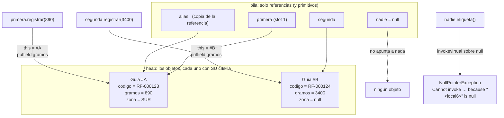
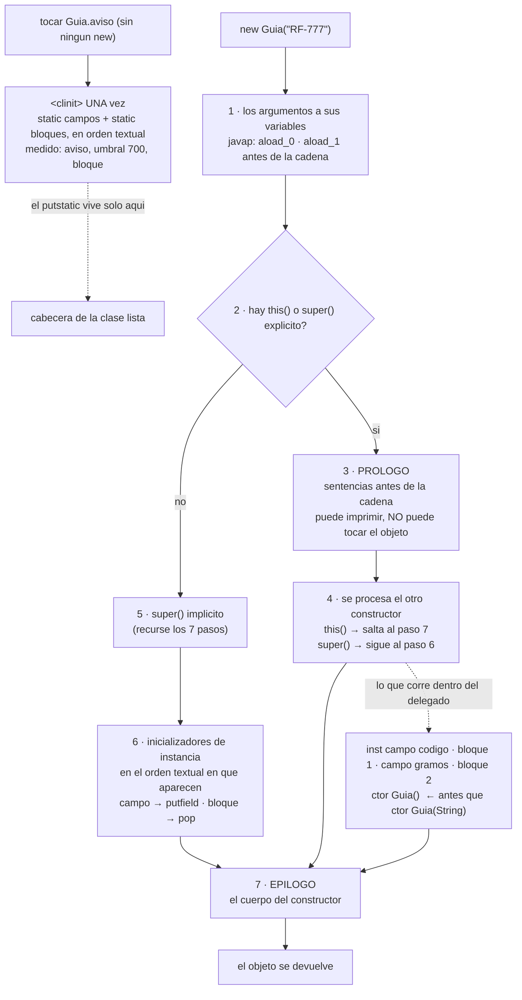

# Módulo 5 · Objetos y clases

> Curso Java (JDK 25) · tramo **Fundamentos** · 7 temas · formato único (specs/021). Portada del curso:
> [CURSO.md](CURSO.md). Todo el código de este módulo se compiló con `javac --release 25` y se ejecutó con
> `java -Dstdout.encoding=UTF-8` sobre OpenJDK Temurin 27.0.1.0.2+1 (macOS, arm64), locale `es_CO`, el
> 2026-11-21. Las salidas están pegadas tal cual.
> **Aviso de proveniencia:** en esta máquina no hay JDK 25 instalado, así que el *API* es la de la versión 25
> (la que comprueba `--release 25`) pero el *ejecutable* es el 27. Ningún tema de este módulo usa funciones
> *preview*; lo que puede diferir entre los dos ejecutables está marcado en cada tema como «pendiente de
> reejecución en JDK 25», y aquí eso es casi siempre el **texto** de una excepción o de un mensaje de `javac`
> —que los redacta la herramienta— y nunca la regla de lenguaje que se enseña. Las citas de la JLS y de la JVMS de
> este módulo se verificaron contra la especificación **Java SE 25** que Oracle sirve hoy como
> «Specifications Latest» (páginas con `dateModified` 2026-09-15; el propio capítulo 12 remite a _The Java
> Virtual Machine Specification, Java SE 25 Edition_): §4.12.5, §7.6, §8.1, §8.1.1.4, §8.3, §8.3.2, §8.3.3, §8.4,
> §8.4.3.2, §8.6, §8.7, §8.8, §8.8.7, §8.8.7.1, §8.8.8, §8.8.9, §8.8.10, §12.4.1, §12.4.2, §12.5, §15.8.3,
> §15.21.3 y el capítulo 16 (§16.9); JVMS §2.6.1, §2.9.1, §2.9.2.
> **Estado de escritura:** tema 2 de 7. Los temas 3 a 7 están previstos y aún no escritos; el laboratorio tiene
> su puerta para los dos temas escritos (**89 comprobaciones, 0 fallidas, 0 omitidas**, de las que 41 son del
> tema 1 y 48 del tema 2), y esta portada no declara horas del módulo completo hasta que los siete estén medidos.

## Cabecera del módulo

| | |
|---|---|
| **Objetivo** | Pasar de «datos sueltos en arreglos» a **un tipo propio**: declarar una clase cuyos campos son su estado y cuyos métodos reciben el objeto como primer argumento, entender que `new` crea un objeto y la variable solo lo señala, seguir el `this` hasta el bytecode, saber **en qué orden** se le llenan las casillas —los siete pasos de §12.5, dónde caen los inicializadores y por qué `this(...)` se salta los propios—, y dominar las dos cosas que más programas rompen: que asignar copie la **referencia** (no el objeto) y que `null` sea un valor de referencia, no «un objeto vacío». |
| **Prerrequisitos** | [Módulo 4](modulo-4.md) completo —en especial su tema 1 (`new Punto[2]` deja casillas `null`: aquí eso mismo pasa con objetos que no son arreglos) y su tema 4 (`ArrayList`/`HashMap`, porque el siguiente paso natural es una lista de objetos)— y [Módulo 3](modulo-3.md) completo, sobre todo su tema 4: **al método se le copia la referencia, no el contenido**; esa regla es la que aquí se ve funcionando dentro de un objeto. Del [Módulo 0](modulo-0.md) se sigue usando `javap -c -p`. |
| **Duración** | Escrito: 80 min (temas 1 y 2, 40 min cada uno). Previstos 7 temas de 40 min · **4 h 40 min** según el temario, cifra que se fija con las cabeceras cuando el módulo esté completo. |
| **Versiones** | JDK 25 (`--release 25`). Nada de este módulo depende de una función *preview*. Tres cosas que sí dependen del ejecutable y se tratan como tales: el **texto** del `NullPointerException` con mensajes útiles (lo redacta la JVM 27; el fenómeno es de 14+), el **número** que devuelve `System.identityHashCode` (medido: cambia con `-XX:hashCode=` y no es una cifra del lenguaje) y el **número de instrucciones** de cada `<init>` que publica el tema 2 (11 / 6 / 7 con cadena, 11 / 14 / 17 sin ella): es política del generador de código de `javac`, no regla del lenguaje —lo que §12.5 paso 4 sí exige es el **reparto** de los inicializadores (2 / 0 / 0 frente a 2 / 2 / 2), y eso es lo que se enseña. |
| **Laboratorio** | [`laboratorios/modulo-5/`](laboratorios/modulo-5/README.md) (al publicar: `examples/java/modulo-5/`), con `verificar.sh`: **89 comprobaciones, 0 fallidas, 0 omitidas** ejecutadas aquí (41 del tema 1 y 48 del tema 2). |
| **Proyecto guía** | `rutaflow-nucleo`: la **ficha de carga**. En M4 una guía era un `String` con guiones que se partía con `split`; aquí pasa a ser un objeto `Guia` con `codigo`, `gramos` y `zona`, su método `etiqueta()` y su constructor. Cada tema cierra una parte: la clase y su receptor (T1), cómo se construye y en qué orden (T2), qué se puede tocar desde fuera (T3), qué pertenece a la clase y no al objeto (T4), dónde vive el archivo (T5), cómo se compara e imprime (T6) y cómo se hace inmutable (T7). |

### Mapa del módulo


**Texto alternativo:** el módulo entero es un cambio de notación. Mientras los datos son `int[]` y `String[]`,
el programa habla de posiciones; cuando declaras `class Guia`, el programa habla de **cosas**. El tema 1 da el
molde y el receptor (`this`). El tema 2 explica cómo nace un objeto y en qué orden se le llenan los campos, que
es donde aparecen los bugs de «uso antes de construir». El tema 3 decide qué se ve desde fuera, y por qué un
getter no es un campo. El tema 4 separa lo que pertenece a la clase de lo que pertenece al objeto. El tema 5
pone el archivo en un paquete y ordena las importaciones. El tema 6 es el contrato de `Object`: sin `equals` y
`hashCode` tus objetos se comparan por identidad y se imprimen con un hash. El tema 7 cierra con el objeto que
no cambia —a mano y con `record`—.

**Convención del módulo.** Igual que en M4: lo que afirma el lenguaje se comprueba con `javap` sobre el
`.class` generado con `--release 25`; lo que afirma el programa se comprueba ejecutándolo y pegando su salida;
y las fronteras se miden en las dos direcciones. Hay tres familias de datos que **no** se citan como si
fueran del lenguaje y por eso se tratan así: el **número** de `System.identityHashCode` (solo se comprueba el
invariante: dos objetos distintos pueden dar el mismo número, y cambiar la estrategia de la JVM cambia los
números), el **texto** de los mensajes de `javac` y de la JVM (se citan literalmente porque así los emite la
herramienta que usamos, pero se marcan como pendientes de reejecución en 25), y cualquier **dirección o hash**
que salga del `toString` por defecto de un objeto (aquello de `Guia@1b6d3586` lleva hash de identidad; el tema
6 lo sustituye por `toString`). Ninguna comprobación de este módulo depende del valor absoluto de un hash ni
del nombre del frame que aparece en un mensaje de `NullPointerException`.

---

### Tema 1: Clases, objetos, campos, métodos y `this` · Básico · 40 min

#### 1. Ubicación y prerrequisitos

Curso Java · tramo Fundamentos · módulo 5 · primer tema. Antes: [Módulo 4 · tema 1](modulo-4.md) (crear un
arreglo de objetos: `new Guia[3]` son tres casillas `null`, y aquí verás por qué), [Módulo 4 · tema 4](modulo-4.md)
(`ArrayList` y `HashMap`, donde ya metiste `String` e `Integer` y ahora meterás tus propios objetos),
[Módulo 3 · tema 4](modulo-3.md) (parámetros, retorno y sobrecarga: al método llega una **copia de la
referencia**, medido allí) y [Módulo 3 · tema 5](modulo-3.md) (la pila de llamadas: el «marco» del que sale la
ranura 0 donde vive `this`). Del [Módulo 0](modulo-0.md): su tema 3 para `javap`, su tema 4 porque ya decidió
que `main` es `static` y su tema 5 para el lanzador de archivo fuente. No se necesita ninguna biblioteca: el
tema entero cabe en un archivo. Fuentes: JLS §8.1 (declaración de clase), §8.2 (miembros), §8.3 (campos), §8.4
(métodos), §4.12.5 (valores por defecto), §15.8.3 (`this`), §15.21.3 (`==` entre referencias), §16 (la variable
local sí exige asignación previa), CJ1 capítulo 4, OCP capítulo 3, JEP 358 (el mensaje del `NPE`).

#### 2. Objetivo

**Al terminar serás capaz de:** declarar una clase con campos y métodos y decir, sin ejecutar nada, cuánto
vale cada campo de un objeto recién creado (`0` para `int`, `null` para `String`) y por qué una variable local
sin asignar **no compila** mientras ese campo sí. Escribir un método de instancia y saber qué objeto es `this`
en cada una de sus llamadas, incluidas las dos formas en que `this` se puede perder: desde un `static` y sobre
`null`. Predecir qué ve un objeto cuando otro nombre cambia uno de sus campos, y distinguir «mismos campos» de
«mismo objeto». Y, si abres el `.class`, señalar en el volcado la instrucción que lee el campo y la que lo
escribe, y decir en qué ranura está el receptor.

#### 3. Por qué importa

Hasta el módulo 4 tus datos viajaban en posiciones: `gramos[i]`, `zonas[i]`. Eso funciona mientras **todo** el
programa recuerde que la casilla 0 de un arreglo pertenece con la casilla 0 de otro. En cuanto el programa pasa
de un tamaño, la correspondencia se rompe en silencio y el fallo aparece como un número mal sumado, no como un
error. La clase convierte esa convención en un tipo: `Guia` lleva su peso **pegado** a su código, y si te
equivocas de objeto no obtienes un número raro —obtienes un error de compilación o un `NullPointerException`
que dice el método.

Y hay una segunda razón, más incómoda: casi todo el Java que vas a leer es esto. Un `record` (tema 7), una
interfaz con implementación (M6), un `enum` (M6) o una entidad de JPA (tramo Aplicación) son un caso particular
de lo que se declara aquí. La parte que la gente aprende «por arriba» —que `this` es el objeto receptor, que
asignar copia la referencia y no el objeto, que un campo `static` no es de cada objeto— es exactamente la parte
que produce los bugs de alias y de estado compartido que luego nadie explica.

Medido en `errores/ThisDesdeStatic.java`: escribir `this` donde no hay objeto no es un estilo desaconsejado, es
un error que `javac` rechaza con `non-static variable this cannot be referenced from a static context`. Medido
en `errores/LocalSinValor.java`: el campo `static int campo` sin inicializar vale `0` y compila; la variable
local `int local` sin inicializar **no compila**. Es la diferencia entre el estado de un objeto, que siempre
está inicializado, y una ranura de un marco de pila, que no existe hasta que le escribes.

#### 4. Analogía

Un **expediente de guía en la bodega**. La clase es el *formato* del expediente: dice qué casillas tiene
(código, peso, zona) y qué se puede hacer con él (registrar un peso, imprimir la etiqueta). El objeto es **un
expediente concreto**, con su folio. `new Guia("RF-000123")` es pedir un folio nuevo y escribirle el código: las
demás casillas quedan **en blanco**, no en cero ni en `""` —en blanco quiere decir `null` para las de texto y
`0` para las numéricas, porque el formulario está impreso pero nadie las ha rellenado.

Ahora la parte que la analogía deja ver bien: de un mismo expediente caben **muchas fotocopias de la carpeta,
pero un solo expediente**. `Guia alias = primera` no fotocopia el expediente: saca otra etiqueta con el mismo
folio. Si quien tiene la etiqueta nueva escribe 890 en la casilla del peso, el expediente **ya está** en 890 y
el primer nombre lo muestra —medido: `por la primera      : 890 (lo cambio quien se llama distinto)`. Y `null`
no es «un expediente en blanco»: es **no tener ninguna etiqueta**. Por eso `nadie.etiqueta()` no devuelve la
etiqueta vacía, sino que revienta —medido: `Cannot invoke "ClaseYObjetos$Guia.etiqueta()" because "<local6>" is null`.

Lo que la analogía traiciona: un expediente físico no puede tener dos pesos; dos objetos sí, y el que cambia uno
no entera al otro (medido: la segunda guía sigue en `3400` mientras la primera ya va en `890`). Los objetos no
comparten casillas: comparten, si acaso, referencias.

#### 5. Diagrama



**Texto alternativo:** la pila guarda nombres y referencias; el heap guarda objetos con sus campos. `primera` y
`alias` apuntan al **mismo** objeto `#A` —medido: `alias misma identidad: true`—, así que una escritura vista
por `alias` (`putfield gramos`) se lee por `primera`. `segunda` es otro objeto `#B` y no se entera. `nadie` no
apunta a un objeto con las casillas vacías: vale `null`, y llamar un método de instancia sobre `null` lanza al
evaluar el receptor. El mismo método, llamado sobre dos objetos distintos, recibe dos `this` distintos: eso es
lo que significa «método de instancia».

#### 6. Explicación

**Nivel 0 — una clase es un tipo nuevo, y `new` crea un objeto con sus campos ya inicializados.**

El archivo `tema-1/ClaseYObjetos.java` declara, dentro de la clase del `main`, una segunda clase:

```java
static class Guia {
    String codigo;   // campo de referencia: valor por defecto null
    int gramos;      // campo primitivo: valor por defecto 0
    String zona;     // sin asignar: el objeto sigue siendo legal
}
```

Tres cosas ocurren con eso. Uno: `Guia` es un tipo, igual que `int` o `String`, y se usa en declaraciones,
parámetros y retornos. Dos: los campos **no son** de la clase, son de cada objeto; `new Guia(...)` reparte
casillas. Tres: esas casillas no están «indeterminadas», tienen el valor por defecto del tipo (JLS §4.12.5:
`0` para numéricos, `false` para `boolean`, `\u0000` para `char`, `null` para referencias). Medido, recién
creado el objeto y antes de escribir en ninguna casilla:

```text
recien creada       : RF-000123 · 0 g · null · yo soy 498931366
```

`0 g` es `gramos` en su valor por defecto; `null` es `zona`, que nadie tocó. Es la misma regla que la del
`String[3]` del módulo 4: una casilla de referencias nace `null`, no nace `""`.

Lo que **no** pasa con las variables locales. `errores/LocalSinValor.java` declara `static int campo;` y una
local `int local;` sin asignar. El campo vale `0` y se puede imprimir; la local produce, medido:

```text
errores/LocalSinValor.java:9: error: variable local might not have been initialized
```

El compilador no te está siendo quisquilloso: los campos tienen un contrato de inicialización garantizado por la
creación del objeto (JLS §12.5), y las locales no. Por eso Java puede prometer «el campo siempre tiene un valor»
y no puede prometer «la variable siempre tiene un valor».

**Nivel 1 — `this` es el receptor: un parámetro que Java te pasa sin que lo escribas.**

`primera.registrar(1250)` y `segunda.registrar(3400)` llaman al **mismo** cuerpo de método. Lo que cambia es el
objeto que viaja delante de los argumentos: `this`. Por eso un método de instancia puede decir «mi peso» sin
saber de qué objeto se trata. Medido en la misma corrida, los dos objetos con su casilla propia:

```text
primera tras 1250: RF-000123 · 1250 g · null · yo soy 498931366
segunda tras 3400: RF-000124 · 3400 g · null · yo soy 414493378
```

Y hay una razón para escribir `this` explícitamente, no estética. Dentro del constructor

```java
Guia(String codigo) {
    this.codigo = codigo;
}
```

el parámetro se llama igual que el campo. Sin `this.`, `codigo = codigo` asigna el parámetro **contra sí mismo**
y el campo sigue en `null`, porque el nombre local oculta al campo (JLS §6.4.1, *Shadowing*). Medido en
`tema-1/SombraDeCampo.java`, que tiene los dos constructores uno al lado del otro:

```text
campo con el parametro tapando : null
campo con this.                : RF-000123
```

Y es un bug **sin aviso**: el mismo archivo compilado con `javac --release 25 -Xlint:all` no emite ni una
advertencia (medido: salida vacía). El `this` ahí no es decoración: es lo que separa «la casilla del objeto» de
«la variable del método».

`this` además **es** una referencia, así que se puede devolver y comparar. Medido:

```text
conZona devuelve el mismo objeto: true · y se queda con SUR
```

donde `conZona` hace `this.zona = nuevaZona; return this;`. Eso es lo que permite la cadena
`g.conZona("NORTE").registrar(1250)`, que verás en estilo de API por todo el curso. Lo importante no es la
cadena: es que **no hubo copia**. Se mutó el mismo objeto y se devolvió el mismo objeto.

Y lo contrario, medido como error de compilación en `errores/ThisDesdeStatic.java` (línea 7) y
`errores/MetodoSinObjeto.java` (línea 14):

```text
error: non-static variable this cannot be referenced from a static context
error: non-static method etiqueta() cannot be referenced from a static context
```

Los dos mensajes dicen lo mismo con otras palabras: un método `static` no recibe receptor, así que no tiene
`this` ni campos de objeto que leer (JLS §8.4.3.2). `main` es `static`; por eso todo lo que haces en `main` pasa
por `new` y un nombre de variable.

**Nivel 2 — referencia y objeto no son lo mismo, y eso tiene tres consecuencias.**

1. **Asignar copia la referencia, no el objeto.** `Guia alias = primera;` pone dos nombres sobre el mismo
   expediente. Medido: `alias misma identidad: true` (`==` entre referencias compara si son el mismo objeto,
   JLS §15.21.3), y después `alias.registrar(890)` deja `por la primera      : 890`. El puente con M3 · tema 4 es
   exacto: lo mismo que le pasaba a un arreglo en un parámetro le pasa a un objeto en un campo, en un retorno y
   en una variable.
2. **Campos iguales no hacen objetos iguales.** Dos guías creadas con el mismo código son dos objetos. Medido:
   `campos iguales       : mismo codigo true · misma referencia false · son dos objetos`, y otra vez en
   `SombraDeCampo.java` con dos objetos de la misma clase: `dos Bien con el mismo codigo   : false`. Esta línea
   es el anticipo del tema 6: hoy Java solo sabe comparar referencias con `==`; `equals` es lo que **tú**
   defines, y hasta definirlo dos objetos con los mismos datos no son «el mismo». Y un extra que conviene saber
   antes de escribir nada: `==` entre referencias exige que los tipos se puedan convertir el uno en el otro por
   cast (§15.21.3), así que comparar dos clases sin parentesco **no compila**. Medido en
   `errores/ComparaTiposDistintos.java`: `incomparable types: Mal and Bien`. Comparar con `Object` sí se puede
   (medido: `contra Object si se puede      : false`). El lenguaje te deja preguntar «¿es el mismo objeto?» entre
   tipos compatibles y te cierra el paso cuando la pregunta no tiene sentido.
3. **`null` es un valor de referencia, no un objeto vacío.** Medido: `null no es un objeto sin datos, es
   ninguna referencia: true` —lo que se compara es el valor de la variable contra el literal `null`, y dos `null`
   entre sí dan `true` porque no hay objeto que distinguir— y, acto seguido, `llamar sobre null   : Cannot
   invoke "ClaseYObjetos$Guia.etiqueta()" because "<local6>" is null`. El mensaje con detalles es el JEP 358,
   dirigido a JDK 14; en este ejecutable viene activo sin opción ninguna (medido: no pasamos ningún `-XX`). En
   esta corrida el nombre del local sale como ranura (`<local6>`) porque compilé sin tabla de depuración.
   Recompilado con `-g` (medido): `because "nadie" is null`. La regla que enseño es la misma en los dos casos,
   pero no finjo que el texto sea idéntico en cualquier compilación.

**Nivel 3 — lo que ve la JVM: el receptor va en la ranura 0 y el campo se lee con `getfield`.**

`tema-1/por-dentro/CamposEnBytecode.java` declara `Punto` con dos métodos que difieren solo en escribir `this.`
en el fuente. Volcado con `javap -c -p` (las instrucciones están tal cual salen):

```text
  int conThis();
    Code:
         0: aload_0
         1: getfield      #7                  // Field x:I
         4: ireturn

  int sinThis();
    Code:
         0: aload_0
         1: getfield      #7                  // Field x:I
         4: ireturn
```

Cuerpo a cuerpo son **la misma secuencia** —el laboratorio lo comprueba comparando las dos, no lo afirma de palabra—: `this`
no cuesta una instrucción, porque no es una cosa que se consulta, es la ranura 0 del marco. Lo mismo para
escribir:

```text
  void mover(int, int);
    Code:
         0: aload_0
         1: aload_0
         2: getfield      #7                  // Field x:I
         5: iload_1
         6: iadd
         7: putfield      #7                  // Field x:I
        10: aload_0
        11: aload_0
        12: getfield      #13                 // Field y:I
        15: iload_2
        16: iadd
        17: putfield      #13                 // Field y:I
        20: return
```

Leído ranura a ranura: la 0 es el receptor (`this`, el objeto al que se le mueve el punto), la 1 es `dx` y la 2
es `dy` —los dos parámetros, desplazados porque la 0 ya está ocupada—; `x` se lee con `getfield` sobre la
referencia de la ranura 0 y se escribe con `putfield` sobre **esa misma referencia** (dos `aload_0` seguidos: uno
alimenta la lectura y otro el destino), y `y` hace lo propio con `#13`.

De ahí salen dos reglas que la gente confunde con las que no. En un método de instancia, `aload_0` es **el
objeto** y los parámetros empiezan en `iload_1`; en un método `static` la ranura 0 ya es el primer parámetro, y
por eso no puede existir `this` (nivel 1) —la prohibición del compilador y la geometría del marco son la misma
cosa vista de dos lados.

Crear el objeto, medido en `Punto.cero()` y en `main`:

```text
  static CamposEnBytecode$Punto cero();
    Code:
         0: new           #8                  // class CamposEnBytecode$Punto
         3: dup
         4: invokespecial #16                 // Method "<init>":()V
         7: areturn
```

Tres pasos seguidos: `new` reserva y pone la referencia en la pila, `dup` la duplica (una la consume el
constructor, la otra es el valor de la expresión), `invokespecial` llama al constructor **con** esa referencia.
Y el constructor propio de `Punto` no hace más que encadenar hacia arriba, medido:

```text
  CamposEnBytecode$Punto();
    Code:
         0: aload_0
         1: invokespecial #1                  // Method java/lang/Object."<init>":()V
         4: return
```

Nadie escribe `x = 0` en el bytecode del constructor de `Punto` **porque sus campos no tienen inicializador
explícito**: el cero viene de la preparación del objeto (JLS §12.5: asignar memoria e inicializar los campos a
su valor por defecto ocurre antes del cuerpo del constructor). Un campo con `= 1250` sí aparecería en `<init>`,
y eso es justo el tema 2.

Cómo se ve la llamada desde fuera, medido en `main` de `CamposEnBytecode`:

```text
  public static void main(java.lang.String[]);
    Code:
         0: new           #7                  // class CamposEnBytecode$Punto
         3: dup
         4: invokespecial #9                  // Method CamposEnBytecode$Punto."<init>":()V
         7: astore_1
         8: aload_1
         9: iconst_3
        10: iconst_4
        11: invokevirtual #10                 // Method CamposEnBytecode$Punto.mover:(II)V
        ...
        36: invokestatic  #37                 // Method CamposEnBytecode$Punto.cero:()LCamposEnBytecode$Punto;
        39: getfield      #41                 // Field CamposEnBytecode$Punto.x:I
```

`mover` se llama con `invokevirtual` (hay receptor: `aload_1` pone el objeto en la pila **antes** de los dos
`int`) y `cero()` con `invokestatic` (no hay receptor: se llama por el nombre de la clase). El descriptor
`(II)V` es la firma que ya viste en M0: dos `int`, devuelve `void`. Y fíjate en `astore_1` a la altura 7: dentro
de un método `static`, la ranura 0 es el primer parámetro (`args`), así que el punto nuevo se guarda en la 1.
Esa es la misma geometría que arriba impedía `this`.

Y el puente con el módulo 4, medido en la salida del mismo programa:

```text
conThis/sinThis    : 3 / 3 · mismo resultado
creado dentro      : 0 (valor por defecto, nadie escribio)
arreglo de Punto   : casilla 0 sin crear es null? true · tras crearla, no: true
```

`new Punto[2]` en bytecode es `anewarray` y **no** construye dos `Punto`: construye dos `null` (en el volcado de
`main` se ve el `aaload` seguido de un `ifnonnull` que es literalmente la comprobación que acabas de imprimir).
Eso explica por qué el módulo 4 te dejaba sumar `0` de un arreglo de `int` pero te reventaba con un arreglo de
`String` al llamar `.length()`.

Por último, la clase anidada. `ClaseYObjetos.java` es **un archivo** y produce **dos** `.class`, medido con
`javac --release 25 -d out ClaseYObjetos.java && ls out`:

```text
ClaseYObjetos$Guia.class
ClaseYObjetos.class
```

El `$` es el nombre binario (JLS §13.1); es lo que estabas leyendo en el mensaje de `NullPointerException` de
nivel 2: `Cannot invoke "ClaseYObjetos$Guia.etiqueta()"`. Y `javap -p` de la anidada, medido:

```text
class ClaseYObjetos$Guia {
  java.lang.String codigo;
  int gramos;
  java.lang.String zona;
  ClaseYObjetos$Guia(java.lang.String);
  java.lang.String etiqueta();
  void registrar(int);
  ClaseYObjetos$Guia conZona(java.lang.String);
}
```

Ningún miembro lleva modificador de acceso: todos quedaron con acceso de paquete (tema 3). La clase exterior
usa `g.codigo` sin problema, y en `javap -v -p` de la exterior aparece el atributo `NestMembers:
ClaseYObjetos$Guia`, con **cero** métodos sintéticos `access$`. Eso es lo que hace la regla «dentro del mismo
`class` se ven los `private`» (JLS §6.6.1) sin pagar el precio de los accessors que Java pagaba antes de la
11. Aquí solo hace falta saber que `static class` = clase anidada que no recibe un objeto exterior (JLS
§8.1.1.4); para este tema la uso porque mantiene el ejemplo en un archivo y se puede ejecutar con el lanzador de
fuente.

Sobre el archivo en sí, medido en `errores/DosPublicasEnUnArchivo.java`:

```text
errores/DosPublicasEnUnArchivo.java:6: error: class Guia is public, should be declared in a file named Guia.java
```

Un archivo fuente admite varias clases, pero **una** `public` y con el nombre del archivo (JLS §7.6). Ese error
lo vas a ver escrito mal cien veces en foros; la regla no es «no se puede», es «no dos `public`».

#### 7. Código ejecutable

**Ejemplo mínimo** · archivo `tema-1/ClaseYObjetos.java` · ejecuta
`javac --release 25 -d out tema-1/ClaseYObjetos.java && java -Dstdout.encoding=UTF-8 -cp out ClaseYObjetos`

```java
public class ClaseYObjetos {

    static class Guia {
        String codigo;          // campo de referencia: su valor por defecto es null
        int gramos;             // campo primitivo: su valor por defecto es 0
        String zona;            // se puede dejar sin asignar y el objeto sigue siendo legal

        Guia(String codigo) {   // el parametro se llama igual que el campo: aqui `this` no es opcional
            this.codigo = codigo;
        }

        String etiqueta() {
            return codigo + " · " + gramos + " g · " + zona + " · yo soy " + System.identityHashCode(this);
        }

        void registrar(int peso) {
            this.gramos = peso;
        }

        Guia conZona(String nuevaZona) {
            this.zona = nuevaZona;
            return this;        // devuelve el mismo objeto, no una copia
        }
    }

    static void muestra(String que, Guia g) {
        System.out.println(que + g.etiqueta());
    }

    public static void main(String[] args) {
        Guia primera = new Guia("RF-000123");
        System.out.println("recien creada       : " + primera.etiqueta());

        Guia segunda = new Guia("RF-000124");
        System.out.println("dos objetos         : primera " + System.identityHashCode(primera)
                + " · segunda " + System.identityHashCode(segunda)
                + " · referencia distinta? " + (primera != segunda));

        primera.registrar(1250);
        segunda.registrar(3400);
        muestra("primera tras 1250: ", primera);
        muestra("segunda tras 3400: ", segunda);

        Guia alias = primera;                             // copia la REFERENCIA, no el objeto
        System.out.println("alias misma identidad: " + (alias == primera));
        alias.registrar(890);
        System.out.println("por la primera      : " + primera.gramos + " (lo cambio quien se llama distinto)");

        primera.conZona("NORTE");
        System.out.println("conZona devuelve el mismo objeto: " + (primera.conZona("SUR") == primera)
                + " · y se queda con " + primera.zona);

        Guia g1 = new Guia("RF-000123");
        Guia g2 = new Guia("RF-000123");
        System.out.println("campos iguales       : mismo codigo " + g1.codigo.equals(g2.codigo)
                + " · misma referencia " + (g1 == g2) + " · son dos objetos");

        Guia nadie = null;
        System.out.println("null no es un objeto sin datos, es ninguna referencia: " + (nadie == null));
        try {
            nadie.etiqueta();
        } catch (NullPointerException e) {
            System.out.println("llamar sobre null   : " + e.getMessage());
        }
    }
}
```

Salida medida (Temurin 27.0.1.0.2+1, `--release 25`, sin `-g`):

```text
recien creada       : RF-000123 · 0 g · null · yo soy 498931366
dos objetos         : primera 498931366 · segunda 414493378 · referencia distinta? true
primera tras 1250: RF-000123 · 1250 g · null · yo soy 498931366
segunda tras 3400: RF-000124 · 3400 g · null · yo soy 414493378
alias misma identidad: true
por la primera      : 890 (lo cambio quien se llama distinto)
conZona devuelve el mismo objeto: true · y se queda con SUR
campos iguales       : mismo codigo true · misma referencia false · son dos objetos
null no es un objeto sin datos, es ninguna referencia: true
llamar sobre null   : Cannot invoke "ClaseYObjetos$Guia.etiqueta()" because "<local6>" is null
```

Los dos números de las dos primeras líneas son los que devolvió **esta** JVM: repetido cinco veces seguidas dio
igual, y forzando la estrategia con `-XX:hashCode=2` los dos se vuelven `1`. Se pegan porque son la salida real,
no porque sean una propiedad del objeto; lo que se enseña es el `true` de `referencia distinta?`, que sí lo es.

**Segundo ejemplo** · `tema-1/por-dentro/CamposEnBytecode.java` · ejecuta
`javac --release 25 -d out tema-1/por-dentro/CamposEnBytecode.java && java -Dstdout.encoding=UTF-8 -cp out CamposEnBytecode`
y después `javap -c -p -cp out 'CamposEnBytecode$Punto'`. Su salida son las tres líneas del nivel 3
(`conThis/sinThis : 3 / 3`, `creado dentro : 0`, `arreglo de Punto : casilla 0 sin crear es null? true · tras
crearla, no: true`) y los volcados pegados arriba.

**Tercer ejemplo** · `tema-1/SombraDeCampo.java` · ejecuta
`javac --release 25 -Xlint:all -d out tema-1/SombraDeCampo.java && java -Dstdout.encoding=UTF-8 -cp out SombraDeCampo`.
Son dos clases con el mismo campo y el mismo parámetro, una con `codigo = codigo` y otra con `this.codigo =
codigo`. Salida medida:

```text
campo con el parametro tapando : null
campo con this.                : RF-000123
dos Bien con el mismo codigo   : false
contra Object si se puede      : false
```

`javac` no emite ninguna advertencia con `-Xlint:all` (medido: salida vacía tras compilar). Es el ejemplo más
importante del tema porque no se ve: el bug está en una línea que parece escrita.

**Los cinco errores** · `tema-1/errores/` son para que los provoques tú:
`ThisDesdeStatic.java`, `MetodoSinObjeto.java`, `LocalSinValor.java`, `DosPublicasEnUnArchivo.java` y
`ComparaTiposDistintos.java`. Ninguno compila, y los cinco mensajes están citados en los niveles 0, 1, 2 y 3.

#### 8. Mini-laboratorio

Escribe los archivos desde cero en `laboratorios/modulo-5/tema-1/` (no copies y pegues: el ejercicio es predecir
y comprobar).

1. Crea `MiGuia.java` con una clase `static class Ficha` dentro de `MiGuia`, con tres campos sin inicializar:
   `String codigo; int gramos; char estado;`. En `main`, crea un objeto y **sin escribir en ningún campo**
   imprime los tres separados por ` | `, después su `getClass().getName()`. Escribe en un comentario qué esperas
   ver antes de ejecutar. Ejecuta: si el comentario decía `null | 0 | ` con espacio, está mal; `char` por defecto
   es `\u0000`, que se imprime como nada y engaña. Cuenta con `ls out` cuántos `.class` produjo un solo `.java`
   y anota por qué hay dos.
2. En el mismo archivo, declara `Ficha a = new Ficha();` y `Ficha b = a;`. Escribe `a.gramos = 1250;` e imprime
   `b.gramos`. Predícelo en un comentario. Después añade `Ficha c = new Ficha(); c.gramos = 1250;` e imprime en
   tres líneas `a == b`, `a == c`, `a.gramos == c.gramos`. Esas tres respuestas juntas son el nivel 2 del tema:
   si no las predijiste bien, vuelve a él.
3. Añade a `Ficha` un constructor `Ficha(String codigo) { codigo = codigo; }` y crea un objeto con él. Imprime el
   campo. Escribe la predicción **antes** de ejecutar, compila con `-Xlint:all` y mira si el compilador dice
   algo. Corrige el constructor con `this.` y vuelve a ejecutar. Los dos mensajes que no llegaron (el de `javac`
   vacío y el `null` en pantalla) son la lección.
4. Crea `OrdenDeSlots.java` con `static class Suma { int total; void subir(int n, int paso) { this.total = this.total + n + paso; } }`.
   Ejecuta `javac -d out OrdenDeSlots.java`, luego `javap -c -p -cp out 'OrdenDeSlots$Suma'`. En un comentario,
   escribe el número de la ranura que usa cada uno de los tres `int` del método (receptor, `n`, `paso`) **antes**
   de mirar el volcado, y después compruébalo. Si escribiste `iload_0` para `n`, lo que te falta es saber quién
   ocupa la 0.
5. Crea `SinReceptor.java` con un método de instancia `String etiqueta()` en una clase anidada y llama
   `System.out.println(MiClase.etiqueta());` desde `main`. Guarda el mensaje exacto de `javac`. Cambia la llamada
   a `System.out.println(new MiClase().etiqueta());`. Ejecuta el primero con el lanzador de fuente para ver el
   fallo otra vez. Ahora, en un comentario, responde con tus palabras qué es lo que **no** existe en el primer
   caso (pista: es la misma palabra que la JVM usa en su mensaje: *static context*).
6. Crea `Nulo.java` con `Ficha nadie = null;` y dos llamadas: `System.out.println(nadie == null);` y
   `nadie.etiqueta();`. Ejecuta y copia el mensaje completo del `NullPointerException`, incluido lo que va
   después de `because`. Vuelve a compilar con `javac -g -d outg Nulo.java` y ejecuta con `-cp outg`: copia ese
   segundo mensaje. Anota la diferencia y qué la produce.

**Listo cuando** puedas decir, sin ejecutar, los valores por defecto de `Ficha` con un campo `double`, uno
`boolean` y uno `Thread` (`0.0`, `false`, `null`); cuando el paso 2 te dé `true`, `false`, `true` sin titubear;
y cuando sepas explicar por qué la respuesta `a.gramos == c.gramos` siendo `true` **no** convierte a `a` y `c`
en el mismo objeto (esa es la pregunta del tema 6).

#### 9. Verificación

```bash
cd docs/reestructuracion/cursos/java/laboratorios/modulo-5
javac --release 25 -encoding UTF-8 -d out tema-1/*.java
java -Dstdout.encoding=UTF-8 -cp out ClaseYObjetos       # «recien creada : RF-000123 · 0 g · null» y «alias misma identidad: true»
javac --release 25 -Xlint:all -d outs tema-1/SombraDeCampo.java   # -Xlint:all no dice nada: salida vacia, medido
java -Dstdout.encoding=UTF-8 -cp outs SombraDeCampo      # «campo con el parametro tapando : null» frente a «this. : RF-000123»
java -Dstdout.encoding=UTF-8 -cp out CamposEnBytecode    # «conThis/sinThis : 3 / 3» y «casilla 0 sin crear es null? true»
javap -c -p -cp out 'CamposEnBytecode$Punto'              # aload_0 · getfield · putfield · iload_1
javac --release 25 -g -d outg tema-1/ClaseYObjetos.java   # el NPE pasa a decir because "nadie" is null
java -XX:+UnlockExperimentalVMOptions -XX:hashCode=2 -cp out ClaseYObjetos   # los dos numeros salen iguales
ls out                                                    # dos .class: ClaseYObjetos.class y ClaseYObjetos$Guia.class
javap -p -cp out 'ClaseYObjetos$Guia'                     # codigo, gramos, zona: sin modificador = acceso de paquete
javac -d /tmp/m5e tema-1/errores/ThisDesdeStatic.java     # non-static variable this cannot be referenced…
javac -d /tmp/m5e tema-1/errores/LocalSinValor.java       # variable local might not have been initialized
```

O, todo el laboratorio del módulo de una vez: `./verificar.sh`. Aquí esas **41** comprobaciones del tema pasan
con Temurin 27 y `--release 25`; con JDK 25 en el `PATH` basta `./verificar.sh`. Reparto medido sobre el propio
script: **16** sobre la salida de `ClaseYObjetos` (dentro van las tres de `identityHashCode` y las dos de
`-g`/sin `-g`), **4** de `SombraDeCampo`, **3** de `CamposEnBytecode` ejecutado, **6** sobre el volcado de `Punto`
(incluida la comparación byte a byte de que los dos cuerpos, con `this.` y sin él, salgan idénticos), **4** sobre
los `.class` de la clase anidada (los dos archivos, el acceso de paquete, `NestMembers` y la ausencia de
`access$`), **3** sobre el volcado de `main` (`aload_1`, `mover:(II)V`, `invokestatic`) y **5** fallos de
compilación esperados. 16 + 4 + 3 + 6 + 4 + 3 + 5 = 41.

*Pendiente de reejecución en JDK 25:* los **mensajes de texto**. El del `NullPointerException`
(`Cannot invoke "…Guia.etiqueta()" because "<local6>" is null`) lo construye la JVM y su redacción cambió en el
paso de 13 a 14; el de `javac` (`non-static variable this cannot be referenced from a static context`, y los
otros cuatro mensajes de los errores esperados, incluido `incomparable types: Mal and Bien`) lo fija el
compilador de la 25 y conviene confirmar que siguen palabra por palabra. La forma del nombre de la posición
(`"<local6>"` frente a `"nadie"`) depende de si compilaste con `-g` y de cuántas variables haya delante, así que
**no es** una cifra del tema ni una comprobación de la puerta.

*Lo que no depende de la versión:* los valores por defecto (JLS §4.12.5), que asignar una variable copie la
referencia, que `==` entre referencias compare identidad (§15.21.3), que `this` sea la ranura 0 del marco y los
parámetros de un método de instancia empiecen en la 1, `getfield`/`putfield` como únicas formas de tocar un
campo, `new` + `dup` + `invokespecial` como los tres pasos de crear un objeto, `aload_0` y `aload_0`/`aload_0`
en el constructor, `invokestatic` sin receptor, el nombre binario con `$`, el atributo `NestMembers`, y que una
clase anidada con `static` no reciba un objeto exterior (§8.1.1.4). Lo único de este tema que sí es del
ejecutable y no del lenguaje es **el número** de `System.identityHashCode`, y por eso la puerta no lo compara
contra una cifra: compara que con `-XX:hashCode=2` los dos objetos dan el mismo número y que con
`-XX:hashCode=0` no, y con eso queda probado que **no puede** usarse como prueba de identidad.

#### 10. Error común y diagnóstico

**Síntoma 1 — «mi objeto tiene los campos en `null`/`0` y no sé quién los borró».** Casi nunca los borró nadie:
nunca los escribió. Causa típica, el constructor con el parámetro que tapa al campo —las dos líneas reales de
`tema-1/SombraDeCampo.java`, la 9 y la 17:

```java
Mal(String codigo)  { codigo = codigo; }      // asigna el parametro contra si mismo: el campo no se toca
Bien(String codigo) { this.codigo = codigo; } // la mano izquierda dice de que objeto es la casilla
```

El mensaje no existe: `javac --release 25 -Xlint:all` sobre ese archivo no emite ni una línea (medido: salida
vacía). Esto es lo que sale al ejecutarlo:

```text
campo con el parametro tapando : null
campo con this.                : RF-000123
```

Diagnóstico: imprime el campo recién creado —`recien creada : RF-000123 · 0 g · null` en el ejemplo— o busca en
el cuerpo del constructor una asignación cuya mano izquierda no lleve `this.` ni un nombre de objeto. Salida real
de `errores/MetodoSinObjeto.java` al intentar lo contrario (usar el método como si fuera de la clase):

```text
errores/MetodoSinObjeto.java:14: error: non-static method etiqueta() cannot be referenced from a static context
```

**Síntoma 2 — «cambié el objeto en un método y se me cambió otro que no tocaba».** No es un bug de Java: es
que el parámetro y la variable son el mismo objeto. Esto no es una hipótesis; es el medidor del tema:
`alias misma identidad: true` seguido de `por la primera      : 890`. El arreglo de M4 · tema 4 y la guía de
hoy son el mismo fenómeno. Diagnóstico en producción: antes de suponer que «algo lo puso a 890», pregúntate
cuántos nombres tiene el objeto. Si la respuesta es «debería tener uno solo», el bug está en un setter que
devuelve `this` y se reusa, o en un campo de clase (`static`) que creíste de objeto —eso es el tema 4, medido
allí.

**Síntoma 3 — «comparo dos guías con `==` y no son iguales aunque traigan el mismo código».** Es correcto, y
salir de ahí tiene precio. Medido: `mismo codigo true · misma referencia false · son dos objetos`. Diagnóstico:
si lo que quieres comparar son los datos, `equals` (tema 6). Si lo que quieres es **una sola guía por código**,
no confíes en que alguien te pase el mismo objeto: busca en un `HashMap` (M4 · tema 4) o normaliza en una
fábrica (tema 4). Y si te apareció la tentación de comparar `System.identityHashCode(a) == System.identityHashCode(b)`:
la puerta tiene una comprobación que demuestra por qué está mal, y es que con `-XX:hashCode=2` los dos números
salen `1` para objetos distintos. No es un identificador: es un hash.

**Síntoma 4 — «uso `this` en un método utilitario y el compilador me dice algo de static context».**
`main`, y cualquier método que quieras llamar sin objeto, no tiene receptor (medido en
`errores/ThisDesdeStatic.java`). Dos salidas, ambas válidas: pasar el objeto como parámetro (la forma que ya
usaste en `muestra(String, Guia)` de `ClaseYObjetos.java`) o declarar el método de instancia y crear el objeto.
La tercera opción, «lo pongo `static` y listo», es la que produce el bug de estado compartido del tema 4.

**Síntoma 5 — «pongo dos clases `public` en el mismo archivo y no me deja».** Medido:
`class Guia is public, should be declared in a file named Guia.java`. La solución **no** es borrar la segunda
clase: es quitarle `public` (una clase de paquete sigue siendo utilizable desde el mismo paquete, que es justo
lo que necesitas mientras el tema 3 no decida otra cosa). Diagnóstico rápido: el mensaje te está diciendo el
nombre de archivo que espera; si la clase debe ser pública, cárgala a su propio archivo.

#### 11. Pregunta con respuesta modelo

**Comprensión.** Tienes `Ficha f;` como campo de una clase y `Ficha g;` como variable local dentro de un método.
¿Puedes imprimir `f == null` y `g == null` sin haber asignado nada?

**Respuesta modelo:** lo primero sí, y da `true`: los campos del objeto se inicializan a `null` al crearlo
(JLS §4.12.5) —medido en `recien creada : … · null`. Lo segundo **no compila**, medido con el mensaje
`variable local might not have been initialized`, porque el capítulo 16 (asignación definida) no garantiza el
contenido de una ranura de pila. La diferencia no es de estilo: un campo siempre tiene un valor porque el objeto
se construyó, una local puede no tenerlo porque nadie la ha escrito todavía.

**Comprensión.** ¿Qué pasa en `System.out.println(nadie.etiqueta())` si `nadie` vale `null`? ¿Y en
`System.out.println(nadie == null)`?

**Respuesta modelo:** la primera lanza —medido: `Cannot invoke "ClaseYObjetos$Guia.etiqueta()" because
"<local6>" is null`—, la segunda imprime `true` y no lanza. La razón es que `==` entre referencias (§15.21.3) es
un operador que compara el **valor** (una referencia, que puede ser `null`) mientras la llamada a un método de
instancia necesita un objeto para ponerlo en la ranura 0. `null` es un valor perfecto para comparar y un
receptor imposible. Y un detalle de entrevista: en Java 14+ el mensaje dice el método y la variable o ranura, así
que no hace falta el depurador; antes de 14 el `NPE` llegaba sin ninguna de las dos pistas.

**Aplicación.** Un compañero escribe esto y dice que «el bug es que `equals` falla»:

```java
Guia a = new Guia("RF-000123");
Guia b = new Guia("RF-000123");
if (a == b) System.out.println("misma guía");
```

**Respuesta modelo:** no hay bug en `==`: da `false` porque son dos objetos, y eso es lo que `==` promete
(medido: `mismo codigo true · misma referencia false · son dos objetos`). Lo que está mal es el **modelo**. Dos
expedientes con el mismo código pueden ser la misma guía o dos guías distintas, y el programa tiene que decir
cuál de las dos cosas quiso. Si quiso «el mismo objeto», `a == b` es correcto y el bug está en que alguien creó
una segunda `Guia` en vez de reusar la primera (normalízalas en una fábrica o guárdalas en un mapa por código).
Si quiso «la misma guía según su código», `==` es la herramienta equivocada: hay que comparar el código con
`equals` hoy y definir `equals`/`hashCode` en el tema 6, con su contrato, porque si no tus objetos no van a
funcionar dentro de `HashMap`. Y un tercer candidato que conviene descartar en la entrevista: no se salva la
comparación con `identityHashCode`, porque dos objetos distintos pueden compartir número (medido con
`-XX:hashCode=2`: `primera 1 · segunda 1`).

#### 12. Cuándo usarlo y cuándo no

| Úsalo | No lo uses |
|---|---|
| Un conjunto de datos que siempre viaja junto (código + peso + zona de la misma guía) | Dos arreglos paralelos indexados por posición: el día que uno se ordena, la correspondencia se rompe (M4 midió el filtro con `binarySearch`; aquí eso no puede pasar) |
| Conducta que depende del estado del dato (`registrar`, `etiqueta`) | Métodos `static` que reciben el objeto para «parecerse» a una función de otro lenguaje: si no usan estado, son una función; si lo usan, es un método |
| Tipos propios que el compilador puede comprobar (`List<Guia>`) | `Object[]` con casts, o `Map<String, Object>` con claves que son campos: pierdes el tipo y recuperas los bugs de posición |
| Una clase anidada `static` para un tipo auxiliar de un solo archivo (aquí `Guia`) | Clases anidadas **no** `static` cuando no hacen falta: cada instancia arrastra una referencia al objeto exterior (§8.1.3), y eso es memoria y ciclo de vida que no pediste |

**Costo:** un objeto cuesta su cabecera más el tamaño de sus campos, y leer un campo es una instrucción
(`getfield`) — no es gratis pero es lo más barato que hay en Java, y por eso `Guia` con tres campos le gana a
tres arreglos paralelos en claridad sin perder en velocidad. Lo que cuesta de verdad es la **mutabilidad por
referencia**: si expones el objeto, expones su memoria viva, y cualquier nombre puede escribir. La defensa es
encapsular (tema 3), decidir quién construye (tema 2) y, cuando el dato no debe cambiar, hacerlo inmutable
(tema 7). Lo que este tema **no** resuelve y no finge resolver: `toString` (sigue saliendo el hash de identidad
si imprimes el objeto), `equals`/`hashCode` (nivel 2, consecuencia 2) y el orden exacto en que se llenan los
campos cuando hay inicializadores y bloques —eso es el tema 2, y es donde la gente cree que sabe algo y no lo
sabe—.

---

### Tema 2: Constructores, encadenamiento con `this(...)`, bloques y orden de inicialización · Básico · 40 min

#### 1. Ubicación y prerrequisitos

Curso Java · tramo Fundamentos · módulo 5 · segundo tema. Antes: [M5 · tema 1](#tema-1-clases-objetos-campos-métodos-y-this) —
sin campos no hay nada que inicializar, y sin `this` como receptor no se entiende quién ejecuta el paso 6;
[M5 · tema 4 de M3](modulo-3.md) (al método se le copia la referencia: un constructor es un método más de esa
misma pila) y [M3 · tema 5](modulo-3.md) (el marco y sus ranuras: `javap` muestra `args_size=3` para un
constructor con dos argumentos porque el receptor va delante); del [Módulo 0](modulo-0.md), su tema 3 para
`javap -c -p -v` y su tema 4 porque ya decidió que un `static` no necesita objeto. Se supone del tema 1 el
valor por defecto de los campos (§4.12.5): aquí se ve el momento exacto en que ese valor deja de ser el
por defecto. Ninguna biblioteca: los cuatro fuentes del tema caben en dos carpetas. Fuentes: JLS §8.3.2
(inicializadores de campo), §8.3.3 (orden de ejecución), §8.6 (bloques de instancia y de clase), §8.7
(cuerpos), §8.8 (declaración de constructor), §8.8.7 (invocación de constructor: prólogo y epílogo), §8.8.7.1
(contexto de construcción temprano), §8.8.8 (constructor por defecto), §8.8.9 (lo que declara el compilador,
incluido su Ejemplo 8.8.9-1), §8.8.10, §12.4.1 y §12.4.2 (inicialización de la clase), §12.5 pasos 1–7, §16.9
(campos `final`), JVMS §2.6.1 (ranura 0), §2.9.1 (`<init>`), §2.9.2 (`<clinit>`).

#### 2. Objetivo

**Al terminar serás capaz de:** escribir los siete pasos de §12.5 y decir en cuál caen los inicializadores de
instancia, en cuál el cuerpo del constructor y en cuál el `super()` implícito. Predecir —sin ejecutar— el
**orden** de las 37 líneas que imprime `tema-2/ConstructoresYOrden.java`, incluidas las tres que delatan que un
inicializador leyó un campo antes de que el constructor lo escribiese. Decir cuántas veces corre un `static`
y cuántas un inicializador de instancia cuando se crean tres objetos (medido: **1** y **3**). Elegir entre
`this(...)` y repetir código con números delante: el mismo constructor cuesta **6 instrucciones delegando y 14
sin delegar**, y los valores impresos no cambian ni una coma (§12.5 paso 4). Detectar el bug que ningún aviso
cuenta —escribir un campo **antes** de `this(...)` compila mudo con `-Xlint:all` y el valor se pierde (medido:
`v = 9` cuando se escribió `5`)— y explicar por qué esa misma escritura antes de `super()` sí es error de
compilación. Y, si abres el `.class`, señalar dónde está el `<clinit>`, por qué un bloque de instancia acaba en
`pop` y un campo en `putfield`, y en qué constructor cayó la copia de los inicializadores.

#### 3. Por qué importa

El tema 1 enseñó a **declarar** el objeto; este decide en qué orden se le llenan las casillas, y casi todo el
código de arranque de un programa vive ahí. Tres razones medidas, en este orden de molestia.

La primera es el **silencio**. `tema-2/EncadenamientoSilencioso.java` escribe `this.v = nuevo;` y después
`this();`: el fuente es legal, `javac --release 25 -Xlint:all` no emite ni una línea y el valor que el programa
intentaba poner en el objeto es otro (medido: `escribir antes de this() : v = 9`). No es una excentricidad: es
lo que pasa cada vez que alguien "ordena" las sentencias de un constructor como le parecen, y produce el mismo
síntoma que el `codigo = codigo` del tema 1 pero con una causa distinta —allí era un nombre; aquí es el
**orden**—.

La segunda es que **`this(...)` no es estética**. Un objeto con cinco constructores escritos a mano copia los
inicializadores en los cinco `<init>` del `.class`: medido en `tema-2/por-dentro/`, el constructor con dos
argumentos pasa de **7 instrucciones** (encadenando) a **17** (sin encadenar) y el `invokestatic` de los
inicializadores aparece **2 veces en cada uno** en vez de una sola. Y sobre eso está la parte que la gente
confunde: los valores impresos son **los mismos** en las dos versiones, así que nadie lo nota ejecutando; lo que
se paga es duplicación de código y, peor, dos sitios que hay que mantener iguales. La razón de peso no es el
tamaño sino el **invariante**: con `final`, §16.9 obliga a asignar el campo en *todo* constructor que no
delega, y delegar es lo que te deja escribir la asignación una vez.

La tercera es la frontera real, que no es la que circula. Se repite como regla que "`this()` o `super()` tienen
que ser la **primera** sentencia". Falso, y medido: `System.out.println("esto si puede ir antes");` antes de
`this()` compila (`tema-2/errores/ThisAntesDeTiempo.java`, líneas 13 y 14: la primera es legal, la segunda es
el error). Lo prohibido en el prólogo es **tocar el objeto** —§8.8.7.1 llama a eso *early construction
context*—, porque el objeto todavía no está construido: `reference to this may only appear after an explicit
constructor invocation`. Saber dónde está la línea exacta es lo que separa un "no compila y no sé por qué" de
un diagnóstico en diez segundos.

#### 4. Analogía

Un **formulario preimpreso en la cinta de la bodega**, y un operario con bolígrafo.

La clase es el puesto de trabajo. El `static` es el **cartel del puesto**: se escribe cuando el puesto abre,
**una vez por turno**, y da igual cuántos paquetes pasen —medido, al crear tres objetos la línea
`static campo aviso : clase inicializada` sale **una** vez y `inst campo gramos` sale **tres**—. El
inicializador de campo es la **caja preimpresa** del formulario: `"sin-codigo"`, `0` —eso ya está escrito
cuando el paquete nace, no lo decide nadie—. El bloque de instancia es una **línea de instrucciones impresa**
en el formulario que se ejecuta pero no escribe en ninguna caja (en el bytecode se ve literalmente: el bloque
termina en `pop`, el campo termina en `putfield`). El cuerpo del constructor es **la letra del operario**, y
siempre va encima de lo impreso: por eso `b = RF-777` y no `b = sin-codigo`.

Y ahora `this(...)`, que es la parte que la analogía explica mejor que ninguna definición. Encadenar es **subir
el paquete a la estación de arriba**. La estación de arriba hace el ciclo completo —su cartel si no está
puesto, su formulario preimpreso, su letra— y **después** te lo devuelve; el lenguaje dice explícitamente que
quien sube el paquete se salta su propio formulario (§12.5 paso 4: "continue from step 7"). Por eso escribir
`this.v = 5` **antes** de `this()` es garabatear en la caja y luego meter el paquete en la cinta: la estación
de arriba vuelve a escribir `9` encima. Y por eso `this.v = 5` **después** de `this()` sí vale: es la última
letra, encima de todo (medido: `v = 5`).

Lo que la analogía traiciona: un formulario físico solo se imprime una vez; aquí el formulario preimpreso se
**reimprime para cada objeto** —los cuatro inicializadores vuelven a salir en `[5]` y en `[6]`—, y el puesto de
trabajo (la clase) se abre en cuanto alguien **toca** el cartel, sin que nadie haya creado un solo paquete
todavía (medido: `[2] leer Guia.aviso fuerza la inicializacion de la clase`, antes de cualquier `new`).

#### 5. Diagrama



**Texto alternativo:** hay dos relojes, no uno. El de la **clase** (`<clinit>`) corre una sola vez y se dispara
con el primer *toque* de la clase —leer un campo `static` basta, no hace falta ningún `new`—; el del **objeto**
son los siete pasos de §12.5, que corren por cada `new`. Dentro de los siete pasos lo que importa es la
bifurcación 2→4: si el constructor encadena con `this(...)`, procesa el otro constructor de arriba a abajo y
**vuelve saltándose su propio paso 6**; por eso los inicializadores no se repiten. El prólogo (paso 3) corre
*antes* de subir el paquete a la cinta, y por eso lo que ahí se escriba en un campo lo pisa el delegado. El
volcado del `.class` muestra las dos cosas: en el paso 6 un campo acaba en `putfield` y un bloque en `pop`, y
en el paso 4 hay un `invokespecial // Method "&lt;init&gt;":()V` en lugar de los inicializadores.

#### 6. Explicación

**Nivel 0 — un objeto no lo construye el constructor: lo construye un procedimiento de siete pasos, y el cuerpo del constructor es el último.**

No es una forma elegante de hablar. JLS §12.5 fija el procedimiento, y los pasos que importan aquí son estos
(citados de la especificación, edición Java SE 25):

1. *«Assign the arguments for the constructor to newly created parameter variables»* — antes que nada, los
   parámetros. En el bytecode se ve como las cargas que preceden a la cadena: `ConstructoresYOrden$Guia(String,
   int)` empieza `0: aload_0 · 1: aload_1 · 2: invokespecial`.
2. *«If this constructor does not contain an explicit constructor invocation then continue from step 5.»*
3. *«Execute the BlockStatements, if any, of the **prologue** of the constructor body.»* — el prólogo es todo lo
   que va **antes** de `this()`/`super()` (§8.8.7). Corre antes de delegar.
4. *«…process the constructor invocation recursively using these same seven steps. … continue from step 7 if
   the invocation is of another constructor in the same class, and continue from step 6 if the invocation is of
   a superclass constructor.»* — la frase que decide todo el tema: **con `this()` te saltas tus inicializadores;
   con `super()` no.**
5. El `super()` implícito si no había invocación explícita.
6. *«Execute the instance initializers and instance variable initializers for this class … **in the
   left-to-right order in which they appear textually** in the source code»* — orden textual, campo y bloque
   mezclados, en el orden en que los escribiste.
7. *«Execute the BlockStatements, if any, of the **epilogue** of this constructor.»* — el cuerpo después de la
   cadena. Y «antes de que se devuelva la referencia al objeto recién creado» (§12.5, párrafo previo): el
   objeto no existe para el que llama hasta pasar el 7.

El archivo `tema-2/ConstructoresYOrden.java` está escrito para que el propio objeto imprima en qué paso está.
Declaración (líneas 18–35):

```java
    static class Guia {
        // ---- se ejecuta UNA vez, al inicializar la clase, en orden textual ----
        static String aviso   = da("static campo aviso  ", "clase inicializada");
        static int    umbral  = da("static campo umbral ", 700);
        static { da("static bloque       ", 0); }

        // ---- se ejecuta en CADA objeto, en orden textual, antes del cuerpo del constructor ----
        String codigo = da("inst   campo codigo ", "sin-codigo");
        { da("inst   bloque 1     ", 0); }
        int gramos  = da("inst   campo gramos ", 0);
        { da("inst   bloque 2     ", 0); }

        Guia()                                    { paso("  ctor   Guia()            (cuerpo)"); }
        Guia(String codigo)                       { this();          paso("  ctor   Guia(String)        (cuerpo)"); this.codigo = codigo; }
        Guia(String codigo, int gramos)           { this(codigo);    paso("  ctor   Guia(String,int)    (cuerpo)"); this.gramos = gramos; }

        String etiqueta() { return codigo + " · " + gramos + " g · umbral " + umbral; }
    }
```

Los tres primeros objetos de `main` producen, literalmente (medido; la salida completa son 37 líneas y está
pegada entera en la sección 7):

```text
[4] new Guia() — el constructor que no delega:
  inst   campo codigo  : sin-codigo
  inst   bloque 1      : 0
  inst   campo gramos  : 0
  inst   bloque 2      : 0
  ctor   Guia()            (cuerpo)
    a = sin-codigo · 0 g · umbral 700
[5] new Guia("RF-777") — delega con this() hacia Guia():
  inst   campo codigo  : sin-codigo
  inst   bloque 1      : 0
  inst   campo gramos  : 0
  inst   bloque 2      : 0
  ctor   Guia()            (cuerpo)
  ctor   Guia(String)        (cuerpo)
    b = RF-777 · 0 g · umbral 700
```

Lee `[5]` con los siete pasos delante. `Guia(String)` **no** tiene inicializadores propios en su cuerpo: los
cuatro que salen son el paso 6 del constructor delegado, y `ctor Guia()` (paso 7 del delegado) aparece **antes**
de `ctor Guia(String)` (paso 7 del que delega). Y fíjate en el valor final: `b = RF-777 · 0 g`. El `codigo` es
`RF-777` porque el epílogo lo escribió encima del `"sin-codigo"` del formulario; el `gramos` sigue en `0` porque
nadie lo tocó después del paso 6. El objeto no es «lo que puso el constructor»: es lo que quedó después de los
siete pasos.

El `.class` dice lo mismo sin palabras. Volcado íntegro del `<init>` del constructor que no delega (`javap -c -p
-cp out 'ConstructoresYOrden$Guia'`, medido):

```text
  ConstructoresYOrden$Guia();
    Code:
         0: aload_0
         1: invokespecial #1                  // Method java/lang/Object."<init>":()V
         4: aload_0
         5: ldc           #7                  // String inst   campo codigo
         7: ldc           #9                  // String sin-codigo
         9: invokestatic  #11                 // Method ConstructoresYOrden.da:(Ljava/lang/String;Ljava/lang/String;)Ljava/lang/String;
        12: putfield      #17                 // Field codigo:Ljava/lang/String;
        15: ldc           #23                 // String inst   bloque 1
        17: iconst_0
        18: invokestatic  #25                 // Method ConstructoresYOrden.da:(Ljava/lang/String;I)I
        21: pop
        22: aload_0
        23: ldc           #28                 // String inst   campo gramos
        25: iconst_0
        26: invokestatic  #25                 // Method ConstructoresYOrden.da:(Ljava/lang/String;I)I
        29: putfield      #30                 // Field gramos:I
        32: ldc           #34                 // String inst   bloque 2
        34: iconst_0
        35: invokestatic  #25                 // Method ConstructoresYOrden.da:(Ljava/lang/String;I)I
        38: pop
        39: ldc           #36                 // String   ctor   Guia()            (cuerpo)
        41: invokestatic  #38                 // Method ConstructoresYOrden.paso:(Ljava/lang/String;)V
        44: return
```

Cuatro cosas, todas leíbles ahí mismo. La posición **1** es el paso 5: `invokespecial Object."<init>"` porque
este constructor no encadena a ninguno de la clase. Las posiciones **4 a 38** son el paso 6: los cuatro
inicializadores, en orden textual —`campo codigo`, `bloque 1`, `campo gramos`, `bloque 2`—, que es exactamente el
orden en que los escribió el fuente y el orden en que salieron por pantalla. La diferencia entre un **campo** y
un **bloque** es la última instrucción de cada uno: `putfield` contra `pop` (§8.3.2 y §8.6: el bloque descarta
el valor de su expresión; el campo lo guarda). Y las posiciones **39 a 41** son el paso 7: el cuerpo del
constructor, después de todo. Nada de lo impreso en pantalla contradice el volcado: la puerta del tema compara
las dos cosas (líneas 188–190 de `verificar.sh`, que exigen que `static bloque` aparezca antes que `inst campo
codigo` y que `ctor Guia()` salga antes que `ctor Guia(String)`).

**Nivel 1 — el `static` y el de instancia son dos relojes distintos: uno corre por clase, otro por objeto.**

`main` empieza tocando un campo `static`, no un objeto (líneas 52–58 del fuente). Salida medida:

```text
[1] main empieza; la clase Guia todavia no se ha tocado
[2] leer Guia.aviso fuerza la inicializacion de la clase:
  static campo aviso   : clase inicializada
  static campo umbral  : 700
  static bloque        : 0
    leido = clase inicializada
[3] volver a leerla NO repite el static:
    leido = clase inicializada
```

Léelo con §12.4.1: la inicialización de una clase se dispara en el primer *acceso* a un campo `static` de esa
clase, entre otras situaciones; no en el `new`, ni en el `main`, ni «al cargar la clase». Aquí el disparo es la
lectura de `Guia.aviso`, y por eso los tres `static` aparecen **antes** del primer `new Guia()` del paso [4] —no
por cortesía del orden de impresión, sino porque `aviso` ya estaba escrito cuando hizo falta leer `umbral` dentro
de `etiqueta()` (`a = sin-codigo · 0 g · umbral 700`). El `[3]` es el detalle gordo: volver a leer el campo no
repite nada. La puerta lo cuenta en lugar de afirmarlo —`veces "el static corre UNA sola vez aunque se creen
tres objetos" … 1` y `veces "los inicializadores de instancia corren una vez POR OBJETO" … 3` (medido sobre las
37 líneas)—.

El `<clinit>` es un método de verdad, y por eso también se ve: sin argumentos, `void`, marcado `static`, y el
único sitio donde vive el campo de clase (JVMS §2.9.2). En `tema-2/por-dentro/OrdenEnBytecode.java` el campo
`static int contador = 100;` produce esto (volcado medido):

```text
  static {};
    Code:
         0: bipush        100
         2: putstatic     #24                 // Field contador:I
         5: return
```

y la comprobación `cero "ningun <init> de instancia toca ese campo static"` verifica que `putstatic` aparece **1
vez** en `<clinit>` y **0 veces** en `<init>` —extraído el miembro por su cabecera exacta, no por su descriptor,
porque `javap` imprime `Guia();` y `static {};` con el mismo `()V` y ninguna búsqueda por descriptor los
separa—. Ese `0` es el que de verdad enseña algo: un campo de clase no se reescribe por objeto; si tu programa
necesita que algo sea distinto por objeto, no es `static` (eso es el tema 4).

**Nivel 2 — `this(...)` es el salto del paso 4 al paso 7, y se ve en el bytecode como un `invokespecial` a otro descriptor.**

`tema-2/por-dentro/OrdenEnBytecode.java` tiene tres constructores: `Guia()`, `Guia(int)` que encadena a `this()`,
y `Guia(int, int)` que encadena a `this(x)` —dos saltos—. Salida medida del programa:

```text
new Guia()        : a/b = 2 / 3
new Guia(5)       : a/b = 5 / 3
new Guia(5, 6)    : a/b = 5 / 6
contador static   : 100
```

Volcado de los tres `<init>` (los mismos que la puerta corta por cabecera con su helper `miembro`):

```text
  OrdenEnBytecode$Guia();
    Code:
         0: aload_0
         1: invokespecial #1                  // Method java/lang/Object."<init>":()V
         4: aload_0
         5: iconst_1
         6: invokestatic  #7                  // Method mas:(I)I
         9: putfield      #13                 // Field a:I
        12: aload_0
        13: iconst_2
        14: invokestatic  #7                  // Method mas:(I)I
        17: putfield      #17                 // Field b:I
        20: return

  OrdenEnBytecode$Guia(int);
    Code:
         0: aload_0
         1: invokespecial #20                 // Method "<init>":()V
         4: aload_0
         5: iload_1
         6: putfield      #13                 // Field a:I
         9: return

  OrdenEnBytecode$Guia(int, int);
    Code:
         0: aload_0
         1: iload_1
         2: invokespecial #21                 // Method "<init>":(I)V
         5: aload_0
         6: iload_2
         7: putfield      #17                 // Field b:I
        10: return
```

Cuenta `invokestatic` por constructor: **2, 0, 0** (medido, y es lo que afirma §12.5 paso 4). El constructor que
no delega lleva los dos inicializadores; los otros dos no llevan **ninguno**, porque en su posición 1 (o 2) hay
un `invokespecial` al *otro* constructor: `Method "<init>":()V` para el salto corto y `Method "<init>":(I)V`
para el largo. Fíjate en la forma del enlace: no es `OrdenEnBytecode$Guia."<init>"`, va **sin nombre de clase**,
porque es una invocación a otro `<init>` de la misma clase (§8.8.7); el que sí lleva clase es el `Object` del
paso 5. Y el enlace se hace **por descriptor**: el último constructor llama a `(I)V`, no a `()V`, así que la
cadena es de dos saltos y la puerta lo comprueba con un `cuenta` sobre ese patrón (`igual "y el ultimo salta al
del medio, no al primero" "1"`).

Dos detalles del volcado que se convierten en reglas prácticas. Primero, en `Guia(int, int)` el `iload_1` va
**antes** del `invokespecial` (posiciones 0, 1, 2): cargar el argumento en la pila de operadores es legal en el
prólogo porque no toca el objeto; usar el objeto no lo es (nivel 3). Segundo, el orden de ejecución de la cadena
es *dentro-fuera*: los tres objetos del ejemplo `ConstructoresYOrden` imprimen `ctor Guia()` antes que
`ctor Guia(String)` antes que `ctor Guia(String,int)`; el constructor delegado termina su vida entera antes de
que el que delega escriba la primera línea de su epílogo. Eso es lo que hace que asignar en el epílogo sea
seguro y asignar en el prólogo, no.

**Nivel 3 — lo que `this(...)` ahorra está medido y no son valores; y hay dos fronteras, una ruidosa y una muda.**

*La duplicación, medida en las dos direcciones.* `tema-2/por-dentro/SinEncadenar.java` es el mismo caso sin
ningún `this()`: tres constructores independientes, cada uno con sus dos inicializadores de campo y sus
asignaciones. Salida del programa:

```text
sin encadenar, new Guia()     : a/b = 2 / 3
sin encadenar, new Guia(5)    : a/b = 5 / 3
sin encadenar, new Guia(5, 6) : a/b = 5 / 6
```

**Los mismos valores.** La puerta lo comprueba comparando las tres líneas de los dos programas (`igual_no_vacio
"encadenar o no encadenar deja los MISMOS valores en los tres objetos"`), porque si no, la afirmación «cuesta
más» sería humo: nadie puede notar la diferencia ejecutando. Lo que cambia es el tamaño de cada método, contado
instrucción a instrucción sobre el volcado (medido con `--release 25`):

| constructor | con `this(...)` | sin `this(...)` | `invokestatic` dentro del `<init>` |
|---|---|---|---|
| `Guia()`      | 11 instrucciones | 11 instrucciones | 2 en las dos versiones (es el que no delega) |
| `Guia(int)`   | **6**            | **14**           | 2 encadenando → **0**; 2 siempre sin cadena |
| `Guia(int, int)` | **7**         | **17**           | idem |

O sea: el que no delega no ahorra nada —y no puede—, y cada constructor que delega se queda con **la mitad o
menos** de bytecode. Sin la cadena, los dos inicializadores se **copian** en los tres `<init>` (`invokestatic`
2/2/2 frente a 2/0/0). Con seis o siete constructores, la cuenta se va haciendo ridícula; pero el argumento
fuerte no es el tamaño, es §16.9: un campo `final` debe quedar asignado **en todo constructor que no delega**,
así que la cadena es el mecanismo que te permite tener ocho constructores y **una** sola línea donde se escribe
el invariante. `tema-2/errores/FinalSinAsignar.java` es el caso sin cadena, y el error lo firma el propio
constructor:

```text
FinalSinAsignar.java:11: error: variable codigo might not have been initialized
        Guia() { }
                 ^
```

*La frontera ruidosa: tocar el objeto antes de la cadena.* Lo prohíbe §8.8.7.1 (*early construction context*),
y el mensaje es literalmente ése. Medido en `tema-2/errores/ThisAntesDeTiempo.java`, cuyo constructor es:

```java
        Guia(String codigo) {
            System.out.println("esto si puede ir antes");
            System.out.println(this.codigo);
            this();
        }
```

```text
ThisAntesDeTiempo.java:14: error: reference to this may only appear after an explicit constructor invocation
            System.out.println(this.codigo);
                               ^
```

La línea 13 compila, la 14 no. Borrar la 14 deja el fuente **legal**: la regla no es «primera sentencia», es «no
toques el objeto todavía». Con `super()` la frontera es aún más estrecha y otro mensaje, medido en
`errores/CampoAntesDeSuper.java` (una subclase cuyo constructor escribe `this.v = 7` antes de `super()`):

```text
CampoAntesDeSuper.java:15: error: reference to v may only appear after an explicit constructor invocation
            this.v = 7;
                ^
```

Y aquí está la asimetría que conviene tener clara, porque es la que explica el bug silencioso: con `super()` el
compilador **te para** —la parte heredada del objeto aún no está construida—; con `this()` **no te dice nada** —
el campo es tuyo y existe desde el paso 1 de la asignación de valores por defecto—, pero lo que escribas se
pisará. El mismo gesto, dos destinos, y solo uno te avisa.

*La frontera muda: escribir antes de `this()`.* `tema-2/EncadenamientoSilencioso.java`:

```java
    static class Antes {
        int v;
        Antes() { this.v = 9; }
        Antes(int nuevo) {
            this.v = nuevo;   // legal: escribe 5 en la casilla...
            this();           // ...y el constructor delegado la vuelve a escribir con 9
        }
    }
```

Salida medida, con `javac --release 25 -Xlint:all` **mudo** (puerta: `vacio "javac -Xlint:all no avisa de ese
campo pisado: el bug sale mudo"`):

```text
escribir antes de this() : v = 9
escribir despues de this(): v = 5
```

Es el paso 3 del nivel 0 ejecutándose antes del paso 4. El programa no está roto: está exactamente donde dice la
especificación, y ese es el problema —no hay síntoma, solo un valor que no es el que alguien escribió. Hay una
frase de §12.5 que es la salida profesional a esto: *«Classes can avoid unwanted exposure of uninitialized state
by assigning to their fields in the prologue of the constructor body»* —el prólogo existe y tiene un uso
legítimo (asignar antes de que el delegado lea algo), y quien no lo conoce escribe ahí un valor que se pisa.

*Lo que el compilador pone por ti.* Si no escribes ningún constructor, aparece un constructor por defecto
(§8.8.8) y `new Vacia()` funciona: medido, `[8] … v = null | 0`, y su `<init>` es el mínimo absoluto —tres
instrucciones, el paso 5 y nada más, porque ningún campo tiene inicializador—:

```text
  ConstructoresYOrden$Vacia();
    Code:
         0: aload_0
         1: invokespecial #1                  // Method java/lang/Object."<init>":()V
         4: return
```

Su acceso no es arbitraria: §8.8.9 dice que el constructor por defecto copia el modificador de acceso de la
clase, y si la clase no tiene ninguno, queda con acceso de paquete. Medido sobre los dos `.class` del mismo
archivo —una clase `public` y una anidada sin modificador—:

```text
public ConstructoresYOrden();
ConstructoresYOrden$Vacia();
```

El `public` aparece en la exterior y no aparece en la anidada (`grep -c public` sobre su volcado: **0**). Es la
versión de constructor de lo que ya viste en el tema 1 con los campos, y la puerta lo mide igual: `flags:
(0x0000)` en el `-v` de `Vacia`.

Y dos efectos más de escribir un constructor, ambos con su mensaje medido. Poner uno **borra** el que venía
gratis: `SinConstructorPorDefecto.java` declara solo `Guia(String)` y llama `new Guia()`:

```text
SinConstructorPorDefecto.java:13: error: constructor Guia in class Guia cannot be applied to given types;
        Guia g = new Guia();
                 ^
  required: String
  found:    no arguments
  reason: actual and formal argument lists differ in length
```

Encadenarse a sí mismo —directa o indirectamente— está prohibido por texto (§8.8.7.1: *«It is a compile-time
error for a constructor to directly or indirectly invoke itself through a series of one or more alternate
constructor invocations»*), y `errores/ConstructorRecursivo.java` lo comprueba con el mensaje corto que emite
`javac`: `recursive constructor invocation`. Por último, el orden textual tiene una restricción de lectura: un
inicializador no puede mirar hacia abajo en el fuente (`errores/ReferenciaAdelantada.java`, `int a = b;` antes
de `int b = 1;`) → `illegal forward reference`; eso es §8.3.3, no el capítulo 16, y es la razón de que el paso 6
se defina «en el orden en que aparecen textualmente» en vez de «en algún orden».

#### 7. Código ejecutable

**Ejemplo mínimo** · archivo `tema-2/ConstructoresYOrden.java` · ejecuta
`javac --release 25 -encoding UTF-8 -d out tema-2/ConstructoresYOrden.java && java -Dstdout.encoding=UTF-8 -cp out ConstructoresYOrden`
y después `javap -c -p -cp out 'ConstructoresYOrden$Guia'`. Los 8 bloques numerados de su salida son la
explicación entera del tema; va completa por si quieres comparar línea a línea (medido, 37 líneas):

```text
[1] main empieza; la clase Guia todavia no se ha tocado
[2] leer Guia.aviso fuerza la inicializacion de la clase:
  static campo aviso   : clase inicializada
  static campo umbral  : 700
  static bloque        : 0
    leido = clase inicializada
[3] volver a leerla NO repite el static:
    leido = clase inicializada
[4] new Guia() — el constructor que no delega:
  inst   campo codigo  : sin-codigo
  inst   bloque 1      : 0
  inst   campo gramos  : 0
  inst   bloque 2      : 0
  ctor   Guia()            (cuerpo)
    a = sin-codigo · 0 g · umbral 700
[5] new Guia("RF-777") — delega con this() hacia Guia():
  inst   campo codigo  : sin-codigo
  inst   bloque 1      : 0
  inst   campo gramos  : 0
  inst   bloque 2      : 0
  ctor   Guia()            (cuerpo)
  ctor   Guia(String)        (cuerpo)
    b = RF-777 · 0 g · umbral 700
[6] new Guia("RF-888", 1250) — dos saltos de this() antes de los inicializadores:
  inst   campo codigo  : sin-codigo
  inst   bloque 1      : 0
  inst   campo gramos  : 0
  inst   bloque 2      : 0
  ctor   Guia()            (cuerpo)
  ctor   Guia(String)        (cuerpo)
  ctor   Guia(String,int)    (cuerpo)
    c = RF-888 · 1250 g · umbral 700
[7] un inicializador que lee un campo que el constructor aun no ha escrito:
  Trampa campo etiqueta  : gramos al inicializar = 0
    gramos al inicializar = 0 | y al leerlo despues, gramos = 1250
[8] clase sin constructores: el compilador pone el suyo
    v = null | 0
```

`javac --release 25 -Xlint:all` sobre este archivo no emite ninguna línea (medido). El bloque `[7]` es el que la
gente acierta menos: el campo `etiqueta` se inicializa con una expresión que **lee `gramos`** en el momento del
paso 6, cuando `gramos` todavía vale `0`; el constructor le escribe `1250` después, en el paso 7. Por eso las dos
mitades de esa línea son distintas: `gramos al inicializar = 0 | y al leerlo despues, gramos = 1250`. No hay
ningún error: el inicializador capturó el valor que había, no el que iba a haber.

**Segundo ejemplo** · `tema-2/por-dentro/OrdenEnBytecode.java` · ejecuta
`javac --release 25 -d outb tema-2/por-dentro/OrdenEnBytecode.java && javap -c -p -cp outb 'OrdenEnBytecode$Guia'`.
Sus tres `<init>` y su `static {}` están pegados en los niveles 1 y 2; su salida como programa son las cuatro
líneas `a/b = 2 / 3`, `5 / 3`, `5 / 6`, `contador static : 100`.

**Tercer ejemplo (la comparación)** · `tema-2/por-dentro/SinEncadenar.java` · el mismo caso, sin ninguna cadena.
Compílalo en el **mismo** `outb` y compara el volcado de `SinEncadenar$Guia(int);` con el de
`OrdenEnBytecode$Guia(int);` de arriba: catorce instrucciones frente a seis y los dos `invokestatic` de vuelta.
La puerta hace esa comparación de forma explícita, incluido el contraste de que los valores impresos sean
idénticos.

**Cuarto ejemplo (el bug silencioso)** · `tema-2/EncadenamientoSilencioso.java` · dos clases con el mismo
constructor delegado, una que escribe antes de `this()` y otra después. Salida: `v = 9` y `v = 5`, y `-Xlint:all`
vacío. Es el ejemplo más importante del tema por la misma razón que `SombraDeCampo.java` lo era del tema 1: la
línea que está mal no molesta a nadie.

**Los seis errores** · `tema-2/errores/`: `ThisAntesDeTiempo.java`, `CampoAntesDeSuper.java`,
`ConstructorRecursivo.java`, `FinalSinAsignar.java`, `ReferenciaAdelantada.java` y
`SinConstructorPorDefecto.java`. Ninguno compila; los seis mensajes están citados arriba, palabra por palabra.

#### 8. Mini-laboratorio

Escribe los archivos desde cero en `laboratorios/modulo-5/tema-2/` (no copies y pegues: el ejercicio es predecir
el orden y luego discutir con la salida).

1. Crea `MiOrden.java` con una `static class Guia` que tenga, **en este orden textual y no en otro**: un campo
   `static String cartel = etiqueta("static campo");`, un bloque `static { etiqueta("static bloque"); }`, un
   campo `String codigo = etiqueta("campo codigo");`, un bloque `{ etiqueta("bloque de instancia"); }` y un
   campo `int gramos = etiqueta("campo gramos");` (escribe tú `etiqueta`, que imprime y devuelve). En `main`,
   lee primero `Guia.cartel` y **después** crea dos objetos. Escribe en un comentario el orden completo de líneas
   que esperas, con números. Ejecuta y corrige el comentario. Si esperabas ver los `static` después del primer
   `new`, tu error es §12.4.1: el disparo fue la lectura del campo.
2. Añade tres constructores a `Guia`: `Guia()`, `Guia(int x)` con `this()` y `Guia(int x, int y)` con `this(x)`,
   cada uno imprimiendo su nombre al final del cuerpo. Ejecuta y anota cuántas veces se imprime cada uno de los
   cinco mensajes al crear los tres objetos. Después compila
   `javap -c -p -cp out 'MiOrden$Guia'` y cuenta los `invokestatic` **por método**, no en el archivo: si no usas
   la cabecera exacta para cortar, `Guia();` y `Guia(int);` se te mezclan (empiezan igual) y `<init>` y
   `static {}` comparten descriptor `()V`. Anota los tres números.
3. Crea `Duplicado.java` con los **mismos** tres constructores pero **sin** ningún `this()`. Ejecuta el tuyo y el
   del paso 2 y compara lo que imprimen los objetos: debe ser idéntico. Compara los volcados: ya no lo es. Escribe
   en un comentario cuántas instrucciones tiene cada `<init>` en las dos versiones y por qué eso, y no los
   valores, es lo que cambia. (Pista: §12.5 paso 4, y §16.9 para la parte que importa.)
4. Crea `Pisado.java` calcando `Antes` y `Despues` de `EncadenamientoSilencioso.java` pero con tus nombres.
   Predice en comentario los dos valores, compila con `-Xlint:all` y **cuenta con los dedos lo que te dijo el
   compilador**. Ejecuta. Ahora cambia solo el orden de las dos sentencias de `Antes`. Ese par de líneas es el
   bug del tema: escríbelo en el comentario con las palabras «paso 3» y «paso 7».
5. Provoca los dos mensajes de frontera y guárdalos en un comentario: primero `System.out.println(this.codigo);`
   antes de `this();` en un constructor de una clase propia; después `this.campo = 1;` antes de `super();` en una
   subclase. Anota la diferencia entre los dos mensajes y responde por qué uno es error y el otro ni siquiera es
   advertencia. (Si te sale `illegal start of expression` u otro texto, no has escrito lo que dice el paso:
   vuelve a mirarlo.)
6. Crea `CeroConstructores.java` con una anidada **sin modificador de acceso** y ningún constructor. Crea un
   objeto, imprime sus campos y ejecuta `javap -p` sobre las **dos** clases del archivo. Copia las dos líneas de
   constructor y explica por qué una lleva `public` y la otra no. Después añade un constructor con un parámetro,
   no borres nada, y llama `new SinConstructores()` en `main`: guarda el mensaje completo, incluidos los tres
   renglones `required` / `found` / `reason`.

**Listo cuando** puedas escribir de memoria los siete pasos de §12.5 y decir en cuáles caen los inicializadores
de instancia, el `super()` implícito y el cuerpo; cuando predigas el `b = RF-777 · 0 g` del ejemplo mínimo
(saberes que el `gramos` **no** lo toca nadie); cuando los conteos del paso 2 te salgan 2/0/0 y los del paso 3
2/2/2 sin volver a abrir el volcado; y cuando sepas explicar por qué `this.v = 5` antes de `this()` compila mudo
y `this.v = 7` antes de `super()` no compila.

#### 9. Verificación

```bash
cd docs/reestructuracion/cursos/java/laboratorios/modulo-5
javac --release 25 -encoding UTF-8 -d out tema-2/ConstructoresYOrden.java
java  -Dstdout.encoding=UTF-8 -cp out ConstructoresYOrden   # 37 lineas: static una vez, inst tres veces
javap -c -p -cp out 'ConstructoresYOrden$Guia'              # campo -> putfield · bloque -> pop · cuerpo al final
javap -p    -cp out ConstructoresYOrden 'ConstructoresYOrden$Vacia'   # public …(); y ConstructoresYOrden$Vacia();
javac --release 25 -encoding UTF-8 -d outb tema-2/por-dentro/OrdenEnBytecode.java tema-2/por-dentro/SinEncadenar.java
javap -c -p -cp outb 'OrdenEnBytecode$Guia'                  # invokestatic 2 / 0 / 0  · invokespecial "<init>":()V
javap -c -p -cp outb 'SinEncadenar$Guia'                     # invokestatic 2 / 2 / 2  · 14 y 17 instrucciones
java  -Dstdout.encoding=UTF-8 -cp outb OrdenEnBytecode       # a/b = 2 / 3 · 5 / 3 · 5 / 6
java  -Dstdout.encoding=UTF-8 -cp outb SinEncadenar          # LOS MISMOS 2 / 3 · 5 / 3 · 5 / 6
javac --release 25 -Xlint:all -d oute tema-2/EncadenamientoSilencioso.java   # mudo: salida vacia, medido
java  -Dstdout.encoding=UTF-8 -cp oute EncadenamientoSilencioso              # antes de this() = 9 · despues = 5
javap -p -v -cp out ConstructoresYOrden | sed -n '/NestMembers/,+3p'          # las tres anidadas
javap -p -v -cp out 'ConstructoresYOrden$Vacia' | grep NestHost               # y cada anidada su exterior
javac -d /tmp/m5e tema-2/errores/ThisAntesDeTiempo.java       # reference to this may only appear after…
javac -d /tmp/m5e tema-2/errores/CampoAntesDeSuper.java       # reference to v may only appear after…
javac -d /tmp/m5e tema-2/errores/FinalSinAsignar.java         # variable codigo might not have been initialized
javac -d /tmp/m5e tema-2/errores/SinConstructorPorDefecto.java # required: String / found: no arguments
```

O el laboratorio entero del módulo: `./verificar.sh`. Esas **48** comprobaciones del tema pasan aquí con Temurin
27 y `--release 25` (el módulo va en **89**, con las 41 del tema 1); con JDK 25 en el `PATH` basta
`./verificar.sh`. Reparto medido sobre el propio `verificar.sh`, grupo por grupo y no sumado de memoria: **11**
sobre `ConstructoresYOrden` ejecutado (5 de texto esperado, 3 conteos `veces` —el `static` **1** vez y los
inicializadores de instancia **3**— y 3 relaciones de orden `antes`); **12** sobre los volcados de
`OrdenEnBytecode` (4 enlaces e instrucciones leídos con `espera`: el `<init>` de `Object`, el `astore_1` de quien
ejecuta `new` y los descriptores `(I)V` y `(II)V`; 4 conteos con `cuenta`: los dos inicializadores del que no
delega, los dos saltos de `"<init>"`; 3 ceros guardados por `cero`: los dos `<init>` delegados y el `putstatic`
dentro de un `<init>`; y 1 `distinto` entre los dos cuerpos); **11** de la comparación con `SinEncadenar` (1
`igual_no_vacio` de los tres valores, 1 salida ejecutada y 9 conteos de instrucciones e `invokestatic` en los dos
archivos); **3** de `EncadenamientoSilencioso` (2 salidas y el `-Xlint:all` vacío exigido con `vacio`); **5** de
anidación y acceso (`NestMembers`, `NestHost`, `access$` en cero y los dos descriptores del constructor por
defecto); y **6** fallos de compilación esperados. 11 + 12 + 11 + 3 + 5 + 6 = 48. Cinco de esas 48 son de la
familia «debe salir cero», y las tres que se le piden al volcado pasan por el helper `cero` —que falla si el
miembro no aparece en el corte, porque un `0` sacado de un volcado vacío no prueba nada—: fue un fallo real de
esta puerta en su primera versión y se cerró con esa guarda, no bajando el listón.

*Pendiente de reejecución en JDK 25:* el **texto** de los seis mensajes de `javac` (`reference to this may only
appear after an explicit constructor invocation`, `… reference to v …`, `recursive constructor invocation`,
`variable codigo might not have been initialized`, `illegal forward reference` y el trío
`required`/`found`/`reason` de `cannot be applied to given types`) los redacta el compilador y conviene
confirmarlos palabra por palabra. Y los **números de tamaño de método** —11, 6, 7, 14, 17 instrucciones— son
política de `javac`, no regla del lenguaje: cambian si cambia el generador de código, así que la puerta los fija
porque aquí hay una sola herramienta medida, pero lo que enseña el tema es la **distribución** 2/0/0 frente a
2/2/2, que eso sí lo exige §12.5 paso 4.

*Lo que no depende de la versión:* los siete pasos de §12.5 y su bifurcación (paso 4: `this()` → 7, `super()` →
6); que los inicializadores de instancia corran en orden textual y **una vez por objeto** (§8.3.3, §12.5 paso 6);
que el `static` corra **una vez por clase** y se dispare al tocar la clase (§12.4.1, JVMS §2.9.2); que los
inicializadores vivan en un único `<init>` de la clase que no delega y los demás salten por descriptor a otro
`<init>` (JVMS §2.9.1, §2.6.1 ranura 0); que el prólogo no pueda tocar el objeto (§8.8.7.1) mientras escribir un
campo antes de `this()` sí compile (§12.5 paso 3 antes del 4); que el constructor por defecto copie el acceso de
la clase y que poner un constructor lo borre (§8.8.8, §8.8.9); la obligación de `final` en todo constructor no
delegante (§16.9); y el atributo `NestHost`/`NestMembers` que da acceso entre anidada y exterior sin métodos
sintéticos `access$`.

#### 10. Error común y diagnóstico

**Síntoma 1 — «puse `codigo = valor` en el constructor y el objeto sale con el otro valor».** Antes de mirar el
tema 1, mira el **orden** de tu constructor. Si hay un `this(...)` por debajo, las asignaciones que van delante
se ejecutan primero y el delegado las pisa (medido: `escribir antes de this() : v = 9` cuando se escribió `5`,
con `-Xlint:all` mudo). Diagnóstico en dos segundos: busca `this(` en el constructor; si aparece, todo lo que le
precede es prólogo (§12.5 paso 3) y compite con el delegado. La corrección es mover la asignación **detrás**, o
mejor, escribirla en el único sitio que manda: el constructor que no delega. Y si no hay `this(...)`, entonces sí
es el tema 1: `codigo = codigo` con el parámetro tapando el campo.

**Síntoma 2 — «me dice `reference to this may only appear after an explicit constructor invocation` y yo no he puesto nada raro».**
Has puesto algo que **toca el objeto** en el prólogo: un `this.algocampo`, una llamada a un método de instancia,
un `this` a secas. No es la regla de «primera sentencia», es §8.8.7.1, y la prueba es que la línea de al lado
(`System.out.println("esto si puede ir antes");`) compila y la tuya no (medido en
`errores/ThisAntesDeTiempo.java`, 13 legal · 14 error). Dos salidas según lo que quisieras: mover esa línea al
epílogo (después de la cadena) o meter eso que necesitas en el constructor delegado, que es justo para lo que
existe `this(...)`.

**Síntoma 3 — «mi contador de inicialización sube doble» / «tengo cinco constructores y el invariante se me
escapa».** Es el mismo síntoma con dos causas, y la única forma de distinguirlas es contar en el volcado. Si los
constructores **no** encadenan, cada `<init>` lleva su copia de los inicializadores: medido, `invokestatic` 2 en
los tres métodos sin cadena frente a 2/0/0 con ella, y `Guia(int, int)` pasa de 7 a 17 instrucciones. Los valores
son idénticos, así que no lo verás ejecutando —lo verás cuando un día cambies el inicializador en un sitio y no
en los otros cuatro—. Diagnóstico: `javap -c -p` y cuenta por **cabecera de método**; si un patrón aparece en más
de un `<init>` y no debe, te falta una cadena. Causa «sube doble» de verdad: un `static` que escribiste como
inicializador de instancia (o al revés) —eso es el tema 4.

**Síntoma 4 — «el `static` se me ejecuta antes de crear nada / no se me ejecuta cuando creo el objeto».**
Los dos son correctos y son §12.4.1: la clase se inicializa en el **primer acceso** a uno de sus `static`, y
después no vuelve a correr (medido: `[2]` imprime los tres `static`, `[3]` vuelve a leer y no imprime nada, y los
tres `new` posteriores no repiten ni una línea). Si necesitas algo por objeto, no es un `static`. Si necesitas
algo **una vez aunque no haya objetos**, un `static` de la clase que te interesa se dispara… solo cuando alguien
la toca: por eso una constante que nadie lee no inicializa nada, y por eso un `Class.forName` aparece en las
fábricas.

**Síntoma 5 — «le he añadido un constructor a la clase y se me han roto veinte sitios».** Medido:
`constructor Guia in class Guia cannot be applied to given types; required: String · found: no arguments ·
reason: actual and formal argument lists differ in length` (`errores/SinConstructorPorDefecto.java`). El
constructor sin argumentos no era tuyo: lo ponía el compilador mientras no hubiera ningún constructor escrito
(§8.8.8). Diagnóstico y arreglo en un renglón: escribe `Guia() { this("sin-codigo"); }` —una línea, y de paso el
invariante queda donde debe (§16.9 si hay `final`)—. Lo que **no** arregla esto es el acceso: si la clase era
pública, su constructor por defecto también lo era (§8.8.9, medido: `public ConstructoresYOrden();`), así que si
escribes `Guia()` sin modificador dentro de una clase `public` has estrechado la API sin querer.

#### 11. Pregunta con respuesta modelo

**Comprensión.** Una clase tiene `int gramos = 500;` y dos constructores, `Guia()` y `Guia(int x)` con `this()`
como primera sentencia. ¿Cuántas veces se ejecuta el inicializador al crear un objeto con cada uno? ¿Y cuántas
veces aparece su `putfield` en el `.class`?

**Respuesta modelo:** se ejecuta **una vez** en los dos casos, y en el `<init>` del **primero** (el que no
delega). En el bytecode, el `putfield` del inicializador aparece **una** vez, no dos; el segundo `<init>` tiene un
`invokespecial` al descriptor del primero y se va directo al paso 7 de §12.5. Medido sobre el caso análogo con dos
inicializadores: `invokestatic` = 2 / 0 / 0 en las tres cabeceras `Guia();`, `Guia(int);`, `Guia(int, int);`. Y
un detalle que se atraganta en la entrevista: si en vez de encadenar escribes los dos `new` contra dos clases
distintas —una con cadena y otra sin ella—, el número de instrucciones del constructor con un argumento pasa de 6
a 14. No es una diferencia de comportamiento; es una diferencia de **dónde está escrito el comportamiento**.

**Comprensión.** ¿Qué diferencia hay entre estas dos líneas puestas en el prólogo de un constructor, y por qué?
`System.out.println("aviso");` y `this.v = 7;` —si la cadena es `this()`; y `this.v = 7;` si la cadena es
`super()`.

**Respuesta modelo:** el `println` compila en los dos casos y `this.v = 7` **compila con `this()` y no con
`super()`**. Con `this()` el campo ya existe —el objeto se repartió y sus campos se pusieron a valor por defecto
antes del paso 1, §12.5—, pero el delegado lo va a reescribir, así que la línea es legal y **silenciosamente
inútil** (medido: `v = 9`, `-Xlint:all` vacío). Con `super()` la parte heredada todavía no está construida, y ahí
§8.8.7.1 lo prohíbe: `CampoAntesDeSuper.java:15: error: reference to v may only appear after an explicit
constructor invocation`. Es el mismo gesto con dos destinos, y por eso la pregunta vale: la frontera no es
«dónde está la sentencia», es «qué existe ya».

**Aplicación.** Un compañero escribe la clase de entidad con seis constructores (uno por cada combinación de
filtrado), cada uno con sus propias asignaciones de los cinco campos, y dice que «así cada uno es explícito».
¿Qué le contestas, con números y con el nombre de la sección de la especificación?

**Respuesta modelo:** que está pagando en duplicación por una claridad que no existe, y hay tres hechos y no una
opinión. Primero §12.5 paso 4: los inicializadores solo corren en el constructor que no delega, así que los otros
cinco tienen que escribir **a mano** lo mismo, y lo que escriban en el prólogo de un delegado se pisa. Segundo,
medido: duplicar los inicializadores convierte un `<init>` de 7 instrucciones en uno de 17; con cinco constructores
esa es la cuenta que se mantiene, no la del tamaño real del programa. Tercero, y es el decisivo: si algún campo es
`final`, §16.9 obliga a asignarlo en **cada** constructor que no delega —los seis—, con lo que el invariante
«esta guía siempre tiene código» vive en seis sitios. Lo que se quiere es la cadena en escalera: `Guia(a)` →
`this(a, valorPorDefecto)`, un único `Guia(a, b)` que no delegue y ahí el invariante; y si las combinaciones son
muchísimas, un constructor canónico con un builder o una fábrica —eso es el tema 7 con `record` y el tramo
Aplicación—.

#### 12. Cuándo usarlo y cuándo no

| Hazlo | No lo hagas |
|---|---|
| Encadenar con `this(...)` hacia **un** constructor cuando hay varios: el invariante se escribe una vez y los inicializadores caen en un solo `<init>` (medido: 2/0/0) | Encadenar «porque sí» desde el único constructor que hay: no ahorra nada y añade un salto —y el que no delega es igual de largo con cadena o sin ella, 11 instrucciones en las dos versiones— |
| Dejar los inicializadores de campo (`int gramos = 0;`) para lo que es valor por defecto universal, y el cuerpo para lo que depende del argumento | Poner en el cuerpo del delegado lo que es un valor por defecto: §12.5 paso 4 lo pisa si el otro constructor lo escribe después, y duplicarlo en todos los `<init>` es el coste medido |
| Escribir las asignaciones **después** de `this(...)`/`super()` cuando necesites el valor del argumento por encima del inicializado (medido: `v = 5` frente a `v = 9`) | Usar el prólogo para escribir campos. En el prólogo van cosas que no tocan el objeto (imprimir, validar argumentos) y, si acaso, asignar antes de exponer estado —§12.5 lo permite; pisarlo, no— |
| Declarar los campos con inicializadores cuando el valor no depende de nadie: cubre a los tres constructores sin repetir una línea | Confiar en que «el constructor siempre los pone» cuando hay un constructor delegante y `final` de por medio: §16.9 te hará asignarlo en cada constructor no delegante, y el error (`variable codigo might not have been initialized`) llegará en el momento menos oportuno |

**Costo:** la cadena se paga una vez por objeto en profundidad de pila —cada `<init>` de la escalera es una
invocación real (`invokespecial`, §12.5 paso 4 recursivo)— y se compra con la mitad de bytecode en cada
constructor delegado (6 frente a 14 instrucciones medidas). Nada de eso es observable en pantalla, y por eso este
tema termina con números y no con una sensación: la diferencia visible entre las dos versiones del ejemplo es
cero, y la invisible es exactamente lo que un refactor se come cuando tiene que mantener cinco copias del mismo
invariante. Lo que este tema **no** resuelve y no finge resolver: qué se puede *tocar* desde fuera cuando ya está
construido (tema 3), qué campos son de la clase y no del objeto (tema 4, donde el `static` de este tema se vuelve
el problema central), dónde vive el archivo (tema 5), `equals`/`hashCode`/`toString` (tema 6) y la forma corta de
todo esto cuando el objeto no debe cambiar —`record` y sus propios pasos de construcción, tema 7——.

---

## Temas que faltan de este módulo

Quedan cinco temas del temario: **3** encapsulación y modificadores de acceso (§6.6, EJ 15–16), **4** `static`
(§8.3, §8.7, §12.4), **5** paquetes e importaciones incluyendo `import module` (JEP 511), **6** los métodos de
`Object` y **7** objetos inmutables y `record` (§8.10, EJ 17). Cada uno traerá su ejemplo, sus errores
reproducibles y sus comprobaciones a `verificar.sh`; el `Laboratorio` y la `Duración` de esta portada se
reescriben con las cifras medidas cuando el módulo esté completo.
