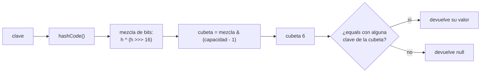

# Lección modelo del formato único

Ejemplo real del formato de [FORMATO-UNICO.md](../FORMATO-UNICO.md). El código de esta carpeta se ejecutó
con OpenJDK 25.0.5 el 2026-11-20 y las salidas están pegadas tal cual. Proyecto guía del ejemplo: el
inventario de una tienda.

### Tema 3: Claves de un `HashMap`: `equals`, `hashCode` y por qué una clave no debe cambiar · Intermedio · 40 min

#### 1. Ubicación y prerrequisitos

Curso Java · tramo Aplicación · módulo «Colecciones». Antes necesitas: clases y objetos, `record`, y el tema
«`List`, `Set`, `Map` y sus implementaciones». Versión: Java 25.

#### 2. Objetivo

Al terminar podrás decir por qué un `HashMap` no encuentra una clave que «está ahí», corregirlo, y elegir
una clave que no pierda datos ni vuelva lento el mapa.

#### 3. Por qué importa

En el inventario guardas las existencias por producto y bodega. Un día el reporte dice que hay 40
unidades, pero al consultarlas por su clave el sistema responde que no existen. No hay excepción ni
mensaje de error: el dato está en memoria y nadie puede llegar a él. Es uno de los fallos más difíciles de
ver en Java, y sale de no conocer el contrato entre `equals` y `hashCode`.

#### 4. Analogía

Un `HashMap` es un mueble de casilleros numerados. Para guardar un paquete, el encargado mira la etiqueta
(la clave), calcula un número de casillero a partir de ella y lo deja ahí. Para buscarlo repite la cuenta
y mira **solo** en ese casillero. Si la etiqueta cambia después de guardar, la cuenta da otro casillero: el
paquete sigue en el mueble, pero el encargado busca donde no está.

**Dónde se rompe la analogía:** en un casillero pueden caer varios paquetes; por eso, además del número,
el mapa compara las etiquetas una por una con `equals`.

#### 5. Diagrama



**Texto alternativo:** la clave pasa por `hashCode()`, se mezclan sus bits y con la capacidad se obtiene un
número de cubeta. Dentro de esa cubeta se compara con `equals`: si coincide con una clave guardada se
devuelve su valor; si no, `null`.

#### 6. Explicación

**Nivel 0.** Un mapa encuentra una clave en dos pasos: primero decide **dónde** buscar con `hashCode()`, y
después confirma **cuál es** con `equals()`. Si dos objetos son iguales pero dan `hashCode` distinto, el
mapa busca en el lugar equivocado. Un `record` te da los dos métodos bien hechos.

**Nivel intermedio.** El contrato tiene dos reglas: (1) si `a.equals(b)`, entonces
`a.hashCode() == b.hashCode()`; (2) mientras un objeto sea clave de un mapa, los campos que usan `equals` y
`hashCode` no pueden cambiar. La segunda es la que más se rompe: la clave se guardó en la cubeta que le
tocaba con sus datos de entonces; si después cambia un campo, ni la clave vieja ni la nueva la encuentran
(la vieja cae en la cubeta correcta pero `equals` ya no coincide; la nueva cae en otra cubeta). Solución:
claves **inmutables** (`record`, `String`, `Integer`, `enum`) y, para «cambiar» una clave, quitar la
entrada y poner otra.

**Nivel maestro.** `HashMap` guarda las entradas en un arreglo de cubetas cuya capacidad es potencia de
dos (16 al crearlo; crece al superar el 75 % de ocupación). La cubeta es
`(h ^ (h >>> 16)) & (capacidad - 1)`: se mezclan los bits altos del hash con los bajos porque solo los
bajos deciden la cubeta. Dos claves distintas pueden compartir hash (`"Aa"` y `"BB"` valen 2112): es una
**colisión** y se resuelve comparando con `equals` dentro de la cubeta. Cuando una cubeta pasa de 8
entradas y la tabla tiene al menos 64 cubetas, se convierte en un árbol; ese árbol solo puede buscar rápido
si las claves son `Comparable`. Las tres medidas de abajo lo muestran: un `hashCode` constante es legal,
pero convierte 11 ms en más de 3 segundos; si además la clave es `Comparable`, baja a unos 100 ms. Las
constantes (16, 0.75, 8 y 64) se leen del propio JDK con
`javap -p -constants java.util.HashMap`.

#### 7. Código ejecutable

**Ejemplo mínimo** · archivo `Minimo.java` · ejecuta `java Minimo.java`

```java
// Lección modelo · ejemplo mínimo. Java 25. Ejecuta: java Minimo.java
import java.util.HashMap;
import java.util.Map;

public class Minimo {
    // Sin equals ni hashCode: dos objetos con los mismos datos son «distintos» para el mapa.
    static class PuntoSinContrato {
        final int x, y;
        PuntoSinContrato(int x, int y) { this.x = x; this.y = y; }
    }

    // Un record genera equals y hashCode a partir de sus componentes.
    record Punto(int x, int y) {}

    public static void main(String[] args) {
        Map<PuntoSinContrato, String> mal = new HashMap<>();
        mal.put(new PuntoSinContrato(1, 2), "tesoro");
        System.out.println("sin contrato: " + mal.get(new PuntoSinContrato(1, 2)));

        Map<Punto, String> bien = new HashMap<>();
        bien.put(new Punto(1, 2), "tesoro");
        System.out.println("con record:   " + bien.get(new Punto(1, 2)));
    }
}
```

Salida:

```text
sin contrato: null
con record:   tesoro
```

**Ejemplo realista** · archivo `Inventario.java` · ejecuta `java -Dstdout.encoding=UTF-8 Inventario.java`

```java
// Lección modelo · ejemplo realista: existencias por (SKU, bodega). Java 25. Ejecuta: java Inventario.java
import java.util.HashMap;
import java.util.Map;
import java.util.Objects;

public class Inventario {
    // ANTES: clave mutable. El equipo le puso setters «por comodidad».
    static final class ClaveMutable {
        private String sku;
        private String bodega;
        ClaveMutable(String sku, String bodega) { this.sku = sku; this.bodega = bodega; }
        void setBodega(String bodega) { this.bodega = bodega; }
        @Override public boolean equals(Object o) {
            return o instanceof ClaveMutable c && sku.equals(c.sku) && bodega.equals(c.bodega);
        }
        @Override public int hashCode() { return Objects.hash(sku, bodega); }
        @Override public String toString() { return sku + "@" + bodega; }
    }

    // DESPUÉS: clave inmutable.
    record Clave(String sku, String bodega) {}

    public static void main(String[] args) {
        Map<ClaveMutable, Integer> existencias = new HashMap<>();
        ClaveMutable clave = new ClaveMutable("TEC-1", "BOG");
        existencias.put(clave, 40);

        clave.setBodega("MED");   // alguien «corrige» la bodega después de guardar

        System.out.println("ANTES (clave mutable)");
        System.out.println("  tamaño del mapa:            " + existencias.size());
        System.out.println("  get con la misma instancia: " + existencias.get(clave));
        System.out.println("  get con TEC-1@BOG:          " + existencias.get(new ClaveMutable("TEC-1", "BOG")));
        System.out.println("  get con TEC-1@MED:          " + existencias.get(new ClaveMutable("TEC-1", "MED")));
        System.out.println("  ¿aparece al recorrerlo?     " + existencias.keySet());

        Map<Clave, Integer> seguro = new HashMap<>();
        seguro.put(new Clave("TEC-1", "BOG"), 40);
        // Para «mover» existencias se quita una entrada y se pone otra: la clave no cambia nunca.
        Integer cantidad = seguro.remove(new Clave("TEC-1", "BOG"));
        seguro.put(new Clave("TEC-1", "MED"), cantidad);
        System.out.println("DESPUÉS (record inmutable)");
        System.out.println("  get con TEC-1@MED:          " + seguro.get(new Clave("TEC-1", "MED")));
        System.out.println("  get con TEC-1@BOG:          " + seguro.get(new Clave("TEC-1", "BOG")));
    }
}
```

Salida:

```text
ANTES (clave mutable)
  tamaño del mapa:            1
  get con la misma instancia: null
  get con TEC-1@BOG:          null
  get con TEC-1@MED:          null
  ¿aparece al recorrerlo?     [TEC-1@MED]
DESPUÉS (record inmutable)
  get con TEC-1@MED:          40
  get con TEC-1@BOG:          null
```

El mapa tiene una entrada y se ve al recorrerlo, pero ninguna consulta la encuentra: ni siquiera con el
mismo objeto que se usó para guardarla.

**Por dentro** · archivo `PorDentro.java` · ejecuta `java -Dstdout.encoding=UTF-8 PorDentro.java`

```java
// Lección modelo · nivel maestro: en qué cubeta cae una clave y cuánto cuesta un mal hashCode.
// Java 25. Ejecuta: java PorDentro.java
import java.util.HashMap;
import java.util.Map;

public class PorDentro {
    // La misma cuenta que hace HashMap: mezcla los bits altos y se queda con los bajos.
    static int cubeta(Object clave, int capacidad) {
        int h = clave.hashCode();
        return (h ^ (h >>> 16)) & (capacidad - 1);
    }

    record ClaveBuena(int id) {}

    // hashCode legal pero pésimo: todas las claves caen en la misma cubeta.
    record ClaveMala(int id) {
        @Override public int hashCode() { return 42; }
    }

    // El mismo hashCode constante, pero la clave se puede ordenar: el mapa convierte la cubeta en árbol.
    record ClaveMalaOrdenable(int id) implements Comparable<ClaveMalaOrdenable> {
        @Override public int hashCode() { return 42; }
        @Override public int compareTo(ClaveMalaOrdenable o) { return Integer.compare(id, o.id); }
    }

    static long medir(Map<Object, Integer> mapa, java.util.function.IntFunction<Object> fabrica, int n) {
        long inicio = System.nanoTime();
        for (int i = 0; i < n; i++) mapa.put(fabrica.apply(i), i);
        long suma = 0;
        for (int i = 0; i < n; i++) suma += mapa.get(fabrica.apply(i));
        if (suma != (long) n * (n - 1) / 2) throw new IllegalStateException("resultado incorrecto");
        return (System.nanoTime() - inicio) / 1_000_000;
    }

    public static void main(String[] args) {
        System.out.println("\"Aa\".hashCode() = " + "Aa".hashCode() + " · \"BB\".hashCode() = " + "BB".hashCode());
        for (String s : new String[] {"Aa", "BB", "TEC-1", "TEC-2"})
            System.out.println("  cubeta de " + s + " con capacidad 16: " + cubeta(s, 16));

        int n = 20_000;
        medir(new HashMap<>(), ClaveBuena::new, n);   // calentamiento del JIT
        long buena = medir(new HashMap<>(), ClaveBuena::new, n);
        long mala = medir(new HashMap<>(), ClaveMala::new, n);
        System.out.println(n + " put + " + n + " get con hashCode bueno: " + buena + " ms");
        long ordenable = medir(new HashMap<>(), ClaveMalaOrdenable::new, n);
        System.out.println(n + " put + " + n + " get con hashCode constante: " + mala + " ms");
        System.out.println(n + " put + " + n + " get con hashCode constante y Comparable: " + ordenable + " ms");
    }
}
```

Salida (los milisegundos cambian en cada máquina; la proporción no):

```text
"Aa".hashCode() = 2112 · "BB".hashCode() = 2112
  cubeta de Aa con capacidad 16: 0
  cubeta de BB con capacidad 16: 0
  cubeta de TEC-1 con capacidad 16: 6
  cubeta de TEC-2 con capacidad 16: 7
20000 put + 20000 get con hashCode bueno: 11 ms
20000 put + 20000 get con hashCode constante: 3642 ms
20000 put + 20000 get con hashCode constante y Comparable: 101 ms
```

#### 8. Mini-laboratorio

1. Ejecuta `Inventario.java` y confirma la salida de arriba.
2. En `ClaveMutable`, borra el método `hashCode` y vuelve a ejecutar. Anota qué consulta cambia y explica
   por qué.
3. Devuelve `hashCode` y cambia `setBodega` para que el campo `bodega` sea `final` (el compilador te
   obligará a quitar el setter y la línea que lo usa).
4. Añade al inventario un método `mover(sku, de, a)` que use `remove` y `put` con la clave `record`.

**Listo cuando** `get` con `TEC-1@MED` devuelve 40, `get` con `TEC-1@BOG` devuelve `null` y no queda
ninguna clave con campos modificables.

#### 9. Verificación

```bash
java -Dstdout.encoding=UTF-8 Inventario.java | grep -c "null"
```

Con el código original imprime `4` (las tres consultas fallidas del «antes» y la bodega vacía del
«después»). Tras el paso 3 del laboratorio, el bloque «ANTES» ya no compila con el setter: esa es la
prueba de que la clave dejó de ser mutable.

#### 10. Error común y diagnóstico

**Síntoma:** `map.get(clave)` devuelve `null`, pero `map.size()` no es 0 y la clave aparece al imprimir
`map.keySet()`. Sin excepción.

**Causa:** la clave cambió después de `put`, o su clase define `equals` sin `hashCode` (o al revés).

**Diagnóstico:** compara `clave.hashCode()` justo antes del `put` y justo antes del `get`; si el número
difiere, la clave mutó. Revisa también que la clase tenga los dos métodos y que usen los mismos campos.

**Arreglo:** clave inmutable (`record`); para cambiar una clave, `remove` + `put`.

**Otro error real de este mismo ejemplo:** en algunas terminales las tildes de la salida salen como `?`
(`tama?o`). No es el mapa: es la codificación de la salida estándar. Se corrige ejecutando con
`-Dstdout.encoding=UTF-8`.

#### 11. Pregunta con respuesta modelo

**Comprensión.** ¿Por qué en el «antes» falla incluso `get` con la misma instancia que se guardó?

**Respuesta modelo:** porque `get` vuelve a calcular el `hashCode` con los datos actuales (`MED`) y busca
en la cubeta que corresponde a ese valor; la entrada sigue en la cubeta que se calculó con `BOG`.

**Entrevista.** ¿Qué pasa si todas las claves de un `HashMap` devuelven el mismo `hashCode`?

**Respuesta modelo:** el mapa sigue siendo correcto, pero todas las entradas caen en una cubeta y cada
operación deja de ser de tiempo constante. Desde Java 8 la cubeta se convierte en árbol al pasar de 8
entradas (con tabla de 64 o más), lo que ayuda si las claves son `Comparable`; si no lo son, la búsqueda
sigue siendo lenta. En la medición de este tema: 11 ms frente a más de 3 segundos, y unos 100 ms con
`Comparable`.

#### 12. Cuándo usarlo y cuándo no

| Úsalo | No lo uses |
|---|---|
| `record`, `String`, `Integer`, `enum` como clave | objetos con setters, listas o arreglos como clave |
| `HashMap` cuando no importa el orden | si necesitas orden por clave: `TreeMap`; si necesitas orden de inserción: `LinkedHashMap` |
| un solo hilo, o mapa que no cambia tras construirse | varios hilos escribiendo: `ConcurrentHashMap` |

**Costo:** un buen `hashCode` hace que buscar no dependa del tamaño del mapa; uno malo no rompe nada, pero
lo vuelve cientos de veces más lento sin avisar.
