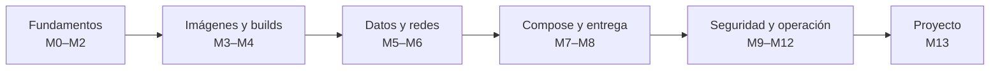

# Curso Docker · Módulo 0: Qué es un contenedor: el Linux que hay debajo

Antes de escribir un Dockerfile vas a aislar un proceso con las herramientas del kernel de Linux. Al final del módulo podrás explicar qué hace Docker por ti y qué no hace: un contenedor no es una máquina virtual pequeña, es un proceso con namespaces, cgroups y capacidades recortadas.

## Mapa de la ruta

«Docker: contenedores de cero a producción» tiene 14 módulos. Este módulo es el punto de entrada.



| Módulo | Qué aprendes |
|---|---|
| 0 | [Qué es un contenedor: el Linux que hay debajo](/curso/docker/0) |
| 1 | [Instalación y arquitectura](/curso/docker/1) |
| 2 | [Ciclo de vida y diagnóstico de contenedores](/curso/docker/2) |
| 3 | [Imágenes y Dockerfile desde cero](/curso/docker/3) |
| 4 | [Builds profesionales con BuildKit](/curso/docker/4) |
| 5 | [Datos y persistencia](/curso/docker/5) |
| 6 | [Redes](/curso/docker/6) |
| 7–13 | Compose para desarrollo · Registros y cadena de suministro · Seguridad en ejecución · Operación del daemon · Swarm y criterio de orquestador · CI/CD y despliegue · Proyecto integrador |

**Sobre la certificación DCA.** El curso cubre los dominios del Docker Certified Associate (guía v1.5, enero de 2025), salvo UCP, DTR y Docker Content Trust, que son productos o funciones que Docker y Mirantis ya no ofrecen como laboratorio libre o que se están retirando. Si vas a presentar el examen, repasa esos tres temas por tu cuenta con la [guía de Mirantis](https://training.mirantis.com/dca-certification-exam/).

## Aprende construyendo

El proyecto del curso es RutaFlow, la plataforma logística de referencia de la academia. Su API es una aplicación Spring Boot; en este curso también usarás dos servicios pequeños de RutaFlow escritos en Python y en Java sin framework, porque permiten ver un mecanismo de Docker sin ruido. En cada módulo RutaFlow avanza un paso, y al final del curso tendrás las siete evidencias del proyecto integrador.

## Entorno del módulo

Los namespaces y los cgroups son funciones del kernel de Linux. macOS y Windows no las tienen, así que necesitas una máquina Linux de laboratorio:

- **Linux nativo** (Ubuntu 24.04 o similar): usa tu propia terminal con `sudo`.
- **macOS o Windows**: instala Docker Desktop (los pasos están en M1 T1) y úsalo solo como una máquina Linux desechable. En este módulo no estudias Docker; lo usas para obtener un kernel Linux donde practicar. Docker Desktop ejecuta su motor en una máquina virtual Linux, y `--privileged` te da permisos de administrador dentro de ella.

Crea la carpeta `academia-labs/docker/m0` y dentro el archivo `lab/Dockerfile`:

```dockerfile
FROM ubuntu:24.04
RUN apt-get update \
 && apt-get install -y --no-install-recommends iproute2 libcap2-bin python3 procps util-linux curl \
 && rm -rf /var/lib/apt/lists/*
```

Construye la imagen del laboratorio y abre una terminal dentro:

```bash
cd academia-labs/docker/m0
docker build -t academia/lab-linux:1 lab
docker run --rm -it --privileged --hostname lab academia/lab-linux:1 bash
```

Todo lo que este módulo marca como «en el laboratorio» se escribe en esa terminal. Si usas Linux nativo, ejecuta los mismos comandos con `sudo` y omite `docker run`.

Las salidas que verás se capturaron el 2026-11-18 con Docker Engine 29.10.0 en Linux x86_64. Los números de inodo, PID e ID cambian en tu equipo; lo que debe coincidir es la forma de la salida.

### Tema 1: Un contenedor es un proceso: namespaces PID, NET, MNT y UTS · Básico · 40 min

**Prerrequisito:** Fundamentos M8 T1–T3 (procesos, memoria y Linux observable).

**Al terminar podrás:** crear con `unshare` un proceso que tiene su propio nombre de host, su propio árbol de PID, su propia red y sus propios montajes, y señalar con evidencia qué recurso aísla cada namespace.

#### Subtema 1.1: Mira los namespaces de tu shell · 5 min

**1. Contexto**

Un namespace es una vista privada de un recurso del kernel. Cada proceso pertenece a un namespace de cada tipo, y el kernel lo muestra como un enlace en `/proc/<pid>/ns`. Antes de crear namespaces nuevos necesitas saber dónde mirar.

**2. Hazlo tú**

En el laboratorio:

```bash
ls -l /proc/$$/ns | awk '{print $9, $10, $11}'
```

Salida real:

```text
cgroup -> cgroup:[4026531835]
ipc -> ipc:[4026532266]
mnt -> mnt:[4026532264]
net -> net:[4026532268]
pid -> pid:[4026532267]
pid_for_children -> pid:[4026532267]
time -> time:[4026532319]
time_for_children -> time:[4026532319]
user -> user:[4026531837]
uts -> uts:[4026532265]
```

**Fallo deliberado:** ejecuta `readlink /proc/self/ns/uts` dos veces y luego `unshare --uts readlink /proc/self/ns/uts`. Las dos primeras líneas dan el mismo número; la tercera da otro. **Diagnóstico:** si comparas números entre comandos distintos sin crear un namespace, siempre coinciden; el número solo cambia cuando el proceso entra en un namespace nuevo.

```text
uts:[4026532265]
uts:[4026532320]
```

**3. Entiende**

El número entre corchetes es el inodo que identifica al namespace. Dos procesos con el mismo número comparten esa vista. Hay ocho tipos en la lista; este tema trabaja cuatro (UTS, PID, NET y MNT). `user` y `cgroup` llegan en T2 y T3.

**4. Cierra**

Guarda la salida en `academia-labs/docker/m0/evidencia/t1-namespaces.txt` (en el laboratorio, redirige con `> /tmp/t1.txt` y cópiala a mano o con `docker cp` desde otra terminal).

#### Subtema 1.2: UTS, un nombre de host propio · 5 min

**1. Contexto**

Cada contenedor de RutaFlow tiene su propio nombre de host, y los logs lo usan para saber qué réplica respondió. Ese nombre vive en el namespace UTS.

**2. Hazlo tú**

```bash
hostname
unshare --uts bash -c "hostname rutaflow-aislado; hostname"
hostname
```

Salida real:

```text
lab
rutaflow-aislado
lab
```

**Fallo deliberado:** ejecuta `hostname rutaflow-aislado` sin `unshare` y luego `hostname`. **Diagnóstico:** cambiaste el nombre de todo el laboratorio porque el proceso compartía el UTS del resto. Devuélvelo con `hostname lab`.

**3. Entiende**

`unshare --uts` crea un UTS nuevo copiando el valor actual. Lo que cambie dentro no se ve fuera. Docker hace lo mismo con `--hostname`.

**4. Cierra**

Anota en la evidencia la diferencia entre cambiar el nombre dentro y fuera del namespace.

#### Subtema 1.3: PID, el proceso cree que es el número 1 · 10 min

**1. Contexto**

En un contenedor, tu aplicación ve su propio árbol de procesos y suele ser el PID 1. El PID 1 tiene reglas especiales para las señales (las verás en T4). Primero necesitas reproducir ese árbol.

**2. Hazlo tú**

```bash
unshare --pid --fork --mount-proc bash -c "ps -o pid,ppid,comm; true"
```

Salida real:

```text
    PID    PPID COMMAND
      1       0 bash
      2       1 ps
```

`bash` es el PID 1 de su namespace y `ps` es su hijo. El `; true` final evita que bash reemplace su proceso por `ps`.

**Fallo deliberado 1 — sin `--fork`:**

```bash
unshare --pid bash -c "/bin/true; /bin/true; echo fin"; echo "exit=$?"
```

```text
bash: fork: Cannot allocate memory
exit=254
```

**Diagnóstico:** sin `--fork`, `unshare` ejecuta `bash` en el namespace PID antiguo y solo sus *hijos* entran al nuevo. El primer hijo (`/bin/true`) se convierte en el PID 1 del namespace y termina. Cuando el PID 1 de un namespace termina, el kernel ya no permite crear procesos en él y `fork` falla con `ENOMEM`, que bash muestra como «Cannot allocate memory». Con `--fork`, `unshare` crea primero un hijo que será el PID 1 y que vive mientras dura tu comando.

**Fallo deliberado 2 — sin `--mount-proc`:**

```bash
unshare --pid --fork bash -c "echo mi PID es \$\$; ps -e | wc -l"
```

```text
mi PID es 1
0
fatal library error, lookup self
```

**Diagnóstico:** el proceso ya está en el namespace nuevo (su PID es 1), pero `/proc` sigue siendo el del namespace anterior y `ps` no se encuentra a sí mismo. `--mount-proc` monta un `/proc` nuevo que refleja el namespace PID.

**3. Entiende**

El namespace PID numera los procesos desde 1. Desde fuera, el mismo proceso tiene otro PID: el archivo `/proc/<pid>/status` lo muestra en la línea `NSpid` (lo usarás en T4). La documentación del kernel describe las dos reglas que acabas de provocar: si el init del namespace termina, `fork` dentro de él falla con `ENOMEM` ([pid_namespaces(7)](https://man7.org/linux/man-pages/man7/pid_namespaces.7.html)).

**4. Cierra**

Guarda la salida correcta y los dos fallos con su diagnóstico en una línea cada uno.

#### Subtema 1.4: NET, una red vacía · 10 min

**1. Contexto**

El servicio de tarifas de RutaFlow escucha en el puerto 8000. Si dos servicios escuchan en el mismo puerto en la misma red, el segundo falla. Los contenedores evitan ese choque porque cada uno tiene su propia pila de red.

**2. Hazlo tú**

```bash
ip -brief link
unshare --net ip -brief link
```

Salida real:

```text
lo               UNKNOWN        00:00:00:00:00:00 <LOOPBACK,UP,LOWER_UP>
eth0@if18        UP             0a:a9:ad:2b:a3:e0 <BROADCAST,MULTICAST,UP,LOWER_UP>
lo               DOWN           00:00:00:00:00:00 <LOOPBACK>
```

Dentro del namespace nuevo solo existe `lo`, y está apagada. Levántala y sirve algo en ella:

```bash
unshare --net bash -c "ip link set lo up; python3 -m http.server 8000 --bind 127.0.0.1 >/dev/null 2>&1 & sleep 1; curl -sS -o /dev/null -w '%{http_code}\n' http://127.0.0.1:8000/; kill %1"
curl -sS -o /dev/null -w "%{http_code}\n" http://127.0.0.1:8000/; echo "curl fuera=$?"
```

Salida real:

```text
200
curl: (7) Failed to connect to 127.0.0.1 port 8000 after 0 ms: Couldn't connect to server
000
curl fuera=7
```

**Fallo deliberado:** dentro de `unshare --net`, ejecuta `curl -sS --max-time 3 http://example.com -o /dev/null; echo curl=$?`.

```text
curl: (6) Could not resolve host: example.com
curl=6
```

**Diagnóstico:** el namespace no tiene interfaces hacia fuera, así que ni siquiera hay DNS. Docker resuelve esto creando un par de interfaces virtuales (`veth`) que conecta el contenedor con un puente del host; lo estudiarás en M6.

**3. Entiende**

El `127.0.0.1` de dentro no es el `127.0.0.1` de fuera: son dos interfaces `lo` distintas. Este detalle explica uno de los fallos más comunes con Docker (una aplicación que escucha en `127.0.0.1` dentro del contenedor no es alcanzable desde fuera), que reproducirás en M6 T2.

**4. Cierra**

Anota en la evidencia por qué el `curl` de fuera falla aunque el servidor esté vivo.

#### Subtema 1.5: MNT, montajes que solo ve un proceso · 10 min

**1. Contexto**

Cada contenedor ve su propio sistema de archivos, y sus volúmenes y montajes no aparecen en el host ni en otros contenedores. Esa separación la da el namespace de montaje.

**2. Hazlo tú**

```bash
mkdir -p /mnt/datos
unshare --mount bash -c "mount -t tmpfs tmpfs /mnt/datos; echo secreto > /mnt/datos/x; ls /mnt/datos; findmnt /mnt/datos"
ls /mnt/datos; findmnt /mnt/datos; echo "findmnt=$?"
```

Salida real:

```text
x
TARGET     SOURCE FSTYPE OPTIONS
/mnt/datos tmpfs  tmpfs  rw,relatime
findmnt=1
```

Dentro del namespace existe el montaje y el archivo `x`; fuera, `ls` no muestra nada y `findmnt` termina con 1 porque ese montaje no existe en tu vista.

**Fallo deliberado:** repite el `mount` sin `unshare --mount` y después ejecuta `findmnt /mnt/datos` en otra terminal del laboratorio (`docker exec -it <id> bash`). **Diagnóstico:** el montaje aparece en las dos terminales porque comparten el namespace MNT. Desmóntalo con `umount /mnt/datos`.

**3. Entiende**

Un contenedor real va más lejos: cambia la raíz del sistema de archivos a la de la imagen (con `pivot_root`), para que el proceso no vea el disco del host. `unshare` solo te da el namespace; la raíz nueva, la imagen, los límites de recursos y la red conectada los añade el runtime (`runc`, en M1 T2).

**4. Cierra**

Escribe la lista de lo que te falta para tener un contenedor: raíz propia (imagen), límites de recursos (T2), privilegios recortados (T3) y una red conectada (M6).

#### Ejercicio del tema

Escribe un único comando `unshare` que dé a `bash` UTS, PID, NET y MNT nuevos a la vez, con `/proc` correcto, el nombre de host `tarifas` y la interfaz `lo` levantada. Dentro, demuestra con tres comandos que el nombre, el árbol de procesos y las interfaces son propios.

<details>
<summary>Solución — ábrela después de intentarlo</summary>

```bash
unshare --uts --pid --fork --mount-proc --net bash -c "hostname tarifas; ip link set lo up; hostname; ps -o pid,comm; ip -brief link; true"
```

`--mount-proc` ya implica un namespace MNT nuevo, por eso no hace falta `--mount`. Debes ver `tarifas`, un `bash` con PID 1 y solo la interfaz `lo`. Si olvidaste `--fork`, vuelve al fallo 1 del subtema 1.3.

</details>

#### Hito del tema

- [ ] Ejecuté los cuatro namespaces por separado y guardé sus salidas.
- [ ] Vi el número de namespace cambiar con `readlink /proc/self/ns/...`.
- [ ] Provoqué y diagnostiqué `fork: Cannot allocate memory` y el `ps` sin `/proc`.
- [ ] Puedo explicar qué le falta a un proceso con `unshare` para ser un contenedor.

**Fuentes:** [namespaces(7)](https://man7.org/linux/man-pages/man7/namespaces.7.html), [pid_namespaces(7)](https://man7.org/linux/man-pages/man7/pid_namespaces.7.html), [unshare(1)](https://man7.org/linux/man-pages/man1/unshare.1.html).

### Tema 2: Límites con cgroups v2: memory.max y cpu.max · Intermedio · 40 min

**Prerrequisito:** Tema 1 de este módulo.

**Al terminar podrás:** identificar qué versión de cgroups usa tu máquina, limitar la memoria y la CPU de un proceso escribiendo en archivos del kernel, provocar un OOM kill y encontrar su evidencia, y relacionar todo eso con `docker run --memory` y `--cpus`.

#### Subtema 2.1: ¿Qué versión de cgroups tienes? · 5 min

**1. Contexto**

Los namespaces deciden qué ve un proceso; los cgroups deciden cuánto puede consumir. Linux tiene dos versiones con archivos distintos. Docker Engine 29 declaró obsoleta la versión 1: las [notas de versión de Engine 29.0.0](https://docs.docker.com/engine/release-notes/29/) dicen «cgroup v1 is deprecated. Support continues until at least May 2029». Antes de escribir un límite necesitas saber qué versión tienes.

**2. Hazlo tú**

En una terminal normal (no en el laboratorio):

```bash
docker info --format 'cgroup v{{.CgroupVersion}} driver={{.CgroupDriver}}'
```

En el laboratorio:

```bash
stat -fc %T /sys/fs/cgroup
```

`cgroup2fs` significa cgroups v2; `tmpfs` significa v1 (o un modo híbrido). Docker Desktop usa cgroups v2.

Salida real en una máquina con cgroups v1, la que se usó para redactar este curso:

```text
cgroup v1 driver=cgroupfs
tmpfs
```

En esa máquina, `docker info` termina con este aviso:

```text
WARNING: Support for cgroup v1 is deprecated and planned to be removed by no later than May 2029 (https://github.com/moby/moby/issues/51111)
```

**Fallo deliberado:** busca `/sys/fs/cgroup/memory.max` en una máquina v1. **Diagnóstico:** el archivo no existe porque v1 usa otra jerarquía (`/sys/fs/cgroup/memory/memory.limit_in_bytes`). Los subtemas 2.2 a 2.4 necesitan v2; si tu Linux usa v1, haz esos tres subtemas en Docker Desktop.

**3. Entiende**

cgroups v2 tiene una sola jerarquía montada en `/sys/fs/cgroup`, y cada controlador (memoria, CPU, E/S) se configura con archivos dentro de cada carpeta. Una carpeta es un cgroup; un proceso pertenece a un cgroup cuando su PID está en `cgroup.procs`.

**4. Cierra**

Guarda la salida de los dos comandos en `evidencia/t2-version.txt`.

#### Subtema 2.2: Crea un cgroup y limita la memoria · 10 min

**1. Contexto**

La API de RutaFlow no debe poder agotar la memoria de un servidor que comparte con PostgreSQL. El límite de memoria se escribe en `memory.max`.

**2. Hazlo tú**

En el laboratorio (Docker Desktop, cgroups v2):

```bash
# 1. Saca todos los procesos del cgroup raíz del laboratorio a una hoja.
mkdir /sys/fs/cgroup/init
for pid in $(cat /sys/fs/cgroup/cgroup.procs); do echo "$pid" > /sys/fs/cgroup/init/cgroup.procs; done
# 2. Activa los controladores de memoria y CPU para los hijos.
echo "+memory +cpu" > /sys/fs/cgroup/cgroup.subtree_control
# 3. Crea el cgroup de RutaFlow y ponle 64 MiB.
mkdir /sys/fs/cgroup/rutaflow
echo 64M > /sys/fs/cgroup/rutaflow/memory.max
echo 0 > /sys/fs/cgroup/rutaflow/memory.swap.max
cat /sys/fs/cgroup/rutaflow/memory.max
```

Debes leer `67108864` (64 × 1024 × 1024 bytes).

**Fallo deliberado:** omite el paso 1 y ejecuta el paso 2. **Diagnóstico:** la escritura falla con `Device or resource busy`. La regla de «ningún proceso interno» de cgroups v2 dice que un cgroup que no es la raíz solo puede repartir recursos entre sus hijos si no tiene procesos propios. Dentro del laboratorio, la raíz que ves es en realidad un cgroup hijo del host, así que la regla se aplica.

**3. Entiende**

El kernel define `memory.max` así: si el uso llega al límite y no puede reducirse, se invoca al OOM killer dentro del cgroup ([cgroup v2, documentación del kernel](https://docs.kernel.org/admin-guide/cgroup-v2.html)). Poner `memory.swap.max` en 0 evita que el proceso esquive el límite usando swap.

**4. Cierra**

Anota los tres archivos que tocaste y para qué sirve cada uno.

#### Subtema 2.3: Provoca un OOM kill y encuentra la evidencia · 10 min

**1. Contexto**

Un proceso que muere por memoria no siempre deja un mensaje propio. Necesitas saber dónde mira el operador.

**2. Hazlo tú**

En el laboratorio, mete tu shell en el cgroup y reserva memoria hasta pasar el límite:

```bash
bash -c 'echo $$ > /sys/fs/cgroup/rutaflow/cgroup.procs; exec python3 -c "
bloques = []
for mb in range(1, 501):
    bloques.append(bytearray(1024 * 1024))
    if mb % 16 == 0:
        print(f\"reservados {mb} MiB\", flush=True)
"'; echo "exit=$?"
grep oom_kill /sys/fs/cgroup/rutaflow/memory.events
cat /sys/fs/cgroup/rutaflow/memory.peak
```

El proceso imprime varias líneas `reservados N MiB`, muere sin mensaje propio y el shell muestra `exit=137` (128 + 9, SIGKILL). `memory.events` muestra `oom_kill 1` y `memory.peak` un valor cercano a 64 MiB.

**Fallo deliberado:** ejecuta el mismo `python3` sin escribir en `cgroup.procs`. **Diagnóstico:** termina con «terminé» o con el límite de toda la máquina, porque el proceso no pertenecía al cgroup limitado.

**3. Entiende**

El código 137 no dice «memoria»: dice «terminado por SIGKILL». La causa está en `memory.events` (`oom_kill` cuenta los procesos de ese cgroup matados por el OOM killer). Docker lee la misma información y la expone como `OOMKilled` en `docker inspect`.

**4. Cierra**

Guarda el `exit=137`, la línea `oom_kill` y `memory.peak` en `evidencia/t2-oom.txt`.

#### Subtema 2.4: Limita la CPU con cpu.max · 10 min

**1. Contexto**

El worker de asignación de RutaFlow hace cálculos intensivos. Si no se limita, puede quitarle CPU a la API.

**2. Hazlo tú**

```bash
mkdir /sys/fs/cgroup/worker
echo "50000 100000" > /sys/fs/cgroup/worker/cpu.max
bash -c 'echo $$ > /sys/fs/cgroup/worker/cgroup.procs; exec timeout 5 sh -c "while :; do :; done"' &
sleep 5
grep -E "usage_usec|nr_throttled|throttled_usec" /sys/fs/cgroup/worker/cpu.stat
```

Con `50000 100000`, el bucle puede usar como mucho 50 000 µs de CPU por cada periodo de 100 000 µs: media CPU. Tras 5 segundos, `usage_usec` debe rondar 2 500 000 y `nr_throttled` debe ser mayor que 0.

**Fallo deliberado:** escribe `echo "50 100000"`. **Diagnóstico:** el kernel rechaza la escritura con `Invalid argument` porque la cuota mínima es de 1000 µs. Revisa siempre que la escritura no haya fallado antes de medir.

**3. Entiende**

El formato de `cpu.max` es `$MAX $PERIOD` y el valor por defecto es `max 100000`, es decir, sin límite ([cgroup v2](https://docs.kernel.org/admin-guide/cgroup-v2.html)). `docker run --cpus 0.5` escribe exactamente `50000 100000`.

**4. Cierra**

Guarda `cpu.stat` y explica en una frase qué significa `nr_throttled`.

#### Subtema 2.5: Lo mismo con Docker · 5 min

**1. Contexto**

No vas a escribir en `/sys/fs/cgroup` cada vez que arranques RutaFlow. Docker crea un cgroup por contenedor y escribe esos archivos por ti.

**2. Hazlo tú**

Fuera del laboratorio:

```bash
docker run --name oom --memory 64m --memory-swap 64m academia/lab-linux:1 python3 -c '
bloques = []
for mb in range(1, 501):
    bloques.append(bytearray(1024 * 1024))
    if mb % 16 == 0:
        print(f"reservados {mb} MiB", flush=True)
print("terminé sin límite")'; echo "exit=$?"
docker inspect -f 'exit={{.State.ExitCode}} OOMKilled={{.State.OOMKilled}}' oom
docker rm oom
```

Salida real:

```text
reservados 16 MiB
reservados 32 MiB
reservados 48 MiB
exit=137
exit=137 OOMKilled=true
```

Mira los archivos que Docker escribió:

```bash
docker run --rm --memory 64m academia/lab-linux:1 cat /sys/fs/cgroup/memory.max
docker run --rm --cpus 0.5 academia/lab-linux:1 cat /sys/fs/cgroup/cpu.max
```

Con cgroups v2 obtienes `67108864` y `50000 100000`. En la máquina v1 de redacción esos archivos no existen y los equivalentes dan `67108864` (`memory/memory.limit_in_bytes`) y `50000` / `100000` (`cpu/cpu.cfs_quota_us` y `cpu.cfs_period_us`).

**Fallo deliberado:** quita `--memory-swap 64m`. **Diagnóstico:** si la máquina tiene swap, el proceso puede aguantar más antes de morir; `--memory-swap` igual a `--memory` impide usar swap.

**3. Entiende**

Docker no inventa los límites: los traduce a archivos de cgroups. Por eso el diagnóstico de M9 T5 (OOM, `docker stats`, `docker inspect`) se apoya en lo que viste aquí.

**4. Cierra**

Guarda el `OOMKilled=true` junto con la evidencia de 2.3: es el mismo fenómeno visto desde dos capas.

#### Ejercicio del tema

Limita un proceso a 32 MiB y a un cuarto de CPU con un único cgroup llamado `tarifas`, y demuestra los dos límites con evidencia del kernel. Después escribe el `docker run` equivalente.

<details>
<summary>Solución — ábrela después de intentarlo</summary>

```bash
mkdir /sys/fs/cgroup/tarifas
echo 32M > /sys/fs/cgroup/tarifas/memory.max
echo 0 > /sys/fs/cgroup/tarifas/memory.swap.max
echo "25000 100000" > /sys/fs/cgroup/tarifas/cpu.max
```

La evidencia es `oom_kill 1` en `memory.events` tras reservar más de 32 MiB, y `nr_throttled` mayor que 0 tras un bucle de CPU. El equivalente es `docker run --memory 32m --memory-swap 32m --cpus 0.25 ...`.

</details>

#### Hito del tema

- [ ] Identifiqué la versión de cgroups de mi máquina y de Docker Desktop.
- [ ] Provoqué un OOM kill y lo encontré en `memory.events` y en `OOMKilled`.
- [ ] Limité la CPU y vi `nr_throttled` crecer.
- [ ] Puedo explicar por qué 137 no basta para afirmar que fue un OOM.

**Fuentes:** [Control Group v2 (kernel.org)](https://docs.kernel.org/admin-guide/cgroup-v2.html), [notas de versión de Docker Engine 29](https://docs.docker.com/engine/release-notes/29/), [docker container run: límites de recursos](https://docs.docker.com/reference/cli/docker/container/run/).

### Tema 3: Root dentro y fuera: capacidades y namespace de usuario · Intermedio · 40 min

**Prerrequisito:** Temas 1 y 2 de este módulo.

**Al terminar podrás:** demostrar que el root de un contenedor Docker es el root del host con privilegios recortados, decodificar la máscara de capacidades por defecto, quitar y añadir capacidades, y explicar qué cambia con un namespace de usuario.

#### Subtema 3.1: ¿Quién es root en un contenedor? · 8 min

**1. Contexto**

Una idea falsa muy extendida es que «todo contenedor usa un namespace de usuario». No es así: Docker solo lo activa si configuras `userns-remap` en el daemon o usas el modo rootless (M9 T3). Vas a comprobarlo.

**2. Hazlo tú**

```bash
docker run --rm ubuntu:24.04 bash -c 'id; cat /proc/self/uid_map'
docker info --format '{{json .SecurityOptions}}'
```

Salida real:

```text
uid=0(root) gid=0(root) groups=0(root)
         0          0 4294967295
["name=seccomp,profile=builtin"]
```

**Fallo deliberado:** interpreta `uid=0` como «root falso». **Diagnóstico:** `uid_map` dice `0 0 4294967295`: el UID 0 de dentro corresponde al UID 0 de fuera, para todo el rango. Es el mapa del namespace de usuario inicial, el del host. Si hubiera remapeo, la segunda columna sería un UID alto del host, y `SecurityOptions` incluiría `name=userns` (o `name=rootless`).

**3. Entiende**

El proceso es root de verdad. Lo que lo frena son otras capas: el conjunto reducido de capacidades (3.2), el perfil seccomp por defecto (`profile=builtin`, M9 T2) y los namespaces. La documentación de Docker lo dice así: «By default, Docker containers are "unprivileged"», y `--privileged` «gives all capabilities to the container» ([Running containers](https://docs.docker.com/engine/containers/run/)).

**4. Cierra**

Guarda las tres líneas en `evidencia/t3-root.txt` con una frase: «root en el contenedor = UID 0 del host».

#### Subtema 3.2: Decodifica las capacidades por defecto · 10 min

**1. Contexto**

Linux divide los poderes de root en capacidades. Docker deja 14 por defecto. Un dato falso del piloto anterior de este curso decía que el bit 31 era `setpcap`; vas a comprobar cuál es.

**2. Hazlo tú**

```bash
docker run --rm ubuntu:24.04 grep Cap /proc/self/status
docker run --rm academia/lab-linux:1 capsh --decode=00000000a80425fb
docker run --rm academia/lab-linux:1 capsh --decode=0x80000000
docker run --rm academia/lab-linux:1 capsh --decode=0x100
```

Salida real:

```text
CapInh:	0000000000000000
CapPrm:	00000000a80425fb
CapEff:	00000000a80425fb
CapBnd:	00000000a80425fb
CapAmb:	0000000000000000
0x00000000a80425fb=cap_chown,cap_dac_override,cap_fowner,cap_fsetid,cap_kill,cap_setgid,cap_setuid,cap_setpcap,cap_net_bind_service,cap_net_raw,cap_sys_chroot,cap_mknod,cap_audit_write,cap_setfcap
0x0000000080000000=cap_setfcap
0x0000000000000100=cap_setpcap
```

El bit 31 (`0x80000000`) es `CAP_SETFCAP`; `CAP_SETPCAP` es el bit 8 (`0x100`). La cabecera del kernel lo confirma: `#define CAP_SETPCAP 8` y `#define CAP_SETFCAP 31` en `linux/capability.h`.

**Fallo deliberado:** decodifica `a80425fb` sin el prefijo de ceros y compara con la tabla de Docker. **Diagnóstico:** `capsh` acepta ambas formas; el error típico es contar a mano los bits desde la izquierda. Usa siempre `capsh --decode`.

**3. Entiende**

`CapEff` son las capacidades efectivas; `CapBnd` es el techo que ningún proceso del contenedor puede superar. Las 14 de la lista coinciden con la tabla oficial de capacidades por defecto: AUDIT_WRITE, CHOWN, DAC_OVERRIDE, FOWNER, FSETID, KILL, MKNOD, NET_BIND_SERVICE, NET_RAW, SETFCAP, SETGID, SETPCAP, SETUID y SYS_CHROOT ([Runtime privilege and Linux capabilities](https://docs.docker.com/engine/containers/run/)). Faltan, por ejemplo, `CAP_SYS_ADMIN` y `CAP_NET_ADMIN`.

**4. Cierra**

Guarda la decodificación y escribe qué capacidad corresponde al bit 31 y cuál al bit 8.

#### Subtema 3.3: Quita y añade capacidades · 10 min

**1. Contexto**

El servicio de tarifas no necesita cambiar dueños de archivos ni tocar la red. Si alguien lo compromete, cada capacidad que conserva es una herramienta más para el atacante.

**2. Hazlo tú**

```bash
docker run --rm ubuntu:24.04 bash -c 'touch /tmp/a && chown nobody /tmp/a && ls -l /tmp/a'
docker run --rm --cap-drop ALL ubuntu:24.04 bash -c 'grep CapEff /proc/self/status; touch /tmp/a && chown nobody /tmp/a; echo "exit=$?"'
docker run --rm --cap-drop CHOWN ubuntu:24.04 bash -c 'touch /tmp/a && chown nobody /tmp/a; echo "exit=$?"'
```

Salida real:

```text
-rw-r--r-- 1 nobody root 0 Nov 19 01:22 /tmp/a
CapEff:	0000000000000000
chown: changing ownership of '/tmp/a': Operation not permitted
exit=1
chown: changing ownership of '/tmp/a': Operation not permitted
exit=1
```

Ahora al revés: una capacidad que no está por defecto.

```bash
docker run --rm academia/lab-linux:1 bash -c 'ip link set lo mtu 1400; echo "exit=$?"'
docker run --rm --cap-add NET_ADMIN academia/lab-linux:1 bash -c 'ip link set lo mtu 1400 && ip -d link show lo | head -1'
```

```text
RTNETLINK answers: Operation not permitted
exit=2
1: lo: <LOOPBACK,UP,LOWER_UP> mtu 1400 qdisc noqueue state UNKNOWN mode DEFAULT group default qlen 1000
```

**Fallo deliberado:** usa `--privileged` para «arreglar» el `RTNETLINK`. **Diagnóstico:** funciona, pero entrega todas las capacidades y acceso a los dispositivos del host. La corrección es añadir solo la capacidad que falta.

**3. Entiende**

Root sin `CAP_CHOWN` no puede cambiar dueños: el kernel comprueba capacidades, no el número 0. Por eso M9 T1 parte de `--cap-drop ALL` y añade solo lo necesario.

**4. Cierra**

Anota qué capacidad necesitó cada operación y qué error aparece sin ella.

#### Subtema 3.4: Un namespace de usuario con unshare · 7 min

**1. Contexto**

El namespace de usuario sí cambia el significado de root: dentro eres UID 0, pero fuera sigues siendo un usuario normal. Así funcionan el modo rootless y `userns-remap`.

**2. Hazlo tú**

En el laboratorio:

```bash
useradd -m -u 2000 -s /bin/bash estudiante
su estudiante -c "id"
su estudiante -c "unshare --user --map-root-user bash -c 'id; cat /proc/self/uid_map; echo prueba >> /etc/hosts 2>&1 || echo \"no pude escribir /etc/hosts\"; touch /tmp/creado-por-root-falso'"
stat -c "%U %u %n" /tmp/creado-por-root-falso
```

Salida real:

```text
uid=2000(estudiante) gid=2000(estudiante) groups=2000(estudiante)
uid=0(root) gid=0(root) groups=0(root)
         0       2000          1
bash: line 1: /etc/hosts: Permission denied
no pude escribir /etc/hosts
estudiante 2000 /tmp/creado-por-root-falso
```

**Fallo deliberado:** compara este `uid_map` con el de 3.1. **Diagnóstico:** aquí la segunda columna es `2000`: el root de dentro es el UID 2000 de fuera, y por eso no puede escribir `/etc/hosts` y el archivo que crea pertenece a `estudiante`.

**3. Entiende**

Docker puede hacer este remapeo para todos los contenedores con la clave `userns-remap` de `/etc/docker/daemon.json`; la documentación lo describe como un UID alto del host que se ve como `0` dentro del contenedor, y lista sus incompatibilidades, por ejemplo `--pid=host`, `--network=host` y `--privileged` sin `--userns=host` ([Isolate containers with a user namespace](https://docs.docker.com/engine/security/userns-remap/)). Además, Engine 29.0.0 indica que el almacén de imágenes de containerd «is temporarily not available when userns remapping is enabled».

**4. Cierra**

Escribe en dos líneas la diferencia entre «root con capacidades recortadas» (3.1–3.3) y «root remapeado» (3.4).

#### Ejercicio del tema

Ejecuta el servicio de tarifas de RutaFlow (por ahora, `python3 -m http.server 8000`) en la imagen del laboratorio con el mínimo de capacidades. Descubre por prueba y error si necesita alguna.

<details>
<summary>Solución — ábrela después de intentarlo</summary>

```bash
docker run --rm -d --name tarifas-min --cap-drop ALL academia/lab-linux:1 python3 -m http.server 8000
docker exec tarifas-min curl -sS -o /dev/null -w "%{http_code}\n" http://127.0.0.1:8000/
docker rm -f tarifas-min
```

Un servidor en un puerto mayor que 1023 no necesita capacidades. Solo necesitaría `NET_BIND_SERVICE` para escuchar en un puerto menor que 1024 sin ser root; la solución profesional es escuchar en un puerto alto.

</details>

#### Hito del tema

- [ ] Demostré con `uid_map` que Docker no remapea root por defecto.
- [ ] Decodifiqué `a80425fb` y ubiqué `CAP_SETFCAP` en el bit 31.
- [ ] Provoqué un `Operation not permitted` quitando una capacidad.
- [ ] Expliqué qué protege un namespace de usuario y qué limita.

**Fuentes:** [capabilities(7)](https://man7.org/linux/man-pages/man7/capabilities.7.html), [user_namespaces(7)](https://man7.org/linux/man-pages/man7/user_namespaces.7.html), [Docker: Runtime privilege and Linux capabilities](https://docs.docker.com/engine/containers/run/), [Docker: userns-remap](https://docs.docker.com/engine/security/userns-remap/).

### Tema 4: PID 1 y señales: por qué docker stop termina en 137 · Avanzado · 45 min

**Prerrequisito:** Temas 1–3 de este módulo. Conocer `kill`, `trap` y los códigos de salida de Fundamentos M8.

**Al terminar podrás:** explicar la regla del kernel que hace que un PID 1 sin manejador ignore SIGTERM, reproducir el `docker stop` que tarda 10 segundos y termina en 137, y corregirlo con un manejador de señales o con un init.

#### Subtema 4.1: Fuera de un contenedor, SIGTERM mata · 5 min

**1. Contexto**

`docker stop` envía SIGTERM y, si el proceso no termina en el plazo, SIGKILL. Antes de ver el caso raro, mira el normal.

**2. Hazlo tú**

En el laboratorio:

```bash
sleep 300 & kill -TERM $!; wait $!; echo "exit=$?"
```

```text
exit=143
```

**Fallo deliberado:** cambia `-TERM` por `-KILL`. **Diagnóstico:** obtienes `exit=137`. La convención del shell es 128 + número de señal: 15 (SIGTERM) da 143 y 9 (SIGKILL) da 137.

**3. Entiende**

`sleep` no instala manejadores; la acción por defecto de SIGTERM es terminar el proceso. Recuerda esa tabla: 143 = SIGTERM, 137 = SIGKILL.

**4. Cierra**

Anota la fórmula 128 + señal y los dos valores.

#### Subtema 4.2: El PID 1 de un namespace ignora SIGTERM · 10 min

**1. Contexto**

Ahora el mismo `sleep` será el PID 1 de un namespace, como lo sería dentro de un contenedor.

**2. Hazlo tú**

```bash
unshare --pid --fork --mount-proc sleep 300 2>/dev/null &
sleep 1; P=$(pgrep -x sleep); echo "PID visto desde fuera: $P"; grep NSpid /proc/$P/status
kill -TERM $P; sleep 1; ps -o pid,stat,comm -p $P
kill -KILL $P; sleep 1; ps -o pid,comm -p $P; echo "ps=$?"
```

Salida real:

```text
PID visto desde fuera: 10
NSpid:	10	1
    PID STAT COMMAND
     10 S    sleep
    PID COMMAND
ps=1
```

`NSpid: 10 1` dice que el mismo proceso es el 10 fuera y el 1 dentro. Tras SIGTERM sigue vivo; SIGKILL lo elimina.

**Fallo deliberado:** repite el experimento sin `--pid`. **Diagnóstico:** SIGTERM mata el `sleep` de inmediato, porque ya no es el init de un namespace.

**3. Entiende**

El kernel protege al init de cada namespace PID: solo le entrega las señales para las que instaló un manejador. La excepción son SIGKILL y SIGSTOP enviadas desde un namespace ancestro, que se entregan a la fuerza ([pid_namespaces(7)](https://man7.org/linux/man-pages/man7/pid_namespaces.7.html)). Un programa que no instala manejador para SIGTERM, como `sleep` o muchos scripts, la ignora cuando es PID 1.

**4. Cierra**

Guarda la salida con `NSpid` en `evidencia/t4-pid1.txt`.

#### Subtema 4.3: El docker stop de 10 segundos · 10 min

**1. Contexto**

Este es el síntoma que verás en producción: los despliegues tardan diez segundos más por contenedor y los logs no muestran un apagado limpio.

**2. Hazlo tú**

Fuera del laboratorio:

```bash
docker run -d --name pid1-sleep ubuntu:24.04 sleep infinity
docker top pid1-sleep -o pid,ppid,comm
time docker stop pid1-sleep
docker inspect -f 'exit={{.State.ExitCode}} OOMKilled={{.State.OOMKilled}}' pid1-sleep
docker rm pid1-sleep
```

Salida real (el `PID` de `docker top` es el del host):

```text
real	0m10.182s
exit=137 OOMKilled=false
```

Prueba también un shell que se manda SIGTERM a sí mismo siendo PID 1:

```bash
docker run --rm ubuntu:24.04 bash -c 'kill -TERM $$; echo "sigo vivo"'; echo "exit=$?"
```

```text
sigo vivo
exit=0
```

**Fallo deliberado:** atribuye el 137 a falta de memoria. **Diagnóstico:** `OOMKilled=false` y los 10 segundos medidos indican otra causa: SIGTERM fue ignorado y Docker envió SIGKILL al vencer el plazo.

**3. Entiende**

La referencia de `docker stop` dice que el proceso principal recibe SIGTERM y, tras un periodo de gracia, SIGKILL; el plazo por defecto es de 10 segundos en contenedores Linux ([docker container stop](https://docs.docker.com/reference/cli/docker/container/stop/)). Combinado con la regla de 4.2, un PID 1 sin manejador siempre agota el plazo.

**4. Cierra**

Guarda el tiempo y el código de salida. Esta es la evidencia «antes» del hito del módulo.

#### Subtema 4.4: Corrige con un manejador de señales · 10 min

**1. Contexto**

La primera corrección es que el proceso principal maneje SIGTERM. En un script de shell eso se hace con `trap`, pero hay una trampa.

**2. Hazlo tú**

```bash
docker run -d --name trap-fg ubuntu:24.04 bash -c 'trap "echo recibido TERM; exit 0" TERM; echo listo; sleep 300'
docker run -d --name trap-bg ubuntu:24.04 bash -c 'trap "echo recibido TERM; exit 0" TERM; echo listo; sleep 300 & wait $!'
time docker stop trap-fg
time docker stop trap-bg
for c in trap-fg trap-bg; do echo "$c exit=$(docker inspect -f '{{.State.ExitCode}}' $c)"; docker logs $c; done
docker rm trap-fg trap-bg
```

Salida real (resumida a los tiempos):

```text
real	0m10.145s
real	0m0.129s
trap-fg exit=137
listo
trap-bg exit=0
listo
recibido TERM
```

**Fallo deliberado:** es `trap-fg`. **Diagnóstico:** bash sí recibió la señal, pero no ejecuta el `trap` hasta que termina el comando en primer plano (`sleep 300`). Con `sleep 300 & wait $!`, `wait` se interrumpe al llegar la señal y el `trap` corre de inmediato.

**3. Entiende**

Instalar el manejador no basta: el manejador debe poder ejecutarse a tiempo. La JVM y Python instalan manejadores de SIGTERM (la JVM ejecuta sus *shutdown hooks*); lo verás con la API de RutaFlow en M2 T3.

**4. Cierra**

Guarda las dos mediciones y una frase con la causa de los 10 segundos de `trap-fg`.

#### Subtema 4.5: Corrige con un init · 10 min

**1. Contexto**

A veces no puedes cambiar el programa (un binario de terceros). La segunda corrección es poner delante un init pequeño que sí maneja señales y las reenvía.

**2. Hazlo tú**

```bash
docker run -d --init --name pid1-init ubuntu:24.04 sleep infinity
docker top pid1-init -o pid,ppid,comm
time docker stop pid1-init
docker inspect -f 'exit={{.State.ExitCode}}' pid1-init
docker rm pid1-init
docker run --rm --init ubuntu:24.04 bash -c 'kill -TERM $$; echo "sigo vivo"'; echo "exit=$?"
```

Salida real:

```text
PID                 PPID                COMMAND
...                 ...                 docker-init
...                 ...                 sleep
real	0m0.145s
exit=143
exit=143
```

Dentro del contenedor, `docker-init` es el PID 1 y `sleep` es el PID 7: ya no es init, así que SIGTERM lo mata con su acción por defecto y el código es 143.

**Fallo deliberado:** usa `--init` con un programa que tenga trabajo pendiente al apagarse. **Diagnóstico:** el init reenvía la señal, pero no sabe guardar el trabajo; si el programa no maneja SIGTERM, muere a mitad. `--init` evita la espera de 10 segundos, no sustituye un apagado ordenado. M2 T3 lo demuestra con un caso en que `--init` deja a la JVM sin ejecutar sus hooks.

**3. Entiende**

`--init` «Run an init inside the container that forwards signals and reaps processes» ([docker container run](https://docs.docker.com/reference/cli/docker/container/run/)). El binario que Docker instala es `docker-init`; `docker version` lo muestra en su propia línea (versión 0.19.0 en la máquina de redacción).

**4. Cierra**

Guarda el árbol de procesos con `docker-init` y el código 143.

#### Ejercicio del tema

Escribe un script `worker.sh` que imprima «procesando lote» cada segundo y que, al recibir SIGTERM, imprima «lote cerrado» y salga con 0. Ejecútalo como PID 1 (sin `--init`) y demuestra que `docker stop` tarda menos de un segundo.

<details>
<summary>Solución — ábrela después de intentarlo</summary>

```bash
cat > worker.sh <<'EOF'
#!/bin/bash
cerrar() { echo "lote cerrado"; exit 0; }
trap cerrar TERM
while true; do
  echo "procesando lote"
  sleep 1 & wait $!
done
EOF
chmod +x worker.sh
docker run -d --name worker -v "$PWD/worker.sh":/worker.sh ubuntu:24.04 /worker.sh
sleep 3; time docker stop worker; docker logs worker | tail -2; docker inspect -f '{{.State.ExitCode}}' worker; docker rm worker
```

La clave es `sleep 1 & wait $!`: con `sleep 1` en primer plano, la señal esperaría hasta un segundo, todavía dentro del plazo, pero el patrón se rompe en cuanto la espera es larga. `-v` monta el script desde tu carpeta; lo estudiarás en M5.

</details>

#### Hito del tema

- [ ] Vi con `NSpid` que un proceso es PID 1 dentro y otro número fuera.
- [ ] Reproduje `docker stop` de 10 segundos con `exit=137` y `OOMKilled=false`.
- [ ] Lo corregí con `trap` y `wait`, y con `--init`, y medí ambos.
- [ ] Puedo explicar por qué `--init` no es un apagado ordenado.

**Fuentes:** [pid_namespaces(7)](https://man7.org/linux/man-pages/man7/pid_namespaces.7.html), [signal(7)](https://man7.org/linux/man-pages/man7/signal.7.html), [docker container stop](https://docs.docker.com/reference/cli/docker/container/stop/), [docker container run](https://docs.docker.com/reference/cli/docker/container/run/).

## Hito RutaFlow del módulo

Vas a ejecutar la API de RutaFlow aislada con `unshare` y con límite de memoria, y a registrar qué le falta para ser un contenedor.

**El JAR.** Usa el JAR de Spring Boot que construiste en el curso Spring Boot (M0–M2). Si aún no lo tienes, usa este sustituto mínimo de un archivo, que responde `/health` y anuncia su apagado. Guárdalo en `academia-labs/docker/rutaflow/RutaflowApi.java`:

```java
import com.sun.net.httpserver.HttpExchange;
import com.sun.net.httpserver.HttpServer;
import java.io.IOException;
import java.net.InetSocketAddress;
import java.nio.charset.StandardCharsets;

/** Sustituto mínimo de la API de RutaFlow para practicar Docker sin Spring Boot. */
public final class RutaflowApi {
  private static final int SEGUNDOS_DE_GRACIA = 2;

  private RutaflowApi() { }

  public static void main(String[] args) throws IOException {
    int puerto = Integer.parseInt(System.getenv().getOrDefault("PUERTO", "8080"));
    HttpServer servidor = HttpServer.create(new InetSocketAddress("0.0.0.0", puerto), 0);
    servidor.createContext("/health", intercambio -> responder(intercambio, "{\"status\":\"UP\"}"));
    servidor.start();
    System.out.println("RutaFlow API escuchando en el puerto " + puerto + " (pid " + ProcessHandle.current().pid() + ")");

    // La JVM ejecuta este hook al recibir SIGTERM o SIGINT; SIGKILL no lo ejecuta.
    Runtime.getRuntime().addShutdownHook(new Thread(() -> {
      System.out.println("Apagado solicitado: cierro el servidor HTTP");
      servidor.stop(SEGUNDOS_DE_GRACIA);
      System.out.println("Apagado ordenado completo");
    }));
  }

  private static void responder(HttpExchange intercambio, String json) throws IOException {
    byte[] cuerpo = json.getBytes(StandardCharsets.UTF_8);
    intercambio.getResponseHeaders().set("Content-Type", "application/json");
    intercambio.sendResponseHeaders(200, cuerpo.length);
    try (var salida = intercambio.getResponseBody()) {
      salida.write(cuerpo);
    }
  }
}
```

Compílalo con tu JDK 25:

```bash
cd academia-labs/docker/rutaflow
javac -d out RutaflowApi.java
jar --create --file rutaflow-api.jar --main-class RutaflowApi -C out .
```

**El laboratorio con Java.** Crea `academia-labs/docker/m0/lab-java/Dockerfile` sobre la imagen oficial de Temurin, que está basada en Ubuntu:

```dockerfile
FROM eclipse-temurin:25-jre
RUN apt-get update \
 && apt-get install -y --no-install-recommends iproute2 procps util-linux curl \
 && rm -rf /var/lib/apt/lists/*
```

```bash
docker build -t academia/lab-java:25 academia-labs/docker/m0/lab-java
docker run --rm -it --privileged --hostname lab -v "$PWD":/rutaflow academia/lab-java:25 bash
```

**Ejecución aislada.** Dentro del laboratorio, crea el cgroup del Tema 2 (`/sys/fs/cgroup/rutaflow` con `memory.max` de 256M) y arranca la API dentro de él y en namespaces nuevos:

```bash
cd /rutaflow
bash -c 'echo $$ > /sys/fs/cgroup/rutaflow/cgroup.procs; exec unshare --pid --fork --mount-proc --uts --net bash -c "hostname rutaflow; ip link set lo up; java -jar rutaflow-api.jar & sleep 2; curl -s http://127.0.0.1:8080/health; echo; ps -o pid,comm; hostname; kill -TERM %1; wait %1; echo exit=\$?"'
curl -sS http://127.0.0.1:8080/health; echo " curl desde fuera=$?"
cat /sys/fs/cgroup/rutaflow/memory.peak
```

Salida real de la parte de namespaces, capturada con el sustituto y OpenJDK 21 porque el entorno de redacción no tenía acceso al registro para descargar `eclipse-temurin:25-jre` (la parte de cgroups v2 queda para verificar en Docker Desktop):

```text
RutaFlow API escuchando en el puerto 8080 (pid 4)
{"status":"UP"}
    PID COMMAND
      1 bash
      4 java
     26 ps
rutaflow
Apagado solicitado: cierro el servidor HTTP
Apagado ordenado completo
exit=143
curl: (7) Failed to connect to 127.0.0.1 port 8080 after 0 ms: Couldn't connect to server
 curl desde fuera=7
```

**Registro.** Crea `academia-labs/docker/rutaflow/evidencia/m0-hito.md` con:

1. La salida anterior y el valor de `memory.peak`.
2. Lo que tuviste que hacer a mano y que Docker hará por ti: raíz propia con la imagen (`pivot_root`), red conectada al host (`veth` y puente), límites escritos en el cgroup, capacidades recortadas y seccomp, y un PID 1 que maneje señales.
3. Qué pasaría con `kill -TERM` si `java` fuera el PID 1 del namespace en lugar de `bash` (respuesta: la JVM instala manejador de SIGTERM, así que sí se apagaría en orden; compruébalo en M2 T3).
