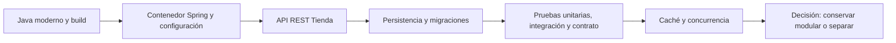

# Microservicios con Spring Boot desde Cero: de Desarrollador a Arquitecto

## Fase 1 · Fundamentos del stack y primer microservicio

**Estado:** diseño curricular de trabajo; no equivale todavía a una publicación ni a la verificación de todos los laboratorios.  
**Duración:** 5 semanas · 75 horas orientativas (15 h/semana).  
**Estudiante:** ya programa y usa terminal, Git y editor; no conoce Spring Boot ni arquitectura distribuida. No se enseñan variables, condicionales, bucles, funciones o clases como si fuera principiante.  
**Resultado de la fase:** construir, ejecutar, probar y diagnosticar un servicio REST Spring Boot con persistencia, configuración, pruebas de contrato y caché; reconocer cuándo no introducir una herramienta o patrón.

> **Qué significa «desde cero» aquí:** las rutas de referencia enlazadas contienen soluciones completas para la mayoría de los mecanismos. La experiencia guiada debe preceder a la consulta de esas soluciones y conducir al estudiante a crear cada archivo por etapas. Esta página es el mapa de diseño y evidencia; las brechas identificadas al final impiden marcar la Fase 1 como lista para publicar.

## 1. Perfil, límites y versiones

El curso parte de habilidades de programación transferibles. No asume que el estudiante conozca beans, controladores, JPA, transacciones, caché o testing en Spring. Cada término nuevo se muestra primero mediante una analogía y un diagrama; luego se construye sobre la aplicación guía **Tienda**. El nombre «microservicio» se introduce como motivación y frontera de responsabilidad, no como requisito de dividir la primera API.

El proyecto del repositorio fija, al revisar las versiones el 2026-11-19, JDK 25 LTS, Spring Boot 4.1.3, Gradle 9.9.2, PostgreSQL 18.7, MySQL 9.7.4, Redis 8.10.2 y dependencias gestionadas por el BOM. El inventario del dueño pide como suelo Java 21 y Spring Boot 3.3+. Por tanto, se enseñan expresamente las funciones estables de Java 21, pero se ejecuta con la línea compatible y ya fijada por el proyecto. En el módulo de CRaC/native se explican diferencias de plataforma y costo; no se promete paridad en macOS. La fuente de verdad y URLs oficiales de versiones están en [Herramientas y versiones](../microservicios/08-herramientas-y-versiones.md).

**Decisión de build:** el curso del repositorio usa Gradle Kotlin DSL, wrapper y catálogo de versiones como camino principal, según `specs/021`. El tema Maven se conserva porque el inventario lo exige; tendrá un POM explícito y una comparación honesta, no una sustitución silenciosa del estándar Gradle del proyecto.

## 2. Resultados de aprendizaje observables

Al cerrar la semana cinco, el estudiante podrá: (1) crear un proyecto JVM reproducible y explicar qué aporta el build; (2) predecir qué objetos construye Spring y qué dependencias inyecta; (3) construir un endpoint REST validado y separar request/response del modelo persistente; (4) guardar y consultar datos con transacciones y migraciones; (5) distinguir prueba unitaria, web, integración y contrato; (6) medir un acierto/fallo de caché y explicar su invalidación; (7) provocar al menos un fallo, observar una señal concreta y corregirlo; (8) argumentar cuándo una opción más simple es mejor.

## 3. Secuencia visual del proyecto guía



**Texto alternativo:** el mismo sistema Tienda se construye de izquierda a derecha: primero lenguaje/build, después contenedor y configuración Spring, API, base de datos, calidad y caché. La última decisión no es «dividir porque sí»: se evalúa si existe una razón para separar el proceso.

## 4. Calendario recomendado (75 h)

| Semana | Objetivo y temas | Evidencia al terminar |
|---|---|---|
| 1 · 15 h | Java moderno, virtual threads, estructura Maven/Gradle y primer proyecto desde cero (S1.01–S1.04). | Proyecto reproducible; tests de dominio verdes; nota breve que compara Maven y Gradle. |
| 2 · 15 h | IoC/DI/ciclo de vida, auto-configuración, multi-módulo, perfiles y arranque CRaC/native (S1.05–S1.09). | Aplicación Tienda configurable; inspección de beans; comparación medida de runtimes. |
| 3 · 15 h | Spring MVC, primer controller, DTO/Jackson, errores globales; entidad/repositorio/servicio y fundamentos JPA (S2.01–S2.06). | API construida bloque a bloque; request válido e inválido observables. |
| 4 · 15 h | Criteria/Specifications, migraciones, PostgreSQL/MySQL, JUnit/Mockito/MockMvc, primer test, Testcontainers y Pact (S2.07–S2.09, S3.01–S3.04). | Consultas filtrables y pipeline de pruebas con resultado repetible. |
| 5 · 15 h | ArchUnit, SonarQube, Redis/cache, patrones de escritura, locks/fencing y estampida (S3.05–S3.06, S4.01–S4.05). | Umbrales/arquitectura explicados, caché observable, fallo controlado y decisión de no añadir complejidad sin necesidad. |

La carga es intensiva: 29 fichas con construcción guiada y comparación de código caben en cinco semanas solo si se trabaja de forma sostenida. Si el estudiante dispone de menos de 10 horas semanales, se recomienda extender la fase a 8–10 semanas en vez de quitar prácticas o convertirlas en lecturas.

## 5. Contrato común de cada ficha

En todas las fichas: mostrar la analogía/diagrama antes de abrir el código; pedir una predicción; construir primero; revelar la referencia después; comparar diferencias; ejecutar; alterar un parámetro y observar; escribir una conclusión. Los diagramas Mermaid llevan texto alternativo y no dependen solo del color. Los ejemplos no exponen credenciales reales. «Código de referencia completo» refiere al proyecto autónomo del laboratorio indicado, no a un fragmento aislado.

**Convención de laboratorios existentes:** los módulos de referencia están en `examples/microservicios/modulo-5` a `modulo-8`; los scripts presentes se llaman `verificar.sh`. La solicitud nueva pide `verify.sh` y que cada laboratorio sea Compose-first. Donde el Compose actual no provee un contenedor de build para el estudiante, se marca la brecha en vez de fingir que basta con `docker compose up`.

---

# Módulo 1 · Java moderno y Spring Boot esencial

**Meta:** entender los cimientos del runtime y desmitificar la «magia» de Spring.  
**Referencia actual:** [`examples/microservicios/modulo-5/`](../../examples/microservicios/modulo-5/) · ver [README del laboratorio](../../examples/microservicios/modulo-5/README.md).

## Ficha S1.01 · Java 21: Streams, Lambdas, Optional, Records, Pattern Matching

1. **UBICACIÓN:** Módulo 1, semana 1, lección 1.
2. **PRERREQUISITOS:** colecciones, métodos y clases Java; terminal y ejecución de pruebas.
3. **OBJETIVO:** aplicar records, lambdas, streams, Optional y pattern matching para calcular y agrupar líneas de pedido; demostrar el resultado con pruebas.
4. **ANALOGÍA VISUAL:** cinta transportadora: filtrar, transformar, ordenar y recolectar productos; una caja vacía/presente representa Optional.
5. **DIAGRAMA TÉCNICO:**
   ```mermaid
   flowchart LR
     L[Lista de líneas] --> F[filter]
     F --> M[map]
     M --> R[reduce / collect]
     L --> O[findFirst] --> X{Optional}
   ```
   **Texto alternativo:** una lista entra a operaciones intermedias; la salida terminal produce suma/lista; una búsqueda retorna Optional presente o vacío.
6. **EXPLICACIÓN CONCEPTUAL:** Streams expresan transformaciones de datos; lambdas aportan comportamiento; records modelan datos inmutables; Optional representa retorno ausente; pattern matching discrimina variantes. **No** usar streams si un bucle con estado, salida temprana o depuración paso a paso resulta más claro; no usar paralelismo por reflejo.
7. **CONSTRUCCIÓN PASO A PASO:** en `f017-java-moderno/src/main/java/academia/java/JavaModerno.java`, crear primero el record de línea y validar sus invariantes; añadir `subtotal`; construir la lista de datos; encadenar filter/map/sorted y luego una terminal; añadir agrupación y suma; modelar pago con tipos sellados y switch exhaustivo. Antes de cada bloque, predecir su tipo de entrada/salida. Esperar totales y SKUs deterministas.
8. **CÓDIGO DE REFERENCIA COMPLETO:** `f017-java-moderno/` (build y código en el laboratorio; referencia principal: `src/main/java/academia/java/JavaModerno.java`).
9. **EXPLICACIÓN LÍNEA POR LÍNEA:** record y constructor compacto validan datos; lambda implementa interfaz funcional; operaciones intermedias son perezosas; terminal consume el stream; Optional fuerza el caso vacío; `sealed` permite exhaustividad del switch.
10. **LABORATORIO PASO A PASO:** desde el módulo 5: `docker compose up -d` no es requisito para esta ficha; ejecutar el build en el contenedor de desarrollo del curso (pendiente de Compose-first), luego `./gradlew :f017-java-moderno:test`. Output actual descrito: tests F017 en verde.
11. **VERIFICACIÓN AUTOMÁTICA:** `./gradlew :f017-java-moderno:test`; en el agregado: `./verificar.sh`.
12. **MODIFICACIÓN GUIADA:** cambiar el umbral de precio y agregar una categoría; predecir agrupación antes de ejecutar.
13. **ERROR COMÚN:** reutilizar un Stream ya consumido. Diagnóstico visual: segunda operación terminal falla con `IllegalStateException`; crear un stream nuevo desde la colección.
14. **PREGUNTA DE ENTREVISTA:** ¿Cuándo elegirías un `for` frente a Stream? **Respuesta modelo:** si necesito estado mutable, `break`, depuración incremental o el stream oculta el algoritmo; medir antes de optimizar.
15. **ANTI-PATRÓN RELACIONADO:** `parallelStream()` sobre una operación de servidor esperando que siempre acelere; puede saturar el pool común.

## Ficha S1.02 · Virtual Threads (Project Loom)

1. **UBICACIÓN:** Módulo 1, semana 1, lección 2.
2. **PRERREQUISITOS:** threads, concurrencia y excepciones básicas; ficha S1.01.
3. **OBJETIVO:** comparar carga concurrente bloqueante con hilos de plataforma y virtuales, observando throughput/recursos sin confundir concurrencia con CPU más rápida.
4. **ANALOGÍA VISUAL:** muchos clientes esperan turno en una fila; el virtual thread es un ticket ligero que libera al trabajador mientras espera I/O.
5. **DIAGRAMA TÉCNICO:**
   ```mermaid
   sequenceDiagram
     participant R as Request
     participant V as Virtual thread
     participant P as Carrier
     R->>V: operación bloqueante
     V->>P: ejecuta
     V-->>P: cede durante I/O
     P->>V: reanuda al completar
   ```
   **Texto alternativo:** la petición ocupa un hilo virtual; al esperar I/O se desacopla del hilo portador y se reanuda al completar.
6. **EXPLICACIÓN CONCEPTUAL:** threads virtuales permiten estilo bloqueante con costo bajo en workloads I/O-bound. No hacen CPU-bound más rápido, no eliminan límites de conexiones ni sustituyen backpressure. Evitarlos si el trabajo consume CPU intensiva o si una librería bloquea fijando carrier sin control.
7. **CONSTRUCCIÓN PASO A PASO:** crear `f018-virtual-threads/src/main/java/academia/hilos/HilosVirtuales.java`; añadir tarea que simula espera; lanzar N tareas con executor virtual; medir duración y contar finalizaciones; repetir con pool de plataforma y misma carga. Explicar por qué se mide y no inferir desde el nombre de la API.
8. **CÓDIGO DE REFERENCIA COMPLETO:** `f018-virtual-threads/`.
9. **EXPLICACIÓN LÍNEA POR LÍNEA:** executor define el tipo de tarea; submit agenda; la espera simula I/O; join/await recoge resultados; contador y cronómetro distinguen finalización de velocidad CPU.
10. **LABORATORIO:** `docker compose up -d` no necesita dependencias para la demo; ejecutar con wrapper dentro del entorno Java del curso (Compose-first pendiente), `./gradlew :f018-virtual-threads:test`; observar conteo y tiempos.
11. **VERIFICACIÓN:** `./gradlew :f018-virtual-threads:test` y test `HilosVirtualesTest`.
12. **MODIFICACIÓN:** subir la carga simulada de I/O, luego cambiarla por cálculo CPU; registrar cómo cambia la ventaja.
13. **ERROR COMÚN:** afirmar que virtual threads vuelven rápida cualquier petición. Diagnóstico: CPU al 100 % y latencia sin mejora; limitar carga o usar paralelismo de CPU medido.
14. **ENTREVISTA:** ¿Qué problema resuelven? **Respuesta modelo:** costo de concurrencia alta con espera bloqueante, no la capacidad de CPU ni el límite externo.
15. **ANTI-PATRÓN:** crear un pool fijo arbitrariamente pequeño de virtual threads; se pierde el modelo de hilo-por-tarea sin proteger el recurso real (p. ej. DB).

## Ficha S1.03 · Maven/Gradle: estructura de proyecto desde cero

1. **UBICACIÓN:** Módulo 1, semana 1, lección 3.
2. **PRERREQUISITOS:** usar terminal, Git y editor; saber qué son dependencias y archivos fuente.
3. **OBJETIVO:** explicar el árbol de un proyecto JVM y construirlo con wrapper, fuentes, pruebas y dependencias fijadas.
4. **ANALOGÍA VISUAL:** plano de una fábrica: carpetas separan producto, herramientas, configuración y control de calidad.
5. **DIAGRAMA TÉCNICO:**
   ```mermaid
   flowchart TB
     B[build.gradle.kts / pom.xml] --> D[Dependencias]
     B --> C[Compilación]
     S[src/main] --> J[Artefacto]
     T[src/test] --> V[Verificación]
   ```
   **Texto alternativo:** el descriptor gobierna dependencias/compilación; fuentes generan artefacto y pruebas producen verificación.
6. **EXPLICACIÓN CONCEPTUAL:** build reproducible describe cómo resolver, compilar, probar y empaquetar. Wrapper fija el motor. Gradle Kotlin DSL es el camino del repo; Maven ofrece ciclo de vida declarativo. No fijar versiones a mano si el BOM ya las gobierna.
7. **CONSTRUCCIÓN PASO A PASO:** crear `settings.gradle.kts`, catálogo `gradle/libs.versions.toml`, `build.gradle.kts`, `src/main/java/...` y `src/test/java/...`; escribir primero el propósito de cada bloque; ejecutar wrapper. Comparar después el equivalente `<project>`, dependencias y plugin en `pom.xml`.
8. **CÓDIGO DE REFERENCIA COMPLETO:** catálogo y wrapper en `examples/microservicios/modulo-5/`; equivalencias Maven en su README. No existe aún un POM de referencia para toda la nueva ruta independiente.
9. **EXPLICACIÓN LÍNEA POR LÍNEA:** `settings` nombra el build; catálogo centraliza versiones; plugin agrega tareas Boot; dependencias describen capacidades; source sets separan código y pruebas.
10. **LABORATORIO:** reproducir build con wrapper desde contenedor de desarrollo; comparación: `./gradlew test` vs `./mvnw test`. Compose de compilación pendiente.
11. **VERIFICACIÓN:** tests del subproyecto y `./verificar.sh` del módulo 5.
12. **MODIFICACIÓN:** cambiar una versión gestionada por catálogo y observar diff de dependencias; revertir para no romper el BOM.
13. **ERROR COMÚN:** usar `gradle` global en vez de wrapper. Diagnóstico: build corre con versión distinta; ejecutar `./gradlew --version`.
14. **ENTREVISTA:** ¿Qué garantiza el wrapper? **Respuesta modelo:** una distribución Gradle declarada por el proyecto y menor variación entre máquinas; no garantiza dependencias disponibles ni build hermético.
15. **ANTI-PATRÓN:** mezclar versiones manuales que contradicen el BOM o duplicar configuración de build en cada subproyecto.

## Ficha S1.04 · Construcción guiada: primer proyecto Maven desde cero

1. **UBICACIÓN:** Módulo 1, semana 1, lección 4.
2. **PRERREQUISITOS:** S1.03; manejar shell y archivos XML.
3. **OBJETIVO:** crear un proyecto mínimo con `pom.xml`, clase principal y una prueba; empaquetarlo de forma reproducible.
4. **ANALOGÍA VISUAL:** receta ejecutable: el POM enumera ingredientes y pasos; el wrapper fija la cocina usada.
5. **DIAGRAMA TÉCNICO:**
   ```mermaid
   flowchart LR
     P[pom.xml] --> D[resolve]
     S[App.java] --> C[compile]
     T[AppTest.java] --> J[test]
     D --> C --> J --> K[package]
   ```
   **Texto alternativo:** POM resuelve dependencias; Maven compila fuente, ejecuta prueba y empaqueta.
6. **EXPLICACIÓN CONCEPTUAL:** Maven estandariza fases y configuración; útil en equipos que lo adoptan. No elegirlo por inercia si el equipo del proyecto usa Gradle; ni mantener dos builds de producción sin una necesidad.
7. **CONSTRUCCIÓN PASO A PASO:** en la ruta nueva `examples/microservicios-spring/fase-1/modulo-1/tema-04-maven/`, crear `pom.xml` (coordenadas, JDK, plugin, JUnit), wrapper, `src/main/java/.../Aplicacion.java`, prueba en `src/test/java`; añadir endpoint solo después en la ficha REST. Ejecutar `./mvnw test` y `./mvnw package`. **Brecha:** esta carpeta y su referencia aún no existen.
8. **CÓDIGO DE REFERENCIA COMPLETO:** pendiente de implementar; el usuario no debe recibirlo como si ya existiera. La equivalencia de build del Módulo 5 no sustituye un POM autónomo.
9. **EXPLICACIÓN LÍNEA POR LÍNEA:** la construcción futura deberá explicar coordenadas, propiedades, plugin, scope test y método principal; aún no hay código que explicar.
10. **LABORATORIO:** Compose objetivo: contenedor JDK/Maven con código montado, `docker compose up --build --abort-on-container-exit`; comandos `./mvnw test` y `./mvnw package`. Compose todavía pendiente.
11. **VERIFICACIÓN:** futuro `verify.sh` debe comprobar código de salida, artefacto y test; no existe aún.
12. **MODIFICACIÓN:** cambiar una aserción para provocar fallo; restaurarla y observar `BUILD SUCCESS`.
13. **ERROR COMÚN:** `release version ... not supported`; verificar JDK dentro del contenedor y `maven.compiler.release`.
14. **ENTREVISTA:** ¿Qué diferencia hay entre `test` y `package`? **Respuesta modelo:** `test` compila y verifica pruebas; `package` ejecuta fases previas y crea artefacto.
15. **ANTI-PATRÓN:** declarar versiones repetidas sin propiedades/gestión o copiar un POM enorme sin entender su ciclo.

## Ficha S1.05 · Spring Boot esencial: IoC, DI, Bean Lifecycle, ApplicationContext

1. **UBICACIÓN:** Módulo 1, semana 2.
2. **PRERREQUISITOS:** objetos/clases Java; S1.03.
3. **OBJETIVO:** explicar y probar quién crea cada dependencia y en qué momento vive un bean.
4. **ANALOGÍA VISUAL:** cocina de restaurante: ApplicationContext organiza ingredientes; el pedido recibe el cocinero adecuado por inyección.
5. **DIAGRAMA TÉCNICO:**
   ```mermaid
   flowchart LR
    C[ApplicationContext] --> N[Notificador]
    C --> S[ServicioPedidos]
    S -->|constructor| N
    C --> L[callbacks lifecycle]
   ```
   **Texto alternativo:** el contenedor crea y conecta servicio y notificador, ejecutando callbacks durante el ciclo de vida.
6. **EXPLICACIÓN CONCEPTUAL:** IoC delega creación/configuración al contenedor; DI suministra colaboradores; ApplicationContext administra beans. No usar Spring para un script trivial o si el contenedor no aporta valor.
7. **CONSTRUCCIÓN PASO A PASO:** archivos exactos en `f019-ioc-di/src/main/java/academia/ioc/`: `Notificador.java`, implementación `NotificadorCorreo.java`, `ServicioPedidos.java` con constructor, `IocApp.java`, `Ciclo.java` y `AuditorDeBeans.java`; agregar `application.properties`; primero instanciar manualmente y luego dejar que Spring conecte. Observar callbacks.
8. **CÓDIGO DE REFERENCIA COMPLETO:** `f019-ioc-di/`.
9. **EXPLICACIÓN LÍNEA POR LÍNEA:** anotación/escaneo registra componente; constructor expresa dependencia obligatoria; contexto resuelve grafo; callbacks muestran inicialización/cierre; auditor enumera beans.
10. **LABORATORIO:** `docker compose up -d` no se necesita para este ejemplo; ejecutarlo en contenedor Java (Compose-first pendiente), `./gradlew :f019-ioc-di:test`.
11. **VERIFICACIÓN:** `CicloDeVidaTest` y `./verificar.sh`.
12. **MODIFICACIÓN:** añadir una implementación mock y seleccionar perfil; comparar identidad del bean.
13. **ERROR COMÚN:** `NoSuchBeanDefinitionException`; observar árbol de paquetes/anotaciones y tipo requerido; registrar o escanear la implementación.
14. **ENTREVISTA:** ¿Por qué inyección por constructor? **Respuesta modelo:** dependencia explícita, objeto válido al construirse y pruebas sencillas.
15. **ANTI-PATRÓN:** service locator o campos `@Autowired` ocultando dependencias; también crear beans innecesarios «por SOLID».

## Ficha S1.06 · Auto-configuración condicional, @Conditional, starters

1. **UBICACIÓN:** Módulo 1, semana 2.
2. **PRERREQUISITOS:** S1.05; conocer dependencias del build.
3. **OBJETIVO:** construir una auto-configuración condicional y predecir cuándo aparece un bean.
4. **ANALOGÍA VISUAL:** accesorio de una máquina que se instala solo si encaja el puerto y no hay pieza preferida ya instalada.
5. **DIAGRAMA TÉCNICO:**
   ```mermaid
   flowchart TD
    D[Dependencia presente] --> C{condiciones}
    P[Bean del usuario] --> C
    C -->|pasa y no hay bean| A[auto-config bean]
    C -->|falla| N[no se registra]
   ```
   **Texto alternativo:** la presencia de dependencia y propiedades habilita configuración salvo que falte una condición o el usuario aporte su bean.
6. **EXPLICACIÓN CONCEPTUAL:** auto-configuración ahorra cableado repetido mediante condiciones explícitas; starter agrupa dependencias. No crear starter propio para una sola app ni depender de auto-config sin inspeccionar condiciones.
7. **CONSTRUCCIÓN PASO A PASO:** en `f020-autoconfiguracion`, crear `Saludador`, `FirmaFormal`, `ModoFormalCondition`, propiedades, configuración y `AutoConfiguration.imports`; luego app consumidora y tests para bean presente/ausente.
8. **CÓDIGO DE REFERENCIA COMPLETO:** `f020-autoconfiguracion/`.
9. **EXPLICACIÓN LÍNEA POR LÍNEA:** propiedad enlaza configuración; `@Conditional` evalúa condición; `@ConditionalOnMissingBean` permite override; archivo imports registra auto-configuración; tests comprueban ambos caminos.
10. **LABORATORIO:** tests desde contenedor de build; `./gradlew :f020-autoconfiguracion:test`. Compose-first pendiente para la nueva ruta.
11. **VERIFICACIÓN:** `SaludoAutoConfigurationTest` y verificador agregado del módulo 5.
12. **MODIFICACIÓN:** activar/desactivar modo formal con propiedad; confirmar bean y mensaje esperado.
13. **ERROR COMÚN:** configuración no se carga porque falta `AutoConfiguration.imports`; revisar classpath y condición evaluada.
14. **ENTREVISTA:** ¿Por qué una auto-configuración cede ante el bean del usuario? **Respuesta modelo:** defaults útiles sin impedir personalización explícita.
15. **ANTI-PATRÓN:** starter que activa comportamiento inesperado sin condiciones observables ni forma de override.

## Ficha S1.07 · Multi-module Spring Boot projects: construcción desde cero

1. **UBICACIÓN:** Módulo 1, semana 2.
2. **PRERREQUISITOS:** S1.03 y S1.05.
3. **OBJETIVO:** dividir dominio y API en módulos compilables sin convertir esa separación en despliegues distribuidos.
4. **ANALOGÍA VISUAL:** plano de una tienda con taller y mostrador separados por función, bajo el mismo techo.
5. **DIAGRAMA TÉCNICO:**
   ```mermaid
   flowchart LR
    API[tienda-api] --> DOM[tienda-dominio]
    DOM --> T[tests dominio]
    API --> W[tests web]
   ```
   **Texto alternativo:** el módulo API depende del dominio; las pruebas de cada límite se ejecutan por separado.
6. **EXPLICACIÓN CONCEPTUAL:** multi-project Gradle separa compilación/responsabilidad dentro de un build; no implica microservicios. No modularizar dos clases sin necesidad ni compartir módulos como API pública accidental.
7. **CONSTRUCCIÓN PASO A PASO:** crear `settings.gradle.kts`, catálogo, `tienda-dominio/build.gradle.kts`, `tienda-api/build.gradle.kts`, `PoliticaDescuento.java`, `TiendaApiApp.java` y controller; mover una regla, declarar dependencia dirigida, escribir test por módulo.
8. **CÓDIGO DE REFERENCIA COMPLETO:** `f021-multimodulo/`.
9. **EXPLICACIÓN LÍNEA POR LÍNEA:** `include` registra módulos; plugin aplica tareas; dependencia `implementation(project(...))` crea grafo; app Boot queda en API; test dominio no necesita servidor.
10. **LABORATORIO:** `./gradlew -p f021-multimodulo test`; Compose no requiere infraestructura. En entorno alumno se ejecuta vía imagen build pendiente.
11. **VERIFICACIÓN:** tests de dominio y API + `./verificar.sh`.
12. **MODIFICACIÓN:** invertir dependencia API/dominio a propósito y hacer fallar regla arquitectónica.
13. **ERROR COMÚN:** módulo no incluido o dependencia circular; inspeccionar `./gradlew projects` y el grafo.
14. **ENTREVISTA:** ¿Un módulo Gradle equivale a un microservicio? **Respuesta modelo:** no; puede ser un artefacto/proceso único, separación de build no separación de despliegue.
15. **ANTI-PATRÓN:** convertir cada paquete en subproyecto o usar `includeBuild` para evitar modelar dependencias.

## Ficha S1.08 · Perfiles y configuración externalizada

1. **UBICACIÓN:** Módulo 1, semana 2.
2. **PRERREQUISITOS:** S1.05; YAML/variables de entorno.
3. **OBJETIVO:** cambiar configuración por entorno sin recompilar y sin incrustar secretos.
4. **ANALOGÍA VISUAL:** tablero de control reemplazable para ensayo y operación; la máquina es la misma.
5. **DIAGRAMA TÉCNICO:**
   ```mermaid
   flowchart LR
    D[defaults] --> M[merge]
    P[profile prod] --> M
    E[environment] --> M
    M --> B[bound properties]
   ```
   **Texto alternativo:** valores por defecto, perfil activo y variables se combinan y se enlazan a un objeto tipado.
6. **EXPLICACIÓN CONCEPTUAL:** externalización separa código/configuración; perfil selecciona conjunto de valores. No uses perfiles como mecanismo de autorización o para almacenar secretos en Git.
7. **CONSTRUCCIÓN PASO A PASO:** crear `TiendaProperties.java`, `application.yml`, `application-prod.yml`, validar valores y activar perfil por env; escribir test de binding antes de iniciar servidor.
8. **CÓDIGO DE REFERENCIA COMPLETO:** `f022-perfiles/`.
9. **EXPLICACIÓN LÍNEA POR LÍNEA:** `@ConfigurationProperties` vincula; validación impide valores inválidos; YAML define defaults; archivo de perfil sustituye; env override sin cambiar artefacto.
10. **LABORATORIO:** inspeccionar perfil default y `prod`; correr `./gradlew :f022-perfiles:test` desde contenedor de build (Compose-first pendiente).
11. **VERIFICACIÓN:** `PerfilesTest` más `./verificar.sh`.
12. **MODIFICACIÓN:** cambiar una propiedad externa y confirmar salida; poner valor inválido y comprobar rechazo.
13. **ERROR COMÚN:** perfil equivocado por nombre o precedencia. Diagnóstico: log del perfil activo y valor final; revisar `SPRING_PROFILES_ACTIVE`.
14. **ENTREVISTA:** ¿Por qué no compilar un JAR distinto por entorno? **Respuesta modelo:** un artefacto inmutable reduce divergencia; la configuración se inyecta al desplegar.
15. **ANTI-PATRÓN:** `application-prod.yml` con contraseñas o proliferación de perfiles por cada cliente.

## Ficha S1.09 · CRaC y GraalVM Native Image: conceptos y trade-offs

1. **UBICACIÓN:** Módulo 1, semana 2; tema de comparación, no prerequisito de REST.
2. **PRERREQUISITOS:** arranque Boot, config y build; S1.05–S1.08.
3. **OBJETIVO:** medir opciones de inicio/huella y defender si el costo operativo justifica optimización.
4. **ANALOGÍA VISUAL:** CRaC es guardar una estación preparada para retomarla; Native Image es fabricar una herramienta ya armada para una tarea acotada.
5. **DIAGRAMA TÉCNICO:**
   ```mermaid
   flowchart TD
    S[App Spring] --> J[JVM: arranque normal]
    S --> C[CRaC: checkpoint y restore]
    S --> N[Native Image: compilación AOT]
    J & C & N --> M[medir inicio, memoria, compatibilidad]
   ```
   **Texto alternativo:** la misma app se ejecuta en JVM, restaurada desde checkpoint CRaC o como imagen nativa; se comparan métricas y restricciones.
6. **EXPLICACIÓN CONCEPTUAL:** CRaC restaura estado de proceso con recursos que deben reabrirse/revalidarse; Native Image compila AOT y requiere análisis de reachability/configuración. No adoptar sin cold-start/costo como requisito medido; límites de SO y librerías importan.
7. **CONSTRUCCIÓN PASO A PASO:** usar `f023-crac`: `CracApp`, `ConexionExterna`, controller y config; añadir hooks de checkpoint. Después `f024-graalvm-native`: app, hints de reflexión y Dockerfile; comparar misma ruta y respuesta.
8. **CÓDIGO DE REFERENCIA COMPLETO:** `f023-crac/` y `f024-graalvm-native/`; scripts opcionales en Compose del módulo 5.
9. **EXPLICACIÓN LÍNEA POR LÍNEA:** hooks del checkpoint invalidan/reconectan recurso; hints describen reflexión; Dockerfile compila/ejecuta artefacto; comparar límites del entorno.
10. **LABORATORIO:** `docker compose --profile crac up --build --abort-on-container-exit`; separado `docker compose --profile native up --build --abort-on-container-exit`; el README pide memoria Docker suficiente. No ejecutar ambos perfiles como prueba de arranque normal.
11. **VERIFICACIÓN:** `./verificar.sh --docker`; se espera JSON `/hola` con `aperturas:1` y `/impuesto` con cálculo esperado, si imágenes disponibles.
12. **MODIFICACIÓN:** agregar un recurso que no pueda serializarse y observar fallo del checkpoint; comparar arranque normal frente a restore.
13. **ERROR COMÚN:** checkpoint conserva socket cerrado. Diagnóstico: llamada falla solo tras restore; cerrar/reabrir recurso en callbacks CRaC.
14. **ENTREVISTA:** ¿Cuándo preferirías JVM normal? **Respuesta modelo:** cuando throughput/compatibilidad dominan, el arranque no es SLO crítico o la complejidad AOT no paga su costo.
15. **ANTI-PATRÓN:** elegir runtime por benchmark de hello-world sin incluir memoria, tamaño, build, compatibilidad y comportamiento real.

---

# Módulo 2 · Primer microservicio: API REST desde cero

**Meta:** construir el servicio Tienda desde el contrato HTTP hasta el almacenamiento migrable.  
**Referencia actual:** [`examples/microservicios/modulo-6/`](../../examples/microservicios/modulo-6/) · [README del laboratorio](../../examples/microservicios/modulo-6/README.md).

## Ficha S2.01 · Spring MVC: DispatcherServlet, Controllers, Validación

1. **UBICACIÓN:** Módulo 2, semana 3.
2. **PRERREQUISITOS:** HTTP/JSON; S1.03 y S1.05.
3. **OBJETIVO:** trazar petición HTTP desde DispatcherServlet hasta controlador y respuesta; validar entrada malformada.
4. **ANALOGÍA VISUAL:** recepción de edificio: clasifica la solicitud y la envía al área correcta.
5. **DIAGRAMA TÉCNICO:**
   ```mermaid
   sequenceDiagram
    participant C as Cliente
    participant D as DispatcherServlet
    participant H as HandlerMapping
    participant R as Controller
    C->>D: HTTP + JSON
    D->>H: resolver ruta
    H->>R: invocar handler
    R-->>D: resultado
    D-->>C: status + JSON
   ```
   **Texto alternativo:** DispatcherServlet enruta la petición al handler/controller y serializa la respuesta.
6. **EXPLICACIÓN CONCEPTUAL:** MVC separa entrada HTTP, coordinación y respuesta; validación rechaza datos no conformes en el borde. No meter dominio complejo ni acceso SQL en el controller.
7. **CONSTRUCCIÓN PASO A PASO:** en `f025-spring-mvc`, añadir `Producto`, `CrearProducto`, `Catalogo`, `ProductoController`, `MvcApp` y `application.properties`; usar MockMvc para POST válido/ inválido; observar 201/400.
8. **CÓDIGO DE REFERENCIA COMPLETO:** `f025-spring-mvc/`.
9. **EXPLICACIÓN LÍNEA POR LÍNEA:** mapping declara ruta/verbo; parámetro body convierte JSON; validación evalúa constraints; catálogo aplica operación; status define semántica HTTP.
10. **LABORATORIO:** `docker compose up -d` (no hay BD para esta ficha); ejecutar test y petición curl desde contenedor de build del curso; Compose de build pendiente.
11. **VERIFICACIÓN:** `./gradlew :f025-spring-mvc:test` y `ProductoControllerTest`.
12. **MODIFICACIÓN:** cambiar límite de nombre y probar justo bajo/encima.
13. **ERROR COMÚN:** 404 por ruta/verbo no coincidente; comparar método, mapping y path en la traza HTTP.
14. **ENTREVISTA:** ¿Qué hace DispatcherServlet? **Respuesta modelo:** front controller que coordina resolución/invocación y manejo de la respuesta.
15. **ANTI-PATRÓN:** controlador «gordo» con reglas de negocio, SQL y formato HTTP en el mismo método.

## Ficha S2.02 · Construcción guiada: primer Controller desde cero

1. **UBICACIÓN:** Módulo 2, semana 3, práctica de arranque.
2. **PRERREQUISITOS:** HTTP, JSON, S2.01.
3. **OBJETIVO:** escribir controller mínimo y probar endpoint antes de introducir persistencia.
4. **ANALOGÍA VISUAL:** una ventanilla con catálogo detrás; primero atiende una consulta en memoria.
5. **DIAGRAMA TÉCNICO:**
   ```mermaid
   flowchart LR
    H[GET /productos/42] --> C[ProductoController]
    C --> R[Catálogo en memoria]
    R --> C --> J[JSON + 200]
   ```
   **Texto alternativo:** petición GET llega al controller, consulta catálogo y vuelve con JSON y 200.
6. **EXPLICACIÓN CONCEPTUAL:** Controller traduce protocolo a acción; sirve para el borde HTTP. No es todavía un microservicio completo ni una capa de persistencia.
7. **CONSTRUCCIÓN PASO A PASO:** crear `f025-spring-mvc/src/main/java/academia/mvc/ProductoController.java`; añadir `@RestController`, constructor de `Catalogo`, método GET, manejo no encontrado; probar con MockMvc. Cada anotación se introduce después de predecir efecto.
8. **CÓDIGO DE REFERENCIA COMPLETO:** controller, modelo y test en `f025-spring-mvc/`.
9. **EXPLICACIÓN LÍNEA POR LÍNEA:** `@RestController` registra handler/serialización; `@GetMapping` ata ruta; constructor inyecta catálogo; return se serializa; excepción define ausencia.
10. **LABORATORIO:** Compose de build objetivo; ejecutar `./gradlew :f025-spring-mvc:test`; luego `curl -i localhost:8080/productos/42` con la app levantada.
11. **VERIFICACIÓN:** test de controller comprueba status, body y caso no encontrado.
12. **MODIFICACIÓN:** cambiar ID consultado y comparar 200/404.
13. **ERROR COMÚN:** método retorna objeto pero respuesta no serializa por tipo/ciclo; ver body y logs de Jackson.
14. **ENTREVISTA:** ¿Por qué empezar con repositorio en memoria? **Respuesta modelo:** aislar el contrato HTTP del problema de persistencia y añadir una dependencia a la vez.
15. **ANTI-PATRÓN:** acceder desde controller a `EntityManager` o SQL directo.

## Ficha S2.03 · DTOs, @JsonProperty, Jackson

1. **UBICACIÓN:** Módulo 2, semana 3.
2. **PRERREQUISITOS:** S2.01–S2.02; JSON.
3. **OBJETIVO:** definir request/response que no filtre estructura interna y verificar nombres JSON.
4. **ANALOGÍA VISUAL:** formulario público distinto de la ficha interna de almacén.
5. **DIAGRAMA TÉCNICO:**
   ```mermaid
   flowchart LR
    J[JSON externo] --> Q[Request DTO]
    Q --> M[Mapper]
    M --> D[Dominio]
    D --> N[Response DTO] --> O[JSON público]
   ```
   **Texto alternativo:** JSON se valida y convierte a DTO de entrada; mapper adapta al dominio; DTO de respuesta produce contrato separado.
6. **EXPLICACIÓN CONCEPTUAL:** DTO define contrato de transporte; Jackson serializa/deserializa. No crear DTO duplicado para cada clase sin una frontera o necesidad de versionado.
7. **CONSTRUCCIÓN PASO A PASO:** crear `CrearClienteRequest.java`, `ClienteResponse.java`, `ClienteMapper.java`, `Cliente.java`, `ClienteController.java`; usar `@JsonProperty` y test JSON.
8. **CÓDIGO DE REFERENCIA COMPLETO:** `f026-dtos-jackson/`.
9. **EXPLICACIÓN LÍNEA POR LÍNEA:** campos request controlan entrada; anotación fija nombre wire; mapper traduce; response decide campos visibles; test protege contrato.
10. **LABORATORIO:** levantar API mediante Compose de build futuro; `./gradlew :f026-dtos-jackson:test`; observar JSON.
11. **VERIFICACIÓN:** `ClienteJsonTest`.
12. **MODIFICACIÓN:** renombrar propiedad Java con `@JsonProperty("nombre_cliente")`; confirmar JSON estable.
13. **ERROR COMÚN:** exponer campo sensible por serializar entidad directamente; comparar JSON antes/después del DTO.
14. **ENTREVISTA:** ¿DTO vs entidad? **Respuesta modelo:** el DTO es contrato externo; entidad representa persistencia/dominio y puede cambiar por razones distintas.
15. **ANTI-PATRÓN:** usar entidad JPA como request/response y acoplar el esquema SQL al API.

## Ficha S2.04 · Manejo global de excepciones (@ControllerAdvice)

1. **UBICACIÓN:** Módulo 2, semana 3.
2. **PRERREQUISITOS:** S2.01–S2.03; status HTTP.
3. **OBJETIVO:** convertir errores de dominio/exposición en respuestas HTTP consistentes sin duplicar try/catch.
4. **ANALOGÍA VISUAL:** protocolo común de atención de incidentes para todas las ventanillas.
5. **DIAGRAMA TÉCNICO:**
   ```mermaid
   flowchart LR
    C[Controller] --> E[Exception]
    E --> A[ControllerAdvice]
    A --> H[status + error JSON]
   ```
   **Texto alternativo:** excepción propagada se resuelve por advice común y se convierte en status y cuerpo de error.
6. **EXPLICACIÓN CONCEPTUAL:** Advice centraliza mapping de excepciones a respuestas. No captura todo para devolver 200 ni expone stack traces/datos internos.
7. **CONSTRUCCIÓN PASO A PASO:** crear excepción específica, `ManejadorGlobalDeErrores.java`, DTO de error y controller mínimo en `f027-controller-advice`; mapear 404 y validación; verificar campos públicos.
8. **CÓDIGO DE REFERENCIA COMPLETO:** `f027-controller-advice/`.
9. **EXPLICACIÓN LÍNEA POR LÍNEA:** excepción nombra condición; `@ExceptionHandler` selecciona clase; `ResponseEntity` fija estado; DTO limita datos; test cubre error conocido y desconocido.
10. **LABORATORIO:** probar rutas éxito/ausencia; `./gradlew :f027-controller-advice:test`.
11. **VERIFICACIÓN:** `ManejadorGlobalTest` + status/body esperado.
12. **MODIFICACIÓN:** añadir campo correlationId no sensible al error.
13. **ERROR COMÚN:** handler demasiado general oculta excepción. Diagnóstico: todas las fallas se vuelven misma respuesta; ordenar handlers y registrar causa internamente.
14. **ENTREVISTA:** ¿Qué no debe retornar un error de API? **Respuesta modelo:** stack trace, secreto, SQL o detalle interno exploitable.
15. **ANTI-PATRÓN:** `catch (Exception e) { return OK; }`.

## Ficha S2.05 · Spring Data JPA, Hibernate, entidades, relaciones, transacciones

1. **UBICACIÓN:** Módulo 2, semana 3–4.
2. **PRERREQUISITOS:** SQL/relaciones; S2.02–S2.04.
3. **OBJETIVO:** persistir un agregado de pedido con relaciones y transacción atómica; observar SQL y rollback.
4. **ANALOGÍA VISUAL:** libro mayor: una operación de pedido y sus líneas se guardan juntas o ninguna queda registrada.
5. **DIAGRAMA TÉCNICO:**
   ```mermaid
   sequenceDiagram
    participant S as Servicio
    participant T as Transaction
    participant R as Repository
    participant DB as PostgreSQL
    S->>T: begin
    S->>R: save pedido + líneas
    R->>DB: SQL
    DB-->>T: commit / rollback
   ```
   **Texto alternativo:** servicio abre transacción, repositorio ejecuta SQL y la base confirma todo o revierte.
6. **EXPLICACIÓN CONCEPTUAL:** JPA define persistencia objeto-relacional; Hibernate implementa; repositorio abstrae consultas; transacción protege invariantes locales. No usar relaciones bidireccionales/lazy por defecto sin comprender consultas; no compartir transacción entre servicios.
7. **CONSTRUCCIÓN PASO A PASO:** en `f028-jpa`, crear `EstadoPedido`, `Pedido`, `LineaPedido`, relación y reglas, `PedidoRepository`, `ServicioPedidos`, `JpaApp`; configurar PostgreSQL; test de persistencia y rollback.
8. **CÓDIGO DE REFERENCIA COMPLETO:** `f028-jpa/`.
9. **EXPLICACIÓN LÍNEA POR LÍNEA:** anotaciones de entidad/ID definen mapeo; owning side controla FK; cascade se justifica; `@Transactional` envuelve unidad; `save` persiste; test lee después de commit.
10. **LABORATORIO:** `docker compose up -d --wait postgres`; `./gradlew :f028-jpa:test`; inspeccionar logs SQL; cerrar con `docker compose down`.
11. **VERIFICACIÓN:** `PedidoJpaTest` + test rollback y persistencia.
12. **MODIFICACIÓN:** provocar excepción luego de guardar y confirmar rollback.
13. **ERROR COMÚN:** N+1 o LazyInitializationException; visualizar consultas SQL; cargar lo necesario en transacción y medir.
14. **ENTREVISTA:** ¿Qué delimita `@Transactional`? **Respuesta modelo:** unidad de trabajo local con reglas de commit/rollback, no transacción distribuida.
15. **ANTI-PATRÓN:** entidad anémica compartida como contrato entre servicios o `CascadeType.ALL` sin entender borrados.

## Ficha S2.06 · Construcción guiada: entidad + repositorio + servicio desde cero

1. **UBICACIÓN:** Módulo 2, semana 3–4.
2. **PRERREQUISITOS:** S2.05 y contratos REST.
3. **OBJETIVO:** escribir capas mínimas de producto desde regla y modelo hasta persistencia y caso de uso.
4. **ANALOGÍA VISUAL:** mostrador (controller), encargado (servicio) y archivo (repositorio/base).
5. **DIAGRAMA TÉCNICO:**
   ```mermaid
   flowchart LR
    C[Controller] --> S[Servicio]
    S --> R[Repository]
    R --> DB[(DB)]
    S --> D[DTO]
   ```
   **Texto alternativo:** controller solicita caso de uso; servicio aplica regla; repositorio persiste; DTO representa respuesta.
6. **EXPLICACIÓN CONCEPTUAL:** separar transporte, caso de uso y persistencia hace visibles responsabilidades. No crear interfaz genérica para una sola implementación sin motivo de sustitución/testing.
7. **CONSTRUCCIÓN PASO A PASO:** en branch nuevo del laboratorio, crear `Producto` entidad, `ProductoRepository`, `ProductoServicio`, `CrearProducto` DTO y controller; conectar cada dependencia por constructor; añadir migración/test antes de endpoint.
8. **CÓDIGO DE REFERENCIA COMPLETO:** `f028-jpa/` para entidad/servicio/repository y `f025-spring-mvc/` para controller; **brecha:** no existe aún un único proyecto progresivo que integre ambos desde cero en una secuencia propia.
9. **EXPLICACIÓN LÍNEA POR LÍNEA:** mapeo de entidad, query method, regla de servicio, anotación transaccional, constructor, status HTTP; el curso deberá añadir un recorrido de cambios completo con diffs.
10. **LABORATORIO:** `docker compose up -d --wait postgres`; correr `./gradlew :f028-jpa:test`; lanzar API integrada en el contenedor de desarrollo cuando se cree.
11. **VERIFICACIÓN:** tests de repositorio y endpoint; `verify.sh` integrado está pendiente.
12. **MODIFICACIÓN:** añadir unicidad SKU y repetir desde request hasta constraint/test.
13. **ERROR COMÚN:** inyectar repositorio en controller. Dibujo de capas revela salto; mover caso de uso al servicio.
14. **ENTREVISTA:** ¿Siempre necesitas una capa de servicio? **Respuesta modelo:** cuando hay caso de uso, regla, transacción o coordinación; no por plantilla automática si solo agrega delegación vacía.
15. **ANTI-PATRÓN:** capas ceremoniales sin lógica y con nombres genéricos `Manager`/`Util`.

## Ficha S2.07 · Criteria API y Specifications

1. **UBICACIÓN:** Módulo 2, semana 4.
2. **PRERREQUISITOS:** S2.05; predicados y consultas SQL.
3. **OBJETIVO:** combinar filtros opcionales sin concatenar SQL inseguro y verificar resultados.
4. **ANALOGÍA VISUAL:** filtros de búsqueda que se ensamblan como piezas, solo cuando el usuario los selecciona.
5. **DIAGRAMA TÉCNICO:**
   ```mermaid
   flowchart LR
    Q[request filtros] --> S[Specifications]
    S --> A[AND/OR predicates]
    A --> J[Criteria query]
    J --> DB[(DB)]
   ```
   **Texto alternativo:** filtros opcionales generan predicados componibles que se traducen a consulta parametrizada.
6. **EXPLICACIÓN CONCEPTUAL:** Criteria construye consultas tipadas; Specification encapsula predicado reutilizable. No usarlo para consultas estáticas simples que derivan claramente de un método repository o JPQL.
7. **CONSTRUCCIÓN PASO A PASO:** editar `FiltroProductos`, `ProductoSpecs`, repository, `ReporteCriteria`; crear filtro de precio, categoría, combinar con `and`; inspeccionar SQL y casos vacíos.
8. **CÓDIGO DE REFERENCIA COMPLETO:** `f029-criteria-specifications/`.
9. **EXPLICACIÓN LÍNEA POR LÍNEA:** filtro transporta parámetros; Specification construye predicado; combinación compone; repository ejecuta; reporte demuestra Criteria agregada.
10. **LABORATORIO:** `docker compose up -d --wait postgres`; `./gradlew :f029-criteria-specifications:test`.
11. **VERIFICACIÓN:** `ConsultasTest` con filtros aislados, combinados y ausentes.
12. **MODIFICACIÓN:** agregar filtro de stock y verificar consulta/resultado.
13. **ERROR COMÚN:** predicado null o join duplicado; revisar parámetros y SQL generado.
14. **ENTREVISTA:** Criteria vs SQL nativo. **Respuesta modelo:** Criteria sirve para composición dinámica tipada; SQL nativo para consultas específicas justificadas y medidas.
15. **ANTI-PATRÓN:** construir framework dinámico de filtros para una búsqueda con dos condiciones fijas.

## Ficha S2.08 · Flyway/Liquibase

1. **UBICACIÓN:** Módulo 2, semana 4.
2. **PRERREQUISITOS:** S2.05; SQL básico.
3. **OBJETIVO:** versionar un cambio de esquema y demostrar que una base vacía llega al mismo estado.
4. **ANALOGÍA VISUAL:** historial numerado de remodelaciones; no se reescribe lo ya ejecutado.
5. **DIAGRAMA TÉCNICO:**
   ```mermaid
   flowchart LR
    E[DB vacía] --> V1[V1 crear tabla]
    V1 --> V2[V2 agregar stock]
    V2 --> A[App compatible]
   ```
   **Texto alternativo:** migraciones inmutables se aplican en orden hasta que esquema coincide con versión de aplicación.
6. **EXPLICACIÓN CONCEPTUAL:** migración es cambio versionado y auditable. Flyway usa archivos SQL/versionados; Liquibase changelog con XML/YAML/JSON/SQL. No aplicar DDL manual solo en producción ni elegir ambos simultáneamente en una misma app.
7. **CONSTRUCCIÓN PASO A PASO:** `f030-flyway/src/main/resources/db/migration/V1__crear_productos.sql`, V2; crear variante Liquibase `db.changelog-master.yaml`; conectar propiedades; arrancar en DB limpia y con DB ya migrada.
8. **CÓDIGO DE REFERENCIA COMPLETO:** subproyectos `f030-flyway/` y `f030-liquibase/`.
9. **EXPLICACIÓN LÍNEA POR LÍNEA:** prefijo/versionado ordena; SQL define estado; changelog registra cambios; tabla de historial evita repetir; test confirma ambos estados.
10. **LABORATORIO:** `docker compose up -d --wait postgres`; ejecutar tests de ambos subproyectos; consultar tabla de historial; `docker compose down`.
11. **VERIFICACIÓN:** `MigracionesFlywayTest` y `ChangelogTest`.
12. **MODIFICACIÓN:** agregar V3 nullable y verificar compatibilidad; intentar editar V1 en base migrada y observar checksum.
13. **ERROR COMÚN:** checksum alterado. Diagnóstico: migración aplicada se editó; crear nueva migración y reparar solo con procedimiento autorizado.
14. **ENTREVISTA:** Flyway o Liquibase. **Respuesta modelo:** elige según SQL-first, formato, revisión y capacidades de equipo; ambos requieren disciplina inmutable.
15. **ANTI-PATRÓN:** `ddl-auto=update` como estrategia de producción sin historial ni revisión.

## Ficha S2.09 · PostgreSQL y MySQL con Docker Compose

1. **UBICACIÓN:** Módulo 2, semana 4.
2. **PRERREQUISITOS:** SQL, S2.05 y S2.08.
3. **OBJETIVO:** ejecutar el mismo contrato de repositorio contra dos motores y explicar diferencias de configuración/SQL.
4. **ANALOGÍA VISUAL:** dos cocinas que sirven el mismo menú, pero tienen herramientas y tiempos distintos.
5. **DIAGRAMA TÉCNICO:**
   ```mermaid
   flowchart LR
    T[Test contrato repositorio] --> P[(PostgreSQL)]
    T --> M[(MySQL)]
    P & M --> C[comparar comportamiento]
   ```
   **Texto alternativo:** una suite contractual comprueba dos implementaciones de base de datos y compara diferencias observables.
6. **EXPLICACIÓN CONCEPTUAL:** ambos son relacionales, pero tipos, collations, sintaxis y aislamiento pueden variar. No soportar dos motores si producto/equipo no lo requiere.
7. **CONSTRUCCIÓN PASO A PASO:** crear servicios y healthchecks en Compose; bases separadas y secretos solo locales; añadir `application-postgres.properties`, `application-mysql.properties`, migraciones por motor y contrato `Inventario`.
8. **CÓDIGO DE REFERENCIA COMPLETO:** `f031-postgresql-mysql/`, `initdb/postgres.sql`, `initdb/mysql.sql` y `docker-compose.yml` del módulo 6.
9. **EXPLICACIÓN LÍNEA POR LÍNEA:** service name sirve DNS Compose; healthcheck bloquea hasta ready; profile selecciona driver/datasource; contrato común separa comportamiento del motor.
10. **LABORATORIO:** `docker compose up -d --wait`; `./gradlew :f031-postgresql-mysql:test`; output reporta contrato en ambos motores; `docker compose down`.
11. **VERIFICACIÓN:** `PostgresTest`, `MysqlTest`, `ContratoMotorTest`, `./verificar.sh`.
12. **MODIFICACIÓN:** cambiar tipo de columna/valor límite y comprobar incompatibilidad; documentar diferencia antes de «arreglarla».
13. **ERROR COMÚN:** puerto ocupado o aplicación arranca antes de healthcheck; `docker compose ps` y logs muestran estado.
14. **ENTREVISTA:** ¿Qué aporta probar en dos motores? **Respuesta modelo:** detecta supuestos no portables cuando el producto debe soportarlos; costo de matriz de pruebas debe ser intencional.
15. **ANTI-PATRÓN:** afirmar portabilidad porque el código usa JPA sin ejecutar en ambos motores.

---

# Módulo 3 · Testing y calidad

**Meta:** hacer visible el comportamiento del servicio y el contrato con consumidores.  
**Referencia actual:** [`examples/microservicios/modulo-7/`](../../examples/microservicios/modulo-7/) · [README del laboratorio](../../examples/microservicios/modulo-7/README.md).

## Ficha S3.01 · JUnit 5, Mockito, MockMvc

1. **UBICACIÓN:** Módulo 3, semana 4.
2. **PRERREQUISITOS:** Java y S2.02.
3. **OBJETIVO:** escoger prueba unitaria, interacción mock o prueba MVC según la frontera que necesita verificarse.
4. **ANALOGÍA VISUAL:** revisión de una pieza, ensayo con sustituto y prueba del tablero completo.
5. **DIAGRAMA TÉCNICO:**
   ```mermaid
   flowchart LR
    U[JUnit: dominio] --> S[servicio]
    M[Mockito: colaborador simulado] --> S
    W[MockMvc: HTTP sin socket] --> C[controller]
   ```
   **Texto alternativo:** JUnit comprueba lógica; Mockito reemplaza vecino; MockMvc atraviesa capa MVC sin abrir puerto real.
6. **EXPLICACIÓN CONCEPTUAL:** pruebas automatizadas protegen comportamiento. No mockear todo ni verificar llamadas internas que no forman contrato.
7. **CONSTRUCCIÓN PASO A PASO:** crear test de servicio y controller en `f032-junit-mockito-mockmvc/src/test/...`; preparar datos, ejecutar caso normal y error; sustituir repositorio en unit test y enviar request con MockMvc.
8. **CÓDIGO DE REFERENCIA COMPLETO:** `f032-junit-mockito-mockmvc/`.
9. **EXPLICACIÓN LÍNEA POR LÍNEA:** Arrange/Act/Assert; mock configura frontera; controller test mide status/body; assertions afirman resultado visible.
10. **LABORATORIO:** `./gradlew :f032-junit-mockito-mockmvc:test`.
11. **VERIFICACIÓN:** suite de 11 pruebas reportada en README.
12. **MODIFICACIÓN:** alterar política de cotización y verificar que el test falla por comportamiento, no por estructura.
13. **ERROR COMÚN:** test frágil verifica orden interno irrelevante; inspeccionar diff de falla y asertar resultado contractual.
14. **ENTREVISTA:** ¿Mock o fake? **Respuesta modelo:** mock verifica interacción esperada; fake implementa comportamiento simplificado útil para integración local.
15. **ANTI-PATRÓN:** mockear value objects o probar getters/setters en vez de comportamiento.

## Ficha S3.02 · Construcción guiada: primer test desde cero

1. **UBICACIÓN:** Módulo 3, semana 4.
2. **PRERREQUISITOS:** S3.01.
3. **OBJETIVO:** escribir un test que falla primero por razón correcta y luego pasa al implementar regla.
4. **ANALOGÍA VISUAL:** lista de control antes de operar una máquina.
5. **DIAGRAMA TÉCNICO:**
   ```mermaid
   flowchart LR
    R[regla esperada] --> T[caso de prueba]
    T -->|rojo| I[implementación]
    I -->|verde| V[regresión protegida]
   ```
   **Texto alternativo:** regla produce prueba roja; implementación cambia a verde y conserva guardia de regresión.
6. **EXPLICACIÓN CONCEPTUAL:** test ejecutable fija comportamiento esperado; escribirlo antes hace visible la especificación. No probar framework en unit test si la lógica es pura.
7. **CONSTRUCCIÓN PASO A PASO:** crear `CatalogoServicioTest.java`; escribir nombre del caso, Arrange, Act, Assert; ejecutar para capturar fallo; implementar `CatalogoServicio`; volver a ejecutar.
8. **CÓDIGO DE REFERENCIA COMPLETO:** suite `f032-junit-mockito-mockmvc/`.
9. **EXPLICACIÓN LÍNEA POR LÍNEA:** dato de entrada; acción; aserción con mensaje; setup solo si compartido; no incluir sleeps.
10. **LABORATORIO:** `./gradlew :f032-junit-mockito-mockmvc:test --tests academia.pruebas.CatalogoServicioTest`.
11. **VERIFICACIÓN:** output `BUILD SUCCESSFUL`, reporte del test con estado verde.
12. **MODIFICACIÓN:** invertir condición de descuento y comprobar rojo de nuevo.
13. **ERROR COMÚN:** prueba pasa sin ejecutar por nombre/filtro incorrecto; revisar test report y número de tests ejecutados.
14. **ENTREVISTA:** ¿Qué significa test determinista? **Respuesta modelo:** mismo resultado sin depender de orden, reloj, red o estado externo accidental.
15. **ANTI-PATRÓN:** test solo valida que no hubo excepción sin comprobar resultado relevante.

## Ficha S3.03 · Testcontainers

1. **UBICACIÓN:** Módulo 3, semana 4.
2. **PRERREQUISITOS:** Docker Compose y S2.09.
3. **OBJETIVO:** probar integración contra PostgreSQL real efímero y aislar estado entre ejecuciones.
4. **ANALOGÍA VISUAL:** laboratorio móvil que trae el equipo real, lo enciende para el experimento y lo guarda al terminar.
5. **DIAGRAMA TÉCNICO:**
   ```mermaid
   sequenceDiagram
    participant T as Test
    participant C as Testcontainer
    participant DB as PostgreSQL
    T->>C: start
    C->>DB: init schema
    T->>DB: query
    T->>C: stop
   ```
   **Texto alternativo:** test arranca contenedor, inicializa esquema, consulta DB y elimina el entorno efímero.
6. **EXPLICACIÓN CONCEPTUAL:** Testcontainers aproxima dependencia real durante prueba. No reemplaza pruebas unitarias ni garantiza que el entorno sea igual a producción.
7. **CONSTRUCCIÓN PASO A PASO:** crear `Cliente`, repository y properties; añadir `@Testcontainers`, `PostgreSQLContainer`, datasource dinámico y test CRUD en `f033-testcontainers`.
8. **CÓDIGO DE REFERENCIA COMPLETO:** `f033-testcontainers/`.
9. **EXPLICACIÓN LÍNEA POR LÍNEA:** imagen fija; contenedor inicia; datasource usa puerto asignado; esquema prepara; test valida lectura/escritura; teardown limpia.
10. **LABORATORIO:** `docker compose up -d` prepara runtime Docker si aplica; `./gradlew :f033-testcontainers:test`; Docker debe estar activo.
11. **VERIFICACIÓN:** tres tests descritos por README y resultado de test report.
12. **MODIFICACIÓN:** cambiar constraint del esquema y comprobar el test detecta rechazo.
13. **ERROR COMÚN:** daemon inaccesible o imagen no descargada. Diagnóstico: error de socket Docker vs timeout de pull; comprobar Docker y registro.
14. **ENTREVISTA:** ¿Por qué contenedor y no H2? **Respuesta modelo:** motor real reduce diferencias, pero aumenta costo y duración de prueba.
15. **ANTI-PATRÓN:** lanzar una base compartida fija para todas las pruebas sin limpiar datos.

## Ficha S3.04 · Contract Testing con Pact y Pact Broker

1. **UBICACIÓN:** Módulo 3, semana 4.
2. **PRERREQUISITOS:** HTTP/JSON y S3.01.
3. **OBJETIVO:** generar contrato desde expectativas del consumidor, verificar proveedor y consultar compatibilidad antes de desplegar.
4. **ANALOGÍA VISUAL:** cliente y restaurante firman una orden detallada; broker conserva versiones aprobadas y verifica si pueden operar juntas.
5. **DIAGRAMA TÉCNICO:**
   ```mermaid
   flowchart LR
    C[Consumer test] --> P[Pact file]
    P --> B[Pact Broker]
    B --> V[Provider verification]
    V --> D[can-i-deploy]
   ```
   **Texto alternativo:** consumidor publica archivo Pact; proveedor verifica; broker responde si versiones pueden desplegarse juntas.
6. **EXPLICACIÓN CONCEPTUAL:** contract test verifica interacciones acordadas, no toda la integración del sistema. No asumir que broker sustituye documentación, E2E o política de compatibilidad.
7. **CONSTRUCCIÓN PASO A PASO:** implementar consumer/provider tests en `f034-pact-consumidor` y `f034-pact-proveedor`; levantar broker; publicar; verificar provider; ejecutar can-i-deploy.
8. **CÓDIGO DE REFERENCIA COMPLETO:** ambos subproyectos `f034-*` y Compose del módulo 7.
9. **EXPLICACIÓN LÍNEA POR LÍNEA:** interacción declara método/path/status/body; mock server valida consumer; provider state prepara dato; verifier consulta contrato; broker versiona evidencia.
10. **LABORATORIO:** `docker compose up -d --wait pact-broker`; seguir comandos README para test, publish, provider verification y can-i-deploy; `docker compose down`.
11. **VERIFICACIÓN:** los comandos manuales del README deben terminar en compatibilidad aprobada. `./verificar.sh` completo incluye también Sonar y Testcontainers; registro externo puede estar pendiente.
12. **MODIFICACIÓN:** quitar campo de respuesta requerido y observar falla del proveedor; restaurar compatibilidad o versionar contrato.
13. **ERROR COMÚN:** provider state no prepara el fixture; el test local consumer pasa, pero verificación provider falla. Inspeccionar reporte Pact.
14. **ENTREVISTA:** ¿Qué cubre Pact? **Respuesta modelo:** interacciones concretas que consumidores esperan, no corrección funcional completa del proveedor.
15. **ANTI-PATRÓN:** contrato generado solo a partir de lo que el proveedor ofrece, sin expectativas reales de consumidores.

## Ficha S3.05 · ArchUnit

1. **UBICACIÓN:** Módulo 3, semana 5.
2. **PRERREQUISITOS:** paquetes y límites de capas; S1.07.
3. **OBJETIVO:** codificar una regla arquitectónica y demostrar que un acceso no permitido falla en CI.
4. **ANALOGÍA VISUAL:** líneas de seguridad en un edificio; permiten circulación prevista, bloquean atajos.
5. **DIAGRAMA TÉCNICO:**
   ```mermaid
   flowchart LR
    C[controller] --> S[service]
    S --> R[repository]
    R --> D[domain]
    C -. prohibido .-> DB[database impl]
   ```
   **Texto alternativo:** dependencias fluyen por capas; una flecha punteada de controller a persistencia se marca como prohibida.
6. **EXPLICACIÓN CONCEPTUAL:** ArchUnit analiza bytecode/dependencias para convertir reglas en tests. No sustituye diseño ni debe bloquear excepciones justificadas sin mecanismo de revisión.
7. **CONSTRUCCIÓN PASO A PASO:** partir de `f035-archunit`; crear paquetes, test `ArquitecturaTest`; escribir regla de capas; añadir deliberadamente dependencia prohibida y observar rojo.
8. **CÓDIGO DE REFERENCIA COMPLETO:** `f035-archunit/`.
9. **EXPLICACIÓN LÍNEA POR LÍNEA:** import package; regla selecciona clases; `should only access` define borde; test ejecuta análisis bytecode.
10. **LABORATORIO:** `./gradlew :f035-archunit:test`; Compose de build objetivo.
11. **VERIFICACIÓN:** cuatro reglas reportadas por README; la variante rota debe fallar.
12. **MODIFICACIÓN:** imponer naming de repositorios y comprobar falso positivo legítimo.
13. **ERROR COMÚN:** regla demasiado amplia da violaciones por test fixtures; acotar paquetes y revisar dependencias reales.
14. **ENTREVISTA:** ¿Fitness function en código? **Respuesta modelo:** chequeo automatizado que vigila una propiedad arquitectónica a medida que el sistema cambia.
15. **ANTI-PATRÓN:** reglas rígidas que solo se satisfacen moviendo archivos o creando interfaces vacías.

## Ficha S3.06 · SonarQube

1. **UBICACIÓN:** Módulo 3, semana 5.
2. **PRERREQUISITOS:** build/test coverage y análisis estático.
3. **OBJETIVO:** ejecutar análisis local y priorizar hallazgos de calidad sin tratar score como sustituto de juicio.
4. **ANALOGÍA VISUAL:** inspector con lista de riesgos, no juez que decide si el producto sirve.
5. **DIAGRAMA TÉCNICO:**
   ```mermaid
   flowchart LR
    S[Source + tests] --> G[Gradle scanner]
    G --> Q[SonarQube]
    Q --> I[issues / quality gate]
    I --> R[revisar y corregir]
   ```
   **Texto alternativo:** Gradle envía análisis al servidor SonarQube y el equipo revisa issues/quality gate.
6. **EXPLICACIÓN CONCEPTUAL:** análisis estático encuentra patrones y deuda; no prueba conducta en producción. No perseguir métrica agregada sin priorizar severidad/contexto.
7. **CONSTRUCCIÓN PASO A PASO:** levantar servicio Sonar, crear `CalculadoraEnvio` y tests, ejecutar scanner con URL/token local y revisar issue; token de demo no se reutiliza.
8. **CÓDIGO DE REFERENCIA COMPLETO:** `f036-sonarqube/` y `sonar/analizar.sh`.
9. **EXPLICACIÓN LÍNEA POR LÍNEA:** Compose fija servicio; test produce cobertura; script define host y tarea; análisis indexa código; dashboard agrupa issues.
10. **LABORATORIO:** `docker compose up -d --wait sonarqube`; `f036-sonarqube/sonar/analizar.sh`; abrir `http://localhost:9000`; `docker compose down`.
11. **VERIFICACIÓN:** endpoint local + analysis finished; `./verificar.sh` integral. La ejecución completa puede requerir descarga externa.
12. **MODIFICACIÓN:** introducir rama condicional redundante para generar issue y corregirla.
13. **ERROR COMÚN:** scanner usa JDK incompatible o token vacío; leer log del scanner y status del servicio.
14. **ENTREVISTA:** ¿Quality gate verde prueba que el código no tiene defectos? **Respuesta modelo:** no; solo cumple reglas configuradas y no detecta todos los errores.
15. **ANTI-PATRÓN:** medir éxito por subir cobertura o bajar issues suprimiendo reglas sin análisis.

---

# Módulo 4 · Caching y rendimiento

**Meta:** experimentar con caché, consistencia y concurrencia; aprender cuándo una caché o lock añade más riesgo que valor.  
**Referencia actual:** [`examples/microservicios/modulo-8/`](../../examples/microservicios/modulo-8/) · [README del laboratorio](../../examples/microservicios/modulo-8/README.md).

## Ficha S4.01 · Caching con Redis: @Cacheable, @CacheEvict, TTL

1. **UBICACIÓN:** Módulo 4, semana 5.
2. **PRERREQUISITOS:** Spring DI, REST, medición y Docker; S2.05.
3. **OBJETIVO:** demostrar miss/hit/eviction y verificar expiración por TTL.
4. **ANALOGÍA VISUAL:** mostrador guarda temporalmente lo consultado para no ir al almacén cada vez.
5. **DIAGRAMA TÉCNICO:**
   ```mermaid
   flowchart LR
    R[request] --> C{Redis hit?}
    C -->|sí| H[respuesta cacheada]
    C -->|no| DB[(repositorio)] --> W[guardar TTL] --> H
    U[actualizar] --> E[evict]
   ```
   **Texto alternativo:** lectura consulta cache; miss lee origen y guarda con TTL; actualización invalida la entrada.
6. **EXPLICACIÓN CONCEPTUAL:** caché reduce latencia/carga con dato temporal; TTL limita envejecimiento, pero no garantiza consistencia instantánea. No cachear dato mutable crítico sin política de invalidación.
7. **CONSTRUCCIÓN PASO A PASO:** `f037-cache-redis`: `CacheConfig`, producto, `RepositorioLento`, servicio con `@Cacheable`/`@CacheEvict`, controller y properties; observar contador de lecturas.
8. **CÓDIGO DE REFERENCIA COMPLETO:** `f037-cache-redis/`.
9. **EXPLICACIÓN LÍNEA POR LÍNEA:** habilitación cache crea proxy; key identifica dato; TTL limita vida; evict remueve entrada; test distingue hit de origen.
10. **LABORATORIO:** `docker compose up -d --wait redis`; `./gradlew :f037-cache-redis:test`; inspeccionar keys con `redis-cli`; `docker compose down`.
11. **VERIFICACIÓN:** `CacheRedisTest` (3 tests según README).
12. **MODIFICACIÓN:** cambiar TTL y medir expiración; cambiar producto y observar invalidación.
13. **ERROR COMÚN:** self-invocation evita proxy cache. Diagnóstico: método se llama dentro del mismo bean y contador aumenta; mover frontera o invocar por proxy.
14. **ENTREVISTA:** ¿Qué dato guardarías? **Respuesta modelo:** lectura frecuente, reconstruible y con política aceptable de frescura; nunca asumir que cache es verdad.
15. **ANTI-PATRÓN:** cache sin invalidación/TTL o asumir que todas las instancias comparten una caché local.

## Ficha S4.02 · Construcción guiada: cache en el microservicio desde cero

1. **UBICACIÓN:** Módulo 4, semana 5.
2. **PRERREQUISITOS:** S4.01 y S2.06.
3. **OBJETIVO:** integrar cache con caso de uso propio, comprobar acierto, actualización y fallo de Redis.
4. **ANALOGÍA VISUAL:** estante auxiliar etiquetado por SKU, que se repone desde catálogo principal.
5. **DIAGRAMA TÉCNICO:**
   ```mermaid
   sequenceDiagram
    participant A as API
    participant S as Servicio
    participant R as Redis
    participant D as DB
    A->>S: get(SKU)
    S->>R: GET
    R-->>S: hit / miss
    S->>D: SELECT si miss
    S->>R: SETEX
   ```
   **Texto alternativo:** el servicio busca SKU en Redis; ante miss consulta DB, guarda por TTL y responde.
6. **EXPLICACIÓN CONCEPTUAL:** caché es optimización con consistencia explícita; no se convierte en repositorio autoritativo. No añadir si medir no demuestra cuello de botella.
7. **CONSTRUCCIÓN PASO A PASO:** duplicación guiada desde cero del producto pequeño en `f037-cache-redis`; crear compose Redis, config, servicio/repositorio, endpoint, evict y test; comparar código que escribió con referencia.
8. **CÓDIGO DE REFERENCIA COMPLETO:** `f037-cache-redis/` incluye código final; la nueva ruta independiente aún debe copiarse como proyecto autónomo, sin copiar como bloque opaco.
9. **EXPLICACIÓN LÍNEA POR LÍNEA:** el curso recorre configuración, cache manager, key, miss, lectura DB, retorno, invalidación y test de cada camino.
10. **LABORATORIO:** `docker compose up -d --wait redis`; ejecutar app/test dentro del contenedor de build (pendiente de crear); observar primera lectura lenta y segunda rápida.
11. **VERIFICACIÓN:** `CacheRedisTest`; futuro `verify.sh` debe comprobar respuesta y contador del repositorio.
12. **MODIFICACIÓN:** parar Redis y observar error; decidir explícitamente si sistema falla cerrado o degrada a DB.
13. **ERROR COMÚN:** endpoint devuelve valor obsoleto tras update; comprobar clave exacta y evict.
14. **ENTREVISTA:** ¿Se debe fallar si Redis no está disponible? **Respuesta modelo:** depende de si caché es opcional, límites del origen y SLO; define fallback y protección de carga.
15. **ANTI-PATRÓN:** introducir cache antes de medición o tratar fallback como ilimitado.

## Ficha S4.03 · Patrones: Read-Through, Write-Behind, Write-Through

1. **UBICACIÓN:** Módulo 4, semana 5.
2. **PRERREQUISITOS:** S4.01–S4.02; entender persistencia.
3. **OBJETIVO:** comparar dónde ocurre lectura/escritura y qué riesgo de pérdida/latencia acepta cada patrón.
4. **ANALOGÍA VISUAL:** tres formas de reponer y registrar una compra: caja consulta almacén; caja registra en dos libros; caja encola para actualizar luego.
5. **DIAGRAMA TÉCNICO:**
   ```mermaid
   flowchart LR
    A[Read-through: miss] --> C[cache loader] --> D[DB]
    B[Write-through] --> C2[cache] --> D2[DB sincrónica]
    E[Write-behind] --> C3[cache] --> Q[cola] --> D3[DB asíncrona]
   ```
   **Texto alternativo:** tres flujos comparan carga en miss, doble escritura síncrona y escritura diferida mediante cola.
6. **EXPLICACIÓN CONCEPTUAL:** patrones distribuyen responsabilidad entre cache y origen. Write-behind agrega pérdida/reintento y orden; no usar sin durabilidad e idempotencia.
7. **CONSTRUCCIÓN PASO A PASO:** `f038-patrones-cache`: `BaseDeDatos`, `ReadThrough`, `WriteThrough`, `WriteBehind`; correr tests y el simulador Python para observar comandos RESP.
8. **CÓDIGO DE REFERENCIA COMPLETO:** `f038-patrones-cache/` y `simuladores/patrones.py`.
9. **EXPLICACIÓN LÍNEA POR LÍNEA:** loader busca/repuebla; write-through confirma DB antes de success; write-behind encola; tests comparan DB/cache al finalizar.
10. **LABORATORIO:** `docker compose up -d --wait redis postgres`; `python3 simuladores/patrones.py`; `./gradlew :f038-patrones-cache:test`.
11. **VERIFICACIÓN:** `PatronesCacheTest` y `test_simuladores.py`.
12. **MODIFICACIÓN:** interrumpir DB tras write-behind y medir pérdida/cola pendiente.
13. **ERROR COMÚN:** write-behind responde éxito antes de persistir y el proceso cae; distinguir ack en memoria de commit durable.
14. **ENTREVISTA:** ¿Cuál escogerías para carrito? **Respuesta modelo:** depende de pérdida aceptable y fuente de verdad; para dinero/datos críticos suele preferirse confirmación durable.
15. **ANTI-PATRÓN:** write-behind sin cola durable, retry, deduplicación y mecanismo de reconciliación.

## Ficha S4.04 · Distributed Locking con Redlock y Fencing Tokens

1. **UBICACIÓN:** Módulo 4, semana 5.
2. **PRERREQUISITOS:** concurrencia, expiración y Redis.
3. **OBJETIVO:** simular lease vencido, comparar tokens de fencing y explicar límites del lock distribuido.
4. **ANALOGÍA VISUAL:** llave temporal que puede caducar mientras un trabajador sigue detenido; el número de turno evita que el trabajador viejo escriba.
5. **DIAGRAMA TÉCNICO:**
   ```mermaid
   sequenceDiagram
    participant A as Worker A
    participant L as Lock
    participant B as Worker B
    participant S as Storage
    A->>L: lease token 41
    Note over A: pausa larga
    B->>L: nuevo lease token 42
    B->>S: write(42) aceptado
    A->>S: write(41) rechazado
   ```
   **Texto alternativo:** worker A pausa, expira lease, worker B obtiene token 42; almacenamiento rechaza escritura atrasada 41.
6. **EXPLICACIÓN CONCEPTUAL:** lock coordina exclusión temporal; Redlock busca adquisición sobre quorum de nodos, pero depende de supuestos temporales/red. Fencing token monotónico debe validarlo el recurso protegido. No usar Redlock como única garantía de corrección financiera sin almacenamiento que imponga fencing.
7. **CONSTRUCCIÓN PASO A PASO:** leer `Redlock`, `FencingTokens`, `AlmacenProtegido`; simular pausa del dueño, nuevo token y escritura obsoleta; luego comparar simulador Python.
8. **CÓDIGO DE REFERENCIA COMPLETO:** `f039-redlock-fencing/` + `simuladores/redlock_fencing.py`.
9. **EXPLICACIÓN LÍNEA POR LÍNEA:** adquisición/expiración; token generado; almacenamiento conserva máximo; write rechaza token menor; test reproduce carrera.
10. **LABORATORIO:** `docker compose up -d --wait` (Redis principal y nodos A/B/C); `./gradlew :f039-redlock-fencing:test`; `python3 simuladores/redlock_fencing.py`.
11. **VERIFICACIÓN:** `RedlockFencingTest` (4 tests del README) y tests de simuladores.
12. **MODIFICACIÓN:** retrasar worker A más allá del TTL y confirmar rechazo por fencing.
13. **ERROR COMÚN:** confiar en `finally unlock` tras lease vencido y liberar lock de otro dueño; comparar owner token y expiración.
14. **ENTREVISTA:** ¿Por qué fencing token además del lock? **Respuesta modelo:** el lock no detiene un proceso pausado; el recurso protegido debe rechazar operaciones antiguas.
15. **ANTI-PATRÓN:** lock con TTL fijo demasiado corto y sin token/validación en almacenamiento.

## Ficha S4.05 · Cache stampede y solución con locks

1. **UBICACIÓN:** Módulo 4, semana 5.
2. **PRERREQUISITOS:** S4.01, S4.04 y carga concurrente.
3. **OBJETIVO:** reproducir expiración simultánea y medir reducción de consultas con carga agrupada/lock.
4. **ANALOGÍA VISUAL:** puerta de almacén abre para cientos de personas a la vez cuando se agota el último producto; un solo encargado repone y los demás esperan.
5. **DIAGRAMA TÉCNICO:**
   ```mermaid
   flowchart LR
    X[TTL vence] --> N{N solicitudes}
    N -->|sin coordinación| D[(N consultas DB)]
    N -->|single-flight/lock| O[1 loader] --> D
    O --> C[cache repoblada] --> W[esperan y leen]
   ```
   **Texto alternativo:** al vencer TTL, N solicitudes disparan N consultas sin coordinación; con lock/single-flight solo una carga el origen.
6. **EXPLICACIÓN CONCEPTUAL:** stampede es carga concurrente redundante al expirar/invalidar cache. Soluciones: TTL con jitter, stale-while-revalidate, single-flight o lock; no usar lock distribuido si concurrencia baja y el costo no importa.
7. **CONSTRUCCIÓN PASO A PASO:** `BaseLenta`, `CargadorConCandado`, `CatalogoServicio`, `StampedeApp`; medir llamada base con N lectores; agregar coordinación; probar expiración y error.
8. **CÓDIGO DE REFERENCIA COMPLETO:** `f040-cache-stampede/` y `simuladores/stampede.py`.
9. **EXPLICACIÓN LÍNEA POR LÍNEA:** carga lenta representa origen; clave compone valor cacheado; lock limita loader; espera comparte resultado; tests cuentan llamadas concurrentes.
10. **LABORATORIO:** `docker compose up -d --wait redis`; `python3 simuladores/stampede.py`; `./gradlew :f040-cache-stampede:test`.
11. **VERIFICACIÓN:** suite `StampedeTest` (22 casos según README), test de concurrencia y conteo de hits/misses.
12. **MODIFICACIÓN:** cambiar TTL fijo a expiración con jitter y comparar pico; variar N lectores.
13. **ERROR COMÚN:** lock evita avalancha pero los demás esperan indefinidamente; ver timeout y métricas de lock; añadir tiempo máximo/fallback.
14. **ENTREVISTA:** ¿Qué alternativa al lock usarías? **Respuesta modelo:** jitter, stale-while-revalidate o single-flight local, según escala y tolerancia a dato antiguo.
15. **ANTI-PATRÓN:** resolver cada problema de caché con un lock distribuido global que se vuelve cuello de botella.

---

## 6. Rúbrica de dominio de la Fase 1

| Dimensión | 0 · Sin evidencia | 1 · Con ayuda | 2 · Autónomo | 3 · Explicable y transferible |
|---|---|---|---|---|
| Construcción | copia un proyecto armado | crea archivos siguiendo cada paso | crea y ajusta el servicio desde estructura vacía | reconstruye un tema en otro dominio y justifica decisiones |
| Comprensión | no predice resultado | describe qué hace el código | explica flujo y límites | compara alternativas con costo/beneficio |
| Laboratorio | no ejecuta | ejecuta con guía | reproduce `docker compose` y verifica | reproduce fallo controlado y lo diagnostica por evidencia |
| Calidad | no hay tests | test básico | unit/integration/contract según frontera | protege restricciones con tests y propone mejora medible |
| Criterio arquitectónico | divide/añade herramientas por moda | reconoce costo tras explicación | elige opción simple según contexto | defiende «no añadir» con impacto operativo |

**Aprobación sugerida:** al menos 2 en todas las dimensiones y 3 en comprensión o criterio arquitectónico. No se otorga aprobación por haber leído las fichas.

## 7. Decisiones técnicas comparadas en la Fase 1

| Decisión | Alternativa A | Alternativa B | Trade-off principal |
|---|---|---|---|
| Build JVM | Gradle Kotlin DSL + wrapper (principal del repo) | Maven Wrapper | Grafo/configuración flexible vs ciclo de vida convencional; ambos reproducibles con wrapper. |
| Configuración | propiedades tipadas y env | perfiles numerosos | validación/observabilidad frente a proliferación de variantes. |
| Persistencia | JPA/Hibernate | JDBC/SQL explícito | productividad ORM frente a control y transparencia de SQL. |
| Migraciones | Flyway SQL-first | Liquibase changelog | simplicidad SQL frente a formatos/capacidades de changelog. |
| Caché | cache-aside/TTL | no cachear | menos latencia/carga frente a invalidación, memoria y riesgo de obsolescencia. |
| Estado de caché | lock distribuido + fencing | jitter/single-flight/stale | coordinación global más cara frente a tolerar duplicación o dato ligeramente viejo. |
| Runtime | JVM | CRaC / Native Image | compatibilidad/throughput frente a inicio, huella, build y restricciones. |
| Modularidad | un proceso modular | dividir en servicios | simplicidad transaccional/operativa frente a despliegue independiente y costos de red. |

## 8. Accesibilidad y ayudas visuales

- El diagrama precede el primer bloque de código y siempre tiene texto alternativo equivalente; no codifica estado solo por color.
- Mermaid debe renderizarse con nombres legibles, contraste suficiente y lectura de izquierda a derecha. Si la figura no carga, la descripción textual conserva el flujo.
- Los errores se muestran con síntoma, causa, arreglo y una representación visual distinta de la ruta correcta.
- El estudiante puede copiar comandos, pero cada bloque indica directorio de ejecución y efecto esperado. No se usa una captura como única evidencia.
- La modificación guiada altera una sola variable por experimento; se registra predicción, output y conclusión.

## 9. Brechas que impiden declarar la Fase 1 completa

| Brecha | Evidencia actual | Acción necesaria antes de afirmar «completo» |
|---|---|---|
| Maven desde cero | README del módulo 5 documenta equivalencias; no existe proyecto Maven autónomo para S1.04. | Crear POM, wrapper, app, tests, Compose de build y `verify.sh`; explicar archivo por archivo. |
| Construcción progresiva de un único servicio | Los subproyectos actuales son demos autónomas; no todos evolucionan una Tienda común desde cero. | Crear guías por archivo/diff y un hilo de integración; mantener referencia completa al final de cada tema. |
| Compose-first en cada ficha | Módulos 6–8 levantan infraestructura; build suele requerir JDK/Gradle en host. Módulo 5 Compose usa perfiles especiales. | Añadir entorno de ejecución reproducible en contenedor y comando uniforme `docker compose up`; probarlo en Mac. |
| Nombre `verify.sh` | scripts actuales usan `verificar.sh`. | Añadir alias o ajustar criterio del dueño; no romper consumidores actuales. |
| Construcción línea a línea en cada tema individual | Lecciones actuales agrupan ciertos puntos (p. ej. Controller y MVC; entidad/repositorio/servicio). | Desglosar cada uno de los 29 bullets en pasos y checkpoints propios, sin remitir solo a una carpeta. |
| Evidencia de ejecución reciente | README del Módulo 3 advierte dependencia de Maven Central y registros; existe `verificacion/microservicios/pendiente.md`. | Ejecutar cada `verify.sh` en Mac con versiones fijadas; guardar output real y corregir fallos. |
| Ficha exacta de 15 apartados | El producto vigente tiene formato Microservicios de 14 puntos o formato universal de 12. | Aprobar equivalencia de formato antes de publicar una nueva ruta; este documento mantiene los 15 puntos solicitados. |
| Duración frente a densidad | 29 temas con labs avanzados en 75 h es intensivo. | Pilotear semana 4–5; si excede carga, extender a 8–10 semanas sin recortar los nueve criterios por tema. |

**Estado de aceptación:** el mapa temático y las fichas de diseño están documentados; los criterios de código incremental desde cero, Compose-first universal, `verify.sh` exacto y verificación integral quedan **pendientes**. La fase no se declara terminada ni se marca como lista para estudiantes hasta resolver esas brechas.

## 10. Próxima entrega técnica recomendada

Implementar y verificar por orden de dependencia, sin publicar aún en el lector: (1) S1.04 primer Maven reproducible y S1.03 wrapper/build aislado; (2) proyecto progresivo de la API S2.01–S2.09; (3) pipeline de pruebas S3.01–S3.06; (4) caché/concurrencia S4.01–S4.05. Cada lote debe generar README, Compose, `verify.sh`, código de referencia y evidencia de ejecución; después se actualiza la tabla de brechas.
