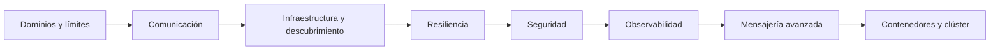

# Microservicios con Spring Boot desde Cero: de Desarrollador a Arquitecto

## Fase 2 · Microservicios esenciales, integración y operación

**Estado:** diseño curricular de trabajo; no es publicación ni certificación de laboratorios.  
**Duración:** 8 semanas · 120 horas orientativas (15 h/semana).  
**Independencia:** Curso A Spring Boot. No depende del Curso B Node.js.  
**Perfil de entrada:** ya programa, usa terminal, Git y editor; conoce Java/Spring básico, HTTP/JSON, pruebas, persistencia y caché al nivel de la Fase 1. No se vuelve a enseñar sintaxis elemental.  
**Versiones de referencia:** JDK 25 LTS, Spring Boot 4.1.3 y Spring Cloud 2025.1.4 según `docs/microservicios/08-herramientas-y-versiones.md`; Maven solo en el proyecto comparativo, Gradle Kotlin DSL sigue siendo la línea principal del repositorio. Cambiar versiones exige revalidar el BOM.  
**Resultado:** construir dos o más servicios desde directorios vacíos, elegir límites de dominio, comunicar/asegurar/observar sus interacciones, desplegarlos localmente y diagnosticar fallos antes de avanzar a mensajería avanzada y Kubernetes.

> **Alcance honesto:** las 49 fichas de abajo son diseño y prescripción de construcción. La mayoría de las rutas de referencia, `docker-compose.yml` por tema y verificadores todavía deben implementarse. Cada ausencia aparece como brecha; la existencia de una ficha no significa que el laboratorio esté listo ni que su prueba haya pasado.

## 1. Resultados observables

Al cerrar la fase, el estudiante podrá: dibujar límites de dominio con evidencia; construir desde cero un segundo servicio con base de datos propia; comparar HTTP, gRPC, GraphQL y eventos; descubrir y enrutar instancias; aplicar políticas de resiliencia con presupuesto de latencia; autenticar usuarios y proteger llamadas de servicio; conectar métricas, trazas y logs; explicar garantías y límites de mensajería; y desplegar una aplicación contenerizada en un clúster de práctica, justificando cuándo no usar esa complejidad.

## 2. Regla común de las fichas y estado de evidencia

Cada ficha tiene los nueve criterios de aceptación, en el mismo orden lógico: **(1)** definición, propósito y cuándo no usar; **(2)** analogía y diagrama con texto alternativo; **(3)** ruta/orden para crear cada archivo y razón antes de escribir; **(4)** ruta de la referencia completa que se entregará tras la construcción; **(5)** explicación de las líneas/bloques clave del código; **(6)** Compose reproducible, comando y salida prevista; **(7)** test/script automático previsto; **(8)** cambio guiado; **(9)** fallo deliberado con diagnóstico visual y corrección. Las salidas de esta página son contratos esperados, no registros de ejecución.

Convención de implementación futura: `examples/microservicios-spring/fase-2/modulo-N/tema-NN/`. Cada carpeta tendrá `README.md`, código completo, Dockerfile/Compose, `verify.sh`, fixtures y la solución de referencia. El estudiante crea primero `src/`, descriptor, configuración, pruebas y archivos de infraestructura en los pasos del README; el código de referencia queda en `reference/` y se revela al final. El perfil Compose `mNN-tNN` solo se considerará disponible cuando exista. El curso no descarga proyectos prefabricados.

**Texto alternativo:** ocho etapas, desde definir límites de dominio hasta desplegar; cada etapa reutiliza el sistema Tienda/Pedidos creado por el estudiante.

## 3. Calendario de 8 semanas

| Semana | Módulo | Hito observable |
|---|---|---|
| 1 | 5 · Microservicios y DDD | Segundo servicio ejecutable, límites y bases separadas decididos con ADR. |
| 2 | 6 · Comunicación | Cliente REST resiliente básico; comparación funcional con gRPC, GraphQL y eventos. |
| 3 | 7 · Spring Cloud | Gateway, descubrimiento/configuración y dos instancias visibles. |
| 4 | 8 · Resiliencia | Fallo del servicio dependiente reproducido y acotado por timeout/circuit breaker. |
| 5 | 9 · Seguridad | Usuario/token validado; permisos y secretos fuera del código. |
| 6 | 10 · Observabilidad | Una petición rastreable con métrica, log y traza correlacionados. |
| 7 | 11 · Mensajería avanzada | Consumidor Kafka/Rabbit/NATS probado con reintento, duplicados y mensaje no procesable. |
| 8 | 12 · Contenedores y despliegue | Imagen mínima, manifests, rollout y reversión documentados en clúster local. |

La carga es deliberadamente intensiva: 49 fichas y ocho hitos en 120 horas. Con menos de 12–15 horas por semana, extender a 12–16 semanas; no eliminar fichas, verificaciones ni fallos controlados.

---

# Módulo 5 · Introducción a microservicios y DDD

**Semana 1 · 15 h.** Proyecto guía: Tienda → Pedidos. Las decisiones de separación deben salir del dominio, no de una moda tecnológica.

### F2.05.01 · Monolito vs Microservicios vs SOA

1. **Concepto / uso / no uso:** comparar forma de despliegue, fronteras y coordinación. Microservicios no son «clases remotas»; no separar un CRUD pequeño, un equipo sin autonomía operativa ni un dominio aún inestable.
2. **Visual:** restaurante con cocina única (monolito), locales autónomos (microservicios) y cocina central compartida (SOA). `flowchart LR; U[Usuario]-->M[Una unidad]; U-->A[API]; A-->S1[Servicio A]; A-->S2[Servicio B]; S1-->B[Bus/servicios compartidos]` —el diagrama contrasta topologías, no escala.
3. **Construcción:** carpeta vacía → `pom.xml`/`build.gradle.kts` → dominio Tienda → un proceso monolítico → separar módulo y luego proceso HTTP; registrar qué frontera cambió y por qué.
4. **Referencia completa:** `.../modulo-5/tema-01/reference/`; proyecto comparativo funcional, aún por construir.
5. **Línea a línea:** descriptor, punto de entrada, puerto HTTP y configuración explican límites de proceso; `docker-compose.yml` revela qué se despliega junto.
6. **Lab:** `docker compose up --build`; salida prevista: una ruta monolítica y dos rutas de servicio responden con contratos equivalentes.
7. **Verificación:** `verify.sh` compara respuestas y prueba que el servicio puede arrancar aislado; pendiente.
8. **Modificación:** cortar una llamada entre servicios y registrar disponibilidad/latencia frente al monolito.
9. **Error visual:** flechas síncronas en cadena crean un «monolito distribuido»; error de red detiene toda la ruta. Diagnóstico: traza y diagrama de dependencias; volver a modularizar o aislar fallo.

### F2.05.02 · DDD: Bounded Contexts, Agregados y Eventos de Dominio

1. **Concepto / uso / no uso:** modelar lenguaje y consistencia dentro de límites explícitos; no usar DDD táctico para tablas CRUD sin reglas ni inventar contextos por equipo.
2. **Visual:** mapa del centro comercial: contextos son tiendas con vocabulario propio; agregado es una caja fuerte de invariantes; evento es el recibo que anuncia un hecho. `flowchart LR; C[Catálogo: Producto]-->E[ProductoPublicado]; E-->P[Pedidos: LíneaPedido]` —el mismo nombre puede representar modelos diferentes.
3. **Construcción:** escribir glosario y mapa → clase `Producto` de catálogo → agregado `Pedido` con invariantes → evento `PedidoCreado` inmutable → test de límite y publicación local.
4. **Referencia completa:** `.../modulo-5/tema-02/reference/`; aún no existe.
5. **Línea a línea:** constructor del agregado protege invariantes; evento describe un hecho pasado; mapper evita compartir entidad JPA entre contextos.
6. **Lab:** Compose con catálogo y pedidos; crear pedido válido y rechazar cantidad cero. Salida prevista: `201` y evento persistido/en memoria según subpaso.
7. **Verificación:** pruebas de invariantes, serialización del evento y ausencia de dependencia de entidades entre contextos; pendiente.
8. **Modificación:** intentar agregar una línea sin stock y observar qué límite debe validar.
9. **Error visual:** dos contextos comparten una entidad «Producto»; el cambio de esquema rompe ambos. Diagnóstico: grafo de dependencias; traducir entre modelos mediante contrato.

### F2.05.03 · Spring Modulith

1. **Concepto / uso / no uso:** organizar módulos de dominio dentro de una app Spring y verificar límites; usarlo como etapa antes de extraer procesos, no como requisito de todo proyecto.
2. **Visual:** departamentos dentro de un edificio con puertas señalizadas. `flowchart LR; A[modulo.catalogo]-->E[API de eventos]; B[modulo.pedidos]-->E; X[dependencia interna inválida]-->A`.
3. **Construcción:** agregar dependencia compatible con Boot → crear paquetes `catalogo` y `pedidos` → exponer API/evento → escribir prueba de módulos.
4. **Referencia:** `.../modulo-5/tema-03/reference/`; por construir.
5. **Línea a línea:** configuración de módulos enumera paquetes; test de verificación inspecciona dependencias; listener define interacción desacoplada.
6. **Lab:** `docker compose up --build`; ejecutar `./mvnw test`/wrapper del proyecto. Previsto: test verde y grafo de módulos impreso.
7. **Verificación:** test falla al introducir dependencia circular; pendiente.
8. **Modificación:** mover una clase a otro paquete y reparar el límite.
9. **Error visual:** flecha circular A↔B. Diagnóstico: reporte de dependencias; invertir dirección o extraer interfaz de módulo.

### F2.05.04 · 12-Factor App

1. **Concepto / uso / no uso:** principios de configuración, procesos, logs y portabilidad para servicios desplegables; no es una lista de cumplimiento literal ni sustituye controles de seguridad.
2. **Visual:** misma máquina conectada a tableros intercambiables según entorno. `flowchart LR; C[Código/imagen inmutable]-->E[Config env]-->R[Proceso]; R-->L[Logs stdout]`.
3. **Construcción:** crear `application.yml` con defaults no secretos → leer variables env → escribir logs a stdout → ejecutar como proceso sin estado local.
4. **Referencia:** `.../modulo-5/tema-04/reference/`; pendiente.
5. **Línea a línea:** binding tipado y validación, env precedence, señal de apagado y logging explican portabilidad.
6. **Lab:** Compose con perfil `dev` y `prod`; esperado: mismo digest responde con distinto endpoint configurado.
7. **Verificación:** script compara digest y salida de configuración no secreta; pendiente.
8. **Modificación:** cambiar variable `APP_MODO` sin rebuild.
9. **Error visual:** secreto escrito en imagen queda en todas las capas. Diagnóstico: escáner de imagen/log; rotar secreto y pasarlo por el runtime.

### F2.05.05 · Strangler Fig Pattern

1. **Concepto / uso / no uso:** reemplazar gradualmente una capacidad heredada detrás de una fachada; no aplicarlo a un sistema pequeño o sin pruebas/propiedad de datos.
2. **Visual:** enredadera que rodea y sustituye una fachada tramo a tramo. `flowchart LR; C[Cliente]-->F[Fachada/ruteador]; F-- rutas aún antiguas -->L[Legado]; F-- ruta migrada -->N[Nuevo servicio]`.
3. **Construcción:** crear fachada → enrutar una ruta por flag → implementar contrato nuevo → comparar respuesta → retirar ruta vieja con rollback.
4. **Referencia:** `.../modulo-5/tema-05/reference/`; aún no existe.
5. **Línea a línea:** regla de ruteo, flag, cliente legado y trazabilidad de versión muestran coexistencia.
6. **Lab:** Compose con `legacy`, `facade`, `new-service`; esperado: `/productos` pasa por nuevo, `/clientes` por legado.
7. **Verificación:** pruebas de contrato y matriz de rutas; pendiente.
8. **Modificación:** cambiar el flag y observar reversión sin recompilar.
9. **Error visual:** dos escritores actualizan el mismo dato. Diagnóstico: secuencia temporal y auditoría; elegir dueño único y migrar datos por etapas.

### F2.05.06 · Database-per-service

1. **Concepto / uso / no uso:** cada servicio posee sus datos y API; evita compartir esquema como contrato. No significa necesariamente un servidor físico por servicio ni conviene si se requieren transacciones atómicas simples.
2. **Visual:** cajas fuertes con llaves distintas y ventanilla de consulta entre dueños. `flowchart LR; P[Pedidos]-->DB1[(db pedidos)]; I[Inventario]-->DB2[(db inventario)]; P-.consulta API/evento.->I`.
3. **Construcción:** crear esquema/credenciales de pedidos → entidad/repositorio/migración → crear esquema inventario → prohibir conexión cruzada → consultar por contrato.
4. **Referencia:** `.../modulo-5/tema-06/reference/`; pendiente.
5. **Línea a línea:** URL/usuario por servicio, migración y cliente HTTP muestran propiedad separada.
6. **Lab:** Compose con dos PostgreSQL lógicos; esperado: pedido persiste aunque inventario solo se consulte por API.
7. **Verificación:** test intenta conexión cruzada y falla; script comprueba ambas rutas; pendiente.
8. **Modificación:** detener DB de inventario y medir degradación de pedidos.
9. **Error visual:** dos servicios apuntan a la misma tabla. Diagnóstico: mapa servicio→DB; separar esquema y planear consistencia por eventos/saga.

### F2.05.07 · Construcción guiada: segundo microservicio desde cero

1. **Concepto / uso / no uso:** servicio es unidad autónoma de proceso, despliegue y datos. No dividir la Tienda hasta que una capacidad y su equipo/operación estén claros.
2. **Visual:** dos talleres intercambian solicitudes con buzón y registros propios. `flowchart LR; G[Gateway/cliente]-->C[catálogo:8081]; G-->P[pedidos:8082]; C-->DBC[(catálogo DB)]; P-->DBP[(pedidos DB)]`.
3. **Construcción:** crear directorio → POM/Wrapper → app → config/health → dominio → repo + migración → controller → pruebas → Dockerfile/Compose → agregar llamada desde primer servicio.
4. **Referencia:** `.../modulo-5/tema-07/reference/`; debe incluir ambos proyectos completos, por construir.
5. **Línea a línea:** cada servicio tiene su `main`, puerto, datasource, repositorio, controller y Dockerfile; README explica cada instrucción.
6. **Lab:** `docker compose up --build --wait`; esperado: dos health endpoints `UP`, bases distintas y `POST /api/pedidos` responde con ID.
7. **Verificación:** `verify.sh` prueba aislamiento, contrato y persistencia después de reiniciar contenedores; pendiente.
8. **Modificación:** apagar catálogo y observar error controlado del pedido, no caída del host.
9. **Error visual:** `connection refused` por servicio/puerto equivocado; diagnosticar con mapa de puertos, logs y DNS de Compose; corregir hostname, no usar `localhost` entre contenedores.

---

# Módulo 6 · Comunicación entre servicios

**Semana 2 · 15 h.** Las alternativas se comparan con el mismo caso de consulta de catálogo y creación de pedido.

### F2.06.01 · REST síncrono: RestTemplate, WebClient y OpenFeign

1. **Concepto / uso / no uso:** cliente HTTP acopla respuesta inmediata; RestTemplate se reconoce en legado, WebClient sirve flujo reactivo/no bloqueante y Feign declara clientes tipados. No encadenar llamadas críticas sin timeouts ni adoptar reactive si todo el camino es bloqueante.
2. **Visual:** llamada telefónica versus formulario; respuesta bloquea al solicitante. `flowchart LR; Pedido-->HTTP-->Catalogo-->JSON`.
3. **Construcción:** crear DTO de respuesta → cliente RestTemplate mínimo → WebClient → Feign con URL/config → test con servidor falso.
4. **Referencia:** `.../modulo-6/tema-01/reference/`; pendiente.
5. **Línea a línea:** URL, serializador, timeout, decoder y excepción HTTP; explicar diferencia de ejecución y API.
6. **Lab:** Compose catálogo + pedidos; esperado: `GET /api/pedidos/1/resumen` incluye SKU recuperado.
7. **Verificación:** test de cliente cubre 200, 404, timeout y conexión rechazada; pendiente.
8. **Modificación:** variar base URL/timeout por env.
9. **Error visual:** hilo esperando indefinidamente. Diagnóstico: traza sin respuesta y timeout ausente; configurar plazo y mapear error sin ocultarlo.

### F2.06.02 · gRPC: Protocol Buffers, servicios y streaming

1. **Concepto / uso / no uso:** RPC tipado con contratos `.proto`, eficiente para comunicación interna y streaming; no usarlo por defecto para clientes web públicos simples ni ignorar compatibilidad de esquema.
2. **Visual:** formulario de campos numerados y canal dúplex. `flowchart LR; Cliente-->Proto-->Servidor; Servidor<-->Stream`.
3. **Construcción:** crear `.proto` → configurar generador → implementar servicio → cliente → unary → streaming y test.
4. **Referencia:** `.../modulo-6/tema-02/reference/`; pendiente.
5. **Línea a línea:** números de campo, cardinalidad RPC, deadline y observer explican contrato/transporte.
6. **Lab:** Compose gRPC client/server; esperado: unary obtiene stock y stream emite cambios secuenciales.
7. **Verificación:** test de compatibilidad, deadline y cierre del stream; pendiente.
8. **Modificación:** agregar campo opcional con número nuevo; observar compatibilidad.
9. **Error visual:** cliente y servidor con métodos/campo incompatibles. Diagnóstico: error de generación/estado gRPC; regenerar código y respetar números reservados.

### F2.06.03 · GraphQL con Spring for GraphQL

1. **Concepto / uso / no uso:** cliente declara campos que necesita en un grafo tipado; útil para agregación de vistas, no reemplaza todas las APIs ni evita N+1/controles de autorización.
2. **Visual:** menú donde la persona elige campos de una ficha. `flowchart LR; Query-->Resolver-->Catalogo; Query-->Resolver-->Precio; Resolver-->JSON`.
3. **Construcción:** schema `.graphqls` → DTO → resolver → servicio → query y mutation → test de selección/autorización.
4. **Referencia:** `.../modulo-6/tema-03/reference/`; pendiente.
5. **Línea a línea:** type/schema, mapping, resolver y loader contextual explican la ruta de un campo.
6. **Lab:** Compose API + backend; esperado: query devuelve solo SKU y precio seleccionados.
7. **Verificación:** test comprueba schema, error y límite de profundidad/costo; pendiente.
8. **Modificación:** pedir campo anidado repetido y observar contador de consultas.
9. **Error visual:** árbol N+1 hace una consulta por fila. Diagnóstico: trazas SQL; usar DataLoader/batch y límites.

### F2.06.04 · Mensajería asíncrona: introducción a RabbitMQ y Kafka

1. **Concepto / uso / no uso:** productor entrega sin esperar resultado funcional inmediato; RabbitMQ enruta mensajes/acknowledgments y Kafka conserva log particionado. No usar broker para una llamada local que requiere respuesta inmediata.
2. **Visual:** central de correo versus diario append-only. `flowchart LR; Productor-->Broker-->Consumidor; Broker-->Retencion`.
3. **Construcción:** crear evento versionado → configuración Rabbit → publisher/consumer con ack → configuración Kafka → producer/group → manejar duplicado.
4. **Referencia:** `.../modulo-6/tema-04/reference/`; pendiente.
5. **Línea a línea:** exchange/queue/binding/ack y topic/key/offset/group explicados por archivo.
6. **Lab:** Compose Rabbit + Kafka con perfiles separados; esperado: ambos consumidores procesan `PedidoCreado` y registran ID.
7. **Verificación:** test de entrega, ack y deduplicación; pendiente.
8. **Modificación:** pausar consumer y observar buffer/retención.
9. **Error visual:** mensaje no ack vuelve a cola o se repite; diagnosticar contador redelivery/offset; hacer handler idempotente.

### F2.06.05 · Sync vs async: criterios de decisión

1. **Concepto / uso / no uso:** sincronía favorece respuesta inmediata; async desacopla disponibilidad y tiempo, añade consistencia eventual/operación. No elegir por moda ni usar async donde se requiere confirmar resultado ahora.
2. **Visual:** llamada en ventanilla vs ticket de turno. `flowchart TD; Q{¿necesitas respuesta ahora?}-- sí -->HTTP; Q-- no -->Evento; Evento-->ConsistenciaEventual`.
3. **Construcción:** registrar requisito de latencia/consistencia → implementar ambas variantes → medir dependencia y comportamiento al fallo → redactar ADR.
4. **Referencia:** `.../modulo-6/tema-05/reference/`; pendiente.
5. **Línea a línea:** endpoint HTTP y productor/consumidor se comparan; se señala ack técnico frente a resultado de negocio.
6. **Lab:** Compose alterna `modo=sync|async`; esperado: sync retorna producto inmediatamente, async devuelve `202` y completa después.
7. **Verificación:** pruebas de contrato, timeout y repetición; pendiente.
8. **Modificación:** cortar destinatario; registrar diferencia entre error HTTP y cola pendiente.
9. **Error visual:** cliente interpreta `202` como operación terminada. Diagnóstico: secuencia de estados; exponer estado/callback y política de consistencia.

---

# Módulo 7 · Spring Cloud e infraestructura

**Semana 3 · 15 h.** Laboratorio acumulativo: tres instancias, registro, Gateway y configuración externa.

### F2.07.01 · Service Discovery: Eureka y Consul

1. **Concepto / uso / no uso:** catálogo dinámico traduce nombre lógico a instancias vivas. Eureka integra con Spring; Consul añade catálogo/health KV. No hace falta para pocas ubicaciones estáticas o un único servicio.
2. **Visual:** directorio telefónico actualizado. `flowchart LR; A[Instancia A]-->R[Registro]; B[Instancia B]-->R; C[Cliente]-->R-->A`.
3. **Construcción:** levantar servidor → añadir cliente → registrar app/health → descubrir por nombre → comparar Eureka y Consul.
4. **Referencia:** `.../modulo-7/tema-01/reference/`; pendiente.
5. **Línea a línea:** anotación de cliente, service ID, lease/health y URL descubierta.
6. **Lab:** Compose registry y dos catálogos; esperado: dos instancias registradas y consulta distribuida.
7. **Verificación:** `verify.sh` espera registro/heartbeat y prueba ruta; pendiente.
8. **Modificación:** detener una instancia y comprobar que deja de elegirse.
9. **Error visual:** lista contiene instancia muerta por heartbeat/health mal configurado; diagnosticar UI/health y revisar lease.

### F2.07.02 · API Gateway: Spring Cloud Gateway

1. **Concepto / uso / no uso:** punto de entrada para rutas transversales, TLS, límites y políticas; no debe absorber dominio ni ser un único cuello de botella sin réplicas.
2. **Visual:** recepcionista dirige al departamento. `flowchart LR; Cliente-->GW{Gateway}; GW-->Catalogo; GW-->Pedidos`.
3. **Construcción:** crear app gateway → declarar routes → predicates/filters → propagar trace/correlation → tests.
4. **Referencia:** `.../modulo-7/tema-02/reference/`; pendiente.
5. **Línea a línea:** route ID, predicate, URI lógico, filtro y orden.
6. **Lab:** Compose gateway + dos apps; esperado: `/catalogo/**` y `/pedidos/**` enrutan correctamente.
7. **Verificación:** test de status, header y path rewrite; pendiente.
8. **Modificación:** cambiar predicate y trazar el 404.
9. **Error visual:** flecha al backend equivocado por prefijo eliminado; observar path/trace y ajustar `StripPrefix`.

### F2.07.03 · Config Server

1. **Concepto / uso / no uso:** centraliza configuración versionable por servicio/perfil; no almacena secretos en repositorios ni es requisito para dos apps locales.
2. **Visual:** tablero central que entrega fichas según nombre/entorno. `flowchart LR; Git[Repo config]-->CS[Config Server]-->A[Servicio A]; CS-->B[Servicio B]`.
3. **Construcción:** repo de config → servidor → cliente → nombre/profile → refresh y estrategia de disponibilidad.
4. **Referencia:** `.../modulo-7/tema-03/reference/`; pendiente.
5. **Línea a línea:** bootstrap/import config, nombre de aplicación, perfil, URI y precedencia.
6. **Lab:** Compose server y app; esperado: cambiar mensaje vía repo/env y ver propiedad enlazada.
7. **Verificación:** test de precedencia y fallo si config obligatoria ausente; pendiente.
8. **Modificación:** servidor config no disponible al arrancar.
9. **Error visual:** app arranca con valor default silencioso; diagnosticar origen de property y fallar explícito si se requiere.

### F2.07.04 · Load Balancing con Spring Cloud LoadBalancer

1. **Concepto / uso / no uso:** elegir instancia entre réplicas registradas; no reemplaza autoscaling ni corrige estado compartido o límites de conexión.
2. **Visual:** filas múltiples en ventanilla con turnos. `flowchart LR; Cliente-->LB-->A; LB-->B; LB-->C`.
3. **Construcción:** exponer servicio con nombre lógico → escalar réplicas → integrar client-side LB → registrar distribución.
4. **Referencia:** `.../modulo-7/tema-04/reference/`; pendiente.
5. **Línea a línea:** service ID, filtro, algoritmo y health filter.
6. **Lab:** `docker compose up --scale catalogo=3`; esperado: solicitudes observadas en más de una instancia.
7. **Verificación:** script envía N solicitudes y comprueba cantidad de IDs/instancias; pendiente.
8. **Modificación:** detener réplica durante carga.
9. **Error visual:** todas las llamadas llegan a una réplica por conexión persistente; revisar logs/keep-alive y algoritmo.

### F2.07.05 · BFF pattern

1. **Concepto / uso / no uso:** backend especializado por experiencia cliente agrega contratos y reduce chatty calls; no replicar reglas de negocio por frontend ni crear BFF por pantalla.
2. **Visual:** guías de museo distintas para visitante y operador. `flowchart LR; Web-->BFFweb-->Servicios; Mobile-->BFFmobile-->Servicios`.
3. **Construcción:** definir necesidades de dos clientes → crear BFF web → componer respuestas → separar formato sin duplicar dominio.
4. **Referencia:** `.../modulo-7/tema-05/reference/`; pendiente.
5. **Línea a línea:** cliente de servicio, DTO de vista, concurrencia y manejo parcial.
6. **Lab:** Compose BFF + servicios; esperado: una respuesta de vista compuesta para Web y otra móvil.
7. **Verificación:** tests contrato por cliente y control de dependencia; pendiente.
8. **Modificación:** hacer lento uno de tres backend y observar degradación parcial.
9. **Error visual:** BFF se transforma en servicio monolítico de negocio. Diagnóstico: imports y reglas duplicadas; mover invariantes al dueño del dominio.

---

# Módulo 8 · Resiliencia

**Semana 4 · 15 h.** Toda política se enseña con timeout medido y falla inyectada; retry no se aplica a operaciones no idempotentes sin protección.

### F2.08.01 · Resilience4j: Circuit Breaker, Retry, RateLimiter, Bulkhead y TimeLimiter

1. **Concepto / uso / no uso:** limitar propagación de fallos y saturación. Circuit breaker abre, retry repite, rate limiter regula tasa, bulkhead aísla concurrencia y time limiter acota espera. No apilar políticas sin métricas ni reintentar errores permanentes.
2. **Visual:** tablero eléctrico con interruptor, contador, carriles aislados y reloj. `flowchart LR; Req-->Timeout-->CB{Circuito}; CB-- cerrado -->Dep; CB-- abierto -->Fallback`.
3. **Construcción:** cliente HTTP → timeout → breaker → retry selectivo → limiter/bulkhead → métricas → tests de estados.
4. **Referencia:** `.../modulo-8/tema-01/reference/`; pendiente.
5. **Línea a línea:** anotación/config de cada política, orden de decorators, exception predicate y ventana deslizante.
6. **Lab:** Compose servicio lento + Toxiproxy; esperado: requests limitadas, circuito cambia `CLOSED→OPEN`.
7. **Verificación:** tests de transición, concurrencia y retry máximo; pendiente.
8. **Modificación:** cambiar umbral/ventana y comparar cantidad de fallos.
9. **Error visual:** retry multiplica tráfico contra servicio caído; diagnosticar gráfico de solicitudes y añadir backoff/jitter/condición.

### F2.08.02 · Timeouts en cascada y presupuesto de latencia

1. **Concepto / uso / no uso:** repartir un SLO de extremo a extremo entre llamadas; no definir cada timeout de forma independiente ni sumar plazo superior al SLA.
2. **Visual:** carrera de relevos con tiempo total limitado. `flowchart LR; A[Gateway 800ms]-->B[Pedido 600ms]-->C[Inventario 350ms]`.
3. **Construcción:** medir latencia base → dibujar ruta crítica → asignar deadlines → propagar cancelación/contexto → verificar percentiles.
4. **Referencia:** `.../modulo-8/tema-02/reference/`; pendiente.
5. **Línea a línea:** timeout de cliente, deadline, cancelación y configuración por dependencia.
6. **Lab:** Compose servicios con latencia configurable; esperado: request se corta antes de superar presupuesto global.
7. **Verificación:** prueba de latencia límite con reloj controlado; pendiente.
8. **Modificación:** agregar una llamada en cascada y recalcular budgets.
9. **Error visual:** timeout del padre expira después del hijo. Diagnóstico: timeline trace; propagar deadline y reservar margen.

### F2.08.03 · Fallback strategies

1. **Concepto / uso / no uso:** respuesta alternativa degradada ante falla; puede ser caché, omitir campo o error explícito. No inventar éxito ni devolver dato obsoleto sin indicar frescura.
2. **Visual:** ruta principal y desvío de emergencia señalizado. `flowchart TD; D[Dependencia]-- ok -->R[Respuesta real]; D-- falla -->F[Fallback etiquetado]`.
3. **Construcción:** definir semántica de producto → excepción tipada → fallback por caso → incluir marca de frescura → tests.
4. **Referencia:** `.../modulo-8/tema-03/reference/`; pendiente.
5. **Línea a línea:** selector de excepción, salida alternativa y campo degradado.
6. **Lab:** Compose con dependencia apagable; esperado: disponibilidad parcial con `degraded=true` o error semántico correcto.
7. **Verificación:** tests diferencian éxito real, fallback y fallo; pendiente.
8. **Modificación:** reducir TTL de dato alternativo.
9. **Error visual:** precio antiguo aparece como vigente. Diagnóstico: response lacks timestamp/flag; exponer edad y definir límite.

### F2.08.04 · Chaos Engineering con Toxiproxy

1. **Concepto / uso / no uso:** introducir latencia, corte o reset controlados para probar hipótesis de resiliencia; no inyectar caos en producción sin guardrails/autorización.
2. **Visual:** túnel de prueba con válvula regulable. `flowchart LR; Cliente-->Toxiproxy{toxic}-->Servicio`.
3. **Construcción:** Compose service/proxy → script activa toxic → ejecutar check → quitar toxic mediante cleanup trap.
4. **Referencia:** `.../modulo-8/tema-04/reference/`; pendiente.
5. **Línea a línea:** config de proxy, toxic latency/reset, duración y limpieza idempotente.
6. **Lab:** `docker compose --profile chaos up --build`; esperado: escenario control responde y escenario degradado muestra timeout/fallback.
7. **Verificación:** `verify.sh` comprueba ambos modos y que toxic queda eliminado; pendiente.
8. **Modificación:** incrementar latencia y predecir breaker.
9. **Error visual:** toxic olvidado hace fallar todos los casos posteriores; diagnosticar proxy state y ejecutar teardown siempre.

---

# Módulo 9 · Seguridad

**Semana 5 · 15 h.** Ninguna ficha publica secretos; la versión vulnerable se ejecuta solo en red local aislada y se compara con la segura.

### F2.09.01 · Spring Security: filter chain

1. **Concepto / uso / no uso:** filtros autentican/autoriza request antes del controller; no escribir un filtro casero para sustituir Security ni confundir CORS con autorización.
2. **Visual:** control de acceso en capas antes de entrar al edificio. `flowchart LR; HTTP-->F1-->F2-->AuthZ-->Controller`.
3. **Construcción:** dependencia → `SecurityFilterChain` → reglas rutas → principal → test permitido/denegado.
4. **Referencia:** `.../modulo-9/tema-01/reference/`; pendiente.
5. **Línea a línea:** matcher, orden, CSRF/CORS justificados, entry point.
6. **Lab:** Compose app y tests; esperado: ruta pública 200, ruta protegida 401/403 según credenciales.
7. **Verificación:** tests de cadena y rutas; pendiente.
8. **Modificación:** cambiar regla `permitAll` a autenticada.
9. **Error visual:** regla amplia antes que específica. Diagnóstico: cadena de filtros y prueba de endpoint; ordenar matchers.

### F2.09.02 · JWT: firma simétrica vs asimétrica

1. **Concepto / uso / no uso:** token firmado acredita integridad/origen; HMAC comparte secreto, RSA/EC separa firmante y verificador. JWT no cifra claims; no elegirlo como sesión universal ni poner datos sensibles en payload.
2. **Visual:** sello compartido versus sello y lupa pública. `flowchart LR; Issuer-->Sign[HMAC o privada]; Sign-->JWT-->Verify[secreto o clave pública]`.
3. **Construcción:** claims mínimos → firmar HMAC → verificar → cambiar a par de claves y rotación → rechazar expiración/audience.
4. **Referencia:** `.../modulo-9/tema-02/reference/`; pendiente.
5. **Línea a línea:** header/payload/signature, `iss/aud/exp/kid`, decoder y key resolver.
6. **Lab:** Compose issuer/resource server; esperado: token válido 200, alterado/expirado 401.
7. **Verificación:** tests de firma, algoritmo esperado, audience y expiración; pendiente.
8. **Modificación:** rotar `kid` con clave anterior todavía verificable.
9. **Error visual:** acepta `alg=none` o confunde key. Diagnóstico: claims/headers y logs seguros; allowlist de algoritmo y key id.

### F2.09.03 · OAuth 2.0 y OIDC

1. **Concepto / uso / no uso:** OAuth 2 autoriza acceso delegado; OIDC añade identidad; no llamar «OAuth login» sin validar ID token ni usar implicit flow para nuevas apps.
2. **Visual:** hotel entrega llave limitada tras confirmar identidad. `flowchart LR; User-->Client-->AS[Authorization Server]; AS-->Token-->API`.
3. **Construcción:** registrar client → authorization code + PKCE → scopes → validar issuer/audience → renovar/cerrar sesión según flujo.
4. **Referencia:** `.../modulo-9/tema-03/reference/`; pendiente.
5. **Línea a línea:** redirect URI, state, nonce, code verifier, token claims y resource server.
6. **Lab:** Compose Keycloak + app; esperado: login redirige y token con issuer correcto permite llamada.
7. **Verificación:** prueba auth code simulado y rechazo de issuer incorrecto; pendiente.
8. **Modificación:** retirar scope y observar 403.
9. **Error visual:** token de otro realm aceptado por issuer laxo; diagnosticar `iss/aud` y fijar metadata esperada.

### F2.09.04 · Keycloak

1. **Concepto / uso / no uso:** proveedor IAM gestiona realm, clientes y usuarios; evita construir login/rotación desde cero. No usar realm demo/credenciales default en producción.
2. **Visual:** registro civil que emite credenciales a servicios. `flowchart LR; Admin-->Realm-->Tokens-->App`.
3. **Construcción:** Compose Keycloak → realm importado mínimo → client/confidentiality → user de laboratorio → conectar resource server.
4. **Referencia:** `.../modulo-9/tema-04/reference/`; pendiente.
5. **Línea a línea:** realm JSON, client ID, issuer URI y roles.
6. **Lab:** `docker compose up --build --wait`; esperado: discovery endpoint y token local verificable.
7. **Verificación:** script obtiene token de test y consulta API; pendiente.
8. **Modificación:** cambiar audiencia del client.
9. **Error visual:** `invalid_token` por issuer interno vs externo. Diagnóstico: URL discovery y claims; configurar issuer accesible consistente.

### F2.09.05 · RBAC y Scopes

1. **Concepto / uso / no uso:** RBAC concede acciones por rol; scope limita permiso delegado del token. No autorizar solo por nombre de usuario ni crear roles por cada endpoint.
2. **Visual:** credencial de empleado más pase por sala. `flowchart LR; Token-->Role-->Policy-->Resource; Token-->Scope-->Policy`.
3. **Construcción:** definir matriz rol/acción → mapear authorities → anotación/matcher → test matriz.
4. **Referencia:** `.../modulo-9/tema-05/reference/`; pendiente.
5. **Línea a línea:** claim mapping, `hasRole/hasAuthority`, regla de método y respuesta 403.
6. **Lab:** Compose Keycloak + dos roles; esperado: operador lee, admin modifica, anónimo 401.
7. **Verificación:** tests table-driven por recurso/rol/scope; pendiente.
8. **Modificación:** quitar scope `orders.write`.
9. **Error visual:** todo token autenticado ve datos. Diagnóstico: matriz con celda indebida; default deny y autorización por recurso.

### F2.09.06 · Token Exchange (RFC 8693)

1. **Concepto / uso / no uso:** servicio cambia token entrante por credencial de audiencia/alcance reducido hacia otro servicio; no reenviar token del usuario a todo backend ni implementar intercambio casero.
2. **Visual:** guardarropa cambia pase general por pase específico. `flowchart LR; UserToken-->Exchange-->DownstreamToken-->ServiceB`.
3. **Construcción:** configurar actor/subject → llamar token endpoint → validar audiencia y scope → propagar token reducido.
4. **Referencia:** `.../modulo-9/tema-06/reference/`; pendiente.
5. **Línea a línea:** grant type, subject/actor token, requested audience y claims resultado.
6. **Lab:** Keycloak perfil token-exchange si versión/feature lo soporta; output previsto: token de downstream con permisos reducidos. Capacidad exacta se valida antes de publicar.
7. **Verificación:** script compara `aud/scope` y rechaza token de origen indebido; pendiente.
8. **Modificación:** pedir scope no concedido.
9. **Error visual:** `invalid_target`/audience amplia; diagnosticar configuración del cliente y minimizar audiencia.

### F2.09.07 · mTLS con Service Mesh

1. **Concepto / uso / no uso:** TLS mutuo valida identidades de ambos extremos; mesh automatiza certificados/política. No activar mesh sin necesidad de identidad de workload/operación.
2. **Visual:** dos edificios revisan credenciales mutuamente. `flowchart LR; A-->ProxyA==mTLS==>ProxyB-->B`.
3. **Construcción:** levantar clúster/mesh de lab → desplegar app → habilitar sidecars → política allow/deny → observar certificados.
4. **Referencia:** `.../modulo-9/tema-07/reference/`; pendiente.
5. **Línea a línea:** manifiesto de injection, peer auth y authorization policy.
6. **Lab:** Compose no sustituye mesh; laboratorio Kubernetes local con `verify.sh`; esperado: identidad válida conecta, namespace no autorizado bloqueado.
7. **Verificación:** curl y policy test con evidencia de identidad; pendiente.
8. **Modificación:** cambiar modo permissive a strict.
9. **Error visual:** pod sin sidecar rompe conexión strict. Diagnóstico: workload identity/handshake; inyectar y validar rollout.

### F2.09.08 · HashiCorp Vault

1. **Concepto / uso / no uso:** almacén/control de secretos con políticas, leases y rotación; no guardar token raíz ni externalizar cada configuración no secreta por obligación.
2. **Visual:** bóveda entrega llave temporal con registro de retiro. `flowchart LR; App-->Auth-->Vault-->Secret; Vault-->Audit`.
3. **Construcción:** perfil dev no productivo → policy mínima → auth method → leer secreto → rotar/revocar.
4. **Referencia:** `.../modulo-9/tema-08/reference/`; pendiente.
5. **Línea a línea:** policy path, role binding, lease TTL y Spring config import.
6. **Lab:** Compose Vault dev aislado; esperado: app lee credencial efímera, no aparece en Git ni logs.
7. **Verificación:** script busca filtración y comprueba revocación; pendiente.
8. **Modificación:** reducir TTL y observar renovación.
9. **Error visual:** token no autorizado/lease vencido. Diagnóstico: audit + expiración; renovar con identidad de workload.

### F2.09.09 · Escaneo de vulnerabilidades: Trivy y Snyk

1. **Concepto / uso / no uso:** identificar CVEs/licencias/configuración en dependencias e imágenes; no tratar «sin hallazgos» como prueba de seguridad ni ignorar falsos positivos sin excepción registrada.
2. **Visual:** rayos X del artefacto. `flowchart LR; Source-->SCA; Image-->Scanner; Scanner-->Report-->Fix`.
3. **Construcción:** crear Dockerfile → escanear FS → construir imagen → escanear imagen → configurar umbral/ignore con vencimiento.
4. **Referencia:** `.../modulo-9/tema-09/reference/`; pendiente.
5. **Línea a línea:** comando, severidad, exit code y excepción con justificación.
6. **Lab:** Compose scanner contra imagen local; Snyk usa token opcional, nunca commit. Expected: reporte reproducible; baseline exacto se registra al generar laboratorio.
7. **Verificación:** script verifica exit code y salida SARIF/JSON; pendiente.
8. **Modificación:** introducir dependencia obsoleta de prueba y comparar reporte.
9. **Error visual:** build pasa pese a CRITICAL por `continue-on-error`. Diagnóstico: pipeline y exit code; bloquear threshold decidido.

---

# Módulo 10 · Observabilidad

**Semana 6 · 15 h.** Observabilidad responde qué ocurrió y por qué; alertar solo con síntoma útil para usuario/servicio.

### F2.10.01 · Micrometer + Prometheus

1. **Concepto / uso / no uso:** instrumentar métricas dimensionales y recolectarlas; no usar IDs de usuario como labels ni confundir métricas con logs.
2. **Visual:** velocímetro conectado a tablero. `flowchart LR; App-->Actuator[/metrics]-->Prometheus-->Query`.
3. **Construcción:** agregar dependencias → endpoint metrics → contador/timer → scrape config → consultar series.
4. **Referencia:** `.../modulo-10/tema-01/reference/`; pendiente.
5. **Línea a línea:** meter, tags, exposition path y scrape target.
6. **Lab:** Compose API + Prometheus; esperado: contador `http_server_requests_seconds_count` crece tras llamada.
7. **Verificación:** `verify.sh` consulta Prometheus HTTP API; pendiente.
8. **Modificación:** variar endpoint y comparar timer.
9. **Error visual:** cardinalidad explota por label con ID único; diagnóstico: conteo de series; usar dimensión acotada.

### F2.10.02 · OpenTelemetry + Zipkin/Jaeger

1. **Concepto / uso / no uso:** traza spans correlacionados en una operación distribuida; Zipkin/Jaeger visualizan. No crear spans sin contexto ni usar tracing para almacenar negocio sensible.
2. **Visual:** hilo de color que atraviesa varios talleres. `sequenceDiagram; Cliente->>Gateway: traceparent; Gateway->>Pedido: span; Pedido->>Catalogo: child span`.
3. **Construcción:** instrumentar app → propagar trace context → exporter OTLP → levantar backend Zipkin/Jaeger → buscar trace.
4. **Referencia:** `.../modulo-10/tema-02/reference/`; pendiente.
5. **Línea a línea:** sampler, exporter, resource attributes, baggage y span parent.
6. **Lab:** Compose OTel Collector + Zipkin o Jaeger; esperado: una traza contiene gateway/pedido/catálogo.
7. **Verificación:** script genera request y consulta spans; pendiente.
8. **Modificación:** muestreo 100% a 10% en demo y observar volumen.
9. **Error visual:** trace termina en cada servicio por header perdido. Diagnóstico: trace ID de logs; propagar W3C context.

### F2.10.03 · Logging estructurado

1. **Concepto / uso / no uso:** eventos JSON con campos consistentes, correlación y nivel; no imprimir secretos/PII ni convertir cada métrica en log.
2. **Visual:** recibos normalizados que se pueden clasificar. `flowchart LR; Request-->JSONLog-->Collector-->Query`.
3. **Construcción:** logger JSON → correlation/trace ID → campos de evento → sanitización → tests.
4. **Referencia:** `.../modulo-10/tema-03/reference/`; pendiente.
5. **Línea a línea:** MDC, serializer, nivel, máscara y salida stdout.
6. **Lab:** Compose app + Loki/collector opcional; esperado: log parseable con `trace_id`.
7. **Verificación:** parser confirma JSON y ausencia de `Authorization/password`; pendiente.
8. **Modificación:** añadir campo `orderId` permitido.
9. **Error visual:** log en texto libre no correlaciona o revela token. Diagnóstico: consulta por trace ID/regex secretos; sanitizar y estructurar.

### F2.10.04 · Grafana: dashboards

1. **Concepto / uso / no uso:** panel visual para explorar señales; no es almacén de métricas ni tablero con 40 gauges sin pregunta operativa.
2. **Visual:** panel de instrumentos con velocidad, presión y combustible. `flowchart LR; Prometheus-->Grafana-->Dashboard`.
3. **Construcción:** datasource provisioning → dashboard JSON → panels RED/USE → variables y enlaces a traces.
4. **Referencia:** `.../modulo-10/tema-04/reference/`; pendiente.
5. **Línea a línea:** datasource UID, PromQL, unidad, intervalo y panel.
6. **Lab:** Compose Grafana + Prometheus; esperado: dashboard provisionado y tasa/latencia visibles.
7. **Verificación:** script consulta API/dashboard UID; pendiente.
8. **Modificación:** agregar filtro por servicio.
9. **Error visual:** panel muestra datos viejos por rango/timezone. Diagnóstico: timestamp y query inspector; alinear rango/retención.

### F2.10.05 · Alerting basado en p99

1. **Concepto / uso / no uso:** alerta cuando cola de latencia afecta objetivo/error budget; p99 describe cola, no sustituye tasa de errores ni SLO. No alertar por una muestra aislada.
2. **Visual:** 99 de 100 clientes bajo límite y una cola de espera resaltada. `flowchart LR; Histograma-->p99-->SLO{umbral sostenido}-->Page`.
3. **Construcción:** definir SLI/SLO → histograma buckets → PromQL quantile/alternativa → regla con ventana → prueba de firing/resolution.
4. **Referencia:** `.../modulo-10/tema-05/reference/`; pendiente.
5. **Línea a línea:** buckets, `histogram_quantile`, `for`, labels y routing.
6. **Lab:** Compose Prometheus/Alertmanager + generador carga; esperado: alerta se activa solo tras violación sostenida.
7. **Verificación:** test de reglas valida firing y recuperación; pendiente.
8. **Modificación:** variar ventana de alerta.
9. **Error visual:** alerta flapea con picos cortos. Diagnóstico: serie temporal; añadir ventana/umbral SLO y separar alerta ticket vs page.

---

# Módulo 11 · Mensajería avanzada

**Semana 7 · 15 h.** La semántica práctica se enseña con duplicados, reordenamiento, reinicio y fallos; «exactly once» siempre se acota a fronteras concretas.

### F2.11.01 · Kafka profundo: particionamiento y consumer groups

1. **Concepto / uso / no uso:** particiones dan orden por clave y paralelismo; group divide asignaciones. No asumir orden global ni escalar consumidores más allá de particiones útiles.
2. **Visual:** carriles de paquetes con varios lectores. `flowchart LR; Topic-->P0-->C1; Topic-->P1-->C2`.
3. **Construcción:** Compose Kafka KRaft → topic → key/partitioner → consumer group → rebalance y offsets.
4. **Referencia:** `.../modulo-11/tema-01/reference/`; pendiente.
5. **Línea a línea:** key, partition count, assignment, offset commit y rebalance listener.
6. **Lab:** Compose broker + tres consumers; esperado: mismo orderId conserva partición/orden, keys distintas paralelizan.
7. **Verificación:** script inspecciona distribución y orden por key; pendiente.
8. **Modificación:** subir particiones y observar asignación.
9. **Error visual:** clave nula concentra eventos o orden global asumido. Diagnóstico: distribución de particiones; elegir key de agregado.

### F2.11.02 · Exactly-Once Semantics (EOS)

1. **Concepto / uso / no uso:** transacción Kafka puede atomizar lectura/escritura en Kafka bajo configuración adecuada; no incluye automáticamente una base SQL/efecto externo. No prometer exactly-once end-to-end.
2. **Visual:** sello de una transacción dentro de una caja Kafka, fuera hay sistemas separados. `flowchart LR; Input-->Tx[Kafka transaction]-->Output; Tx-.no cubre.->DB`.
3. **Construcción:** consumer idempotente → producer transaccional → commit offset en transacción → duplicado/restart test.
4. **Referencia:** `.../modulo-11/tema-02/reference/`; pendiente.
5. **Línea a línea:** `transactional.id`, isolation level, offset send/commit.
6. **Lab:** Compose Kafka; esperado: lector `read_committed` no observa registro abortado.
7. **Verificación:** test abort/restart compara registros visibles; pendiente.
8. **Modificación:** cambiar isolation a `read_uncommitted`.
9. **Error visual:** DB y Kafka muestran estado diferente. Diagnóstico: frontera transaccional; introducir outbox/idempotencia, no prometer atomicidad global.

### F2.11.03 · Schema Registry y Avro

1. **Concepto / uso / no uso:** registro/versionado de esquemas reduce incompatibilidad; Avro binario necesita schema evolution. No usar `latest` sin política ni borrar campos incompatibles sin regla.
2. **Visual:** contrato de formulario con versiones compatibles. `flowchart LR; Producer-->Registry-->Topic-->Consumer; Registry-->CompatibilityCheck`.
3. **Construcción:** escribir `.avsc` → generar clase → configurar serializer → publicar v1/v2 → probar compatibilidad.
4. **Referencia:** `.../modulo-11/tema-03/reference/`; pendiente.
5. **Línea a línea:** field/default/namespace, serializer config, subject naming y compatibility mode.
6. **Lab:** Compose Kafka + Schema Registry; esperado: v1/v2 compatibles; esquema incompatible es rechazado.
7. **Verificación:** script registra schemas y compara status; pendiente.
8. **Modificación:** añadir campo sin default y observar rechazo.
9. **Error visual:** consumer no decodifica schema ID; diagnóstico: endpoint registry/ID; sincronizar y mantener contrato.

### F2.11.04 · Dead Letter Topics

1. **Concepto / uso / no uso:** separar mensaje agotado/no procesable para inspección y replay; no es basurero ni sustituye alertas, retención o idempotencia.
2. **Visual:** carril de excepción etiquetado para paquetes dañados. `flowchart LR; Topic-->Consumer; Consumer--error permanente-->DLT-->Operator`.
3. **Construcción:** clasificar transitorio/permanente → retry acotado → enviar payload+headers al DLT → herramienta segura de replay.
4. **Referencia:** `.../modulo-11/tema-04/reference/`; pendiente.
5. **Línea a línea:** recoverer, original topic/partition/offset, error header y retry policy.
6. **Lab:** Compose Kafka; esperado: mensaje inválido queda en DLT y mensaje válido se confirma.
7. **Verificación:** script confirma conteo y replay sin duplicar efecto; pendiente.
8. **Modificación:** aumentar retry máximo.
9. **Error visual:** DLT acumula sin alarma o replay masivo duplica. Diagnóstico: edad/volumen/ID; alertar y reproducir por lote idempotente.

### F2.11.05 · RabbitMQ: publisher confirms y DLQ

1. **Concepto / uso / no uso:** confirms reconocen recepción del broker; DLX/DLQ separa mensajes rechazados/expirados. Confirm no equivale a consumidor exitoso ni transacción de negocio.
2. **Visual:** remitente recibe recibo de oficina y paquete fallido va a mesa lateral. `flowchart LR; Publisher-->Exchange-->Queue-->Consumer; Queue--reject-->DLQ`.
3. **Construcción:** crear exchange/queue/binding → publisher confirm → consumer ack/reject → dead-letter routing.
4. **Referencia:** `.../modulo-11/tema-05/reference/`; pendiente.
5. **Línea a línea:** confirm callback, mandatory return, ack/nack y DLX arguments.
6. **Lab:** Compose RabbitMQ; esperado: confirm de publicación y mensaje venenoso en DLQ.
7. **Verificación:** test simula broker y consumer; pendiente.
8. **Modificación:** detener consumidor y publicar lote.
9. **Error visual:** confirm llega pero mensaje no en queue correcta; revisar exchange routing key/return; no confundir confirm con procesamiento.

### F2.11.06 · NATS

1. **Concepto / uso / no uso:** NATS ofrece pub/sub ligero; JetStream agrega persistencia, replay y ack. No asumir que pub/sub efímero equivale a una cola duradera.
2. **Visual:** altavoz instantáneo versus archivo de emisiones. `flowchart LR; Pub-->NATS-->Sub; Pub-->JetStream[(stream)]-->DurableConsumer`.
3. **Construcción:** Compose NATS → publicar/suscribir core → configurar stream JetStream → durable consumer/ack.
4. **Referencia:** `.../modulo-11/tema-06/reference/`; pendiente.
5. **Línea a línea:** subject, stream retention, durable name y ack policy.
6. **Lab:** Compose NATS con JetStream; esperado: subscriber online recibe core; durable replay recibe mensajes retenidos.
7. **Verificación:** test reinicia consumer y compara entrega; pendiente.
8. **Modificación:** cambiar retention y observar replay.
9. **Error visual:** subscriber desconectado pierde evento core; diagnosticar si había stream/durable; activar persistencia cuando el requisito lo exige.

---

# Módulo 12 · Docker, Kubernetes y despliegue

**Semana 8 · 15 h.** Kubernetes se practica en clúster local y se distingue con claridad de Docker Compose, que organiza procesos de un host.

### F2.12.01 · Dockerfile multi-stage y distroless

1. **Concepto / uso / no uso:** separar build/runtime y reducir superficie de imagen; distroless no trae shell/diagnósticos y requiere preparación. No usar una base mínima si el equipo no puede depurar ni verificar compatibilidad.
2. **Visual:** taller de construcción separado de caja final. `flowchart LR; Source-->Builder-->JAR-->RuntimeMinimal`.
3. **Construcción:** Dockerfile con build Maven/Gradle → copiar artefacto → usuario no root → probar distroless y SBOM.
4. **Referencia:** `.../modulo-12/tema-01/reference/`; pendiente.
5. **Línea a línea:** `FROM`, `COPY --from`, usuario, health/entrypoint y metadata.
6. **Lab:** build de imagen y run; esperado: endpoint responde y runtime no incluye toolchain.
7. **Verificación:** `verify.sh` inspecciona usuario, capas y respuesta; Trivy opcional pendiente.
8. **Modificación:** comparar imagen JRE general vs distroless por tamaño/diagnóstico.
9. **Error visual:** `exec format error` por arquitectura o falta de CA cert. Diagnóstico: inspect/ldd equivalente; elegir plataforma y runtime compatible.

### F2.12.02 · Docker Compose

1. **Concepto / uso / no uso:** define servicios, redes, volúmenes y dependencias locales; no es scheduler de clúster ni sustituye despliegue multi-host.
2. **Visual:** plano del laboratorio con enchufes y tuberías. `flowchart LR; API-->DB; API-->Broker; Compose-->Network`.
3. **Construcción:** escribir service → image/build → env/secret local → healthcheck → volume/network → perfiles.
4. **Referencia:** `.../modulo-12/tema-02/reference/`; pendiente.
5. **Línea a línea:** `depends_on` health vs start order, port mapping, volume y profile.
6. **Lab:** `docker compose up --build --wait`; esperado: todos healthy; `down` preserva o elimina volumen según opción explícita.
7. **Verificación:** script ejecuta config, health y smoke checks; pendiente.
8. **Modificación:** borrar volumen con `down -v` y observar pérdida de datos.
9. **Error visual:** app usa `localhost` como DB dentro de contenedor; revisar DNS/red y usar nombre del servicio.

### F2.12.03 · Kubernetes: Deployments, Services, ConfigMaps y Secrets

1. **Concepto / uso / no uso:** API declarativa reconcilia pods y ofrece red/configuración; ConfigMap no es secreto y Secret base64 no equivale a cifrado/gestión segura. No usar clúster por una app local sencilla.
2. **Visual:** supervisor mantiene número de réplicas y mostrador estable. `flowchart LR; Deployment-->Pods; Service-->Pods; ConfigMap-->Pods; Secret-->Pods`.
3. **Construcción:** namespace → Deployment → Service → ConfigMap → Secret dev → despliegue y lectura.
4. **Referencia:** `.../modulo-12/tema-03/reference/`; pendiente.
5. **Línea a línea:** selector labels, replicas, image, ports, envFrom y mount.
6. **Lab:** clúster local + `kubectl apply`; esperado: desired/current replicas coinciden y service devuelve respuesta.
7. **Verificación:** `verify.sh` espera rollout y prueba endpoint; pendiente.
8. **Modificación:** cambiar imagen a tag inexistente.
9. **Error visual:** pods `ImagePullBackOff` por tag/credenciales. Diagnóstico: `describe`, events y logs; restaurar tag.

### F2.12.04 · Readiness y Liveness Probes

1. **Concepto / uso / no uso:** readiness decide si recibe tráfico; liveness decide reinicio. No comprobar dependencia lenta en liveness sin límites ni hacer que cada fallo DB reinicie toda réplica.
2. **Visual:** puerta de entrada y paramédico son funciones distintas. `flowchart LR; Pod-->Ready{listo?}; Pod-->Live{atascado?}; Ready-->Service; Live-->Restart`.
3. **Construcción:** endpoint health separado → configurar probes → delays/threshold → simular startup, no-ready y deadlock.
4. **Referencia:** `.../modulo-12/tema-04/reference/`; pendiente.
5. **Línea a línea:** path/port, initial delay, period, timeout y failure threshold.
6. **Lab:** clúster local; esperado: readiness retira endpoint, liveness reinicia solo pod bloqueado.
7. **Verificación:** script observa EndpointSlice y restart count; pendiente.
8. **Modificación:** aumentar startup delay y evitar falsos reinicios.
9. **Error visual:** probe apunta a puerto incorrecto; `kubectl describe` muestra failures; alinear puerto y endpoint.

### F2.12.05 · HPA

1. **Concepto / uso / no uso:** escala réplicas según métricas y límites; requiere métricas/resources. No escalar por CPU sin requests correctos ni multiplicar conexiones DB sin presupuesto.
2. **Visual:** termostato enciende más ventiladores cuando sube demanda. `flowchart LR; Load-->Metrics-->HPA-->Replicas`.
3. **Construcción:** resources requests → metrics-server → deployment → HPA min/max/target → carga controlada.
4. **Referencia:** `.../modulo-12/tema-05/reference/`; pendiente.
5. **Línea a línea:** metric target, stabilization window, min/max y resource request.
6. **Lab:** clúster local con generador; esperado: réplicas suben y bajan al cesar carga.
7. **Verificación:** script consulta HPA/current replicas; pendiente.
8. **Modificación:** variar CPU target y ventana.
9. **Error visual:** HPA `unknown` por métrica ausente; diagnosticar `kubectl top`/events; instalar metrics-server y declarar requests.

### F2.12.06 · Helm

1. **Concepto / uso / no uso:** empaqueta templates y valores por entorno; no esconder lógica compleja en templates ni desplegar un chart sin render/validación.
2. **Visual:** plantilla de maqueta con piezas intercambiables. `flowchart LR; Chart+Values-->Render-->KubernetesObjects`.
3. **Construcción:** `Chart.yaml` → templates → defaults → values dev → render → install/upgrade/rollback.
4. **Referencia:** `.../modulo-12/tema-06/reference/`; pendiente.
5. **Línea a línea:** values binding, labels, helpers y template condition.
6. **Lab:** clúster local; esperado: `helm template` crea objetos válidos y release queda `deployed`.
7. **Verificación:** lint/render/rollout script; pendiente.
8. **Modificación:** cambiar replicas desde values.
9. **Error visual:** `nil pointer` o selector desigual. Diagnóstico: `helm template --debug`; establecer defaults/labels consistentes.

### F2.12.07 · Blue-Green y Canary

1. **Concepto / uso / no uso:** blue-green conmuta entre entornos completos; canary desplaza porcentaje gradual. No hacer canary sin métrica/rollback ni blue-green si duplicar capacidad/costo es inviable.
2. **Visual:** dos pistas de aterrizaje versus rampa de tráfico. `flowchart LR; Router-->Blue; Router-.porcentaje creciente.->Green`.
3. **Construcción:** desplegar v1/v2 → readiness → ruta blue-green → canary por peso → métrica y rollback.
4. **Referencia:** `.../modulo-12/tema-07/reference/`; pendiente.
5. **Línea a línea:** selector/service, weighted route y condición de promoción.
6. **Lab:** clúster local con versiones etiquetadas; esperado: canary recibe peso declarado y rollback restaura v1.
7. **Verificación:** script cuenta respuestas por versión y ejecuta rollback; pendiente.
8. **Modificación:** introducir error en v2 y comprobar bloqueo de promoción.
9. **Error visual:** peso aplicado a ruta equivocada; comparar configuración deseada y distribución observada.

### F2.12.08 · GitOps con ArgoCD

1. **Concepto / uso / no uso:** controlador compara Git deseado con clúster y reconcilia cambios; no es CI de compilación ni debe dar permiso de escritura amplio a repositorio de manifests sin revisión.
2. **Visual:** espejo que detecta y corrige divergencia. `flowchart LR; Git-->ArgoCD-->Cluster; Cluster-.drift.->ArgoCD`.
3. **Construcción:** manifests versionados → app Argo → repo/path/target → sync manual → drift y sync policy.
4. **Referencia:** `.../modulo-12/tema-08/reference/`; pendiente.
5. **Línea a línea:** source repo, revision, destination namespace y sync options.
6. **Lab:** clúster local + ArgoCD; esperado: aplicación `Synced/Healthy`, cambio en Git converge.
7. **Verificación:** script consulta estado y prueba rollback por commit; pendiente.
8. **Modificación:** editar recurso en clúster y observar reconciliación.
9. **Error visual:** `OutOfSync` por ruta/credencial/manifest; diagnosticar diff y eventos; corregir fuente, no parchear manualmente el pod.

---

## 4. Cierre, evaluación y brechas

**Evaluación integradora:** el estudiante crea desde cero un flujo Pedido→Inventario que puede desplegarse en local; documenta una decisión de límite, una llamada síncrona y un evento, tokenización/roles, métricas/trazas, un fallo Toxiproxy, una estrategia de rollback y un ADR de lo que deliberadamente no incorporó. Rúbrica por dimensión (construcción, comprensión, reproducibilidad, seguridad, observabilidad y criterio operativo): 0 sin evidencia, 1 con ayuda, 2 autónomo, 3 transferible.

**Criterio de aprobación:** al menos 2 en todas las dimensiones y 3 en diagnóstico o criterio arquitectónico. Ver el código de referencia no sustituye construirlo.

| Brecha | Estado actual | Acción antes de publicar |
|---|---|---|
| 49 soluciones completas por tema | Diseñadas; el starter de referencia no está construido. | Implementar proyectos en rutas señaladas, uno por uno, y ejecutar cada test. |
| Compose y `verify.sh` para cada ficha | Prescritos en diseño; no existen todavía. | Crear servicios con versiones fijadas, healthchecks, salida esperada y verificador funcional. |
| Compatibilidad de herramientas | Matriz de versiones del repo leída; combos nuevos no verificados en este turno. | Validar POM/BOM, Kafka, Spring Cloud, mesh, Keycloak y proveedores en imágenes reales. |
| Kubernetes/CRaC/operación local | Diseño de labs; exige clúster/recursos compatibles. | Probar en Mac/Colima o Docker Desktop y documentar RAM/CPU y limitaciones por OS. |
| Densidad | 49 fichas en 120 h es intensivo. | Pilotear y, si no cabe, extender a 12–16 semanas sin quitar los 9 criterios. |

**Estado de aceptación:** mapa y secuencia diseñados; código, Compose, scripts y evidencias de ejecución de las fichas de Fase 2 quedan pendientes. La fase no está lista para estudiantes hasta implementar y verificar sus laboratorios.
