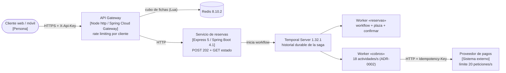

# Proyecto final · Módulo 32 · Sistema de reservas con pago externo y Comité de Arquitectura

Lección: [`web/public/content/microservices/modulo-36.md`](../../../web/public/content/microservices/modulo-36.md)
(Fase 3, fichas F181–F187, specs/018). Integra lo del curso en **un sistema ejecutable**, en sus **dos pistas por
separado**, como pide el prompt:

- **Pista Node.js (Fase 2)**, en la raíz: Express 5.3.0, Temporal TypeScript SDK 1.26.0, ioredis 6.0.0 y Gatling JS
  3.16.101, sobre **Node.js 26.13.1 LTS**. Se ejecuta entera con `./verificar.sh`.
- **Pista Spring Boot (Fase 1)**, en [`spring/`](spring/): Spring Boot 4.1.3, Spring Cloud Gateway 5.0.4 (tren
  2025.1.4) con `RedisRateLimiter`, Temporal Java SDK 1.41.1 y Gatling 3.16.1 con el plugin `io.gatling.gradle` 3.16.0, sobre
  **JDK 25**. Mismo contrato HTTP, misma saga, mismo límite.

## El enunciado

Una ticketera vende entradas para conciertos. Cada reserva: (1) bloquea una plaza, (2) cobra con un **proveedor de
pagos externo** (no es tuyo: HTTP con `Idempotency-Key`, 402 si la tarjeta no paga) y (3) confirma. Si algo falla a
mitad, hay que deshacer lo hecho. El tráfico entra por un **API Gateway** con **rate limiting** por cliente, y el
negocio pide aguantar **picos de 60 reservas/s** con **p99 < 300 ms** y **< 1 % de errores** en la API.

A mitad del proyecto llega la **restricción sobrevenida**: el proveedor limita a **20 peticiones/s** por cliente.
Mides el impacto con Gatling, rediseñas, lo documentas en un **ADR** y lo defiendes ante el **Comité de Arquitectura**.

## Arquitectura (C4, nivel 2: contenedores)



## Mapa del laboratorio

| Carpeta | Ficha | Qué hay | Test |
|---|---|---|---|
| `f181-sistema-reservas/` | Sistema de reservas con pago externo | proveedor simulado, inventario, repositorio, API Express, `montaje.js`, demo | `reservas.test.js` (4) |
| `f182-saga-temporal/` | Saga orquestada con Temporal.io | `saga.js`, `actividades.js`, `workflows.js`, `worker.js`, `iniciar.js`, orquestador local y de Temporal | `saga.test.js` (5), `bundle.test.js` (2), `temporal.infra.js` (3, servidor real) |
| `f183-gateway-rate-limit/` | API Gateway con rate limiting | `limitador.js` (memoria y Redis + Lua), `gateway.js` | `gateway.test.js` (3), `limitador-redis.infra.js` (1, Redis real) |
| `f184-carga-gatling/` | Test de carga con Gatling | `src/reservas.gatling.js`, `arrancar-sistema.js`, `error-comun.sh` | `carga.test.js` (1, necesita Java) |
| `f185-restriccion-sobrevenida/` | Restricción sobrevenida | `escenario.js`, `antes.js`, `despues.js`, `cola-cobros.js` | `restriccion.test.js` (3) |
| `f186-adr/` | Rediseño documentado en ADR | `adr/0001…`, `adr/0002…`, `validar-adr.js` | `fitness.test.js` (3) |
| `f187-defensa-arb/` | Defensa ante Architecture Review Board | `rubrica.json`, `puntuar.js`, `entregables.js`, evaluaciones | `defensa.test.js` (5) |
| `spring/` | todas (pista Fase 1) | `pagos-externo/`, `reservas/` (Temporal Java), `gateway/` (SCG + Redis), `carga/` (Gatling Java), `jdk/` | `ReservaWorkflowTest` (3) |
| raíz | Costo (criterio 8 del Comité) | `costo.js` → `COSTO.md` | — |

## Ejecutar (pista Node.js)

```bash
cd examples/microservicios/modulo-36
npm ci
node f181-sistema-reservas/demo.js                  # el sistema en un proceso
node f185-restriccion-sobrevenida/antes.js          # el pico contra el proveedor limitado
node f185-restriccion-sobrevenida/despues.js        # con la cola de cobros del ADR-0002
node f184-carga-gatling/arrancar-sistema.js &       # sistema en :8080 para Gatling
npx gatling run --sources-folder f184-carga-gatling/src --results-folder logs/gatling --simulation reservas tasa=60 segundos=20
```

Con Temporal de verdad (`brew install temporal` en macOS):

```bash
temporal server start-dev                                      # terminal 1 (UI en http://localhost:8233)
node f181-sistema-reservas/proveedor-pagos.js                  # terminal 2 (LIMITE_RPS=20 para la restricción)
COBROS_POR_SEGUNDO=18 node f182-saga-temporal/worker.js        # terminal 3
node f182-saga-temporal/iniciar.js                             # terminal 4
```

## Ejecutar (pista Spring Boot)

```bash
cd examples/microservicios/modulo-36/spring
./gradlew test                                                    # ReservaWorkflowTest con Temporal en memoria
docker compose -f ../docker-compose.yml up -d --wait           # Redis para el gateway
temporal server start-dev &                                    # Temporal
./gradlew :pagos-externo:bootRun &              # :8090 (LIMITE_RPS=20 para la restricción)
COBROS_POR_SEGUNDO=18 ./gradlew :reservas:bootRun &   # :8081
./gradlew :gateway:bootRun &                    # :8080
./gradlew :carga:gatlingRun                           # Gatling Java contra :8080
java spring/jdk/SagaReserva.java; java spring/jdk/CuboDeFichas.java   # mecánica en JDK puro
```

## Verificar

```bash
./verificar.sh              # pista Node + Redis local si hay redis-server + Gatling si hay Java + jdk/
./verificar.sh --compose    # además: Redis con Docker Compose y los tests con Gradle de spring/
```

Toda la salida queda en `logs/verificar.log`. Si algo falla o falta una herramienta (Java, Redis, Temporal, Docker),
lo dice, sigue con lo demás y termina con `RESULTADO: FALLA` o `RESULTADO: OK · Módulo 32 … verificado`.

## Rúbrica del Comité

La rúbrica completa está en [`docs/microservicios/07-plantillas.md`](../../../docs/microservicios/07-plantillas.md)
(sección 7.2) y, ejecutable, en `f187-defensa-arb/rubrica.json` + `puntuar.js`. Aprueba quien obtiene **≥ 2.8 de
media ponderada y ningún criterio en 1**. Antes de pedir fecha: `node f187-defensa-arb/entregables.js` debe decir
`listo para la defensa`.

## Build: Gradle (equivalencia con Maven)

Este laboratorio se construye con Gradle 9.9.2 (Kotlin DSL) por el wrapper (`spring/gradlew`); las versiones están en el
catálogo `gradle/libs.versions.toml`. Hasta el 2026-11-20 usaba Maven: `./mvnw test` → `./gradlew test` ·
`./mvnw -pl <carpeta> test` → `./gradlew :<carpeta>:test` · `./mvnw package -DskipTests` → `./gradlew bootJar` ·
`./mvnw spring-boot:run` → `./gradlew bootRun` · `target/` → `build/` · `pom.xml` → `build.gradle.kts`.
