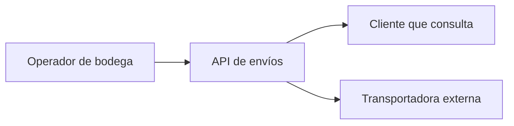
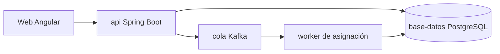
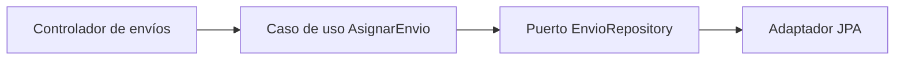
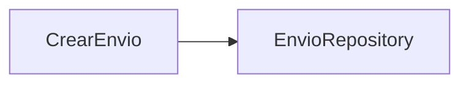

# API de envíos · diseño propuesto

Supuesto didáctico: api, worker, cola y base de datos son una propuesta, no procesos ejecutados por este laboratorio. El validador comprueba texto, no relaciones de código.

## Contexto

## Contenedores

## Componentes

## Código

