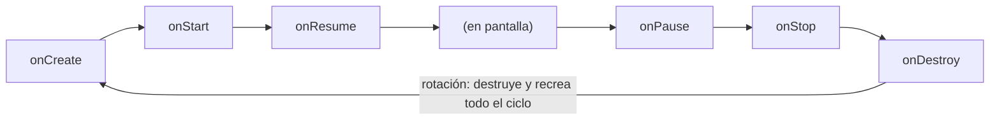

# Módulo 1: Ciclo de vida: Activities y ViewModel


## Aprende construyendo

> **Antes de empezar este módulo.** Trabajas en el proyecto `academia-android` del Módulo 0, creado con el paquete `com.academia.android`. En `app/build.gradle.kts`, dentro de `dependencies { }`, añade `implementation(libs.androidx.lifecycle.viewmodel.compose)` (catálogo del Módulo 0, Tema 3) y pulsa **Sync Now**: trae `ViewModel`, `viewModelScope` y `SavedStateHandle` de forma explícita en lugar de depender de lo que llegue de forma transitiva.
>
> **Los scripts `python3` de este módulo son modelos, no pruebas.** Sirven para razonar sobre qué sobrevive y qué se pierde, pero no ejecutan Android. La evidencia real de cada tema es la que aparece como **Verificación real en Android**: logs de `adb logcat` en el emulador con una salida esperada concreta.


### Tema 1: Ciclo de vida de una Activity · Básico · 45 min

<details open>
<summary><strong>Capa 1 — Lectura</strong></summary>

#### ► DE QUÉ TRATA
Al finalizar podrás predecir en qué callback específico del ciclo de vida es seguro iniciar o liberar un recurso costoso, y explicar por qué el estado simple se pierde al rotar.

#### ► CÓMO FUNCIONA


</details>

<details>
<summary><strong>Capa 2 — Construcción</strong></summary>

#### Código y verificación

```bash
# compila con Gradle el archivo Kotlin generado a continuación
test -f settings.gradle.kts || cd academia-android   # sitúate en la raíz del proyecto del Módulo 0
mkdir -p app/src/main/kotlin/com/academia/android
# la plantilla del Módulo 0 ya creó MainActivity en java/; la reemplazas en el mismo archivo
# (si la crearas también en kotlin/, habría dos clases MainActivity y no compilaría)
```

Crea el archivo `app/src/main/java/com/academia/android/MainActivity.kt`:

```kotlin
package com.academia.android

import android.os.Bundle
import android.util.Log
import androidx.activity.ComponentActivity

private const val ETIQUETA = "CicloDeVida"

class MainActivity : ComponentActivity() {
    override fun onCreate(savedInstanceState: Bundle?) {
        super.onCreate(savedInstanceState)
        Log.d(ETIQUETA, "onCreate")
    }
    override fun onStart() { super.onStart(); Log.d(ETIQUETA, "onStart") }
    override fun onResume() { super.onResume(); Log.d(ETIQUETA, "onResume") }
    override fun onPause() { super.onPause(); Log.d(ETIQUETA, "onPause") }
    override fun onStop() { super.onStop(); Log.d(ETIQUETA, "onStop") }
    override fun onDestroy() { super.onDestroy(); Log.d(ETIQUETA, "onDestroy") }
}
```

```bash
grep -c "override fun on" app/src/main/java/com/academia/android/MainActivity.kt
./gradlew :app:compileDebugKotlin
```

```bash
adb logcat -s CicloDeVida:D
```

</details>

### Tema 2: ViewModel sobrevive a la rotación · Básico · 45 min

<details open>
<summary><strong>Capa 1 — Lectura</strong></summary>

#### ► DE QUÉ TRATA
Al finalizar podrás mover un estado a un ViewModel y confirmar que sobrevive a una rotación de pantalla, a diferencia del estado simple del Tema 1.

</details>

<details>
<summary><strong>Capa 2 — Construcción</strong></summary>

#### Código y verificación
```
┌── Rotación ────────────────────────────────────────────┐
│ Activity destruida → recreada → ViewModelStore PRESERVADO   │
│ → misma instancia de ViewModel recuperada                       │
└─────────────────────────────────────────────────┘
┌── Muerte de proceso ─────────────────────────┐
│ TODO se destruye, incluyendo el ViewModelStore     │
└─────────────────────────────────────────┘
```

```bash
# compila con Gradle el archivo Kotlin generado a continuación
test -f settings.gradle.kts || cd academia-android   # sitúate en la raíz del proyecto del Módulo 0
mkdir -p app/src/main/kotlin/com/academia/android
```

Crea el archivo `app/src/main/kotlin/com/academia/android/TareasViewModel.kt`:

```kotlin
package com.academia.android

import androidx.lifecycle.ViewModel
import kotlinx.coroutines.flow.MutableStateFlow
import kotlinx.coroutines.flow.asStateFlow

class TareasViewModel : ViewModel() {
    private val _contador = MutableStateFlow(0)
    val contador = _contador.asStateFlow()

    fun incrementar() {
        _contador.value++
    }
}
```

```bash
./gradlew :app:compileDebugKotlin
```

```bash
python3 -c "
class ActivitySimulada:
    def __init__(self):
        self.contador = 0  # se reinicia en cada recreación
    def recrear(self):
        return ActivitySimulada()  # instancia nueva: estado perdido

class ViewModelStoreSimulado:
    def __init__(self):
        self.view_models = {}
    def obtener_o_crear(self, clave, fabrica):
        if clave not in self.view_models:
            self.view_models[clave] = fabrica()
        return self.view_models[clave]  # misma instancia: estado preservado

store = ViewModelStoreSimulado()
vm = store.obtener_o_crear('TareasViewModel', lambda: {'contador': 0})
vm['contador'] += 1
print('contador en ViewModel antes de rotar:', vm['contador'])
vm_tras_rotar = store.obtener_o_crear('TareasViewModel', lambda: {'contador': 0})
print('contador en ViewModel tras rotar (misma instancia):', vm_tras_rotar['contador'])
"
```

```kotlin
val vm = androidx.lifecycle.ViewModelProvider(this)[TareasViewModel::class.java]
vm.incrementar()
Log.d(ETIQUETA, "ViewModel ${System.identityHashCode(vm)} contador=${vm.contador.value}")
```

</details>

### Tema 3: SavedStateHandle · Básico · 45 min

<details open>
<summary><strong>Capa 1 — Lectura</strong></summary>

#### ► DE QUÉ TRATA
Al finalizar podrás usar SavedStateHandle para persistir un valor que sobreviva incluso a la muerte del proceso, no solo a la rotación.

</details>

<details>
<summary><strong>Capa 2 — Construcción</strong></summary>

#### Código y verificación
```
┌── ViewModel normal ───────────────────────────────┐
│ sobrevive rotación,  NO sobrevive muerte de proceso    │
└───────────────────────────────────────────┘
┌── ViewModel + SavedStateHandle ────────────────────┐
│ sobrevive rotación,  SÍ sobrevive muerte de proceso     │
│ (solo para los valores explícitamente guardados en él)    │
└───────────────────────────────────────────┘
```

```bash
# compila con Gradle el archivo Kotlin generado a continuación
test -f settings.gradle.kts || cd academia-android   # sitúate en la raíz del proyecto del Módulo 0
mkdir -p app/src/main/kotlin/com/academia/android
```

Crea el archivo `app/src/main/kotlin/com/academia/android/TareasConFiltroViewModel.kt`:

```kotlin
package com.academia.android

import androidx.lifecycle.SavedStateHandle
import androidx.lifecycle.ViewModel

class TareasConFiltroViewModel(
    private val savedStateHandle: SavedStateHandle
) : ViewModel() {
    var filtro: String
        get() = savedStateHandle["filtro"] ?: ""
        set(value) {
            savedStateHandle["filtro"] = value
        }
}
```

```bash
./gradlew :app:compileDebugKotlin
```

```bash
python3 -c "
class ProcesoAndroid:
    def __init__(self):
        self.view_model_store = {}       # se pierde por completo en muerte de proceso
        self.bundle_persistido = {}      # sobrevive a la muerte de proceso (SavedStateHandle)

    def matar_proceso(self):
        self.view_model_store = {}       # todo el ViewModelStore desaparece
        # el bundle_persistido NO se toca: representa el mecanismo del sistema que sí sobrevive

proceso = ProcesoAndroid()
proceso.view_model_store['contador'] = 5           # como el Tema 2, solo en memoria
proceso.bundle_persistido['filtro'] = 'pendientes' # como SavedStateHandle

proceso.matar_proceso()

print('contador tras muerte de proceso (ViewModel normal):', proceso.view_model_store.get('contador', 'PERDIDO'))
print('filtro tras muerte de proceso (SavedStateHandle):', proceso.bundle_persistido.get('filtro', 'PERDIDO'))
"
```

```bash
adb shell am kill com.academia.android
```

</details>
