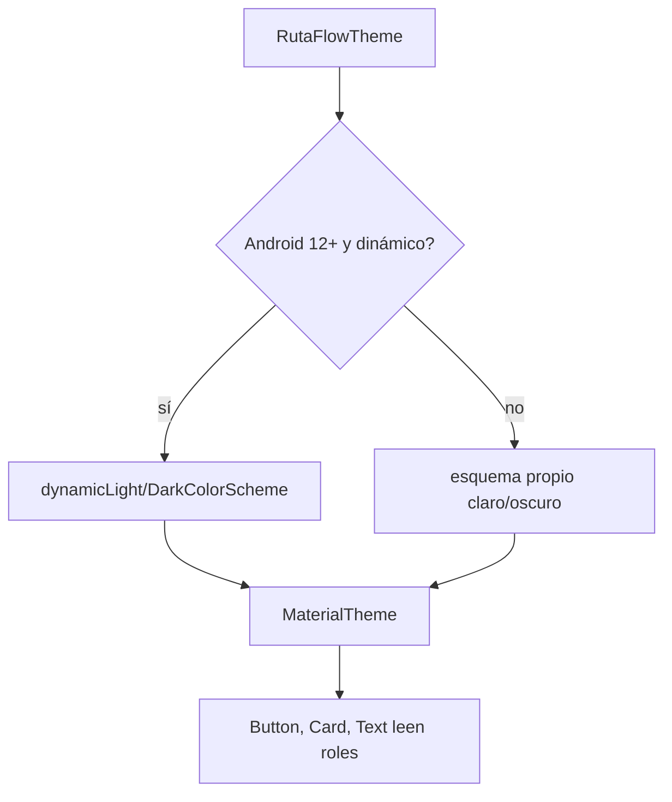

# Módulo 1: Jetpack Compose: UI declarativa


## Aprende construyendo

> **Antes de empezar este módulo.** No necesitas dependencias nuevas: la plantilla Empty Activity ya declara el BOM de Compose, `ui`, `material3` y `activity-compose`.


### Tema 1: Composables y recomposición · Básico · 45 min

<details open>
<summary><strong>Capa 1 — Lectura</strong></summary>

#### ► DE QUÉ TRATA
Al finalizar podrás explicar qué activa @Composable en el compilador, y predecir cuándo Compose recompone una función ante un cambio de sus parámetros.

</details>

<details>
<summary><strong>Capa 2 — Construcción</strong></summary>

#### Código y verificación
```
┌── TarjetaTarea(titulo, completada) ──────┐
│  describe la UI para ESE estado exacto      │
└──────────┬───────────────────────┘
           │ cambia `titulo` o `completada`
           ▼
┌── Compose RECOMPONE la función ──────────┐
│  nueva descripción de UI, reconciliada         │
│  automáticamente contra la anterior              │
└───────────────────────────────────────┘
```

```bash
# compila con Gradle el archivo Kotlin generado a continuación
test -f settings.gradle.kts || cd academia-android   # sitúate en la raíz del proyecto del Módulo 0
mkdir -p app/src/main/kotlin/com/academia/android
```

Crea el archivo `app/src/main/kotlin/com/academia/android/TarjetaTarea.kt`:

```kotlin
package com.academia.android

import androidx.compose.material3.Text
import androidx.compose.runtime.Composable
import androidx.compose.ui.text.style.TextDecoration

@Composable
fun TarjetaTarea(titulo: String, completada: Boolean) {
    Text(
        text = titulo,
        textDecoration = if (completada) TextDecoration.LineThrough else null
    )
}
```

```bash
./gradlew :app:compileDebugKotlin
```

</details>

### Tema 2: State hoisting · Básico · 45 min

<details open>
<summary><strong>Capa 1 — Lectura</strong></summary>

#### ► DE QUÉ TRATA
Al finalizar podrás elevar el estado de un composable hijo hacia su padre, dejando al hijo como una función pura que solo refleja lo que recibe.

</details>

<details>
<summary><strong>Capa 2 — Construcción</strong></summary>

#### Código y verificación
```
┌── PantallaCrearTarea (padre) ─────────────┐
│ var titulo by remember { mutableStateOf("") } │
│        │                                        │
│        ▼ pasa valor + callback                    │
│  CampoTitulo(valor = titulo,                          │
│              onValorCambia = { titulo = it })            │
│        │  (SIN estado propio, solo refleja)                  │
│        ▼ notifica cambios hacia arriba                          │
└───────────────────────────────────────┘
```

```bash
# compila con Gradle el archivo Kotlin generado a continuación
test -f settings.gradle.kts || cd academia-android   # sitúate en la raíz del proyecto del Módulo 0
mkdir -p app/src/main/kotlin/com/academia/android
```

Crea el archivo `app/src/main/kotlin/com/academia/android/CampoTitulo.kt`:

```kotlin
package com.academia.android

import androidx.compose.material3.TextField
import androidx.compose.runtime.Composable
import androidx.compose.runtime.getValue
import androidx.compose.runtime.mutableStateOf
import androidx.compose.runtime.remember
import androidx.compose.runtime.setValue

@Composable
fun CampoTitulo(valor: String, onValorCambia: (String) -> Unit) {
    TextField(value = valor, onValueChange = onValorCambia) // sin estado propio
}

@Composable
fun PantallaCrearTarea() {
    var titulo by remember { mutableStateOf("") } // el estado vive en el padre
    CampoTitulo(valor = titulo, onValorCambia = { titulo = it })
}
```

```bash
./gradlew :app:compileDebugKotlin
```

</details>

### Tema 3: remember, rememberSaveable y layout básico · Básico · 45 min

<details open>
<summary><strong>Capa 1 — Lectura</strong></summary>

#### ► DE QUÉ TRATA
Al finalizar podrás elegir entre remember y rememberSaveable según si un valor debe sobrevivir a rotación, y combinar Column, Row y Box para construir un layout.

</details>

<details>
<summary><strong>Capa 2 — Construcción</strong></summary>

#### Código y verificación
```
┌── remember { mutableStateOf(0) } ────────┐   ┌── rememberSaveable { mutableStateOf(0) } ─┐
│ sobrevive recomposición,                     │   │ sobrevive recomposición Y rotación             │
│ se PIERDE al rotar                              │   │ (serializado a un Bundle de estado)            │
└─────────────────────────────────┘   └───────────────────────────────────┘
```

```bash
# compila con Gradle el archivo Kotlin generado a continuación
test -f settings.gradle.kts || cd academia-android   # sitúate en la raíz del proyecto del Módulo 0
mkdir -p app/src/main/kotlin/com/academia/android
```

Crea el archivo `app/src/main/kotlin/com/academia/android/PantallaContador.kt`:

```kotlin
package com.academia.android

import androidx.compose.foundation.layout.Column
import androidx.compose.foundation.layout.Row
import androidx.compose.foundation.layout.Spacer
import androidx.compose.foundation.layout.fillMaxWidth
import androidx.compose.foundation.layout.padding
import androidx.compose.foundation.layout.weight
import androidx.compose.material3.Text
import androidx.compose.runtime.Composable
import androidx.compose.runtime.getValue
import androidx.compose.runtime.mutableStateOf
import androidx.compose.runtime.remember
import androidx.compose.runtime.saveable.rememberSaveable
import androidx.compose.runtime.setValue
import androidx.compose.ui.Modifier
import androidx.compose.ui.unit.dp

@Composable
fun PantallaContador() {
    var contadorVolatil by remember { mutableStateOf(0) }       // se pierde al rotar
    var contadorPersistente by rememberSaveable { mutableStateOf(0) } // sobrevive a la rotación

    Column(modifier = Modifier.fillMaxWidth().padding(16.dp)) {
        Row {
            Text("Volátil: $contadorVolatil")
            Spacer(Modifier.weight(1f))
            Text("Persistente: $contadorPersistente")
        }
    }
}
```

```bash
./gradlew :app:compileDebugKotlin
```

</details>

### Tema 4: Material 3 en Compose: tema, color dinámico y componentes · Intermedio · 40 min

<details open>
<summary><strong>Capa 1 — Lectura</strong></summary>

#### ► DE QUÉ TRATA
Usa Android Studio con un proyecto «Empty Activity» (Compose) llamado RutaFlowConductor. Verifica que build.gradle.kts del módulo app tenga androidx.compose.material3:material3 (viene en la plantilla).

#### ► LA ANALOGÍA
**Conceptos clave:** `MaterialTheme`, `ColorScheme`, roles de color (`primary`, `onPrimary`, `surface`), color dinámico, `Typography`, modo oscuro.

Material 3 organiza los colores por **roles**, no por nombres de color: `primary` es el color principal de la marca y `onPrimary` es el color del texto encima de él. Cada rol tiene su versión clara y oscura en un `ColorScheme`.

- `MaterialTheme(colorScheme, typography)` envuelve la app y entrega el tema a todo lo que está adentro.
- Los componentes (`Button`, `Card`, `TopAppBar`) toman sus colores del tema.
- En tu código lees el tema con `MaterialTheme.colorScheme.primary`, nunca con un `Color(0xFF...)` fijo.
- En Android 12+ el **color dinámico** (`dynamicLightColorScheme`) genera el esquema a partir del fondo de pantalla del usuario.

**Analogía:** los roles de color son los cargos de una empresa: «jefe de turno» es un papel, aunque cada día lo ocupe otra persona. La analogía falla en que, con color dinámico, quien elige a la persona es el usuario, no tú.

**Límite de uso:** el color dinámico cambia tus colores de marca por los del usuario: desactívalo en pantallas donde la marca o un color de estado (rojo = error) deben ser exactos.



#### ► CÓMO FUNCIONA


</details>

<details>
<summary><strong>Capa 2 — Construcción</strong></summary>

#### Código y verificación

```kotlin
package co.rutaflow.conductor.ui.theme

import android.os.Build
import androidx.compose.foundation.isSystemInDarkTheme
import androidx.compose.material3.MaterialTheme
import androidx.compose.material3.darkColorScheme
import androidx.compose.material3.dynamicDarkColorScheme
import androidx.compose.material3.dynamicLightColorScheme
import androidx.compose.material3.lightColorScheme
import androidx.compose.runtime.Composable
import androidx.compose.ui.graphics.Color
import androidx.compose.ui.platform.LocalContext

private val Claro = lightColorScheme(primary = Color(0xFF0B57D0), secondary = Color(0xFF00897B))
private val Oscuro = darkColorScheme(primary = Color(0xFFA8C7FA), secondary = Color(0xFF80CBC4))

@Composable
fun RutaFlowTheme(
    oscuro: Boolean = isSystemInDarkTheme(),
    colorDinamico: Boolean = true,
    contenido: @Composable () -> Unit,
) {
    val esquema = when {
        colorDinamico && Build.VERSION.SDK_INT >= Build.VERSION_CODES.S -> {
            val contexto = LocalContext.current
            if (oscuro) dynamicDarkColorScheme(contexto) else dynamicLightColorScheme(contexto)
        }
        oscuro -> Oscuro
        else -> Claro
    }
    MaterialTheme(colorScheme = esquema, content = contenido)
}
```

```kotlin
package co.rutaflow.conductor

import androidx.compose.foundation.layout.Column
import androidx.compose.foundation.layout.padding
import androidx.compose.material3.Button
import androidx.compose.material3.Card
import androidx.compose.material3.MaterialTheme
import androidx.compose.material3.Text
import androidx.compose.runtime.Composable
import androidx.compose.ui.Modifier
import androidx.compose.ui.unit.dp

@Composable
fun TarjetaEntrega(codigo: String, estado: String, alEntregar: () -> Unit) {
    Card(Modifier.padding(16.dp)) {
        Column(Modifier.padding(16.dp)) {
            Text(codigo, style = MaterialTheme.typography.titleMedium)
            // Rol del tema, no un color fijo: funciona en claro y oscuro.
            Text(estado, color = MaterialTheme.colorScheme.secondary)
            Button(onClick = alEntregar) { Text("Marcar entregado") }
        }
    }
}
```

```bash
./gradlew installDebug
adb shell "cmd uimode night yes"   # cambia a modo oscuro sin tocar el teléfono
```

```text
En modo claro: tarjeta clara, botón con el color primary y estado en secondary legible.
Tras `cmd uimode night yes`: la misma tarjeta con fondo oscuro y textos claros, sin recompilar.
Con color dinámico en Android 12+: el botón toma un tono del fondo de pantalla del dispositivo.
```

</details>
