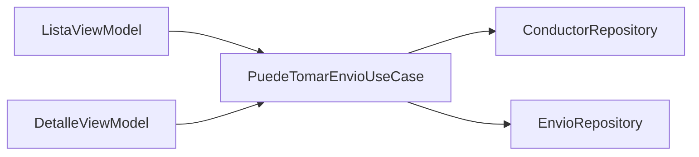

# Módulo 11: Proyecto integrador: app Android completa


## Aprende construyendo

> **Los scripts `python3` de este módulo son modelos, no pruebas de Android.** Ilustran el razonamiento, pero no ejecutan tu app. La evidencia real es la indicada en cada tema como **Verificación real en Android**: la suite de Gradle `./gradlew :app:testDebugUnitTest :app:connectedDebugAndroidTest :app:lintDebug` en verde. La checklist en Python solo comprueba que existan archivos; no demuestra que funcionen.


### Tema 1: Arquitectura MVVM completa con UDF · Avanzado · 45 min

<details open>
<summary><strong>Capa 1 — Lectura</strong></summary>

#### ► DE QUÉ TRATA
Al finalizar podrás integrar Compose, navegación, StateFlow, Room y Retrofit en una única arquitectura MVVM+UDF coherente, y explicar por qué cada capa se comunica en una única dirección.

#### ► LA ANALOGÍA
**Conceptos clave:** cada capa con una única responsabilidad, comunicación en una única dirección.

Este proyecto integra cada módulo anterior: la UI declarativa con state hoisting (Módulo 2) se combina con navegación con argumentos tipados (Módulo 3), UDF completo con `StateFlow` (Módulo 4), persistencia offline-first con Room (Módulo 6), inyección de dependencias con Hilt (Módulo 7), y una suite de tests (Módulo 9). La clave es que cada capa tiene una única responsabilidad y se comunica con las adyacentes en una única dirección: la UI nunca conoce Room ni Retrofit directamente, el ViewModel nunca construye vistas Compose directamente.

**Analogía:** esta arquitectura es como una cadena de producción industrial donde cada estación tiene una función clara y bien delimitada, y el producto fluye en una única dirección de estación en estación: ninguna estación necesita conocer los detalles internos de las demás.

**Diagrama:**

```
┌── UI (Compose, Módulo 2) ──────────────────┐
└──────────┬──────────────────────────────┘
           │ collectAsStateWithLifecycle / eventos (Módulo 4)
           ▼
┌── ViewModel (StateFlow, UDF) ───────────────┐
└──────────┬──────────────────────────────┘
           │
           ▼
┌── Repositorio (offline-first, Módulo 6) ────┐
└────┬─────────────────────────┬──────────┘
     ▼                             ▼
┌── Room (caché local) ──┐   ┌── Retrofit (API remota, Módulo 5) ──┐
└─────────────────┘   └───────────────────────────┘
```

</details>

<details>
<summary><strong>Capa 2 — Construcción</strong></summary>

#### Código y verificación
```
┌── UI (Compose, Módulo 2) ──────────────────┐
└──────────┬──────────────────────────────┘
           │ collectAsStateWithLifecycle / eventos (Módulo 4)
           ▼
┌── ViewModel (StateFlow, UDF) ───────────────┐
└──────────┬──────────────────────────────┘
           │
           ▼
┌── Repositorio (offline-first, Módulo 6) ────┐
└────┬─────────────────────────┬──────────┘
     ▼                             ▼
┌── Room (caché local) ──┐   ┌── Retrofit (API remota, Módulo 5) ──┐
└─────────────────┘   └───────────────────────────┘
```

```bash
# Este script python3 verifica que la integración conecta las capas en el orden correcto
test -f settings.gradle.kts || cd academia-android   # sitúate en la raíz del proyecto del Módulo 0
mkdir -p app/src/main/kotlin/com/academia/android
```

Crea el archivo `app/src/main/kotlin/com/academia/android/TareasViewModelIntegrado.kt`:

```kotlin
package com.academia.android

import androidx.lifecycle.ViewModel
import androidx.lifecycle.viewModelScope
import kotlinx.coroutines.flow.SharingStarted
import kotlinx.coroutines.flow.StateFlow
import kotlinx.coroutines.flow.stateIn
import kotlinx.coroutines.launch
import javax.inject.Inject
import dagger.hilt.android.lifecycle.HiltViewModel

@HiltViewModel
class TareasViewModelIntegrado @Inject constructor(
    private val repo: TareaRepository // Room + Retrofit por debajo (Módulo 6), inyectado por Hilt (Módulo 7)
) : ViewModel() {
    val tareas: StateFlow<List<Tarea>> = repo.tareas
        .stateIn(viewModelScope, SharingStarted.WhileSubscribed(5000), emptyList())

    fun sincronizar() = viewModelScope.launch { repo.sincronizar() }
}
```

```bash
./gradlew :app:compileDebugKotlin
```

```bash
python3 -c "
capas = {
    'UI':          {'conoce_directamente': ['ViewModel']},
    'ViewModel':   {'conoce_directamente': ['Repositorio']},
    'Repositorio': {'conoce_directamente': ['Room', 'Retrofit']},
    'Room':        {'conoce_directamente': []},
    'Retrofit':     {'conoce_directamente': []},
}

def viola_udf(capas):
    violaciones = []
    if 'Room' in capas['UI']['conoce_directamente'] or 'Retrofit' in capas['UI']['conoce_directamente']:
        violaciones.append('UI conoce Room/Retrofit directamente, saltándose ViewModel y Repositorio')
    if 'Room' in capas['ViewModel']['conoce_directamente'] or 'Retrofit' in capas['ViewModel']['conoce_directamente']:
        violaciones.append('ViewModel conoce Room/Retrofit directamente, saltándose el Repositorio')
    return violaciones

print('violaciones de capas encontradas:', viola_udf(capas))
"
```

</details>

### Tema 2: Inyección de dependencias en toda la app · Avanzado · 45 min

<details open>
<summary><strong>Capa 1 — Lectura</strong></summary>

#### ► DE QUÉ TRATA
Al finalizar podrás confirmar que ninguna clase de la app instancia manualmente sus dependencias, y explicar por qué eso habilita el testing completo del sistema.

</details>

<details>
<summary><strong>Capa 2 — Construcción</strong></summary>

#### Código y verificación
```
┌── Auditoría: "grep -r 'Retrofit(' o 'Room.databaseBuilder' " ─┐
│ en TODO el código de la app                                          │
├── 0 resultados fuera de NetworkModule/DatabaseModule ──────┤
│   → ninguna instanciación manual                                    │
└──────────────────────────────────────────────────────────┘
```

```bash
test -f settings.gradle.kts || cd academia-android   # sitúate en la raíz del proyecto del Módulo 0
mkdir -p app/src/main/kotlin/com/academia/android
```

Crea el archivo `app/src/main/kotlin/com/academia/android/ViewModelBienInyectado.kt`:

```kotlin
package com.academia.android

import androidx.lifecycle.ViewModel
import javax.inject.Inject
import dagger.hilt.android.lifecycle.HiltViewModel

@HiltViewModel
class ViewModelBienInyectado @Inject constructor(
    private val repo: TareaRepository // inyectado, nunca instanciado manualmente
) : ViewModel()
```

Crea el archivo `app/src/main/kotlin/com/academia/android/ViewModelMalInyectado.kt`:

```kotlin
package com.academia.android

import androidx.lifecycle.ViewModel

class ViewModelMalInyectado : ViewModel() {
    // ANTIPATRÓN deliberado para esta demostración: instanciación manual
    private val retrofitManual = Retrofit.Builder().baseUrl("https://api.miapp.com/").build()
}
```

```bash
grep -rn "Retrofit.Builder()\|Room.databaseBuilder(" app/src/main/kotlin/com/academia/android/ | grep -v "NetworkModule.kt"
```

```bash
./gradlew :app:compileDebugKotlin
```

</details>

### Tema 3: Cierre del track y próximos pasos · Avanzado · 45 min

<details open>
<summary><strong>Capa 1 — Lectura</strong></summary>

#### ► DE QUÉ TRATA
Al finalizar podrás articular, con una checklist verificable, qué hace a una app Android profesionalmente completa más allá de su UI visual.

</details>

<details>
<summary><strong>Capa 2 — Construcción</strong></summary>

#### Código y verificación
```
┌── App Android profesional = ───────────────────────┐
│   UI atractiva (Compose)                                │
│ + flujo de datos predecible (UDF)                          │
│ + resiliencia offline (Room + Retrofit)                       │
│ + dependencias desacopladas (Hilt)                              │
│ + confianza antes de publicar (tests)                              │
└───────────────────────────────────────────────┘
```

```bash
# Este script python3 ejecuta la checklist ejecutable definida a continuación
test -f settings.gradle.kts || cd academia-android   # sitúate en la raíz del proyecto del Módulo 0
mkdir -p app
```

Crea el archivo `app/checklist-cierre-track.py`:

```python
import os

archivos_del_proyecto = os.popen("find app/src/main/kotlin -name '*.kt' 2>/dev/null").read()

criterios = {
    "ui_compose": "@Composable" in archivos_del_proyecto or os.path.exists("app/src/main/kotlin/com/academia/android/TarjetaTarea.kt"),
    "udf_stateflow": os.path.exists("app/src/main/kotlin/com/academia/android/TareasViewModelIntegrado.kt"),
    "offline_first_room": os.path.exists("app/src/main/kotlin/com/academia/android/AppDatabase.kt"),
    "dependencias_hilt": os.path.exists("app/src/main/kotlin/com/academia/android/ViewModelBienInyectado.kt"),
    "tests_existen": os.path.exists("app/src/test/kotlin/com/academia/android/TareasViewModelTest.kt"),  # src/test, nunca src/main
}

for nombre, cumplido in criterios.items():
    print(f"[{'CUMPLE' if cumplido else 'NO CUMPLE'}] {nombre}")

total = len(criterios)
cumplidos = sum(criterios.values())
print(f"Resumen: {cumplidos}/{total} dimensiones de una app Android completa presentes")
```

```bash
python3 app/checklist-cierre-track.py
```

```bash
./gradlew assembleDebug
./gradlew test
```

</details>

### Tema 4: Capa de dominio y casos de uso: reglas de negocio fuera del ViewModel · Avanzado · 40 min

<details open>
<summary><strong>Capa 1 — Lectura</strong></summary>

#### ► DE QUÉ TRATA
Continúa la app RutaFlowConductor con Hilt configurado. Crea el paquete co.rutaflow.conductor.domain. Los casos de uso no importan nada de android.*.

#### ► LA ANALOGÍA
**Conceptos clave:** capa de dominio, caso de uso, `operator fun invoke`, repositorio, Kotlin puro, prueba unitaria sin Android.

La guía de arquitectura de Android propone tres capas: **UI** (pantallas y ViewModels), **dominio** (opcional) y **datos** (repositorios). La capa de dominio contiene **casos de uso**: clases pequeñas con una sola responsabilidad que combinan datos de uno o más repositorios y aplican reglas del negocio.

- Un caso de uso se nombra con un verbo: `PuedeTomarEnvioUseCase`.
- Expone una sola función, normalmente `operator fun invoke(...)`, para llamarlo como `puedeTomar(envio)`.
- No conoce Android ni la interfaz: recibe datos y devuelve un resultado.

Solo crea casos de uso cuando la lógica se reutiliza o es compleja; si un ViewModel solo pasa datos de un repositorio, un caso de uso agrega una capa vacía.

**Analogía:** el caso de uso es el reglamento del depósito pegado en una sola pared: todos los turnos lo consultan en el mismo lugar. La analogía falla en que el reglamento no sabe quién lo lee; el caso de uso tampoco sabe qué pantalla lo llama.

**Límite de uso:** no crees un caso de uso por cada llamada a un repositorio. No pongas en el dominio formatos de pantalla (textos, colores): eso es de la UI.



#### ► CÓMO FUNCIONA


</details>

<details>
<summary><strong>Capa 2 — Construcción</strong></summary>

#### Código y verificación

```kotlin
package co.rutaflow.conductor.domain

import javax.inject.Inject

data class Envio(val codigo: String, val kilos: Int)
data class Conductor(val id: String, val capacidadKilos: Int, val cargaActualKilos: Int)

interface ConductorRepository { suspend fun actual(): Conductor }

sealed interface Decision {
    data object Puede : Decision
    data class NoPuede(val faltanKilos: Int) : Decision
}

class PuedeTomarEnvioUseCase @Inject constructor(
    private val conductores: ConductorRepository,
) {
    suspend operator fun invoke(envio: Envio): Decision {
        val conductor = conductores.actual()
        val libre = conductor.capacidadKilos - conductor.cargaActualKilos
        return if (envio.kilos <= libre) Decision.Puede else Decision.NoPuede(envio.kilos - libre)
    }
}
```

```kotlin
package co.rutaflow.conductor.domain

import kotlinx.coroutines.test.runTest
import org.junit.Assert.assertEquals
import org.junit.Test

class PuedeTomarEnvioUseCaseTest {
    private val repo = object : ConductorRepository {
        override suspend fun actual() = Conductor("C-7", capacidadKilos = 100, cargaActualKilos = 80)
    }
    private val puedeTomar = PuedeTomarEnvioUseCase(repo)

    @Test fun `acepta si cabe`() = runTest { assertEquals(Decision.Puede, puedeTomar(Envio("ENV-1", 20))) }

    @Test fun `rechaza y dice cuánto falta`() = runTest {
        assertEquals(Decision.NoPuede(faltanKilos = 5), puedeTomar(Envio("ENV-2", 25)))
    }
}
```

```bash
./gradlew :app:testDebugUnitTest --tests "*PuedeTomarEnvioUseCaseTest"
```

```text
> Task :app:testDebugUnitTest
PuedeTomarEnvioUseCaseTest > acepta si cabe PASSED
PuedeTomarEnvioUseCaseTest > rechaza y dice cuánto falta PASSED
BUILD SUCCESSFUL
```

</details>
