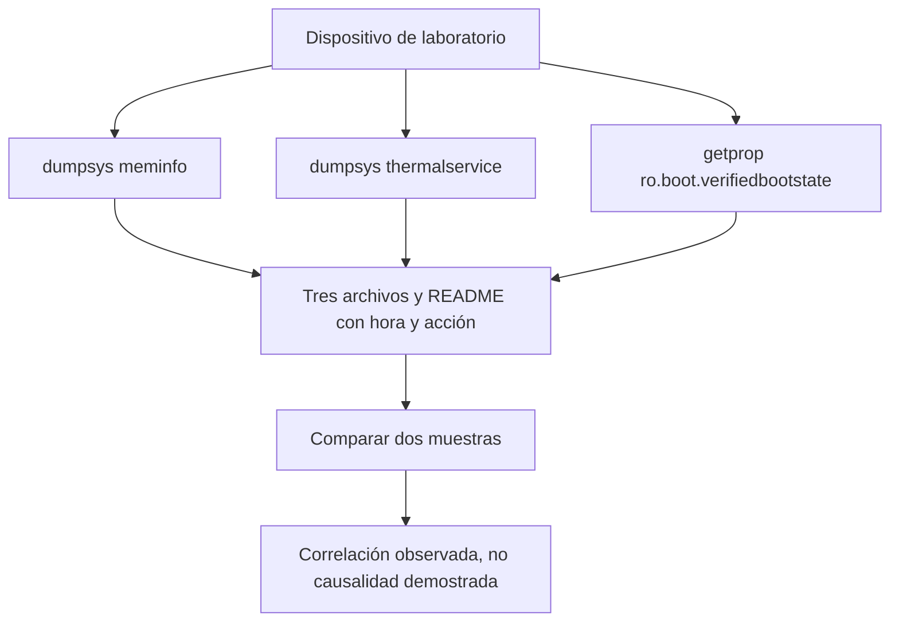

# Módulo 12: Android en producción — seguridad, sincronización y calidad

Una app móvil se ejecuta en un dispositivo que puede perderse, restaurarse, quedarse días sin red o recibir intents de otras aplicaciones. El APK puede inspeccionarse y la versión instalada puede permanecer meses. Este módulo endurece el proyecto final considerando esas condiciones en lugar de asumir un dispositivo confiable y siempre conectado.


## Aprende construyendo


### Tema 1: El sistema operativo conecta tu app con entradas externas · Avanzado · 45 min

<details open>
<summary><strong>Capa 1 — Lectura</strong></summary>

#### ► DE QUÉ TRATA
Al finalizar podrás validar un deep link entrante (scheme, host, path, autorización) antes de actuar sobre él, y explicar por qué un intent recibido es entrada no confiable.

</details>

<details>
<summary><strong>Capa 2 — Construcción</strong></summary>

#### Código y verificación
```
┌── otra app/web ──▶ intent/deep link ──▶ componente exportado ──┐
└──────────┬───────────────────────────────────────┘
           │
           ▼
     validar FORMA (scheme, host, path)
           │
           ▼
     autenticar/autorizar (¿esta sesión puede leer ESTE recurso?)
           │
           ▼
     confirmar efecto (nunca acción destructiva directa)
```

```bash
# compila con Gradle el archivo Kotlin generado a continuación
test -f settings.gradle.kts || cd academia-android   # sitúate en la raíz del proyecto del Módulo 0
mkdir -p app/src/main/kotlin/com/academia/android
```

Crea el archivo `app/src/main/kotlin/com/academia/android/ValidacionDeepLink.kt`:

```kotlin
package com.academia.android

import android.net.Uri

class SesionInvalidaException(mensaje: String) : Exception(mensaje)

fun parseTaskLink(uri: Uri, sesionPuedeLeer: (String) -> Boolean): String {
    require(uri.scheme == "https") { "scheme inválido: ${uri.scheme}" }
    require(uri.host == "tasks.example.com") { "host inválido: ${uri.host}" }
    require(uri.pathSegments.size == 2 && uri.pathSegments.first() == "tasks") { "path inválido" }
    val id = uri.pathSegments.last()
    if (!sesionPuedeLeer(id)) throw SesionInvalidaException("sesión no autorizada para leer $id")
    return id
}
```

```bash
./gradlew :app:compileDebugKotlin
```

</details>

### Tema 2: Proteger datos exige conocer copias y ciclo de vida · Avanzado · 45 min

<details open>
<summary><strong>Capa 1 — Lectura</strong></summary>

#### ► DE QUÉ TRATA
Al finalizar podrás cifrar un dato sensible con una construcción autenticada (AEAD) real, y enumerar las copias adicionales (backup, logs, notificaciones) que ese cifrado por sí solo no protege.

</details>

<details>
<summary><strong>Capa 2 — Construcción</strong></summary>

#### Código y verificación
```
┌── dato sensible ──▶ ¿necesario guardarlo? ──▶ storage privado ──▶ cifrado (Keystore) ┐
└──────────────────────────────────────────────────────────────┘
                         copias adicionales que el cifrado de Room NO alcanza:
                         backup | logs | crash reports | notificación | clipboard
```

```bash
test -f settings.gradle.kts || cd academia-android   # sitúate en la raíz del proyecto del Módulo 0
mkdir -p app/src/main/kotlin/com/academia/android
```

Crea el archivo `app/src/main/kotlin/com/academia/android/CifradoSensible.kt`:

```kotlin
package com.academia.android

import android.security.keystore.KeyGenParameterSpec
import android.security.keystore.KeyProperties
import javax.crypto.KeyGenerator

fun generarClaveEnKeystore() {
    val generador = KeyGenerator.getInstance(KeyProperties.KEY_ALGORITHM_AES, "AndroidKeyStore")
    generador.init(
        KeyGenParameterSpec.Builder(
            "local_sensitive_v1",
            KeyProperties.PURPOSE_ENCRYPT or KeyProperties.PURPOSE_DECRYPT,
        )
            .setBlockModes(KeyProperties.BLOCK_MODE_GCM)
            .setEncryptionPaddings(KeyProperties.ENCRYPTION_PADDING_NONE)
            .build(),
    )
    generador.generateKey() // material de clave NO exportable, vive dentro del Keystore
}
```

```bash
./gradlew :app:compileDebugKotlin
```

</details>

### Tema 3: Offline-first necesita un protocolo de cambios · Avanzado · 45 min

<details open>
<summary><strong>Capa 1 — Lectura</strong></summary>

#### ► DE QUÉ TRATA
Al finalizar podrás implementar un patrón outbox con operation ID idempotente sobre SQLite real, y resolver un conflicto de sincronización con una política explícita, no "last-write-wins" ciego.

</details>

<details>
<summary><strong>Capa 2 — Construcción</strong></summary>

#### Código y verificación
```
┌── UI ──▶ Room (fuente local) + outbox op-42 (UNA transacción) ─┐
└──────────┬───────────────────────────────────────┘
           │ WorkManager drena al volver la red
           ▼
┌── API (idempotente por operation ID) ──────────────────────┐
│  accepted + version   O   409 conflict + version actual        │
└──────────┬───────────────────────────────────────┘
           ▼
     Room TX: aplicar y limpiar outbox   O   marcar conflicto visible a la UI
```

```bash
test -f settings.gradle.kts || cd academia-android   # sitúate en la raíz del proyecto del Módulo 0
mkdir -p app/src/main/kotlin/com/academia/android
```

Crea el archivo `app/src/main/kotlin/com/academia/android/OutboxOffline.kt`:

```kotlin
package com.academia.android

import java.util.UUID

data class PendingMutation(
    val operationId: String,
    val entityId: String,
    val baseVersion: Long,
    val kind: String,
    val payload: String,
)

class OutboxRepository {
    // en Room real: @Transaction — ambas escrituras en la MISMA transacción
    fun renameOffline(taskId: String, title: String, baseVersion: Long): PendingMutation {
        val mutacion = PendingMutation(
            operationId = UUID.randomUUID().toString(),
            entityId = taskId,
            baseVersion = baseVersion,
            kind = "rename",
            payload = title,
        )
        return mutacion
    }
}
```

```bash
./gradlew :app:compileDebugKotlin
```

</details>

### Tema 4: La calidad se opera por dispositivo y versión · Avanzado · 45 min

<details open>
<summary><strong>Capa 1 — Lectura</strong></summary>

#### ► DE QUÉ TRATA
Al finalizar podrás identificar una operación bloqueante en el hilo principal que causaría ANR, y diseñar un rollout gradual con gates de calidad antes de producción completa.

</details>

<details>
<summary><strong>Capa 2 — Construcción</strong></summary>

#### Código y verificación
```
┌── commit ──▶ tests/benchmark ──▶ internal ──▶ staged 5% ──▶ vitals por versión ┐
└──────────┬───────────────────────────────────────────────┘
           │
     ┌─────┴─────┐
     ▼             ▼
   sano         regresión
     │             │
  ampliar    detener + hotfix/kill switch
```

```bash
test -f settings.gradle.kts || cd academia-android   # sitúate en la raíz del proyecto del Módulo 0
mkdir -p app/src/main/kotlin/com/academia/android
```

Crea el archivo `app/src/main/kotlin/com/academia/android/RepositorioMainSafe.kt`:

```kotlin
package com.academia.android

import kotlinx.coroutines.CoroutineDispatcher
import kotlinx.coroutines.Dispatchers
import kotlinx.coroutines.withContext
import java.io.File

class FileRepository(
    private val io: CoroutineDispatcher = Dispatchers.IO
) {
    suspend fun load(archivo: File): String = withContext(io) {
        archivo.readText() // I/O síncrono, pero movido explícitamente FUERA del hilo principal
    }
}
```

```bash
./gradlew :app:compileDebugKotlin
```

</details>

### Android 17: privacidad, compatibilidad y dispositivos grandes

<details open>
<summary><strong>Capa 1 — Lectura</strong></summary>

</details>

<details>
<summary><strong>Capa 2 — Construcción</strong></summary>

#### Nota de construcción
Este tema es principalmente conceptual en esta versión. La verificación se realiza con las preguntas de comprensión y el criterio de cuándo NO usar android 17: privacidad, compatibilidad y dispositivos grandes.

</details>

### Proyecto: app resistente a dispositivo, red y release

<details open>
<summary><strong>Capa 1 — Lectura</strong></summary>

</details>

<details>
<summary><strong>Capa 2 — Construcción</strong></summary>

#### Nota de construcción
Este tema es principalmente conceptual en esta versión. La verificación se realiza con las preguntas de comprensión y el criterio de cuándo NO usar proyecto: app resistente a dispositivo, red y release.

</details>

### Método de estudio y proyecto de ampliación

<details open>
<summary><strong>Capa 1 — Lectura</strong></summary>

</details>

<details>
<summary><strong>Capa 2 — Construcción</strong></summary>

#### Nota de construcción
Este tema es principalmente conceptual en esta versión. La verificación se realiza con las preguntas de comprensión y el criterio de cuándo NO usar método de estudio y proyecto de ampliación.

</details>

### Tema 5: Del dispositivo al diagnóstico: SoC, memoria, límites térmicos y arranque verificado · Avanzado · 45 min

<details open>
<summary><strong>Capa 1 — Lectura</strong></summary>

#### ► DE QUÉ TRATA
Al finalizar recogerás evidencias de memoria, estado térmico y arranque en un dispositivo de pruebas, distinguiendo mediciones disponibles de garantías de seguridad. Prerrequisitos: Android Studio, Platform Tools, una app de laboratorio instalada y autorización de depuración del…

#### ► CÓMO FUNCIONA


</details>

<details>
<summary><strong>Capa 2 — Construcción</strong></summary>

#### Código y verificación

```bash
mkdir diagnostico-android
cd diagnostico-android
adb devices
adb shell dumpsys -l
```

```bash
adb shell dumpsys meminfo com.example.restauracion > memoria.txt
adb shell dumpsys thermalservice > termico.txt
adb shell getprop ro.boot.verifiedbootstate > arranque.txt
```

</details>
