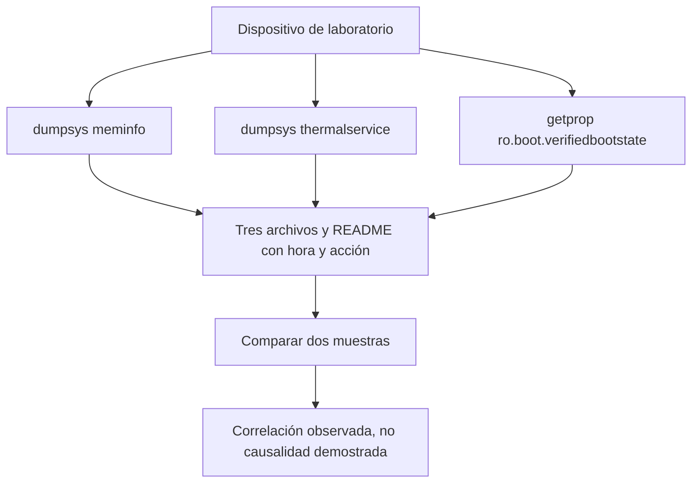

# Módulo 13: Android en producción — seguridad, sincronización y calidad

Una app móvil se ejecuta en un dispositivo que puede perderse, restaurarse, quedarse días sin red o recibir intents de otras aplicaciones. El APK puede inspeccionarse y la versión instalada puede permanecer meses. Este módulo endurece el proyecto final considerando esas condiciones en lugar de asumir un dispositivo confiable y siempre conectado.


## Aprende construyendo

> **Los scripts `python3` de este módulo son modelos, no pruebas de Android.** Ilustran el razonamiento, pero no ejecutan tu app. La evidencia real es la indicada en cada tema como **Verificación real en Android**. En el Tema 2, la criptografía en Python no usa `AndroidKeyStore`: para probar tu `CifradoSensible.kt` de verdad, escribe una prueba instrumentada en `app/src/androidTest` que cifre y descifre un texto y ejecútala con `./gradlew :app:connectedDebugAndroidTest` (el almacén de claves de Android solo existe en el dispositivo o emulador).


### Tema 1: El sistema operativo conecta tu app con entradas externas · Avanzado · 45 min

<details open>
<summary><strong>Capa 1 — Lectura</strong></summary>

#### ► DE QUÉ TRATA
Al finalizar podrás validar un deep link entrante (scheme, host, path, autorización) antes de actuar sobre él, y explicar por qué un intent recibido es entrada no confiable.

</details>

<details>
<summary><strong>Capa 2 — Construcción</strong></summary>

#### Código y verificación
```
┌── otra app/web ──▶ intent/deep link ──▶ componente exportado ──┐
└──────────┬───────────────────────────────────────┘
           │
           ▼
     validar FORMA (scheme, host, path)
           │
           ▼
     autenticar/autorizar (¿esta sesión puede leer ESTE recurso?)
           │
           ▼
     confirmar efecto (nunca acción destructiva directa)
```

```bash
# compila con Gradle el archivo Kotlin generado a continuación
test -f settings.gradle.kts || cd academia-android   # sitúate en la raíz del proyecto del Módulo 0
mkdir -p app/src/main/kotlin/com/academia/android
```

Crea el archivo `app/src/main/kotlin/com/academia/android/ValidacionDeepLink.kt`:

```kotlin
package com.academia.android

import android.net.Uri

class SesionInvalidaException(mensaje: String) : Exception(mensaje)

fun parseTaskLink(uri: Uri, sesionPuedeLeer: (String) -> Boolean): String {
    require(uri.scheme == "https") { "scheme inválido: ${uri.scheme}" }
    require(uri.host == "tasks.example.com") { "host inválido: ${uri.host}" }
    require(uri.pathSegments.size == 2 && uri.pathSegments.first() == "tasks") { "path inválido" }
    val id = uri.pathSegments.last()
    if (!sesionPuedeLeer(id)) throw SesionInvalidaException("sesión no autorizada para leer $id")
    return id
}
```

```bash
./gradlew :app:compileDebugKotlin
```

```bash
python3 -c "
from urllib.parse import urlparse

class SesionInvalida(Exception): pass

def parse_task_link(uri_str, sesion_puede_leer):
    uri = urlparse(uri_str)
    if uri.scheme != 'https':
        raise ValueError(f'scheme inválido: {uri.scheme}')
    if uri.hostname != 'tasks.example.com':
        raise ValueError(f'host inválido: {uri.hostname}')
    partes = [p for p in uri.path.split('/') if p]
    if len(partes) != 2 or partes[0] != 'tasks':
        raise ValueError('path inválido')
    id_tarea = partes[1]
    if not sesion_puede_leer(id_tarea):
        raise SesionInvalida(f'sesión no autorizada para leer {id_tarea}')
    return id_tarea

tareas_del_usuario_actual = {'42'}
sesion_puede_leer = lambda id_tarea: id_tarea in tareas_del_usuario_actual

casos = [
    ('https://tasks.example.com/tasks/42', 'válido, tarea propia'),
    ('https://tasks.evil.com/tasks/42', 'host falso'),
    ('http://tasks.example.com/tasks/42', 'scheme inseguro'),
    ('https://tasks.example.com/tasks/99', 'ID de tarea AJENA'),
]
for uri_str, descripcion in casos:
    try:
        id_tarea = parse_task_link(uri_str, sesion_puede_leer)
        print(f'{descripcion}: ACEPTADO, id={id_tarea}')
    except (ValueError, SesionInvalida) as e:
        print(f'{descripcion}: RECHAZADO ({e})')
"
```

</details>

### Tema 2: Proteger datos exige conocer copias y ciclo de vida · Avanzado · 45 min

<details open>
<summary><strong>Capa 1 — Lectura</strong></summary>

#### ► DE QUÉ TRATA
Al finalizar podrás cifrar un dato sensible con una construcción autenticada (AEAD) real, y enumerar las copias adicionales (backup, logs, notificaciones) que ese cifrado por sí solo no protege.

</details>

<details>
<summary><strong>Capa 2 — Construcción</strong></summary>

#### Código y verificación
```
┌── dato sensible ──▶ ¿necesario guardarlo? ──▶ storage privado ──▶ cifrado (Keystore) ┐
└──────────────────────────────────────────────────────────────┘
                         copias adicionales que el cifrado de Room NO alcanza:
                         backup | logs | crash reports | notificación | clipboard
```

```bash
# Este script python3 es un MODELO de AES-GCM; no usa AndroidKeyStore (la prueba real es instrumentada)
test -f settings.gradle.kts || cd academia-android   # sitúate en la raíz del proyecto del Módulo 0
mkdir -p app/src/main/kotlin/com/academia/android
```

Crea el archivo `app/src/main/kotlin/com/academia/android/CifradoSensible.kt`:

```kotlin
package com.academia.android

import android.security.keystore.KeyGenParameterSpec
import android.security.keystore.KeyProperties
import javax.crypto.KeyGenerator

fun generarClaveEnKeystore() {
    val generador = KeyGenerator.getInstance(KeyProperties.KEY_ALGORITHM_AES, "AndroidKeyStore")
    generador.init(
        KeyGenParameterSpec.Builder(
            "local_sensitive_v1",
            KeyProperties.PURPOSE_ENCRYPT or KeyProperties.PURPOSE_DECRYPT,
        )
            .setBlockModes(KeyProperties.BLOCK_MODE_GCM)
            .setEncryptionPaddings(KeyProperties.ENCRYPTION_PADDING_NONE)
            .build(),
    )
    generador.generateKey() // material de clave NO exportable, vive dentro del Keystore
}
```

```bash
./gradlew :app:compileDebugKotlin
```

```bash
python3 -c "
import os
from cryptography.hazmat.primitives.ciphers.aead import AESGCM

clave = AESGCM.generate_key(bit_length=256)  # equivalente a la clave generada en el Keystore
aesgcm = AESGCM(clave)
nonce = os.urandom(12)  # NUNCA reutilizar este nonce con la misma clave

dato_sensible = b'numero-de-tarjeta-de-prueba-4242'
ciphertext = aesgcm.encrypt(nonce, dato_sensible, None)
print('cifrado exitoso, longitud del ciphertext:', len(ciphertext))

descifrado = aesgcm.decrypt(nonce, ciphertext, None)
print('descifrado exitoso, coincide con el original:', descifrado == dato_sensible)

# manipulación deliberada del ciphertext (como un atacante alterando el archivo cifrado)
ciphertext_manipulado = bytearray(ciphertext)
ciphertext_manipulado[0] ^= 0xFF
try:
    aesgcm.decrypt(nonce, bytes(ciphertext_manipulado), None)
    print('INESPERADO: el ciphertext manipulado se descifró sin error')
except Exception as e:
    print('ciphertext manipulado RECHAZADO:', type(e).__name__)
"
```

</details>

### Tema 3: Offline-first necesita un protocolo de cambios · Avanzado · 45 min

<details open>
<summary><strong>Capa 1 — Lectura</strong></summary>

#### ► DE QUÉ TRATA
Al finalizar podrás implementar un patrón outbox con operation ID idempotente sobre SQLite real, y resolver un conflicto de sincronización con una política explícita, no "last-write-wins" ciego.

</details>

<details>
<summary><strong>Capa 2 — Construcción</strong></summary>

#### Código y verificación
```
┌── UI ──▶ Room (fuente local) + outbox op-42 (UNA transacción) ─┐
└──────────┬───────────────────────────────────────┘
           │ WorkManager drena al volver la red
           ▼
┌── API (idempotente por operation ID) ──────────────────────┐
│  accepted + version   O   409 conflict + version actual        │
└──────────┬───────────────────────────────────────┘
           ▼
     Room TX: aplicar y limpiar outbox   O   marcar conflicto visible a la UI
```

```bash
test -f settings.gradle.kts || cd academia-android   # sitúate en la raíz del proyecto del Módulo 0
mkdir -p app/src/main/kotlin/com/academia/android
```

Crea el archivo `app/src/main/kotlin/com/academia/android/OutboxOffline.kt`:

```kotlin
package com.academia.android

import java.util.UUID

data class PendingMutation(
    val operationId: String,
    val entityId: String,
    val baseVersion: Long,
    val kind: String,
    val payload: String,
)

class OutboxRepository {
    // en Room real: @Transaction — ambas escrituras en la MISMA transacción
    fun renameOffline(taskId: String, title: String, baseVersion: Long): PendingMutation {
        val mutacion = PendingMutation(
            operationId = UUID.randomUUID().toString(),
            entityId = taskId,
            baseVersion = baseVersion,
            kind = "rename",
            payload = title,
        )
        return mutacion
    }
}
```

```bash
./gradlew :app:compileDebugKotlin
```

```bash
python3 -c "
import sqlite3, uuid

con = sqlite3.connect(':memory:')
con.execute('CREATE TABLE tareas (id TEXT PRIMARY KEY, titulo TEXT, version INTEGER, sync_state TEXT)')
con.execute('CREATE TABLE outbox (operation_id TEXT PRIMARY KEY, entity_id TEXT, base_version INTEGER, payload TEXT)')
con.execute(\"INSERT INTO tareas VALUES ('t1', 'Comprar leche', 1, 'synced')\")

def rename_offline(con, entity_id, nuevo_titulo, base_version):
    op_id = str(uuid.uuid4())
    with con:  # UNA transacción real para ambas escrituras
        con.execute('UPDATE tareas SET titulo=?, sync_state=? WHERE id=?', (nuevo_titulo, 'pending', entity_id))
        con.execute('INSERT INTO outbox VALUES (?,?,?,?)', (op_id, entity_id, base_version, nuevo_titulo))
    return op_id

servidor_version_actual = {'t1': 1}
operaciones_ya_procesadas_por_servidor = set()

def drenar_outbox(con, servidor_version_actual, operaciones_procesadas):
    for op_id, entity_id, base_version, payload in con.execute('SELECT * FROM outbox').fetchall():
        if op_id in operaciones_procesadas:
            continue  # idempotencia: reintento del mismo operation ID, no duplicar efecto
        if base_version < servidor_version_actual[entity_id]:
            print(f'op {op_id[:8]}: CONFLICTO (base_version={base_version} < servidor={servidor_version_actual[entity_id]})')
            con.execute('UPDATE tareas SET sync_state=? WHERE id=?', ('conflict', entity_id))
        else:
            servidor_version_actual[entity_id] += 1
            operaciones_procesadas.add(op_id)
            con.execute('UPDATE tareas SET sync_state=?, version=? WHERE id=?', ('synced', servidor_version_actual[entity_id], entity_id))
            con.execute('DELETE FROM outbox WHERE operation_id=?', (op_id,))
            print(f'op {op_id[:8]}: ACEPTADA, nueva versión={servidor_version_actual[entity_id]}')

op1 = rename_offline(con, 't1', 'Comprar leche y pan', 1)
drenar_outbox(con, servidor_version_actual, operaciones_ya_procesadas_por_servidor)
print('estado final:', con.execute('SELECT * FROM tareas').fetchall())
print('outbox restante:', con.execute('SELECT * FROM outbox').fetchall())
"
```

</details>

### Tema 4: La calidad se opera por dispositivo y versión · Avanzado · 45 min

<details open>
<summary><strong>Capa 1 — Lectura</strong></summary>

#### ► DE QUÉ TRATA
Al finalizar podrás identificar una operación bloqueante en el hilo principal que causaría ANR, y diseñar un rollout gradual con gates de calidad antes de producción completa.

</details>

<details>
<summary><strong>Capa 2 — Construcción</strong></summary>

#### Código y verificación
```
┌── commit ──▶ tests/benchmark ──▶ internal ──▶ staged 5% ──▶ vitals por versión ┐
└──────────┬───────────────────────────────────────────────┘
           │
     ┌─────┴─────┐
     ▼             ▼
   sano         regresión
     │             │
  ampliar    detener + hotfix/kill switch
```

```bash
test -f settings.gradle.kts || cd academia-android   # sitúate en la raíz del proyecto del Módulo 0
mkdir -p app/src/main/kotlin/com/academia/android
```

Crea el archivo `app/src/main/kotlin/com/academia/android/RepositorioMainSafe.kt`:

```kotlin
package com.academia.android

import kotlinx.coroutines.CoroutineDispatcher
import kotlinx.coroutines.Dispatchers
import kotlinx.coroutines.withContext
import java.io.File

class FileRepository(
    private val io: CoroutineDispatcher = Dispatchers.IO
) {
    suspend fun load(archivo: File): String = withContext(io) {
        archivo.readText() // I/O síncrono, pero movido explícitamente FUERA del hilo principal
    }
}
```

```bash
./gradlew :app:compileDebugKotlin
```

```bash
python3 -c "
import threading
import time

def trabajo_de_io_lento():
    time.sleep(0.2)  # simula una lectura de archivo/red lenta
    return 'datos cargados'

resultados = {}

def bloquea_hilo_principal():
    inicio = time.time()
    resultados['dato'] = trabajo_de_io_lento()  # ejecutado DIRECTAMENTE en este hilo
    resultados['hilo_principal_bloqueado_por'] = time.time() - inicio

def main_safe_con_hilo_io():
    contenedor = {}
    def en_hilo_io():
        contenedor['dato'] = trabajo_de_io_lento()
    hilo_io = threading.Thread(target=en_hilo_io)
    inicio = time.time()
    hilo_io.start()
    # el 'hilo principal' queda libre para hacer otra cosa mientras tanto
    tiempo_libre_hilo_principal = time.time() - inicio
    hilo_io.join()
    return tiempo_libre_hilo_principal, contenedor['dato']

bloquea_hilo_principal()
print(f'BLOQUEANDO el hilo principal: bloqueado por {resultados[\"hilo_principal_bloqueado_por\"]:.3f}s')

tiempo_libre, dato = main_safe_con_hilo_io()
print(f'MAIN-SAFE (hilo de I/O separado): hilo principal libre en {tiempo_libre:.4f}s (dato: {dato})')
"
```

</details>

### Android 17: privacidad, compatibilidad y dispositivos grandes

<details open>
<summary><strong>Capa 1 — Lectura</strong></summary>

</details>

<details>
<summary><strong>Capa 2 — Construcción</strong></summary>

#### Nota de construcción
Este tema es principalmente conceptual en esta versión. La verificación se realiza con las preguntas de comprensión y el criterio de cuándo NO usar android 17: privacidad, compatibilidad y dispositivos grandes.

</details>

### Proyecto: app resistente a dispositivo, red y release

<details open>
<summary><strong>Capa 1 — Lectura</strong></summary>

</details>

<details>
<summary><strong>Capa 2 — Construcción</strong></summary>

#### Nota de construcción
Este tema es principalmente conceptual en esta versión. La verificación se realiza con las preguntas de comprensión y el criterio de cuándo NO usar proyecto: app resistente a dispositivo, red y release.

</details>

### Método de estudio y proyecto de ampliación

<details open>
<summary><strong>Capa 1 — Lectura</strong></summary>

</details>

<details>
<summary><strong>Capa 2 — Construcción</strong></summary>

#### Nota de construcción
Este tema es principalmente conceptual en esta versión. La verificación se realiza con las preguntas de comprensión y el criterio de cuándo NO usar método de estudio y proyecto de ampliación.

</details>

### Tema 5: Del dispositivo al diagnóstico: SoC, memoria, límites térmicos y arranque verificado · Avanzado · 45 min

<details open>
<summary><strong>Capa 1 — Lectura</strong></summary>

#### ► DE QUÉ TRATA
Al finalizar recogerás evidencias de memoria, estado térmico y arranque en un dispositivo de pruebas, distinguiendo mediciones disponibles de garantías de seguridad. Prerrequisitos: Android Studio, Platform Tools, una app de laboratorio instalada y autorización de depuración del…

#### ► CÓMO FUNCIONA


</details>

<details>
<summary><strong>Capa 2 — Construcción</strong></summary>

#### Código y verificación


```bash
mkdir diagnostico-android
cd diagnostico-android
adb devices
adb shell dumpsys -l
```

```bash
adb shell dumpsys meminfo com.example.restauracion > memoria.txt
adb shell dumpsys thermalservice > termico.txt
adb shell getprop ro.boot.verifiedbootstate > arranque.txt
```

</details>
