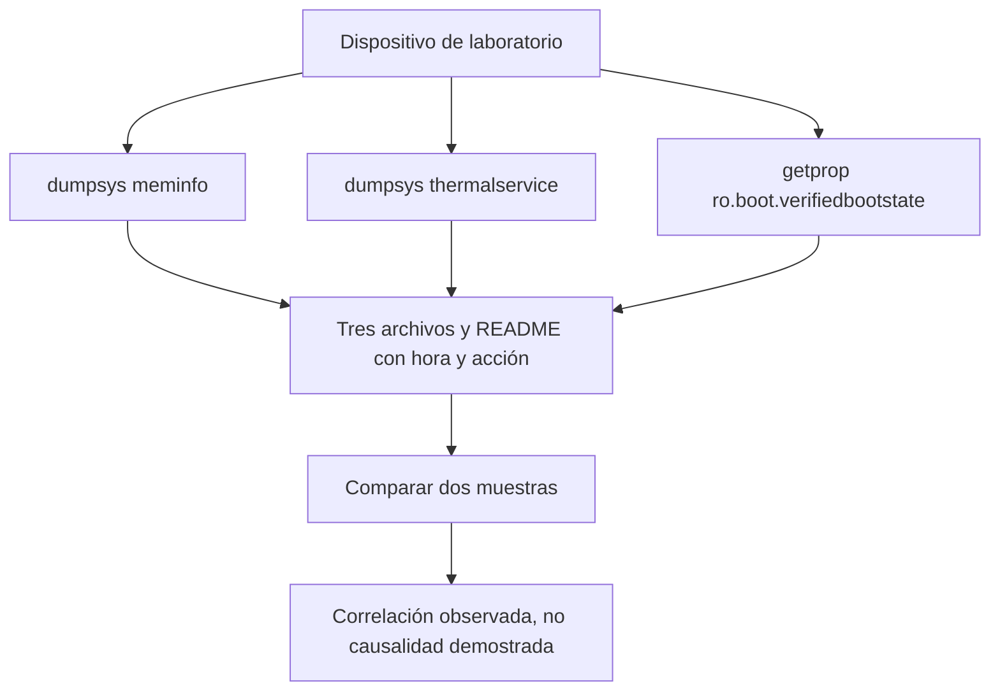

# Módulo 13: Android en producción — seguridad, sincronización y calidad

Una app móvil se ejecuta en un dispositivo que puede perderse, restaurarse, quedarse días sin red o recibir intents de otras aplicaciones. El APK puede inspeccionarse y la versión instalada puede permanecer meses. Este módulo endurece el proyecto final considerando esas condiciones en lugar de asumir un dispositivo confiable y siempre conectado.


## Aprende construyendo

> **Los scripts `python3` de este módulo son modelos, no pruebas de Android.** Ilustran el razonamiento, pero no ejecutan tu app. La evidencia real es la indicada en cada tema como **Verificación real en Android**. En el Tema 2, la criptografía en Python no usa `AndroidKeyStore`: para probar tu `CifradoSensible.kt` de verdad, escribe una prueba instrumentada en `app/src/androidTest` que cifre y descifre un texto y ejecútala con `./gradlew :app:connectedDebugAndroidTest` (el almacén de claves de Android solo existe en el dispositivo o emulador).


### Tema 1: El sistema operativo conecta tu app con entradas externas · Avanzado · 45 min

<details open>
<summary><strong>Capa 1 — Lectura</strong></summary>

#### ► DE QUÉ TRATA
Al finalizar podrás validar un deep link entrante (scheme, host, path, autorización) antes de actuar sobre él, y explicar por qué un intent recibido es entrada no confiable.

#### ► LA IDEA EN UNA FRASE
**Al finalizar podrás validar un deep link entrante (scheme, host, path, autorización) antes de actuar sobre él, y explicar por qué un intent recibido es entrada no confiable.**

#### ► POR QUÉ EXISTE ESTO
Resuelve un problema real de diseño o implementación y evita decisiones a ciegas.

#### ► LA ANALOGÍA
Piensa en el sistema operativo conecta tu app con entradas externas como una herramienta de taller: útil cuando conoces su propósito y sus límites.
**Dónde se rompe la analogía:** en software, los efectos dependen del contexto, la escala y los trade-offs.

#### ► CÓMO FUNCIONA
1. Identifica el problema que el sistema operativo conecta tu app con entradas externas resuelve.
2. Observa sus componentes y relaciones.
3. Aplica la opción más simple que funcione.
4. Verifica el resultado y los límites.

#### ► LO QUE PUEDE SALIR MAL
| Síntoma | Causa probable | Arreglo |
|---|---|---|
| El sistema operativo conecta tu app con entradas externas se aplica pero el resultado no mejora | Se usó sin medir el problema real | Mide antes y compara contra la alternativa simple |
| Aparece complejidad inesperada | Se adoptó la técnica sin comprender sus trade-offs | Vuelve a la sección de trade-offs y reduce el alcance |
| Falla en un caso límite | Se asumió un contexto que no se cumple | Prueba el caso límite y documenta cuándo NO usarlo |

#### ► TRADE-OFFS
| Opción | Cuándo usarla | Cuándo NO usarla |
|---|---|---|
| Usar El sistema operativo conecta tu app con entradas externas | Cuando el problema coincide con su propósito y el beneficio es observable | Cuando agrega complejidad sin resolver un problema real |
| Alternativa más simple | Cuando el contexto es pequeño, estable o fácil de razonar | Cuando ya demostró no escalar o no cumplir el requisito |
| Postergar la decisión | Cuando falta evidencia del problema | Cuando el costo de esperar es mayor que el costo de probar |

#### ► CUÁNDO NO USAR ESTO
No uses el sistema operativo conecta tu app con entradas externas por defecto. Aplícalo cuando el problema lo justifique y puedas verificar el beneficio; si una alternativa más simple resuelve igual, prefiérela.

#### ► DE VUELTA A LA ANALOGÍA
Volviendo a la analogía: el sistema operativo conecta tu app con entradas externas funciona como el modelo inicial, pero recuerda dónde se rompe: en producción importan la evidencia, la escala y el costo de equivocarte.

#### ► LO QUE DEBES RECORDAR
- El sistema operativo conecta tu app con entradas externas existe para resolver un problema específico.
- Mide antes de adoptar complejidad.
- Conoce el caso donde NO usarlo.
- Verifica con evidencia observable.

#### ► PREGUNTAS PARA PENSAR
1. ¿Qué problema concreto resuelve el sistema operativo conecta tu app con entradas externas en tu contexto?
2. ¿Cómo sabrías que el sistema operativo conecta tu app con entradas externas no está funcionando bien?
3. ¿Qué alternativa más simple considerarías antes de usar el sistema operativo conecta tu app con entradas externas?

</details>

<details>
<summary><strong>Capa 2 — Construcción</strong></summary>

#### Código y verificación
```
┌── otra app/web ──▶ intent/deep link ──▶ componente exportado ──┐
└──────────┬───────────────────────────────────────┘
           │
           ▼
     validar FORMA (scheme, host, path)
           │
           ▼
     autenticar/autorizar (¿esta sesión puede leer ESTE recurso?)
           │
           ▼
     confirmar efecto (nunca acción destructiva directa)
```

```bash
# compila con Gradle el archivo Kotlin generado a continuación
test -f settings.gradle.kts || cd academia-android   # sitúate en la raíz del proyecto del Módulo 0
mkdir -p app/src/main/kotlin/com/academia/android
cat > app/src/main/kotlin/com/academia/android/ValidacionDeepLink.kt <<'EOF'
package com.academia.android

import android.net.Uri

class SesionInvalidaException(mensaje: String) : Exception(mensaje)

fun parseTaskLink(uri: Uri, sesionPuedeLeer: (String) -> Boolean): String {
    require(uri.scheme == "https") { "scheme inválido: ${uri.scheme}" }
    require(uri.host == "tasks.example.com") { "host inválido: ${uri.host}" }
    require(uri.pathSegments.size == 2 && uri.pathSegments.first() == "tasks") { "path inválido" }
    val id = uri.pathSegments.last()
    if (!sesionPuedeLeer(id)) throw SesionInvalidaException("sesión no autorizada para leer $id")
    return id
}
EOF
./gradlew :app:compileDebugKotlin
```

```bash
python3 -c "
from urllib.parse import urlparse

class SesionInvalida(Exception): pass

def parse_task_link(uri_str, sesion_puede_leer):
    uri = urlparse(uri_str)
    if uri.scheme != 'https':
        raise ValueError(f'scheme inválido: {uri.scheme}')
    if uri.hostname != 'tasks.example.com':
        raise ValueError(f'host inválido: {uri.hostname}')
    partes = [p for p in uri.path.split('/') if p]
    if len(partes) != 2 or partes[0] != 'tasks':
        raise ValueError('path inválido')
    id_tarea = partes[1]
    if not sesion_puede_leer(id_tarea):
        raise SesionInvalida(f'sesión no autorizada para leer {id_tarea}')
    return id_tarea

tareas_del_usuario_actual = {'42'}
sesion_puede_leer = lambda id_tarea: id_tarea in tareas_del_usuario_actual

casos = [
    ('https://tasks.example.com/tasks/42', 'válido, tarea propia'),
    ('https://tasks.evil.com/tasks/42', 'host falso'),
    ('http://tasks.example.com/tasks/42', 'scheme inseguro'),
    ('https://tasks.example.com/tasks/99', 'ID de tarea AJENA'),
]
for uri_str, descripcion in casos:
    try:
        id_tarea = parse_task_link(uri_str, sesion_puede_leer)
        print(f'{descripcion}: ACEPTADO, id={id_tarea}')
    except (ValueError, SesionInvalida) as e:
        print(f'{descripcion}: RECHAZADO ({e})')
"
```

</details>

### Tema 2: Proteger datos exige conocer copias y ciclo de vida · Avanzado · 45 min

<details open>
<summary><strong>Capa 1 — Lectura</strong></summary>

#### ► DE QUÉ TRATA
Al finalizar podrás cifrar un dato sensible con una construcción autenticada (AEAD) real, y enumerar las copias adicionales (backup, logs, notificaciones) que ese cifrado por sí solo no protege.

#### ► LA IDEA EN UNA FRASE
**Al finalizar podrás cifrar un dato sensible con una construcción autenticada (AEAD) real, y enumerar las copias adicionales (backup, logs, notificaciones) que ese cifrado por sí solo no protege.**

#### ► POR QUÉ EXISTE ESTO
Resuelve un problema real de diseño o implementación y evita decisiones a ciegas.

#### ► LA ANALOGÍA
Piensa en proteger datos exige conocer copias y ciclo de vida como una herramienta de taller: útil cuando conoces su propósito y sus límites.
**Dónde se rompe la analogía:** en software, los efectos dependen del contexto, la escala y los trade-offs.

#### ► CÓMO FUNCIONA
1. Identifica el problema que proteger datos exige conocer copias y ciclo de vida resuelve.
2. Observa sus componentes y relaciones.
3. Aplica la opción más simple que funcione.
4. Verifica el resultado y los límites.

#### ► LO QUE PUEDE SALIR MAL
| Síntoma | Causa probable | Arreglo |
|---|---|---|
| Proteger datos exige conocer copias y ciclo de vida se aplica pero el resultado no mejora | Se usó sin medir el problema real | Mide antes y compara contra la alternativa simple |
| Aparece complejidad inesperada | Se adoptó la técnica sin comprender sus trade-offs | Vuelve a la sección de trade-offs y reduce el alcance |
| Falla en un caso límite | Se asumió un contexto que no se cumple | Prueba el caso límite y documenta cuándo NO usarlo |

#### ► TRADE-OFFS
| Opción | Cuándo usarla | Cuándo NO usarla |
|---|---|---|
| Usar Proteger datos exige conocer copias y ciclo de vida | Cuando el problema coincide con su propósito y el beneficio es observable | Cuando agrega complejidad sin resolver un problema real |
| Alternativa más simple | Cuando el contexto es pequeño, estable o fácil de razonar | Cuando ya demostró no escalar o no cumplir el requisito |
| Postergar la decisión | Cuando falta evidencia del problema | Cuando el costo de esperar es mayor que el costo de probar |

#### ► CUÁNDO NO USAR ESTO
No uses proteger datos exige conocer copias y ciclo de vida por defecto. Aplícalo cuando el problema lo justifique y puedas verificar el beneficio; si una alternativa más simple resuelve igual, prefiérela.

#### ► DE VUELTA A LA ANALOGÍA
Volviendo a la analogía: proteger datos exige conocer copias y ciclo de vida funciona como el modelo inicial, pero recuerda dónde se rompe: en producción importan la evidencia, la escala y el costo de equivocarte.

#### ► LO QUE DEBES RECORDAR
- Proteger datos exige conocer copias y ciclo de vida existe para resolver un problema específico.
- Mide antes de adoptar complejidad.
- Conoce el caso donde NO usarlo.
- Verifica con evidencia observable.

#### ► PREGUNTAS PARA PENSAR
1. ¿Qué problema concreto resuelve proteger datos exige conocer copias y ciclo de vida en tu contexto?
2. ¿Cómo sabrías que proteger datos exige conocer copias y ciclo de vida no está funcionando bien?
3. ¿Qué alternativa más simple considerarías antes de usar proteger datos exige conocer copias y ciclo de vida?

</details>

<details>
<summary><strong>Capa 2 — Construcción</strong></summary>

#### Código y verificación
```
┌── dato sensible ──▶ ¿necesario guardarlo? ──▶ storage privado ──▶ cifrado (Keystore) ┐
└──────────────────────────────────────────────────────────────┘
                         copias adicionales que el cifrado de Room NO alcanza:
                         backup | logs | crash reports | notificación | clipboard
```

```bash
# Este script python3 es un MODELO de AES-GCM; no usa AndroidKeyStore (la prueba real es instrumentada)
test -f settings.gradle.kts || cd academia-android   # sitúate en la raíz del proyecto del Módulo 0
mkdir -p app/src/main/kotlin/com/academia/android
cat > app/src/main/kotlin/com/academia/android/CifradoSensible.kt <<'EOF'
package com.academia.android

import android.security.keystore.KeyGenParameterSpec
import android.security.keystore.KeyProperties
import javax.crypto.KeyGenerator

fun generarClaveEnKeystore() {
    val generador = KeyGenerator.getInstance(KeyProperties.KEY_ALGORITHM_AES, "AndroidKeyStore")
    generador.init(
        KeyGenParameterSpec.Builder(
            "local_sensitive_v1",
            KeyProperties.PURPOSE_ENCRYPT or KeyProperties.PURPOSE_DECRYPT,
        )
            .setBlockModes(KeyProperties.BLOCK_MODE_GCM)
            .setEncryptionPaddings(KeyProperties.ENCRYPTION_PADDING_NONE)
            .build(),
    )
    generador.generateKey() // material de clave NO exportable, vive dentro del Keystore
}
EOF
./gradlew :app:compileDebugKotlin
```

```bash
python3 -c "
import os
from cryptography.hazmat.primitives.ciphers.aead import AESGCM

clave = AESGCM.generate_key(bit_length=256)  # equivalente a la clave generada en el Keystore
aesgcm = AESGCM(clave)
nonce = os.urandom(12)  # NUNCA reutilizar este nonce con la misma clave

dato_sensible = b'numero-de-tarjeta-de-prueba-4242'
ciphertext = aesgcm.encrypt(nonce, dato_sensible, None)
print('cifrado exitoso, longitud del ciphertext:', len(ciphertext))

descifrado = aesgcm.decrypt(nonce, ciphertext, None)
print('descifrado exitoso, coincide con el original:', descifrado == dato_sensible)

# manipulación deliberada del ciphertext (como un atacante alterando el archivo cifrado)
ciphertext_manipulado = bytearray(ciphertext)
ciphertext_manipulado[0] ^= 0xFF
try:
    aesgcm.decrypt(nonce, bytes(ciphertext_manipulado), None)
    print('INESPERADO: el ciphertext manipulado se descifró sin error')
except Exception as e:
    print('ciphertext manipulado RECHAZADO:', type(e).__name__)
"
```

</details>

### Tema 3: Offline-first necesita un protocolo de cambios · Avanzado · 45 min

<details open>
<summary><strong>Capa 1 — Lectura</strong></summary>

#### ► DE QUÉ TRATA
Al finalizar podrás implementar un patrón outbox con operation ID idempotente sobre SQLite real, y resolver un conflicto de sincronización con una política explícita, no "last-write-wins" ciego.

#### ► LA IDEA EN UNA FRASE
**Al finalizar podrás implementar un patrón outbox con operation ID idempotente sobre SQLite real, y resolver un conflicto de sincronización con una política explícita, no "last-write-wins" ciego.**

#### ► POR QUÉ EXISTE ESTO
Resuelve un problema real de diseño o implementación y evita decisiones a ciegas.

#### ► LA ANALOGÍA
Piensa en offline-first necesita un protocolo de cambios como una herramienta de taller: útil cuando conoces su propósito y sus límites.
**Dónde se rompe la analogía:** en software, los efectos dependen del contexto, la escala y los trade-offs.

#### ► CÓMO FUNCIONA
1. Identifica el problema que offline-first necesita un protocolo de cambios resuelve.
2. Observa sus componentes y relaciones.
3. Aplica la opción más simple que funcione.
4. Verifica el resultado y los límites.

#### ► LO QUE PUEDE SALIR MAL
| Síntoma | Causa probable | Arreglo |
|---|---|---|
| Offline-first necesita un protocolo de cambios se aplica pero el resultado no mejora | Se usó sin medir el problema real | Mide antes y compara contra la alternativa simple |
| Aparece complejidad inesperada | Se adoptó la técnica sin comprender sus trade-offs | Vuelve a la sección de trade-offs y reduce el alcance |
| Falla en un caso límite | Se asumió un contexto que no se cumple | Prueba el caso límite y documenta cuándo NO usarlo |

#### ► TRADE-OFFS
| Opción | Cuándo usarla | Cuándo NO usarla |
|---|---|---|
| Usar Offline-first necesita un protocolo de cambios | Cuando el problema coincide con su propósito y el beneficio es observable | Cuando agrega complejidad sin resolver un problema real |
| Alternativa más simple | Cuando el contexto es pequeño, estable o fácil de razonar | Cuando ya demostró no escalar o no cumplir el requisito |
| Postergar la decisión | Cuando falta evidencia del problema | Cuando el costo de esperar es mayor que el costo de probar |

#### ► CUÁNDO NO USAR ESTO
No uses offline-first necesita un protocolo de cambios por defecto. Aplícalo cuando el problema lo justifique y puedas verificar el beneficio; si una alternativa más simple resuelve igual, prefiérela.

#### ► DE VUELTA A LA ANALOGÍA
Volviendo a la analogía: offline-first necesita un protocolo de cambios funciona como el modelo inicial, pero recuerda dónde se rompe: en producción importan la evidencia, la escala y el costo de equivocarte.

#### ► LO QUE DEBES RECORDAR
- Offline-first necesita un protocolo de cambios existe para resolver un problema específico.
- Mide antes de adoptar complejidad.
- Conoce el caso donde NO usarlo.
- Verifica con evidencia observable.

#### ► PREGUNTAS PARA PENSAR
1. ¿Qué problema concreto resuelve offline-first necesita un protocolo de cambios en tu contexto?
2. ¿Cómo sabrías que offline-first necesita un protocolo de cambios no está funcionando bien?
3. ¿Qué alternativa más simple considerarías antes de usar offline-first necesita un protocolo de cambios?

</details>

<details>
<summary><strong>Capa 2 — Construcción</strong></summary>

#### Código y verificación
```
┌── UI ──▶ Room (fuente local) + outbox op-42 (UNA transacción) ─┐
└──────────┬───────────────────────────────────────┘
           │ WorkManager drena al volver la red
           ▼
┌── API (idempotente por operation ID) ──────────────────────┐
│  accepted + version   O   409 conflict + version actual        │
└──────────┬───────────────────────────────────────┘
           ▼
     Room TX: aplicar y limpiar outbox   O   marcar conflicto visible a la UI
```

```bash
test -f settings.gradle.kts || cd academia-android   # sitúate en la raíz del proyecto del Módulo 0
mkdir -p app/src/main/kotlin/com/academia/android
cat > app/src/main/kotlin/com/academia/android/OutboxOffline.kt <<'EOF'
package com.academia.android

import java.util.UUID

data class PendingMutation(
    val operationId: String,
    val entityId: String,
    val baseVersion: Long,
    val kind: String,
    val payload: String,
)

class OutboxRepository {
    // en Room real: @Transaction — ambas escrituras en la MISMA transacción
    fun renameOffline(taskId: String, title: String, baseVersion: Long): PendingMutation {
        val mutacion = PendingMutation(
            operationId = UUID.randomUUID().toString(),
            entityId = taskId,
            baseVersion = baseVersion,
            kind = "rename",
            payload = title,
        )
        return mutacion
    }
}
EOF
./gradlew :app:compileDebugKotlin
```

```bash
python3 -c "
import sqlite3, uuid

con = sqlite3.connect(':memory:')
con.execute('CREATE TABLE tareas (id TEXT PRIMARY KEY, titulo TEXT, version INTEGER, sync_state TEXT)')
con.execute('CREATE TABLE outbox (operation_id TEXT PRIMARY KEY, entity_id TEXT, base_version INTEGER, payload TEXT)')
con.execute(\"INSERT INTO tareas VALUES ('t1', 'Comprar leche', 1, 'synced')\")

def rename_offline(con, entity_id, nuevo_titulo, base_version):
    op_id = str(uuid.uuid4())
    with con:  # UNA transacción real para ambas escrituras
        con.execute('UPDATE tareas SET titulo=?, sync_state=? WHERE id=?', (nuevo_titulo, 'pending', entity_id))
        con.execute('INSERT INTO outbox VALUES (?,?,?,?)', (op_id, entity_id, base_version, nuevo_titulo))
    return op_id

servidor_version_actual = {'t1': 1}
operaciones_ya_procesadas_por_servidor = set()

def drenar_outbox(con, servidor_version_actual, operaciones_procesadas):
    for op_id, entity_id, base_version, payload in con.execute('SELECT * FROM outbox').fetchall():
        if op_id in operaciones_procesadas:
            continue  # idempotencia: reintento del mismo operation ID, no duplicar efecto
        if base_version < servidor_version_actual[entity_id]:
            print(f'op {op_id[:8]}: CONFLICTO (base_version={base_version} < servidor={servidor_version_actual[entity_id]})')
            con.execute('UPDATE tareas SET sync_state=? WHERE id=?', ('conflict', entity_id))
        else:
            servidor_version_actual[entity_id] += 1
            operaciones_procesadas.add(op_id)
            con.execute('UPDATE tareas SET sync_state=?, version=? WHERE id=?', ('synced', servidor_version_actual[entity_id], entity_id))
            con.execute('DELETE FROM outbox WHERE operation_id=?', (op_id,))
            print(f'op {op_id[:8]}: ACEPTADA, nueva versión={servidor_version_actual[entity_id]}')

op1 = rename_offline(con, 't1', 'Comprar leche y pan', 1)
drenar_outbox(con, servidor_version_actual, operaciones_ya_procesadas_por_servidor)
print('estado final:', con.execute('SELECT * FROM tareas').fetchall())
print('outbox restante:', con.execute('SELECT * FROM outbox').fetchall())
"
```

</details>

### Tema 4: La calidad se opera por dispositivo y versión · Avanzado · 45 min

<details open>
<summary><strong>Capa 1 — Lectura</strong></summary>

#### ► DE QUÉ TRATA
Al finalizar podrás identificar una operación bloqueante en el hilo principal que causaría ANR, y diseñar un rollout gradual con gates de calidad antes de producción completa.

#### ► LA IDEA EN UNA FRASE
**Al finalizar podrás identificar una operación bloqueante en el hilo principal que causaría ANR, y diseñar un rollout gradual con gates de calidad antes de producción completa.**

#### ► POR QUÉ EXISTE ESTO
Resuelve un problema real de diseño o implementación y evita decisiones a ciegas.

#### ► LA ANALOGÍA
Piensa en la calidad se opera por dispositivo y versión como una herramienta de taller: útil cuando conoces su propósito y sus límites.
**Dónde se rompe la analogía:** en software, los efectos dependen del contexto, la escala y los trade-offs.

#### ► CÓMO FUNCIONA
1. Identifica el problema que la calidad se opera por dispositivo y versión resuelve.
2. Observa sus componentes y relaciones.
3. Aplica la opción más simple que funcione.
4. Verifica el resultado y los límites.

#### ► LO QUE PUEDE SALIR MAL
| Síntoma | Causa probable | Arreglo |
|---|---|---|
| La calidad se opera por dispositivo y versión se aplica pero el resultado no mejora | Se usó sin medir el problema real | Mide antes y compara contra la alternativa simple |
| Aparece complejidad inesperada | Se adoptó la técnica sin comprender sus trade-offs | Vuelve a la sección de trade-offs y reduce el alcance |
| Falla en un caso límite | Se asumió un contexto que no se cumple | Prueba el caso límite y documenta cuándo NO usarlo |

#### ► TRADE-OFFS
| Opción | Cuándo usarla | Cuándo NO usarla |
|---|---|---|
| Usar La calidad se opera por dispositivo y versión | Cuando el problema coincide con su propósito y el beneficio es observable | Cuando agrega complejidad sin resolver un problema real |
| Alternativa más simple | Cuando el contexto es pequeño, estable o fácil de razonar | Cuando ya demostró no escalar o no cumplir el requisito |
| Postergar la decisión | Cuando falta evidencia del problema | Cuando el costo de esperar es mayor que el costo de probar |

#### ► CUÁNDO NO USAR ESTO
No uses la calidad se opera por dispositivo y versión por defecto. Aplícalo cuando el problema lo justifique y puedas verificar el beneficio; si una alternativa más simple resuelve igual, prefiérela.

#### ► DE VUELTA A LA ANALOGÍA
Volviendo a la analogía: la calidad se opera por dispositivo y versión funciona como el modelo inicial, pero recuerda dónde se rompe: en producción importan la evidencia, la escala y el costo de equivocarte.

#### ► LO QUE DEBES RECORDAR
- La calidad se opera por dispositivo y versión existe para resolver un problema específico.
- Mide antes de adoptar complejidad.
- Conoce el caso donde NO usarlo.
- Verifica con evidencia observable.

#### ► PREGUNTAS PARA PENSAR
1. ¿Qué problema concreto resuelve la calidad se opera por dispositivo y versión en tu contexto?
2. ¿Cómo sabrías que la calidad se opera por dispositivo y versión no está funcionando bien?
3. ¿Qué alternativa más simple considerarías antes de usar la calidad se opera por dispositivo y versión?

</details>

<details>
<summary><strong>Capa 2 — Construcción</strong></summary>

#### Código y verificación
```
┌── commit ──▶ tests/benchmark ──▶ internal ──▶ staged 5% ──▶ vitals por versión ┐
└──────────┬───────────────────────────────────────────────┘
           │
     ┌─────┴─────┐
     ▼             ▼
   sano         regresión
     │             │
  ampliar    detener + hotfix/kill switch
```

```bash
test -f settings.gradle.kts || cd academia-android   # sitúate en la raíz del proyecto del Módulo 0
mkdir -p app/src/main/kotlin/com/academia/android
cat > app/src/main/kotlin/com/academia/android/RepositorioMainSafe.kt <<'EOF'
package com.academia.android

import kotlinx.coroutines.CoroutineDispatcher
import kotlinx.coroutines.Dispatchers
import kotlinx.coroutines.withContext
import java.io.File

class FileRepository(
    private val io: CoroutineDispatcher = Dispatchers.IO
) {
    suspend fun load(archivo: File): String = withContext(io) {
        archivo.readText() // I/O síncrono, pero movido explícitamente FUERA del hilo principal
    }
}
EOF
./gradlew :app:compileDebugKotlin
```

```bash
python3 -c "
import threading
import time

def trabajo_de_io_lento():
    time.sleep(0.2)  # simula una lectura de archivo/red lenta
    return 'datos cargados'

resultados = {}

def bloquea_hilo_principal():
    inicio = time.time()
    resultados['dato'] = trabajo_de_io_lento()  # ejecutado DIRECTAMENTE en este hilo
    resultados['hilo_principal_bloqueado_por'] = time.time() - inicio

def main_safe_con_hilo_io():
    contenedor = {}
    def en_hilo_io():
        contenedor['dato'] = trabajo_de_io_lento()
    hilo_io = threading.Thread(target=en_hilo_io)
    inicio = time.time()
    hilo_io.start()
    # el 'hilo principal' queda libre para hacer otra cosa mientras tanto
    tiempo_libre_hilo_principal = time.time() - inicio
    hilo_io.join()
    return tiempo_libre_hilo_principal, contenedor['dato']

bloquea_hilo_principal()
print(f'BLOQUEANDO el hilo principal: bloqueado por {resultados[\"hilo_principal_bloqueado_por\"]:.3f}s')

tiempo_libre, dato = main_safe_con_hilo_io()
print(f'MAIN-SAFE (hilo de I/O separado): hilo principal libre en {tiempo_libre:.4f}s (dato: {dato})')
"
```

</details>

### Android 17: privacidad, compatibilidad y dispositivos grandes

<details open>
<summary><strong>Capa 1 — Lectura</strong></summary>

#### ► DE QUÉ TRATA
Este tema te guía por android 17: privacidad, compatibilidad y dispositivos grandes con foco en comprensión antes de implementación.

#### ► LA IDEA EN UNA FRASE
**Entender android 17: privacidad, compatibilidad y dispositivos grandes te permite tomar mejores decisiones técnicas.**

#### ► POR QUÉ EXISTE ESTO
Resuelve un problema real de diseño o implementación y evita decisiones a ciegas.

#### ► LA ANALOGÍA
Piensa en android 17: privacidad, compatibilidad y dispositivos grandes como una herramienta de taller: útil cuando conoces su propósito y sus límites.
**Dónde se rompe la analogía:** en software, los efectos dependen del contexto, la escala y los trade-offs.

#### ► CÓMO FUNCIONA
1. Identifica el problema que android 17: privacidad, compatibilidad y dispositivos grandes resuelve.
2. Observa sus componentes y relaciones.
3. Aplica la opción más simple que funcione.
4. Verifica el resultado y los límites.

#### ► LO QUE PUEDE SALIR MAL
| Síntoma | Causa probable | Arreglo |
|---|---|---|
| Android 17: privacidad, compatibilidad y dispositivos grandes se aplica pero el resultado no mejora | Se usó sin medir el problema real | Mide antes y compara contra la alternativa simple |
| Aparece complejidad inesperada | Se adoptó la técnica sin comprender sus trade-offs | Vuelve a la sección de trade-offs y reduce el alcance |
| Falla en un caso límite | Se asumió un contexto que no se cumple | Prueba el caso límite y documenta cuándo NO usarlo |

#### ► TRADE-OFFS
| Opción | Cuándo usarla | Cuándo NO usarla |
|---|---|---|
| Usar Android 17: privacidad, compatibilidad y dispositivos grandes | Cuando el problema coincide con su propósito y el beneficio es observable | Cuando agrega complejidad sin resolver un problema real |
| Alternativa más simple | Cuando el contexto es pequeño, estable o fácil de razonar | Cuando ya demostró no escalar o no cumplir el requisito |
| Postergar la decisión | Cuando falta evidencia del problema | Cuando el costo de esperar es mayor que el costo de probar |

#### ► CUÁNDO NO USAR ESTO
No uses android 17: privacidad, compatibilidad y dispositivos grandes por defecto. Aplícalo cuando el problema lo justifique y puedas verificar el beneficio; si una alternativa más simple resuelve igual, prefiérela.

#### ► DE VUELTA A LA ANALOGÍA
Volviendo a la analogía: android 17: privacidad, compatibilidad y dispositivos grandes funciona como el modelo inicial, pero recuerda dónde se rompe: en producción importan la evidencia, la escala y el costo de equivocarte.

#### ► LO QUE DEBES RECORDAR
- Android 17: privacidad, compatibilidad y dispositivos grandes existe para resolver un problema específico.
- Mide antes de adoptar complejidad.
- Conoce el caso donde NO usarlo.
- Verifica con evidencia observable.

#### ► PREGUNTAS PARA PENSAR
1. ¿Qué problema concreto resuelve android 17: privacidad, compatibilidad y dispositivos grandes en tu contexto?
2. ¿Cómo sabrías que android 17: privacidad, compatibilidad y dispositivos grandes no está funcionando bien?
3. ¿Qué alternativa más simple considerarías antes de usar android 17: privacidad, compatibilidad y dispositivos grandes?

</details>

<details>
<summary><strong>Capa 2 — Construcción</strong></summary>

#### Nota de construcción
Este tema es principalmente conceptual en esta versión. La verificación se realiza con las preguntas de comprensión y el criterio de cuándo NO usar android 17: privacidad, compatibilidad y dispositivos grandes.

</details>

### Proyecto: app resistente a dispositivo, red y release

<details open>
<summary><strong>Capa 1 — Lectura</strong></summary>

#### ► DE QUÉ TRATA
Este tema te guía por proyecto: app resistente a dispositivo, red y release con foco en comprensión antes de implementación.

#### ► LA IDEA EN UNA FRASE
**Entender proyecto: app resistente a dispositivo, red y release te permite tomar mejores decisiones técnicas.**

#### ► POR QUÉ EXISTE ESTO
Resuelve un problema real de diseño o implementación y evita decisiones a ciegas.

#### ► LA ANALOGÍA
Piensa en proyecto: app resistente a dispositivo, red y release como una herramienta de taller: útil cuando conoces su propósito y sus límites.
**Dónde se rompe la analogía:** en software, los efectos dependen del contexto, la escala y los trade-offs.

#### ► CÓMO FUNCIONA
1. Identifica el problema que proyecto: app resistente a dispositivo, red y release resuelve.
2. Observa sus componentes y relaciones.
3. Aplica la opción más simple que funcione.
4. Verifica el resultado y los límites.

#### ► LO QUE PUEDE SALIR MAL
| Síntoma | Causa probable | Arreglo |
|---|---|---|
| Proyecto: app resistente a dispositivo, red y release se aplica pero el resultado no mejora | Se usó sin medir el problema real | Mide antes y compara contra la alternativa simple |
| Aparece complejidad inesperada | Se adoptó la técnica sin comprender sus trade-offs | Vuelve a la sección de trade-offs y reduce el alcance |
| Falla en un caso límite | Se asumió un contexto que no se cumple | Prueba el caso límite y documenta cuándo NO usarlo |

#### ► TRADE-OFFS
| Opción | Cuándo usarla | Cuándo NO usarla |
|---|---|---|
| Usar Proyecto: app resistente a dispositivo, red y release | Cuando el problema coincide con su propósito y el beneficio es observable | Cuando agrega complejidad sin resolver un problema real |
| Alternativa más simple | Cuando el contexto es pequeño, estable o fácil de razonar | Cuando ya demostró no escalar o no cumplir el requisito |
| Postergar la decisión | Cuando falta evidencia del problema | Cuando el costo de esperar es mayor que el costo de probar |

#### ► CUÁNDO NO USAR ESTO
No uses proyecto: app resistente a dispositivo, red y release por defecto. Aplícalo cuando el problema lo justifique y puedas verificar el beneficio; si una alternativa más simple resuelve igual, prefiérela.

#### ► DE VUELTA A LA ANALOGÍA
Volviendo a la analogía: proyecto: app resistente a dispositivo, red y release funciona como el modelo inicial, pero recuerda dónde se rompe: en producción importan la evidencia, la escala y el costo de equivocarte.

#### ► LO QUE DEBES RECORDAR
- Proyecto: app resistente a dispositivo, red y release existe para resolver un problema específico.
- Mide antes de adoptar complejidad.
- Conoce el caso donde NO usarlo.
- Verifica con evidencia observable.

#### ► PREGUNTAS PARA PENSAR
1. ¿Qué problema concreto resuelve proyecto: app resistente a dispositivo, red y release en tu contexto?
2. ¿Cómo sabrías que proyecto: app resistente a dispositivo, red y release no está funcionando bien?
3. ¿Qué alternativa más simple considerarías antes de usar proyecto: app resistente a dispositivo, red y release?

</details>

<details>
<summary><strong>Capa 2 — Construcción</strong></summary>

#### Nota de construcción
Este tema es principalmente conceptual en esta versión. La verificación se realiza con las preguntas de comprensión y el criterio de cuándo NO usar proyecto: app resistente a dispositivo, red y release.

</details>

### Método de estudio y proyecto de ampliación

<details open>
<summary><strong>Capa 1 — Lectura</strong></summary>

#### ► DE QUÉ TRATA
Este tema te guía por método de estudio y proyecto de ampliación con foco en comprensión antes de implementación.

#### ► LA IDEA EN UNA FRASE
**Entender método de estudio y proyecto de ampliación te permite tomar mejores decisiones técnicas.**

#### ► POR QUÉ EXISTE ESTO
Resuelve un problema real de diseño o implementación y evita decisiones a ciegas.

#### ► LA ANALOGÍA
Piensa en método de estudio y proyecto de ampliación como una herramienta de taller: útil cuando conoces su propósito y sus límites.
**Dónde se rompe la analogía:** en software, los efectos dependen del contexto, la escala y los trade-offs.

#### ► CÓMO FUNCIONA
1. Identifica el problema que método de estudio y proyecto de ampliación resuelve.
2. Observa sus componentes y relaciones.
3. Aplica la opción más simple que funcione.
4. Verifica el resultado y los límites.

#### ► LO QUE PUEDE SALIR MAL
| Síntoma | Causa probable | Arreglo |
|---|---|---|
| Método de estudio y proyecto de ampliación se aplica pero el resultado no mejora | Se usó sin medir el problema real | Mide antes y compara contra la alternativa simple |
| Aparece complejidad inesperada | Se adoptó la técnica sin comprender sus trade-offs | Vuelve a la sección de trade-offs y reduce el alcance |
| Falla en un caso límite | Se asumió un contexto que no se cumple | Prueba el caso límite y documenta cuándo NO usarlo |

#### ► TRADE-OFFS
| Opción | Cuándo usarla | Cuándo NO usarla |
|---|---|---|
| Usar Método de estudio y proyecto de ampliación | Cuando el problema coincide con su propósito y el beneficio es observable | Cuando agrega complejidad sin resolver un problema real |
| Alternativa más simple | Cuando el contexto es pequeño, estable o fácil de razonar | Cuando ya demostró no escalar o no cumplir el requisito |
| Postergar la decisión | Cuando falta evidencia del problema | Cuando el costo de esperar es mayor que el costo de probar |

#### ► CUÁNDO NO USAR ESTO
No uses método de estudio y proyecto de ampliación por defecto. Aplícalo cuando el problema lo justifique y puedas verificar el beneficio; si una alternativa más simple resuelve igual, prefiérela.

#### ► DE VUELTA A LA ANALOGÍA
Volviendo a la analogía: método de estudio y proyecto de ampliación funciona como el modelo inicial, pero recuerda dónde se rompe: en producción importan la evidencia, la escala y el costo de equivocarte.

#### ► LO QUE DEBES RECORDAR
- Método de estudio y proyecto de ampliación existe para resolver un problema específico.
- Mide antes de adoptar complejidad.
- Conoce el caso donde NO usarlo.
- Verifica con evidencia observable.

#### ► PREGUNTAS PARA PENSAR
1. ¿Qué problema concreto resuelve método de estudio y proyecto de ampliación en tu contexto?
2. ¿Cómo sabrías que método de estudio y proyecto de ampliación no está funcionando bien?
3. ¿Qué alternativa más simple considerarías antes de usar método de estudio y proyecto de ampliación?

</details>

<details>
<summary><strong>Capa 2 — Construcción</strong></summary>

#### Nota de construcción
Este tema es principalmente conceptual en esta versión. La verificación se realiza con las preguntas de comprensión y el criterio de cuándo NO usar método de estudio y proyecto de ampliación.

</details>

### Tema 5: Del dispositivo al diagnóstico: SoC, memoria, límites térmicos y arranque verificado · Avanzado · 45 min

<details open>
<summary><strong>Capa 1 — Lectura</strong></summary>

#### ► DE QUÉ TRATA
Al finalizar recogerás evidencias de memoria, estado térmico y arranque en un dispositivo de pruebas, distinguiendo mediciones disponibles de garantías de seguridad. Prerrequisitos: Android Studio, Platform Tools, una app de laboratorio instalada y autorización de depuración del…

#### ► LA IDEA EN UNA FRASE
**Al finalizar recogerás evidencias de memoria, estado térmico y arranque en un dispositivo de pruebas, distinguiendo mediciones disponibles de garantías de seguridad.**

#### ► POR QUÉ EXISTE ESTO
Resuelve un problema real de diseño o implementación y evita decisiones a ciegas.

#### ► LA ANALOGÍA
Piensa en del dispositivo al diagnóstico: soc, memoria, límites térmicos y arranque verificado como una herramienta de taller: útil cuando conoces su propósito y sus límites.
**Dónde se rompe la analogía:** en software, los efectos dependen del contexto, la escala y los trade-offs.

#### ► CÓMO FUNCIONA


#### ► LO QUE PUEDE SALIR MAL
| Síntoma | Causa probable | Arreglo |
|---|---|---|
| Del dispositivo al diagnóstico: SoC, memoria, límites térmicos y arranque verificado se aplica pero el resultado no mejora | Se usó sin medir el problema real | Mide antes y compara contra la alternativa simple |
| Aparece complejidad inesperada | Se adoptó la técnica sin comprender sus trade-offs | Vuelve a la sección de trade-offs y reduce el alcance |
| Falla en un caso límite | Se asumió un contexto que no se cumple | Prueba el caso límite y documenta cuándo NO usarlo |

#### ► TRADE-OFFS
| Opción | Cuándo usarla | Cuándo NO usarla |
|---|---|---|
| Usar Del dispositivo al diagnóstico: SoC, memoria, límites térmicos y arranque verificado | Cuando el problema coincide con su propósito y el beneficio es observable | Cuando agrega complejidad sin resolver un problema real |
| Alternativa más simple | Cuando el contexto es pequeño, estable o fácil de razonar | Cuando ya demostró no escalar o no cumplir el requisito |
| Postergar la decisión | Cuando falta evidencia del problema | Cuando el costo de esperar es mayor que el costo de probar |

#### ► CUÁNDO NO USAR ESTO
No uses del dispositivo al diagnóstico: soc, memoria, límites térmicos y arranque verificado por defecto. Aplícalo cuando el problema lo justifique y puedas verificar el beneficio; si una alternativa más simple resuelve igual, prefiérela.

#### ► DE VUELTA A LA ANALOGÍA
Volviendo a la analogía: del dispositivo al diagnóstico: soc, memoria, límites térmicos y arranque verificado funciona como el modelo inicial, pero recuerda dónde se rompe: en producción importan la evidencia, la escala y el costo de equivocarte.

#### ► LO QUE DEBES RECORDAR
- Del dispositivo al diagnóstico: SoC, memoria, límites térmicos y arranque verificado existe para resolver un problema específico.
- Mide antes de adoptar complejidad.
- Conoce el caso donde NO usarlo.
- Verifica con evidencia observable.

#### ► PREGUNTAS PARA PENSAR
1. ¿Qué problema concreto resuelve del dispositivo al diagnóstico: soc, memoria, límites térmicos y arranque verificado en tu contexto?
2. ¿Cómo sabrías que del dispositivo al diagnóstico: soc, memoria, límites térmicos y arranque verificado no está funcionando bien?
3. ¿Qué alternativa más simple considerarías antes de usar del dispositivo al diagnóstico: soc, memoria, límites térmicos y arranque verificado?

</details>

<details>
<summary><strong>Capa 2 — Construcción</strong></summary>

#### Código y verificación


```bash
mkdir diagnostico-android
cd diagnostico-android
adb devices
adb shell dumpsys -l
```

```bash
adb shell dumpsys meminfo com.example.restauracion > memoria.txt
adb shell dumpsys thermalservice > termico.txt
adb shell getprop ro.boot.verifiedbootstate > arranque.txt
```

</details>
