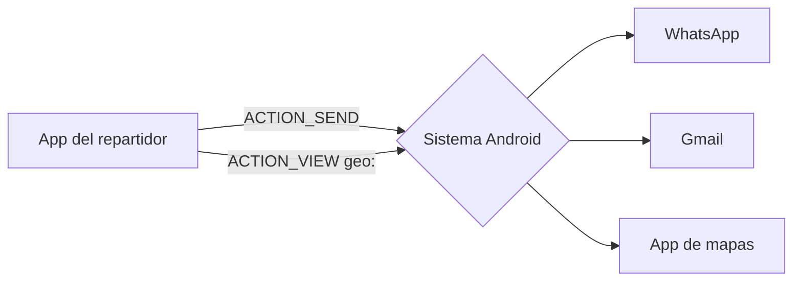
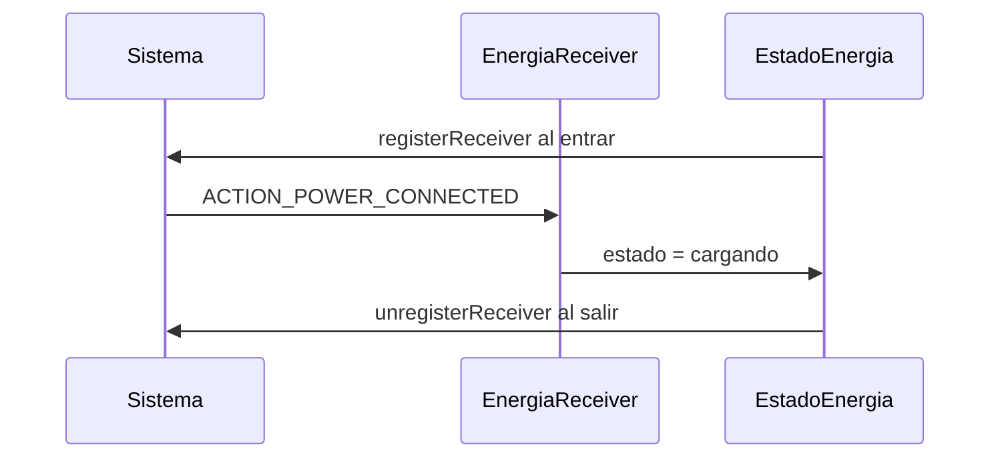
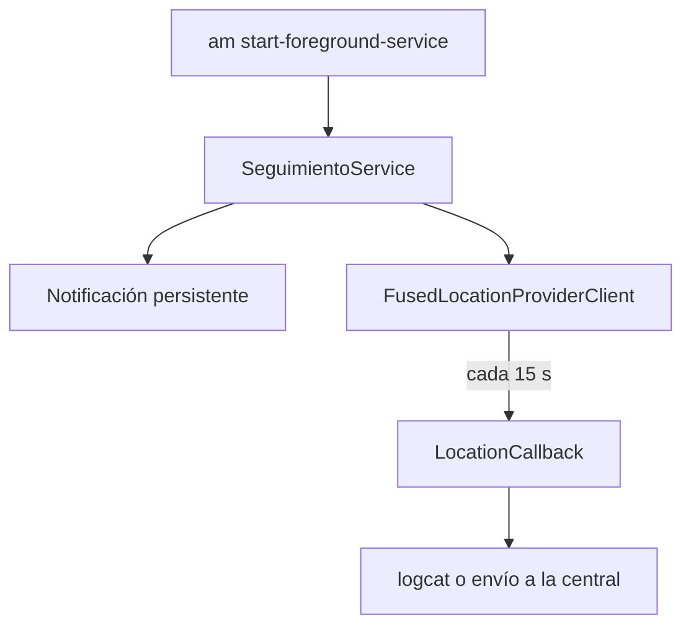
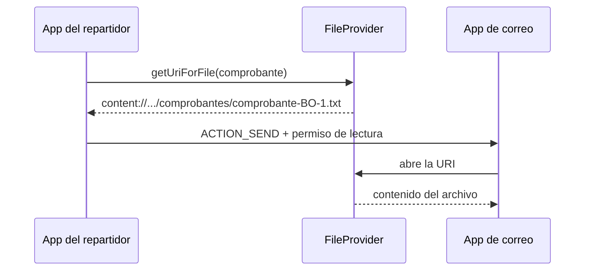
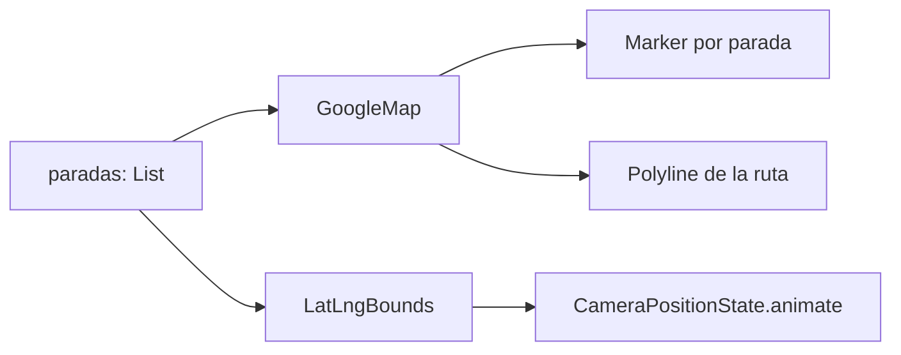
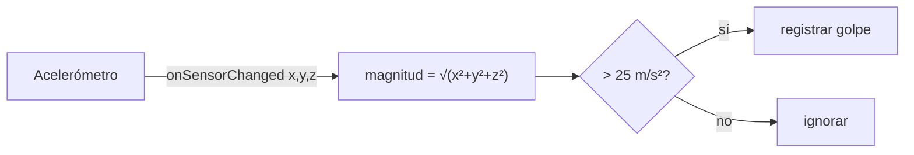
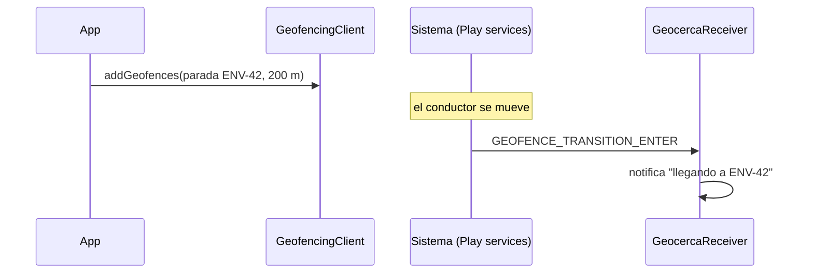
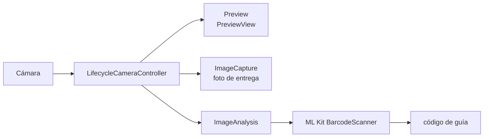
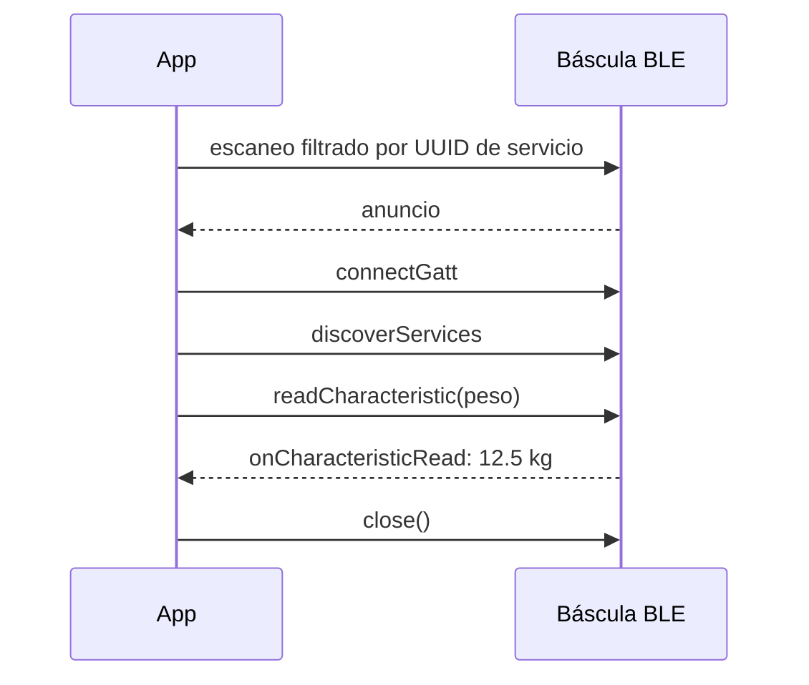

# Módulo 14: Android como plataforma — Intents, broadcasts, servicios y content providers


## Aprende construyendo

> **Dependencias de este módulo** (catálogo del Módulo 0, Tema 3; cada tema crea su proyecto nuevo, así que copia en su `gradle/libs.versions.toml` las líneas que use). Tema 3 y Tema 6: `implementation(libs.play.services.location)`. Tema 5: `implementation(libs.maps.compose)` y el plugin `alias(libs.plugins.secrets)` (raíz con `apply false`). Tema 7: `implementation(libs.androidx.camera.camera2)`, `implementation(libs.androidx.camera.lifecycle)`, `implementation(libs.androidx.camera.view)`, `implementation(libs.androidx.camera.mlkit.vision)` e `implementation(libs.mlkit.barcode.scanning)`. Todas van dentro de `dependencies { }` de `app/build.gradle.kts`.


### Tema 1: Intents implícitos y Activity Result API · Avanzado · 45 min

<details open>
<summary><strong>Capa 1 — Lectura</strong></summary>

#### ► DE QUÉ TRATA
Al finalizar podrás pedir al sistema que otra app comparta, navegue o elija un contacto mediante Intents implícitos, recibir el resultado con la Activity Result API y manejar el caso en que ninguna app puede resolver el Intent. Prerrequisitos: Módulos 1 y 2 (Activities y Compose)…

#### ► LA ANALOGÍA
Un **Intent explícito** nombra la clase destino (`Intent(context, OtraActivity::class.java)`); un **Intent implícito** describe una **acción** (`ACTION_SEND`, `ACTION_VIEW`) y unos datos o tipo MIME, y el sistema busca las apps que la declaran en su `intent-filter`. `createChooser` muestra el selector. Si nadie puede resolverlo, `startActivity` lanza `ActivityNotFoundException`. La **Activity Result API** (`rememberLauncherForActivityResult` con un contrato como `PickContact` o `TakePicture`) reemplaza a `onActivityResult` y entrega el resultado en un callback. Desde Android 11, para *consultar* qué apps existen debes declararlo en `<queries>` del manifiesto.

**Analogía:** el Intent explícito es llamar a una persona por su nombre; el implícito es gritar en la oficina "¿quién sabe traducir del inglés?" y dejar que conteste quien pueda.

**Diagrama:**



**¿Por qué es importante?** porque los Intents son el mecanismo con el que Android integra apps, y manejar mal su resolución es una causa común de cierres inesperados.
**Fuente oficial:** [Android: Intents and intent filters](https://developer.android.com/guide/components/intents-filters), [Android: Get a result from an activity](https://developer.android.com/training/basics/intents/result).
**Conceptos clave:** Intent explícito e implícito, acción, tipo MIME, `intent-filter`, `createChooser`, `ActivityNotFoundException`, Activity Result API, `<queries>`.
**Cuándo no usarlo:** para navegar entre pantallas de tu propia app usa Navigation Compose (Módulo 3), no Intents.

**Transferencia al proyecto integrador «Aplicación del repartidor Android»:** agrega en el detalle de cada entrega los botones de compartir seguimiento, navegar y llamar al destinatario.
Como **siguiente** paso, aplica lo aprendido en el proyecto integrador del track y compara el resultado con lo que esperabas.
**Errores comunes:** lanzar un Intent implícito sin envolver `startActivity` en `try/catch`, asumiendo que siempre habrá una app que lo resuelva —en un emulador AOSP sin Google Play ese error cierra la app igual que en el Paso 4—, y usar `ACTION_CALL` en vez de `ACTION_DIAL` olvidando que el primero exige el permiso `CALL_PHONE` en tiempo de ejecución.

#### ► CÓMO FUNCIONA


</details>

<details>
<summary><strong>Capa 2 — Construcción</strong></summary>

#### Código y verificación

```bash
mkdir android-plataforma-tema1 && cd android-plataforma-tema1
# En Android Studio: File ▸ New ▸ New Project ▸ Empty Activity, nombre Repartidor,
# paquete com.rutaflow.repartidor; en «Save location» elige esta misma carpeta
# (android-plataforma-tema1), para que settings.gradle.kts quede aquí
```

```kotlin
package com.rutaflow.repartidor

import android.content.ActivityNotFoundException
import android.content.Context
import android.content.Intent
import android.net.Uri
import android.util.Log
import androidx.activity.compose.rememberLauncherForActivityResult
import androidx.activity.result.contract.ActivityResultContracts
import androidx.compose.foundation.layout.Column
import androidx.compose.material3.Button
import androidx.compose.material3.Text
import androidx.compose.runtime.*

private const val TAG = "RutaFlow"

// Intent implícito: describe QUÉ quieres hacer; el sistema elige la app que lo resuelve
fun compartirGuia(context: Context, guia: String) {
    val enviar = Intent(Intent.ACTION_SEND).apply {
        type = "text/plain"
        putExtra(Intent.EXTRA_TEXT, "Sigue tu envío $guia en https://rutaflow.co/s/$guia")
    }
    context.startActivity(Intent.createChooser(enviar, "Compartir guía"))
}

fun navegarA(context: Context, direccion: String) {
    val uri = Uri.parse("geo:0,0?q=" + Uri.encode(direccion))
    try {
        context.startActivity(Intent(Intent.ACTION_VIEW, uri))
    } catch (e: ActivityNotFoundException) {
        Log.w(TAG, "No hay app de mapas instalada para $uri")
    }
}

@Composable
fun AccionesEntrega(guia: String, direccion: String, context: Context) {
    var contacto by remember { mutableStateOf<String?>(null) }
    // Activity Result API: lanzar otra app y recibir su resultado sin onActivityResult
    val elegirContacto = rememberLauncherForActivityResult(ActivityResultContracts.PickContact()) { uri ->
        contacto = uri?.lastPathSegment
        Log.i(TAG, "Contacto elegido: $uri")
    }
    Column {
        Button(onClick = { compartirGuia(context, guia) }) { Text("Compartir guía") }
        Button(onClick = { navegarA(context, direccion) }) { Text("Navegar") }
        Button(onClick = { elegirContacto.launch(null) }) { Text("Elegir contacto") }
        contacto?.let { Text("Contacto: $it") }
    }
}
```

```bash
./gradlew installDebug
adb shell am start -n com.rutaflow.repartidor/.MainActivity
adb logcat -s RutaFlow
```

```text
(logcat, al elegir un contacto)
I RutaFlow: Contacto elegido: content://com.android.contacts/contacts/lookup/.../1
```

</details>

### Tema 2: BroadcastReceiver: reaccionar a eventos del sistema · Avanzado · 45 min

<details open>
<summary><strong>Capa 1 — Lectura</strong></summary>

#### ► DE QUÉ TRATA
Al finalizar podrás registrar un BroadcastReceiver dinámico atado al ciclo de vida de una pantalla, declarar si recibe broadcasts de otras apps y simular eventos del sistema con adb. Prerrequisitos: Módulo 1 (ciclo de vida) y Tema 1 de este módulo.

#### ► CÓMO FUNCIONA


</details>

<details>
<summary><strong>Capa 2 — Construcción</strong></summary>

#### Código y verificación


```bash
mkdir android-plataforma-tema2 && cd android-plataforma-tema2
# En Android Studio: File ▸ New ▸ New Project ▸ Empty Activity, nombre Repartidor,
# paquete com.rutaflow.repartidor; en «Save location» elige esta misma carpeta
# (android-plataforma-tema2), para que settings.gradle.kts quede aquí
```

```kotlin
package com.rutaflow.repartidor

import android.content.BroadcastReceiver
import android.content.Context
import android.content.Intent
import android.content.IntentFilter
import android.util.Log
import androidx.compose.runtime.*
import androidx.compose.ui.platform.LocalContext
import androidx.core.content.ContextCompat

// Recibe eventos del sistema mientras la pantalla está visible
class EnergiaReceiver(private val alCambiar: (String) -> Unit) : BroadcastReceiver() {
    override fun onReceive(context: Context, intent: Intent) {
        val estado = when (intent.action) {
            Intent.ACTION_POWER_CONNECTED -> "cargando"
            Intent.ACTION_POWER_DISCONNECTED -> "sin cargador"
            Intent.ACTION_BATTERY_LOW -> "batería baja: sincroniza y reduce el GPS"
            else -> return
        }
        Log.i("RutaFlow", "Evento de energía: $estado")
        alCambiar(estado)
    }
}

@Composable
fun EstadoEnergia() {
    val context = LocalContext.current
    var estado by remember { mutableStateOf("sin eventos") }
    // Registro dinámico atado al ciclo de vida del composable: se quita al salir
    DisposableEffect(Unit) {
        val receiver = EnergiaReceiver { estado = it }
        val filtro = IntentFilter().apply {
            addAction(Intent.ACTION_POWER_CONNECTED)
            addAction(Intent.ACTION_POWER_DISCONNECTED)
            addAction(Intent.ACTION_BATTERY_LOW)
        }
        ContextCompat.registerReceiver(context, receiver, filtro, ContextCompat.RECEIVER_NOT_EXPORTED)
        onDispose { context.unregisterReceiver(receiver) }
    }
    androidx.compose.material3.Text("Energía: $estado")
}
```

```bash
./gradlew installDebug
adb shell am start -n com.rutaflow.repartidor/.MainActivity
adb shell dumpsys battery set ac 1      # simula conectar el cargador
adb shell dumpsys battery unplug       # simula desconectarlo
adb shell dumpsys battery reset
adb logcat -s RutaFlow
```

```text
I RutaFlow: Evento de energía: cargando
I RutaFlow: Evento de energía: sin cargador
```

</details>

### Tema 3: Foreground Service de ubicación con FusedLocationProvider · Avanzado · 45 min

<details open>
<summary><strong>Capa 1 — Lectura</strong></summary>

#### ► DE QUÉ TRATA
Al finalizar podrás mantener un seguimiento de ubicación con la app en segundo plano usando un *foreground service* de tipo location, pedir actualizaciones al FusedLocationProvider con un intervalo que cuida la batería y simular posiciones en el emulador. Prerrequisitos: Tema 2 d…

#### ► LA ANALOGÍA
Un **foreground service** es un servicio que el usuario sabe que está corriendo: debe mostrar una notificación persistente y, desde Android 14, declarar su **tipo** (`location`, `dataSync`, `mediaPlayback`…) en el manifiesto y al llamar `startForeground`, además del permiso específico (`FOREGROUND_SERVICE_LOCATION`). El **FusedLocationProviderClient** combina GPS, Wi-Fi y redes móviles; con `LocationRequest` eliges prioridad e intervalo para equilibrar precisión y batería. Las actualizaciones se detienen en `onDestroy`.

**Analogía:** es el taxímetro encendido: el pasajero ve en todo momento que está corriendo y sabe que puede pedir que lo apaguen.

**Diagrama:**



**¿Por qué es importante?** porque el seguimiento en segundo plano es el corazón de una app de reparto y es de lo más revisado por Google Play: un tipo o permiso mal declarado bloquea la publicación.
**Fuente oficial:** [Android: Foreground service types](https://developer.android.com/develop/background-work/services/fgs/service-types), [Android: Request location updates](https://developer.android.com/develop/sensors-and-location/location/request-updates).
**Conceptos clave:** foreground service, tipo de servicio, notificación persistente, `FOREGROUND_SERVICE_LOCATION`, FusedLocationProviderClient, `LocationRequest`, prioridad e intervalo, `adb emu geo fix`.
**Cuándo no usarlo:** si solo necesitas la ubicación al marcar una entrega, pide una lectura única (`getCurrentLocation`) sin servicio. Si el trabajo puede esperar, usa WorkManager.

**Transferencia al proyecto integrador «Aplicación del repartidor Android»:** activa el seguimiento solo mientras la ruta del día está iniciada y detenlo al cerrar la última entrega.
Como **siguiente** paso, aplica lo aprendido en el proyecto integrador del track y compara el resultado con lo que esperabas.
**Errores comunes:** olvidar declarar `android:foregroundServiceType="location"` en el manifiesto antes de llamar a `startForeground` en Android 14+, o subir la prioridad a `PRIORITY_HIGH_ACCURACY` con un intervalo corto sin medir antes el consumo real de batería en el emulador.

#### ► CÓMO FUNCIONA


</details>

<details>
<summary><strong>Capa 2 — Construcción</strong></summary>

#### Objetivo observable
Al finalizar podrás mantener un seguimiento de ubicación con la app en segundo plano usando un *foreground service* de tipo `location`, pedir actualizaciones al FusedLocationProvider con un intervalo que cuida la batería y simular posiciones en el emulador. Prerrequisitos: Tema 2 de este módulo y Módulo 8 (trabajo en segundo plano).

</details>

### Tema 4: Compartir archivos con FileProvider y content:// · Avanzado · 45 min

<details open>
<summary><strong>Capa 1 — Lectura</strong></summary>

#### ► DE QUÉ TRATA
Al finalizar podrás compartir un archivo privado de tu app con otra app mediante un FileProvider, conceder permiso de lectura temporal sobre una URI content:// y explicar por qué Android prohíbe las URI file://. Prerrequisito: Tema 1 de este módulo.

#### ► LA ANALOGÍA
Un **ContentProvider** expone datos de una app mediante URI `content://` y controla quién accede. `FileProvider` es un ContentProvider ya hecho para archivos: en `rutas_compartidas.xml` declaras qué carpetas se pueden compartir, `getUriForFile` traduce un `File` a una URI `content://`, y `FLAG_GRANT_READ_URI_PERMISSION` da permiso **temporal** solo a la app que recibe el Intent. Desde Android 7, enviar una URI `file://` a otra app lanza `FileUriExposedException`, porque revelaría rutas internas y dependería de permisos de archivo globales.

**Analogía:** en vez de darle a alguien la llave de tu casa (`file://`), le entregas un pase de un solo uso para recoger un paquete en la portería (`content://`).

**Diagrama:**



**¿Por qué es importante?** porque compartir y recibir archivos entre apps es habitual, y hacerlo con permisos temporales evita fugas de datos de clientes.
**Fuente oficial:** [Android: Sharing files (FileProvider)](https://developer.android.com/training/secure-file-sharing/setup-sharing), [Android: Content providers](https://developer.android.com/guide/topics/providers/content-providers).
**Conceptos clave:** ContentProvider, `FileProvider`, URI `content://`, `rutas_compartidas.xml`, `FLAG_GRANT_READ_URI_PERMISSION`, `FileUriExposedException`, `ContentResolver`.
**Cuándo no usarlo:** para datos estructurados que solo usa tu app, Room (Módulo 6) es suficiente; crea un ContentProvider propio solo si otras apps deben consultar esos datos.

**Transferencia al proyecto integrador «Aplicación del repartidor Android»:** envía el comprobante de cada entrega al cliente con FileProvider y borra de la caché los comprobantes de días anteriores.
Como **siguiente** paso, aplica lo aprendido en el proyecto integrador del track y compara el resultado con lo que esperabas.
**Errores comunes:** compartir una URI `file://` en vez de `content://` esperando que funcione igual en todos los Android —en Android 7+ ese error termina en `FileUriExposedException`, como en el Paso 4—, u olvidar declarar la carpeta en `rutas_compartidas.xml`, lo que hace que `getUriForFile` lance `IllegalArgumentException`.

#### ► CÓMO FUNCIONA


</details>

<details>
<summary><strong>Capa 2 — Construcción</strong></summary>

#### Código y verificación


```bash
mkdir android-plataforma-tema4 && cd android-plataforma-tema4
# En Android Studio: File ▸ New ▸ New Project ▸ Empty Activity, nombre Repartidor,
# paquete com.rutaflow.repartidor; en «Save location» elige esta misma carpeta
# (android-plataforma-tema4), para que settings.gradle.kts quede aquí
```

```xml
<!-- AndroidManifest.xml, dentro de <application> -->
<provider
    android:name="androidx.core.content.FileProvider"
    android:authorities="${applicationId}.archivos"
    android:exported="false"
    android:grantUriPermissions="true">
    <meta-data
        android:name="android.support.FILE_PROVIDER_PATHS"
        android:resource="@xml/rutas_compartidas" />
</provider>
```

```xml
<?xml version="1.0" encoding="utf-8"?>
<!-- app/src/main/res/xml/rutas_compartidas.xml: SOLO estas carpetas se pueden compartir -->
<paths>
    <cache-path name="comprobantes" path="comprobantes/" />
</paths>
```

```kotlin
package com.rutaflow.repartidor

import android.content.ClipData
import android.content.Context
import android.content.Intent
import android.util.Log
import androidx.core.content.FileProvider
import java.io.File

// Genera un comprobante y lo comparte con otra app sin exponer rutas del sistema de archivos
fun compartirComprobante(context: Context, guia: String) {
    val carpeta = File(context.cacheDir, "comprobantes").apply { mkdirs() }
    val archivo = File(carpeta, "comprobante-$guia.txt")
    archivo.writeText("RutaFlow\nGuía: $guia\nEstado: entregado\n")

    // content:// en lugar de file:// — el permiso se concede solo a la app que recibe
    val uri = FileProvider.getUriForFile(context, "${context.packageName}.archivos", archivo)
    Log.i("RutaFlow", "Compartiendo $uri")

    val enviar = Intent(Intent.ACTION_SEND).apply {
        type = "text/plain"
        putExtra(Intent.EXTRA_STREAM, uri)
        clipData = ClipData.newRawUri("comprobante", uri)
        addFlags(Intent.FLAG_GRANT_READ_URI_PERMISSION)
    }
    context.startActivity(Intent.createChooser(enviar, "Enviar comprobante"))
}
```

```bash
./gradlew installDebug
adb shell am start -n com.rutaflow.repartidor/.MainActivity
adb logcat -s RutaFlow
```

</details>

### Tema 5: Mapas con Maps Compose: marcadores, cámara y ruta · Avanzado · 45 min

<details open>
<summary><strong>Capa 1 — Lectura</strong></summary>

#### ► DE QUÉ TRATA
Agrega com.google.maps.android:maps-compose al módulo app y una clave de Maps SDK for Android en local.properties (MAPS_API_KEY=...), leída con el plugin Secrets Gradle. Nunca subas la clave al repositorio.

#### ► LA ANALOGÍA
**Conceptos clave:** `GoogleMap`, `CameraPositionState`, `Marker`, `Polyline`, `LatLngBounds`, clave de API restringida.

`GoogleMap` es un composable. Su cámara se controla con un `CameraPositionState` creado con `rememberCameraPositionState`. Dentro del mapa colocas otros composables: `Marker` para un punto y `Polyline` para una línea entre puntos.

Para mostrar todas las paradas, construyes un `LatLngBounds` con sus coordenadas y mueves la cámara con `CameraUpdateFactory.newLatLngBounds(bounds, padding)`.

La **clave de API** identifica tu app ante Google: restríngela en la consola de Google Cloud al nombre del paquete y a la huella SHA-1 del certificado, para que nadie más pueda usarla.

**Analogía:** el mapa es un tablero y los marcadores son fichas que pones encima según el estado del juego. La analogía falla en que el tablero también tiene su propio estado (la cámara) que el usuario puede mover.

**Límite de uso:** Maps SDK cobra por uso a partir de cierto volumen. En una lista con muchas filas no dibujes un mapa por fila: usa una imagen estática o el modo lite.



#### ► CÓMO FUNCIONA


</details>

<details>
<summary><strong>Capa 2 — Construcción</strong></summary>

#### Código y verificación


```kotlin
package co.rutaflow.conductor.mapa

import androidx.compose.runtime.Composable
import androidx.compose.runtime.LaunchedEffect
import androidx.compose.ui.Modifier
import com.google.android.gms.maps.CameraUpdateFactory
import com.google.android.gms.maps.model.LatLng
import com.google.android.gms.maps.model.LatLngBounds
import com.google.maps.android.compose.GoogleMap
import com.google.maps.android.compose.Marker
import com.google.maps.android.compose.MarkerState
import com.google.maps.android.compose.Polyline
import com.google.maps.android.compose.rememberCameraPositionState

data class Parada(val nombre: String, val posicion: LatLng)

@Composable
fun MapaRuta(paradas: List<Parada>, modifier: Modifier = Modifier) {
    val camara = rememberCameraPositionState()

    // Encuadra todas las paradas cuando cambia la lista.
    LaunchedEffect(paradas) {
        if (paradas.size >= 2) {
            val limites = LatLngBounds.builder().apply { paradas.forEach { include(it.posicion) } }.build()
            camara.animate(CameraUpdateFactory.newLatLngBounds(limites, 120))
        }
    }

    GoogleMap(modifier = modifier, cameraPositionState = camara) {
        paradas.forEachIndexed { i, p ->
            Marker(state = MarkerState(p.posicion), title = "${i + 1}. ${p.nombre}")
        }
        Polyline(points = paradas.map { it.posicion })
    }
}
```

```bash
./gradlew installDebug
# abre la pantalla de ruta con paradas en Bogotá: Bodega (4.6486,-74.1078), Calle 26 (4.6280,-74.0900), Cliente (4.6097,-74.0817)
```

```text
El mapa abre centrado en Bogotá con tres marcadores numerados 1, 2 y 3 unidos por una línea.
Al tocar un marcador aparece su título, por ejemplo «2. Calle 26».
```

</details>

### Tema 6: Sensores con SensorManager: detectar caídas del paquete y orientación · Avanzado · 40 min

<details open>
<summary><strong>Capa 1 — Lectura</strong></summary>

#### ► DE QUÉ TRATA
No necesitas permisos para el acelerómetro. Usa un dispositivo real o el emulador con Extended controls > Virtual sensors para mover el teléfono simulado.

#### ► CÓMO FUNCIONA


</details>

<details>
<summary><strong>Capa 2 — Construcción</strong></summary>

#### Código y verificación


```kotlin
package co.rutaflow.conductor.sensores

import android.content.Context
import android.hardware.Sensor
import android.hardware.SensorEvent
import android.hardware.SensorEventListener
import android.hardware.SensorManager
import androidx.compose.runtime.Composable
import androidx.compose.runtime.DisposableEffect
import androidx.compose.ui.platform.LocalContext
import kotlin.math.sqrt

@Composable
fun DetectorGolpes(umbral: Float = 25f, alGolpe: (Float) -> Unit) {
    val contexto = LocalContext.current
    DisposableEffect(Unit) {
        val gestor = contexto.getSystemService(Context.SENSOR_SERVICE) as SensorManager
        val acelerometro = gestor.getDefaultSensor(Sensor.TYPE_ACCELEROMETER)
        val oyente = object : SensorEventListener {
            override fun onSensorChanged(evento: SensorEvent) {
                val (x, y, z) = evento.values
                val magnitud = sqrt(x * x + y * y + z * z) // incluye la gravedad (~9.8)
                if (magnitud > umbral) alGolpe(magnitud)
            }
            override fun onAccuracyChanged(sensor: Sensor, precision: Int) = Unit
        }
        if (acelerometro != null) gestor.registerListener(oyente, acelerometro, SensorManager.SENSOR_DELAY_GAME)
        onDispose { gestor.unregisterListener(oyente) } // apaga el sensor al salir
    }
}
```

```bash
./gradlew installDebug
# en el emulador: Extended controls > Virtual sensors > Accelerometer, mueve bruscamente el dispositivo
adb logcat -s Golpes
```

```text
En reposo no se registra nada (magnitud cercana a 9.8).
Al mover bruscamente el sensor virtual, `alGolpe` recibe un valor mayor que 25 y Logcat muestra, por ejemplo: I Golpes: golpe de 31.4 m/s²
```

</details>

### Tema 7: Geofencing: avisar al entrar en la zona de una parada · Avanzado · 45 min

<details open>
<summary><strong>Capa 1 — Lectura</strong></summary>

#### ► DE QUÉ TRATA
Agrega com.google.android.gms:play-services-location. Necesitas los permisos ACCESS_FINE_LOCATION y, para recibir avisos con la app cerrada, ACCESS_BACKGROUND_LOCATION, pedido por separado después del primero.

#### ► CÓMO FUNCIONA


</details>

<details>
<summary><strong>Capa 2 — Construcción</strong></summary>

#### Código y verificación


```kotlin
package co.rutaflow.conductor.geocercas

import android.Manifest
import android.app.PendingIntent
import android.content.Context
import android.content.Intent
import androidx.annotation.RequiresPermission
import com.google.android.gms.location.Geofence
import com.google.android.gms.location.GeofencingRequest
import com.google.android.gms.location.LocationServices

class Geocercas(private val contexto: Context) {
    private val cliente = LocationServices.getGeofencingClient(contexto)

    private val pendingIntent: PendingIntent by lazy {
        val intent = Intent(contexto, GeocercaReceiver::class.java)
        PendingIntent.getBroadcast(contexto, 0, intent, PendingIntent.FLAG_UPDATE_CURRENT or PendingIntent.FLAG_MUTABLE)
    }

    @RequiresPermission(Manifest.permission.ACCESS_FINE_LOCATION)
    fun vigilarParada(codigo: String, lat: Double, lng: Double) {
        val cerca = Geofence.Builder()
            .setRequestId(codigo)
            .setCircularRegion(lat, lng, 200f) // metros
            .setTransitionTypes(Geofence.GEOFENCE_TRANSITION_ENTER)
            .setExpirationDuration(8 * 60 * 60 * 1000L) // la jornada
            .build()
        val solicitud = GeofencingRequest.Builder()
            .setInitialTrigger(GeofencingRequest.INITIAL_TRIGGER_ENTER)
            .addGeofence(cerca)
            .build()
        cliente.addGeofences(solicitud, pendingIntent)
    }
}
```

```kotlin
package co.rutaflow.conductor.geocercas

import android.content.BroadcastReceiver
import android.content.Context
import android.content.Intent
import android.util.Log
import com.google.android.gms.location.Geofence
import com.google.android.gms.location.GeofencingEvent

class GeocercaReceiver : BroadcastReceiver() {
    override fun onReceive(context: Context, intent: Intent) {
        val evento = GeofencingEvent.fromIntent(intent) ?: return
        if (evento.hasError()) { Log.w("Geocerca", "error ${evento.errorCode}"); return }
        if (evento.geofenceTransition == Geofence.GEOFENCE_TRANSITION_ENTER) {
            evento.triggeringGeofences?.forEach { Log.i("Geocerca", "llegando a ${it.requestId}") }
        }
    }
}
```

```bash
./gradlew installDebug
# registra el receptor en AndroidManifest.xml: <receiver android:name=".geocercas.GeocercaReceiver" android:exported="false" />
# en el emulador: Extended controls > Location, simula una ruta que pase por 4.6097,-74.0817
adb logcat -s Geocerca
```

```text
Al simular la llegada a 4.6097,-74.0817, Logcat muestra:
I Geocerca: llegando a ENV-42
```

</details>

### Tema 8: CameraX y ML Kit: foto de entrega y escaneo de códigos de barras · Avanzado · 45 min

<details open>
<summary><strong>Capa 1 — Lectura</strong></summary>

#### ► DE QUÉ TRATA
Agrega androidx.camera:camera-camera2, camera-lifecycle, camera-view y com.google.mlkit:barcode-scanning. Declara <uses-permission android:name="android.permission.CAMERA" /> y pide el permiso en tiempo de ejecución.

#### ► LA ANALOGÍA
**Conceptos clave:** CameraX, caso de uso (`Preview`, `ImageCapture`, `ImageAnalysis`), `LifecycleCameraController`, ML Kit, `BarcodeScanner`, procesamiento en el dispositivo.

**CameraX** simplifica la cámara con **casos de uso** que se combinan:

| Caso de uso | Para |
|---|---|
| `Preview` | mostrar lo que ve la cámara |
| `ImageCapture` | tomar una foto |
| `ImageAnalysis` | analizar cada fotograma (escaneo) |

`LifecycleCameraController` los maneja juntos y abre o cierra la cámara según el ciclo de vida de la pantalla. `PreviewView` muestra la imagen.

**ML Kit** analiza el fotograma **en el dispositivo**, sin enviar imágenes a internet. `MlKitAnalyzer` conecta ML Kit con `ImageAnalysis` y entrega los códigos detectados.

**Analogía:** CameraX es una cámara con tres botones: mirar, disparar y vigilar. ML Kit es el ayudante que lee las etiquetas mientras miras. La analogía falla en que el ayudante también se equivoca: por eso se valida el formato del código leído.

**Límite de uso:** el análisis de cada fotograma consume batería: actívalo solo en la pantalla de escaneo. No guardes fotos con datos personales en almacenamiento compartido; usa el directorio privado de la app.



#### ► CÓMO FUNCIONA


</details>

<details>
<summary><strong>Capa 2 — Construcción</strong></summary>

#### Código y verificación


```kotlin
package co.rutaflow.conductor.camara

import androidx.camera.core.ImageAnalysis.COORDINATE_SYSTEM_VIEW_REFERENCED
import androidx.camera.mlkit.vision.MlKitAnalyzer
import androidx.camera.view.CameraController
import androidx.camera.view.LifecycleCameraController
import androidx.camera.view.PreviewView
import androidx.compose.runtime.Composable
import androidx.compose.ui.platform.LocalContext
import androidx.compose.ui.platform.LocalLifecycleOwner
import androidx.compose.ui.viewinterop.AndroidView
import androidx.core.content.ContextCompat
import com.google.mlkit.vision.barcode.BarcodeScannerOptions
import com.google.mlkit.vision.barcode.BarcodeScanning
import com.google.mlkit.vision.barcode.common.Barcode

@Composable
fun PantallaEscaneo(alLeerGuia: (String) -> Unit) {
    val contexto = LocalContext.current
    val ciclo = LocalLifecycleOwner.current
    AndroidView(factory = {
        val vista = PreviewView(it)
        val escaner = BarcodeScanning.getClient(
            BarcodeScannerOptions.Builder().setBarcodeFormats(Barcode.FORMAT_CODE_128, Barcode.FORMAT_QR_CODE).build())
        val controlador = LifecycleCameraController(it).apply {
            setEnabledUseCases(CameraController.IMAGE_CAPTURE or CameraController.IMAGE_ANALYSIS)
            setImageAnalysisAnalyzer(
                ContextCompat.getMainExecutor(it),
                MlKitAnalyzer(listOf(escaner), COORDINATE_SYSTEM_VIEW_REFERENCED, ContextCompat.getMainExecutor(it)) { resultado ->
                    resultado.getValue(escaner)?.firstOrNull()?.rawValue
                        ?.takeIf { guia -> guia.matches(Regex("ENV-\\d+")) } // valida el formato
                        ?.let(alLeerGuia)
                })
            bindToLifecycle(ciclo) // abre y cierra la cámara con la pantalla
        }
        vista.controller = controlador
        vista
    })
}
```

```bash
./gradlew installDebug
# abre la pantalla de escaneo y apunta a un código Code 128 con el texto ENV-42
adb logcat -s Escaneo
```

```text
La pantalla muestra la imagen de la cámara.
Al apuntar a un código con el texto ENV-42, se llama `alLeerGuia("ENV-42")` y la app pasa a la confirmación de entrega.
Un código QR con otro texto (por ejemplo, una URL) se ignora.
```

</details>

### Tema 9: Bluetooth LE: buscar y leer una báscula del vehículo · Avanzado · 45 min

<details open>
<summary><strong>Capa 1 — Lectura</strong></summary>

#### ► DE QUÉ TRATA
Necesitas un dispositivo real con Bluetooth (el emulador no lo simula bien) y un periférico BLE; puedes usar la app nRF Connect en otro teléfono como periférico de prueba. Declara BLUETOOTH_SCAN (con neverForLocation) y BLUETOOTH_CONNECT.

#### ► LA ANALOGÍA
**Conceptos clave:** Bluetooth Low Energy, periférico, escaneo, filtro por UUID de servicio, GATT, servicio, característica, `BLUETOOTH_SCAN`, `BLUETOOTH_CONNECT`.

En BLE, el **periférico** (la báscula) anuncia los **servicios** que ofrece. La app **escanea**, se conecta y habla con él por **GATT**: cada servicio tiene **características**, que son valores que se leen, escriben o notifican. Todos se identifican con UUID.

Pasos:

1. Escanear con un **filtro por UUID de servicio**: menos resultados y menos batería.
2. `device.connectGatt(...)` y esperar `STATE_CONNECTED`.
3. `discoverServices()` y buscar la característica.
4. `readCharacteristic(...)` y recibir el valor en `onCharacteristicRead`.
5. `close()` al terminar.

Desde Android 12, escanear pide `BLUETOOTH_SCAN` y conectar pide `BLUETOOTH_CONNECT`. Si no usas el escaneo para ubicación, declara `neverForLocation` y no necesitas el permiso de ubicación.

**Analogía:** el periférico es un local con un cartel que dice qué vende (servicio); dentro hay estantes con productos etiquetados (características). Primero buscas el cartel, luego entras, luego lees la etiqueta. La analogía falla en que solo puedes atender un pedido a la vez: las operaciones GATT van en fila.

**Límite de uso:** las operaciones GATT no se pueden encadenar sin esperar cada callback: si lanzas dos lecturas seguidas, la segunda falla. Para producción, considera una librería que maneje la cola (por ejemplo, Nordic BLE Library).



#### ► CÓMO FUNCIONA
```mermaid
sequenceDiagram
    participant A as App
    participant B as Báscula BLE
    A->>B: escaneo filtrado por UUID de servicio
    B-->>A: anuncio
    A->>B: connectGatt
    A->>B: discoverServices
    A->>B: readCharacteristic(peso)
    B-->>A: onCharacteristicRead: 12.5 kg
    A->>B: close()
```

</details>

<details>
<summary><strong>Capa 2 — Construcción</strong></summary>

#### Código y verificación
```mermaid
sequenceDiagram
    participant A as App
    participant B as Báscula BLE
    A->>B: escaneo filtrado por UUID de servicio
    B-->>A: anuncio
    A->>B: connectGatt
    A->>B: discoverServices
    A->>B: readCharacteristic(peso)
    B-->>A: onCharacteristicRead: 12.5 kg
    A->>B: close()
```

```xml
<uses-permission android:name="android.permission.BLUETOOTH_SCAN"
    android:usesPermissionFlags="neverForLocation" />
<uses-permission android:name="android.permission.BLUETOOTH_CONNECT" />
<uses-feature android:name="android.hardware.bluetooth_le" android:required="false" />
```

```kotlin
package co.rutaflow.conductor.bascula

import android.Manifest
import android.bluetooth.*
import android.bluetooth.le.*
import android.content.Context
import android.os.ParcelUuid
import android.util.Log
import androidx.annotation.RequiresPermission
import java.util.UUID

private val SERVICIO_PESO = UUID.fromString("0000181d-0000-1000-8000-00805f9b34fb") // Weight Scale
private val CARACTERISTICA_PESO = UUID.fromString("00002a9d-0000-1000-8000-00805f9b34fb") // Weight Measurement

class Bascula(private val contexto: Context) {
    private val adaptador = (contexto.getSystemService(Context.BLUETOOTH_SERVICE) as BluetoothManager).adapter

    @RequiresPermission(allOf = [Manifest.permission.BLUETOOTH_SCAN, Manifest.permission.BLUETOOTH_CONNECT])
    fun leerPeso() {
        val filtro = ScanFilter.Builder().setServiceUuid(ParcelUuid(SERVICIO_PESO)).build()
        val ajustes = ScanSettings.Builder().setScanMode(ScanSettings.SCAN_MODE_LOW_LATENCY).build()
        adaptador.bluetoothLeScanner.startScan(listOf(filtro), ajustes, object : ScanCallback() {
            @RequiresPermission(allOf = [Manifest.permission.BLUETOOTH_SCAN, Manifest.permission.BLUETOOTH_CONNECT])
            override fun onScanResult(tipo: Int, resultado: ScanResult) {
                adaptador.bluetoothLeScanner.stopScan(this) // basta con el primero
                resultado.device.connectGatt(contexto, false, gattCallback)
            }
        })
    }

    private val gattCallback = object : BluetoothGattCallback() {
        @RequiresPermission(Manifest.permission.BLUETOOTH_CONNECT)
        override fun onConnectionStateChange(gatt: BluetoothGatt, estado: Int, nuevo: Int) {
            if (nuevo == BluetoothProfile.STATE_CONNECTED) gatt.discoverServices() else gatt.close()
        }
        @RequiresPermission(Manifest.permission.BLUETOOTH_CONNECT)
        override fun onServicesDiscovered(gatt: BluetoothGatt, estado: Int) {
            val c = gatt.getService(SERVICIO_PESO)?.getCharacteristic(CARACTERISTICA_PESO) ?: return gatt.close()
            gatt.readCharacteristic(c)
        }
        @RequiresPermission(Manifest.permission.BLUETOOTH_CONNECT)
        override fun onCharacteristicRead(gatt: BluetoothGatt, c: BluetoothGattCharacteristic, valor: ByteArray, estado: Int) {
            // Weight Measurement: byte 0 = banderas, bytes 1-2 = peso en unidades de 0.005 kg (little-endian).
            val crudo = (valor[1].toInt() and 0xFF) or ((valor[2].toInt() and 0xFF) shl 8)
            Log.i("Bascula", "peso ${crudo * 0.005} kg")
            gatt.close() // libera la conexión
        }
    }
}
```

```bash
./gradlew installDebug
# en otro teléfono, nRF Connect > Advertiser: anuncia el servicio 0x181D (Weight Scale)
adb logcat -s Bascula
```

```text
Con un periférico que anuncia el servicio de báscula y una medida de 2500 unidades, Logcat muestra:
I Bascula: peso 12.5 kg
```

</details>

### Proyecto 15: la app del repartidor se integra con el sistema

<details open>
<summary><strong>Capa 1 — Lectura</strong></summary>

</details>

<details>
<summary><strong>Capa 2 — Construcción</strong></summary>

#### Nota de construcción
Este tema es principalmente conceptual en esta versión. La verificación se realiza con las preguntas de comprensión y el criterio de cuándo NO usar proyecto 15: la app del repartidor se integra con el sistema.

</details>
