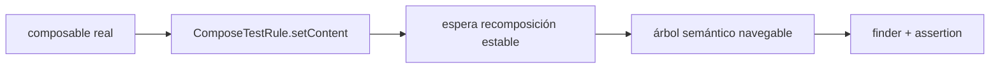
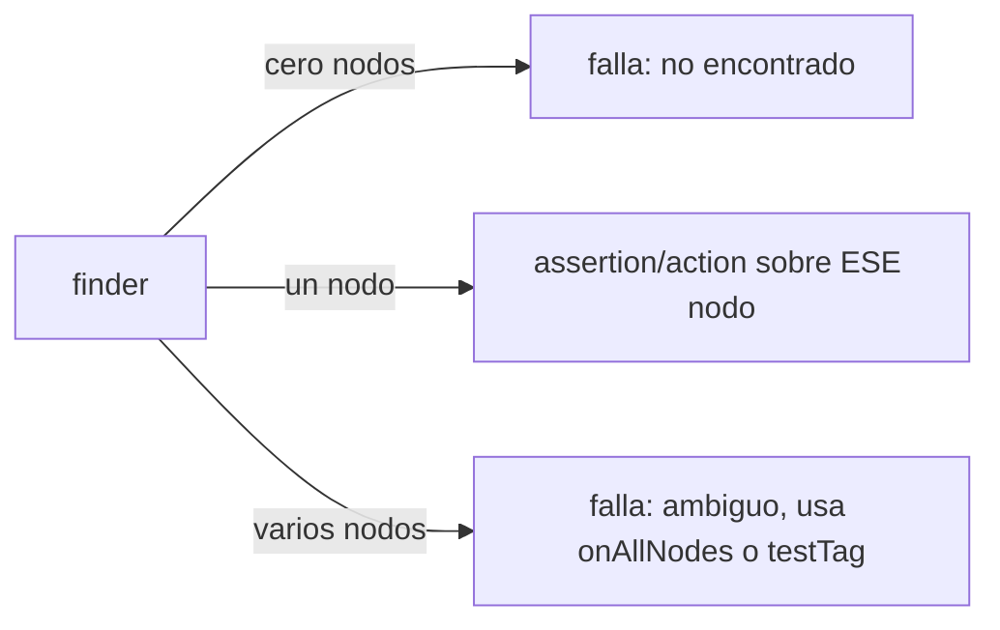
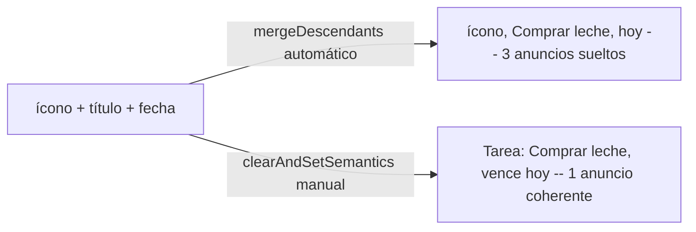
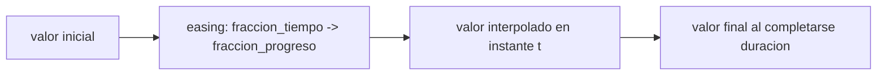
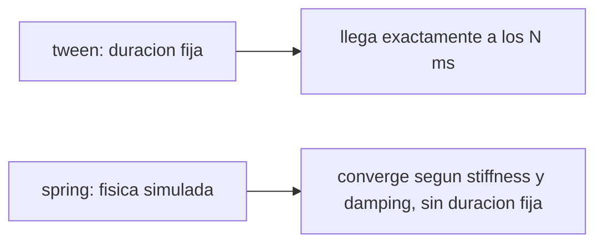

# Módulo 14: Compose Master — pruebas, accesibilidad y animación

Una pantalla Compose que "se ve bien" en el emulador puede seguir rota para quien usa TalkBack, o para un cambio futuro que nadie prueba automáticamente. Este módulo cierra el track cubriendo tres disciplinas que no aparecen en el resultado visual: verificar UI con pruebas reales, exponer la interfaz a servicios de accesibilidad, y animar transiciones con una especificación medible en vez de "una animación que se ve fluida".


## Aprende construyendo


### Tema 1: ComposeTestRule ejecuta tu UI sin emulador visible · Avanzado · 45 min

<details open>
<summary><strong>Capa 1 — Lectura</strong></summary>

#### ► CÓMO FUNCIONA


</details>

<details>
<summary><strong>Capa 2 — Construcción</strong></summary>

#### Código y verificación

```bash
mkdir -p app/src/androidTest/kotlin/com/academia/android
```

```kotlin
package com.academia.android

import androidx.compose.foundation.layout.Column
import androidx.compose.material3.Button
import androidx.compose.material3.Text
import androidx.compose.runtime.*

@Composable
fun ContadorDePrueba() {
    var cantidad by remember { mutableStateOf(0) }
    Column {
        Text("Contador: $cantidad")
        Button(onClick = { cantidad++ }) { Text("Incrementar") }
    }
}
```

```kotlin
// app/src/androidTest/kotlin/com/academia/android/ContadorTest.kt
package com.academia.android

import androidx.compose.ui.test.junit4.createComposeRule
import androidx.compose.ui.test.onNodeWithText
import androidx.compose.ui.test.performClick
import androidx.compose.ui.test.assertTextEquals
import org.junit.Rule
import org.junit.Test

class ContadorTest {
    @get:Rule
    val compose = createComposeRule()

    @Test
    fun alHacerClicIncrementaElContador() {
        compose.setContent { ContadorDePrueba() }
        compose.onNodeWithText("Contador: 0").assertExists()
        compose.onNodeWithText("Incrementar").performClick()
        compose.onNodeWithText("Contador: 1").assertExists()
    }
}
```

```kotlin
android { defaultConfig { testInstrumentationRunner = "androidx.test.runner.AndroidJUnitRunner" } }
dependencies {
    androidTestImplementation(platform(libs.androidx.compose.bom))
    androidTestImplementation("androidx.compose.ui:ui-test-junit4")
    debugImplementation("androidx.compose.ui:ui-test-manifest")
}
```

```bash
./gradlew :app:connectedDebugAndroidTest -Pandroid.testInstrumentationRunnerArguments.class="com.academia.android.ContadorTest"
```

</details>

### Tema 2: Finders, assertions y actions navegan el árbol semántico · Avanzado · 45 min

<details open>
<summary><strong>Capa 1 — Lectura</strong></summary>

#### ► DE QUÉ TRATA
Al finalizar podrás elegir el finder correcto para un nodo (por texto, por tag, por rol) y encadenar assertions y actions sin ambigüedad cuando existan varios nodos similares.

#### ► CÓMO FUNCIONA


</details>

<details>
<summary><strong>Capa 2 — Construcción</strong></summary>

#### Código y verificación


```bash
test -f settings.gradle.kts || cd academia-android   # sitúate en la raíz del proyecto del Módulo 0
mkdir -p app/src/androidTest/kotlin/com/academia/android
```

```kotlin
// app/src/androidTest/kotlin/com/academia/android/FormularioDobleTest.kt
package com.academia.android

import androidx.compose.ui.test.junit4.createComposeRule
import androidx.compose.ui.test.onNodeWithTag
import androidx.compose.ui.test.onNodeWithText
import androidx.compose.ui.test.onAllNodesWithText
import androidx.compose.ui.test.performTextInput
import androidx.compose.ui.test.assertTextEquals
import androidx.compose.ui.test.assertCountEquals
import org.junit.Rule
import org.junit.Test

class FormularioDobleTest {
    @get:Rule
    val compose = createComposeRule()

    @Test
    fun `dos campos comparten placeholder, buscar por texto es ambiguo`() {
        compose.setContent { PantallaFormularioDoble() }
        // ambos campos muestran el placeholder "Guardar": onAllNodesWithText confirma la ambigüedad
        compose.onAllNodesWithText("Guardar").assertCountEquals(2)
    }

    @Test
    fun escribeEnElCampoDeTituloDeLaTareaNoEnElDeNota() {
        compose.setContent { PantallaFormularioDoble() }
        // dos campos comparten el placeholder "Guardar"; testTag es la única forma no ambigua
        compose.onNodeWithTag("campo_titulo_tarea").performTextInput("Comprar leche")
        compose.onNodeWithTag("campo_titulo_tarea").assertTextEquals("Comprar leche")
    }
}
```

```bash
# Gradle ejecuta el test instrumentado de Compose que usa testTag
./gradlew :app:connectedDebugAndroidTest -Pandroid.testInstrumentationRunnerArguments.class="com.academia.android.FormularioDobleTest"
```

</details>

### Tema 3: Semantics y clearAndSetSemantics definen qué percibe la accesibilidad · Avanzado · 45 min

<details open>
<summary><strong>Capa 1 — Lectura</strong></summary>

#### ► DE QUÉ TRATA
Al finalizar podrás explicar cómo Compose fusiona (mergeDescendants) la semántica de un grupo de nodos hijos, y cuándo clearAndSetSemantics debe reemplazar esa fusión con una descripción manual coherente.

#### ► LA ANALOGÍA
**Conceptos clave:** nodo semántico, `mergeDescendants`, `clearAndSetSemantics`, enunciado coherente.

Cada composable puede aportar propiedades semánticas (texto, rol, estado) a un nodo; un contenedor con `mergeDescendants = true` combina las de sus hijos en un solo nodo navegable, útil para una tarjeta que debe anunciarse como una unidad. `clearAndSetSemantics` descarta la fusión automática y define manualmente la descripción completa, necesario cuando la fusión automática produce un orden o redundancia que no tiene sentido leído en voz alta.

**Analogía:** la fusión automática es como leer en voz alta cada etiqueta de una caja por separado; `clearAndSetSemantics` es escribir una sola frase que resume el contenido de la caja de forma que tenga sentido escuchada de corrido.

**Diagrama:**



#### ► CÓMO FUNCIONA


</details>

<details>
<summary><strong>Capa 2 — Construcción</strong></summary>

#### Objetivo observable
Al finalizar podrás explicar cómo Compose fusiona (`mergeDescendants`) la semántica de un grupo de nodos hijos, y cuándo `clearAndSetSemantics` debe reemplazar esa fusión con una descripción manual coherente.

**Conocimiento previo:** `contentDescription` (Módulo 10, Tema 3 de este track); Tema 2 de este módulo (árbol semántico).

</details>

### Tema 4: AccessibilityService y TalkBack consumen el árbol semántico en producción · Avanzado · 45 min

<details open>
<summary><strong>Capa 1 — Lectura</strong></summary>

#### ► DE QUÉ TRATA
Al finalizar podrás auditar una pantalla completa detectando qué nodos carecen de descripción accesible, y explicar qué anunciaría TalkBack recorriendo esa pantalla en el orden real del árbol.

#### ► LA ANALOGÍA
**Conceptos clave:** `AccessibilityService`, TalkBack, orden de navegación, foco de accesibilidad.

`AccessibilityService` es la API que TalkBack usa para recibir eventos del árbol semántico y anunciarlos mediante voz; no interpreta píxeles, solo la información semántica expuesta. El orden en que TalkBack navega sigue por defecto el orden del árbol de composición, que puede no coincidir con el orden visual si el layout usa superposición o reordenamiento visual sin ajustar la semántica. Un nodo interactivo (botón, ícono clicable) sin `contentDescription` se anuncia como "botón sin etiqueta", inutilizable para quien depende de voz.

**Analogía:** TalkBack es un guía que solo puede describir lo que está etiquetado; un ícono sin descripción es una puerta sin cartel — el guía sabe que existe pero no puede decir para qué sirve.

**Diagrama:**

```
┌── árbol semántico completo ──┐
│  nodo 1: "Volver" (botón)      │
│  nodo 2: sin contentDescription│ ◀── TalkBack anuncia "botón sin etiqueta"
│  nodo 3: "Comprar leche"        │
└─────────────────────────────────┘
```

</details>

<details>
<summary><strong>Capa 2 — Construcción</strong></summary>

#### Código y verificación
```
┌── árbol semántico completo ──┐
│  nodo 1: "Volver" (botón)      │
│  nodo 2: sin contentDescription│ ◀── TalkBack anuncia "botón sin etiqueta"
│  nodo 3: "Comprar leche"        │
└─────────────────────────────────┘
```

```bash
test -f settings.gradle.kts || cd academia-android   # sitúate en la raíz del proyecto del Módulo 0
mkdir -p app/src/main/kotlin/com/academia/android
```

```kotlin
// app/src/main/kotlin/com/academia/android/AuditoriaAccesibilidad.kt
package com.academia.android

data class NodoAuditado(val id: String, val esInteractivo: Boolean, val contentDescription: String?)

/** Detecta nodos interactivos sin contentDescription, tal como los anunciaría TalkBack. */
fun auditarArbol(nodos: List<NodoAuditado>): List<String> =
    nodos.filter { it.esInteractivo && it.contentDescription.isNullOrEmpty() }.map { it.id }
```

```bash
./gradlew :app:compileDebugKotlin
```

```kotlin
// app/src/test/kotlin/com/academia/android/AuditoriaAccesibilidadTest.kt
package com.academia.android

import kotlin.test.Test
import kotlin.test.assertEquals

class AuditoriaAccesibilidadTest {

    private val pantallaResumen = listOf(
        NodoAuditado(id = "boton_volver", esInteractivo = true, contentDescription = "Volver"),
        NodoAuditado(id = "icono_editar", esInteractivo = true, contentDescription = null),
        NodoAuditado(id = "texto_tarea", esInteractivo = false, contentDescription = null),
        NodoAuditado(id = "icono_mas", esInteractivo = true, contentDescription = null),
    )

    @Test
    fun `detecta solo nodos interactivos sin descripcion`() {
        val problemas = auditarArbol(pantallaResumen)

        assertEquals(listOf("icono_editar", "icono_mas"), problemas)
    }
}
```

```bash
# Gradle ejecuta el test unitario real sobre la JVM
./gradlew :app:testDebugUnitTest --tests "com.academia.android.AuditoriaAccesibilidadTest"
```

</details>

### Tema 5: Animaciones de estado y visibilidad usan una especificación medible · Avanzado · 45 min

<details open>
<summary><strong>Capa 1 — Lectura</strong></summary>

#### ► DE QUÉ TRATA
Al finalizar podrás calcular el valor interpolado de una animación en un instante dado usando una especificación de easing explícita, en vez de describir la animación como "algo que se ve fluida".

#### ► CÓMO FUNCIONA


</details>

<details>
<summary><strong>Capa 2 — Construcción</strong></summary>

#### Código y verificación


```bash
test -f settings.gradle.kts || cd academia-android   # sitúate en la raíz del proyecto del Módulo 0
mkdir -p app/src/main/kotlin/com/academia/android
```

```kotlin
// app/src/main/kotlin/com/academia/android/AnimacionTareaCompletada.kt
package com.academia.android

import androidx.compose.animation.core.LinearOutSlowInEasing
import androidx.compose.animation.core.animateFloatAsState
import androidx.compose.animation.core.tween
import androidx.compose.runtime.Composable

@Composable
fun opacidadTareaCompletada(completada: Boolean): Float {
    val opacidad by animateFloatAsState(
        targetValue = if (completada) 0.4f else 1.0f,
        animationSpec = tween(durationMillis = 300, easing = LinearOutSlowInEasing),
        label = "opacidadTarea",
    )
    return opacidad
}
```

```bash
./gradlew :app:compileDebugKotlin
```

```kotlin
// app/src/test/kotlin/com/academia/android/AnimacionTareaCompletadaTest.kt
package com.academia.android

import androidx.compose.animation.core.LinearOutSlowInEasing
import kotlin.test.Test
import kotlin.test.assertTrue

class AnimacionTareaCompletadaTest {

    private fun valorInterpolado(inicial: Float, final: Float, duracionMs: Int, tiempoTranscurridoMs: Int): Float {
        val fraccionTiempo = (tiempoTranscurridoMs.toFloat() / duracionMs).coerceAtMost(1f)
        val fraccionProgreso = LinearOutSlowInEasing.transform(fraccionTiempo)
        return inicial + (final - inicial) * fraccionProgreso
    }

    @Test
    fun `LinearOutSlowInEasing progresa mas de la mitad antes de la mitad del tiempo`() {
        val progresoAMitadTiempo = LinearOutSlowInEasing.transform(0.5f)

        assertTrue(progresoAMitadTiempo > 0.5f, "ease-out debe progresar más de la mitad antes de la mitad del tiempo")
    }

    @Test
    fun `a mitad de tiempo la opacidad esta mas cerca del final que con interpolacion lineal`() {
        val valorConEasingReal = valorInterpolado(inicial = 1.0f, final = 0.4f, duracionMs = 300, tiempoTranscurridoMs = 150)
        val valorLineal = 1.0f + (0.4f - 1.0f) * 0.5f // 0.7, el punto medio lineal sin easing

        assertTrue(valorConEasingReal < valorLineal, "con LinearOutSlowInEasing, a mitad de tiempo ya debería estar más cerca de 0.4 que la interpolación lineal")
    }
}
```

```bash
# Gradle ejecuta el test unitario real usando la función Easing real de Compose (sin emulador)
./gradlew :app:testDebugUnitTest --tests "com.academia.android.AnimacionTareaCompletadaTest"
```

</details>

### Tema 6: AnimatedContent y AnimationSpec especifican transiciones completas · Avanzado · 45 min

<details open>
<summary><strong>Capa 1 — Lectura</strong></summary>

#### ► DE QUÉ TRATA
Al finalizar podrás elegir entre un tween (duración fija) y un spring (basado en física) según el comportamiento deseado, y simular numéricamente cómo converge un resorte hacia su valor final.

#### ► CÓMO FUNCIONA


</details>

<details>
<summary><strong>Capa 2 — Construcción</strong></summary>

#### Código y verificación


```bash
test -f settings.gradle.kts || cd academia-android   # sitúate en la raíz del proyecto del Módulo 0
mkdir -p app/src/main/kotlin/com/academia/android
```

```kotlin
// app/src/main/kotlin/com/academia/android/TransicionListaTareas.kt
package com.academia.android

import androidx.compose.animation.AnimatedContent
import androidx.compose.animation.core.Spring
import androidx.compose.animation.core.spring
import androidx.compose.runtime.Composable

@Composable
fun TransicionContadorTareas(cantidad: Int) {
    AnimatedContent(
        targetState = cantidad,
        transitionSpec = {
            fadeIn() togetherWith fadeOut()
        },
        label = "contadorTareas",
    ) { valorObjetivo ->
        // el tamaño del texto anima con un spring, no con duracion fija
        TextoConSpring(valorObjetivo, spring(dampingRatio = Spring.DampingRatioMediumBouncy))
    }
}
```

```bash
./gradlew :app:compileDebugKotlin
```

```kotlin
// app/src/main/kotlin/com/academia/android/SimulacionSpring.kt
package com.academia.android

import kotlin.math.sqrt

/** Integra la ecuación de movimiento de un oscilador armónico amortiguado (método de Euler). */
fun simularSpring(
    valorInicial: Double,
    valorFinal: Double,
    stiffness: Double,
    dampingRatio: Double,
    pasos: Int = 20,
    dt: Double = 0.016,
): List<Double> {
    var posicion = valorInicial
    var velocidad = 0.0
    val masa = 1.0
    val dampingCoef = dampingRatio * 2 * sqrt(stiffness * masa)
    val trayectoria = mutableListOf(posicion)
    repeat(pasos) {
        val desplazamiento = posicion - valorFinal
        val fuerza = -stiffness * desplazamiento - dampingCoef * velocidad
        val aceleracion = fuerza / masa
        velocidad += aceleracion * dt
        posicion += velocidad * dt
        trayectoria.add(posicion)
    }
    return trayectoria
}
```

```kotlin
// app/src/test/kotlin/com/academia/android/SimulacionSpringTest.kt
package com.academia.android

import kotlin.test.Test
import kotlin.test.assertTrue

class SimulacionSpringTest {

    @Test
    fun `damping bajo rebota mas alla del objetivo antes de asentarse`() {
        val trayectoria = simularSpring(valorInicial = 0.0, valorFinal = 10.0, stiffness = 200.0, dampingRatio = 0.3)

        assertTrue(trayectoria.max() > 10.0, "con damping bajo el resorte debe sobrepasar el objetivo (rebote)")
    }

    @Test
    fun `damping alto converge sin sobrepasar significativamente el objetivo`() {
        val trayectoria = simularSpring(valorInicial = 0.0, valorFinal = 10.0, stiffness = 200.0, dampingRatio = 1.2)

        assertTrue(trayectoria.max() <= 10.05, "con damping alto el resorte no debe sobrepasar significativamente el objetivo")
    }
}
```

</details>
