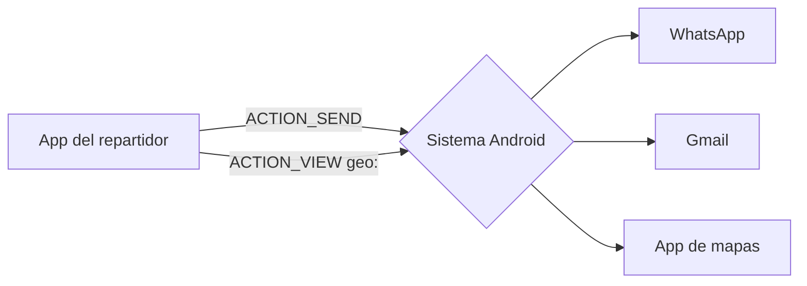
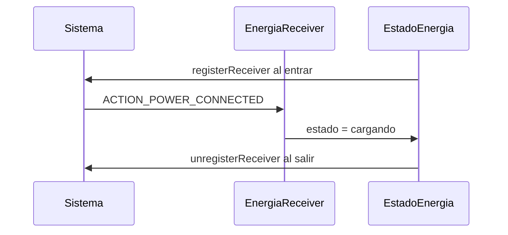
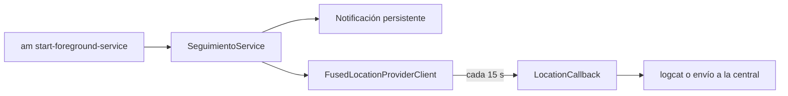
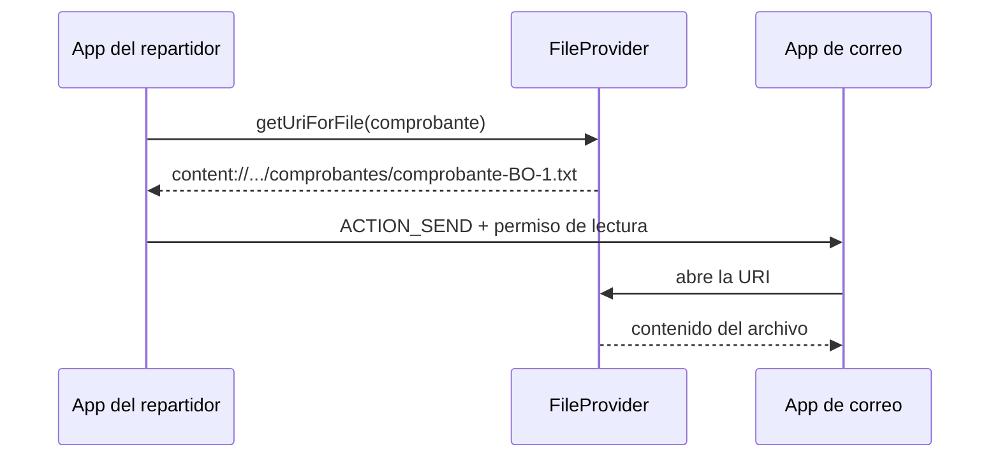

# Módulo 15: Android como plataforma — Intents, broadcasts, servicios y content providers


## Aprende construyendo

### Tema 1: Intents implícitos y Activity Result API

#### Paso 1 · Objetivo y preparación
Al finalizar podrás pedir al sistema que otra app comparta, navegue o elija un contacto mediante Intents implícitos, recibir el resultado con la Activity Result API y manejar el caso en que ninguna app puede resolver el Intent. Prerrequisitos: Módulos 1 y 2 (Activities y Compose).

#### Paso 2 · Contexto y caso real
El repartidor de RutaFlow necesita compartir el enlace de seguimiento por WhatsApp, abrir la dirección en su app de mapas y llamar al contacto del destinatario. Reescribir mapas o mensajería sería absurdo: el caso real en Android es delegar en otras apps con Intents, que es como el sistema conecta aplicaciones entre sí.

#### Paso 3 · Teoría, modelo mental y analogía
Un **Intent explícito** nombra la clase destino (`Intent(context, OtraActivity::class.java)`); un **Intent implícito** describe una **acción** (`ACTION_SEND`, `ACTION_VIEW`) y unos datos o tipo MIME, y el sistema busca las apps que la declaran en su `intent-filter`. `createChooser` muestra el selector. Si nadie puede resolverlo, `startActivity` lanza `ActivityNotFoundException`. La **Activity Result API** (`rememberLauncherForActivityResult` con un contrato como `PickContact` o `TakePicture`) reemplaza a `onActivityResult` y entrega el resultado en un callback. Desde Android 11, para *consultar* qué apps existen debes declararlo en `<queries>` del manifiesto.

**Analogía:** el Intent explícito es llamar a una persona por su nombre; el implícito es gritar en la oficina "¿quién sabe traducir del inglés?" y dejar que conteste quien pueda.

**Diagrama:**



#### Paso 4 · Demostración guiada desde cero
**Ejemplo independiente (desde cero):** este tema se reproduce en una **carpeta vacía**, como **proyecto nuevo**, sin estado de otros temas.

```bash
mkdir android-plataforma && cd android-plataforma && cd android-plataforma
# En Android Studio: File ▸ New ▸ New Project ▸ Empty Activity, nombre Repartidor,
# paquete com.rutaflow.repartidor, guardado dentro de esta carpeta
```

Crea `app/src/main/java/com/rutaflow/repartidor/Acciones.kt`:

```kotlin
package com.rutaflow.repartidor

import android.content.ActivityNotFoundException
import android.content.Context
import android.content.Intent
import android.net.Uri
import android.util.Log
import androidx.activity.compose.rememberLauncherForActivityResult
import androidx.activity.result.contract.ActivityResultContracts
import androidx.compose.foundation.layout.Column
import androidx.compose.material3.Button
import androidx.compose.material3.Text
import androidx.compose.runtime.*

private const val TAG = "RutaFlow"

// Intent implícito: describe QUÉ quieres hacer; el sistema elige la app que lo resuelve
fun compartirGuia(context: Context, guia: String) {
    val enviar = Intent(Intent.ACTION_SEND).apply {
        type = "text/plain"
        putExtra(Intent.EXTRA_TEXT, "Sigue tu envío $guia en https://rutaflow.co/s/$guia")
    }
    context.startActivity(Intent.createChooser(enviar, "Compartir guía"))
}

fun navegarA(context: Context, direccion: String) {
    val uri = Uri.parse("geo:0,0?q=" + Uri.encode(direccion))
    try {
        context.startActivity(Intent(Intent.ACTION_VIEW, uri))
    } catch (e: ActivityNotFoundException) {
        Log.w(TAG, "No hay app de mapas instalada para $uri")
    }
}

@Composable
fun AccionesEntrega(guia: String, direccion: String, context: Context) {
    var contacto by remember { mutableStateOf<String?>(null) }
    // Activity Result API: lanzar otra app y recibir su resultado sin onActivityResult
    val elegirContacto = rememberLauncherForActivityResult(ActivityResultContracts.PickContact()) { uri ->
        contacto = uri?.lastPathSegment
        Log.i(TAG, "Contacto elegido: $uri")
    }
    Column {
        Button(onClick = { compartirGuia(context, guia) }) { Text("Compartir guía") }
        Button(onClick = { navegarA(context, direccion) }) { Text("Navegar") }
        Button(onClick = { elegirContacto.launch(null) }) { Text("Elegir contacto") }
        contacto?.let { Text("Contacto: $it") }
    }
}
```

**Ejecuta el ejemplo:**

```bash
./gradlew installDebug
adb shell am start -n com.rutaflow.repartidor/.MainActivity
adb logcat -s RutaFlow
```

**Resultado esperado:**

```text
(logcat, al elegir un contacto)
I RutaFlow: Contacto elegido: content://com.android.contacts/contacts/lookup/.../1
```

En `MainActivity` llama `AccionesEntrega("BO-004512", "Cra 7 # 72-41, Bogotá", LocalContext.current)` dentro de `setContent`. Al pulsar **Compartir guía** aparece el selector del sistema; **Navegar** abre la app de mapas del emulador (o deja el aviso en logcat si no hay ninguna); **Elegir contacto** abre la libreta y, al volver, muestra el identificador del contacto.

**Fallo deliberado:** En `navegarA` borra el `try/catch` y prueba en un emulador sin app de mapas (una imagen *AOSP* sin Google Play). La app se cierra con `android.content.ActivityNotFoundException: No Activity found to handle Intent { act=android.intent.action.VIEW dat=geo:... }`. Un Intent implícito puede no tener quién lo atienda: siempre maneja ese caso.

#### Paso 5 · Práctica guiada
Agrega un botón **Llamar** que abra el marcador con el teléfono del destinatario usando `ACTION_DIAL` y `tel:`. **Pista:** `Intent(Intent.ACTION_DIAL, Uri.parse("tel:3001234567"))` no necesita permiso porque solo marca; `ACTION_CALL` sí lo necesita.

#### Paso 6 · Práctica independiente
Usa el contrato `ActivityResultContracts.TakePicture()` para tomar la foto de la evidencia de entrega con la cámara del sistema, guardándola en un `Uri` creado con `FileProvider` (Tema 4).

#### Paso 7 · Cierre y evidencia
Entrega como evidencia la salida real del Paso 4 y la explicación del fallo deliberado. **¿Por qué es importante?** porque los Intents son el mecanismo con el que Android integra apps, y manejar mal su resolución es una causa común de cierres inesperados.
**Fuente oficial:** [Android: Intents and intent filters](https://developer.android.com/guide/components/intents-filters), [Android: Get a result from an activity](https://developer.android.com/training/basics/intents/result).
**Conceptos clave:** Intent explícito e implícito, acción, tipo MIME, `intent-filter`, `createChooser`, `ActivityNotFoundException`, Activity Result API, `<queries>`.
**Cuándo no usarlo:** para navegar entre pantallas de tu propia app usa Navigation Compose (Módulo 3), no Intents.

**Transferencia al proyecto integrador «Aplicación del repartidor Android»:** agrega en el detalle de cada entrega los botones de compartir seguimiento, navegar y llamar al destinatario.
Como **siguiente** paso, aplica lo aprendido en el proyecto integrador del track y compara el resultado con lo que esperabas.
**Errores comunes:** copiar el ejemplo sin leer la salida real y dar por hecho que funciona con un solo caso.

### Tema 2: BroadcastReceiver: reaccionar a eventos del sistema

#### Paso 1 · Objetivo y preparación
Al finalizar podrás registrar un `BroadcastReceiver` dinámico atado al ciclo de vida de una pantalla, declarar si recibe broadcasts de otras apps y simular eventos del sistema con `adb`. Prerrequisitos: Módulo 1 (ciclo de vida) y Tema 1 de este módulo.

#### Paso 2 · Contexto y caso real
Cuando la batería del teléfono del repartidor baja, la app debe sincronizar las entregas pendientes y reducir la frecuencia del GPS. Android anuncia esos eventos con *broadcasts*: es el mismo mecanismo de un caso real como detectar que se conectó el cargador o que cambió la zona horaria.

#### Paso 3 · Teoría, modelo mental y analogía
Un **broadcast** es un mensaje que el sistema u otras apps envían a quien se haya suscrito. Un **BroadcastReceiver** recibe los que coinciden con su `IntentFilter` en `onReceive`, que debe ser rápido (para trabajo largo, usa WorkManager). Desde Android 8 casi ningún broadcast implícito se entrega a receptores declarados en el manifiesto, así que se **registran en código** mientras la app está activa. Desde Android 14, al registrar debes indicar `RECEIVER_EXPORTED` o `RECEIVER_NOT_EXPORTED` (si otras apps pueden enviarte el broadcast). `ContextCompat.registerReceiver` aplica la regla de forma compatible.

**Analogía:** es suscribirte a las alertas de una emisora solo mientras tienes la radio encendida.

**Diagrama:**



#### Paso 4 · Demostración guiada desde cero
**Ejemplo independiente (desde cero):** este tema se reproduce en una **carpeta vacía**, como **proyecto nuevo**, sin estado de otros temas.

```bash
mkdir android-plataforma && cd android-plataforma && cd android-plataforma
# En Android Studio: File ▸ New ▸ New Project ▸ Empty Activity, nombre Repartidor,
# paquete com.rutaflow.repartidor, guardado dentro de esta carpeta
```

Crea `app/src/main/java/com/rutaflow/repartidor/Energia.kt`:

```kotlin
package com.rutaflow.repartidor

import android.content.BroadcastReceiver
import android.content.Context
import android.content.Intent
import android.content.IntentFilter
import android.util.Log
import androidx.compose.runtime.*
import androidx.compose.ui.platform.LocalContext
import androidx.core.content.ContextCompat

// Recibe eventos del sistema mientras la pantalla está visible
class EnergiaReceiver(private val alCambiar: (String) -> Unit) : BroadcastReceiver() {
    override fun onReceive(context: Context, intent: Intent) {
        val estado = when (intent.action) {
            Intent.ACTION_POWER_CONNECTED -> "cargando"
            Intent.ACTION_POWER_DISCONNECTED -> "sin cargador"
            Intent.ACTION_BATTERY_LOW -> "batería baja: sincroniza y reduce el GPS"
            else -> return
        }
        Log.i("RutaFlow", "Evento de energía: $estado")
        alCambiar(estado)
    }
}

@Composable
fun EstadoEnergia() {
    val context = LocalContext.current
    var estado by remember { mutableStateOf("sin eventos") }
    // Registro dinámico atado al ciclo de vida del composable: se quita al salir
    DisposableEffect(Unit) {
        val receiver = EnergiaReceiver { estado = it }
        val filtro = IntentFilter().apply {
            addAction(Intent.ACTION_POWER_CONNECTED)
            addAction(Intent.ACTION_POWER_DISCONNECTED)
            addAction(Intent.ACTION_BATTERY_LOW)
        }
        ContextCompat.registerReceiver(context, receiver, filtro, ContextCompat.RECEIVER_NOT_EXPORTED)
        onDispose { context.unregisterReceiver(receiver) }
    }
    androidx.compose.material3.Text("Energía: $estado")
}
```

**Ejecuta el ejemplo:**

```bash
./gradlew installDebug
adb shell am start -n com.rutaflow.repartidor/.MainActivity
adb shell dumpsys battery set ac 1      # simula conectar el cargador
adb shell dumpsys battery unplug       # simula desconectarlo
adb shell dumpsys battery reset
adb logcat -s RutaFlow
```

**Resultado esperado:**

```text
I RutaFlow: Evento de energía: cargando
I RutaFlow: Evento de energía: sin cargador
```

Muestra `EstadoEnergia()` en `MainActivity`. Con cada comando de `dumpsys battery` el texto de la pantalla cambia y en logcat aparece `I RutaFlow: Evento de energía: cargando` y luego `sin cargador`. Si un evento no llega, revisa que la pantalla esté visible: el receptor solo existe mientras el composable está en pantalla.

**Fallo deliberado:** Reemplaza `ContextCompat.registerReceiver(context, receiver, filtro, ContextCompat.RECEIVER_NOT_EXPORTED)` por `context.registerReceiver(receiver, filtro)` y agrega al filtro una acción propia como `"com.rutaflow.SINCRONIZAR"`. En Android 14 o superior la app se cierra con `SecurityException: ... One of RECEIVER_EXPORTED or RECEIVER_NOT_EXPORTED should be specified when a receiver isn't being registered exclusively for system broadcasts`. Declarar quién puede enviarte mensajes es obligatorio.

#### Paso 5 · Práctica guiada
Agrega `Intent.ACTION_TIMEZONE_CHANGED` al filtro y muestra la nueva zona horaria cuando cambie. **Pista:** la zona actual se obtiene con `java.time.ZoneId.systemDefault()`; puedes cambiarla en los ajustes del emulador para probar.

#### Paso 6 · Práctica independiente
Cuando llegue `ACTION_BATTERY_LOW`, encola un `OneTimeWorkRequest` de sincronización (Módulo 8) en lugar de hacer la sincronización dentro de `onReceive`, y explica por qué.

#### Paso 7 · Cierre y evidencia
Entrega como evidencia la salida real del Paso 4 y la explicación del fallo deliberado. **¿Por qué es importante?** porque reaccionar al estado del dispositivo mejora la batería y la confiabilidad, y los cambios de seguridad de Android 14 rompen receptores mal registrados.
**Fuente oficial:** [Android: Broadcasts overview](https://developer.android.com/develop/background-work/background-tasks/broadcasts), [Android 14: Safer context-registered receivers](https://developer.android.com/about/versions/14/behavior-changes-14#runtime-receivers-exported).
**Conceptos clave:** broadcast, `BroadcastReceiver`, `IntentFilter`, registro dinámico, `RECEIVER_NOT_EXPORTED`, `DisposableEffect`, `adb shell dumpsys battery`.
**Cuándo no usarlo:** para observar conectividad de red usa `ConnectivityManager.NetworkCallback`, y para tareas programadas WorkManager con restricciones: son más precisos que los broadcasts.

**Transferencia al proyecto integrador «Aplicación del repartidor Android»:** reduce la frecuencia del GPS y sincroniza pendientes cuando la batería esté baja.
Como **siguiente** paso, aplica lo aprendido en el proyecto integrador del track y compara el resultado con lo que esperabas.
**Errores comunes:** copiar el ejemplo sin leer la salida real y dar por hecho que funciona con un solo caso.

### Tema 3: Foreground Service de ubicación con FusedLocationProvider

#### Paso 1 · Objetivo y preparación
Al finalizar podrás mantener un seguimiento de ubicación con la app en segundo plano usando un *foreground service* de tipo `location`, pedir actualizaciones al FusedLocationProvider con un intervalo que cuida la batería y simular posiciones en el emulador. Prerrequisitos: Tema 2 de este módulo y Módulo 8 (trabajo en segundo plano).

#### Paso 2 · Contexto y caso real
La central de RutaFlow necesita ver dónde está cada repartidor mientras la ruta está activa, aunque el teléfono esté en el bolsillo con la pantalla apagada. WorkManager no sirve para un flujo continuo; el caso real de apps de reparto, transporte o deporte es un servicio en primer plano con notificación visible.

#### Paso 3 · Teoría, modelo mental y analogía
Un **foreground service** es un servicio que el usuario sabe que está corriendo: debe mostrar una notificación persistente y, desde Android 14, declarar su **tipo** (`location`, `dataSync`, `mediaPlayback`…) en el manifiesto y al llamar `startForeground`, además del permiso específico (`FOREGROUND_SERVICE_LOCATION`). El **FusedLocationProviderClient** combina GPS, Wi-Fi y redes móviles; con `LocationRequest` eliges prioridad e intervalo para equilibrar precisión y batería. Las actualizaciones se detienen en `onDestroy`.

**Analogía:** es el taxímetro encendido: el pasajero ve en todo momento que está corriendo y sabe que puede pedir que lo apaguen.

**Diagrama:**



#### Paso 4 · Demostración guiada desde cero
**Ejemplo independiente (desde cero):** este tema se reproduce en una **carpeta vacía**, como **proyecto nuevo**, sin estado de otros temas.

```bash
mkdir android-plataforma && cd android-plataforma && cd android-plataforma
# En Android Studio: File ▸ New ▸ New Project ▸ Empty Activity, nombre Repartidor,
# paquete com.rutaflow.repartidor, guardado dentro de esta carpeta
```

Crea `AndroidManifest.xml (fragmentos)`:

```xml
<!-- app/src/main/AndroidManifest.xml (fragmentos) -->
<uses-permission android:name="android.permission.ACCESS_FINE_LOCATION" />
<uses-permission android:name="android.permission.ACCESS_COARSE_LOCATION" />
<uses-permission android:name="android.permission.FOREGROUND_SERVICE" />
<uses-permission android:name="android.permission.FOREGROUND_SERVICE_LOCATION" />
<uses-permission android:name="android.permission.POST_NOTIFICATIONS" />

<application ...>
    <service
        android:name=".SeguimientoService"
        android:exported="false"
        android:foregroundServiceType="location" />
</application>
```

Crea `app/build.gradle.kts (fragmento)`:

```kotlin
// app/build.gradle.kts, dentro de dependencies { }
implementation("com.google.android.gms:play-services-location:21.3.0")
```

Crea `app/src/main/java/com/rutaflow/repartidor/SeguimientoService.kt`:

```kotlin
package com.rutaflow.repartidor

import android.app.NotificationChannel
import android.app.NotificationManager
import android.app.Service
import android.content.Intent
import android.content.pm.ServiceInfo
import android.os.IBinder
import android.os.Looper
import android.util.Log
import androidx.core.app.NotificationCompat
import androidx.core.app.ServiceCompat
import com.google.android.gms.location.*

// Servicio en primer plano: sigue enviando la ubicación con la pantalla apagada,
// pero SIEMPRE con una notificación visible para el usuario
class SeguimientoService : Service() {
    private lateinit var ubicacion: FusedLocationProviderClient
    private val callback = object : LocationCallback() {
        override fun onLocationResult(resultado: LocationResult) {
            resultado.lastLocation?.let {
                Log.i("RutaFlow", "Posición %.5f, %.5f (±%.0f m)".format(it.latitude, it.longitude, it.accuracy))
            }
        }
    }

    override fun onCreate() {
        super.onCreate()
        ubicacion = LocationServices.getFusedLocationProviderClient(this)
        val canal = NotificationChannel("seguimiento", "Seguimiento de ruta", NotificationManager.IMPORTANCE_LOW)
        getSystemService(NotificationManager::class.java).createNotificationChannel(canal)
    }

    override fun onStartCommand(intent: Intent?, flags: Int, startId: Int): Int {
        val notificacion = NotificationCompat.Builder(this, "seguimiento")
            .setSmallIcon(android.R.drawable.ic_menu_mylocation)
            .setContentTitle("Ruta en curso")
            .setContentText("Compartiendo tu ubicación con la central")
            .setOngoing(true)
            .build()
        ServiceCompat.startForeground(this, 1, notificacion, ServiceInfo.FOREGROUND_SERVICE_TYPE_LOCATION)

        val solicitud = LocationRequest.Builder(Priority.PRIORITY_BALANCED_POWER_ACCURACY, 15_000)
            .setMinUpdateIntervalMillis(10_000)
            .build()
        try {
            ubicacion.requestLocationUpdates(solicitud, callback, Looper.getMainLooper())
        } catch (e: SecurityException) {
            Log.e("RutaFlow", "Falta el permiso de ubicación", e)
            stopSelf()
        }
        return START_STICKY
    }

    override fun onDestroy() {
        ubicacion.removeLocationUpdates(callback)
        super.onDestroy()
    }

    override fun onBind(intent: Intent?): IBinder? = null
}
```

**Ejecuta el ejemplo:**

```bash
./gradlew installDebug
adb shell pm grant com.rutaflow.repartidor android.permission.ACCESS_FINE_LOCATION
adb shell pm grant com.rutaflow.repartidor android.permission.POST_NOTIFICATIONS
adb shell am start-foreground-service -n com.rutaflow.repartidor/.SeguimientoService
adb emu geo fix -74.0636 4.6486      # mueve el emulador a Chapinero (longitud latitud)
adb logcat -s RutaFlow
```

**Resultado esperado:**

```text
I RutaFlow: Posición 4.64860, -74.06360 (±5 m)
```

Aparece la notificación **Ruta en curso** y en logcat una línea `I RutaFlow: Posición 4.64860, -74.06360 (±... m)` cada vez que cambias la posición con `adb emu geo fix`. En la app real el servicio se inicia con `ContextCompat.startForegroundService` después de que el usuario concede los permisos con la Activity Result API; los `pm grant` solo agilizan la prueba.

**Fallo deliberado:** Borra `android:foregroundServiceType="location"` del manifiesto y vuelve a instalar. En Android 14 o superior el servicio falla al arrancar con `android.app.MissingForegroundServiceTypeException: Starting FGS without a type`. El sistema exige declarar para qué usas el primer plano.

#### Paso 5 · Práctica guiada
Agrega a la notificación una acción **Terminar ruta** que detenga el servicio. **Pista:** crea un `PendingIntent.getService` hacia el mismo servicio con una acción propia, y en `onStartCommand` llama `stopSelf()` cuando llegue esa acción.

#### Paso 6 · Práctica independiente
Mide en el emulador el efecto de cambiar la prioridad a `PRIORITY_HIGH_ACCURACY` y el intervalo a 5 s, y redacta en el README qué combinación usarías en ciudad y en carretera y por qué.

#### Paso 7 · Cierre y evidencia
Entrega como evidencia la salida real del Paso 4 y la explicación del fallo deliberado. **¿Por qué es importante?** porque el seguimiento en segundo plano es el corazón de una app de reparto y es de lo más revisado por Google Play: un tipo o permiso mal declarado bloquea la publicación.
**Fuente oficial:** [Android: Foreground service types](https://developer.android.com/develop/background-work/services/fgs/service-types), [Android: Request location updates](https://developer.android.com/develop/sensors-and-location/location/request-updates).
**Conceptos clave:** foreground service, tipo de servicio, notificación persistente, `FOREGROUND_SERVICE_LOCATION`, FusedLocationProviderClient, `LocationRequest`, prioridad e intervalo, `adb emu geo fix`.
**Cuándo no usarlo:** si solo necesitas la ubicación al marcar una entrega, pide una lectura única (`getCurrentLocation`) sin servicio. Si el trabajo puede esperar, usa WorkManager.

**Transferencia al proyecto integrador «Aplicación del repartidor Android»:** activa el seguimiento solo mientras la ruta del día está iniciada y detenlo al cerrar la última entrega.
Como **siguiente** paso, aplica lo aprendido en el proyecto integrador del track y compara el resultado con lo que esperabas.
**Errores comunes:** copiar el ejemplo sin leer la salida real y dar por hecho que funciona con un solo caso.

### Tema 4: Compartir archivos con FileProvider y content://

#### Paso 1 · Objetivo y preparación
Al finalizar podrás compartir un archivo privado de tu app con otra app mediante un `FileProvider`, conceder permiso de lectura temporal sobre una URI `content://` y explicar por qué Android prohíbe las URI `file://`. Prerrequisito: Tema 1 de este módulo.

#### Paso 2 · Contexto y caso real
Al terminar una entrega, el repartidor envía el comprobante al cliente por correo o WhatsApp. El archivo vive en el almacenamiento privado de la app, que otras apps no pueden leer. Compartir sin hacer público todo el almacenamiento es el caso real que resuelven los **content providers**.

#### Paso 3 · Teoría, modelo mental y analogía
Un **ContentProvider** expone datos de una app mediante URI `content://` y controla quién accede. `FileProvider` es un ContentProvider ya hecho para archivos: en `rutas_compartidas.xml` declaras qué carpetas se pueden compartir, `getUriForFile` traduce un `File` a una URI `content://`, y `FLAG_GRANT_READ_URI_PERMISSION` da permiso **temporal** solo a la app que recibe el Intent. Desde Android 7, enviar una URI `file://` a otra app lanza `FileUriExposedException`, porque revelaría rutas internas y dependería de permisos de archivo globales.

**Analogía:** en vez de darle a alguien la llave de tu casa (`file://`), le entregas un pase de un solo uso para recoger un paquete en la portería (`content://`).

**Diagrama:**



#### Paso 4 · Demostración guiada desde cero
**Ejemplo independiente (desde cero):** este tema se reproduce en una **carpeta vacía**, como **proyecto nuevo**, sin estado de otros temas.

```bash
mkdir android-plataforma && cd android-plataforma && cd android-plataforma
# En Android Studio: File ▸ New ▸ New Project ▸ Empty Activity, nombre Repartidor,
# paquete com.rutaflow.repartidor, guardado dentro de esta carpeta
```

Crea `AndroidManifest.xml (fragmento)`:

```xml
<!-- AndroidManifest.xml, dentro de <application> -->
<provider
    android:name="androidx.core.content.FileProvider"
    android:authorities="${applicationId}.archivos"
    android:exported="false"
    android:grantUriPermissions="true">
    <meta-data
        android:name="android.support.FILE_PROVIDER_PATHS"
        android:resource="@xml/rutas_compartidas" />
</provider>
```

Crea `app/src/main/res/xml/rutas_compartidas.xml`:

```xml
<?xml version="1.0" encoding="utf-8"?>
<!-- app/src/main/res/xml/rutas_compartidas.xml: SOLO estas carpetas se pueden compartir -->
<paths>
    <cache-path name="comprobantes" path="comprobantes/" />
</paths>
```

Crea `app/src/main/java/com/rutaflow/repartidor/Comprobantes.kt`:

```kotlin
package com.rutaflow.repartidor

import android.content.ClipData
import android.content.Context
import android.content.Intent
import android.util.Log
import androidx.core.content.FileProvider
import java.io.File

// Genera un comprobante y lo comparte con otra app sin exponer rutas del sistema de archivos
fun compartirComprobante(context: Context, guia: String) {
    val carpeta = File(context.cacheDir, "comprobantes").apply { mkdirs() }
    val archivo = File(carpeta, "comprobante-$guia.txt")
    archivo.writeText("RutaFlow\nGuía: $guia\nEstado: entregado\n")

    // content:// en lugar de file:// — el permiso se concede solo a la app que recibe
    val uri = FileProvider.getUriForFile(context, "${context.packageName}.archivos", archivo)
    Log.i("RutaFlow", "Compartiendo $uri")

    val enviar = Intent(Intent.ACTION_SEND).apply {
        type = "text/plain"
        putExtra(Intent.EXTRA_STREAM, uri)
        clipData = ClipData.newRawUri("comprobante", uri)
        addFlags(Intent.FLAG_GRANT_READ_URI_PERMISSION)
    }
    context.startActivity(Intent.createChooser(enviar, "Enviar comprobante"))
}
```

**Ejecuta el ejemplo:**

```bash
./gradlew installDebug
adb shell am start -n com.rutaflow.repartidor/.MainActivity
adb logcat -s RutaFlow
```

**Resultado esperado:**

```text
I RutaFlow: Compartiendo content://com.rutaflow.repartidor.archivos/comprobantes/comprobante-BO-004512.txt
```

Llama `compartirComprobante(context, "BO-004512")` desde un botón. En logcat aparece `I RutaFlow: Compartiendo content://com.rutaflow.repartidor.archivos/comprobantes/comprobante-BO-004512.txt` y el selector del sistema ofrece las apps que aceptan texto; la app de correo adjunta el archivo.

**Fallo deliberado:** Cambia `val uri = FileProvider.getUriForFile(...)` por `val uri = android.net.Uri.fromFile(archivo)`. Al pulsar el botón la app se cierra con `android.os.FileUriExposedException: file:///data/user/0/com.rutaflow.repartidor/cache/comprobantes/comprobante-BO-004512.txt exposed beyond app through ClipData.Item.getUri()`. Android bloquea las rutas de archivo entre apps.

#### Paso 5 · Práctica guiada
Comparte un comprobante guardado en `filesDir/firmas/` en lugar de la caché. **Pista:** agrega `<files-path name="firmas" path="firmas/" />` a `rutas_compartidas.xml`; sin esa línea `getUriForFile` lanza `IllegalArgumentException` porque la carpeta no está autorizada.

#### Paso 6 · Práctica independiente
Lee un archivo que el usuario elija con `ActivityResultContracts.OpenDocument()` y muestra su nombre consultando la URI con `contentResolver.query` y `OpenableColumns.DISPLAY_NAME`.

#### Paso 7 · Cierre y evidencia
Entrega como evidencia la salida real del Paso 4 y la explicación del fallo deliberado. **¿Por qué es importante?** porque compartir y recibir archivos entre apps es habitual, y hacerlo con permisos temporales evita fugas de datos de clientes.
**Fuente oficial:** [Android: Sharing files (FileProvider)](https://developer.android.com/training/secure-file-sharing/setup-sharing), [Android: Content providers](https://developer.android.com/guide/topics/providers/content-providers).
**Conceptos clave:** ContentProvider, `FileProvider`, URI `content://`, `rutas_compartidas.xml`, `FLAG_GRANT_READ_URI_PERMISSION`, `FileUriExposedException`, `ContentResolver`.
**Cuándo no usarlo:** para datos estructurados que solo usa tu app, Room (Módulo 6) es suficiente; crea un ContentProvider propio solo si otras apps deben consultar esos datos.

**Transferencia al proyecto integrador «Aplicación del repartidor Android»:** envía el comprobante de cada entrega al cliente con FileProvider y borra de la caché los comprobantes de días anteriores.
Como **siguiente** paso, aplica lo aprendido en el proyecto integrador del track y compara el resultado con lo que esperabas.
**Errores comunes:** copiar el ejemplo sin leer la salida real y dar por hecho que funciona con un solo caso.

## Construcción guiada del capítulo

### Proyecto 15: la app del repartidor se integra con el sistema

Partiendo del proyecto `android-plataforma`, completa la pantalla de detalle de una entrega:

1. Botones para compartir el seguimiento, navegar y llamar (Intents implícitos).
2. Reacción a batería baja: sincronizar y bajar la frecuencia del GPS (BroadcastReceiver + WorkManager).
3. Seguimiento de ubicación solo mientras la ruta está activa (foreground service de tipo `location`).
4. Envío del comprobante al cliente (FileProvider).
5. README con la tabla de permisos que usa la app, para qué sirve cada uno y cómo se explica al usuario.

**Verificación:** sin app de mapas la app no se cierra; el receptor se desregistra al salir de la pantalla; el servicio muestra notificación y se detiene al terminar la ruta; ninguna URI `file://` sale de la app; cada permiso del manifiesto está justificado en el README.

**Errores comunes y soluciones**

- `ActivityNotFoundException`: atrapa el error o verifica con `<queries>`.
- Receptores sin `RECEIVER_EXPORTED/NOT_EXPORTED` en Android 14: usa `ContextCompat.registerReceiver`.
- Foreground service sin tipo o sin permiso específico: declara ambos.
- `FileUriExposedException`: comparte con `FileProvider` y concede permiso temporal.
