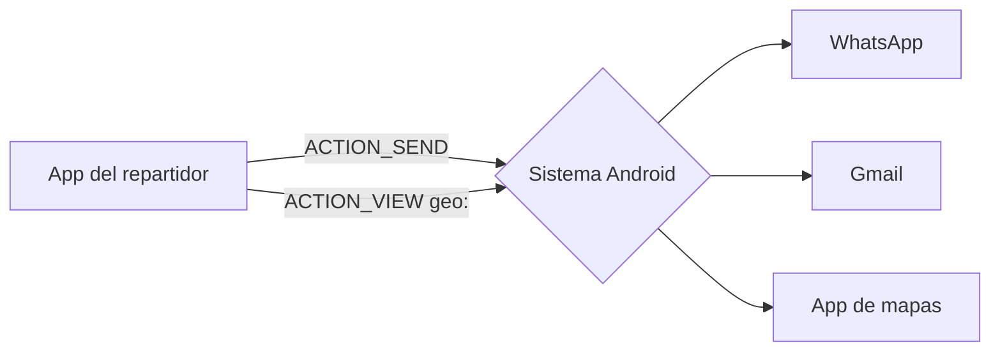
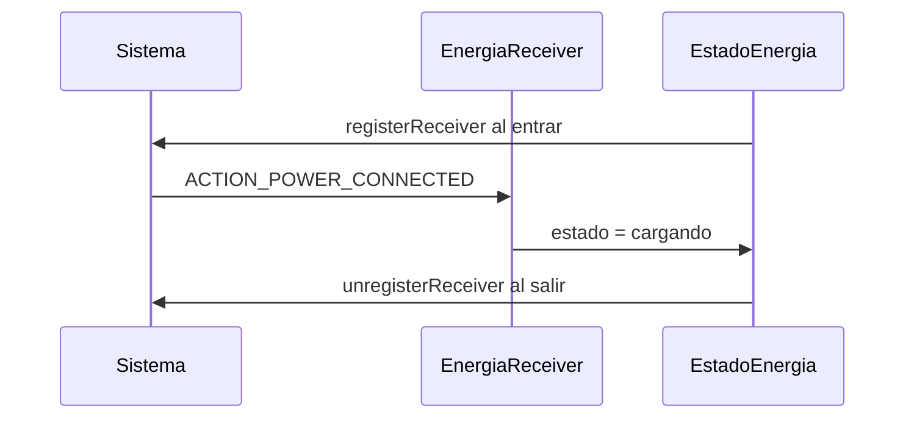
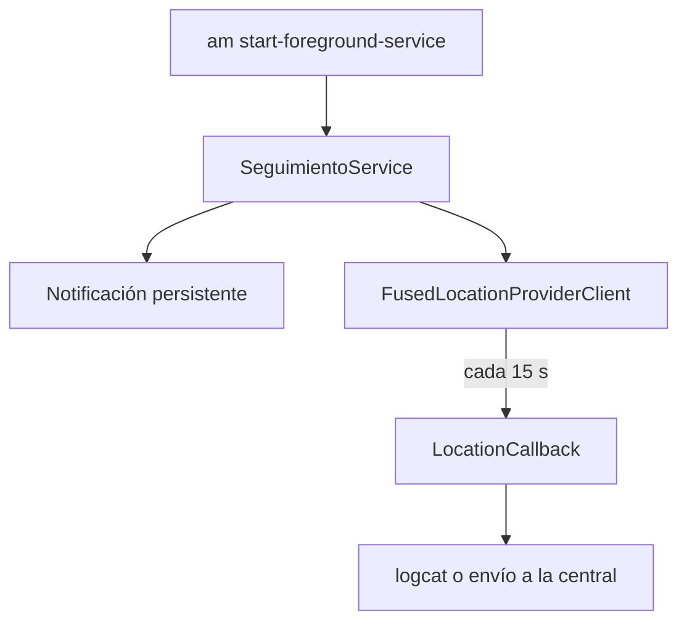
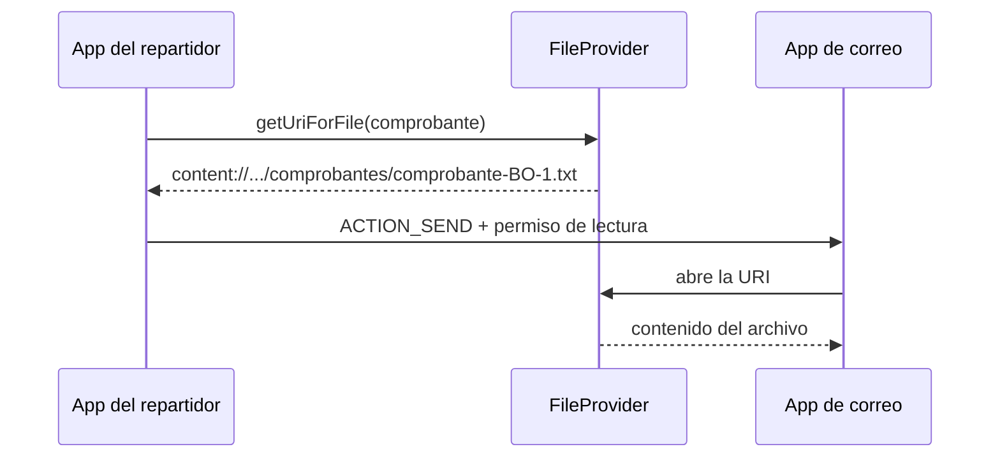
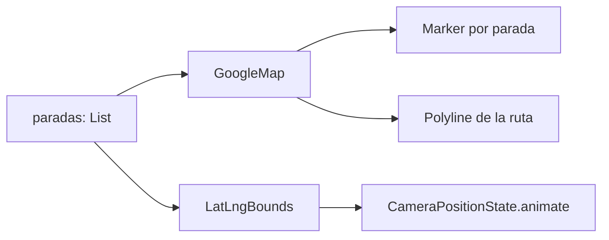
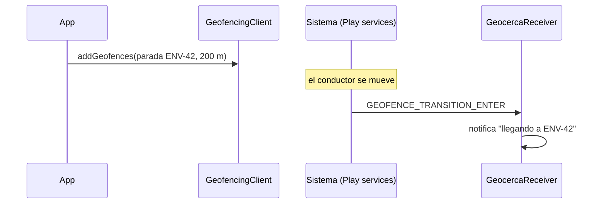
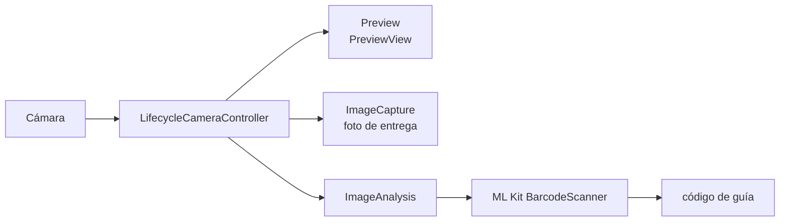
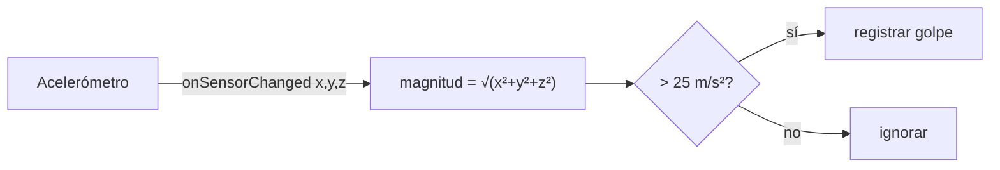
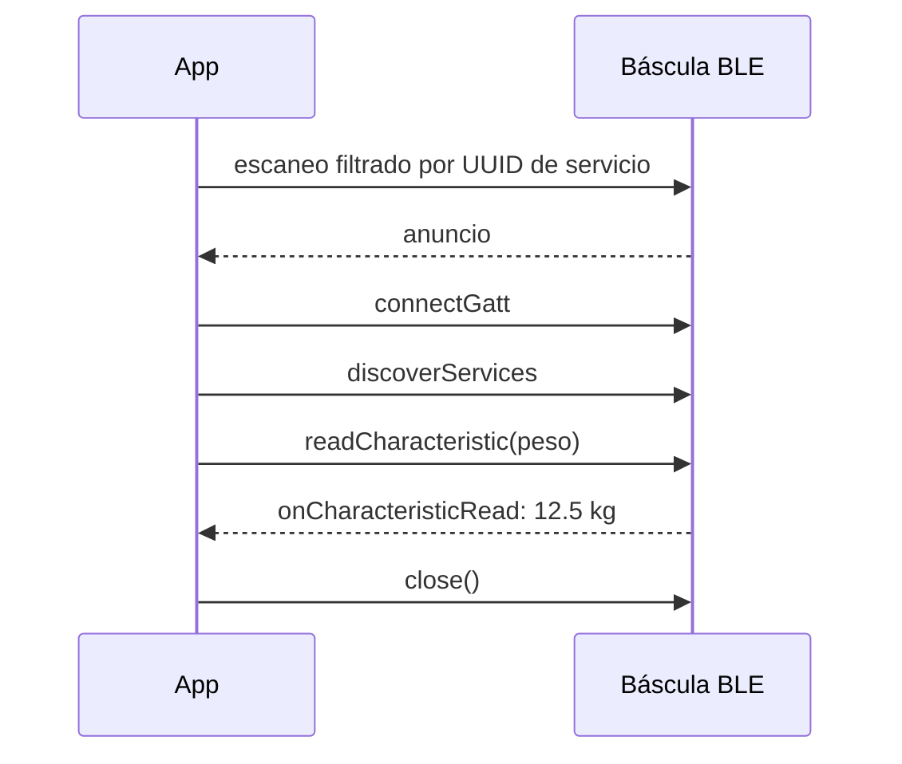

# Módulo 15: Android como plataforma — Intents, broadcasts, servicios y content providers


## Aprende construyendo

> **Dependencias de este módulo** (catálogo del Módulo 0, Tema 3; cada tema crea su proyecto nuevo, así que copia en su `gradle/libs.versions.toml` las líneas que use). Tema 3 y Tema 6: `implementation(libs.play.services.location)`. Tema 5: `implementation(libs.maps.compose)` y el plugin `alias(libs.plugins.secrets)` (raíz con `apply false`). Tema 7: `implementation(libs.androidx.camera.camera2)`, `implementation(libs.androidx.camera.lifecycle)`, `implementation(libs.androidx.camera.view)`, `implementation(libs.androidx.camera.mlkit.vision)` e `implementation(libs.mlkit.barcode.scanning)`. Todas van dentro de `dependencies { }` de `app/build.gradle.kts`.

### Tema 1: Intents implícitos y Activity Result API

#### Paso 1 · Objetivo y preparación
Al finalizar podrás pedir al sistema que otra app comparta, navegue o elija un contacto mediante Intents implícitos, recibir el resultado con la Activity Result API y manejar el caso en que ninguna app puede resolver el Intent. Prerrequisitos: Módulos 1 y 2 (Activities y Compose).

#### Paso 2 · Contexto y caso real
El repartidor de RutaFlow necesita compartir el enlace de seguimiento por WhatsApp, abrir la dirección en su app de mapas y llamar al contacto del destinatario. Reescribir mapas o mensajería sería absurdo: el caso real en Android es delegar en otras apps con Intents, que es como el sistema conecta aplicaciones entre sí.

#### Paso 3 · Teoría, modelo mental y analogía
Un **Intent explícito** nombra la clase destino (`Intent(context, OtraActivity::class.java)`); un **Intent implícito** describe una **acción** (`ACTION_SEND`, `ACTION_VIEW`) y unos datos o tipo MIME, y el sistema busca las apps que la declaran en su `intent-filter`. `createChooser` muestra el selector. Si nadie puede resolverlo, `startActivity` lanza `ActivityNotFoundException`. La **Activity Result API** (`rememberLauncherForActivityResult` con un contrato como `PickContact` o `TakePicture`) reemplaza a `onActivityResult` y entrega el resultado en un callback. Desde Android 11, para *consultar* qué apps existen debes declararlo en `<queries>` del manifiesto.

**Analogía:** el Intent explícito es llamar a una persona por su nombre; el implícito es gritar en la oficina "¿quién sabe traducir del inglés?" y dejar que conteste quien pueda.

**Diagrama:**



**¿Por qué es importante?** porque los Intents son el mecanismo con el que Android integra apps, y manejar mal su resolución es una causa común de cierres inesperados.
**Fuente oficial:** [Android: Intents and intent filters](https://developer.android.com/guide/components/intents-filters), [Android: Get a result from an activity](https://developer.android.com/training/basics/intents/result).
**Conceptos clave:** Intent explícito e implícito, acción, tipo MIME, `intent-filter`, `createChooser`, `ActivityNotFoundException`, Activity Result API, `<queries>`.
**Cuándo no usarlo:** para navegar entre pantallas de tu propia app usa Navigation Compose (Módulo 3), no Intents.

**Transferencia al proyecto integrador «Aplicación del repartidor Android»:** agrega en el detalle de cada entrega los botones de compartir seguimiento, navegar y llamar al destinatario.
Como **siguiente** paso, aplica lo aprendido en el proyecto integrador del track y compara el resultado con lo que esperabas.
**Errores comunes:** lanzar un Intent implícito sin envolver `startActivity` en `try/catch`, asumiendo que siempre habrá una app que lo resuelva —en un emulador AOSP sin Google Play ese error cierra la app igual que en el Paso 4—, y usar `ACTION_CALL` en vez de `ACTION_DIAL` olvidando que el primero exige el permiso `CALL_PHONE` en tiempo de ejecución.

#### Paso 4 · Demostración guiada desde cero
**Ejemplo independiente (desde cero):** este tema se reproduce en una **carpeta vacía**, como **proyecto nuevo**, sin estado de otros temas.

```bash
mkdir android-plataforma-tema1 && cd android-plataforma-tema1
# En Android Studio: File ▸ New ▸ New Project ▸ Empty Activity, nombre Repartidor,
# paquete com.rutaflow.repartidor; en «Save location» elige esta misma carpeta
# (android-plataforma-tema1), para que settings.gradle.kts quede aquí
```

Crea `app/src/main/java/com/rutaflow/repartidor/Acciones.kt`:

```kotlin
package com.rutaflow.repartidor

import android.content.ActivityNotFoundException
import android.content.Context
import android.content.Intent
import android.net.Uri
import android.util.Log
import androidx.activity.compose.rememberLauncherForActivityResult
import androidx.activity.result.contract.ActivityResultContracts
import androidx.compose.foundation.layout.Column
import androidx.compose.material3.Button
import androidx.compose.material3.Text
import androidx.compose.runtime.*

private const val TAG = "RutaFlow"

// Intent implícito: describe QUÉ quieres hacer; el sistema elige la app que lo resuelve
fun compartirGuia(context: Context, guia: String) {
    val enviar = Intent(Intent.ACTION_SEND).apply {
        type = "text/plain"
        putExtra(Intent.EXTRA_TEXT, "Sigue tu envío $guia en https://rutaflow.co/s/$guia")
    }
    context.startActivity(Intent.createChooser(enviar, "Compartir guía"))
}

fun navegarA(context: Context, direccion: String) {
    val uri = Uri.parse("geo:0,0?q=" + Uri.encode(direccion))
    try {
        context.startActivity(Intent(Intent.ACTION_VIEW, uri))
    } catch (e: ActivityNotFoundException) {
        Log.w(TAG, "No hay app de mapas instalada para $uri")
    }
}

@Composable
fun AccionesEntrega(guia: String, direccion: String, context: Context) {
    var contacto by remember { mutableStateOf<String?>(null) }
    // Activity Result API: lanzar otra app y recibir su resultado sin onActivityResult
    val elegirContacto = rememberLauncherForActivityResult(ActivityResultContracts.PickContact()) { uri ->
        contacto = uri?.lastPathSegment
        Log.i(TAG, "Contacto elegido: $uri")
    }
    Column {
        Button(onClick = { compartirGuia(context, guia) }) { Text("Compartir guía") }
        Button(onClick = { navegarA(context, direccion) }) { Text("Navegar") }
        Button(onClick = { elegirContacto.launch(null) }) { Text("Elegir contacto") }
        contacto?.let { Text("Contacto: $it") }
    }
}
```

**Ejecuta el ejemplo:**

```bash
./gradlew installDebug
adb shell am start -n com.rutaflow.repartidor/.MainActivity
adb logcat -s RutaFlow
```

**Resultado esperado:**

```text
(logcat, al elegir un contacto)
I RutaFlow: Contacto elegido: content://com.android.contacts/contacts/lookup/.../1
```

En `MainActivity` llama `AccionesEntrega("BO-004512", "Cra 7 # 72-41, Bogotá", LocalContext.current)` dentro de `setContent`. Al pulsar **Compartir guía** aparece el selector del sistema; **Navegar** abre la app de mapas del emulador (o deja el aviso en logcat si no hay ninguna); **Elegir contacto** abre la libreta y, al volver, muestra el identificador del contacto.

**Fallo deliberado:** En `navegarA` borra el `try/catch` y prueba en un emulador sin app de mapas (una imagen *AOSP* sin Google Play). La app se cierra con `android.content.ActivityNotFoundException: No Activity found to handle Intent { act=android.intent.action.VIEW dat=geo:... }`. Un Intent implícito puede no tener quién lo atienda: siempre maneja ese caso.

#### Paso 5 · Práctica guiada
Agrega un botón **Llamar** que abra el marcador con el teléfono del destinatario usando `ACTION_DIAL` y `tel:`. **Pista:** `Intent(Intent.ACTION_DIAL, Uri.parse("tel:3001234567"))` no necesita permiso porque solo marca; `ACTION_CALL` sí lo necesita.

#### Paso 6 · Práctica independiente
Usa el contrato `ActivityResultContracts.TakePicture()` para tomar la foto de la evidencia de entrega con la cámara del sistema, guardándola en un `Uri` creado con `FileProvider` (Tema 4).

#### Paso 7 · Cierre


### Tema 2: BroadcastReceiver: reaccionar a eventos del sistema

#### Paso 1 · Objetivo y preparación
Al finalizar podrás registrar un `BroadcastReceiver` dinámico atado al ciclo de vida de una pantalla, declarar si recibe broadcasts de otras apps y simular eventos del sistema con `adb`. Prerrequisitos: Módulo 1 (ciclo de vida) y Tema 1 de este módulo.

#### Paso 2 · Contexto y caso real
Cuando la batería del teléfono del repartidor baja, la app debe sincronizar las entregas pendientes y reducir la frecuencia del GPS. Android anuncia esos eventos con *broadcasts*: es el mismo mecanismo de un caso real como detectar que se conectó el cargador o que cambió la zona horaria.

#### Paso 3 · Teoría, modelo mental y analogía
Un **broadcast** es un mensaje que el sistema u otras apps envían a quien se haya suscrito. Un **BroadcastReceiver** recibe los que coinciden con su `IntentFilter` en `onReceive`, que debe ser rápido (para trabajo largo, usa WorkManager). Desde Android 8 casi ningún broadcast implícito se entrega a receptores declarados en el manifiesto, así que se **registran en código** mientras la app está activa. Desde Android 14, al registrar debes indicar `RECEIVER_EXPORTED` o `RECEIVER_NOT_EXPORTED` (si otras apps pueden enviarte el broadcast). `ContextCompat.registerReceiver` aplica la regla de forma compatible.

**Analogía:** es suscribirte a las alertas de una emisora solo mientras tienes la radio encendida.

**Diagrama:**



**¿Por qué es importante?** porque reaccionar al estado del dispositivo mejora la batería y la confiabilidad, y los cambios de seguridad de Android 14 rompen receptores mal registrados.
**Fuente oficial:** [Android: Broadcasts overview](https://developer.android.com/develop/background-work/background-tasks/broadcasts), [Android 14: Safer context-registered receivers](https://developer.android.com/about/versions/14/behavior-changes-14#runtime-receivers-exported).
**Conceptos clave:** broadcast, `BroadcastReceiver`, `IntentFilter`, registro dinámico, `RECEIVER_NOT_EXPORTED`, `DisposableEffect`, `adb shell dumpsys battery`.
**Cuándo no usarlo:** para observar conectividad de red usa `ConnectivityManager.NetworkCallback`, y para tareas programadas WorkManager con restricciones: son más precisos que los broadcasts.

**Transferencia al proyecto integrador «Aplicación del repartidor Android»:** reduce la frecuencia del GPS y sincroniza pendientes cuando la batería esté baja.
Como **siguiente** paso, aplica lo aprendido en el proyecto integrador del track y compara el resultado con lo que esperabas.
**Errores comunes:** registrar el receiver con `context.registerReceiver(receiver, filtro)` sin indicar `RECEIVER_EXPORTED`/`RECEIVER_NOT_EXPORTED` en Android 14+ —un error de seguridad que tira la app al arrancar, como en el Paso 4—, u olvidar `unregisterReceiver` en `onDispose`, dejando el receptor vivo después de salir de la pantalla.

#### Paso 4 · Demostración guiada desde cero
**Ejemplo independiente (desde cero):** este tema se reproduce en una **carpeta vacía**, como **proyecto nuevo**, sin estado de otros temas.

```bash
mkdir android-plataforma-tema2 && cd android-plataforma-tema2
# En Android Studio: File ▸ New ▸ New Project ▸ Empty Activity, nombre Repartidor,
# paquete com.rutaflow.repartidor; en «Save location» elige esta misma carpeta
# (android-plataforma-tema2), para que settings.gradle.kts quede aquí
```

Crea `app/src/main/java/com/rutaflow/repartidor/Energia.kt`:

```kotlin
package com.rutaflow.repartidor

import android.content.BroadcastReceiver
import android.content.Context
import android.content.Intent
import android.content.IntentFilter
import android.util.Log
import androidx.compose.runtime.*
import androidx.compose.ui.platform.LocalContext
import androidx.core.content.ContextCompat

// Recibe eventos del sistema mientras la pantalla está visible
class EnergiaReceiver(private val alCambiar: (String) -> Unit) : BroadcastReceiver() {
    override fun onReceive(context: Context, intent: Intent) {
        val estado = when (intent.action) {
            Intent.ACTION_POWER_CONNECTED -> "cargando"
            Intent.ACTION_POWER_DISCONNECTED -> "sin cargador"
            Intent.ACTION_BATTERY_LOW -> "batería baja: sincroniza y reduce el GPS"
            else -> return
        }
        Log.i("RutaFlow", "Evento de energía: $estado")
        alCambiar(estado)
    }
}

@Composable
fun EstadoEnergia() {
    val context = LocalContext.current
    var estado by remember { mutableStateOf("sin eventos") }
    // Registro dinámico atado al ciclo de vida del composable: se quita al salir
    DisposableEffect(Unit) {
        val receiver = EnergiaReceiver { estado = it }
        val filtro = IntentFilter().apply {
            addAction(Intent.ACTION_POWER_CONNECTED)
            addAction(Intent.ACTION_POWER_DISCONNECTED)
            addAction(Intent.ACTION_BATTERY_LOW)
        }
        ContextCompat.registerReceiver(context, receiver, filtro, ContextCompat.RECEIVER_NOT_EXPORTED)
        onDispose { context.unregisterReceiver(receiver) }
    }
    androidx.compose.material3.Text("Energía: $estado")
}
```

**Ejecuta el ejemplo:**

```bash
./gradlew installDebug
adb shell am start -n com.rutaflow.repartidor/.MainActivity
adb shell dumpsys battery set ac 1      # simula conectar el cargador
adb shell dumpsys battery unplug       # simula desconectarlo
adb shell dumpsys battery reset
adb logcat -s RutaFlow
```

**Resultado esperado:**

```text
I RutaFlow: Evento de energía: cargando
I RutaFlow: Evento de energía: sin cargador
```

Muestra `EstadoEnergia()` en `MainActivity`. Con cada comando de `dumpsys battery` el texto de la pantalla cambia y en logcat aparece `I RutaFlow: Evento de energía: cargando` y luego `sin cargador`. Si un evento no llega, revisa que la pantalla esté visible: el receptor solo existe mientras el composable está en pantalla.

**Fallo deliberado:** Reemplaza `ContextCompat.registerReceiver(context, receiver, filtro, ContextCompat.RECEIVER_NOT_EXPORTED)` por `context.registerReceiver(receiver, filtro)` y agrega al filtro una acción propia como `"com.rutaflow.SINCRONIZAR"`. En Android 14 o superior la app se cierra con `SecurityException: ... One of RECEIVER_EXPORTED or RECEIVER_NOT_EXPORTED should be specified when a receiver isn't being registered exclusively for system broadcasts`. Declarar quién puede enviarte mensajes es obligatorio.

#### Paso 5 · Práctica guiada
Agrega `Intent.ACTION_TIMEZONE_CHANGED` al filtro y muestra la nueva zona horaria cuando cambie. **Pista:** la zona actual se obtiene con `java.time.ZoneId.systemDefault()`; puedes cambiarla en los ajustes del emulador para probar.

#### Paso 6 · Práctica independiente
Cuando llegue `ACTION_BATTERY_LOW`, encola un `OneTimeWorkRequest` de sincronización (Módulo 8) en lugar de hacer la sincronización dentro de `onReceive`, y explica por qué.

#### Paso 7 · Cierre


### Tema 3: Foreground Service de ubicación con FusedLocationProvider

#### Paso 1 · Objetivo y preparación
Al finalizar podrás mantener un seguimiento de ubicación con la app en segundo plano usando un *foreground service* de tipo `location`, pedir actualizaciones al FusedLocationProvider con un intervalo que cuida la batería y simular posiciones en el emulador. Prerrequisitos: Tema 2 de este módulo y Módulo 8 (trabajo en segundo plano).

#### Paso 2 · Contexto y caso real
La central de RutaFlow necesita ver dónde está cada repartidor mientras la ruta está activa, aunque el teléfono esté en el bolsillo con la pantalla apagada. WorkManager no sirve para un flujo continuo; el caso real de apps de reparto, transporte o deporte es un servicio en primer plano con notificación visible.

#### Paso 3 · Teoría, modelo mental y analogía
Un **foreground service** es un servicio que el usuario sabe que está corriendo: debe mostrar una notificación persistente y, desde Android 14, declarar su **tipo** (`location`, `dataSync`, `mediaPlayback`…) en el manifiesto y al llamar `startForeground`, además del permiso específico (`FOREGROUND_SERVICE_LOCATION`). El **FusedLocationProviderClient** combina GPS, Wi-Fi y redes móviles; con `LocationRequest` eliges prioridad e intervalo para equilibrar precisión y batería. Las actualizaciones se detienen en `onDestroy`.

**Analogía:** es el taxímetro encendido: el pasajero ve en todo momento que está corriendo y sabe que puede pedir que lo apaguen.

**Diagrama:**



**¿Por qué es importante?** porque el seguimiento en segundo plano es el corazón de una app de reparto y es de lo más revisado por Google Play: un tipo o permiso mal declarado bloquea la publicación.
**Fuente oficial:** [Android: Foreground service types](https://developer.android.com/develop/background-work/services/fgs/service-types), [Android: Request location updates](https://developer.android.com/develop/sensors-and-location/location/request-updates).
**Conceptos clave:** foreground service, tipo de servicio, notificación persistente, `FOREGROUND_SERVICE_LOCATION`, FusedLocationProviderClient, `LocationRequest`, prioridad e intervalo, `adb emu geo fix`.
**Cuándo no usarlo:** si solo necesitas la ubicación al marcar una entrega, pide una lectura única (`getCurrentLocation`) sin servicio. Si el trabajo puede esperar, usa WorkManager.

**Transferencia al proyecto integrador «Aplicación del repartidor Android»:** activa el seguimiento solo mientras la ruta del día está iniciada y detenlo al cerrar la última entrega.
Como **siguiente** paso, aplica lo aprendido en el proyecto integrador del track y compara el resultado con lo que esperabas.
**Errores comunes:** olvidar declarar `android:foregroundServiceType="location"` en el manifiesto antes de llamar a `startForeground` en Android 14+, o subir la prioridad a `PRIORITY_HIGH_ACCURACY` con un intervalo corto sin medir antes el consumo real de batería en el emulador.

#### Paso 4 · Demostración guiada desde cero
**Ejemplo independiente (desde cero):** este tema se reproduce en una **carpeta vacía**, como **proyecto nuevo**, sin estado de otros temas.

```bash
mkdir android-plataforma-tema3 && cd android-plataforma-tema3
# En Android Studio: File ▸ New ▸ New Project ▸ Empty Activity, nombre Repartidor,
# paquete com.rutaflow.repartidor; en «Save location» elige esta misma carpeta
# (android-plataforma-tema3), para que settings.gradle.kts quede aquí
```

Crea `AndroidManifest.xml (fragmentos)`:

```xml
<!-- app/src/main/AndroidManifest.xml (fragmentos) -->
<uses-permission android:name="android.permission.ACCESS_FINE_LOCATION" />
<uses-permission android:name="android.permission.ACCESS_COARSE_LOCATION" />
<uses-permission android:name="android.permission.FOREGROUND_SERVICE" />
<uses-permission android:name="android.permission.FOREGROUND_SERVICE_LOCATION" />
<uses-permission android:name="android.permission.POST_NOTIFICATIONS" />

<application ...>
    <service
        android:name=".SeguimientoService"
        android:exported="false"
        android:foregroundServiceType="location" />
</application>
```

Crea `app/build.gradle.kts (fragmento)`:

```kotlin
// app/build.gradle.kts, dentro de dependencies { }
implementation("com.google.android.gms:play-services-location:21.4.0")
```

Crea `app/src/main/java/com/rutaflow/repartidor/SeguimientoService.kt`:

```kotlin
package com.rutaflow.repartidor

import android.app.NotificationChannel
import android.app.NotificationManager
import android.app.Service
import android.content.Intent
import android.content.pm.ServiceInfo
import android.os.IBinder
import android.os.Looper
import android.util.Log
import androidx.core.app.NotificationCompat
import androidx.core.app.ServiceCompat
import com.google.android.gms.location.*

// Servicio en primer plano: sigue enviando la ubicación con la pantalla apagada,
// pero SIEMPRE con una notificación visible para el usuario
class SeguimientoService : Service() {
    private lateinit var ubicacion: FusedLocationProviderClient
    private val callback = object : LocationCallback() {
        override fun onLocationResult(resultado: LocationResult) {
            resultado.lastLocation?.let {
                Log.i("RutaFlow", "Posición %.5f, %.5f (±%.0f m)".format(it.latitude, it.longitude, it.accuracy))
            }
        }
    }

    override fun onCreate() {
        super.onCreate()
        ubicacion = LocationServices.getFusedLocationProviderClient(this)
        val canal = NotificationChannel("seguimiento", "Seguimiento de ruta", NotificationManager.IMPORTANCE_LOW)
        getSystemService(NotificationManager::class.java).createNotificationChannel(canal)
    }

    override fun onStartCommand(intent: Intent?, flags: Int, startId: Int): Int {
        val notificacion = NotificationCompat.Builder(this, "seguimiento")
            .setSmallIcon(android.R.drawable.ic_menu_mylocation)
            .setContentTitle("Ruta en curso")
            .setContentText("Compartiendo tu ubicación con la central")
            .setOngoing(true)
            .build()
        ServiceCompat.startForeground(this, 1, notificacion, ServiceInfo.FOREGROUND_SERVICE_TYPE_LOCATION)

        val solicitud = LocationRequest.Builder(Priority.PRIORITY_BALANCED_POWER_ACCURACY, 15_000)
            .setMinUpdateIntervalMillis(10_000)
            .build()
        try {
            ubicacion.requestLocationUpdates(solicitud, callback, Looper.getMainLooper())
        } catch (e: SecurityException) {
            Log.e("RutaFlow", "Falta el permiso de ubicación", e)
            stopSelf()
        }
        return START_STICKY
    }

    override fun onDestroy() {
        ubicacion.removeLocationUpdates(callback)
        super.onDestroy()
    }

    override fun onBind(intent: Intent?): IBinder? = null
}
```

**Ejecuta el ejemplo:**

```bash
./gradlew installDebug
adb shell pm grant com.rutaflow.repartidor android.permission.ACCESS_FINE_LOCATION
adb shell pm grant com.rutaflow.repartidor android.permission.POST_NOTIFICATIONS
adb shell am start-foreground-service -n com.rutaflow.repartidor/.SeguimientoService
adb emu geo fix -74.0636 4.6486      # mueve el emulador a Chapinero (longitud latitud)
adb logcat -s RutaFlow
```

**Resultado esperado:**

```text
I RutaFlow: Posición 4.64860, -74.06360 (±5 m)
```

Aparece la notificación **Ruta en curso** y en logcat una línea `I RutaFlow: Posición 4.64860, -74.06360 (±... m)` cada vez que cambias la posición con `adb emu geo fix`. En la app real el servicio se inicia con `ContextCompat.startForegroundService` después de que el usuario concede los permisos con la Activity Result API; los `pm grant` solo agilizan la prueba.

**Fallo deliberado:** Borra `android:foregroundServiceType="location"` del manifiesto y vuelve a instalar. En Android 14 o superior el servicio falla al arrancar con `android.app.MissingForegroundServiceTypeException: Starting FGS without a type`. El sistema exige declarar para qué usas el primer plano.

#### Paso 5 · Práctica guiada
Agrega a la notificación una acción **Terminar ruta** que detenga el servicio. **Pista:** crea un `PendingIntent.getService` hacia el mismo servicio con una acción propia, y en `onStartCommand` llama `stopSelf()` cuando llegue esa acción.

#### Paso 6 · Práctica independiente
Mide en el emulador el efecto de cambiar la prioridad a `PRIORITY_HIGH_ACCURACY` y el intervalo a 5 s, y redacta en el README qué combinación usarías en ciudad y en carretera y por qué.

#### Paso 7 · Cierre


### Tema 4: Compartir archivos con FileProvider y content://

#### Paso 1 · Objetivo y preparación
Al finalizar podrás compartir un archivo privado de tu app con otra app mediante un `FileProvider`, conceder permiso de lectura temporal sobre una URI `content://` y explicar por qué Android prohíbe las URI `file://`. Prerrequisito: Tema 1 de este módulo.

#### Paso 2 · Contexto y caso real
Al terminar una entrega, el repartidor envía el comprobante al cliente por correo o WhatsApp. El archivo vive en el almacenamiento privado de la app, que otras apps no pueden leer. Compartir sin hacer público todo el almacenamiento es el caso real que resuelven los **content providers**.

#### Paso 3 · Teoría, modelo mental y analogía
Un **ContentProvider** expone datos de una app mediante URI `content://` y controla quién accede. `FileProvider` es un ContentProvider ya hecho para archivos: en `rutas_compartidas.xml` declaras qué carpetas se pueden compartir, `getUriForFile` traduce un `File` a una URI `content://`, y `FLAG_GRANT_READ_URI_PERMISSION` da permiso **temporal** solo a la app que recibe el Intent. Desde Android 7, enviar una URI `file://` a otra app lanza `FileUriExposedException`, porque revelaría rutas internas y dependería de permisos de archivo globales.

**Analogía:** en vez de darle a alguien la llave de tu casa (`file://`), le entregas un pase de un solo uso para recoger un paquete en la portería (`content://`).

**Diagrama:**



**¿Por qué es importante?** porque compartir y recibir archivos entre apps es habitual, y hacerlo con permisos temporales evita fugas de datos de clientes.
**Fuente oficial:** [Android: Sharing files (FileProvider)](https://developer.android.com/training/secure-file-sharing/setup-sharing), [Android: Content providers](https://developer.android.com/guide/topics/providers/content-providers).
**Conceptos clave:** ContentProvider, `FileProvider`, URI `content://`, `rutas_compartidas.xml`, `FLAG_GRANT_READ_URI_PERMISSION`, `FileUriExposedException`, `ContentResolver`.
**Cuándo no usarlo:** para datos estructurados que solo usa tu app, Room (Módulo 6) es suficiente; crea un ContentProvider propio solo si otras apps deben consultar esos datos.

**Transferencia al proyecto integrador «Aplicación del repartidor Android»:** envía el comprobante de cada entrega al cliente con FileProvider y borra de la caché los comprobantes de días anteriores.
Como **siguiente** paso, aplica lo aprendido en el proyecto integrador del track y compara el resultado con lo que esperabas.
**Errores comunes:** compartir una URI `file://` en vez de `content://` esperando que funcione igual en todos los Android —en Android 7+ ese error termina en `FileUriExposedException`, como en el Paso 4—, u olvidar declarar la carpeta en `rutas_compartidas.xml`, lo que hace que `getUriForFile` lance `IllegalArgumentException`.

#### Paso 4 · Demostración guiada desde cero
**Ejemplo independiente (desde cero):** este tema se reproduce en una **carpeta vacía**, como **proyecto nuevo**, sin estado de otros temas.

```bash
mkdir android-plataforma-tema4 && cd android-plataforma-tema4
# En Android Studio: File ▸ New ▸ New Project ▸ Empty Activity, nombre Repartidor,
# paquete com.rutaflow.repartidor; en «Save location» elige esta misma carpeta
# (android-plataforma-tema4), para que settings.gradle.kts quede aquí
```

Crea `AndroidManifest.xml (fragmento)`:

```xml
<!-- AndroidManifest.xml, dentro de <application> -->
<provider
    android:name="androidx.core.content.FileProvider"
    android:authorities="${applicationId}.archivos"
    android:exported="false"
    android:grantUriPermissions="true">
    <meta-data
        android:name="android.support.FILE_PROVIDER_PATHS"
        android:resource="@xml/rutas_compartidas" />
</provider>
```

Crea `app/src/main/res/xml/rutas_compartidas.xml`:

```xml
<?xml version="1.0" encoding="utf-8"?>
<!-- app/src/main/res/xml/rutas_compartidas.xml: SOLO estas carpetas se pueden compartir -->
<paths>
    <cache-path name="comprobantes" path="comprobantes/" />
</paths>
```

Crea `app/src/main/java/com/rutaflow/repartidor/Comprobantes.kt`:

```kotlin
package com.rutaflow.repartidor

import android.content.ClipData
import android.content.Context
import android.content.Intent
import android.util.Log
import androidx.core.content.FileProvider
import java.io.File

// Genera un comprobante y lo comparte con otra app sin exponer rutas del sistema de archivos
fun compartirComprobante(context: Context, guia: String) {
    val carpeta = File(context.cacheDir, "comprobantes").apply { mkdirs() }
    val archivo = File(carpeta, "comprobante-$guia.txt")
    archivo.writeText("RutaFlow\nGuía: $guia\nEstado: entregado\n")

    // content:// en lugar de file:// — el permiso se concede solo a la app que recibe
    val uri = FileProvider.getUriForFile(context, "${context.packageName}.archivos", archivo)
    Log.i("RutaFlow", "Compartiendo $uri")

    val enviar = Intent(Intent.ACTION_SEND).apply {
        type = "text/plain"
        putExtra(Intent.EXTRA_STREAM, uri)
        clipData = ClipData.newRawUri("comprobante", uri)
        addFlags(Intent.FLAG_GRANT_READ_URI_PERMISSION)
    }
    context.startActivity(Intent.createChooser(enviar, "Enviar comprobante"))
}
```

**Ejecuta el ejemplo:**

```bash
./gradlew installDebug
adb shell am start -n com.rutaflow.repartidor/.MainActivity
adb logcat -s RutaFlow
```

**Resultado esperado:**

```text
I RutaFlow: Compartiendo content://com.rutaflow.repartidor.archivos/comprobantes/comprobante-BO-004512.txt
```

Llama `compartirComprobante(context, "BO-004512")` desde un botón. En logcat aparece `I RutaFlow: Compartiendo content://com.rutaflow.repartidor.archivos/comprobantes/comprobante-BO-004512.txt` y el selector del sistema ofrece las apps que aceptan texto; la app de correo adjunta el archivo.

**Fallo deliberado:** Cambia `val uri = FileProvider.getUriForFile(...)` por `val uri = android.net.Uri.fromFile(archivo)`. Al pulsar el botón la app se cierra con `android.os.FileUriExposedException: file:///data/user/0/com.rutaflow.repartidor/cache/comprobantes/comprobante-BO-004512.txt exposed beyond app through ClipData.Item.getUri()`. Android bloquea las rutas de archivo entre apps.

#### Paso 5 · Práctica guiada
Comparte un comprobante guardado en `filesDir/firmas/` en lugar de la caché. **Pista:** agrega `<files-path name="firmas" path="firmas/" />` a `rutas_compartidas.xml`; sin esa línea `getUriForFile` lanza `IllegalArgumentException` porque la carpeta no está autorizada.

#### Paso 6 · Práctica independiente
Lee un archivo que el usuario elija con `ActivityResultContracts.OpenDocument()` y muestra su nombre consultando la URI con `contentResolver.query` y `OpenableColumns.DISPLAY_NAME`.

#### Paso 7 · Cierre

### Tema 5: Mapas con Maps Compose: marcadores, cámara y ruta · Intermedio · 45 min

**Prerrequisito:** tema «Foreground Service de ubicación con FusedLocationProvider» de este módulo.

**Al finalizar podrás:** mostrar un mapa de Google con Maps Compose, dibujar las paradas de una ruta con marcadores y una polilínea, y mover la cámara para encuadrarlas.

**¿Por qué es importante?** El conductor necesita ver dónde está cada entrega. Con Maps Compose el mapa es un composable más: reacciona al estado igual que el resto de la pantalla.

#### Paso 1 · Objetivo y preparación

Agrega `com.google.maps.android:maps-compose` al módulo `app` y una clave de Maps SDK for Android en `local.properties` (`MAPS_API_KEY=...`), leída con el plugin Secrets Gradle. Nunca subas la clave al repositorio.

#### Paso 2 · Contexto y caso real

Los conductores de RutaFlow seguían la ruta en una lista de direcciones y se perdían en barrios nuevos. Con el mapa y la línea de la ruta, ven el orden de las paradas de un vistazo.

#### Paso 3 · Teoría, modelo mental y analogía

**Conceptos clave:** `GoogleMap`, `CameraPositionState`, `Marker`, `Polyline`, `LatLngBounds`, clave de API restringida.

`GoogleMap` es un composable. Su cámara se controla con un `CameraPositionState` creado con `rememberCameraPositionState`. Dentro del mapa colocas otros composables: `Marker` para un punto y `Polyline` para una línea entre puntos.

Para mostrar todas las paradas, construyes un `LatLngBounds` con sus coordenadas y mueves la cámara con `CameraUpdateFactory.newLatLngBounds(bounds, padding)`.

La **clave de API** identifica tu app ante Google: restríngela en la consola de Google Cloud al nombre del paquete y a la huella SHA-1 del certificado, para que nadie más pueda usarla.

**Analogía:** el mapa es un tablero y los marcadores son fichas que pones encima según el estado del juego. La analogía falla en que el tablero también tiene su propio estado (la cámara) que el usuario puede mover.

**Límite de uso:** Maps SDK cobra por uso a partir de cierto volumen. En una lista con muchas filas no dibujes un mapa por fila: usa una imagen estática o el modo lite.



#### Paso 4 · Demostración guiada desde cero

Archivo `app/src/main/java/co/rutaflow/conductor/mapa/MapaRuta.kt`:

```kotlin
package co.rutaflow.conductor.mapa

import androidx.compose.runtime.Composable
import androidx.compose.runtime.LaunchedEffect
import androidx.compose.ui.Modifier
import com.google.android.gms.maps.CameraUpdateFactory
import com.google.android.gms.maps.model.LatLng
import com.google.android.gms.maps.model.LatLngBounds
import com.google.maps.android.compose.GoogleMap
import com.google.maps.android.compose.Marker
import com.google.maps.android.compose.MarkerState
import com.google.maps.android.compose.Polyline
import com.google.maps.android.compose.rememberCameraPositionState

data class Parada(val nombre: String, val posicion: LatLng)

@Composable
fun MapaRuta(paradas: List<Parada>, modifier: Modifier = Modifier) {
    val camara = rememberCameraPositionState()

    // Encuadra todas las paradas cuando cambia la lista.
    LaunchedEffect(paradas) {
        if (paradas.size >= 2) {
            val limites = LatLngBounds.builder().apply { paradas.forEach { include(it.posicion) } }.build()
            camara.animate(CameraUpdateFactory.newLatLngBounds(limites, 120))
        }
    }

    GoogleMap(modifier = modifier, cameraPositionState = camara) {
        paradas.forEachIndexed { i, p ->
            Marker(state = MarkerState(p.posicion), title = "${i + 1}. ${p.nombre}")
        }
        Polyline(points = paradas.map { it.posicion })
    }
}
```

Ejecútalo:

```bash
./gradlew installDebug
# abre la pantalla de ruta con paradas en Bogotá: Bodega (4.6486,-74.1078), Calle 26 (4.6280,-74.0900), Cliente (4.6097,-74.0817)
```

**Explicación por bloques:** `MapaRuta` recibe las paradas como estado. `rememberCameraPositionState` guarda la cámara entre recomposiciones. `LaunchedEffect(paradas)` construye los límites con todas las paradas y anima la cámara con un margen de 120 píxeles; se vuelve a ejecutar solo si la lista cambia. Dentro de `GoogleMap`, cada parada es un `Marker` numerado y la `Polyline` une las posiciones en orden.

**Resultado esperado:**

```text
El mapa abre centrado en Bogotá con tres marcadores numerados 1, 2 y 3 unidos por una línea.
Al tocar un marcador aparece su título, por ejemplo «2. Calle 26».
```

**Fallo deliberado:** quita la clave de API del manifiesto. **Error esperado:** el mapa queda gris y Logcat muestra `Authorization failure` con instrucciones sobre la clave. **Diagnóstico:** el SDK no pudo identificar la app. Revisa que la clave llegue al manifiesto y que sus restricciones incluyan el paquete y la huella SHA-1 de tu certificado de depuración.

#### Paso 5 · Práctica guiada

1. **Reproducción:** muestra el mapa con las tres paradas de ejemplo.
2. **Variación:** agrega un marcador distinto para la posición actual del conductor.
3. **Diagnóstico:** reproduce el fallo deliberado sin clave.
4. **Integración:** cambia el color de los marcadores entregados con `BitmapDescriptorFactory.defaultMarker(HUE_GREEN)`.
5. **Diseño:** decide cuándo actualizar la cámara: en cada posición del GPS o solo al cambiar de parada, y justifica.

**Pista:** si el mapa no se mueve, revisa que `LaunchedEffect` tenga como clave la lista de paradas.

#### Paso 6 · Práctica independiente

Agrega un botón «Centrar en mí» que mueva la cámara a la última posición conocida del conductor con `CameraUpdateFactory.newLatLngZoom`.

#### Paso 7 · Cierre

- [ ] Explicas para qué sirve `CameraPositionState`.
- [ ] El mapa muestra marcadores y la ruta.
- [ ] Reprodujiste el error de autorización.
- [ ] Tu clave está restringida y fuera del repositorio.

Si fallas dos o más, vuelve al Paso 3. **Errores comunes:** subir la clave al repositorio, dibujar un mapa por fila de una lista y mover la cámara en cada recomposición. **Siguiente paso:** el tema siguiente dispara avisos cuando el conductor entra en la zona de una parada.

**Transferencia al proyecto integrador «RutaFlow»:** muestra en la app del conductor de RutaFlow el mapa de la ruta del día con marcadores numerados y la línea entre paradas.

**Fuente oficial:** [Google — Maps Compose library](https://developers.google.com/maps/documentation/android-sdk/maps-compose) y [Google — Using API keys](https://developers.google.com/maps/documentation/android-sdk/get-api-key).

### Tema 6: Geofencing: avisar al entrar en la zona de una parada · Avanzado · 45 min

**Prerrequisito:** temas «Foreground Service de ubicación con FusedLocationProvider» y «BroadcastReceiver: reaccionar a eventos del sistema» de este módulo.

**Al finalizar podrás:** registrar una geocerca circular alrededor de una parada con `GeofencingClient`, recibir la transición de entrada en un `BroadcastReceiver` y probarla con ubicaciones simuladas.

**¿Por qué es importante?** Pedir la ubicación cada pocos segundos para saber si el conductor llegó gasta batería. Una geocerca deja ese trabajo al sistema, que avisa solo cuando el dispositivo cruza el borde.

#### Paso 1 · Objetivo y preparación

Agrega `com.google.android.gms:play-services-location`. Necesitas los permisos `ACCESS_FINE_LOCATION` y, para recibir avisos con la app cerrada, `ACCESS_BACKGROUND_LOCATION`, pedido por separado después del primero.

#### Paso 2 · Contexto y caso real

RutaFlow quería avisar al cliente «el mensajero está llegando» cuando el conductor estuviera a 200 metros. La primera versión revisaba el GPS cada cinco segundos y agotaba la batería antes del mediodía.

#### Paso 3 · Teoría, modelo mental y analogía

**Conceptos clave:** geocerca, radio, transición (entrar, salir, permanecer), `GeofencingClient`, `GeofencingRequest`, `PendingIntent`, ubicación en segundo plano.

Una **geocerca** es un círculo (centro y radio) que registras en el sistema. Google Play services combina GPS, wifi y redes móviles para detectar cuándo el dispositivo **entra**, **sale** o **permanece** dentro.

- `Geofence.Builder` define el id, el círculo, las transiciones y la duración.
- `GeofencingRequest` agrupa geocercas y dice si avisar al registrarlas si ya estás dentro (`INITIAL_TRIGGER_ENTER`).
- El aviso llega a un `PendingIntent`, normalmente un `BroadcastReceiver`, aunque la app esté cerrada.

Usa radios de al menos 100–150 metros: con menos, los avisos fallan por la precisión del sistema. Hay un límite de 100 geocercas activas por app.

**Analogía:** la geocerca es un timbre en la entrada de una cerca: no vigilas el camino todo el tiempo, solo escuchas cuando alguien cruza. La analogía falla en que el timbre puede sonar con algunos segundos o minutos de retraso.

**Límite de uso:** el aviso no es inmediato: puede tardar, sobre todo con el teléfono en reposo. No lo uses para cobrar o para decisiones legales; úsalo para avisos y como pista.



#### Paso 4 · Demostración guiada desde cero

Archivo `app/src/main/java/co/rutaflow/conductor/geocercas/Geocercas.kt`:

```kotlin
package co.rutaflow.conductor.geocercas

import android.Manifest
import android.app.PendingIntent
import android.content.Context
import android.content.Intent
import androidx.annotation.RequiresPermission
import com.google.android.gms.location.Geofence
import com.google.android.gms.location.GeofencingRequest
import com.google.android.gms.location.LocationServices

class Geocercas(private val contexto: Context) {
    private val cliente = LocationServices.getGeofencingClient(contexto)

    private val pendingIntent: PendingIntent by lazy {
        val intent = Intent(contexto, GeocercaReceiver::class.java)
        PendingIntent.getBroadcast(contexto, 0, intent, PendingIntent.FLAG_UPDATE_CURRENT or PendingIntent.FLAG_MUTABLE)
    }

    @RequiresPermission(Manifest.permission.ACCESS_FINE_LOCATION)
    fun vigilarParada(codigo: String, lat: Double, lng: Double) {
        val cerca = Geofence.Builder()
            .setRequestId(codigo)
            .setCircularRegion(lat, lng, 200f) // metros
            .setTransitionTypes(Geofence.GEOFENCE_TRANSITION_ENTER)
            .setExpirationDuration(8 * 60 * 60 * 1000L) // la jornada
            .build()
        val solicitud = GeofencingRequest.Builder()
            .setInitialTrigger(GeofencingRequest.INITIAL_TRIGGER_ENTER)
            .addGeofence(cerca)
            .build()
        cliente.addGeofences(solicitud, pendingIntent)
    }
}
```

Archivo `app/src/main/java/co/rutaflow/conductor/geocercas/GeocercaReceiver.kt`:

```kotlin
package co.rutaflow.conductor.geocercas

import android.content.BroadcastReceiver
import android.content.Context
import android.content.Intent
import android.util.Log
import com.google.android.gms.location.Geofence
import com.google.android.gms.location.GeofencingEvent

class GeocercaReceiver : BroadcastReceiver() {
    override fun onReceive(context: Context, intent: Intent) {
        val evento = GeofencingEvent.fromIntent(intent) ?: return
        if (evento.hasError()) { Log.w("Geocerca", "error ${evento.errorCode}"); return }
        if (evento.geofenceTransition == Geofence.GEOFENCE_TRANSITION_ENTER) {
            evento.triggeringGeofences?.forEach { Log.i("Geocerca", "llegando a ${it.requestId}") }
        }
    }
}
```

Ejecútalo:

```bash
./gradlew installDebug
# registra el receptor en AndroidManifest.xml: <receiver android:name=".geocercas.GeocercaReceiver" android:exported="false" />
# en el emulador: Extended controls > Location, simula una ruta que pase por 4.6097,-74.0817
adb logcat -s Geocerca
```

**Explicación por bloques:** `Geocercas` crea el cliente de geocercas y un `PendingIntent` hacia el receptor; debe ser `FLAG_MUTABLE` porque el sistema le agrega los datos del evento. `vigilarParada` define un círculo de 200 metros que avisa al entrar, dura la jornada y, con `INITIAL_TRIGGER_ENTER`, avisa de inmediato si el conductor ya está dentro. `GeocercaReceiver` lee el evento, revisa errores y registra el id de la parada.

**Resultado esperado:**

```text
Al simular la llegada a 4.6097,-74.0817, Logcat muestra:
I Geocerca: llegando a ENV-42
```

**Fallo deliberado:** registra la geocerca sin haber concedido el permiso de ubicación. **Error esperado:** `addGeofences` falla con `ApiException: 1004` (GEOFENCE_INSUFFICIENT_LOCATION_PERMISSION). **Diagnóstico:** el sistema exige ubicación precisa y, para avisos con la app cerrada, ubicación en segundo plano. Pide los permisos antes de registrar.

#### Paso 5 · Práctica guiada

1. **Reproducción:** registra la geocerca y simula una ruta que entre en ella.
2. **Variación:** agrega la transición de salida y registra «salió de ENV-42».
3. **Diagnóstico:** reproduce el fallo deliberado sin permiso y lee el código de error.
4. **Integración:** quita las geocercas de las paradas entregadas con `removeGeofences(listOf(codigo))`.
5. **Diseño:** explica al equipo por qué el aviso «llegando» no puede usarse como prueba de entrega.

**Pista:** en el emulador, una ruta simulada dispara los avisos mejor que un salto directo a un punto.

#### Paso 6 · Práctica independiente

Al recibir la entrada, muestra una notificación local «Llegando a ENV-42» que abra la pantalla de la entrega, respetando el permiso de notificaciones de Android 13.

#### Paso 7 · Cierre

- [ ] Explicas qué es una transición y por qué el radio mínimo importa.
- [ ] Logcat muestra el aviso de llegada con la ruta simulada.
- [ ] Reprodujiste el error de permiso insuficiente.
- [ ] Quitas las geocercas que ya no sirven.

Si fallas dos o más, vuelve al Paso 3. **Errores comunes:** usar radios de pocos metros, olvidar el permiso en segundo plano y tratar el aviso como algo inmediato. **Siguiente paso:** el tema siguiente usa la cámara para la prueba de entrega en la parada.

**Transferencia al proyecto integrador «RutaFlow»:** en la app del conductor de RutaFlow, crea una geocerca de 200 m por parada del día y avisa al cliente cuando el conductor entra.

**Fuente oficial:** [Android Developers — Create and monitor geofences](https://developer.android.com/develop/sensors-and-location/location/geofencing).

### Tema 7: CameraX y ML Kit: foto de entrega y escaneo de códigos de barras · Avanzado · 50 min

**Prerrequisito:** tema «Permisos en tiempo de ejecución y alternativas sin permisos» (módulo 16).

**Al finalizar podrás:** mostrar la vista previa de la cámara con CameraX, tomar una foto de la entrega y leer el código de barras de la guía con el escáner de ML Kit en el dispositivo.

**¿Por qué es importante?** Escribir a mano el número de guía genera errores y demoras en cada parada. Escanearlo y adjuntar una foto toma segundos y deja evidencia.

#### Paso 1 · Objetivo y preparación

Agrega `androidx.camera:camera-camera2`, `camera-lifecycle`, `camera-view` y `com.google.mlkit:barcode-scanning`. Declara `<uses-permission android:name="android.permission.CAMERA" />` y pide el permiso en tiempo de ejecución.

#### Paso 2 · Contexto y caso real

En RutaFlow, uno de cada cincuenta números de guía se escribía mal y el paquete figuraba como entregado a otra persona. Con el escaneo, ese error desapareció y la foto resolvió los reclamos.

#### Paso 3 · Teoría, modelo mental y analogía

**Conceptos clave:** CameraX, caso de uso (`Preview`, `ImageCapture`, `ImageAnalysis`), `LifecycleCameraController`, ML Kit, `BarcodeScanner`, procesamiento en el dispositivo.

**CameraX** simplifica la cámara con **casos de uso** que se combinan:

| Caso de uso | Para |
|---|---|
| `Preview` | mostrar lo que ve la cámara |
| `ImageCapture` | tomar una foto |
| `ImageAnalysis` | analizar cada fotograma (escaneo) |

`LifecycleCameraController` los maneja juntos y abre o cierra la cámara según el ciclo de vida de la pantalla. `PreviewView` muestra la imagen.

**ML Kit** analiza el fotograma **en el dispositivo**, sin enviar imágenes a internet. `MlKitAnalyzer` conecta ML Kit con `ImageAnalysis` y entrega los códigos detectados.

**Analogía:** CameraX es una cámara con tres botones: mirar, disparar y vigilar. ML Kit es el ayudante que lee las etiquetas mientras miras. La analogía falla en que el ayudante también se equivoca: por eso se valida el formato del código leído.

**Límite de uso:** el análisis de cada fotograma consume batería: actívalo solo en la pantalla de escaneo. No guardes fotos con datos personales en almacenamiento compartido; usa el directorio privado de la app.



#### Paso 4 · Demostración guiada desde cero

Archivo `app/src/main/java/co/rutaflow/conductor/camara/PantallaEscaneo.kt`:

```kotlin
package co.rutaflow.conductor.camara

import androidx.camera.core.ImageAnalysis.COORDINATE_SYSTEM_VIEW_REFERENCED
import androidx.camera.mlkit.vision.MlKitAnalyzer
import androidx.camera.view.CameraController
import androidx.camera.view.LifecycleCameraController
import androidx.camera.view.PreviewView
import androidx.compose.runtime.Composable
import androidx.compose.ui.platform.LocalContext
import androidx.compose.ui.platform.LocalLifecycleOwner
import androidx.compose.ui.viewinterop.AndroidView
import androidx.core.content.ContextCompat
import com.google.mlkit.vision.barcode.BarcodeScannerOptions
import com.google.mlkit.vision.barcode.BarcodeScanning
import com.google.mlkit.vision.barcode.common.Barcode

@Composable
fun PantallaEscaneo(alLeerGuia: (String) -> Unit) {
    val contexto = LocalContext.current
    val ciclo = LocalLifecycleOwner.current
    AndroidView(factory = {
        val vista = PreviewView(it)
        val escaner = BarcodeScanning.getClient(
            BarcodeScannerOptions.Builder().setBarcodeFormats(Barcode.FORMAT_CODE_128, Barcode.FORMAT_QR_CODE).build())
        val controlador = LifecycleCameraController(it).apply {
            setEnabledUseCases(CameraController.IMAGE_CAPTURE or CameraController.IMAGE_ANALYSIS)
            setImageAnalysisAnalyzer(
                ContextCompat.getMainExecutor(it),
                MlKitAnalyzer(listOf(escaner), COORDINATE_SYSTEM_VIEW_REFERENCED, ContextCompat.getMainExecutor(it)) { resultado ->
                    resultado.getValue(escaner)?.firstOrNull()?.rawValue
                        ?.takeIf { guia -> guia.matches(Regex("ENV-\\d+")) } // valida el formato
                        ?.let(alLeerGuia)
                })
            bindToLifecycle(ciclo) // abre y cierra la cámara con la pantalla
        }
        vista.controller = controlador
        vista
    })
}
```

Ejecútalo:

```bash
./gradlew installDebug
# abre la pantalla de escaneo y apunta a un código Code 128 con el texto ENV-42
adb logcat -s Escaneo
```

**Explicación por bloques:** `PreviewView` es una vista clásica, por eso se usa dentro de `AndroidView`. El escáner de ML Kit se limita a Code 128 y QR para ser más rápido. `LifecycleCameraController` activa captura y análisis, y `bindToLifecycle` abre la cámara cuando la pantalla está visible y la cierra al salir. `MlKitAnalyzer` pasa cada fotograma al escáner; el resultado se valida con una expresión regular antes de aceptarlo como guía.

**Resultado esperado:**

```text
La pantalla muestra la imagen de la cámara.
Al apuntar a un código con el texto ENV-42, se llama `alLeerGuia("ENV-42")` y la app pasa a la confirmación de entrega.
Un código QR con otro texto (por ejemplo, una URL) se ignora.
```

**Fallo deliberado:** abre la pantalla sin haber concedido el permiso de cámara. **Error esperado:** la vista previa queda negra y Logcat muestra un error de CameraX por permiso denegado. **Diagnóstico:** CameraX no pide el permiso por ti. Pídelo con `rememberLauncherForActivityResult(RequestPermission())` antes de mostrar la pantalla y ofrece escribir la guía a mano si el usuario lo niega.

#### Paso 5 · Práctica guiada

1. **Reproducción:** escanea un código Code 128 generado con el texto ENV-42.
2. **Variación:** toma una foto con `controlador.takePicture` y guárdala en `context.filesDir`.
3. **Diagnóstico:** reproduce el fallo deliberado sin permiso.
4. **Integración:** agrega una vibración corta al leer un código válido.
5. **Diseño:** decide qué hacer si el código está dañado: reintentar, escribir a mano o foto obligatoria.

**Pista:** si no detecta nada, revisa el formato del código y la iluminación antes de culpar al código.

#### Paso 6 · Práctica independiente

Después de escanear, toma automáticamente una foto de la entrega, comprímela a JPEG de calidad 80 y adjúntala al envío con su nombre `<guia>-<fecha>.jpg`.

#### Paso 7 · Cierre

- [ ] Nombras los tres casos de uso de CameraX.
- [ ] El escaneo de ENV-42 llama al callback con el texto correcto.
- [ ] Reprodujiste la pantalla negra sin permiso.
- [ ] Validas el formato de lo leído.

Si fallas dos o más, vuelve al Paso 3. **Errores comunes:** olvidar pedir el permiso, analizar fotogramas en todas las pantallas y aceptar cualquier texto leído sin validar. **Siguiente paso:** el tema siguiente usa otros sensores del dispositivo: acelerómetro y brújula.

**Transferencia al proyecto integrador «RutaFlow»:** en la app del conductor de RutaFlow, escanea la guía y toma la foto de entrega con CameraX y ML Kit, y deja la escritura manual como respaldo.

**Fuente oficial:** [Android Developers — CameraX overview](https://developer.android.com/media/camera/camerax) y [Google — ML Kit Barcode scanning](https://developers.google.com/ml-kit/vision/barcode-scanning/android).

### Tema 8: Sensores con SensorManager: detectar caídas del paquete y orientación · Intermedio · 40 min

**Prerrequisito:** tema «BroadcastReceiver: reaccionar a eventos del sistema» de este módulo.

**Al finalizar podrás:** leer el acelerómetro con `SensorManager` dentro de un efecto de Compose, detectar un golpe fuerte calculando la magnitud y liberar el sensor al salir de la pantalla.

**¿Por qué es importante?** Los sensores dan información que el GPS no da: si el teléfono cayó, si está en movimiento o hacia dónde apunta. Mal usados, también agotan la batería porque siguen activos en segundo plano.

#### Paso 1 · Objetivo y preparación

No necesitas permisos para el acelerómetro. Usa un dispositivo real o el emulador con **Extended controls > Virtual sensors** para mover el teléfono simulado.

#### Paso 2 · Contexto y caso real

RutaFlow transporta equipos frágiles. El cliente pidió registrar si el paquete sufrió un golpe durante el viaje. El teléfono del conductor, en el soporte del vehículo, sirve como detector aproximado.

#### Paso 3 · Teoría, modelo mental y analogía

**Conceptos clave:** `SensorManager`, `Sensor.TYPE_ACCELEROMETER`, `SensorEventListener`, frecuencia de muestreo, magnitud, gravedad (9,8 m/s²), `DisposableEffect`.

`SensorManager` da acceso a los sensores. Te registras con un `SensorEventListener` y una **frecuencia** (`SENSOR_DELAY_UI`, `SENSOR_DELAY_GAME`…). Cada lectura llega en `onSensorChanged` con los valores de los ejes x, y, z.

El acelerómetro mide la aceleración en m/s², **incluida la gravedad**. En reposo, la **magnitud** `√(x² + y² + z²)` es cerca de 9,8. Un golpe produce un pico mucho mayor (por ejemplo, más de 25).

En Compose, `DisposableEffect` registra el listener al entrar y lo **desregistra en `onDispose`**. Olvidar desregistrar deja el sensor encendido aunque la pantalla ya no exista.

**Analogía:** el acelerómetro es un vaso de agua en el tablero: si el agua salta, hubo un golpe. La analogía falla en que el sensor también «ve» la gravedad todo el tiempo, por eso se mide la magnitud y no un eje solo.

**Límite de uso:** el teléfono no está pegado al paquete: la medida es aproximada. No uses frecuencias altas sin necesidad. Para actividad física (caminar, conducir) usa la Activity Recognition API, que ya combina sensores.



#### Paso 4 · Demostración guiada desde cero

Archivo `app/src/main/java/co/rutaflow/conductor/sensores/DetectorGolpes.kt`:

```kotlin
package co.rutaflow.conductor.sensores

import android.content.Context
import android.hardware.Sensor
import android.hardware.SensorEvent
import android.hardware.SensorEventListener
import android.hardware.SensorManager
import androidx.compose.runtime.Composable
import androidx.compose.runtime.DisposableEffect
import androidx.compose.ui.platform.LocalContext
import kotlin.math.sqrt

@Composable
fun DetectorGolpes(umbral: Float = 25f, alGolpe: (Float) -> Unit) {
    val contexto = LocalContext.current
    DisposableEffect(Unit) {
        val gestor = contexto.getSystemService(Context.SENSOR_SERVICE) as SensorManager
        val acelerometro = gestor.getDefaultSensor(Sensor.TYPE_ACCELEROMETER)
        val oyente = object : SensorEventListener {
            override fun onSensorChanged(evento: SensorEvent) {
                val (x, y, z) = evento.values
                val magnitud = sqrt(x * x + y * y + z * z) // incluye la gravedad (~9.8)
                if (magnitud > umbral) alGolpe(magnitud)
            }
            override fun onAccuracyChanged(sensor: Sensor, precision: Int) = Unit
        }
        if (acelerometro != null) gestor.registerListener(oyente, acelerometro, SensorManager.SENSOR_DELAY_GAME)
        onDispose { gestor.unregisterListener(oyente) } // apaga el sensor al salir
    }
}
```

Ejecútalo:

```bash
./gradlew installDebug
# en el emulador: Extended controls > Virtual sensors > Accelerometer, mueve bruscamente el dispositivo
adb logcat -s Golpes
```

**Explicación por bloques:** `DetectorGolpes` no dibuja nada: solo administra el sensor mientras está en la pantalla. Al entrar, `DisposableEffect` obtiene el acelerómetro y registra el oyente con frecuencia de juego. Cada lectura calcula la magnitud; si supera el umbral, llama a `alGolpe` con el valor. Al salir, `onDispose` desregistra el oyente y el sensor deja de consumir. Si el dispositivo no tiene acelerómetro, no se registra nada.

**Resultado esperado:**

```text
En reposo no se registra nada (magnitud cercana a 9.8).
Al mover bruscamente el sensor virtual, `alGolpe` recibe un valor mayor que 25 y Logcat muestra, por ejemplo: I Golpes: golpe de 31.4 m/s²
```

**Fallo deliberado:** quita `onDispose { gestor.unregisterListener(oyente) }` y navega varias veces entre pantallas. **Error esperado:** Logcat muestra golpes repetidos desde pantallas que ya cerraste y el consumo de batería sube. **Diagnóstico:** cada visita registró un oyente nuevo y ninguno se quitó. Desregistra siempre en `onDispose`.

#### Paso 5 · Práctica guiada

1. **Reproducción:** registra la magnitud en Logcat con el teléfono en reposo y anota el valor.
2. **Variación:** cambia el umbral a 15 y observa cuántos falsos positivos aparecen al caminar.
3. **Diagnóstico:** reproduce el fallo deliberado navegando entre pantallas.
4. **Integración:** agrega el sensor de rotación (`TYPE_ROTATION_VECTOR`) y muestra hacia dónde apunta el teléfono.
5. **Diseño:** escribe por qué esta medida es aproximada y cómo se lo explicarías al cliente.

**Pista:** si ves golpes sin moverte, revisa cuántos oyentes registraste.

#### Paso 6 · Práctica independiente

Guarda cada golpe con hora y posición en Room, y muestra al final del viaje un resumen «2 golpes fuertes, el mayor de 34 m/s² en Calle 26».

#### Paso 7 · Cierre

- [ ] Explicas por qué en reposo la magnitud es cercana a 9,8.
- [ ] El detector registra golpes con el sensor virtual.
- [ ] Reprodujiste el oyente que no se libera.
- [ ] Sabes cuándo usar Activity Recognition en su lugar.

Si fallas dos o más, vuelve al Paso 3. **Errores comunes:** no desregistrar el oyente, usar la frecuencia más alta sin necesidad y mirar un solo eje en lugar de la magnitud. **Siguiente paso:** el tema siguiente conecta la app con dispositivos Bluetooth LE, como una báscula.

**Transferencia al proyecto integrador «RutaFlow»:** registra en la app del conductor de RutaFlow los golpes fuertes durante el viaje de envíos frágiles y adjunta el resumen a la entrega.

**Fuente oficial:** [Android Developers — Sensors overview](https://developer.android.com/develop/sensors-and-location/sensors/sensors_overview) y [Android Developers — Motion sensors](https://developer.android.com/develop/sensors-and-location/sensors/sensors_motion).

### Tema 9: Bluetooth LE: buscar y leer una báscula del vehículo · Avanzado · 50 min

**Prerrequisito:** tema «Permisos en tiempo de ejecución y alternativas sin permisos» (módulo 16).

**Al finalizar podrás:** buscar dispositivos Bluetooth Low Energy filtrando por servicio, conectarte con `BluetoothGatt`, leer una característica y desconectarte, con los permisos de Android 12+.

**¿Por qué es importante?** Básculas, impresoras de etiquetas y sensores de temperatura se conectan por Bluetooth LE. Hacerlo mal deja conexiones abiertas, agota la batería o falla en versiones nuevas por permisos.

#### Paso 1 · Objetivo y preparación

Necesitas un dispositivo real con Bluetooth (el emulador no lo simula bien) y un periférico BLE; puedes usar la app **nRF Connect** en otro teléfono como periférico de prueba. Declara `BLUETOOTH_SCAN` (con `neverForLocation`) y `BLUETOOTH_CONNECT`.

#### Paso 2 · Contexto y caso real

Los vehículos grandes de RutaFlow tienen una báscula BLE. El conductor escribía el peso a mano y a veces lo leía mal. Leerlo de la báscula elimina el error y queda registrado con la entrega.

#### Paso 3 · Teoría, modelo mental y analogía

**Conceptos clave:** Bluetooth Low Energy, periférico, escaneo, filtro por UUID de servicio, GATT, servicio, característica, `BLUETOOTH_SCAN`, `BLUETOOTH_CONNECT`.

En BLE, el **periférico** (la báscula) anuncia los **servicios** que ofrece. La app **escanea**, se conecta y habla con él por **GATT**: cada servicio tiene **características**, que son valores que se leen, escriben o notifican. Todos se identifican con UUID.

Pasos:

1. Escanear con un **filtro por UUID de servicio**: menos resultados y menos batería.
2. `device.connectGatt(...)` y esperar `STATE_CONNECTED`.
3. `discoverServices()` y buscar la característica.
4. `readCharacteristic(...)` y recibir el valor en `onCharacteristicRead`.
5. `close()` al terminar.

Desde Android 12, escanear pide `BLUETOOTH_SCAN` y conectar pide `BLUETOOTH_CONNECT`. Si no usas el escaneo para ubicación, declara `neverForLocation` y no necesitas el permiso de ubicación.

**Analogía:** el periférico es un local con un cartel que dice qué vende (servicio); dentro hay estantes con productos etiquetados (características). Primero buscas el cartel, luego entras, luego lees la etiqueta. La analogía falla en que solo puedes atender un pedido a la vez: las operaciones GATT van en fila.

**Límite de uso:** las operaciones GATT no se pueden encadenar sin esperar cada callback: si lanzas dos lecturas seguidas, la segunda falla. Para producción, considera una librería que maneje la cola (por ejemplo, Nordic BLE Library).



#### Paso 4 · Demostración guiada desde cero

Archivo `app/src/main/AndroidManifest.xml`:

```xml
<uses-permission android:name="android.permission.BLUETOOTH_SCAN"
    android:usesPermissionFlags="neverForLocation" />
<uses-permission android:name="android.permission.BLUETOOTH_CONNECT" />
<uses-feature android:name="android.hardware.bluetooth_le" android:required="false" />
```

Archivo `app/src/main/java/co/rutaflow/conductor/bascula/Bascula.kt`:

```kotlin
package co.rutaflow.conductor.bascula

import android.Manifest
import android.bluetooth.*
import android.bluetooth.le.*
import android.content.Context
import android.os.ParcelUuid
import android.util.Log
import androidx.annotation.RequiresPermission
import java.util.UUID

private val SERVICIO_PESO = UUID.fromString("0000181d-0000-1000-8000-00805f9b34fb") // Weight Scale
private val CARACTERISTICA_PESO = UUID.fromString("00002a9d-0000-1000-8000-00805f9b34fb") // Weight Measurement

class Bascula(private val contexto: Context) {
    private val adaptador = (contexto.getSystemService(Context.BLUETOOTH_SERVICE) as BluetoothManager).adapter

    @RequiresPermission(allOf = [Manifest.permission.BLUETOOTH_SCAN, Manifest.permission.BLUETOOTH_CONNECT])
    fun leerPeso() {
        val filtro = ScanFilter.Builder().setServiceUuid(ParcelUuid(SERVICIO_PESO)).build()
        val ajustes = ScanSettings.Builder().setScanMode(ScanSettings.SCAN_MODE_LOW_LATENCY).build()
        adaptador.bluetoothLeScanner.startScan(listOf(filtro), ajustes, object : ScanCallback() {
            @RequiresPermission(allOf = [Manifest.permission.BLUETOOTH_SCAN, Manifest.permission.BLUETOOTH_CONNECT])
            override fun onScanResult(tipo: Int, resultado: ScanResult) {
                adaptador.bluetoothLeScanner.stopScan(this) // basta con el primero
                resultado.device.connectGatt(contexto, false, gattCallback)
            }
        })
    }

    private val gattCallback = object : BluetoothGattCallback() {
        @RequiresPermission(Manifest.permission.BLUETOOTH_CONNECT)
        override fun onConnectionStateChange(gatt: BluetoothGatt, estado: Int, nuevo: Int) {
            if (nuevo == BluetoothProfile.STATE_CONNECTED) gatt.discoverServices() else gatt.close()
        }
        @RequiresPermission(Manifest.permission.BLUETOOTH_CONNECT)
        override fun onServicesDiscovered(gatt: BluetoothGatt, estado: Int) {
            val c = gatt.getService(SERVICIO_PESO)?.getCharacteristic(CARACTERISTICA_PESO) ?: return gatt.close()
            gatt.readCharacteristic(c)
        }
        @RequiresPermission(Manifest.permission.BLUETOOTH_CONNECT)
        override fun onCharacteristicRead(gatt: BluetoothGatt, c: BluetoothGattCharacteristic, valor: ByteArray, estado: Int) {
            // Weight Measurement: byte 0 = banderas, bytes 1-2 = peso en unidades de 0.005 kg (little-endian).
            val crudo = (valor[1].toInt() and 0xFF) or ((valor[2].toInt() and 0xFF) shl 8)
            Log.i("Bascula", "peso ${crudo * 0.005} kg")
            gatt.close() // libera la conexión
        }
    }
}
```

Ejecútalo:

```bash
./gradlew installDebug
# en otro teléfono, nRF Connect > Advertiser: anuncia el servicio 0x181D (Weight Scale)
adb logcat -s Bascula
```

**Explicación por bloques:** El manifiesto declara los dos permisos de Android 12+; `neverForLocation` indica que el escaneo no se usa para ubicar al usuario. `leerPeso` escanea solo periféricos que anuncian el servicio estándar de báscula y se detiene con el primer resultado. El callback de GATT sigue la fila de operaciones: al conectar descubre servicios, al descubrirlos lee la característica de peso y al recibir el valor lo decodifica según la especificación (dos bytes en unidades de 5 gramos) y cierra la conexión.

**Resultado esperado:**

```text
Con un periférico que anuncia el servicio de báscula y una medida de 2500 unidades, Logcat muestra:
I Bascula: peso 12.5 kg
```

**Fallo deliberado:** quita `gatt.close()` de `onCharacteristicRead` y lee el peso diez veces. **Error esperado:** después de algunas lecturas, `connectGatt` falla con estado 133 o el periférico deja de aceptar conexiones. **Diagnóstico:** cada conexión que no cierras ocupa un recurso limitado del sistema. Llama siempre a `close()` cuando terminas.

#### Paso 5 · Práctica guiada

1. **Reproducción:** anuncia el servicio desde nRF Connect y encuentra el dispositivo con el filtro.
2. **Variación:** cambia la lectura por notificaciones (`setCharacteristicNotification` y el descriptor CCCD) para recibir cada nueva medida.
3. **Diagnóstico:** reproduce el fallo deliberado sin `close()`.
4. **Integración:** agrega un tiempo límite de diez segundos al escaneo con `Handler.postDelayed` y `stopScan`.
5. **Diseño:** decide qué hacer si la báscula no responde: reintentar, pedir el peso a mano o bloquear la entrega.

**Pista:** si una operación GATT no responde, revisa si lanzaste otra antes de que llegara el callback de la anterior.

#### Paso 6 · Práctica independiente

Encapsula el flujo en una función `suspend fun leerPeso(): Double` con `suspendCancellableCoroutine`, que cierre la conexión también si la corrutina se cancela.

#### Paso 7 · Cierre

- [ ] Explicas servicio, característica y GATT.
- [ ] Leíste el peso del periférico de prueba.
- [ ] Reprodujiste el agotamiento de conexiones sin `close()`.
- [ ] Declaras los permisos correctos de Android 12+.

Si fallas dos o más, vuelve al Paso 3. **Errores comunes:** escanear sin filtro, encadenar operaciones GATT sin esperar y olvidar cerrar la conexión. **Siguiente paso:** el módulo 16 trata la seguridad de los datos que reciben estas integraciones.

**Transferencia al proyecto integrador «RutaFlow»:** lee el peso de la báscula BLE del vehículo al registrar cada envío en la app del conductor de RutaFlow, con entrada manual como respaldo.

**Fuente oficial:** [Android Developers — Bluetooth Low Energy](https://developer.android.com/develop/connectivity/bluetooth/ble/ble-overview) y [Android Developers — Bluetooth permissions](https://developer.android.com/develop/connectivity/bluetooth/bt-permissions).

## Construcción guiada del capítulo

### Proyecto 15: la app del repartidor se integra con el sistema

Partiendo del proyecto `android-plataforma`, completa la pantalla de detalle de una entrega:

1. Botones para compartir el seguimiento, navegar y llamar (Intents implícitos).
2. Reacción a batería baja: sincronizar y bajar la frecuencia del GPS (BroadcastReceiver + WorkManager).
3. Seguimiento de ubicación solo mientras la ruta está activa (foreground service de tipo `location`).
4. Envío del comprobante al cliente (FileProvider).
5. README con la tabla de permisos que usa la app, para qué sirve cada uno y cómo se explica al usuario.

**Verificación:** sin app de mapas la app no se cierra; el receptor se desregistra al salir de la pantalla; el servicio muestra notificación y se detiene al terminar la ruta; ninguna URI `file://` sale de la app; cada permiso del manifiesto está justificado en el README.

**Errores comunes y soluciones**

- `ActivityNotFoundException`: atrapa el error o verifica con `<queries>`.
- Receptores sin `RECEIVER_EXPORTED/NOT_EXPORTED` en Android 14: usa `ContextCompat.registerReceiver`.
- Foreground service sin tipo o sin permiso específico: declara ambos.
- `FileUriExposedException`: comparte con `FileProvider` y concede permiso temporal.
