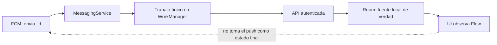
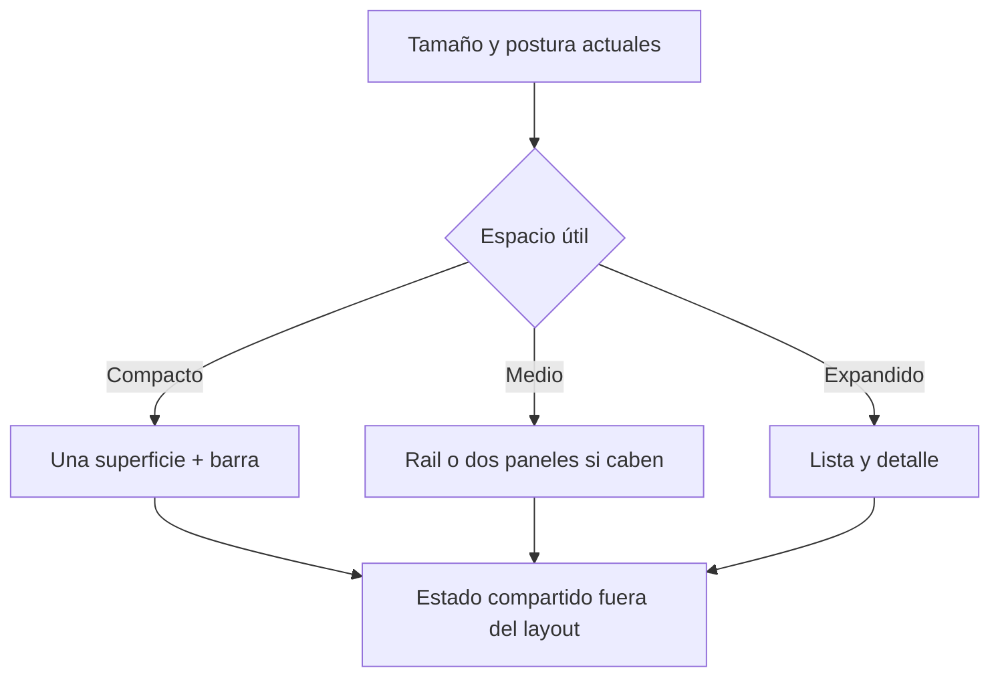
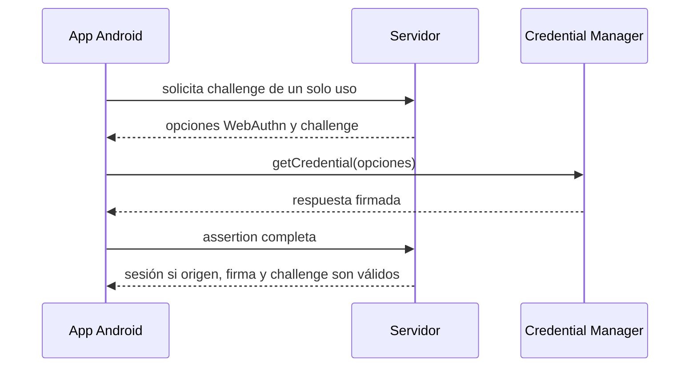

# Módulo 16: Android profesional — privacidad, datos, escala e identidad

Este módulo cubre seis huecos detectados al contrastar el track completo con Android
Basics with Compose, las guías de calidad de Google, temarios actuales por proyectos
y libros modernos de Kotlin/Compose. Continúa sobre `academia-android`; cada tema deja
una evidencia independiente y termina integrándose en RutaFlow.

## Aprende construyendo

### Tema 1: Permisos en tiempo de ejecución y alternativas sin permiso

#### Paso 1 · Objetivo y preparación
Al finalizar podrás pedir un permiso solo cuando una acción lo necesita, manejar
rechazo y elegir Photo Picker cuando no necesitas acceso general. **Prerrequisitos:**
Módulo 15 Tema 1 (Activity Result API) y AndroidManifest.

#### Paso 2 · Contexto y caso real
**¿Por qué es importante?** RutaFlow adjunta una foto de entrega. Pedir acceso a toda
la galería al abrir la app aumenta riesgo y abandono; el selector del sistema concede
acceso temporal únicamente al elemento elegido.

#### Paso 3 · Teoría, modelo mental y analogía
Un permiso peligroso se declara en el manifiesto y se solicita durante la acción que
lo justifica. Antes de pedirlo, comprueba si ya fue concedido; si el sistema recomienda
una explicación, muestra una razón concreta; si se rechaza, conserva un flujo útil.
`ActivityResultContracts.RequestPermission` devuelve la decisión sin códigos mágicos.

La mejor petición puede ser ninguna: Photo Picker y Storage Access Framework permiten
elegir contenido sin permiso general. **Analogía:** un permiso amplio entrega una llave
del archivo; el picker deja que el usuario entregue una sola carpeta. La analogía no
implica propiedad permanente: la URI puede necesitar persistencia explícita según el
contrato usado.

#### Paso 4 · Demostración guiada desde cero
En una rama nueva del proyecto crea
`app/src/main/java/com/academia/privacidad/AdjuntarFoto.kt`:

```kotlin
package com.academia.privacidad

import android.net.Uri
import androidx.activity.compose.rememberLauncherForActivityResult
import androidx.activity.result.PickVisualMediaRequest
import androidx.activity.result.contract.ActivityResultContracts
import androidx.compose.material3.Button
import androidx.compose.material3.Text
import androidx.compose.runtime.Composable

@Composable
fun AdjuntarFoto(onSeleccionada: (Uri) -> Unit) {
    val picker = rememberLauncherForActivityResult(
        ActivityResultContracts.PickVisualMedia()
    ) { uri -> uri?.let(onSeleccionada) }

    Button(onClick = {
        picker.launch(PickVisualMediaRequest(ActivityResultContracts.PickVisualMedia.ImageOnly))
    }) { Text("Elegir comprobante") }
}
```

Compila y revisa el manifiesto fusionado:

```bash
cd academia-android
./gradlew :app:assembleDebug :app:processDebugMainManifest
grep -R "READ_MEDIA_IMAGES" app/build/intermediates/merged_manifests || echo "sin permiso amplio"
```

**Resultado esperado:** `BUILD SUCCESSFUL` y `sin permiso amplio`. El contrato abre
una UI del sistema y devuelve `Uri?`; cancelar no es error y no ejecuta el callback.

**Fallo deliberado:** agrega `READ_MEDIA_IMAGES` al manifiesto aunque solo uses el
picker. El `grep` lo detecta: existe privilegio sin necesidad. Elimínalo y documenta
por qué el caso de uso funciona con acceso seleccionado por el usuario.

#### Paso 5 · Práctica guiada
Añade una pantalla previa que explique para qué se usará la imagen y permita continuar
sin adjuntarla. **Pista:** la explicación pertenece a tu UI; no suplantes el diálogo
del sistema ni bloquees al usuario si rechaza.

#### Paso 6 · Práctica independiente
Implementa ubicación precisa para «iniciar ruta» con `RequestPermission`. Prueba tres
estados: concedido, rechazado y «no volver a preguntar». En el último ofrece abrir
ajustes, pero no repitas el diálogo en bucle.

#### Paso 7 · Cierre
Entrega picker, manifiesto sin privilegios sobrantes y matriz de tres estados. El
siguiente tema persiste preferencias pequeñas sin convertirlas en una base relacional.
**Errores comunes:** pedir permisos al arrancar, asumir que el rechazo es permanente y
solicitar almacenamiento para un picker que no lo necesita. **Cuándo no usarlo:** si
necesitas relaciones, consultas o conjuntos grandes, usa Room; un permiso tampoco debe
sustituir una alternativa más privada.

**Transferencia al proyecto integrador «RutaFlow»:** el comprobante se elige por URI y
se copia al almacenamiento controlado por la app antes de subirlo. **Fuentes oficiales:**
[solicitar permisos](https://developer.android.com/training/permissions/requesting) y
[minimizar permisos](https://developer.android.com/privacy-and-security/minimize-permission-requests).

### Tema 2: DataStore para preferencias consistentes y migrables

#### Paso 1 · Objetivo y preparación
Al finalizar podrás guardar una preferencia con DataStore, observarla como `Flow` y
decidir entre Preferences, un esquema tipado y Room. **Prerrequisitos:** corrutinas,
Flow y Módulo 6.

#### Paso 2 · Contexto y caso real
**¿Por qué es importante?** RutaFlow recuerda tema visual, filtros y consentimiento.
Son pocos valores, pero deben escribirse sin bloquear el hilo ni perder actualizaciones
concurrentes.

#### Paso 3 · Teoría, modelo mental y analogía
Preferences DataStore guarda pares clave/valor sin esquema; Proto o un serializer
tipado conserva estructura; Room resuelve conjuntos grandes, relaciones y actualizaciones
parciales. `data` expone un `Flow` y `edit` aplica una transacción. DataStore no cifra
secretos por sí solo. **Analogía:** DataStore es una ficha de configuración, Room un
archivo con tablas relacionadas; no uses la ficha como almacén de miles de entregas.

#### Paso 4 · Demostración guiada desde cero
Agrega `androidx.datastore:datastore-preferences` al catálogo de versiones del proyecto.
Usa la versión estable indicada por las notas oficiales de AndroidX que hayas fijado en
la rama; no mezcles versiones copiadas de ejemplos distintos. Crea el archivo
`app/src/main/java/com/academia/ajustes/AjustesRepository.kt` con este contenido:

```kotlin
package com.academia.ajustes

import android.content.Context
import androidx.datastore.preferences.core.booleanPreferencesKey
import androidx.datastore.preferences.core.edit
import androidx.datastore.preferences.preferencesDataStore
import kotlinx.coroutines.flow.Flow
import kotlinx.coroutines.flow.map

private val Context.ajustesDataStore by preferencesDataStore("ajustes")

class AjustesRepository(private val context: Context) {
    private val altoContraste = booleanPreferencesKey("alto_contraste")

    val altoContrasteFlow: Flow<Boolean> = context.ajustesDataStore.data
        .map { it[altoContraste] ?: false }

    suspend fun cambiarAltoContraste(activo: Boolean) {
        context.ajustesDataStore.edit { it[altoContraste] = activo }
    }
}
```

```bash
cd academia-android
./gradlew :app:compileDebugKotlin :app:testDebugUnitTest
./gradlew :app:test
```

**Resultado esperado:** `BUILD SUCCESSFUL`; una sola instancia de DataStore existe por
archivo y la escritura ocurre dentro de `edit`. La UI recopila el `Flow` con ciclo de
vida, no lee el archivo directamente.

**Fallo deliberado:** declara dos delegates con el mismo nombre de archivo en clases
distintas y trata de usarlos simultáneamente. DataStore puede fallar por múltiples
instancias activas. Centraliza el delegate a nivel superior e inyecta el repositorio.

#### Paso 5 · Práctica guiada
Agrega `ordenar_por_prioridad` con valor predeterminado `true` y prueba que la ausencia
de clave produce el valor documentado. **Pista:** el default pertenece al mapeo del
repositorio, no a cada pantalla.

#### Paso 6 · Práctica independiente
Diseña una migración desde `SharedPreferences`. Escribe una tabla con clave anterior,
clave nueva, default y política ante dato inválido; demuestra que la migración se ejecuta
una vez y que una reinstalación limpia conserva defaults sensatos.

#### Paso 7 · Cierre
Entrega repositorio, prueba de default y plan de migración. El siguiente tema pagina un conjunto
que DataStore no debería almacenar. **Errores comunes:** crear múltiples instancias,
guardar tokens como texto y usar DataStore para datos relacionales. **Cuándo no usarlo:**
usa Room para entregas y Android Keystore más almacenamiento apropiado para secretos.

**Transferencia al proyecto integrador «RutaFlow»:** persiste filtros y preferencias,
no el historial de entregas. **Fuente oficial:** [DataStore](https://developer.android.com/topic/libraries/architecture/datastore).

### Tema 3: Paging 3, estados de carga y RemoteMediator

#### Paso 1 · Objetivo y preparación
Al finalizar podrás cargar entregas por páginas, mostrar carga/error/reintento y explicar
cuándo combinar red y Room con `RemoteMediator`. **Prerrequisitos:** Retrofit, Room,
Flow y LazyColumn.

#### Paso 2 · Contexto y caso real
**¿Por qué es importante?** descargar diez mil entregas para mostrar veinte desperdicia
red y memoria. Paginar no es solo «scroll infinito»: también exige claves estables,
deduplicación, refresh y recuperación de errores.

#### Paso 3 · Teoría, modelo mental y analogía
`PagingSource` carga una fuente; `Pager` expone `Flow<PagingData<T>>`; Compose consume
con `collectAsLazyPagingItems`. `LoadState` distingue refresh y append. Cuando Room es
la fuente de verdad, `RemoteMediator` trae páginas remotas y las escribe en una
transacción. **Analogía:** el catálogo entrega bandejas bajo demanda; RemoteMediator
repone el depósito local, no entrega directamente a cada pantalla.

#### Paso 4 · Demostración guiada desde cero
Crea `app/src/main/java/com/academia/paging/EntregasPagingSource.kt`:

```kotlin
package com.academia.paging

import androidx.paging.PagingSource
import androidx.paging.PagingState

data class Entrega(val id: Int)

class EntregasPagingSource(
    private val cargar: suspend (pagina: Int, tamano: Int) -> List<Entrega>
) : PagingSource<Int, Entrega>() {
    override suspend fun load(params: LoadParams<Int>): LoadResult<Int, Entrega> = try {
        val pagina = params.key ?: 1
        val datos = cargar(pagina, params.loadSize)
        LoadResult.Page(
            data = datos,
            prevKey = if (pagina == 1) null else pagina - 1,
            nextKey = if (datos.isEmpty()) null else pagina + 1,
        )
    } catch (error: Exception) {
        LoadResult.Error(error)
    }

    override fun getRefreshKey(state: PagingState<Int, Entrega>): Int? =
        state.anchorPosition?.let(state::closestPageToPosition)?.let { page ->
            page.prevKey?.plus(1) ?: page.nextKey?.minus(1)
        }
}
```

```bash
cd academia-android
./gradlew :app:testDebugUnitTest --tests '*PagingSource*'
```

**Resultado esperado:** tests con `PagingSource.LoadParams.Refresh` verifican página 1,
`nextKey = 2` y `LoadResult.Error` ante una excepción. El fin se representa con lista
vacía y `nextKey = null`, no con un bucle de peticiones.

**Fallo deliberado:** devuelve siempre `pagina + 1`, incluso con respuesta vacía. Un
test demuestra que nunca se alcanza el final. Restaura `nextKey = null` cuando no hay
datos.

#### Paso 5 · Práctica guiada
Renderiza `LoadState.Loading`, `Error` con botón Retry y lista vacía. **Pista:** refresh
y append son estados distintos; un error al anexar no debe borrar lo ya visible.

#### Paso 6 · Práctica independiente
Implementa `RemoteMediator` con Room como fuente de verdad. Prueba refresh transaccional,
clave siguiente y una respuesta duplicada del servidor sin duplicar filas.

#### Paso 7 · Cierre
Entrega PagingSource, pruebas de fin/error y diseño de RemoteMediator. El siguiente tema
recibe cambios remotos mediante push sin confundir notificación con estado de negocio.
**Errores comunes:** claves inestables, reintento infinito y usar la red directamente
como UI source en una app offline-first. **Cuándo no usarlo:** una lista pequeña y
acotada no necesita Paging.

**Transferencia al proyecto integrador «RutaFlow»:** historial paginado desde Room,
sincronizado por RemoteMediator. **Fuentes oficiales:** [Paging 3](https://developer.android.com/topic/libraries/architecture/paging/v3-overview) y
[red + base de datos](https://developer.android.com/topic/libraries/architecture/paging/v3-network-db).

### Tema 4: FCM, permiso de notificaciones y sincronización confiable

#### Paso 1 · Objetivo y preparación
Al finalizar podrás recibir un mensaje FCM, renovar el token, pedir permiso en Android
13+ y tratar el push como señal para sincronizar. **Prerrequisitos:** notificaciones
locales, deep links, WorkManager y backend autenticado.

#### Paso 2 · Contexto y caso real
**¿Por qué es importante?** RutaFlow avisa que una entrega cambió, pero un push puede
retrasarse, duplicarse o perderse. La notificación mejora latencia percibida; la API y
la base local siguen siendo la fuente de verdad.

#### Paso 3 · Teoría, modelo mental y analogía
FCM asigna un token a una instalación; `onNewToken` debe enviarlo al backend asociado
al usuario correcto. Los mensajes de datos permiten decidir cómo sincronizar. Android
13+ requiere `POST_NOTIFICATIONS` para mostrar UI, no para actualizar silenciosamente
dentro de los límites del sistema. **Analogía:** el push es un timbre, no el contenido
del paquete: al oírlo consultas el estado autenticado.



#### Paso 4 · Demostración guiada desde cero
Crea `app/src/main/java/com/academia/push/RutaFlowMessagingService.kt`:

```kotlin
package com.academia.push

import com.google.firebase.messaging.FirebaseMessagingService
import com.google.firebase.messaging.RemoteMessage

class RutaFlowMessagingService : FirebaseMessagingService() {
    override fun onNewToken(token: String) {
        // En producción: encolar registro autenticado; nunca imprimir el token.
        TokenPendiente.guardar(token)
    }

    override fun onMessageReceived(message: RemoteMessage) {
        val envioId = message.data["envio_id"] ?: return
        if (!envioId.matches(Regex("RF-[0-9]+"))) return
        SincronizacionEnvio.encolar(applicationContext, envioId)
    }
}
```

Declara el servicio con `exported="false"` y la acción `MESSAGING_EVENT`, crea el canal
en primer plano y solicita `POST_NOTIFICATIONS` después de explicar el beneficio.

```bash
cd academia-android
./gradlew :app:processDebugMainManifest :app:testDebugUnitTest
./gradlew :app:test
grep -R "MESSAGING_EVENT\|exported=\"false\"" app/build/intermediates/merged_manifests
```

**Resultado esperado:** el manifiesto fusionado contiene servicio no exportado; tests
rechazan IDs inválidos y encolan una sola sincronización idempotente para duplicados.

**Fallo deliberado:** usa el texto recibido como estado final y marca «entregado» sin
consultar API. Reproduce un mensaje duplicado o antiguo: puede retroceder datos. Corrige
encolando una sincronización por ID y comparando versión del servidor.

#### Paso 5 · Práctica guiada
Implementa `onNewToken` con una cola local que se vacía tras login. **Pista:** cerrar
sesión debe desvincular el token en backend antes de asociarlo a otra cuenta.

#### Paso 6 · Práctica independiente
Prueba matriz foreground/background, permiso concedido/rechazado y mensaje perdido.
Cuando FCM informa mensajes eliminados, ejecuta sincronización completa y documenta
telemetría de recibido, mostrado, abierto y sincronizado sin guardar contenido sensible.

#### Paso 7 · Cierre
Entrega servicio, manifiesto, política de token y matriz. El siguiente tema adapta el mismo flujo
a pantallas grandes. **Errores comunes:** confiar en entrega exacta, registrar tokens en
logs y pedir permiso sin contexto. **Cuándo no usarlo:** actualizaciones críticas que
requieren garantía deben tener reconciliación en backend/cliente; FCM no es una cola
transaccional.

**Transferencia al proyecto integrador «RutaFlow»:** cada push invalida una entrega y
WorkManager reconcilia Room. **Fuentes oficiales:** [configurar FCM](https://firebase.google.com/docs/cloud-messaging/android/get-started) y
[recibir mensajes](https://firebase.google.com/docs/cloud-messaging/android/receive-messages).

### Tema 5: Interfaces adaptativas para teléfono, tablet y foldable

#### Paso 1 · Objetivo y preparación
Al finalizar podrás elegir navegación y paneles por espacio disponible, preservar estado
al redimensionar y probar teléfono, tablet, split-screen y foldable. **Prerrequisitos:**
Compose, Navigation y pruebas UI.

#### Paso 2 · Contexto y caso real
**¿Por qué es importante?** Android no equivale a un rectángulo fijo: una app puede
cambiar de tamaño sin recrearse y ejecutarse en tablet, escritorio o postura plegada.
Estirar una lista de teléfono produce líneas ilegibles y navegación desperdiciada.

#### Paso 3 · Teoría, modelo mental y analogía
Diseño adaptativo responde al tamaño de la ventana, no al modelo del dispositivo.
Compact suele usar una pantalla; medium/expanded puede usar lista y detalle simultáneos,
con `NavigationSuiteScaffold` eligiendo barra o rail. Los datos y la selección viven
fuera del layout para sobrevivir al cambio. **Analogía:** el mismo inventario se organiza
en un mostrador pequeño o una bodega; no cambia el contenido, cambia su distribución.

La decisión se reevalúa cuando cambia la ventana: una bisagra puede introducir una zona
no utilizable, así que el ancho por sí solo no autoriza colocar controles sobre el
pliegue. Teclado, foco y orden semántico deben conservar una secuencia comprensible
aunque los componentes cambien de columna.



#### Paso 4 · Demostración guiada desde cero
Crea y prueba una decisión pura antes de conectar APIs de ventana:

```kotlin
package com.academia.adaptive

enum class Ancho { COMPACTO, MEDIO, EXPANDIDO }
enum class Presentacion { UNA_PANTALLA, LISTA_Y_DETALLE }

fun presentacion(ancho: Ancho): Presentacion = when (ancho) {
    Ancho.COMPACTO -> Presentacion.UNA_PANTALLA
    Ancho.MEDIO, Ancho.EXPANDIDO -> Presentacion.LISTA_Y_DETALLE
}
```

Conecta la función a `currentWindowAdaptiveInfo().windowSizeClass` y conserva
`envioSeleccionadoId` en ViewModel/SavedStateHandle.

```bash
cd academia-android
./gradlew :app:testDebugUnitTest --tests '*Adaptive*' :app:connectedDebugAndroidTest
```

**Resultado esperado:** tests unitarios cubren tres anchos; pruebas UI confirman barra
en compacto y lista/detalle en expandido sin perder selección al redimensionar.

**Fallo deliberado:** calcula layout una sola vez con `resources.configuration` y guarda
selección dentro de la rama compacta. Al cambiar tamaño, se pierde. Mueve el estado al
ViewModel y deriva presentación del tamaño actual.

#### Paso 5 · Práctica guiada
Agrega previews para cuatro tamaños y limita el ancho de formularios. **Pista:** más
espacio no significa que cada campo deba ocuparlo por completo.

#### Paso 6 · Práctica independiente
Ejecuta la matriz oficial: teléfono vertical/horizontal, tablet, foldable, split-screen,
teclado y TalkBack. Registra captura, foco y continuidad de una entrega seleccionada.

#### Paso 7 · Cierre
Entrega layout adaptativo y matriz. El siguiente y último tema moderniza autenticación sin guardar
contraseñas. **Errores comunes:** detectar «tablet» por nombre, duplicar pantallas y
guardar estado dentro del layout. **Cuándo no usarlo:** no añadas panel doble si empeora
la tarea; adapta según contenido y evidencia.

**Transferencia al proyecto integrador «RutaFlow»:** teléfono muestra lista o detalle;
tablet muestra ambos con selección compartida. **Fuentes oficiales:** [calidad adaptativa](https://developer.android.com/develop/adaptive-apps/quality-guidelines/core-app-quality) y
[calidad técnica](https://developer.android.com/quality/technical).

### Tema 6: Credential Manager, passkeys y verificación en servidor

#### Paso 1 · Objetivo y preparación
Al finalizar podrás iniciar sesión con Credential Manager, explicar el reto criptográfico
de una passkey y separar autenticación local de autorización del backend. **Prerrequisitos:**
HTTP, deep links y seguridad del Módulo 13.

#### Paso 2 · Contexto y caso real
**¿Por qué es importante?** guardar contraseñas o construir un selector propio aumenta
phishing y fragmentación. Credential Manager unifica passkeys, contraseñas y proveedores;
el servidor sigue verificando credenciales y emitiendo la sesión de RutaFlow.

#### Paso 3 · Teoría, modelo mental y analogía
El servidor genera un challenge de un solo uso ligado al origen. El autenticador firma
con una clave privada que no se comparte; el servidor valida firma, challenge, RP ID y
contador cuando corresponda. La app transporta JSON de WebAuthn, no decide por sí sola
que la firma es válida. **Analogía:** el teléfono firma un formulario con un sello que
no entrega; la oficina compara el sello y el número único del formulario.



#### Paso 4 · Demostración guiada desde cero
Crea `app/src/main/java/com/academia/identidad/IniciarSesion.kt`:

```kotlin
package com.academia.identidad

import android.content.Context
import androidx.credentials.CredentialManager
import androidx.credentials.GetCredentialRequest
import androidx.credentials.GetPublicKeyCredentialOption
import androidx.credentials.PublicKeyCredential

class IniciarSesion(private val context: Context, private val api: IdentidadApi) {
    suspend fun ejecutar(): String {
        val opcionesJson = api.crearChallenge()
        val request = GetCredentialRequest(
            listOf(GetPublicKeyCredentialOption(opcionesJson))
        )
        val respuesta = CredentialManager.create(context).getCredential(context, request)
        val passkey = respuesta.credential as? PublicKeyCredential
            ?: error("tipo de credencial no soportado")
        return api.verificarYCrearSesion(passkey.authenticationResponseJson)
    }
}
```

```bash
cd academia-android
./gradlew :app:compileDebugKotlin :app:testDebugUnitTest
./gradlew :app:test
```

**Resultado esperado:** el fake de `IdentidadApi` comprueba que el JSON recibido incluye
el challenge esperado y devuelve una sesión solo una vez. Cancelar el selector produce
estado cancelado, no «contraseña incorrecta».

**Fallo deliberado:** reutiliza el mismo challenge en dos verificaciones. El segundo
intento debe fallar; si pasa, existe replay. Marca challenges consumidos y con expiración
en el servidor.

#### Paso 5 · Práctica guiada
Modela `Cargando`, `Cancelado`, `Autenticado` y `Error` sin registrar el JSON completo.
**Pista:** cancelación voluntaria no es un incidente ni debe mostrar alarma roja.

#### Paso 6 · Práctica independiente
Agrega fallback de contraseña/federado mediante Credential Manager, logout que revoca
sesión y prueba de cuenta equivocada. Diseña dónde aplicar Play Integrity como señal de
riesgo, nunca como sustituto de autenticación o autorización.

#### Paso 7 · Cierre
Entrega flujo, prueba anti-replay y modelo de estados. Como siguiente paso, cierra el track demostrando que
una app profesional minimiza privilegios, escala datos/UI y delega identidad a APIs
modernas con verificación de servidor. **Errores comunes:** verificar solo en cliente,
registrar assertions y confundir integridad de dispositivo con identidad. **Cuándo no
usarlo:** no obligues passkeys si tu población/plataformas no puede recuperarlas; conserva
un fallback seguro y medido.

**Transferencia al proyecto integrador «RutaFlow»:** conductor inicia sesión, backend
verifica y entrega sesión con autorización por envío. **Fuente oficial:**
[Credential Manager y form factors](https://developer.android.com/identity/form-factors).

## Proyecto del módulo

Integra los seis temas en una rama `modulo-16`: adjunta foto sin permiso amplio,
persiste preferencias con DataStore, pagina Room/red, reconcilia un push FCM, adapta
lista/detalle y autentica con challenge de servidor. La evidencia incluye tests, matriz
de dispositivos/permisos, manifiesto fusionado y un README que separa lo ejecutado en
emulador de Firebase/backend que requiera credenciales reales.
