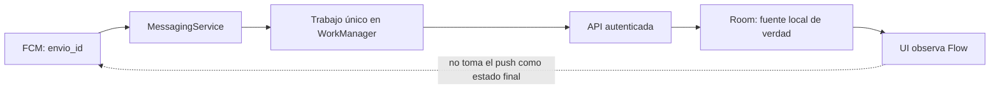
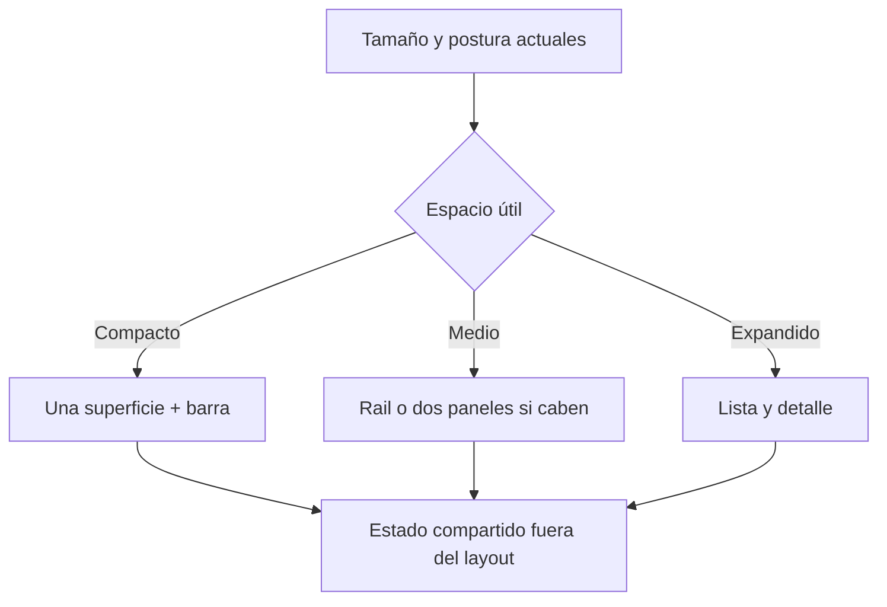
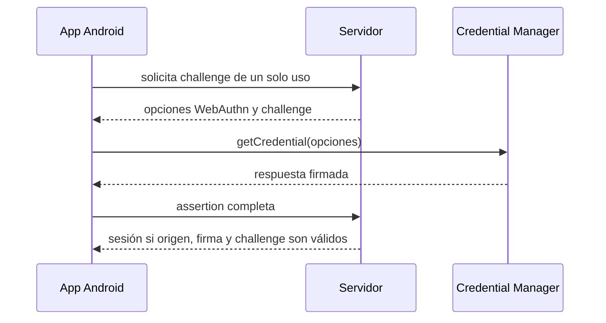
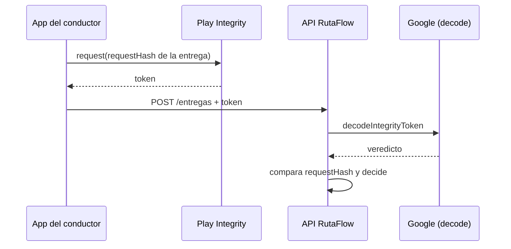

# Módulo 16: Android profesional — privacidad, datos, escala e identidad

Este módulo cubre seis huecos detectados al contrastar el track completo con Android
Basics with Compose, las guías de calidad de Google, temarios actuales por proyectos
y libros modernos de Kotlin/Compose. Continúa sobre `academia-android`; cada tema deja
una evidencia independiente y termina integrándose en RutaFlow.

## Aprende construyendo

> **Dependencias de este módulo** (catálogo del Módulo 0, Tema 3), dentro de `dependencies { }` de `app/build.gradle.kts`: Tema 2, `implementation(libs.androidx.datastore.preferences)`; Tema 3, `implementation(libs.androidx.paging.runtime)` e `implementation(libs.androidx.paging.compose)`; Tema 4, `implementation(platform(libs.firebase.bom))` e `implementation(libs.firebase.messaging)`, más el plugin `alias(libs.plugins.google.services)` (raíz con `apply false`) y el `google-services.json` de tu proyecto de Firebase en `app/`; Tema 6, `implementation(libs.androidx.credentials)` e `implementation(libs.androidx.credentials.play.services.auth)`; Tema 7, `implementation(libs.play.integrity)`.


### Tema 1: Permisos en tiempo de ejecución y alternativas sin permiso · Avanzado · 45 min

<details open>
<summary><strong>Capa 1 — Lectura</strong></summary>

#### ► DE QUÉ TRATA
Al finalizar podrás pedir un permiso solo cuando una acción lo necesita, manejar rechazo y elegir Photo Picker cuando no necesitas acceso general. Prerrequisitos: Módulo 15 Tema 1 (Activity Result API) y AndroidManifest.

#### ► LA ANALOGÍA
Un permiso peligroso se declara en el manifiesto y se solicita durante la acción que
lo justifica. Antes de pedirlo, comprueba si ya fue concedido; si el sistema recomienda
una explicación, muestra una razón concreta; si se rechaza, conserva un flujo útil.
`ActivityResultContracts.RequestPermission` devuelve la decisión sin códigos mágicos.

La mejor petición puede ser ninguna: Photo Picker y Storage Access Framework permiten
elegir contenido sin permiso general. **Analogía:** un permiso amplio entrega una llave
del archivo; el picker deja que el usuario entregue una sola carpeta. La analogía no
implica propiedad permanente: la URI puede necesitar persistencia explícita según el
contrato usado.

</details>

<details>
<summary><strong>Capa 2 — Construcción</strong></summary>

#### Código y verificación
```kotlin
package com.academia.privacidad

import android.net.Uri
import androidx.activity.compose.rememberLauncherForActivityResult
import androidx.activity.result.PickVisualMediaRequest
import androidx.activity.result.contract.ActivityResultContracts
import androidx.compose.material3.Button
import androidx.compose.material3.Text
import androidx.compose.runtime.Composable

@Composable
fun AdjuntarFoto(onSeleccionada: (Uri) -> Unit) {
    val picker = rememberLauncherForActivityResult(
        ActivityResultContracts.PickVisualMedia()
    ) { uri -> uri?.let(onSeleccionada) }

    Button(onClick = {
        picker.launch(PickVisualMediaRequest(ActivityResultContracts.PickVisualMedia.ImageOnly))
    }) { Text("Elegir comprobante") }
}
```

```bash
test -f settings.gradle.kts || cd academia-android   # sitúate en la raíz del proyecto del Módulo 0
./gradlew :app:assembleDebug :app:processDebugMainManifest
grep -R "READ_MEDIA_IMAGES" app/build/intermediates/merged_manifests || echo "sin permiso amplio"
```

</details>

### Tema 2: DataStore para preferencias consistentes y migrables · Avanzado · 45 min

<details open>
<summary><strong>Capa 1 — Lectura</strong></summary>

#### ► DE QUÉ TRATA
Al finalizar podrás guardar una preferencia con DataStore, observarla como Flow y decidir entre Preferences, un esquema tipado y Room. Prerrequisitos: corrutinas, Flow y Módulo 6.

</details>

<details>
<summary><strong>Capa 2 — Construcción</strong></summary>

#### Código y verificación
```kotlin
package com.academia.ajustes

import android.content.Context
import androidx.datastore.preferences.core.booleanPreferencesKey
import androidx.datastore.preferences.core.edit
import androidx.datastore.preferences.preferencesDataStore
import kotlinx.coroutines.flow.Flow
import kotlinx.coroutines.flow.map

private val Context.ajustesDataStore by preferencesDataStore("ajustes")

class AjustesRepository(private val context: Context) {
    private val altoContraste = booleanPreferencesKey("alto_contraste")

    val altoContrasteFlow: Flow<Boolean> = context.ajustesDataStore.data
        .map { it[altoContraste] ?: false }

    suspend fun cambiarAltoContraste(activo: Boolean) {
        context.ajustesDataStore.edit { it[altoContraste] = activo }
    }
}
```

```bash
test -f settings.gradle.kts || cd academia-android   # sitúate en la raíz del proyecto del Módulo 0
./gradlew :app:compileDebugKotlin :app:testDebugUnitTest
./gradlew :app:test
```

</details>

### Tema 3: Paging 3, estados de carga y RemoteMediator · Avanzado · 45 min

<details open>
<summary><strong>Capa 1 — Lectura</strong></summary>

#### ► DE QUÉ TRATA
Al finalizar podrás cargar entregas por páginas, mostrar carga/error/reintento y explicar cuándo combinar red y Room con RemoteMediator. Prerrequisitos: Retrofit, Room, Flow y LazyColumn.

#### ► LA ANALOGÍA
`PagingSource` carga una fuente; `Pager` expone `Flow<PagingData<T>>`; Compose consume
con `collectAsLazyPagingItems`. `LoadState` distingue refresh y append. Cuando Room es
la fuente de verdad, `RemoteMediator` trae páginas remotas y las escribe en una
transacción. **Analogía:** el catálogo entrega bandejas bajo demanda; RemoteMediator
repone el depósito local, no entrega directamente a cada pantalla.

</details>

<details>
<summary><strong>Capa 2 — Construcción</strong></summary>

#### Código y verificación
```kotlin
package com.academia.paging

import androidx.paging.PagingSource
import androidx.paging.PagingState

data class Entrega(val id: Int)

class EntregasPagingSource(
    private val cargar: suspend (pagina: Int, tamano: Int) -> List<Entrega>
) : PagingSource<Int, Entrega>() {
    override suspend fun load(params: LoadParams<Int>): LoadResult<Int, Entrega> = try {
        val pagina = params.key ?: 1
        val datos = cargar(pagina, params.loadSize)
        LoadResult.Page(
            data = datos,
            prevKey = if (pagina == 1) null else pagina - 1,
            nextKey = if (datos.isEmpty()) null else pagina + 1,
        )
    } catch (error: Exception) {
        LoadResult.Error(error)
    }

    override fun getRefreshKey(state: PagingState<Int, Entrega>): Int? =
        state.anchorPosition?.let(state::closestPageToPosition)?.let { page ->
            page.prevKey?.plus(1) ?: page.nextKey?.minus(1)
        }
}
```

```bash
test -f settings.gradle.kts || cd academia-android   # sitúate en la raíz del proyecto del Módulo 0
./gradlew :app:testDebugUnitTest --tests '*PagingSource*'
```

</details>

### Tema 4: FCM, permiso de notificaciones y sincronización confiable · Avanzado · 45 min

<details open>
<summary><strong>Capa 1 — Lectura</strong></summary>

#### ► DE QUÉ TRATA
Al finalizar podrás recibir un mensaje FCM, renovar el token, pedir permiso en Android 13+ y tratar el push como señal para sincronizar. Prerrequisitos: notificaciones locales, deep links, WorkManager y backend autenticado.

#### ► CÓMO FUNCIONA


</details>

<details>
<summary><strong>Capa 2 — Construcción</strong></summary>

#### Código y verificación

```kotlin
package com.academia.push

import com.google.firebase.messaging.FirebaseMessagingService
import com.google.firebase.messaging.RemoteMessage

class RutaFlowMessagingService : FirebaseMessagingService() {
    override fun onNewToken(token: String) {
        // En producción: encolar registro autenticado; nunca imprimir el token.
        TokenPendiente.guardar(token)
    }

    override fun onMessageReceived(message: RemoteMessage) {
        val envioId = message.data["envio_id"] ?: return
        if (!envioId.matches(Regex("RF-[0-9]+"))) return
        SincronizacionEnvio.encolar(applicationContext, envioId)
    }
}
```

```bash
test -f settings.gradle.kts || cd academia-android   # sitúate en la raíz del proyecto del Módulo 0
./gradlew :app:processDebugMainManifest :app:testDebugUnitTest
./gradlew :app:test
grep -R "MESSAGING_EVENT\|exported=\"false\"" app/build/intermediates/merged_manifests
```

</details>

### Tema 5: Interfaces adaptativas para teléfono, tablet y foldable · Avanzado · 45 min

<details open>
<summary><strong>Capa 1 — Lectura</strong></summary>

#### ► DE QUÉ TRATA
Al finalizar podrás elegir navegación y paneles por espacio disponible, preservar estado al redimensionar y probar teléfono, tablet, split-screen y foldable. Prerrequisitos: Compose, Navigation y pruebas UI.

#### ► LA ANALOGÍA
Diseño adaptativo responde al tamaño de la ventana, no al modelo del dispositivo.
Compact suele usar una pantalla; medium/expanded puede usar lista y detalle simultáneos,
con `NavigationSuiteScaffold` eligiendo barra o rail. Los datos y la selección viven
fuera del layout para sobrevivir al cambio. **Analogía:** el mismo inventario se organiza
en un mostrador pequeño o una bodega; no cambia el contenido, cambia su distribución.

La decisión se reevalúa cuando cambia la ventana: una bisagra puede introducir una zona
no utilizable, así que el ancho por sí solo no autoriza colocar controles sobre el
pliegue. Teclado, foco y orden semántico deben conservar una secuencia comprensible
aunque los componentes cambien de columna.



#### ► CÓMO FUNCIONA


</details>

<details>
<summary><strong>Capa 2 — Construcción</strong></summary>

#### Código y verificación


```kotlin
package com.academia.adaptive

enum class Ancho { COMPACTO, MEDIO, EXPANDIDO }
enum class Presentacion { UNA_PANTALLA, LISTA_Y_DETALLE }

fun presentacion(ancho: Ancho): Presentacion = when (ancho) {
    Ancho.COMPACTO -> Presentacion.UNA_PANTALLA
    Ancho.MEDIO, Ancho.EXPANDIDO -> Presentacion.LISTA_Y_DETALLE
}
```

```bash
test -f settings.gradle.kts || cd academia-android   # sitúate en la raíz del proyecto del Módulo 0
./gradlew :app:testDebugUnitTest --tests '*Adaptive*' :app:connectedDebugAndroidTest
```

</details>

### Tema 6: Credential Manager, passkeys y verificación en servidor · Avanzado · 45 min

<details open>
<summary><strong>Capa 1 — Lectura</strong></summary>

#### ► DE QUÉ TRATA
Al finalizar podrás iniciar sesión con Credential Manager, explicar el reto criptográfico de una passkey y separar autenticación local de autorización del backend. Prerrequisitos: HTTP, deep links y seguridad del Módulo 13.

#### ► CÓMO FUNCIONA


</details>

<details>
<summary><strong>Capa 2 — Construcción</strong></summary>

#### Código y verificación


```kotlin
package com.academia.identidad

import android.content.Context
import androidx.credentials.CredentialManager
import androidx.credentials.GetCredentialRequest
import androidx.credentials.GetPublicKeyCredentialOption
import androidx.credentials.PublicKeyCredential

class IniciarSesion(private val context: Context, private val api: IdentidadApi) {
    suspend fun ejecutar(): String {
        val opcionesJson = api.crearChallenge()
        val request = GetCredentialRequest(
            listOf(GetPublicKeyCredentialOption(opcionesJson))
        )
        val respuesta = CredentialManager.create(context).getCredential(context, request)
        val passkey = respuesta.credential as? PublicKeyCredential
            ?: error("tipo de credencial no soportado")
        return api.verificarYCrearSesion(passkey.authenticationResponseJson)
    }
}
```

```bash
test -f settings.gradle.kts || cd academia-android   # sitúate en la raíz del proyecto del Módulo 0
./gradlew :app:compileDebugKotlin :app:testDebugUnitTest
./gradlew :app:test
```

</details>

### Tema 7: Play Integrity API: comprobar en el servidor que la petición viene de tu app real · Avanzado · 45 min

<details open>
<summary><strong>Capa 1 — Lectura</strong></summary>

#### ► DE QUÉ TRATA
Necesitas la app publicada (aunque sea en una pista de prueba interna) en Google Play Console, la API habilitada en un proyecto de Google Cloud y com.google.android.play:integrity en el módulo app. El servidor descifra el token con la API de Google.

#### ► LA ANALOGÍA
**Conceptos clave:** atestación, token de integridad, nonce o `requestHash`, veredicto de app (`appRecognitionVerdict`), de dispositivo (`deviceRecognitionVerdict`) y de cuenta, decodificación en servidor.

Flujo de una **solicitud estándar**:

1. La app prepara el proveedor con `prepareIntegrityToken` (una vez, al iniciar).
2. Al confirmar la entrega, pide un token con un **`requestHash`**: el hash de los datos de la acción (envío, hora). Así el token solo sirve para esa acción.
3. El servidor envía el token a la API `decodeIntegrityToken` de Google y recibe el **veredicto**.
4. El servidor compara el `requestHash` y decide.

| Veredicto | Valor esperado |
|---|---|
| app | `PLAY_RECOGNIZED`: la app es la tuya, sin modificar |
| dispositivo | contiene `MEETS_DEVICE_INTEGRITY` |
| cuenta | `LICENSED` si la cuenta obtuvo la app desde Play |

La decisión **siempre** se toma en el servidor: la app nunca decide si es confiable.

**Analogía:** es el sello de seguridad de un documento que el banco revisa en su oficina, no el cliente en su casa. La analogía falla en que un sello válido no dice que la persona sea honesta, solo que el documento es auténtico.

**Límite de uso:** no bloquees todo ante un veredicto negativo: hay dispositivos legítimos sin la integridad más alta. Usa la señal para pedir verificación extra o revisar, no como única defensa. La API tiene cuotas diarias.



#### ► CÓMO FUNCIONA


</details>

<details>
<summary><strong>Capa 2 — Construcción</strong></summary>

#### Código y verificación


```kotlin
package co.rutaflow.conductor.integridad

import android.content.Context
import com.google.android.play.core.integrity.IntegrityManagerFactory
import com.google.android.play.core.integrity.StandardIntegrityManager.*
import java.security.MessageDigest
import kotlinx.coroutines.tasks.await

class Integridad(contexto: Context, private val numeroProyecto: Long) {
    private val gestor = IntegrityManagerFactory.createStandard(contexto)
    private var proveedor: StandardIntegrityTokenProvider? = null

    suspend fun preparar() { // una vez, al iniciar la app
        proveedor = gestor.prepareIntegrityToken(
            PrepareIntegrityTokenRequest.builder().setCloudProjectNumber(numeroProyecto).build()).await()
    }

    suspend fun tokenParaEntrega(codigo: String, epochSegundos: Long): String {
        val hash = MessageDigest.getInstance("SHA-256")
            .digest("$codigo|$epochSegundos".toByteArray())
            .joinToString("") { "%02x".format(it) }
        val token = requireNotNull(proveedor).request(
            StandardIntegrityTokenRequest.builder().setRequestHash(hash).build()).await()
        return token.token()
    }
}
```

```kotlin
package co.rutaflow.api

// Respuesta ya decodificada por la API de Google (playintegrity.googleapis.com/v1/{paquete}:decodeIntegrityToken).
data class Veredicto(val requestHash: String, val app: String, val dispositivo: List<String>)

enum class Decision { ACEPTAR, VERIFICAR_EXTRA, RECHAZAR }

fun decidir(veredicto: Veredicto, hashEsperado: String): Decision = when {
    veredicto.requestHash != hashEsperado -> Decision.RECHAZAR       // token de otra acción
    veredicto.app != "PLAY_RECOGNIZED" -> Decision.RECHAZAR          // app modificada o desconocida
    "MEETS_DEVICE_INTEGRITY" !in veredicto.dispositivo -> Decision.VERIFICAR_EXTRA
    else -> Decision.ACEPTAR
}
```

```bash
./gradlew bundleRelease   # sube el .aab a la pista de prueba interna de Play Console
# instala desde Play en un dispositivo de prueba y confirma una entrega
```

```text
App instalada desde Play en un dispositivo real: veredicto app PLAY_RECOGNIZED, dispositivo [MEETS_DEVICE_INTEGRITY] y decisión ACEPTAR.
La misma app instalada con un APK modificado: app UNRECOGNIZED_VERSION y decisión RECHAZAR.
Un token reutilizado para otra entrega: requestHash distinto y decisión RECHAZAR.
```

</details>
