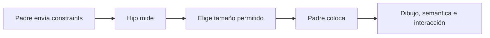
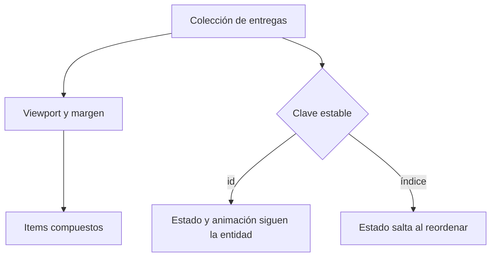
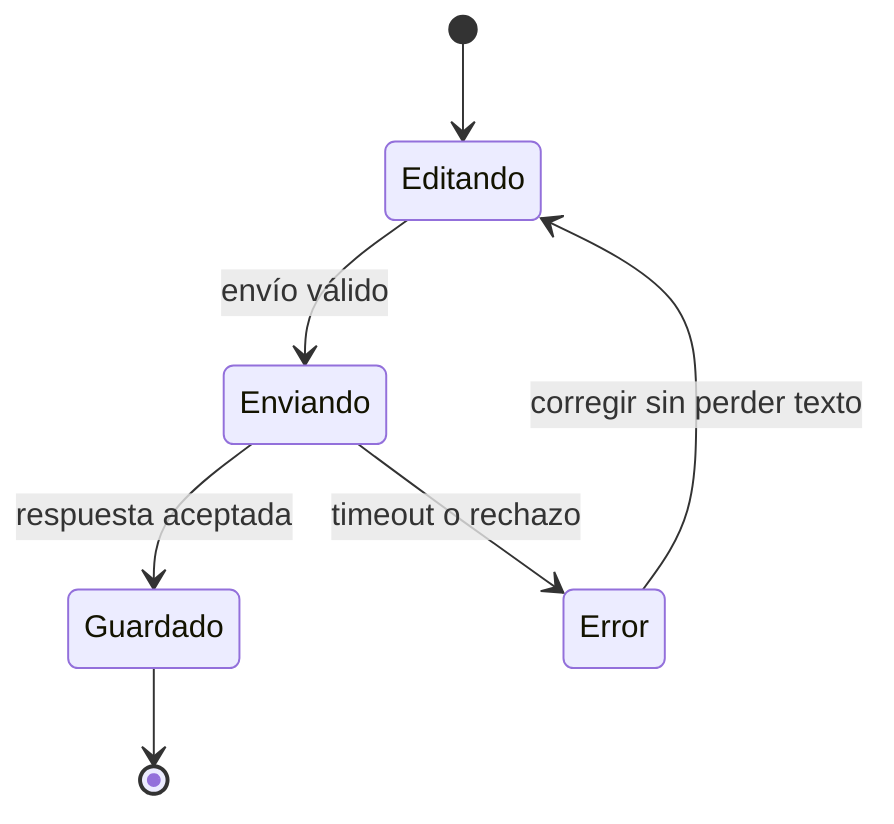
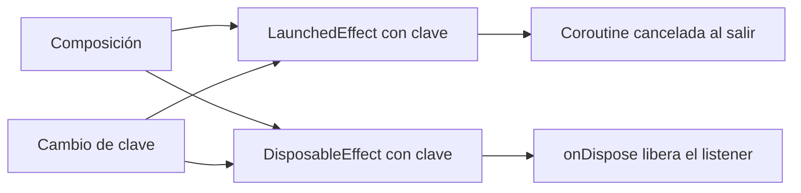
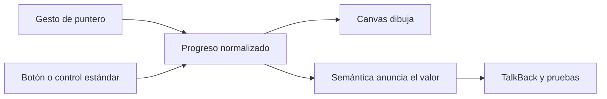

# Módulo 17: Compose profesional — layouts, formularios, listas y efectos

## Aprende construyendo

Este módulo convierte el conocimiento inicial de Compose en una interfaz mantenible.
Trabajarás sobre RutaFlow y separarás estado, presentación, interacción y efectos. Cada
tema deja una prueba observable; una captura bonita no sustituye comportamiento correcto.

### Tema 1: Constraints, Modifier y componentes con slots

#### Paso 1 · Objetivo y preparación
Al finalizar podrás explicar el ciclo medir–dimensionar–colocar, ordenar modificadores
sin resultados accidentales y diseñar un componente por slots. Abre `academia-android`
y crea el paquete `com.academia.ui.componentes`. **Prerrequisitos:** Compose básico del Módulo 2.

#### Paso 2 · Contexto y caso real
**¿Por qué es importante?** En RutaFlow una tarjeta debe funcionar en teléfono, tablet,
fuente grande y traducciones extensas. Fijar píxeles o copiar una tarjeta por pantalla
produce recortes y divergencias. Compose pasa constraints del padre al hijo; el hijo
elige un tamaño permitido y el padre lo coloca. `Modifier` participa en medición,
dibujo, semántica e interacción, por eso su orden cambia el resultado.

#### Paso 3 · Teoría, modelo mental y analogía
Un layout recibe mínimos y máximos. `fillMaxWidth` acepta el máximo; `wrapContentSize`
se ajusta al contenido; `weight` reparte el sobrante dentro de `Row` o `Column`. En
`clickable().padding()` el área clicable incluye el padding; al invertirlos, el padding
queda fuera. Una slot API recibe contenido composable y evita veinte parámetros visuales.
**Analogía:** el padre entrega un sobre de medidas; cada hijo devuelve una pieza válida
y el padre arma el escaparate.



#### Paso 4 · Demostración guiada desde cero
Crea `app/src/main/java/com/academia/ui/componentes/EntregaCard.kt`:

```kotlin
@Composable
fun EntregaCard(
    titulo: String,
    modifier: Modifier = Modifier,
    estado: @Composable RowScope.() -> Unit,
    acciones: @Composable RowScope.() -> Unit,
) {
    Card(modifier.fillMaxWidth()) {
        Column(Modifier.padding(16.dp), verticalArrangement = Arrangement.spacedBy(12.dp)) {
            Text(titulo, style = MaterialTheme.typography.titleMedium)
            Row(content = estado)
            Row(horizontalArrangement = Arrangement.spacedBy(8.dp), content = acciones)
        }
    }
}
```

```bash
cd academia-android
./gradlew :app:test
./gradlew :app:assembleDebug
```

**Resultado esperado:** una tarjeta admite badges y botones distintos sin conocer sus
clases; con fuente al 200 % crece y no corta el título. Inspecciona Layout Inspector y
confirma una jerarquía simple. **Fallo deliberado:** agrega `height(80.dp)`; el texto
grande se recorta. Sustitúyelo por `heightIn(min = 80.dp)` y deja crecer contenido.

#### Paso 5 · Práctica guiada
Escribe un test que encuentre título y acciones por semántica. Compara
`padding().clickable()` con `clickable().padding()` usando bounds. **Pista:** decide
primero cuál debe ser el área táctil mínima, luego ordena los modificadores. Verifica
además que el parámetro `modifier` se aplique al nodo raíz y una sola vez.

#### Paso 6 · Práctica independiente
Construye `EstadoVacio` con slots de icono, mensaje y acción; pruébalo a 320 dp, 840 dp,
RTL y fuente grande. Documenta por qué no creaste variantes con y sin botón, qué API
pública mantendrías estable y cómo impedirías que un consumidor rompa el espaciado.
Compara el componente con una implementación duplicada en dos pantallas y registra qué
cambios exigen tocar un solo archivo. **Proyecto integrador:** `EntregaCard` y
`EstadoVacio` son las piezas base del proyecto integrador de RutaFlow; las pantallas
siguientes las reutilizan en lugar de duplicar tarjetas.

#### Paso 7 · Cierre
Entrega componente, previews y pruebas. El siguiente tema usa layouts lazy para colecciones
grandes. **Errores comunes:** medidas fijas, Modifier sin parámetro, slots demasiado
específicos y clickable sin semántica. **Cuándo no usarlo:** no construyas un layout
personalizado si `Row`, `Column`, `Box` o un componente Material resuelven el contrato.

**Transferencia a RutaFlow:** tarjeta reutilizable de entrega. **Fuentes oficiales:**
[layout en Compose](https://developer.android.com/develop/ui/compose/layouts/basics) y
[modificadores](https://developer.android.com/develop/ui/compose/modifiers).

### Tema 2: LazyColumn, grids, claves estables y estado de scroll

#### Paso 1 · Objetivo y preparación
Al finalizar podrás renderizar colecciones grandes, preservar identidad al reordenar y
medir rendimiento en release. Crea `ui/entregas/ListaEntregas.kt`; necesitas estado
inmutable. **Prerrequisitos:** colecciones Kotlin y Paging del Módulo 16.

#### Paso 2 · Contexto y caso real
**¿Por qué es importante?** Una `Column` compone todos los elementos aunque estén fuera
de pantalla. Con miles de entregas aumenta tiempo, memoria y recomposición. Los layouts
lazy componen el viewport y un margen; las claves conectan estado con la entidad correcta
cuando cambia la posición.

#### Paso 3 · Teoría, modelo mental y analogía
`LazyColumn` y `LazyVerticalGrid` reciben un DSL. `key` debe ser única y estable; el
índice no lo es si insertas u ordenas. `contentType` permite reutilizar composiciones
entre estructuras equivalentes. `rememberLazyListState` conserva posición durante
recomposición; `rememberSaveable` o ViewModel cubren recreación según el requisito.
`derivedStateOf` reduce cambios observables y `snapshotFlow` convierte lecturas Compose
en Flow para telemetría. **Analogía:** una biblioteca trae a la mesa los libros visibles,
pero cada ejemplar conserva su ISBN aunque cambie de estante.



#### Paso 4 · Demostración guiada desde cero
Crea `app/src/main/java/com/academia/ui/entregas/ListaEntregas.kt`:

```kotlin
@Composable
fun ListaEntregas(entregas: List<Entrega>, onAbrir: (String) -> Unit) {
    val estado = rememberLazyListState()
    val mostrarSubir by remember { derivedStateOf { estado.firstVisibleItemIndex > 5 } }
    Box {
        LazyColumn(state = estado) {
            items(entregas, key = { it.id }, contentType = { "entrega" }) { entrega ->
                EntregaCard(entrega.titulo, Modifier.animateItem(),
                    estado = { Text(entrega.estado) },
                    acciones = { Button({ onAbrir(entrega.id) }) { Text("Abrir") } })
            }
        }
        if (mostrarSubir) Text("Volver arriba", Modifier.align(Alignment.BottomEnd))
    }
}
```

```bash
cd academia-android
./gradlew :app:test
./gradlew :app:assembleRelease
```

**Resultado esperado:** insertar al inicio no mueve el estado interno de otras tarjetas
y el botón aparece después del sexto item. Perfila release, porque debug no representa
rendimiento lazy. **Fallo deliberado:** usa el índice como key, activa una fila y reordena;
la selección salta. Restituye `id` y prueba la regresión.

#### Paso 5 · Práctica guiada
Agrega encabezados por zona y restaura scroll al volver desde detalle. **Pista:** separa
identidad del encabezado y de cada entrega. Prueba inserción, borrado, orden inverso y
dos items visualmente iguales con IDs distintos. Observa también qué ocurre si todos
los elementos se emiten dentro de un único bloque `item`.

#### Paso 6 · Práctica independiente
Construye grid adaptativo para fotos, incluye vacío/cargando/error y conecta
`LazyPagingItems`. Registra recomposiciones y frame timing de una ruta crítica en release;
justifica `contentType`, claves y lugar de persistencia de la posición. La evidencia debe
incluir un test que reordene datos y otro que restaure la pantalla tras recreación.
**Proyecto integrador:** la bandeja lazy forma parte del proyecto integrador de RutaFlow
y se reutiliza en el detalle de cada entrega.

#### Paso 7 · Cierre
Entrega lista, prueba de claves y medición. El siguiente tema diseña formularios que
cooperan con teclado y accesibilidad. **Errores comunes:** Column masiva, claves por
índice, varios elementos costosos dentro de un item y evaluar solo debug. **Cuándo no
usarlo:** para cinco elementos estáticos sin scroll, `Column` es más simple.

**Transferencia a RutaFlow:** bandeja paginada estable. **Fuente oficial:**
[listas y grids lazy](https://developer.android.com/develop/ui/compose/lists).

### Tema 3: Formularios, IME, foco y validación accesible

#### Paso 1 · Objetivo y preparación
Al finalizar podrás modelar valor, error y envío; configurar teclado y foco; y conservar
un borrador sin mezclar validación con widgets. Crea `ui/entregas/EditarEntrega.kt`.
**Prerrequisitos:** state hoisting, ViewModel y `SavedStateHandle`.

#### Paso 2 · Contexto y caso real
**¿Por qué es importante?** Un formulario profesional acepta pegado, autofill, teclados
distintos, rotación, errores del servidor y lectores de pantalla. Validar solo al guardar
acumula errores; validar cada tecla con mensajes agresivos impide escribir. El contrato
define cuándo mostrar error y dónde vive.

#### Paso 3 · Teoría, modelo mental y analogía
Usa estado inmutable con valores, campos tocados y estado de envío. La validación debe
ser pura; ViewModel coordina reglas de negocio y servidor. `KeyboardOptions` describe
tipo y acción IME, pero no garantiza un teclado. `FocusRequester` mueve foco como
consecuencia de una acción, no durante composición. Un error necesita texto, semántica
y asociación visual; color solo no basta. Preserva borradores con `SavedStateHandle` y
secretos únicamente el tiempo indispensable. **Analogía:** el formulario es un inspector
que señala una casilla y explica cómo corregirla, no un guardia que borra todo.



#### Paso 4 · Demostración guiada desde cero
Crea el archivo solicitado:

```kotlin
data class Formulario(val direccion: String = "", val tocado: Boolean = false) {
    val error get() = if (tocado && direccion.length < 8) "Escribe una dirección completa" else null
}

@Composable
fun CampoDireccion(form: Formulario, onCambio: (String) -> Unit, onSiguiente: () -> Unit) {
    OutlinedTextField(
        value = form.direccion, onValueChange = onCambio,
        label = { Text("Dirección") }, isError = form.error != null,
        supportingText = { form.error?.let { Text(it) } },
        keyboardOptions = KeyboardOptions(imeAction = ImeAction.Next),
        keyboardActions = KeyboardActions(onNext = { onSiguiente() }),
        modifier = Modifier.fillMaxWidth().semantics { form.error?.let { error(it) } }
    )
}
```

```bash
cd academia-android
./gradlew :app:test
./gradlew :app:connectedDebugAndroidTest
```

**Resultado esperado:** el error aparece tras blur o envío, TalkBack lo anuncia y Next
mueve foco; rotar conserva el borrador. **Fallo deliberado:** convierte texto a número
dentro de `onValueChange`; pega caracteres y provoca excepción. Conserva entrada cruda,
valida sin lanzar y transforma al confirmar.

#### Paso 5 · Práctica guiada
Añade teléfono opcional, selector de fecha y botón deshabilitado solo durante envío.
Prueba teclado virtual, hardware keyboard y Atrás que oculta IME antes de navegar.
**Pista:** un error remoto no debe sobrescribir el texto escrito mientras llegaba la
respuesta; vincúlalo a la versión de datos enviada.

#### Paso 6 · Práctica independiente
Implementa `Editando`, `Enviando`, `Guardado` y `Error`. Prueba doble toque, timeout,
error por campo, error global, restauración y fuente 200 %. Entrega una matriz de regla,
momento de validación y evidencia observable. Añade una prueba que confirme que cancelar
la pantalla no deja una solicitud huérfana ni pierde un envío ya aceptado por backend.
**Proyecto integrador:** el formulario de alta y edición es el flujo de entrada del
proyecto integrador de RutaFlow.

#### Paso 7 · Cierre
Entrega formulario y pruebas. El siguiente tema controla efectos y APIs imperativas sin
repetir trabajo. **Errores comunes:** estado aislado en cada campo, validar lanzando
excepciones, foco en composición y error solo por color. **Cuándo no usarlo:** no diseñes
un formulario si una selección del sistema resuelve la tarea con menos datos y permisos.

**Transferencia a RutaFlow:** alta y edición robusta. **Fuentes oficiales:**
[entrada de texto](https://developer.android.com/develop/ui/compose/text/user-input) y
[accesibilidad](https://developer.android.com/develop/ui/compose/accessibility).

### Tema 4: Side effects, lifecycle y APIs imperativas

#### Paso 1 · Objetivo y preparación
Al finalizar podrás elegir `LaunchedEffect`, `DisposableEffect`, `SideEffect`,
`rememberUpdatedState` y `produceState`. Crea `ui/mapa/SeguimientoEffect.kt` y usa un
fake antes de conectar ubicación real. **Prerrequisitos:** coroutines, lifecycle y UDF.

#### Paso 2 · Contexto y caso real
**¿Por qué es importante?** Una composable puede ejecutarse muchas veces; iniciar un
listener en su cuerpo registra duplicados y filtra batería. Los efectos son puentes
controlados entre composición y mundos imperativos como sensores, analytics o mapas.

#### Paso 3 · Teoría, modelo mental y analogía
`LaunchedEffect(key)` inicia una coroutine ligada a la presencia del nodo y reinicia al
cambiar la clave. `DisposableEffect` exige liberar listener. `SideEffect` publica estado
tras composición exitosa. `rememberUpdatedState` permite que un efecto largo invoque la
callback reciente sin reiniciarse. `produceState` adapta una fuente a `State`. Las claves
representan identidad, no valores casuales. Para Flow del ViewModel usa colección
lifecycle-aware. **Analogía:** un efecto es un contrato de alquiler: registra cuándo
entras, qué cambio exige mudanza y cómo devuelves las llaves.



#### Paso 4 · Demostración guiada desde cero
Crea `app/src/main/java/com/academia/ui/mapa/SeguimientoEffect.kt`:

```kotlin
@Composable
fun SeguimientoEffect(envioId: String, fuente: FuentePosicion, onPunto: (Punto) -> Unit) {
    val callbackActual by rememberUpdatedState(onPunto)
    DisposableEffect(envioId, fuente) {
        val listener = fuente.observar(envioId) { callbackActual(it) }
        onDispose { listener.cancelar() }
    }
}
```

```bash
cd academia-android
./gradlew :app:test
./gradlew :app:connectedDebugAndroidTest
```

**Resultado esperado:** recomponer con igual fuente no duplica listeners; cambiar ID
cancela uno y registra otro; retirar el nodo deja cero. **Fallo deliberado:** llama
`fuente.observar` directamente en la composable. Fuerza diez recomposiciones y observa
diez listeners. Devuélvelo a `DisposableEffect` y verifica conteos con el fake.

#### Paso 5 · Práctica guiada
Implementa snackbar con `LaunchedEffect(mensaje.id)` y callback actualizada. Prueba que
rotar no repita un mensaje consumido y que uno nuevo sí aparezca. **Pista:** el estado
durable expresa el resultado; el efecto ejecuta presentación imperativa. Explica por qué
usar un Boolean de evento suele perder o repetir acciones.

#### Paso 6 · Práctica independiente
Adapta un callback de conectividad mediante `produceState` y `awaitDispose`. Documenta
propietario, clave, cancelación y comportamiento background/foreground. Escribe tests
para clave estable, cambio de clave, salida de composición y callback nueva. Compara el
adaptador con un Flow creado en la capa de datos y elige según reutilización y lifecycle.
Incluye un contador de altas y bajas en el fake para demostrar que cada recurso adquirido
tiene una liberación correspondiente incluso cuando la Activity cambia de configuración.
**Proyecto integrador:** el listener del mapa forma parte del proyecto integrador de
RutaFlow y debe liberarse al salir de la pantalla.

#### Paso 7 · Cierre
Entrega adaptador y pruebas de liberación. El siguiente tema combina gestos, Canvas y
semántica. **Errores comunes:** I/O en el cuerpo, clave constante para identidad variable
y efecto que nunca libera. **Cuándo no usarlo:** si un valor deriva puramente de estado,
usa cálculo o `derivedStateOf`, no un efecto.

**Transferencia a RutaFlow:** mapa sin listeners duplicados. **Fuente oficial:**
[side effects](https://developer.android.com/develop/ui/compose/side-effects).

### Tema 5: Gestos, Canvas y componentes personalizados accesibles

#### Paso 1 · Objetivo y preparación
Al finalizar podrás elegir una abstracción de gesto, dibujar progreso y ofrecer una
operación equivalente por semántica. Crea `ui/ruta/ProgresoRuta.kt`; necesitas coroutines
y accesibilidad de los módulos 10 y 14. **Prerrequisitos:** Canvas, coroutines y semántica.

#### Paso 2 · Contexto y caso real
**¿Por qué es importante?** Un mapa o firma requiere input de puntero y dibujo, pero un
Canvas sin semántica es invisible para TalkBack y difícil de probar. Primero usa Button,
Slider o scroll; baja a `pointerInput` solo si el gesto no existe a mayor nivel.

#### Paso 3 · Teoría, modelo mental y analogía
Gestos de alto nivel agregan foco, ripple, teclado y semántica. Detectores como
`detectDragGestures` consumen eventos dentro de `pointerInput`; su key controla reinicio.
Canvas usa píxeles bajo `DrawScope`, por lo que conviertes `Dp` con density. El estado no
pertenece al dibujo: recibe progreso normalizado y emite intención. Expón
`progressBarRangeInfo`, descripción y acciones; respeta tamaño táctil y reduce motion
cuando la animación no sea esencial. **Analogía:** Canvas pinta el tablero, pero la capa
semántica escribe instrucciones para lector, teclado y pruebas.



#### Paso 4 · Demostración guiada desde cero
Crea `app/src/main/java/com/academia/ui/ruta/ProgresoRuta.kt`:

```kotlin
@Composable
fun ProgresoRuta(progreso: Float, onCambio: (Float) -> Unit) {
    val valor = progreso.coerceIn(0f, 1f)
    Canvas(
        Modifier.fillMaxWidth().height(48.dp)
            .semantics {
                progressBarRangeInfo = ProgressBarRangeInfo(valor, 0f..1f)
                setProgress { onCambio(it.coerceIn(0f, 1f)); true }
            }
            .pointerInput(Unit) {
                detectTapGestures { onCambio((it.x / size.width).coerceIn(0f, 1f)) }
            }
    ) {
        drawLine(Color.Gray, Offset(0f, center.y), Offset(size.width, center.y), 8.dp.toPx())
        drawCircle(Color.Blue, 12.dp.toPx(), Offset(size.width * valor, center.y))
    }
}
```

```bash
cd academia-android
./gradlew :app:test
./gradlew :app:connectedDebugAndroidTest
```

**Resultado esperado:** toque y acción semántica cambian el mismo estado; valores fuera
de rango se limitan y TalkBack anuncia porcentaje. **Fallo deliberado:** divide por ancho
cero en una prueba de medición. Evita procesar input hasta que exista layout válido.

#### Paso 5 · Práctica guiada
Añade marcas de paradas y descripción seleccionada. Prueba extremos, RTL, teclado y
`setProgress`. **Pista:** invierte presentación en RTL solo si la semántica del dominio
lo requiere; una línea temporal no siempre cambia dirección. Añade botones alternativos
para quien no pueda ejecutar un gesto preciso.

#### Paso 6 · Práctica independiente
Construye firma o ruta con pan/zoom, límites y «Restablecer». Ofrece alternativa sin
gesto complejo, prueba multi-touch y cancelación, y compara frame timing en release.
Explica cuándo migrar a Maps u otro componente especializado. Registra además cómo
serializarías el resultado sin guardar cada evento de puntero innecesario.
**Proyecto integrador:** el progreso operable completa la visualización del proyecto
integrador de RutaFlow sin depender de un gesto fino.

#### Paso 7 · Cierre
Entrega componente, alternativa accesible y pruebas. El siguiente módulo profesionaliza
builds, módulos y optimización. **Errores comunes:** detector bajo nivel innecesario,
estado en Canvas, coordenadas sin density y dibujo sin semántica. **Cuándo no usarlo:**
usa componentes estándar cuando expresan la misma interacción.

**Transferencia a RutaFlow:** progreso operable sin visión ni gesto fino. **Fuentes oficiales:**
[gestos](https://developer.android.com/develop/ui/compose/touch-input/pointer-input)
y [gráficos](https://developer.android.com/develop/ui/compose/graphics/draw/overview).

## Proyecto del módulo

Reemplaza bandeja y edición de RutaFlow por componentes con slots, lista lazy estable,
formulario accesible, listener con ciclo correcto y visualización Canvas operable. Adjunta
tests, captura con fuente grande, recorrido TalkBack y medición release. Distingue lo
ejecutado de las decisiones pendientes de revisión humana.
