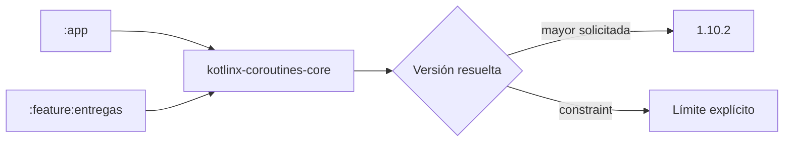
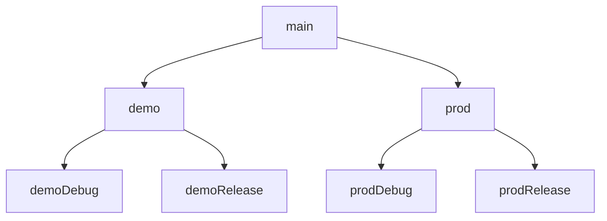
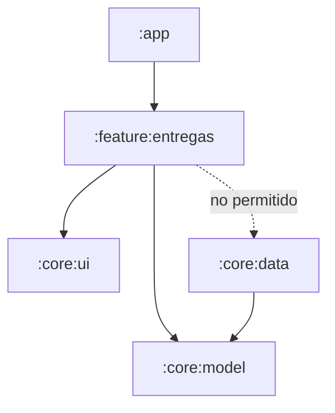
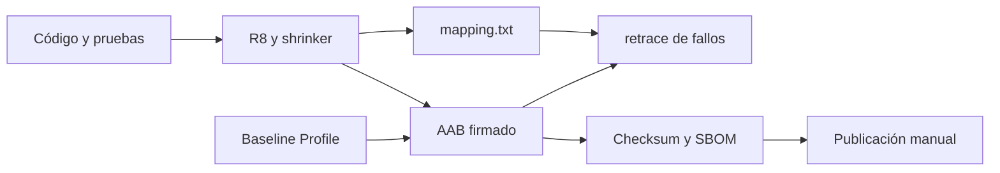
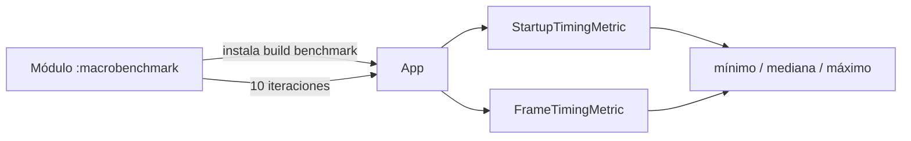

# Módulo 17: Build profesional — variantes, módulos, optimización y CI

## Aprende construyendo

Aquí el proyecto deja de ser una sola configuración local y se convierte en un producto
reproducible. Cada decisión se prueba con Gradle; no se considera profesional una build
que depende de archivos secretos o pasos manuales en el portátil del autor.


### Tema 1: Gradle, version catalogs y resolución de dependencias · Avanzado · 45 min

<details open>
<summary><strong>Capa 1 — Lectura</strong></summary>

#### ► DE QUÉ TRATA
Al finalizar podrás leer el grafo Gradle, centralizar versiones y diagnosticar un conflicto. Prerrequisitos: estructura del Módulo 0. Trabaja en gradle/libs.versions.toml.

#### ► LA ANALOGÍA
Gradle construye un grafo de tareas y otro de dependencias por variante. Una dependencia
`implementation` no expone su API a consumidores; `api` sí y aumenta acoplamiento. BOM
alinea una familia compatible. Constraints expresan límites; dependency locking fija lo
resuelto. Plugins modifican el modelo antes de ejecutar tareas. Si dos módulos piden
versiones distintas, Gradle elige la mayor por defecto; `failOnVersionConflict()`
convierte esa divergencia en error, y una constraint puede fijar un límite explícito.
El catálogo no valida compatibilidad binaria: eso se comprueba con las notas de
versión y con las pruebas. **Analogía:** el catálogo
es la lista de compras, el grafo muestra proveedores indirectos y el lockfile conserva
exactamente el lote aprobado.



#### ► CÓMO FUNCIONA


</details>

<details>
<summary><strong>Capa 2 — Construcción</strong></summary>

#### Código y verificación

```toml
[versions]
coroutines = "1.10.2"

[libraries]
kotlinx-coroutines-core = { module = "org.jetbrains.kotlinx:kotlinx-coroutines-core", version.ref = "coroutines" }

[bundles]
coroutines = ["kotlinx-coroutines-core"]
```

```bash
test -f settings.gradle.kts || cd academia-android   # sitúate en la raíz del proyecto del Módulo 0
./gradlew :app:dependencies --configuration debugRuntimeClasspath
./gradlew :app:dependencyInsight --dependency kotlinx-coroutines-core --configuration debugRuntimeClasspath
./gradlew :app:test
```

</details>

### Tema 2: Build types, product flavors y configuración segura · Avanzado · 45 min

<details open>
<summary><strong>Capa 1 — Lectura</strong></summary>

#### ► DE QUÉ TRATA
Al finalizar podrás generar demo/prod y debug/release con IDs, endpoints y recursos correctos. Prerrequisitos: Kotlin DSL y manifest. Edita app/build.gradle.kts.

#### ► LA ANALOGÍA
Build type expresa depuración/optimización; flavor expresa dimensión de producto o
entorno. La variante fusiona manifest, recursos y código con prioridades; el source set
de la variante se superpone a `main` y el build type tiene prioridad sobre el flavor.
`BuildConfig`
sirve para valores no secretos; todo incluido en el artefacto puede extraerse.
`manifestPlaceholders` sustituye valores por variante sin duplicar el manifest, y
`signingConfigs` lee rutas y claves desde variables de entorno;
`./gradlew :app:signingReport` confirma qué configuración se aplicó sin imprimir
secretos. Credenciales
de firma viven fuera del repositorio y CI las inyecta. **Analogía:** una misma fábrica
combina mercado y acabado, pero nunca imprime la llave de la bodega sobre el producto.



#### ► CÓMO FUNCIONA


</details>

<details>
<summary><strong>Capa 2 — Construcción</strong></summary>

#### Código y verificación


```kotlin
android {
    flavorDimensions += "entorno"
    productFlavors {
        create("demo") { dimension = "entorno"; applicationIdSuffix = ".demo"; buildConfigField("String", "API_URL", "\"https://demo.invalid\"") }
        create("prod") { dimension = "entorno"; buildConfigField("String", "API_URL", "\"https://api.invalid\"") }
    }
    buildFeatures { buildConfig = true }
}
```

```bash
test -f settings.gradle.kts || cd academia-android   # sitúate en la raíz del proyecto del Módulo 0
./gradlew :app:assembleDemoDebug :app:assembleProdRelease
./gradlew :app:processDemoDebugMainManifest
./gradlew :app:test
```

</details>

### Tema 3: Modularización, convenciones y fronteras de arquitectura · Avanzado · 45 min

<details open>
<summary><strong>Capa 1 — Lectura</strong></summary>

#### ► DE QUÉ TRATA
Al finalizar podrás separar feature, core y data sin ciclos. Prerrequisitos: Hilt, arquitectura por capas y Gradle. Crea feature:entregas y core:model.

#### ► CÓMO FUNCIONA


</details>

<details>
<summary><strong>Capa 2 — Construcción</strong></summary>

#### Código y verificación


```kotlin
// feature/entregas/build.gradle.kts
plugins { id("rutaflow.android.feature") }
dependencies {
    implementation(project(":core:model"))
    implementation(project(":core:ui"))
}
```

```bash
test -f settings.gradle.kts || cd academia-android   # sitúate en la raíz del proyecto del Módulo 0
./gradlew projects
./gradlew :feature:entregas:test
./gradlew :app:assembleDebug --scan
```

</details>

### Tema 4: R8, recursos, Baseline Profiles y pipeline reproducible · Avanzado · 45 min

<details open>
<summary><strong>Capa 1 — Lectura</strong></summary>

#### ► DE QUÉ TRATA
Al finalizar podrás minimizar release, conservar solo reglas necesarias, medir arranque y automatizar un artefacto trazable. Prerrequisitos: publicación, testing y profiling.

#### ► CÓMO FUNCIONA


</details>

<details>
<summary><strong>Capa 2 — Construcción</strong></summary>

#### Código y verificación


```kotlin
buildTypes.named("release") {
    isMinifyEnabled = true
    isShrinkResources = true
    proguardFiles(getDefaultProguardFile("proguard-android-optimize.txt"), "proguard-rules.pro")
}
```

```bash
test -f settings.gradle.kts || cd academia-android   # sitúate en la raíz del proyecto del Módulo 0
./gradlew clean
./gradlew :app:test :app:lintProdRelease :app:bundleProdRelease
./gradlew :benchmark:connectedCheck
sha256sum app/build/outputs/bundle/prodRelease/*.aab
```

</details>

### Tema 5: Macrobenchmark: medir el arranque y el scroll como lo vive el usuario · Avanzado · 45 min

<details open>
<summary><strong>Capa 1 — Lectura</strong></summary>

#### ► DE QUÉ TRATA
Usa Android Studio con la plantilla Baseline Profile / Macrobenchmark (File > New > New Module). Necesitas un dispositivo real o un emulador con imagen de Android 10+; los resultados de emulador solo sirven para comparar entre sí.

#### ► LA ANALOGÍA
**Conceptos clave:** Macrobenchmark, arranque en frío, `StartupTimingMetric`, `FrameTimingMetric`, iteraciones, `CompilationMode`, mediana y percentil.

**Macrobenchmark** corre en un módulo de pruebas aparte que controla la app desde fuera:

- `measureRepeated` instala, arranca y repite la acción varias veces (**iteraciones**).
- `StartupTimingMetric` mide el tiempo hasta el primer fotograma (`timeToInitialDisplayMs`).
- `FrameTimingMetric` mide cuánto tarda cada fotograma durante una interacción, como el scroll.
- `CompilationMode.None()` simula la app sin optimizar; `CompilationMode.Partial()` aplica el Baseline Profile.

El resultado muestra mínimo, mediana y máximo. Compara **medianas** entre variantes, no una sola ejecución.

**Analogía:** es cronometrar una carrera diez veces con el mismo corredor, en la pista real, en lugar de una vez en el pasillo. La analogía falla en que el dispositivo también influye: compara siempre en el mismo teléfono.

**Límite de uso:** no midas en builds de depuración. Las cifras de un emulador no representan un teléfono real de gama baja. Microbenchmark (otra librería) es para funciones sueltas; Macrobenchmark es para flujos completos.



#### ► CÓMO FUNCIONA


</details>

<details>
<summary><strong>Capa 2 — Construcción</strong></summary>

#### Código y verificación


```kotlin
package co.rutaflow.benchmark

import androidx.benchmark.macro.CompilationMode
import androidx.benchmark.macro.FrameTimingMetric
import androidx.benchmark.macro.StartupMode
import androidx.benchmark.macro.StartupTimingMetric
import androidx.benchmark.macro.junit4.MacrobenchmarkRule
import androidx.test.ext.junit.runners.AndroidJUnit4
import androidx.test.uiautomator.By
import androidx.test.uiautomator.Direction
import org.junit.Rule
import org.junit.Test
import org.junit.runner.RunWith

@RunWith(AndroidJUnit4::class)
class ArranqueBenchmark {
    @get:Rule val regla = MacrobenchmarkRule()

    @Test fun arranqueSinPerfil() = arranque(CompilationMode.None())
    @Test fun arranqueConPerfil() = arranque(CompilationMode.Partial())

    private fun arranque(modo: CompilationMode) = regla.measureRepeated(
        packageName = "co.rutaflow.conductor",
        metrics = listOf(StartupTimingMetric()),
        compilationMode = modo,
        startupMode = StartupMode.COLD,
        iterations = 10,
    ) { startActivityAndWait() }

    @Test fun scrollListaEnvios() = regla.measureRepeated(
        packageName = "co.rutaflow.conductor",
        metrics = listOf(FrameTimingMetric()),
        iterations = 5,
        setupBlock = { startActivityAndWait() },
    ) {
        val lista = device.findObject(By.res("lista_envios")) // testTag en Compose
        lista.setGestureMargin(device.displayWidth / 5)
        lista.fling(Direction.DOWN)
    }
}
```

```bash
./gradlew :macrobenchmark:connectedBenchmarkAndroidTest
# resultados en macrobenchmark/build/outputs/connected_android_test_additional_output/
```

```text
ArranqueBenchmark_arranqueSinPerfil
timeToInitialDisplayMs   min 612,   median 655,   max 720
ArranqueBenchmark_arranqueConPerfil
timeToInitialDisplayMs   min 431,   median 462,   max 510
(las cifras dependen del dispositivo; lo que importa es la diferencia entre medianas)
```

</details>
