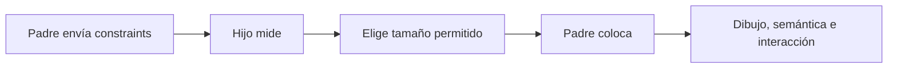
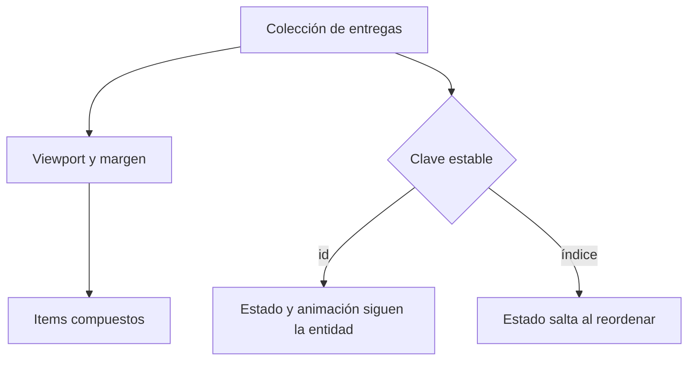
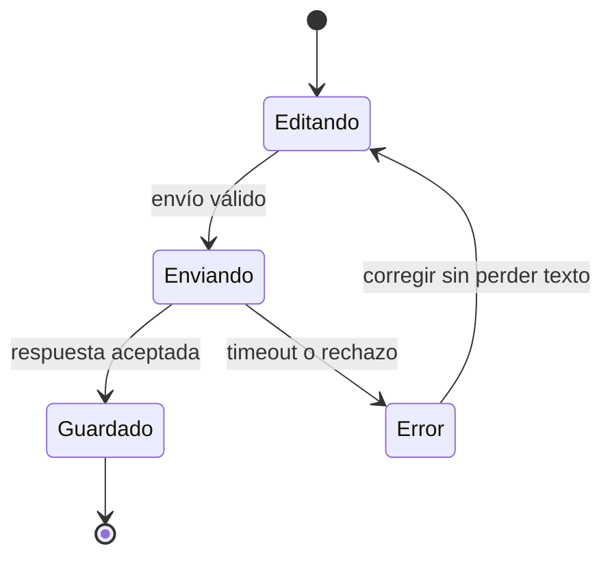
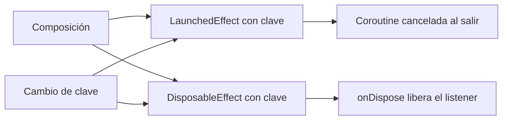
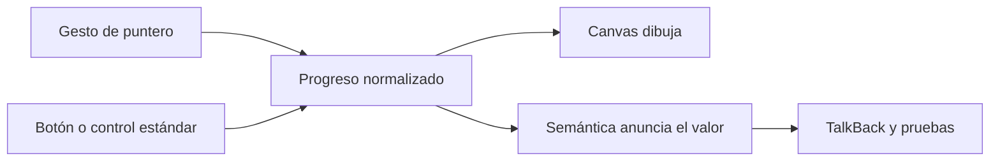

# Módulo 17: Compose profesional — layouts, formularios, listas y efectos

## Aprende construyendo

Este módulo convierte el conocimiento inicial de Compose en una interfaz mantenible.
Trabajarás sobre RutaFlow y separarás estado, presentación, interacción y efectos. Cada
tema deja una prueba observable; una captura bonita no sustituye comportamiento correcto.


### Tema 1: Constraints, Modifier y componentes con slots · Avanzado · 45 min

<details open>
<summary><strong>Capa 1 — Lectura</strong></summary>

#### ► DE QUÉ TRATA
Al finalizar podrás explicar el ciclo medir–dimensionar–colocar, ordenar modificadores sin resultados accidentales y diseñar un componente por slots. Abre academia-android y crea el paquete com.academia.ui.componentes. Prerrequisitos: Compose básico del Módulo 2.

#### ► CÓMO FUNCIONA


</details>

<details>
<summary><strong>Capa 2 — Construcción</strong></summary>

#### Código y verificación

```kotlin
@Composable
fun EntregaCard(
    titulo: String,
    modifier: Modifier = Modifier,
    estado: @Composable RowScope.() -> Unit,
    acciones: @Composable RowScope.() -> Unit,
) {
    Card(modifier.fillMaxWidth()) {
        Column(Modifier.padding(16.dp), verticalArrangement = Arrangement.spacedBy(12.dp)) {
            Text(titulo, style = MaterialTheme.typography.titleMedium)
            Row(content = estado)
            Row(horizontalArrangement = Arrangement.spacedBy(8.dp), content = acciones)
        }
    }
}
```

```bash
test -f settings.gradle.kts || cd academia-android   # sitúate en la raíz del proyecto del Módulo 0
./gradlew :app:test
./gradlew :app:assembleDebug
```

</details>

### Tema 2: LazyColumn, grids, claves estables y estado de scroll · Avanzado · 45 min

<details open>
<summary><strong>Capa 1 — Lectura</strong></summary>

#### ► DE QUÉ TRATA
Al finalizar podrás renderizar colecciones grandes, preservar identidad al reordenar y medir rendimiento en release. Crea ui/entregas/ListaEntregas.kt; necesitas estado inmutable. Prerrequisitos: colecciones Kotlin y Paging del Módulo 16.

#### ► LA ANALOGÍA
`LazyColumn` y `LazyVerticalGrid` reciben un DSL. `key` debe ser única y estable; el
índice no lo es si insertas u ordenas. `contentType` permite reutilizar composiciones
entre estructuras equivalentes. `rememberLazyListState` conserva posición durante
recomposición; `rememberSaveable` o ViewModel cubren recreación según el requisito.
`derivedStateOf` reduce cambios observables y `snapshotFlow` convierte lecturas Compose
en Flow para telemetría. **Analogía:** una biblioteca trae a la mesa los libros visibles,
pero cada ejemplar conserva su ISBN aunque cambie de estante.



#### ► CÓMO FUNCIONA


</details>

<details>
<summary><strong>Capa 2 — Construcción</strong></summary>

#### Código y verificación


```kotlin
@Composable
fun ListaEntregas(entregas: List<Entrega>, onAbrir: (String) -> Unit) {
    val estado = rememberLazyListState()
    val mostrarSubir by remember { derivedStateOf { estado.firstVisibleItemIndex > 5 } }
    Box {
        LazyColumn(state = estado) {
            items(entregas, key = { it.id }, contentType = { "entrega" }) { entrega ->
                EntregaCard(entrega.titulo, Modifier.animateItem(),
                    estado = { Text(entrega.estado) },
                    acciones = { Button({ onAbrir(entrega.id) }) { Text("Abrir") } })
            }
        }
        if (mostrarSubir) Text("Volver arriba", Modifier.align(Alignment.BottomEnd))
    }
}
```

```bash
test -f settings.gradle.kts || cd academia-android   # sitúate en la raíz del proyecto del Módulo 0
./gradlew :app:test
./gradlew :app:assembleRelease
```

</details>

### Tema 3: Formularios, IME, foco y validación accesible · Avanzado · 45 min

<details open>
<summary><strong>Capa 1 — Lectura</strong></summary>

#### ► DE QUÉ TRATA
Al finalizar podrás modelar valor, error y envío; configurar teclado y foco; y conservar un borrador sin mezclar validación con widgets. Crea ui/entregas/EditarEntrega.kt. Prerrequisitos: state hoisting, ViewModel y SavedStateHandle.

#### ► CÓMO FUNCIONA


</details>

<details>
<summary><strong>Capa 2 — Construcción</strong></summary>

#### Código y verificación


```kotlin
data class Formulario(val direccion: String = "", val tocado: Boolean = false) {
    val error get() = if (tocado && direccion.length < 8) "Escribe una dirección completa" else null
}

@Composable
fun CampoDireccion(form: Formulario, onCambio: (String) -> Unit, onSiguiente: () -> Unit) {
    OutlinedTextField(
        value = form.direccion, onValueChange = onCambio,
        label = { Text("Dirección") }, isError = form.error != null,
        supportingText = { form.error?.let { Text(it) } },
        keyboardOptions = KeyboardOptions(imeAction = ImeAction.Next),
        keyboardActions = KeyboardActions(onNext = { onSiguiente() }),
        modifier = Modifier.fillMaxWidth().semantics { form.error?.let { error(it) } }
    )
}
```

```bash
test -f settings.gradle.kts || cd academia-android   # sitúate en la raíz del proyecto del Módulo 0
./gradlew :app:test
./gradlew :app:connectedDebugAndroidTest
```

</details>

### Tema 4: Side effects, lifecycle y APIs imperativas · Avanzado · 45 min

<details open>
<summary><strong>Capa 1 — Lectura</strong></summary>

#### ► DE QUÉ TRATA
Al finalizar podrás elegir LaunchedEffect, DisposableEffect, SideEffect, rememberUpdatedState y produceState. Crea ui/mapa/SeguimientoEffect.kt y usa un fake antes de conectar ubicación real. Prerrequisitos: coroutines, lifecycle y UDF.

#### ► LA ANALOGÍA
`LaunchedEffect(key)` inicia una coroutine ligada a la presencia del nodo y reinicia al
cambiar la clave. `DisposableEffect` exige liberar listener. `SideEffect` publica estado
tras composición exitosa. `rememberUpdatedState` permite que un efecto largo invoque la
callback reciente sin reiniciarse. `produceState` adapta una fuente a `State`. Las claves
representan identidad, no valores casuales. Para Flow del ViewModel usa colección
lifecycle-aware. **Analogía:** un efecto es un contrato de alquiler: registra cuándo
entras, qué cambio exige mudanza y cómo devuelves las llaves.



#### ► CÓMO FUNCIONA


</details>

<details>
<summary><strong>Capa 2 — Construcción</strong></summary>

#### Objetivo observable
Al finalizar podrás elegir `LaunchedEffect`, `DisposableEffect`, `SideEffect`,
`rememberUpdatedState` y `produceState`. Crea `ui/mapa/SeguimientoEffect.kt` y usa un
fake antes de conectar ubicación real. **Prerrequisitos:** coroutines, lifecycle y UDF.

</details>

### Tema 5: Gestos, Canvas y componentes personalizados accesibles · Avanzado · 45 min

<details open>
<summary><strong>Capa 1 — Lectura</strong></summary>

#### ► DE QUÉ TRATA
Al finalizar podrás elegir una abstracción de gesto, dibujar progreso y ofrecer una operación equivalente por semántica. Crea ui/ruta/ProgresoRuta.kt; necesitas coroutines y accesibilidad de los módulos 10 y 14. Prerrequisitos: Canvas, coroutines y semántica.

#### ► LA ANALOGÍA
Gestos de alto nivel agregan foco, ripple, teclado y semántica. Detectores como
`detectDragGestures` consumen eventos dentro de `pointerInput`; su key controla reinicio.
Canvas usa píxeles bajo `DrawScope`, por lo que conviertes `Dp` con density. El estado no
pertenece al dibujo: recibe progreso normalizado y emite intención. Expón
`progressBarRangeInfo`, descripción y acciones; respeta tamaño táctil y reduce motion
cuando la animación no sea esencial. **Analogía:** Canvas pinta el tablero, pero la capa
semántica escribe instrucciones para lector, teclado y pruebas.



#### ► CÓMO FUNCIONA


</details>

<details>
<summary><strong>Capa 2 — Construcción</strong></summary>

#### Código y verificación


```kotlin
@Composable
fun ProgresoRuta(progreso: Float, onCambio: (Float) -> Unit) {
    val valor = progreso.coerceIn(0f, 1f)
    Canvas(
        Modifier.fillMaxWidth().height(48.dp)
            .semantics {
                progressBarRangeInfo = ProgressBarRangeInfo(valor, 0f..1f)
                setProgress { onCambio(it.coerceIn(0f, 1f)); true }
            }
            .pointerInput(Unit) {
                detectTapGestures { onCambio((it.x / size.width).coerceIn(0f, 1f)) }
            }
    ) {
        drawLine(Color.Gray, Offset(0f, center.y), Offset(size.width, center.y), 8.dp.toPx())
        drawCircle(Color.Blue, 12.dp.toPx(), Offset(size.width * valor, center.y))
    }
}
```

```bash
test -f settings.gradle.kts || cd academia-android   # sitúate en la raíz del proyecto del Módulo 0
./gradlew :app:test
./gradlew :app:connectedDebugAndroidTest
```

</details>
