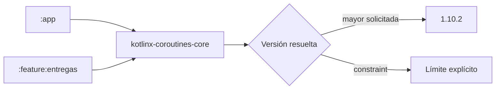
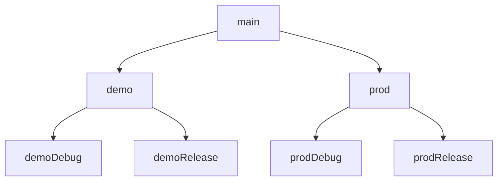
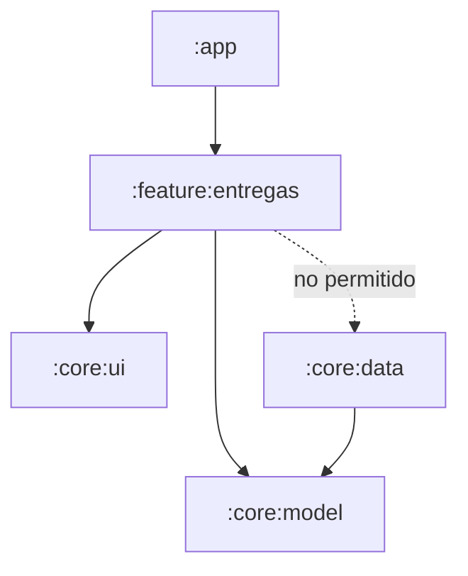
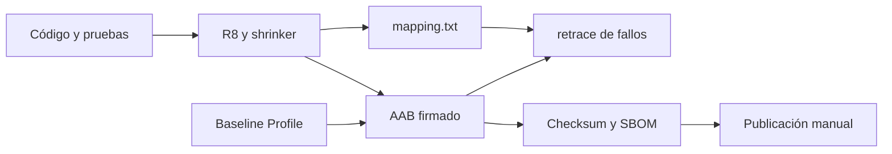

# Módulo 18: Build profesional — variantes, módulos, optimización y CI

## Aprende construyendo

Aquí el proyecto deja de ser una sola configuración local y se convierte en un producto
reproducible. Cada decisión se prueba con Gradle; no se considera profesional una build
que depende de archivos secretos o pasos manuales en el portátil del autor.

### Tema 1: Gradle, version catalogs y resolución de dependencias

#### Paso 1 · Objetivo y preparación
Al finalizar podrás leer el grafo Gradle, centralizar versiones y diagnosticar un conflicto.
**Prerrequisitos:** estructura del Módulo 0. Trabaja en `gradle/libs.versions.toml`.

#### Paso 2 · Contexto y caso real
**¿Por qué es importante?** Una app grande usa plugins, BOM, procesadores y docenas de
librerías transitivas. Declarar versiones en cada módulo causa divergencia; actualizar a
ciegas puede compilar y fallar en runtime. El catálogo da nombres comunes, pero no decide
compatibilidad ni reemplaza las notas de versión.

#### Paso 3 · Teoría, modelo mental y analogía
Gradle construye un grafo de tareas y otro de dependencias por variante. Una dependencia
`implementation` no expone su API a consumidores; `api` sí y aumenta acoplamiento. BOM
alinea una familia compatible. Constraints expresan límites; dependency locking fija lo
resuelto. Plugins modifican el modelo antes de ejecutar tareas. Si dos módulos piden
versiones distintas, Gradle elige la mayor por defecto; `failOnVersionConflict()`
convierte esa divergencia en error, y una constraint puede fijar un límite explícito.
El catálogo no valida compatibilidad binaria: eso se comprueba con las notas de
versión y con las pruebas. **Analogía:** el catálogo
es la lista de compras, el grafo muestra proveedores indirectos y el lockfile conserva
exactamente el lote aprobado.



#### Paso 4 · Demostración guiada desde cero
Crea o edita `gradle/libs.versions.toml`:

```toml
[versions]
coroutines = "1.10.2"

[libraries]
kotlinx-coroutines-core = { module = "org.jetbrains.kotlinx:kotlinx-coroutines-core", version.ref = "coroutines" }

[bundles]
coroutines = ["kotlinx-coroutines-core"]
```

Usa `implementation(libs.bundles.coroutines)` y ejecuta:

```bash
cd academia-android
./gradlew :app:dependencies --configuration debugRuntimeClasspath
./gradlew dependencyInsight --dependency kotlinx-coroutines-core --configuration debugRuntimeClasspath
./gradlew :app:test
```

**Resultado esperado:** una versión seleccionada y una ruta que explica quién la pidió.
`dependencyInsight` muestra la versión elegida y la cadena de solicitantes; si aparece
`FAILED`, esa ruta indica qué módulo introdujo el conflicto. **Fallo deliberado:** agrega una versión transitiva incompatible; observa selección y
fuerza una prueba que use la API afectada. Corrige alineando, no excluyendo sin análisis.

#### Paso 5 · Práctica guiada
Mueve tres dependencias al catálogo y distingue plugin de librería. **Pista:** confirma
con `dependencies` cada classpath; una build verde no prueba ausencia de duplicados.

#### Paso 6 · Práctica independiente
Activa verification metadata o locking, simula checksum/versión inesperada y documenta
la actualización segura: fuente primaria, changelog, build, tests y rollback. Compara
`api` e `implementation` midiendo qué módulo recompila al cambiar una clase interna.
**Proyecto integrador:** el catálogo y el grafo documentado sostienen la build
reproducible del proyecto integrador multi-módulo.

#### Paso 7 · Cierre
Entrega catálogo, informe de grafo y prueba. El siguiente tema produce variantes sin
filtrar secretos. **Errores comunes:** versiones dinámicas, exclusiones globales y copiar
coordenadas antiguas. **Cuándo no usarlo:** un catálogo compartido no obliga a que todas
las aplicaciones usen la misma versión si tienen ciclos independientes.

**Transferencia a RutaFlow:** dependencias auditables. **Fuentes oficiales:**
[gestión de dependencias](https://developer.android.com/build/dependencies) y
[version catalogs](https://docs.gradle.org/current/userguide/version_catalogs.html).

### Tema 2: Build types, product flavors y configuración segura

#### Paso 1 · Objetivo y preparación
Al finalizar podrás generar demo/prod y debug/release con IDs, endpoints y recursos
correctos. **Prerrequisitos:** Kotlin DSL y manifest. Edita `app/build.gradle.kts`.

#### Paso 2 · Contexto y caso real
**¿Por qué es importante?** RutaFlow necesita un entorno de prueba sin que una build
debug escriba producción. Copiar proyectos duplica arreglos; hardcodear tokens los publica
en APK. Variantes combinan flavor, build type y source sets de forma determinista.

#### Paso 3 · Teoría, modelo mental y analogía
Build type expresa depuración/optimización; flavor expresa dimensión de producto o
entorno. La variante fusiona manifest, recursos y código con prioridades; el source set
de la variante se superpone a `main` y el build type tiene prioridad sobre el flavor.
`BuildConfig`
sirve para valores no secretos; todo incluido en el artefacto puede extraerse.
`manifestPlaceholders` sustituye valores por variante sin duplicar el manifest, y
`signingConfigs` lee rutas y claves desde variables de entorno;
`./gradlew :app:signingReport` confirma qué configuración se aplicó sin imprimir
secretos. Credenciales
de firma viven fuera del repositorio y CI las inyecta. **Analogía:** una misma fábrica
combina mercado y acabado, pero nunca imprime la llave de la bodega sobre el producto.



#### Paso 4 · Demostración guiada desde cero
Crea o edita `app/build.gradle.kts`:

```kotlin
android {
    flavorDimensions += "entorno"
    productFlavors {
        create("demo") { dimension = "entorno"; applicationIdSuffix = ".demo"; buildConfigField("String", "API_URL", "\"https://demo.invalid\"") }
        create("prod") { dimension = "entorno"; buildConfigField("String", "API_URL", "\"https://api.invalid\"") }
    }
    buildFeatures { buildConfig = true }
}
```

```bash
cd academia-android
./gradlew :app:assembleDemoDebug :app:assembleProdRelease
./gradlew :app:processDemoDebugMainManifest
./gradlew :app:test
```

**Resultado esperado:** dos application IDs instalables y endpoints distintos; release
no contiene herramientas debug. El manifest fusionado queda bajo
`app/build/intermediates/`; localízalo para la variante y confirma `applicationId`,
permisos y metadatos antes de instalar. **Fallo deliberado:** coloca un token en `BuildConfig`,
abre el APK como ZIP y encuéntralo. Elimínalo y usa autenticación emitida por backend.

#### Paso 5 · Práctica guiada
Agrega nombre/icono visible para demo y un network security config solo debug. **Pista:**
inspecciona el manifest fusionado, no deduzcas el resultado de archivos parciales.

#### Paso 6 · Práctica independiente
Define matriz de variantes permitidas y deshabilita combinaciones inútiles con
`androidComponents.beforeVariants`, comprobando que la matriz final coincide con la
documentación. Prueba endpoint, ID, debuggable y ausencia de secretos. Diseña firma en CI con
variables protegidas sin imprimir valores ni almacenar keystore en el repositorio.
**Proyecto integrador:** la matriz demo/prod forma parte de las variantes del proyecto
integrador de RutaFlow.

#### Paso 7 · Cierre
Entrega matriz y artefactos inspeccionados. El siguiente tema divide el monolito con
fronteras verificables. **Errores comunes:** flavor por cliente sin estrategia, secretos
en recursos y probar solo debug. **Cuándo no usarlo:** no crees flavors si basta una
configuración remota validada y el binario es idéntico.

**Transferencia a RutaFlow:** demo aislada de producción. **Fuente oficial:**
[build variants](https://developer.android.com/build/build-variants).

### Tema 3: Modularización, convenciones y fronteras de arquitectura

#### Paso 1 · Objetivo y preparación
Al finalizar podrás separar feature, core y data sin ciclos. **Prerrequisitos:** Hilt,
arquitectura por capas y Gradle. Crea `feature:entregas` y `core:model`.

#### Paso 2 · Contexto y caso real
**¿Por qué es importante?** Un módulo único permite cualquier acceso, ralentiza builds y
hace difícil asignar ownership. Demasiados módulos también cuestan configuración y APIs.
La frontera se justifica por encapsulación, reutilización, equipo o rendimiento medido.

#### Paso 3 · Teoría, modelo mental y analogía
Features dependen de contratos core, no de implementaciones hermanas. `internal` y
`implementation` reducen superficie. Un módulo data puede implementar una interfaz de
dominio inyectada desde el composition root. Convention plugins centralizan configuración
sin copiar bloques Gradle. Un módulo por paquete solo agrega configuración; la frontera se
justifica por ownership, reutilización o rendimiento medido. Las dependencias apuntan
hacia contratos: una feature no conoce implementaciones de data. Un test de arquitectura o
una regla de dependencias entre módulos puede fallar la build si aparece una flecha
prohibida. Mide configuración, compilación limpia e incremental antes y
después. **Analogía:** paredes con puertas explícitas contienen incendios; levantar una
pared entre cada silla hace inhabitable el edificio.



#### Paso 4 · Demostración guiada desde cero
Crea `core/model/src/main/kotlin/Entrega.kt` y declara dependencias:

```kotlin
// feature/entregas/build.gradle.kts
plugins { id("rutaflow.android.feature") }
dependencies {
    implementation(project(":core:model"))
    implementation(project(":core:ui"))
}
```

```bash
cd academia-android
./gradlew projects
./gradlew :feature:entregas:test
./gradlew :app:assembleDebug --scan
```

**Resultado esperado:** feature compila/prueba aislada y no accede a clases internas de
data. `./gradlew projects` y el build scan muestran la topología; compara tiempos antes y
después en la misma máquina y con la misma tarea. **Fallo deliberado:** añade dependencia feature A → B y B → A; Gradle rechaza el
ciclo. Extrae el contrato compartido hacia core sin mover toda implementación.

#### Paso 5 · Práctica guiada
Extrae modelo y UI común; usa `dependencyInsight` y un test de arquitectura para impedir
que feature dependa de `app`. **Pista:** dibuja flechas antes de mover archivos.

#### Paso 6 · Práctica independiente
Crea convention plugin para Compose, compara tiempo limpio/incremental y documenta API
pública de cada módulo. Mide configuración y compilación limpia con `--profile`; sin
medición, dividir puede empeorar el ciclo. Simula eliminar una feature y demuestra que core no cambia.
Registra tradeoff: módulos, tiempo, ownership, aislamiento y complejidad de navegación.
**Proyecto integrador:** las fronteras entre feature, core y data definen la estructura
del proyecto integrador multi-módulo.

#### Paso 7 · Cierre
Entrega grafo sin ciclos y mediciones. El siguiente tema optimiza release sin romper
serialización ni reflexión. **Errores comunes:** módulo por paquete, core gigante y `api`
por comodidad. **Cuándo no usarlo:** una app pequeña puede comenzar por paquetes y
extraer módulos cuando exista una frontera o métrica real.

**Transferencia a RutaFlow:** feature de entregas aislada. **Fuente oficial:**
[modularización](https://developer.android.com/topic/modularization).

### Tema 4: R8, recursos, Baseline Profiles y pipeline reproducible

#### Paso 1 · Objetivo y preparación
Al finalizar podrás minimizar release, conservar solo reglas necesarias, medir arranque
y automatizar un artefacto trazable. **Prerrequisitos:** publicación, testing y profiling.

#### Paso 2 · Contexto y caso real
**¿Por qué es importante?** Debug oculta problemas de shrinker y rendimiento. R8 elimina,
optimiza y ofusca; una regla amplia arregla un crash pero pierde beneficios. CI debe
probar el mismo release que se distribuye y conservar mapping para desofuscar fallos.

#### Paso 3 · Teoría, modelo mental y analogía
R8 parte de entry points y reglas keep. Reflexión/serialización deben declarar contratos
o generar adapters. Resource shrinker elimina recursos no alcanzables y exige minificación
activa; los recursos accedidos por nombre deben conservarse con una regla. `mapping.txt`
permite desofuscar con `retrace`; sin ese archivo, un fallo de producción queda ilegible.
Baseline Profile
precompila rutas críticas en ART y se versiona en `src/main/baseline-prof.txt`;
Macrobenchmark mide fuera del proceso objetivo. Sin perfil el arranque sigue funcionando,
pero pierde la precompilación. CI
produce AAB firmado, SBOM/checksums, tests y mapping, con permisos mínimos. **Analogía:**
R8 poda ramas no conectadas; el perfil marca caminos que deben estar pavimentados antes
de la primera visita.



#### Paso 4 · Demostración guiada desde cero
Actualiza la configuración release en `app/build.gradle.kts`:

```kotlin
buildTypes.named("release") {
    isMinifyEnabled = true
    isShrinkResources = true
    proguardFiles(getDefaultProguardFile("proguard-android-optimize.txt"), "proguard-rules.pro")
}
```

```bash
cd academia-android
./gradlew clean
./gradlew :app:test :app:lintProdRelease :app:bundleProdRelease
./gradlew :benchmark:connectedCheck
sha256sum app/build/outputs/bundle/prodRelease/*.aab
```

**Resultado esperado:** AAB, mapping, reporte lint y benchmark con ruta reproducible.
El reporte lint y el mapping quedan bajo `app/build/outputs/`; verifica su existencia
antes de publicar. **Fallo deliberado:** accede por reflexión a una clase solo release; observa crash
minificado. Añade regla mínima o adapter generado y prueba el artefacto release.

#### Paso 5 · Práctica guiada
Genera perfil para inicio y apertura de entrega; compara mediana sin/con perfil en mismo
dispositivo. **Pista:** no mezcles cambios funcionales con la comparación.

#### Paso 6 · Práctica independiente
Diseña pipeline con caché, unit/instrumented tests, lint, bundle, firma, checksum, mapping
y promoción manual protegida. Conserva el mapping junto al artefacto y automatiza
`retrace` en el análisis de fallos. Reproduce fallo, desofusca stack trace y ejecuta rollback.
Documenta qué evidencia proviene de emulador y qué requiere Play pre-launch/vitals.
**Proyecto integrador:** el pipeline y el AAB trazable cierran la entrega del proyecto
integrador de RutaFlow.

#### Paso 7 · Cierre
Entrega bundle y reporte. El siguiente módulo conecta almacenamiento, cámara y hardware.
**Errores comunes:** keep global, benchmark debug, firma expuesta y publicar artefacto
distinto al probado. **Cuándo no usarlo:** no interpretes un microbenchmark aislado como
experiencia completa; combínalo con métricas de campo.

**Transferencia a RutaFlow:** release optimizada y trazable. **Fuentes oficiales:**
[optimización](https://developer.android.com/build/shrink-code) y
[Baseline Profiles](https://developer.android.com/topic/performance/baselineprofiles/overview).

## Proyecto del módulo

Convierte RutaFlow en proyecto multi-módulo con demo/prod, catálogo verificado, release
minificada y pipeline que conserva mapping y checksum. Provoca un conflicto, un ciclo y
un crash de reflexión; demuestra diagnóstico y corrección mínima.
