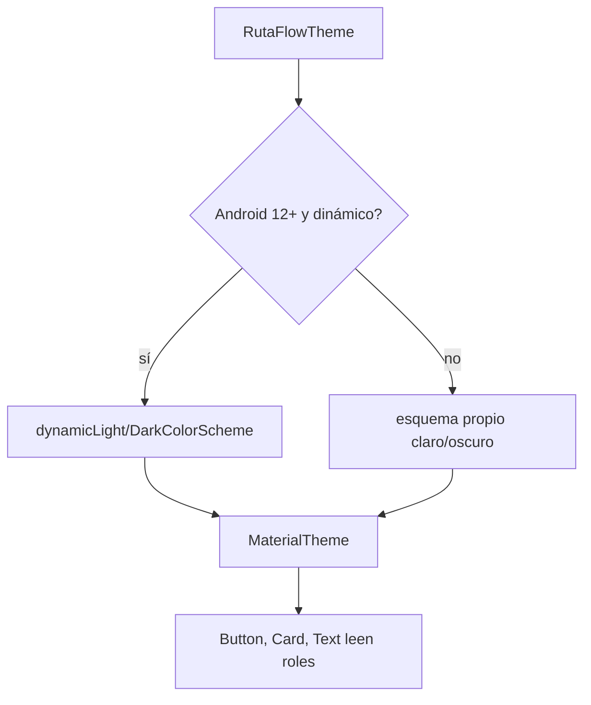

# Módulo 2: Jetpack Compose: UI declarativa


## Aprende construyendo

> **Antes de empezar este módulo.** No necesitas dependencias nuevas: la plantilla Empty Activity ya declara el BOM de Compose, `ui`, `material3` y `activity-compose`.
>
> **Los scripts `python3` de este módulo son modelos, no pruebas de Android.** Ilustran el razonamiento, pero no ejecutan tu app. La evidencia real es la indicada en cada tema como **Verificación real en Android**: para ver la recomposición de verdad, muestra el composable con `setContent { … }` desde `MainActivity`, ejecuta la app y abre **Layout Inspector** con el contador de recomposiciones activado; el número de `TarjetaTarea` solo sube cuando cambia un parámetro que lee.

### Tema 1: Composables y recomposición

#### Paso 1 · Objetivo y preparación

Al finalizar podrás explicar qué activa `@Composable` en el compilador, y predecir cuándo Compose recompone una función ante un cambio de sus parámetros.

**Conocimiento previo:** Kotlin básico; Módulo 1 de este track (ciclo de vida).

#### Paso 2 · Contexto y caso real

**¿Por qué es importante?** Entender que un composable se recompone en respuesta a cambios en sus parámetros de entrada es la base para razonar sobre cuándo y por qué se actualiza la UI, y para diagnosticar recomposiciones innecesarias más adelante (Módulo 10).

#### Paso 3 · Teoría con analogía

**Conceptos clave:** UI como función pura del estado, re-ejecución automática ante cambios.

`@Composable` activa un tratamiento especial del plugin de compilación de Compose: no transforma la función en una vista por reflexión, sino que el compilador modifica su contrato interno para que participe en la composición, recuerde su posición en el árbol y registre las lecturas de estado que determinan futuras recomposiciones. Un composable describe la UI declarativamente ("esta es la UI que corresponde a este estado"), y cuando cualquiera de sus parámetros cambia, Compose vuelve a ejecutar (recompone) la función, reconciliando el resultado contra la versión anterior. Este modelo es conceptualmente idéntico al de React (track React, Módulo 2): un componente se re-ejecuta cuando cambian sus props, y el framework reconcilia contra un árbol anterior (DOM virtual en React, árbol de UI nativo en Compose).

**Analogía:** un composable es como una fórmula matemática que siempre produce el mismo resultado dados los mismos valores de entrada: cambiar un valor de entrada obliga a recalcular la fórmula (recomponer), pero la fórmula nunca "recuerda" un estado anterior por su cuenta.

**Diagrama:**

```
┌── TarjetaTarea(titulo, completada) ──────┐
│  describe la UI para ESE estado exacto      │
└──────────┬───────────────────────┘
           │ cambia `titulo` o `completada`
           ▼
┌── Compose RECOMPONE la función ──────────┐
│  nueva descripción de UI, reconciliada         │
│  automáticamente contra la anterior              │
└───────────────────────────────────────┘
```

#### Paso 4 · Demostración guiada desde cero

Continuando en `academia-android` (el proyecto creado en el Módulo 0; si no lo tienes, créalo primero con su Tema 1), crea `app/src/main/kotlin/com/academia/android/TarjetaTarea.kt`:

```bash
# compila con Gradle el archivo Kotlin generado a continuación
test -f settings.gradle.kts || cd academia-android   # sitúate en la raíz del proyecto del Módulo 0
mkdir -p app/src/main/kotlin/com/academia/android
cat > app/src/main/kotlin/com/academia/android/TarjetaTarea.kt <<'EOF'
package com.academia.android

import androidx.compose.material3.Text
import androidx.compose.runtime.Composable
import androidx.compose.ui.text.style.TextDecoration

@Composable
fun TarjetaTarea(titulo: String, completada: Boolean) {
    Text(
        text = titulo,
        textDecoration = if (completada) TextDecoration.LineThrough else null
    )
}
EOF
./gradlew :app:compileDebugKotlin
```

**Explicación línea por línea:** `@Composable` marca la función para el plugin de compilación de Compose; `titulo` y `completada` son los parámetros de entrada que determinan la salida — cualquier cambio en ellos dispara una recomposición que vuelve a evaluar la expresión `if (completada) TextDecoration.LineThrough else null`, produciendo tachado o no según el nuevo valor.

Simula, con un script, cuántas veces se "recompondría" la función ante una secuencia de cambios de estado, contando solo los cambios reales (no repeticiones del mismo valor):

```bash
python3 -c "
def recomponer_si_cambia(historial_completada):
    recomposiciones = 0
    anterior = None
    for valor in historial_completada:
        if valor != anterior:
            recomposiciones += 1
            anterior = valor
    return recomposiciones

secuencia = [False, False, True, True, True, False]
print('cambios de estado:', secuencia)
print('recomposiciones necesarias:', recomponer_si_cambia(secuencia))
"
```

**Resultado esperado:** de 6 valores en la secuencia, solo 3 representan un cambio real respecto al valor anterior (`False→True`, luego `True→False`), por lo que el script reporta 3 recomposiciones necesarias, ilustrando que Compose no recompone por cada asignación sino específicamente cuando el valor leído efectivamente cambia.

**Fallo deliberado:** modifica `TarjetaTarea.kt` para que, en vez de leer el parámetro `completada`, declare internamente `val completada = false` como una constante local ignorando el parámetro de entrada. Ningún cambio externo en el argumento pasado por quien invoque `TarjetaTarea` afectaría ya el resultado — diagnostica confirmando que un composable solo recompone en respuesta a cambios de datos que efectivamente lee como parámetros o estado observado; ignorar el parámetro de entrada rompe por completo la reactividad declarativa que describe el Paso 3.

#### Paso 5 · Práctica guiada

Agrega un tercer parámetro `prioridad: String` a `TarjetaTarea` y muestra su valor junto al título, confirmando con el script de verificación de sintaxis que la nueva firma sigue teniendo paréntesis balanceados. **Pista:** agregar un parámetro no cambia el principio de recomposición: cualquier cambio en `prioridad` también dispararía una recomposición.

#### Paso 6 · Práctica independiente

Escribe, en una frase, qué pasaría con la recomposición si `TarjetaTarea` recibiera un cuarto parámetro de tipo lambda (`onClick: () -> Unit`) que cambiara de instancia en cada recomposición del padre, y por qué eso podría causar recomposiciones más frecuentes de lo necesario (pista relacionado con el Módulo 10 de este track).

#### Paso 7 · Cierre

Ya explicas qué activa `@Composable` y predices cuándo Compose recompone una función. El siguiente tema aborda dónde debe vivir el estado que un composable refleja, en vez de gestionarlo internamente. Fuente oficial: [Android Developers — Thinking in Compose](https://developer.android.com/develop/ui/compose/mental-model).

**Errores comunes:** invocar una función `@Composable` fuera de un contexto composable (fuera de otra función composable o de `setContent`); realizar efectos secundarios (peticiones de red, escritura en base de datos) directamente en el cuerpo de un composable en vez de usar `LaunchedEffect`/`DisposableEffect`.

**Cuándo no usarlo:** para lógica pura sin ninguna relación con la UI (por ejemplo, una función de cálculo matemático reutilizada en varios lugares), no la marques como `@Composable`; resérvala para funciones que efectivamente describen o emiten UI.

**Transferencia al proyecto integrador «Aplicación del repartidor Android»:** Divide la lista de entregas en composables que reciben datos. Actualiza un estado desde el repositorio falso y verifica que solo se muestra el nuevo valor, sin ejecutar una confirmación durante la composición.

### Tema 2: State hoisting

#### Paso 1 · Objetivo y preparación

Al finalizar podrás elevar el estado de un composable hijo hacia su padre, dejando al hijo como una función pura que solo refleja lo que recibe.

**Conocimiento previo:** Tema 1 de este módulo.

#### Paso 2 · Contexto y caso real

**¿Por qué es importante?** Elevar el estado hace que el componente hijo sea reutilizable y testeable de forma aislada, y establece el mismo principio de flujo unidireccional que se generalizará a nivel de pantalla completa en el Módulo 4 con `StateFlow`.

#### Paso 3 · Teoría con analogía

**Conceptos clave:** el componente hijo no decide, solo refleja lo que recibe.

State hoisting es el patrón de elevar el estado desde un composable hijo hacia su padre: el hijo recibe el valor actual como parámetro y una función de callback para notificar cambios, sin mantener ningún estado mutable propio. Un `CampoTitulo` sin estado propio puede reutilizarse en cualquier contexto (formulario de creación, edición, test) simplemente pasándole distintos valores y callbacks; uno con `remember` interno quedaría acoplado a esa instancia específica. Este principio ("el estado vive arriba, los hijos son funciones puras") es el corazón de UDF (Unidirectional Data Flow), que se estudiará con `StateFlow` en el Módulo 4.

**Analogía:** state hoisting es como un empleado de mostrador que no decide precios ni políticas por su cuenta: muestra la información que le entrega la gerencia (el estado del padre) y transmite cualquier solicitud del cliente de vuelta a la gerencia (el callback), sin guardar ninguna regla de negocio propia.

**Diagrama:**

```
┌── PantallaCrearTarea (padre) ─────────────┐
│ var titulo by remember { mutableStateOf("") } │
│        │                                        │
│        ▼ pasa valor + callback                    │
│  CampoTitulo(valor = titulo,                          │
│              onValorCambia = { titulo = it })            │
│        │  (SIN estado propio, solo refleja)                  │
│        ▼ notifica cambios hacia arriba                          │
└───────────────────────────────────────┘
```

#### Paso 4 · Demostración guiada desde cero

Reutiliza `academia-android` (el proyecto del Módulo 0) y crea `app/src/main/kotlin/com/academia/android/CampoTitulo.kt`:

```bash
# compila con Gradle el archivo Kotlin generado a continuación
test -f settings.gradle.kts || cd academia-android   # sitúate en la raíz del proyecto del Módulo 0
mkdir -p app/src/main/kotlin/com/academia/android
cat > app/src/main/kotlin/com/academia/android/CampoTitulo.kt <<'EOF'
package com.academia.android

import androidx.compose.material3.TextField
import androidx.compose.runtime.Composable
import androidx.compose.runtime.getValue
import androidx.compose.runtime.mutableStateOf
import androidx.compose.runtime.remember
import androidx.compose.runtime.setValue

@Composable
fun CampoTitulo(valor: String, onValorCambia: (String) -> Unit) {
    TextField(value = valor, onValueChange = onValorCambia) // sin estado propio
}

@Composable
fun PantallaCrearTarea() {
    var titulo by remember { mutableStateOf("") } // el estado vive en el padre
    CampoTitulo(valor = titulo, onValorCambia = { titulo = it })
}
EOF
./gradlew :app:compileDebugKotlin
```

**Explicación línea por línea:** `CampoTitulo` recibe `valor` y `onValorCambia` como parámetros, sin ningún `remember` interno; `PantallaCrearTarea` es quien posee el estado real (`titulo`) y se lo pasa hacia abajo, recibiendo notificaciones de cambio hacia arriba mediante el callback — el script Python confirma programáticamente que el cuerpo de `CampoTitulo` no contiene ningún `remember`, la condición central de state hoisting correctamente aplicado.

Simula reutilizar el mismo `CampoTitulo` en dos contextos distintos (creación y edición) para confirmar que es genuinamente reutilizable al no tener estado propio:

```bash
python3 -c "
def campo_titulo(valor, on_cambia):
    return {'texto_mostrado': valor, 'notificar': on_cambia}

# contexto 1: formulario de creación, empieza vacío
estado_creacion = {'titulo': ''}
campo_1 = campo_titulo(estado_creacion['titulo'], lambda v: estado_creacion.__setitem__('titulo', v))
campo_1['notificar']('Comprar leche')
print('creación tras escribir:', estado_creacion['titulo'])

# contexto 2: formulario de edición, empieza con un valor existente
estado_edicion = {'titulo': 'Tarea existente'}
campo_2 = campo_titulo(estado_edicion['titulo'], lambda v: estado_edicion.__setitem__('titulo', v))
campo_2['notificar']('Tarea existente editada')
print('edición tras escribir:', estado_edicion['titulo'])
"
```

**Resultado esperado:** ambos contextos (creación y edición) reutilizan exactamente la misma función `campo_titulo` sin ninguna modificación, y cada uno mantiene su propio estado de forma independiente (`estado_creacion` y `estado_edicion` no interfieren entre sí), confirmando que el componente sin estado propio es genuinamente reutilizable en contextos distintos.

**Fallo deliberado:** modifica `CampoTitulo.kt` para que declare internamente `var valorInterno by remember { mutableStateOf(valor) }` y use `valorInterno` en vez del parámetro `valor` directamente. Ahora, si el padre actualiza `titulo` externamente (por ejemplo, al cargar una tarea existente para editar), el campo seguiría mostrando su propio `valorInterno` desactualizado — diagnostica confirmando que mantener estado propio en el hijo rompe la sincronización con el padre, exactamente el problema que state hoisting evita al no darle al hijo ninguna fuente de verdad propia.

#### Paso 5 · Práctica guiada

Agrega un segundo campo elevado (`CampoDescripcion`, siguiendo el mismo patrón exacto de `CampoTitulo`) a `PantallaCrearTarea`, y confirma con el script de verificación que tampoco mantiene ningún `remember` propio. **Pista:** copia la estructura de `CampoTitulo` y solo cambia el nombre de la variable de estado en el padre.

#### Paso 6 · Práctica independiente

Documenta en una frase por qué testear `CampoTitulo` de forma aislada (Módulo 9 de este track) es más simple gracias a state hoisting, comparando con cuánto más difícil sería testear un composable que mantuviera su propio estado interno.

#### Paso 7 · Cierre

Ya elevas el estado de un composable hijo hacia su padre, dejándolo como una función pura y reutilizable. El siguiente tema cubre cómo decidir si ese estado en el padre debe sobrevivir a una rotación, y los contenedores básicos de layout. Fuente oficial: [Android Developers — State hoisting](https://developer.android.com/develop/ui/compose/state-hoisting).

**Errores comunes:** mantener un `remember` interno en un composable que se pretende reutilizable, acoplándolo a una única instancia; olvidar propagar el callback de cambio hacia el padre, dejando la UI visualmente desactualizada.

**Cuándo no usarlo:** para un composable genuinamente de un solo uso, sin ninguna intención de reutilizarlo ni testearlo de forma aislada, mantener un estado interno simple con `remember` es más directo y no aporta beneficio adicional elevarlo innecesariamente.

**Transferencia al proyecto integrador «Aplicación del repartidor Android»:** Eleva el filtro de estado al contenedor de la lista. Dos controles que modifican el mismo filtro deben permanecer sincronizados; la tarjeta recibe el valor y comunica eventos sin mantener una copia divergente.

### Tema 3: remember, rememberSaveable y layout básico

#### Paso 1 · Objetivo y preparación

Al finalizar podrás elegir entre `remember` y `rememberSaveable` según si un valor debe sobrevivir a rotación, y combinar `Column`, `Row` y `Box` para construir un layout.

**Conocimiento previo:** Temas 1 y 2 de este módulo; ciclo de vida y rotación (Módulo 1, Tema 1).

#### Paso 2 · Contexto y caso real

**¿Por qué es importante?** Elegir entre `remember` y `rememberSaveable` según si el estado debe o no sobrevivir a una rotación es una decisión constante en Compose; los tres contenedores de layout (`Column`, `Row`, `Box`) son la base combinable de prácticamente cualquier estructura visual en la app.

#### Paso 3 · Teoría con analogía

**Conceptos clave:** memoria entre recomposiciones vs supervivencia a rotación.

`remember` conserva un valor entre recomposiciones sucesivas, pero vive únicamente en la memoria de la instancia actual de la Activity, por lo que se pierde ante una rotación (Módulo 1, Tema 1); `rememberSaveable` extiende ese comportamiento agregando serialización automática a un `Bundle` de estado que sí sobrevive a la recreación, un nivel de persistencia comparable (aunque más limitado) al que `SavedStateHandle` ofrece a nivel de `ViewModel` (Módulo 1, Tema 3). Para el layout, `Column` apila elementos verticalmente, `Row` los apila horizontalmente, y `Box` los superpone; cada uno acepta un `Modifier` que encadena transformaciones (padding, tamaño, `weight`).

**Analogía:** `remember` es como una nota escrita en una pizarra que se borra si la sala se remodela por completo (rotación); `rememberSaveable` es como esa misma nota fotografiada y guardada aparte, de modo que puede volver a escribirse en la pizarra nueva tras la remodelación.

**Diagrama:**

```
┌── remember { mutableStateOf(0) } ────────┐   ┌── rememberSaveable { mutableStateOf(0) } ─┐
│ sobrevive recomposición,                     │   │ sobrevive recomposición Y rotación             │
│ se PIERDE al rotar                              │   │ (serializado a un Bundle de estado)            │
└─────────────────────────────────┘   └───────────────────────────────────┘
```

#### Paso 4 · Demostración guiada desde cero

Reutiliza `academia-android` (el proyecto del Módulo 0) y crea `app/src/main/kotlin/com/academia/android/PantallaContador.kt` comparando ambos mecanismos y combinando `Column`/`Row`:

```bash
# compila con Gradle el archivo Kotlin generado a continuación
test -f settings.gradle.kts || cd academia-android   # sitúate en la raíz del proyecto del Módulo 0
mkdir -p app/src/main/kotlin/com/academia/android
cat > app/src/main/kotlin/com/academia/android/PantallaContador.kt <<'EOF'
package com.academia.android

import androidx.compose.foundation.layout.Column
import androidx.compose.foundation.layout.Row
import androidx.compose.foundation.layout.Spacer
import androidx.compose.foundation.layout.fillMaxWidth
import androidx.compose.foundation.layout.padding
import androidx.compose.foundation.layout.weight
import androidx.compose.material3.Text
import androidx.compose.runtime.Composable
import androidx.compose.runtime.getValue
import androidx.compose.runtime.mutableStateOf
import androidx.compose.runtime.remember
import androidx.compose.runtime.saveable.rememberSaveable
import androidx.compose.runtime.setValue
import androidx.compose.ui.Modifier
import androidx.compose.ui.unit.dp

@Composable
fun PantallaContador() {
    var contadorVolatil by remember { mutableStateOf(0) }       // se pierde al rotar
    var contadorPersistente by rememberSaveable { mutableStateOf(0) } // sobrevive a la rotación

    Column(modifier = Modifier.fillMaxWidth().padding(16.dp)) {
        Row {
            Text("Volátil: $contadorVolatil")
            Spacer(Modifier.weight(1f))
            Text("Persistente: $contadorPersistente")
        }
    }
}
EOF
./gradlew :app:compileDebugKotlin
```

**Explicación línea por línea:** `contadorVolatil` usa `remember` simple; `contadorPersistente` usa `rememberSaveable`, agregando serialización a un `Bundle`; `Column`/`Row`/`Modifier.weight(1f)` construyen el layout, con `weight(1f)` haciendo que el `Spacer` ocupe todo el espacio disponible entre ambos textos, empujándolos a los extremos.

Simula la diferencia de supervivencia entre ambos mecanismos ante una rotación (recreación de Activity sin muerte de proceso):

```bash
python3 -c "
class InstanciaActivity:
    def __init__(self, memoria_volatil=0, bundle_guardado=None):
        self.memoria_volatil = memoria_volatil          # como remember: no persiste
        self.bundle_guardado = bundle_guardado or {}      # como rememberSaveable: sí persiste

def rotar(instancia):
    # una rotación real destruye la instancia y crea una nueva,
    # pero el Bundle de estado SÍ se transfiere a la nueva instancia
    return InstanciaActivity(memoria_volatil=0, bundle_guardado=instancia.bundle_guardado)

actividad = InstanciaActivity()
actividad.memoria_volatil = 7
actividad.bundle_guardado['contador_persistente'] = 7
print('antes de rotar -> volatil:', actividad.memoria_volatil, '| persistente:', actividad.bundle_guardado['contador_persistente'])

nueva_actividad = rotar(actividad)
print('tras rotar      -> volatil:', nueva_actividad.memoria_volatil, '| persistente:', nueva_actividad.bundle_guardado.get('contador_persistente'))
"
```

**Resultado esperado:** antes de rotar, ambos valores muestran `7`; tras la "rotación" simulada, `memoria_volatil` vuelve a `0` (la nueva instancia no la recibió, igual que `remember` simple), mientras que `bundle_guardado['contador_persistente']` conserva `7`, porque el Bundle de estado sí se transfiere a la nueva instancia, exactamente el comportamiento de `rememberSaveable`.

**Fallo deliberado:** intenta guardar en `rememberSaveable` un objeto complejo no serializable, como una instancia de una clase Kotlin arbitraria sin implementar `Parcelable` (`rememberSaveable { mutableStateOf(MiClaseCompleja()) }`). En un proyecto Android real esto falla en tiempo de ejecución con una excepción de serialización — diagnostica confirmando la misma restricción ya vista con `SavedStateHandle` (Módulo 1, Tema 3): la persistencia a través de un `Bundle` exige tipos serializables, mientras `remember` simple acepta cualquier tipo en memoria sin esa restricción.

#### Paso 5 · Práctica guiada

Agrega un tercer valor `pestanaSeleccionada` con `rememberSaveable`, y extiende el script de simulación del Paso 4 para confirmar que también sobrevive a la "rotación" simulada junto al contador persistente existente. **Pista:** agrega la nueva clave al mismo `bundle_guardado` del script, siguiendo el mismo patrón que `contador_persistente`.

#### Paso 6 · Práctica independiente

Construye un layout propio combinando `Row` (dentro de la cual haya un `Column`) para representar una tarjeta con avatar a la izquierda y dos líneas de texto apiladas a la derecha, documentando qué `Modifier` (`padding`, `weight`, `fillMaxWidth`) usarías en cada contenedor.

#### Paso 7 · Cierre

Ya eliges correctamente entre `remember` y `rememberSaveable` según la necesidad de supervivencia a rotación, y combinas los tres contenedores básicos de layout. Esto cierra el módulo de Jetpack Compose; el siguiente módulo del track aborda navegación entre pantallas. Fuente oficial: [Android Developers — Save UI state](https://developer.android.com/develop/ui/compose/state-saving).

**Errores comunes:** usar `remember` simple para un valor que sí importa preservar tras rotar (como el texto de un formulario en progreso), perdiéndolo inesperadamente; anidar `Column`/`Row` innecesariamente en vez de usar `weight` y `Modifier` con más precisión.

**Cuándo no usarlo:** para un valor que se recalcula instantáneamente y sin ningún costo perceptible al rotar (por ejemplo, un valor derivado directamente de otro estado ya persistido), no necesitas ni `remember` ni `rememberSaveable` adicional: derívalo directamente en cada recomposición.

---

**Transferencia al proyecto integrador «Aplicación del repartidor Android»:** Conserva el texto de búsqueda durante la recreación y mantén transitorio el estado de un tooltip. Prueba rotación con el teclado abierto: la consulta y la distribución de la pantalla deben seguir siendo utilizables.

### Tema 4: Material 3 en Compose: tema, color dinámico y componentes · Intermedio · 40 min

**Prerrequisito:** tema «remember, rememberSaveable y layout básico» de este módulo.

**Al finalizar podrás:** definir el tema de la app con `MaterialTheme` de Material 3, activar el color dinámico en Android 12+ y usar componentes que leen colores y tipografía del tema en lugar de valores fijos.

**¿Por qué es importante?** Si cada pantalla escribe sus propios colores, el modo oscuro, la accesibilidad y un cambio de marca obligan a tocar cientos de archivos. Con un tema, el cambio se hace en un solo lugar y los componentes de Material 3 lo respetan.

#### Paso 1 · Objetivo y preparación

Usa Android Studio con un proyecto «Empty Activity» (Compose) llamado `RutaFlowConductor`. Verifica que `build.gradle.kts` del módulo `app` tenga `androidx.compose.material3:material3` (viene en la plantilla).

#### Paso 2 · Contexto y caso real

La app del conductor de RutaFlow tenía colores escritos a mano en cada botón. En modo oscuro, el texto de los estados de entrega quedaba negro sobre fondo casi negro. Con un tema de Material 3, el mismo componente cambia sus colores según el modo.

#### Paso 3 · Teoría, modelo mental y analogía

**Conceptos clave:** `MaterialTheme`, `ColorScheme`, roles de color (`primary`, `onPrimary`, `surface`), color dinámico, `Typography`, modo oscuro.

Material 3 organiza los colores por **roles**, no por nombres de color: `primary` es el color principal de la marca y `onPrimary` es el color del texto encima de él. Cada rol tiene su versión clara y oscura en un `ColorScheme`.

- `MaterialTheme(colorScheme, typography)` envuelve la app y entrega el tema a todo lo que está adentro.
- Los componentes (`Button`, `Card`, `TopAppBar`) toman sus colores del tema.
- En tu código lees el tema con `MaterialTheme.colorScheme.primary`, nunca con un `Color(0xFF...)` fijo.
- En Android 12+ el **color dinámico** (`dynamicLightColorScheme`) genera el esquema a partir del fondo de pantalla del usuario.

**Analogía:** los roles de color son los cargos de una empresa: «jefe de turno» es un papel, aunque cada día lo ocupe otra persona. La analogía falla en que, con color dinámico, quien elige a la persona es el usuario, no tú.

**Límite de uso:** el color dinámico cambia tus colores de marca por los del usuario: desactívalo en pantallas donde la marca o un color de estado (rojo = error) deben ser exactos.



#### Paso 4 · Demostración guiada desde cero

Archivo `app/src/main/java/co/rutaflow/conductor/ui/theme/Theme.kt`:

```kotlin
package co.rutaflow.conductor.ui.theme

import android.os.Build
import androidx.compose.foundation.isSystemInDarkTheme
import androidx.compose.material3.MaterialTheme
import androidx.compose.material3.darkColorScheme
import androidx.compose.material3.dynamicDarkColorScheme
import androidx.compose.material3.dynamicLightColorScheme
import androidx.compose.material3.lightColorScheme
import androidx.compose.runtime.Composable
import androidx.compose.ui.graphics.Color
import androidx.compose.ui.platform.LocalContext

private val Claro = lightColorScheme(primary = Color(0xFF0B57D0), secondary = Color(0xFF00897B))
private val Oscuro = darkColorScheme(primary = Color(0xFFA8C7FA), secondary = Color(0xFF80CBC4))

@Composable
fun RutaFlowTheme(
    oscuro: Boolean = isSystemInDarkTheme(),
    colorDinamico: Boolean = true,
    contenido: @Composable () -> Unit,
) {
    val esquema = when {
        colorDinamico && Build.VERSION.SDK_INT >= Build.VERSION_CODES.S -> {
            val contexto = LocalContext.current
            if (oscuro) dynamicDarkColorScheme(contexto) else dynamicLightColorScheme(contexto)
        }
        oscuro -> Oscuro
        else -> Claro
    }
    MaterialTheme(colorScheme = esquema, content = contenido)
}
```

Archivo `app/src/main/java/co/rutaflow/conductor/TarjetaEntrega.kt`:

```kotlin
package co.rutaflow.conductor

import androidx.compose.foundation.layout.Column
import androidx.compose.foundation.layout.padding
import androidx.compose.material3.Button
import androidx.compose.material3.Card
import androidx.compose.material3.MaterialTheme
import androidx.compose.material3.Text
import androidx.compose.runtime.Composable
import androidx.compose.ui.Modifier
import androidx.compose.ui.unit.dp

@Composable
fun TarjetaEntrega(codigo: String, estado: String, alEntregar: () -> Unit) {
    Card(Modifier.padding(16.dp)) {
        Column(Modifier.padding(16.dp)) {
            Text(codigo, style = MaterialTheme.typography.titleMedium)
            // Rol del tema, no un color fijo: funciona en claro y oscuro.
            Text(estado, color = MaterialTheme.colorScheme.secondary)
            Button(onClick = alEntregar) { Text("Marcar entregado") }
        }
    }
}
```

Ejecútalo:

```bash
./gradlew installDebug
adb shell "cmd uimode night yes"   # cambia a modo oscuro sin tocar el teléfono
```

**Explicación por bloques:** `RutaFlowTheme` elige el esquema: dinámico en Android 12+ si está activado, o el propio en claro u oscuro. `MaterialTheme` lo entrega a todo el contenido. `TarjetaEntrega` usa `Card` y `Button`, que toman sus colores del tema, y escribe el estado con el rol `secondary` y el título con la tipografía `titleMedium`. El comando `cmd uimode night yes` cambia el modo para comprobar los dos esquemas.

**Resultado esperado:**

```text
En modo claro: tarjeta clara, botón con el color primary y estado en secondary legible.
Tras `cmd uimode night yes`: la misma tarjeta con fondo oscuro y textos claros, sin recompilar.
Con color dinámico en Android 12+: el botón toma un tono del fondo de pantalla del dispositivo.
```

**Fallo deliberado:** reemplaza `color = MaterialTheme.colorScheme.secondary` por `color = Color.Black` y activa el modo oscuro. **Error esperado:** el estado casi no se lee sobre la tarjeta oscura. **Diagnóstico:** un color fijo ignora el tema. Usa un rol del esquema; si necesitas un color propio, agrégalo al tema.

#### Paso 5 · Práctica guiada

1. **Reproducción:** cambia entre modo claro y oscuro con `adb` y compara la tarjeta.
2. **Variación:** cambia `primary` en `Claro` y comprueba que todos los botones cambian.
3. **Diagnóstico:** reproduce el fallo deliberado con `Color.Black`.
4. **Integración:** define una `Typography` propia con otra fuente para `titleMedium` y pásala a `MaterialTheme`.
5. **Diseño:** decide en qué pantallas de RutaFlow desactivarías el color dinámico y por qué.

**Pista:** busca en el proyecto `Color(0x`: cada aparición fuera del tema es una candidata a rol.

#### Paso 6 · Práctica independiente

Agrega una vista previa `@Preview(uiMode = Configuration.UI_MODE_NIGHT_YES)` de `TarjetaEntrega` y otra en modo claro, y revisa las dos en Android Studio.

#### Paso 7 · Cierre

- [ ] Explicas qué es un rol de color.
- [ ] La tarjeta se ve bien en claro y en oscuro.
- [ ] Reprodujiste el problema del color fijo.
- [ ] Sabes cuándo desactivar el color dinámico.

Si fallas dos o más, vuelve al Paso 3. **Errores comunes:** escribir colores fijos en las pantallas, olvidar los colores `on...` y usar color dinámico donde la marca debe ser exacta. **Siguiente paso:** el tema «State hoisting» separa el estado de estos componentes para reutilizarlos.

**Transferencia al proyecto integrador «RutaFlow»:** crea `RutaFlowTheme` para la app del conductor y reemplaza todos los colores fijos de las pantallas por roles del esquema.

**Fuente oficial:** [Android Developers — Material Design 3 in Compose](https://developer.android.com/develop/ui/compose/designsystems/material3) y [Material Design 3 — Color roles](https://m3.material.io/styles/color/roles).

## Laboratorio práctico

**Objetivo del laboratorio:** construir una pantalla Compose con estado elevado (state hoisting) correctamente aplicado.

**Requisitos previos:** Módulo 1 completado.

| Paso | Acción | Código/Comando | Explicación |
|---|---|---|---|
| 1 | Crear `TarjetaTarea(titulo: String)` sin estado interno | Ver Tema 1 | Recibe datos como parámetros |
| 2 | Usar `remember { mutableStateOf(0) }` para un contador local | Ver Tema 3 | Observa la recomposición en cada click |
| 3 | Elevar ese estado al padre | Ver Tema 2 | `value`/`onValueChange` en el hijo |
| 4 | Combinar `Row`, `Column`, `Box` con Modifiers | Ver Tema 3 | `padding`, `fillMaxWidth`, `weight` |
| 5 | Cambiar `remember` por `rememberSaveable` | Ver Tema 3 | Verifica supervivencia a rotación |

**Verificación:** el laboratorio se considera exitoso si el composable hijo no mantiene ningún estado propio (todo llega vía parámetros/callbacks), y si el valor con `rememberSaveable` sobrevive a una rotación de pantalla mientras uno con `remember` simple no lo hace.

**Errores comunes y soluciones**

- **Mantener estado propio dentro de un composable reutilizable.** Elévalo al padre (state hoisting) para mantenerlo reutilizable y testeable.
- **Usar `remember` cuando el valor debe sobrevivir a rotación.** Cambia a `rememberSaveable`.
- **Anidar `Column`/`Row` innecesariamente en vez de usar `weight` y `Modifier` con más precisión.** Simplifica el árbol de layout cuando sea posible.

---
