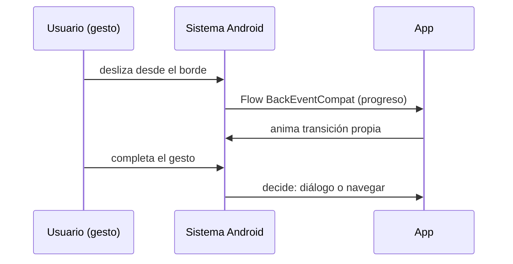

# Módulo 2: Navegación con Navigation Compose


## Aprende construyendo

> **Antes de empezar este módulo.** Con el catálogo del Módulo 0 (Tema 3), añade en `app/build.gradle.kts`, dentro de `dependencies { }`, `implementation(libs.androidx.navigation.compose)` y `implementation(libs.kotlinx.serialization.json)`; dentro de `plugins { }`, `alias(libs.plugins.kotlin.serialization)`; y en el `build.gradle.kts` de la raíz, `alias(libs.plugins.kotlin.serialization) apply false`. Pulsa **Sync Now**. Sin `navigation-compose`, `import androidx.navigation.compose.NavHost` no compila; el plugin de serialización hace falta para las rutas tipadas con `@Serializable`.
>
> **Los scripts `python3` de este módulo son modelos, no pruebas.** La evidencia real es la que aparece como **Verificación real en Android**: la app en el emulador y comandos `adb` con salida esperada.


### Tema 1: NavHost y NavController · Intermedio · 40 min

<details open>
<summary><strong>Capa 1 — Lectura</strong></summary>

#### ► DE QUÉ TRATA
Al finalizar podrás declarar un grafo de navegación con NavHost y explicar cómo NavController gestiona automáticamente el back stack.

</details>

<details>
<summary><strong>Capa 2 — Construcción</strong></summary>

#### Código y verificación
```
┌── NavHost (grafo declarado una vez) ──────────┐
│  "lista"        → ListaTareasScreen              │
│  "detalle/{id}" → DetalleTareaScreen                │
└──────────┬─────────────────────────────┘
           │ navController.navigate("detalle/42")
           ▼
┌── back stack gestionado automáticamente ──────┐
│  [lista, detalle/42]  ← "atrás" del sistema pop-ea  │
└───────────────────────────────────────┘
```

```bash
# compila con Gradle el archivo Kotlin generado a continuación
test -f settings.gradle.kts || cd academia-android   # sitúate en la raíz del proyecto del Módulo 0
mkdir -p app/src/main/kotlin/com/academia/android
```

Crea el archivo `app/src/main/kotlin/com/academia/android/GrafoNavegacion.kt`:

```kotlin
package com.academia.android

import androidx.compose.runtime.Composable
import androidx.navigation.NavHostController
import androidx.navigation.compose.NavHost
import androidx.navigation.compose.composable
import androidx.navigation.compose.rememberNavController

@Composable
fun GrafoNavegacion(navController: NavHostController = rememberNavController()) {
    NavHost(navController, startDestination = "lista") {
        composable("lista") {
            ListaTareasScreen(onTareaClick = { id -> navController.navigate("detalle/$id") })
        }
        composable("detalle/{id}") { backStackEntry ->
            val id = backStackEntry.arguments?.getString("id")
            DetalleTareaScreen(id)
        }
    }
}
```

```bash
./gradlew :app:compileDebugKotlin
```

```bash
python3 -c "
class BackStackSimulado:
    def __init__(self, inicio):
        self.pila = [inicio]
    def navigate(self, ruta):
        self.pila.append(ruta)
    def atras(self):
        if len(self.pila) > 1:
            return self.pila.pop()
        return None
    def pantalla_actual(self):
        return self.pila[-1]

nav = BackStackSimulado('lista')
nav.navigate('detalle/42')
print('pantalla actual tras navegar:', nav.pantalla_actual())
print('pila completa:', nav.pila)
nav.atras()
print('pantalla actual tras \"atrás\":', nav.pantalla_actual())
"
```

</details>

### Tema 2: Argumentos tipados y deep links · Intermedio · 40 min

<details open>
<summary><strong>Capa 1 — Lectura</strong></summary>

#### ► DE QUÉ TRATA
Al finalizar podrás declarar un argumento de navegación con su tipo explícito, y configurar un deep link que mapee una URI externa hacia una ruta interna.

</details>

<details>
<summary><strong>Capa 2 — Construcción</strong></summary>

#### Código y verificación
```
┌── Sin tipo declarado ──────────────┐   ┌── Con navArgument tipado ────────────┐
│ "detalle/{id}" (string genérico)       │   │ navArgument("id") { type = StringType }   │
│ conversión manual, riesgo de error       │ ≠ │ validación y extracción automática          │
└─────────────────────────────┘   └───────────────────────────────────┘

┌── URI externa ────────────┐        ┌── Ruta interna ya declarada ────┐
│ miapp://tarea/42               │  ──▶  │ "detalle/{id}"  (id = "42")            │
└───────────────────────┘        └──────────────────────────┘
```

```bash
# compila con Gradle el archivo Kotlin generado a continuación
test -f settings.gradle.kts || cd academia-android   # sitúate en la raíz del proyecto del Módulo 0
mkdir -p app/src/main/kotlin/com/academia/android
```

Crea el archivo `app/src/main/kotlin/com/academia/android/RutaDetalleTarea.kt`:

```kotlin
package com.academia.android

import androidx.navigation.NavGraphBuilder
import androidx.navigation.NavType
import androidx.navigation.navArgument
import androidx.navigation.navDeepLink
import androidx.navigation.compose.composable

// composable(...) es una extensión de NavGraphBuilder: solo existe dentro del grafo
fun NavGraphBuilder.rutaDetalleConArgumentoYDeepLink() {
    composable(
        "detalle/{id}",
        arguments = listOf(navArgument("id") { type = NavType.StringType }),
        deepLinks = listOf(navDeepLink { uriPattern = "miapp://tarea/{id}" })
    ) { /* renderiza DetalleTareaScreen con el id ya resuelto */ }
}
```

```bash
./gradlew :app:compileDebugKotlin
```

```bash
python3 -c "
import re

def resolver_deep_link(uri, patron_uri, ruta_interna):
    # convierte 'miapp://tarea/{id}' en una regex que captura 'id'
    patron_regex = '^' + re.escape(patron_uri).replace(r'\{id\}', '(?P<id>[^/]+)') + '$'
    match = re.match(patron_regex, uri)
    if not match:
        return None
    return ruta_interna.replace('{id}', match.group('id'))

resultado = resolver_deep_link('miapp://tarea/42', 'miapp://tarea/{id}', 'detalle/{id}')
print('URI externa: miapp://tarea/42  ->  ruta interna resuelta:', resultado)
"
```

```xml
<intent-filter>
    <action android:name="android.intent.action.VIEW" />
    <category android:name="android.intent.category.DEFAULT" />
    <category android:name="android.intent.category.BROWSABLE" />
    <data android:scheme="miapp" android:host="tarea" />
</intent-filter>
```

```bash
adb shell am start -W -a android.intent.action.VIEW -d "miapp://tarea/42" com.academia.android
```

```kotlin
import androidx.navigation.NavGraphBuilder
import androidx.navigation.compose.composable
import androidx.navigation.toRoute
import kotlinx.serialization.Serializable

@Serializable data class DetalleTarea(val id: String)

fun NavGraphBuilder.rutaDetalleTipada() {
    composable<DetalleTarea> { entrada ->
        val destino: DetalleTarea = entrada.toRoute()
        // renderiza DetalleTareaScreen(destino.id)
    }
}
// navegar: navController.navigate(DetalleTarea(id = "42"))
```

</details>

### Tema 3: Navegación anidada con stacks independientes · Intermedio · 40 min

<details open>
<summary><strong>Capa 1 — Lectura</strong></summary>

#### ► DE QUÉ TRATA
Al finalizar podrás estructurar una app con bottom navigation donde cada sección mantiene su propio historial de navegación independiente.

</details>

<details>
<summary><strong>Capa 2 — Construcción</strong></summary>

#### Código y verificación
```
┌── Bottom Nav ─────────────────────────────────┐
│ ├── Inicio  → stack propio: [Inicio]                │
│ ├── Tareas  → stack propio: [Lista → Detalle → Edición] │
│ └── Perfil  → stack propio: [Perfil]                    │
│                                                              │
│ Cambiar de pestaña NO resetea el stack de la anterior.        │
└───────────────────────────────────────────┘
```

```bash
# Verificación en python3 del modelo de stacks independientes antes de escribir el Compose real
test -f settings.gradle.kts || cd academia-android   # sitúate en la raíz del proyecto del Módulo 0
mkdir -p app/src/main/kotlin/com/academia/android
python3 -c "
class NavegacionMultiSeccion:
    def __init__(self, secciones):
        self.stacks = {s: [s] for s in secciones}  # cada sección arranca con su propia raíz
        self.seccion_activa = secciones[0]

    def navigate_en_seccion_activa(self, ruta):
        self.stacks[self.seccion_activa].append(ruta)

    def cambiar_seccion(self, seccion):
        self.seccion_activa = seccion  # NO toca el stack de ninguna sección

    def pantalla_actual(self):
        return self.stacks[self.seccion_activa][-1]

nav = NavegacionMultiSeccion(['Inicio', 'Tareas', 'Perfil'])
nav.cambiar_seccion('Tareas')
nav.navigate_en_seccion_activa('Detalle')
nav.navigate_en_seccion_activa('Edicion')
print('stack de Tareas antes de cambiar:', nav.stacks['Tareas'])

nav.cambiar_seccion('Perfil')
print('pantalla actual en Perfil:', nav.pantalla_actual())

nav.cambiar_seccion('Tareas')
print('pantalla actual al volver a Tareas:', nav.pantalla_actual())
print('stack de Tareas preservado:', nav.stacks['Tareas'])
"
```

Crea el archivo `app/src/main/kotlin/com/academia/android/NavegacionInferior.kt`:

```kotlin
package com.academia.android

import androidx.compose.foundation.layout.padding
import androidx.compose.material3.NavigationBar
import androidx.compose.material3.NavigationBarItem
import androidx.compose.material3.Scaffold
import androidx.compose.runtime.Composable
import androidx.navigation.compose.NavHost
import androidx.navigation.compose.composable
import androidx.navigation.compose.rememberNavController

data class SeccionPrincipal(val ruta: String)

@Composable
fun AppConNavegacionInferior(secciones: List<SeccionPrincipal>) {
    val navController = rememberNavController()
    Scaffold(bottomBar = {
        NavigationBar {
            secciones.forEach { seccion ->
                NavigationBarItem(
                    selected = false,
                    onClick = { navController.navigate(seccion.ruta) },
                    icon = { },
                )
            }
        }
    }) { padding ->
        NavHost(navController, startDestination = "inicio", androidx.compose.ui.Modifier.padding(padding)) {
            composable("inicio") { }
        }
    }
}
```

```bash
./gradlew :app:compileDebugKotlin
```

</details>

### Tema 4: Predictive Back — gesto del sistema con preview animado · Intermedio · 40 min

<details open>
<summary><strong>Capa 1 — Lectura</strong></summary>

#### ► DE QUÉ TRATA
Al finalizar podrás usar PredictiveBackHandler para que el gesto de retroceso del sistema (swipe predictivo) muestre una previsualización coherente con lo que realmente va a pasar, en vez de prometer una navegación que luego se interrumpe con un diálogo inesperado.

#### ► LA ANALOGÍA
**Conceptos clave:** Predictive Back, `PredictiveBackHandler`, `BackEventCompat`, `enableOnBackInvokedCallback`, previsualización progresiva del gesto.

`BackHandler` (el callback simple) se ejecuta solo al COMPLETAR el gesto de retroceso, sin participar de la fase de previsualización; `PredictiveBackHandler` expone un `Flow<BackEventCompat>` que permite observar el progreso del gesto mientras el dedo todavía se desliza, decidiendo en tiempo real si mostrar la preview normal del sistema o reaccionar distinto cuando el gesto se completa.

**Analogía:** un semáforo en cuenta regresiva que muestra cuánto falta para cruzar es como la previsualización predictiva: informa progresivamente lo que está por pasar, y esa información debe ser honesta con el resultado final — lo contrario de una luz que simplemente cambia a rojo sin ningún aviso.

**Diagrama:**



#### ► CÓMO FUNCIONA


</details>

<details>
<summary><strong>Capa 2 — Construcción</strong></summary>

#### Objetivo observable
Al finalizar podrás usar `PredictiveBackHandler` para que el gesto de retroceso del sistema (swipe predictivo) muestre una previsualización coherente con lo que realmente va a pasar, en vez de prometer una navegación que luego se interrumpe con un diálogo inesperado.

**Conocimiento previo:** Temas 1 y 3 de este módulo.

</details>
