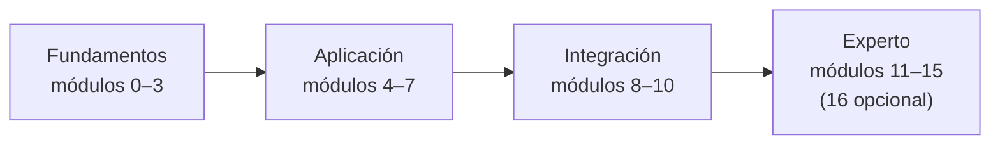
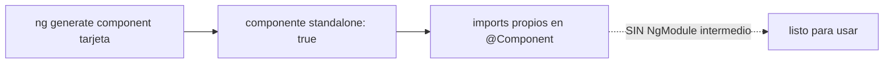

# Módulo 0: Fundamentos y Angular CLI


## Antes de comenzar: prepara tu equipo desde cero

No necesitas haber programado antes. Solo necesitas saber crear una carpeta y copiar un comando. Usaremos **Visual Studio Code**, **Node.js 24 LTS**, **Git** y Angular CLI 22. Angular 22 exige Node `^22.22.3`, `^24.15.0` o `>=26` y fija **TypeScript 6.0** (su compilador declara `typescript >=6.0 <6.1`), aunque la línea de la academia para TypeScript es la 7: en este curso usa la versión que instala el CLI. Un comando es una instrucción escrita en una terminal; ejecútalo con `Enter` y espera a que termine antes de escribir el siguiente.


### Windows

<details open>
<summary><strong>Capa 1 — Lectura</strong></summary>

#### ► DE QUÉ TRATA
Este tema te guía por windows con foco en comprensión antes de implementación.

#### ► LA IDEA EN UNA FRASE
**Entender windows te permite tomar mejores decisiones técnicas.**

#### ► POR QUÉ EXISTE ESTO
Resuelve un problema real de diseño o implementación y evita decisiones a ciegas.

#### ► LA ANALOGÍA
Piensa en windows como una herramienta de taller: útil cuando conoces su propósito y sus límites.
**Dónde se rompe la analogía:** en software, los efectos dependen del contexto, la escala y los trade-offs.

#### ► CÓMO FUNCIONA
1. Identifica el problema que windows resuelve.
2. Observa sus componentes y relaciones.
3. Aplica la opción más simple que funcione.
4. Verifica el resultado y los límites.

#### ► LO QUE PUEDE SALIR MAL
| Síntoma | Causa probable | Arreglo |
|---|---|---|
| Windows se aplica pero el resultado no mejora | Se usó sin medir el problema real | Mide antes y compara contra la alternativa simple |
| Aparece complejidad inesperada | Se adoptó la técnica sin comprender sus trade-offs | Vuelve a la sección de trade-offs y reduce el alcance |
| Falla en un caso límite | Se asumió un contexto que no se cumple | Prueba el caso límite y documenta cuándo NO usarlo |

#### ► TRADE-OFFS
| Opción | Cuándo usarla | Cuándo NO usarla |
|---|---|---|
| Usar Windows | Cuando el problema coincide con su propósito y el beneficio es observable | Cuando agrega complejidad sin resolver un problema real |
| Alternativa más simple | Cuando el contexto es pequeño, estable o fácil de razonar | Cuando ya demostró no escalar o no cumplir el requisito |
| Postergar la decisión | Cuando falta evidencia del problema | Cuando el costo de esperar es mayor que el costo de probar |

#### ► CUÁNDO NO USAR ESTO
No uses windows por defecto. Aplícalo cuando el problema lo justifique y puedas verificar el beneficio; si una alternativa más simple resuelve igual, prefiérela.

#### ► DE VUELTA A LA ANALOGÍA
Volviendo a la analogía: windows funciona como el modelo inicial, pero recuerda dónde se rompe: en producción importan la evidencia, la escala y el costo de equivocarte.

#### ► LO QUE DEBES RECORDAR
- Windows existe para resolver un problema específico.
- Mide antes de adoptar complejidad.
- Conoce el caso donde NO usarlo.
- Verifica con evidencia observable.

#### ► PREGUNTAS PARA PENSAR
1. ¿Qué problema concreto resuelve windows en tu contexto?
2. ¿Cómo sabrías que windows no está funcionando bien?
3. ¿Qué alternativa más simple considerarías antes de usar windows?

</details>

<details>
<summary><strong>Capa 2 — Construcción</strong></summary>

#### Nota de construcción
Este tema es principalmente conceptual en esta versión. La verificación se realiza con las preguntas de comprensión y el criterio de cuándo NO usar windows.

</details>

### macOS

<details open>
<summary><strong>Capa 1 — Lectura</strong></summary>

#### ► DE QUÉ TRATA
Este tema te guía por macos con foco en comprensión antes de implementación.

#### ► LA IDEA EN UNA FRASE
**Entender macos te permite tomar mejores decisiones técnicas.**

#### ► POR QUÉ EXISTE ESTO
Resuelve un problema real de diseño o implementación y evita decisiones a ciegas.

#### ► LA ANALOGÍA
Piensa en macos como una herramienta de taller: útil cuando conoces su propósito y sus límites.
**Dónde se rompe la analogía:** en software, los efectos dependen del contexto, la escala y los trade-offs.

#### ► CÓMO FUNCIONA
1. Identifica el problema que macos resuelve.
2. Observa sus componentes y relaciones.
3. Aplica la opción más simple que funcione.
4. Verifica el resultado y los límites.

#### ► LO QUE PUEDE SALIR MAL
| Síntoma | Causa probable | Arreglo |
|---|---|---|
| macOS se aplica pero el resultado no mejora | Se usó sin medir el problema real | Mide antes y compara contra la alternativa simple |
| Aparece complejidad inesperada | Se adoptó la técnica sin comprender sus trade-offs | Vuelve a la sección de trade-offs y reduce el alcance |
| Falla en un caso límite | Se asumió un contexto que no se cumple | Prueba el caso límite y documenta cuándo NO usarlo |

#### ► TRADE-OFFS
| Opción | Cuándo usarla | Cuándo NO usarla |
|---|---|---|
| Usar macOS | Cuando el problema coincide con su propósito y el beneficio es observable | Cuando agrega complejidad sin resolver un problema real |
| Alternativa más simple | Cuando el contexto es pequeño, estable o fácil de razonar | Cuando ya demostró no escalar o no cumplir el requisito |
| Postergar la decisión | Cuando falta evidencia del problema | Cuando el costo de esperar es mayor que el costo de probar |

#### ► CUÁNDO NO USAR ESTO
No uses macos por defecto. Aplícalo cuando el problema lo justifique y puedas verificar el beneficio; si una alternativa más simple resuelve igual, prefiérela.

#### ► DE VUELTA A LA ANALOGÍA
Volviendo a la analogía: macos funciona como el modelo inicial, pero recuerda dónde se rompe: en producción importan la evidencia, la escala y el costo de equivocarte.

#### ► LO QUE DEBES RECORDAR
- macOS existe para resolver un problema específico.
- Mide antes de adoptar complejidad.
- Conoce el caso donde NO usarlo.
- Verifica con evidencia observable.

#### ► PREGUNTAS PARA PENSAR
1. ¿Qué problema concreto resuelve macos en tu contexto?
2. ¿Cómo sabrías que macos no está funcionando bien?
3. ¿Qué alternativa más simple considerarías antes de usar macos?

</details>

<details>
<summary><strong>Capa 2 — Construcción</strong></summary>

#### Nota de construcción
Este tema es principalmente conceptual en esta versión. La verificación se realiza con las preguntas de comprensión y el criterio de cuándo NO usar macos.

</details>

### Linux (Ubuntu/Debian)

<details open>
<summary><strong>Capa 1 — Lectura</strong></summary>

#### ► DE QUÉ TRATA
Este tema te guía por linux (ubuntu/debian) con foco en comprensión antes de implementación.

#### ► LA IDEA EN UNA FRASE
**Entender linux (ubuntu/debian) te permite tomar mejores decisiones técnicas.**

#### ► POR QUÉ EXISTE ESTO
Resuelve un problema real de diseño o implementación y evita decisiones a ciegas.

#### ► LA ANALOGÍA
Piensa en linux (ubuntu/debian) como una herramienta de taller: útil cuando conoces su propósito y sus límites.
**Dónde se rompe la analogía:** en software, los efectos dependen del contexto, la escala y los trade-offs.

#### ► CÓMO FUNCIONA
1. Identifica el problema que linux (ubuntu/debian) resuelve.
2. Observa sus componentes y relaciones.
3. Aplica la opción más simple que funcione.
4. Verifica el resultado y los límites.

#### ► LO QUE PUEDE SALIR MAL
| Síntoma | Causa probable | Arreglo |
|---|---|---|
| Linux (Ubuntu/Debian) se aplica pero el resultado no mejora | Se usó sin medir el problema real | Mide antes y compara contra la alternativa simple |
| Aparece complejidad inesperada | Se adoptó la técnica sin comprender sus trade-offs | Vuelve a la sección de trade-offs y reduce el alcance |
| Falla en un caso límite | Se asumió un contexto que no se cumple | Prueba el caso límite y documenta cuándo NO usarlo |

#### ► TRADE-OFFS
| Opción | Cuándo usarla | Cuándo NO usarla |
|---|---|---|
| Usar Linux (Ubuntu/Debian) | Cuando el problema coincide con su propósito y el beneficio es observable | Cuando agrega complejidad sin resolver un problema real |
| Alternativa más simple | Cuando el contexto es pequeño, estable o fácil de razonar | Cuando ya demostró no escalar o no cumplir el requisito |
| Postergar la decisión | Cuando falta evidencia del problema | Cuando el costo de esperar es mayor que el costo de probar |

#### ► CUÁNDO NO USAR ESTO
No uses linux (ubuntu/debian) por defecto. Aplícalo cuando el problema lo justifique y puedas verificar el beneficio; si una alternativa más simple resuelve igual, prefiérela.

#### ► DE VUELTA A LA ANALOGÍA
Volviendo a la analogía: linux (ubuntu/debian) funciona como el modelo inicial, pero recuerda dónde se rompe: en producción importan la evidencia, la escala y el costo de equivocarte.

#### ► LO QUE DEBES RECORDAR
- Linux (Ubuntu/Debian) existe para resolver un problema específico.
- Mide antes de adoptar complejidad.
- Conoce el caso donde NO usarlo.
- Verifica con evidencia observable.

#### ► PREGUNTAS PARA PENSAR
1. ¿Qué problema concreto resuelve linux (ubuntu/debian) en tu contexto?
2. ¿Cómo sabrías que linux (ubuntu/debian) no está funcionando bien?
3. ¿Qué alternativa más simple considerarías antes de usar linux (ubuntu/debian)?

</details>

<details>
<summary><strong>Capa 2 — Construcción</strong></summary>

#### Nota de construcción
Este tema es principalmente conceptual en esta versión. La verificación se realiza con las preguntas de comprensión y el criterio de cuándo NO usar linux (ubuntu/debian).

</details>

### Tu primer proyecto verificable

<details open>
<summary><strong>Capa 1 — Lectura</strong></summary>

#### ► DE QUÉ TRATA
Este tema te guía por tu primer proyecto verificable con foco en comprensión antes de implementación.

#### ► LA IDEA EN UNA FRASE
**Entender tu primer proyecto verificable te permite tomar mejores decisiones técnicas.**

#### ► POR QUÉ EXISTE ESTO
Resuelve un problema real de diseño o implementación y evita decisiones a ciegas.

#### ► LA ANALOGÍA
Piensa en tu primer proyecto verificable como una herramienta de taller: útil cuando conoces su propósito y sus límites.
**Dónde se rompe la analogía:** en software, los efectos dependen del contexto, la escala y los trade-offs.

#### ► CÓMO FUNCIONA


#### ► LO QUE PUEDE SALIR MAL
| Síntoma | Causa probable | Arreglo |
|---|---|---|
| Tu primer proyecto verificable se aplica pero el resultado no mejora | Se usó sin medir el problema real | Mide antes y compara contra la alternativa simple |
| Aparece complejidad inesperada | Se adoptó la técnica sin comprender sus trade-offs | Vuelve a la sección de trade-offs y reduce el alcance |
| Falla en un caso límite | Se asumió un contexto que no se cumple | Prueba el caso límite y documenta cuándo NO usarlo |

#### ► TRADE-OFFS
| Opción | Cuándo usarla | Cuándo NO usarla |
|---|---|---|
| Usar Tu primer proyecto verificable | Cuando el problema coincide con su propósito y el beneficio es observable | Cuando agrega complejidad sin resolver un problema real |
| Alternativa más simple | Cuando el contexto es pequeño, estable o fácil de razonar | Cuando ya demostró no escalar o no cumplir el requisito |
| Postergar la decisión | Cuando falta evidencia del problema | Cuando el costo de esperar es mayor que el costo de probar |

#### ► CUÁNDO NO USAR ESTO
No uses tu primer proyecto verificable por defecto. Aplícalo cuando el problema lo justifique y puedas verificar el beneficio; si una alternativa más simple resuelve igual, prefiérela.

#### ► DE VUELTA A LA ANALOGÍA
Volviendo a la analogía: tu primer proyecto verificable funciona como el modelo inicial, pero recuerda dónde se rompe: en producción importan la evidencia, la escala y el costo de equivocarte.

#### ► LO QUE DEBES RECORDAR
- Tu primer proyecto verificable existe para resolver un problema específico.
- Mide antes de adoptar complejidad.
- Conoce el caso donde NO usarlo.
- Verifica con evidencia observable.

#### ► PREGUNTAS PARA PENSAR
1. ¿Qué problema concreto resuelve tu primer proyecto verificable en tu contexto?
2. ¿Cómo sabrías que tu primer proyecto verificable no está funcionando bien?
3. ¿Qué alternativa más simple considerarías antes de usar tu primer proyecto verificable?

</details>

<details>
<summary><strong>Capa 2 — Construcción</strong></summary>

#### Código y verificación
```bash
ng new mi-primera-app --style=scss --routing
cd mi-primera-app
ng serve --open
```


</details>

### Tema 1: El CLI ya no genera NgModules · Básico · 30 min

<details open>
<summary><strong>Capa 1 — Lectura</strong></summary>

#### ► DE QUÉ TRATA
Al finalizar podrás confirmar, con un error real de Angular, exactamente qué significa que ng generate component produzca hoy componentes standalone: que un componente NO standalone no puede agregarse al imports de otro componente standalone, el error genuino que separa ambos mun…

#### ► LA IDEA EN UNA FRASE
**Al finalizar podrás confirmar, con un error real de Angular, exactamente qué significa que ng generate component produzca hoy componentes standalone: que un componente NO standalone no puede agregarse al imports de otro componente standalone, el error genuino que separa ambos mundos.**

#### ► POR QUÉ EXISTE ESTO
Resuelve un problema real de diseño o implementación y evita decisiones a ciegas.

#### ► LA ANALOGÍA
Piensa en el cli ya no genera ngmodules como una herramienta de taller: útil cuando conoces su propósito y sus límites.
**Dónde se rompe la analogía:** en software, los efectos dependen del contexto, la escala y los trade-offs.

#### ► CÓMO FUNCIONA


#### ► LO QUE PUEDE SALIR MAL
| Síntoma | Causa probable | Arreglo |
|---|---|---|
| El CLI ya no genera NgModules se aplica pero el resultado no mejora | Se usó sin medir el problema real | Mide antes y compara contra la alternativa simple |
| Aparece complejidad inesperada | Se adoptó la técnica sin comprender sus trade-offs | Vuelve a la sección de trade-offs y reduce el alcance |
| Falla en un caso límite | Se asumió un contexto que no se cumple | Prueba el caso límite y documenta cuándo NO usarlo |

#### ► TRADE-OFFS
| Opción | Cuándo usarla | Cuándo NO usarla |
|---|---|---|
| Usar El CLI ya no genera NgModules | Cuando el problema coincide con su propósito y el beneficio es observable | Cuando agrega complejidad sin resolver un problema real |
| Alternativa más simple | Cuando el contexto es pequeño, estable o fácil de razonar | Cuando ya demostró no escalar o no cumplir el requisito |
| Postergar la decisión | Cuando falta evidencia del problema | Cuando el costo de esperar es mayor que el costo de probar |

#### ► CUÁNDO NO USAR ESTO
No uses el cli ya no genera ngmodules por defecto. Aplícalo cuando el problema lo justifique y puedas verificar el beneficio; si una alternativa más simple resuelve igual, prefiérela.

#### ► DE VUELTA A LA ANALOGÍA
Volviendo a la analogía: el cli ya no genera ngmodules funciona como el modelo inicial, pero recuerda dónde se rompe: en producción importan la evidencia, la escala y el costo de equivocarte.

#### ► LO QUE DEBES RECORDAR
- El CLI ya no genera NgModules existe para resolver un problema específico.
- Mide antes de adoptar complejidad.
- Conoce el caso donde NO usarlo.
- Verifica con evidencia observable.

#### ► PREGUNTAS PARA PENSAR
1. ¿Qué problema concreto resuelve el cli ya no genera ngmodules en tu contexto?
2. ¿Cómo sabrías que el cli ya no genera ngmodules no está funcionando bien?
3. ¿Qué alternativa más simple considerarías antes de usar el cli ya no genera ngmodules?

</details>

<details>
<summary><strong>Capa 2 — Construcción</strong></summary>

#### Código y verificación
```bash
ng new mi-app
cd mi-app
ng generate component tarjeta   # standalone, sin tocar ningún módulo
ng serve                         # dev server con hot-reload
```

```ts
@Component({ selector: 'app-tarjeta', template: `<h2>{{ titulo }}</h2>` })
export class Tarjeta { titulo = 'Hola Angular'; }
```


```bash
mkdir demo-standalone-cli
cd demo-standalone-cli
npx -y @angular/cli@22 new . --standalone --style=css --routing=false --skip-git --defaults
```

```ts
// src/app/tarjeta-legacy.component.ts
import { Component } from '@angular/core';

@Component({
  selector: 'app-tarjeta-legacy',
  standalone: false, // simula un componente de la era pre-standalone
  template: `<p>Tarjeta legacy</p>`,
})
export class TarjetaLegacyComponent {}
```

```ts
// src/app/tarjeta-moderna.component.ts
import { Component } from '@angular/core';
import { TarjetaLegacyComponent } from './tarjeta-legacy.component';

@Component({
  selector: 'app-tarjeta-moderna',
  imports: [TarjetaLegacyComponent], // TarjetaLegacyComponent NO es standalone
  template: `<app-tarjeta-legacy></app-tarjeta-legacy>`,
})
export class TarjetaModernaComponent {}
```

</details>

### Tema 2: Interpolación y property binding · Básico · 30 min

<details open>
<summary><strong>Capa 1 — Lectura</strong></summary>

#### ► DE QUÉ TRATA
Al finalizar podrás confirmar, con una comprobación real sobre el objeto DOM (no solo sobre el HTML servido), que el property binding ([value], [disabled]) refleja el estado ACTUAL de una propiedad del DOM, y que la interpolación también actualiza el texto visible cuando cambia e…

#### ► LA IDEA EN UNA FRASE
**Al finalizar podrás confirmar, con una comprobación real sobre el objeto DOM (no solo sobre el HTML servido), que el property binding ([value], [disabled]) refleja el estado ACTUAL de una propiedad del DOM, y que la interpolación también actualiza el texto visible cuando cambia el estado.**

#### ► POR QUÉ EXISTE ESTO
Resuelve un problema real de diseño o implementación y evita decisiones a ciegas.

#### ► LA ANALOGÍA
Piensa en interpolación y property binding como una herramienta de taller: útil cuando conoces su propósito y sus límites.
**Dónde se rompe la analogía:** en software, los efectos dependen del contexto, la escala y los trade-offs.

#### ► CÓMO FUNCIONA
1. Identifica el problema que interpolación y property binding resuelve.
2. Observa sus componentes y relaciones.
3. Aplica la opción más simple que funcione.
4. Verifica el resultado y los límites.

#### ► LO QUE PUEDE SALIR MAL
| Síntoma | Causa probable | Arreglo |
|---|---|---|
| Interpolación y property binding se aplica pero el resultado no mejora | Se usó sin medir el problema real | Mide antes y compara contra la alternativa simple |
| Aparece complejidad inesperada | Se adoptó la técnica sin comprender sus trade-offs | Vuelve a la sección de trade-offs y reduce el alcance |
| Falla en un caso límite | Se asumió un contexto que no se cumple | Prueba el caso límite y documenta cuándo NO usarlo |

#### ► TRADE-OFFS
| Opción | Cuándo usarla | Cuándo NO usarla |
|---|---|---|
| Usar Interpolación y property binding | Cuando el problema coincide con su propósito y el beneficio es observable | Cuando agrega complejidad sin resolver un problema real |
| Alternativa más simple | Cuando el contexto es pequeño, estable o fácil de razonar | Cuando ya demostró no escalar o no cumplir el requisito |
| Postergar la decisión | Cuando falta evidencia del problema | Cuando el costo de esperar es mayor que el costo de probar |

#### ► CUÁNDO NO USAR ESTO
No uses interpolación y property binding por defecto. Aplícalo cuando el problema lo justifique y puedas verificar el beneficio; si una alternativa más simple resuelve igual, prefiérela.

#### ► DE VUELTA A LA ANALOGÍA
Volviendo a la analogía: interpolación y property binding funciona como el modelo inicial, pero recuerda dónde se rompe: en producción importan la evidencia, la escala y el costo de equivocarte.

#### ► LO QUE DEBES RECORDAR
- Interpolación y property binding existe para resolver un problema específico.
- Mide antes de adoptar complejidad.
- Conoce el caso donde NO usarlo.
- Verifica con evidencia observable.

#### ► PREGUNTAS PARA PENSAR
1. ¿Qué problema concreto resuelve interpolación y property binding en tu contexto?
2. ¿Cómo sabrías que interpolación y property binding no está funcionando bien?
3. ¿Qué alternativa más simple considerarías antes de usar interpolación y property binding?

</details>

<details>
<summary><strong>Capa 2 — Construcción</strong></summary>

#### Código y verificación
```html
<h2>{{ titulo }}</h2>              <!-- interpolación: texto -->
           <!-- property binding: propiedad real del DOM -->
<button [disabled]="cargando">Enviar</button>
```

```
┌── {{ expresion }} ─────────┐   siempre produce TEXTO visible
└──────────────────────────────┘
┌── [propiedad]="expresion" ─┐   enlaza la propiedad REAL del objeto DOM
└──────────────────────────────┘   (value, disabled, src, ...)
```

```bash
mkdir -p src/app
```

```ts
// src/app/campo-cantidad.component.ts
import { Component, signal } from '@angular/core';

@Component({
  selector: 'app-campo-cantidad',
  standalone: true,
  template: `
    <p data-testid="texto">Cantidad: {{ cantidad() }}</p>
    <input data-testid="input" [value]="cantidad()" [disabled]="bloqueado()" />
  `,
})
export class CampoCantidadComponent {
  cantidad = signal(3);
  bloqueado = signal(false);
}
```

```ts
// src/app/campo-cantidad.component.spec.ts
import { TestBed } from '@angular/core/testing';
import { CampoCantidadComponent } from './campo-cantidad.component';

describe('Interpolacion vs property binding (comprobacion real del DOM)', () => {
  it('la interpolacion produce SOLO texto visible, no una propiedad del DOM', () => {
    const fixture = TestBed.createComponent(CampoCantidadComponent);
    fixture.detectChanges();

    const texto = fixture.nativeElement.querySelector('[data-testid="texto"]');
    expect(texto.textContent).toContain('Cantidad: 3');
    expect(texto.value).toBeUndefined(); // un <p> no tiene una propiedad DOM "value"
    fixture.componentInstance.cantidad.set(7);
    fixture.detectChanges();
    expect(texto.textContent).toContain('Cantidad: 7'); // interpolación dinámica
  });

  it('[value] real actualiza la propiedad .value del input, no solo el atributo inicial', () => {
    const fixture = TestBed.createComponent(CampoCantidadComponent);
    fixture.detectChanges();

    const input: HTMLInputElement = fixture.nativeElement.querySelector('[data-testid="input"]');
    expect(input.value).toBe('3'); // propiedad REAL del DOM, no solo el atributo HTML inicial

    fixture.componentInstance.cantidad.set(7);
    fixture.detectChanges();

    expect(input.value).toBe('7'); // la propiedad del DOM se actualizo dinamicamente
  });

  it('[disabled] real controla la propiedad booleana .disabled del input', () => {
    const fixture = TestBed.createComponent(CampoCantidadComponent);
    fixture.detectChanges();

    const input: HTMLInputElement = fixture.nativeElement.querySelector('[data-testid="input"]');
    expect(input.disabled).toBe(false);

    fixture.componentInstance.bloqueado.set(true);
    fixture.detectChanges();

    expect(input.disabled).toBe(true); // propiedad booleana REAL, no un atributo de texto
  });
});
```

```bash
npx ng test --watch=false
```

</details>

### Tema 3: TypeScript a fondo — unknown, any, never y utility types · Básico · 30 min

<details open>
<summary><strong>Capa 1 — Lectura</strong></summary>

#### ► DE QUÉ TRATA
Al finalizar podrás confirmar, ejecutando el compilador REAL de TypeScript (tsc), que unknown produce un error de compilación genuino al operar sobre un valor sin narrowing previo, mientras any compila sin ninguna advertencia sobre el mismo código inseguro.

#### ► LA IDEA EN UNA FRASE
**Al finalizar podrás confirmar, ejecutando el compilador REAL de TypeScript (tsc), que unknown produce un error de compilación genuino al operar sobre un valor sin narrowing previo, mientras any compila sin ninguna advertencia sobre el mismo código inseguro.**

#### ► POR QUÉ EXISTE ESTO
Resuelve un problema real de diseño o implementación y evita decisiones a ciegas.

#### ► LA ANALOGÍA
Piensa en typescript a fondo — unknown, any, never y utility types como una herramienta de taller: útil cuando conoces su propósito y sus límites.
**Dónde se rompe la analogía:** en software, los efectos dependen del contexto, la escala y los trade-offs.

#### ► CÓMO FUNCIONA
1. Identifica el problema que typescript a fondo — unknown, any, never y utility types resuelve.
2. Observa sus componentes y relaciones.
3. Aplica la opción más simple que funcione.
4. Verifica el resultado y los límites.

#### ► LO QUE PUEDE SALIR MAL
| Síntoma | Causa probable | Arreglo |
|---|---|---|
| TypeScript a fondo — unknown, any, never y utility types se aplica pero el resultado no mejora | Se usó sin medir el problema real | Mide antes y compara contra la alternativa simple |
| Aparece complejidad inesperada | Se adoptó la técnica sin comprender sus trade-offs | Vuelve a la sección de trade-offs y reduce el alcance |
| Falla en un caso límite | Se asumió un contexto que no se cumple | Prueba el caso límite y documenta cuándo NO usarlo |

#### ► TRADE-OFFS
| Opción | Cuándo usarla | Cuándo NO usarla |
|---|---|---|
| Usar TypeScript a fondo — unknown, any, never y utility types | Cuando el problema coincide con su propósito y el beneficio es observable | Cuando agrega complejidad sin resolver un problema real |
| Alternativa más simple | Cuando el contexto es pequeño, estable o fácil de razonar | Cuando ya demostró no escalar o no cumplir el requisito |
| Postergar la decisión | Cuando falta evidencia del problema | Cuando el costo de esperar es mayor que el costo de probar |

#### ► CUÁNDO NO USAR ESTO
No uses typescript a fondo — unknown, any, never y utility types por defecto. Aplícalo cuando el problema lo justifique y puedas verificar el beneficio; si una alternativa más simple resuelve igual, prefiérela.

#### ► DE VUELTA A LA ANALOGÍA
Volviendo a la analogía: typescript a fondo — unknown, any, never y utility types funciona como el modelo inicial, pero recuerda dónde se rompe: en producción importan la evidencia, la escala y el costo de equivocarte.

#### ► LO QUE DEBES RECORDAR
- TypeScript a fondo — unknown, any, never y utility types existe para resolver un problema específico.
- Mide antes de adoptar complejidad.
- Conoce el caso donde NO usarlo.
- Verifica con evidencia observable.

#### ► PREGUNTAS PARA PENSAR
1. ¿Qué problema concreto resuelve typescript a fondo — unknown, any, never y utility types en tu contexto?
2. ¿Cómo sabrías que typescript a fondo — unknown, any, never y utility types no está funcionando bien?
3. ¿Qué alternativa más simple considerarías antes de usar typescript a fondo — unknown, any, never y utility types?

</details>

<details>
<summary><strong>Capa 2 — Construcción</strong></summary>

#### Código y verificación
```
┌── any ─────────┐   NINGUNA verificacion — tsc acepta cualquier operacion
└──────────────────┘
┌── unknown ─────┐   tsc EXIGE narrowing (typeof/instanceof) antes de operar
└──────────────────┘
┌── never ───────┐   tipo sin valores posibles — verificacion exhaustiva real
└──────────────────┘
```

```ts
function procesar(valor: unknown) {
  if (typeof valor === "string") valor.toUpperCase(); // narrowing exigido
}
type TareaParcial = Partial<Tarea>;       // todas las props opcionales
type SoloTitulo = Pick<Tarea, "titulo">;   // solo esa propiedad
type ContadorPorEstado = Record<"pendiente"|"hecha", number>;
```

```bash
mkdir demo-tipos
cd demo-tipos
npm init -y
npm install --save-dev typescript --silent
npx tsc --init --strict
```

```ts
// src/unknown-vs-any.ts
function procesarConAny(valor: any) {
  return valor.toUpperCase(); // any: NINGUNA verificacion, compila aunque valor sea un numero
}

function procesarConUnknown(valor: unknown) {
  return valor.toUpperCase(); // unknown: tsc real debe rechazar esta linea sin narrowing
}
```

```bash
npx tsc --noEmit src/unknown-vs-any.ts 2>&1 | tee salida-tsc.txt || true
cat salida-tsc.txt
```

```ts
// src/verificar-tsc.mjs
import { execSync } from 'node:child_process';

export function compilarYCapturarErrores(archivo) {
  try {
    execSync(`npx tsc --noEmit ${archivo}`, { encoding: 'utf-8' });
    return '';
  } catch (error) {
    return error.stdout ?? '';
  }
}
```

</details>

### Tema 4: Compilador AOT frente a JIT · Básico · 30 min

<details open>
<summary><strong>Capa 1 — Lectura</strong></summary>

#### ► DE QUÉ TRATA
Al finalizar podrás confirmar, ejecutando ng build real sobre un componente con un error deliberado de plantilla, que AOT detecta ese error en tiempo de COMPILACIÓN (antes de desplegar a producción), con un mensaje de error real que incluye el archivo y la línea exactos.

#### ► LA IDEA EN UNA FRASE
**Al finalizar podrás confirmar, ejecutando ng build real sobre un componente con un error deliberado de plantilla, que AOT detecta ese error en tiempo de COMPILACIÓN (antes de desplegar a producción), con un mensaje de error real que incluye el archivo y la línea exactos.**

#### ► POR QUÉ EXISTE ESTO
Resuelve un problema real de diseño o implementación y evita decisiones a ciegas.

#### ► LA ANALOGÍA
Piensa en compilador aot frente a jit como una herramienta de taller: útil cuando conoces su propósito y sus límites.
**Dónde se rompe la analogía:** en software, los efectos dependen del contexto, la escala y los trade-offs.

#### ► CÓMO FUNCIONA
1. Identifica el problema que compilador aot frente a jit resuelve.
2. Observa sus componentes y relaciones.
3. Aplica la opción más simple que funcione.
4. Verifica el resultado y los límites.

#### ► LO QUE PUEDE SALIR MAL
| Síntoma | Causa probable | Arreglo |
|---|---|---|
| Compilador AOT frente a JIT se aplica pero el resultado no mejora | Se usó sin medir el problema real | Mide antes y compara contra la alternativa simple |
| Aparece complejidad inesperada | Se adoptó la técnica sin comprender sus trade-offs | Vuelve a la sección de trade-offs y reduce el alcance |
| Falla en un caso límite | Se asumió un contexto que no se cumple | Prueba el caso límite y documenta cuándo NO usarlo |

#### ► TRADE-OFFS
| Opción | Cuándo usarla | Cuándo NO usarla |
|---|---|---|
| Usar Compilador AOT frente a JIT | Cuando el problema coincide con su propósito y el beneficio es observable | Cuando agrega complejidad sin resolver un problema real |
| Alternativa más simple | Cuando el contexto es pequeño, estable o fácil de razonar | Cuando ya demostró no escalar o no cumplir el requisito |
| Postergar la decisión | Cuando falta evidencia del problema | Cuando el costo de esperar es mayor que el costo de probar |

#### ► CUÁNDO NO USAR ESTO
No uses compilador aot frente a jit por defecto. Aplícalo cuando el problema lo justifique y puedas verificar el beneficio; si una alternativa más simple resuelve igual, prefiérela.

#### ► DE VUELTA A LA ANALOGÍA
Volviendo a la analogía: compilador aot frente a jit funciona como el modelo inicial, pero recuerda dónde se rompe: en producción importan la evidencia, la escala y el costo de equivocarte.

#### ► LO QUE DEBES RECORDAR
- Compilador AOT frente a JIT existe para resolver un problema específico.
- Mide antes de adoptar complejidad.
- Conoce el caso donde NO usarlo.
- Verifica con evidencia observable.

#### ► PREGUNTAS PARA PENSAR
1. ¿Qué problema concreto resuelve compilador aot frente a jit en tu contexto?
2. ¿Cómo sabrías que compilador aot frente a jit no está funcionando bien?
3. ¿Qué alternativa más simple considerarías antes de usar compilador aot frente a jit?

</details>

<details>
<summary><strong>Capa 2 — Construcción</strong></summary>

#### Código y verificación
```
┌── JIT (historico) ──────────────┐   plantillas compiladas EN el navegador,
│   compilador completo en bundle │   en CADA arranque de la aplicacion
└────────────────────────────────────┘
┌── AOT (moderno, por defecto) ───┐   plantillas compiladas durante el BUILD,
│   solo JavaScript puro          │   el navegador recibe codigo listo
└────────────────────────────────────┘
```

```bash
mkdir -p src/app
```

```ts
// src/app/resumen-envio-roto.component.ts
import { Component } from '@angular/core';

@Component({
  selector: 'app-resumen-envio-roto',
  standalone: true,
  template: `<p>Estado: {{ estadoQueNoExiste }}</p>`, // referencia una propiedad inexistente
})
export class ResumenEnvioRotoComponent {
  estado = 'en tránsito'; // el nombre real de la propiedad es distinto al usado en el template
}
```

```bash
npx ng build 2>&1 | tee salida-build.txt || true
cat salida-build.txt
```

```ts
// src/scripts/verificar-build.mjs
import { execSync } from 'node:child_process';

export function ejecutarBuild() {
  try {
    execSync('npx ng build', { encoding: 'utf-8' });
    return { exitoso: true, salida: '' };
  } catch (error) {
    return { exitoso: false, salida: (error.stdout ?? '') + (error.stderr ?? '') };
  }
}
```

```ts
// src/scripts/verificar-build.spec.mjs
import { describe, it, expect } from 'vitest';
import { ejecutarBuild } from './verificar-build.mjs';

describe('ng build real (AOT) detecta errores de plantilla antes de produccion', () => {
  it('el build FALLA y reporta la propiedad inexistente con archivo y linea', () => {
    const resultado = ejecutarBuild();

    expect(resultado.exitoso).toBe(false);
    expect(resultado.salida).toContain('estadoQueNoExiste');
    expect(resultado.salida).toContain('resumen-envio-roto.component.ts');
  });
});
```

</details>
